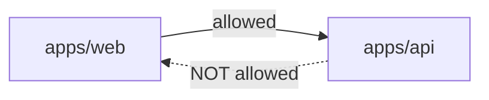
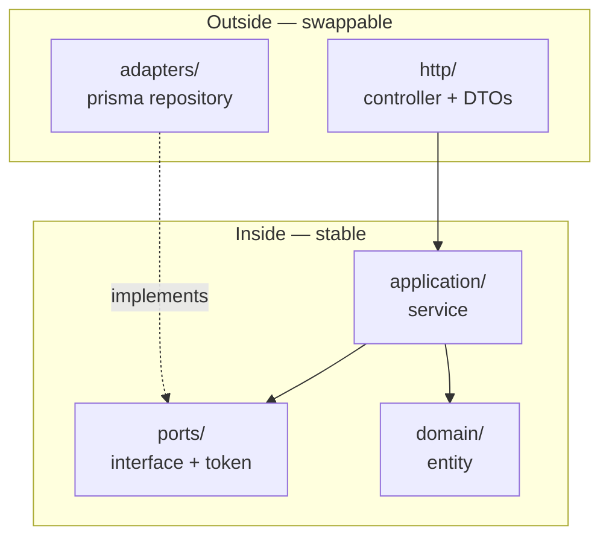

# Sprint Primer — the complete walkthrough

Companion to [`2-DAY-SPRINT.md`](./2-DAY-SPRINT.md).

**This version holds nothing back.** Every file is written out in full, and every line that isn't
obvious is explained underneath it. Type the code (don't paste — typing is how it sticks), read
the explanation, run the verification.

**Reading the Phase docs is optional *while* you build.** Reading theory when you're already lost
doesn't help. Build first with this guide, then read the linked section afterwards — it'll land,
because you'll have something to attach it to. Each block lists its reading at the end, not the
start.

**Your exact stack** — the code below is written for these versions, not generic tutorials:

| | |
|---|---|
| NestJS | 11 |
| `@nestjs/config` | 12 |
| Prisma | 7 · client generated to `apps/api/generated/prisma` |
| Zod | 4.5 |
| Postgres | in Docker, on host port **5433** |

---

## Contents

| | Block |
|---|---|
| **Sat 10:00** | [S1 — Config and bootstrap](#s1--config-and-bootstrap) |
| **Sat 12:45** | [S2 — Prisma, filter, health](#s2--prisma-exception-filter-health) |
| **Sat 14:00** | [S3 — The schema](#s3--the-schema) |
| **Sat 16:30** | [S4 — Migrations](#s4--migrations) |
| **Sat 17:15** | [S5 — Seeding](#s5--seeding) |
| **Sun 09:00** | [U1 — The Problems module](#u1--the-problems-module) |
| **Sun 12:45** | [U2 — Wiring the frontend](#u2--wiring-the-frontend) |
| **Sun 14:00** | [U3 — CI](#u3--ci) |
| **Sun 15:15** | [U4 — Tests](#u4--tests) |
| | [Errors you will hit](#errors-you-will-hit) · [Glossary](#glossary) |

---

# Part 0 — six things to know before you type anything

## 0.1 Decorators — the `@` symbols

A decorator is **a function that attaches a label to a class or method**. It doesn't change what
your code does. Nest reads those labels at startup and builds the app from them.

```ts
@Controller("coffees")
export class CoffeesController {}
```

That says *"this class handles URLs under `/coffees`"*. Nest reads it; nothing else happens.

| Decorator | Goes on | Means |
|---|---|---|
| `@Module({...})` | class | A box of related things |
| `@Injectable()` | class | Nest may create and inject this |
| `@Controller('path')` | class | I handle HTTP under this path |
| `@Get()` | method | I answer GET requests |
| `@Param('x')` | parameter | Take this from the URL path |
| `@Query()` | parameter | Take this from the `?query=string` |
| `@Inject(TOKEN)` | parameter | Inject whatever is registered under this token |
| `@Catch()` | class | I'm an exception filter |

**The failure to recognise:** forget `@Injectable()` and nothing fails at compile time. The class
just becomes invisible to Nest, and at boot you get `Nest can't resolve dependencies of X`.

## 0.2 Dependency injection, in 20 seconds

```ts
// welded — you can never test this without a real database
class OrderService { private db = new PostgresClient(); }

// injected — a test can hand it a fake
class OrderService { constructor(private db: Database) {} }
```

Nest does the handing-in. You *register* classes; Nest reads the constructor and supplies them.

## 0.3 Modules — and the mistake everyone makes

```ts
@Module({
  imports:     [OtherModule],   // other modules whose exports I want
  controllers: [MyController],  // HTTP entry points here
  providers:   [MyService],     // classes this module can inject
  exports:     [MyService],     // which of mine others may use
})
export class MyModule {}
```

**A provider is private to its module.** To use it elsewhere you must `export` it there **and**
`import` that module here. Both. Missing either gives you
`Nest can't resolve dependencies of X`.

`@Global()` skips the import half — register once, inject anywhere. Right for config and the
database. Wrong for anything else.

## 0.4 Everything inside the decorator

This is the mistake in your current `app.module.ts`:

```ts
// ❌ runs at import time, result thrown away, Nest never sees it
export class AppModule {}
ConfigModule.forRoot({ isGlobal: true, validate });

// ✅ inside the decorator's imports array
@Module({ imports: [ConfigModule.forRoot({ isGlobal: true, validate })] })
export class AppModule {}
```

`ConfigModule.forRoot(...)` **returns a module object**. It has to be *given* to Nest by putting
it in `imports`. Calling it on its own line does nothing.

## 0.5 Your three local facts

**Postgres is on 5433.** Your machine already runs one on 5432. `docker-compose.yml` maps
`5433:5432`. Your `.env` is already correct — don't "fix" it.

**Your Prisma client is not `@prisma/client`.** `schema.prisma` says
`output = "../generated/prisma"`. Every tutorial says `@prisma/client`; yours is elsewhere. You'll
check the real path in S2.

**`prisma.config.ts` already exists and is CLI-only.** It tells the `prisma` *command* how to reach
the database for `migrate` and `seed`. Your running app needs its own config — that's S1. Two
separate doors to the same room.

## 0.6 Start the database

```bash
pnpm infra:up
docker ps
```

Both containers should say `healthy` after ~10 seconds. Nothing below works without this.

---

# S1 — Config and bootstrap

⏱ **Saturday 10:00 · 2h**

### What you're building

An app that reads its settings from `.env`, **refuses to start** if any are missing or malformed,
and listens on port 3001.

### Why it matters

Without validation, a typo'd `DATABSE_URL` gives you an app that starts fine and dies on the first
request, with an error that never mentions the env var. With it, the app refuses to boot and names
the variable. **A loud failure now instead of a mystery later.**

---

## The three ideas you need

### 1. A schema is a description, not an action

This is the bug in your current file. These are two separate things:

```ts
const schema = z.object({ PORT: z.coerce.number() });  // ① the description
const value  = schema.parse(process.env);              // ② using it on real data
```

Your file did ① and ② on the same line, against a hardcoded object. So `Schema` became a *parsed
result*, and `z.infer<typeof Schema>` had nothing to work with.

**The schema file exports the description and a function that uses it. It never parses at import
time.**

### 2. `z.coerce` — what it actually does

Every environment variable is a **string**. `PORT=3001` in `.env` arrives in your program as
`"3001"`, never `3001`.

So `z.number()` fails: *"Invalid input: expected number, received string"*.

`z.coerce.number()` runs `Number(value)` **first**, then validates the result:

```
"3001"  →  Number("3001")  →  3001  →  is it a number? yes ✓
```

| Written | Runs first |
|---|---|
| `z.coerce.number()` | `Number(v)` |
| `z.coerce.boolean()` | `Boolean(v)` ⚠️ `Boolean("false")` is `true` — avoid for env flags |
| `z.coerce.date()` | `new Date(v)` |

You need it on `PORT` and `REDIS_PORT`. Not on `DATABASE_URL` or `REDIS_HOST` — those are
genuinely strings.

### 3. `NODE_ENV` is a Node convention

Its values are `"development"`, `"test"`, `"production"`. Nothing else. It is **not** a URL —
`localhost:3000` is a CORS origin, which is a different setting entirely.

Your `.env` doesn't define `NODE_ENV`, so it needs `.default("development")`.

---

## File 1 of 3 — `apps/api/src/config/env.schema.ts`

Replace everything in your current file with this.

```ts
import { z } from "zod";

/**
 * The shape every environment variable must have.
 * This is a DESCRIPTION. Nothing is parsed here.
 */
export const envSchema = z.object({
  NODE_ENV: z
    .enum(["development", "test", "production"])
    .default("development"),

  PORT: z.coerce.number().int().min(1).max(65535).default(3001),

  DATABASE_URL: z.string().url(),

  REDIS_HOST: z.string().min(1).default("localhost"),

  REDIS_PORT: z.coerce.number().int().min(1).max(65535).default(6379),
});

/** The TypeScript type, derived from the schema so the two can never drift. */
export type Env = z.infer<typeof envSchema>;

/**
 * Called once by ConfigModule at boot with the raw process.env.
 * Returns the parsed, typed config — or throws a readable error and kills the app.
 */
export function validateEnv(raw: Record<string, unknown>): Env {
  const result = envSchema.safeParse(raw);

  if (!result.success) {
    const details = result.error.issues
      .map((issue) => `  • ${issue.path.join(".")}: ${issue.message}`)
      .join("\n");

    throw new Error(
      `\n❌ Invalid environment variables:\n${details}\n\n` +
        `Check apps/api/.env against apps/api/.env.example\n`,
    );
  }

  return result.data;
}
```

### Every line that isn't obvious

| Line | What it does |
|---|---|
| `import { z } from "zod"` | Named import. Your file had `import z from "zod"` (default import) — that happens to work but the named form is the documented one |
| `z.enum([...])` | The value must be exactly one of these strings |
| `.default("development")` | If the variable is **missing**, use this. Your `.env` has no `NODE_ENV`, so this is what makes it work |
| `z.coerce.number()` | Convert the string to a number *before* checking |
| `.int()` | No decimals — `3001.5` is not a port |
| `.min(1).max(65535)` | The legal TCP port range. Catches `PORT=99999` |
| `z.string().url()` | Must parse as a URL. `postgresql://...` passes (I verified this on your Zod 4.5) |
| `z.infer<typeof envSchema>` | Derives the TS type **from** the schema. Change the schema, the type follows. No duplication |
| `safeParse` not `parse` | `parse` throws Zod's own error, which is noisy. `safeParse` returns a result object so **you** can format the message |
| `result.success` | `false` → `result.error` exists. `true` → `result.data` exists. TypeScript narrows on this check |
| `issue.path.join(".")` | `path` is an array like `["DATABASE_URL"]`. Joining gives the variable name |
| `issue.message` | Zod's human text, e.g. `"Invalid input: expected string, received undefined"` |
| `throw new Error(...)` | **Throwing here is the whole point.** ConfigModule lets it propagate and the process dies |
| `return result.data` | The parsed values — `PORT` is now a real `number` |

> **Why `safeParse` here but "use `parse` for config" elsewhere?** Both are defensible. `parse`
> throws Zod's raw error; `safeParse` + your own `throw` lets you print *which* variables failed in
> a readable list. Same outcome — the app dies — but a message you can act on.

---

## File 2 of 3 — `apps/api/src/app.module.ts`

```ts
import { Module } from '@nestjs/common';
import { ConfigModule } from '@nestjs/config';
import { AppController } from './app.controller';
import { AppService } from './app.service';
import { validateEnv } from './config/env.schema';

@Module({
  imports: [
    ConfigModule.forRoot({
      isGlobal: true,
      validate: validateEnv,
    }),
  ],
  controllers: [AppController],
  providers: [AppService],
})
export class AppModule {}
```

### What changed from yours

| | |
|---|---|
| `ConfigModule.forRoot(...)` moved **inside** `imports` | It returns a module object; Nest only sees it if you hand it over. Yours was a floating statement (§0.4) |
| `validate: validateEnv` | The function you just wrote. Yours referenced a `validate` that didn't exist |
| Added the import for `validateEnv` | — |

### What each option does

| Option | Effect |
|---|---|
| `isGlobal: true` | Any module can inject `ConfigService` without importing `ConfigModule`. Without this you'd add `ConfigModule` to every module's `imports` |
| `validate` | Runs **once at boot**, receives raw `process.env`, and whatever it returns becomes the config. Throwing aborts startup |

> `ConfigModule` reads `.env` from the process's working directory. `pnpm dev:api` runs inside
> `apps/api`, so `apps/api/.env` is found automatically.

---

## File 3 of 3 — `apps/api/src/main.ts`

```ts
import { NestFactory } from '@nestjs/core';
import { ValidationPipe } from '@nestjs/common';
import { ConfigService } from '@nestjs/config';
import { AppModule } from './app.module';

async function bootstrap() {
  const app = await NestFactory.create(AppModule);

  // 1. Validate and transform every incoming request body / query.
  app.useGlobalPipes(
    new ValidationPipe({
      whitelist: true,
      transform: true,
    }),
  );

  // 2. Let the Next.js app (a different origin) read our responses.
  app.enableCors({ origin: 'http://localhost:3000' });

  // 3. Run cleanup (closing DB connections) on Ctrl-C instead of dying mid-query.
  app.enableShutdownHooks();

  // 4. Read the port from the VALIDATED config, not raw process.env.
  const configService = app.get(ConfigService);
  const port = configService.get<number>('PORT') ?? 3001;

  // 5. Start listening. This MUST be last.
  await app.listen(port);
  console.log(`✅ API listening on http://localhost:${port}`);
}

void bootstrap();
```

### What changed from yours, and why order matters

| Your version | Problem |
|---|---|
| `await app.listen(...)` came **first** | The server started accepting requests *before* the pipe, CORS and shutdown hooks were attached. Those three configure the app — they must run before it opens for business |
| `ValidationPipe` not imported | It comes from `@nestjs/common` |
| `process.env.PORT ?? 3000` | Raw, unvalidated, and the wrong default. You built validated config in File 1 — use it |

### Line notes

| Line | What it does |
|---|---|
| `NestFactory.create(AppModule)` | Builds the whole app: reads every decorator, constructs every provider |
| `app.get(ConfigService)` | Pulls a provider out of the container manually. You do this in `main.ts` because there's no constructor to inject into |
| `configService.get<number>('PORT')` | Returns `number \| undefined`, so `?? 3001` satisfies TypeScript |
| `void bootstrap()` | `bootstrap` is `async`, so it returns a Promise nobody awaits. `void` tells the linter that's deliberate |

### ⚠️ `whitelist: true` is a security control

It **strips any property not declared on your DTO**. Without it, a body of
`{ email, password, role: "ADMIN" }` passes `role` straight through — and if any code later
spreads that object into a database write, the client just made themselves an admin.

That's **mass assignment**. It's a real vulnerability class and a standard interview question.

`transform: true` converts the plain JSON into your DTO class and applies type conversion — which
is what makes `?limit=20` arrive as a `number` on Sunday.

---

## ✅ Verify — do all four

```bash
pnpm dev:api
```

**1. It starts on 3001.** You should see `✅ API listening on http://localhost:3001`.

```bash
curl localhost:3001        # → Hello World!
```

**2. A missing variable kills it.** Comment out `DATABASE_URL` in `apps/api/.env`, restart:

```
❌ Invalid environment variables:
  • DATABASE_URL: Invalid input: expected string, received undefined
```

**If it starts anyway, `validate` isn't wired** — check File 2.

**3. A malformed variable kills it.** Set `PORT=notanumber`:

```
  • PORT: Invalid input: expected number, received NaN
```

**4. Put both back**, confirm it starts.

> Step 2 and 3 are the actual deliverable. An app that boots correctly proves nothing; an app that
> **refuses** to boot correctly is what you built.

## 🔧 If it breaks

| Message | Cause |
|---|---|
| `expected number, received string` | Missing `z.coerce` on a port |
| `Nest can't resolve dependencies of ConfigService` | `isGlobal: true` missing, or `ConfigModule` not in `imports` |
| App boots with a broken `.env` | `validate` not passed, or you returned instead of throwing |
| `Cannot find name 'ValidationPipe'` | Missing import from `@nestjs/common` |
| Port 3000 not 3001 | Still reading `process.env` |

## 📖 Read after (25 min, now that it's built)

> `docs/phase-0-foundations.md` **§B.6** lines **674–707** — dynamic modules, `forRoot`
> `docs/phase-1-auth-data-frontend.md` **§C.1** lines **654–692** — parse, don't validate

---

# S2 — Prisma, exception filter, health

⏱ **Saturday 12:45 · 1h15**

### What you're building

A live database connection, one uniform error shape, and a `/health` endpoint that can genuinely
fail.

> ⚠️ **Prisma 7 changed how connections work.** Most tutorials and older Prisma docs are wrong for
> your version. The three fixes below are not optional — I hit all three running your code.

---

## Step 0 — fix the generator, then generate

Your `schema.prisma` generator block needs two extra lines **before** you generate anything:

```prisma
generator client {
  provider     = "prisma-client"
  output       = "../generated/prisma"
  moduleFormat = "cjs"        // ← REQUIRED
  runtime      = "nodejs"     // ← REQUIRED
}
```

**Why.** `apps/api/package.json` has no `"type": "module"`, so your app is **CommonJS**. Without
`moduleFormat = "cjs"`, Prisma 7 generates **ESM** — including `import.meta.url`, which is illegal
in CommonJS. TypeScript compiles it anyway (the file is marked `@ts-nocheck`), and then Node
detects the ESM syntax, switches to ESM parsing, and dies on the CommonJS `exports`:

```
ReferenceError: exports is not defined in ES module scope
```

That error names neither Prisma nor module format, which is why it's so hard to place.

```bash
pnpm --filter api exec prisma generate
ls apps/api/generated/prisma/
```

Confirm the fix worked — this must print **nothing**:

```bash
grep -r "import.meta" apps/api/generated/prisma/*.ts
```

## Step 0b — install the driver adapter

```bash
pnpm --filter api add @prisma/adapter-pg
```

**Why.** Prisma 7 **removed** the built-in connection handling. `datasourceUrl` and `datasources`
no longer exist — the options type now requires either a **driver adapter** or an Accelerate URL.
If you try the old way you get:

```
TS2353: Object literal may only specify known properties,
and 'datasourceUrl' does not exist in type 'PrismaClientOptions'
```

A **driver adapter** is a thin wrapper around a real Node database driver (here, `pg`). Prisma
sends it queries; the driver talks to Postgres.

---

## ⚠️ File locations — put these in `src/`, not `prisma/`

`apps/api/prisma/` is **Prisma's** folder — it holds `schema.prisma` and `migrations/`. Your
application code goes in `src/`.

| ✅ Correct | ❌ Wrong |
|---|---|
| `apps/api/src/prisma/prisma.service.ts` | `apps/api/prisma/prisma.service.ts` |
| `apps/api/src/prisma/prisma.module.ts` | `apps/api/prisma/prisma.module.ts` |

Putting them in `prisma/` compiles Prisma's folder into `dist/` and makes every relative import
one level wrong.

---

## File 1 — `apps/api/src/prisma/prisma.service.ts`

```ts
import { Injectable, OnModuleDestroy, OnModuleInit } from '@nestjs/common';
import { ConfigService } from '@nestjs/config';
import { PrismaPg } from '@prisma/adapter-pg';
import { PrismaClient } from '../../generated/prisma/client';

@Injectable()
export class PrismaService
  extends PrismaClient
  implements OnModuleInit, OnModuleDestroy
{
  constructor(config: ConfigService) {
    // Prisma 7 has no built-in connection handling — you supply a DRIVER ADAPTER.
    // schema.prisma has no `url` (prisma.config.ts serves the CLI only), so the
    // running app passes the connection string in here itself.
    super({
      adapter: new PrismaPg(config.getOrThrow<string>('DATABASE_URL')),
    });
  }

  async onModuleInit() {
    await this.$connect();
  }

  async onModuleDestroy() {
    await this.$disconnect();
  }
}
```

| Line | Why |
|---|---|
| `extends PrismaClient` | **`extends`, not `implements`** — you want all its query methods for free |
| `implements OnModuleInit, OnModuleDestroy` | **`implements`, not `extends`** — these are interfaces. No code, just a compiler check that you spelled the methods right |
| `'../../generated/prisma/client'` | Two levels up from `src/prisma/`. **Not `@prisma/client`** |
| `constructor(config: ConfigService)` | DI supplies it. This is the app's *own* door to the database — separate from `prisma.config.ts`, which only serves the CLI |
| `super({ adapter: new PrismaPg(...) })` | The Prisma 7 way. `PrismaPg` accepts a connection string directly |
| `getOrThrow` | Throws if missing rather than returning `undefined`. Your S1 validation already guarantees it exists |
| `onModuleInit` | One connection pool opened at startup, not one per request |
| `onModuleDestroy` | Only runs because you called `enableShutdownHooks()` in S1 |

> Both keywords on one class doing different jobs — that's `extends` vs `implements` in one real
> example.

## File 2 — `apps/api/src/prisma/prisma.module.ts`

```ts
import { Global, Module } from '@nestjs/common';
import { PrismaService } from './prisma.service';

@Global()
@Module({
  providers: [PrismaService],
  exports: [PrismaService],
})
export class PrismaModule {}
```

| Line | Why |
|---|---|
| `@Global()` | Every feature module needs the database. Without it you'd import `PrismaModule` everywhere |
| `exports: [PrismaService]` | **Required even with `@Global()`.** Global affects the *import* half; you still open the door with `exports` |

Add `PrismaModule` to `app.module.ts`'s `imports` array — imported as `'./prisma/prisma.module'`.

## File 3 — `apps/api/src/common/filters/all-exceptions.filter.ts`

```ts
import {
  ArgumentsHost,
  Catch,
  ExceptionFilter,
  HttpException,
  HttpStatus,
  Logger,
} from '@nestjs/common';
import type { Request, Response } from 'express';

@Catch()
export class AllExceptionsFilter implements ExceptionFilter {
  private readonly logger = new Logger(AllExceptionsFilter.name);

  catch(exception: unknown, host: ArgumentsHost) {
    const ctx = host.switchToHttp();
    const response = ctx.getResponse<Response>();
    const request = ctx.getRequest<Request>();

    const isHttp = exception instanceof HttpException;
    const status = isHttp
      ? exception.getStatus()
      : HttpStatus.INTERNAL_SERVER_ERROR;

    // 4xx: tell the client what they did wrong — they can fix it.
    // 5xx: a generic message. Details go to the log, never to the client.
    const message = isHttp ? exception.message : 'Internal server error';

    if (!isHttp) {
      this.logger.error(
        `Unhandled ${request.method} ${request.url}`,
        exception instanceof Error ? exception.stack : String(exception),
      );
    }

    response.status(status).json({
      statusCode: status,
      message,
      path: request.url,
      timestamp: new Date().toISOString(),
    });
  }
}
```

| Line | Why |
|---|---|
| `@Catch()` with no argument | Catch **everything**. `@Catch(HttpException)` would catch only those |
| `host.switchToHttp()` | Nest also supports WebSockets and gRPC, so `host` is generic. This narrows it |
| `exception instanceof HttpException` | Distinguishes "Nest threw this deliberately" (404, 400) from "something crashed" |
| Generic message for 5xx | **Never leak a stack trace** — it exposes file paths and library versions |

## File 4 — `apps/api/src/health/health.controller.ts`

```ts
import { Controller, Get } from '@nestjs/common';
import { PrismaService } from '../prisma/prisma.service';

@Controller('health')
export class HealthController {
  constructor(private readonly prisma: PrismaService) {}

  @Get()
  async check() {
    let db: 'up' | 'down' = 'down';
    try {
      await this.prisma.$queryRaw`SELECT 1`;
      db = 'up';
    } catch {
      db = 'down';
    }

    return {
      status: db === 'up' ? 'ok' : 'degraded',
      uptime: Math.floor(process.uptime()),
      db,
    };
  }
}
```

| Line | Why |
|---|---|
| `constructor(private readonly prisma: PrismaService)` | **This is dependency injection.** `private readonly` is TS shorthand that also creates the field |
| `$queryRaw\`SELECT 1\`` | A real round-trip. **A health check that can't fail is decoration** |
| `try/catch` | The endpoint must *report* the failure, not crash |

Add `HealthController` to `app.module.ts`'s `controllers` array.

## File 5 — register the filter in `main.ts`

**This is a step, not a footnote.** Writing the filter file does nothing until you register it.

Two edits to `src/main.ts`:

```ts
import { AllExceptionsFilter } from './common/filters/all-exceptions.filter';
```

and, immediately after `useGlobalPipes` (still **before** `app.listen`):

```ts
app.useGlobalFilters(new AllExceptionsFilter());
```

Without this, `/nope` returns Nest's default `{"message","error","statusCode"}` instead of your
`{"statusCode","message","path","timestamp"}`. That difference is how you tell whether it's wired.

---

## ✅ Verify — all four

```bash
pnpm dev:api
```

```bash
curl localhost:3001/health
# {"status":"ok","uptime":1,"db":"up"}

curl localhost:3001/nope
# {"statusCode":404,"message":"Cannot GET /nope","path":"/nope","timestamp":"..."}
#  ↑ YOUR shape. If you see {"message","error","statusCode"} the filter isn't registered.

docker stop codearena-postgres && sleep 2
curl localhost:3001/health
# {"status":"degraded","uptime":16,"db":"down"}   ← reports it, doesn't crash
docker start codearena-postgres
```

**Test it by breaking it.** An endpoint you've only seen succeed is untested.

## 🔧 If it breaks

| Message | Cause | Fix |
|---|---|---|
| `exports is not defined in ES module scope` | Prisma generated ESM into a CommonJS app | `moduleFormat = "cjs"` + `runtime = "nodejs"`, then regenerate |
| `'datasourceUrl' does not exist in type` | Prisma 7 removed it | Use `adapter: new PrismaPg(url)` |
| `PrismaClient needs to be constructed with a non-empty, valid PrismaClientOptions` | No adapter passed | Same fix |
| `Nest can't resolve dependencies of PrismaService` | `PrismaModule` not in `app.module.ts` imports, or `exports` missing | Check both |
| `Cannot find module '../../generated/prisma/client'` | Wrong depth, or not generated | `ls apps/api/generated/prisma/`; count the `../` |
| **Your changes seem to have no effect** | **A stale server still holds port 3001.** `nest start` spawns a child; killing the CLI leaves it running | See below |

### ⚠️ The stale-server trap — this cost me three wrong diagnoses

`pnpm dev:api` runs the Nest CLI, which spawns a **separate** `node` process. Ctrl-C usually
handles it, but a killed terminal can leave the child alive, holding port 3001 — so your next
start silently fails to bind and **you keep testing the old code**.

Find and kill it by port:

```bash
ss -ltnp | grep 3001              # shows pid=NNNN
kill -9 <that pid>
```

> Don't use `pkill -f "nest start"` — the pattern matches your own shell command and kills your
> terminal.

## 📖 Read after (10 min)

> `docs/phase-0-foundations.md` **§B.3** lines **564–599** — modules and `@Global()`

---

# S3 — The schema

⏱ **Saturday 14:00 · 2h30 — the biggest block**

### What you're building

Seven tables that satisfy the frontend's contract, with deliberate indexes.

---

## The syntax, completely

A `model` is a table. Each line inside is a column.

### Types

| Prisma | Postgres | Note |
|---|---|---|
| `String` | text | |
| `Int` | integer | |
| `Boolean` | boolean | |
| `DateTime` | timestamp | |
| `Json` | jsonb | Opaque blob |
| `String[]` | text[] | A real Postgres array |

`Type?` = nullable (may be null). `Type[]` = a list.

### Field attributes — one `@`

| Attribute | Does |
|---|---|
| `@id` | This is the primary key |
| `@unique` | No two rows share this value |
| `@default(cuid())` | Random collision-resistant string id |
| `@default(autoincrement())` | 1, 2, 3… assigned by Postgres |
| `@default(now())` | Timestamp at insert |
| `@updatedAt` | Auto-updated on every write |
| `@relation(fields: [xId], references: [id])` | Wires a foreign key |

### Block attributes — two `@@`

At the bottom of a model; they describe the **table**, not one column.

| Attribute | Does |
|---|---|
| `@@index([col])` | Create an index |
| `@@index([a, b(sort: Desc)])` | Composite index, second column descending |
| `@@unique([a, b])` | The *combination* must be unique |

### First — what a "key" actually is

Two words you need before relations make any sense.

**Primary key (PK)** — the column that uniquely identifies a row. `Problem.id`. No two problems
share one. It's what you point *at*.

**Foreign key (FK)** — a column that **stores another table's primary key**. That column *is* the
link between two tables. There is no other mechanism; relations are just an ID copied into a
column.

Concretely, with your own tables:

**`Problem`**

| id | slug |
|---|---|
| 1 | two-sum |
| 2 | 3sum |

**`ProblemExample`**

| id | **problemId** ← the FK | input |
|---|---|---|
| 10 | **1** | `[2,7,11], 9` |
| 11 | **1** | `[3,2,4], 6` |
| 12 | **2** | `[-1,0,1]` |

Examples 10 and 11 belong to problem 1; example 12 belongs to problem 2. That single column is the
entire relationship.

`ALTER TABLE ... ADD CONSTRAINT ... FOREIGN KEY` in tomorrow's migration is Postgres being told to
*enforce* it: you can't set `problemId = 99` if no problem 99 exists, and you can't delete a
problem that still has examples (unless you said `onDelete: Cascade`).

### Relations — both halves

**One-to-many.** Each example belongs to exactly **one** problem — one value, one column. So the
foreign key lives on the **many** side:

```prisma
model Author {
  id    String @id @default(cuid())
  books Book[]                                        // ← creates NO column
}

model Book {
  id       String @id @default(cuid())
  authorId String                                     // ← the real FK column
  author   Author @relation(fields: [authorId], references: [id])
  @@index([authorId])                                 // ← FKs need this. Always.
}
```

`books Book[]` is a convenience Prisma builds from the FK. `authorId` is the actual column.

**Many-to-many.** A Problem has many Tags **and** a Tag has many Problems. Now neither side can
hold the foreign key, because a column holds **one** value:

| Attempt | Breaks because |
|---|---|
| a `tagId` column on `Problem` | a problem could have only **one** tag |
| a `problemId` column on `Tag` | a tag could belong to only **one** problem |

So Postgres needs a **third table holding two foreign keys**, one pointing each way:

| A (problemId) | B (tagId) |
|---|---|
| 1 | 5 |
| 1 | 7 |
| 2 | 5 |

Problem 1 has tags 5 *and* 7; tag 5 is on problems 1 *and* 2. Many in both directions. That's a
**join table**.

Prisma's *implicit* form creates and manages it for you (you'll see it as `_ProblemToTag` in the
migration SQL) — you just write the array on both sides:

```prisma
model Book { tags Tag[]  }
model Tag  { books Book[] }
```

---

## Indexes — the concept that matters most

**Without an index, finding rows means reading every row** — a *sequential scan*. Fine at 333 rows.
Catastrophic at 10 million.

An index is **a sorted copy of one or more columns plus a pointer to the full row**. Like a book's
index: instead of reading 900 pages to find "monads", you look it up alphabetically and jump to
page 412.

The default is a **B-tree** — kept sorted. That's why one B-tree serves equality (`= 'MEDIUM'`),
ranges (`> 100`) **and** `ORDER BY`. It's also why `LIKE '%foo'` can't use one: with an unknown
prefix there's nowhere in the sort order to start.

**Cost:** every write must update every index, plus disk. So index what you query.

**Two rules:**

1. **Every foreign key gets an index.** Postgres creates them automatically for primary keys and
   `@unique` — **not** for foreign keys. You'll constantly ask "all submissions for this user";
   without an index on `userId` that's a full scan.
2. **Composite column order matters.** `(userId, createdAt)` is a phone book sorted by surname then
   first name. Great for "all Smiths" and "Smith, John". **Useless** for "everyone named John."
   → **Equality columns first, range/sort columns second.**

---

## The full schema

Append this to `apps/api/prisma/schema.prisma` (keep the existing `generator` and `datasource`
blocks at the top — do **not** replace them).

```prisma
enum Role       { USER ADMIN }
enum Difficulty { EASY MEDIUM HARD }
enum Language   { TYPESCRIPT PYTHON CPP JAVA }
enum Verdict    { PENDING ACCEPTED WRONG_ANSWER TIME_LIMIT RUNTIME_ERROR COMPILE_ERROR }

model User {
  id       String @id @default(cuid())
  email    String @unique
  username String @unique
  passwordHash String                       // NEVER a column called `password`
  role     Role   @default(USER)

  // Glicko-2 rating fields — added now so Week 5 needs no migration
  rating           Float @default(1500)
  ratingDeviation  Float @default(350)
  volatility       Float @default(0.06)

  createdAt DateTime @default(now())
  updatedAt DateTime @updatedAt

  submissions   Submission[]
  refreshTokens RefreshToken[]
}

model Problem {
  id          Int        @id @default(autoincrement())   // frontend contract: a NUMBER
  slug        String     @unique
  title       String
  difficulty  Difficulty
  description String[]                                    // array of paragraphs
  constraints String[]
  starterCode Json                                        // language -> code map

  createdAt DateTime @default(now())
  updatedAt DateTime @updatedAt

  examples    ProblemExample[]
  testCases   TestCase[]
  submissions Submission[]
  tags        Tag[]

  @@index([difficulty])                    // list page filters by difficulty
}

model ProblemExample {
  id        Int     @id @default(autoincrement())
  problemId Int
  problem   Problem @relation(fields: [problemId], references: [id], onDelete: Cascade)
  input       String
  output      String
  explanation String?
  order       Int

  @@index([problemId])                     // FK — always indexed
}

model Tag {
  id       Int       @id @default(autoincrement())
  name     String    @unique
  problems Problem[]
}

model TestCase {
  id        Int     @id @default(autoincrement())
  problemId Int
  problem   Problem @relation(fields: [problemId], references: [id], onDelete: Cascade)
  input    String
  expected String
  isSample Boolean @default(false)
  order    Int

  @@index([problemId])
}

model Submission {
  id        String   @id @default(cuid())   // never a guessable id for user data
  userId    String
  user      User     @relation(fields: [userId], references: [id], onDelete: Cascade)
  problemId Int
  problem   Problem  @relation(fields: [problemId], references: [id])
  language  Language
  verdict   Verdict  @default(PENDING)
  code      String
  runtimeMs Int?
  createdAt DateTime @default(now())

  @@index([userId, createdAt(sort: Desc)])  // profile history, cursor-paginated
  @@index([problemId, verdict])             // acceptance-rate stats
}

model RefreshToken {
  id        String    @id @default(cuid())
  userId    String
  user      User      @relation(fields: [userId], references: [id], onDelete: Cascade)
  tokenHash String    @unique               // the HASH, never the token itself
  family    String                          // rotation: reuse kills the whole family
  revokedAt DateTime?
  expiresAt DateTime
  createdAt DateTime  @default(now())

  @@index([userId, family])                 // rotation lookup
}
```

### The decisions to write down (this is ADR-001)

| Decision | The reasoning |
|---|---|
| `Problem.id` is `Int`, `User.id` is `String` | Frontend contract needs a number for problems, and problems are public. Sequential **user** ids let anyone enumerate your users — an *insecure direct object reference* |
| `starterCode` is `Json`, `examples` is a table | Starter code is always read whole and never queried by key. Examples are ordered rows you might edit individually. Postgres can't index inside a Json blob or enforce constraints on it |
| Enums are `EASY`, frontend wants `"Easy"` | **Map in the DTO, at the HTTP boundary.** Not in the service (business logic shouldn't know about presentation), not by renaming the enum (that contorts your domain for one consumer) |
| `onDelete: Cascade` on child rows | Delete a Problem, its examples and test cases go too. Without it Postgres refuses the delete |
| `passwordHash`, `tokenHash` | Naming that makes storing a plaintext secret feel wrong |

## ✅ Verify

```bash
pnpm --filter api exec prisma format      # canonical formatting
pnpm --filter api exec prisma validate    # syntax + relations coherent
```

`validate` passing means it *parses*, not that the design is right. That's what your written
reasoning is for.

## 📖 Read after (40 min)

> `docs/phase-1-auth-data-frontend.md` **§A.3** lines **260–315** — indexes, the phone book insight
> `docs/phase-1-auth-data-frontend.md` **Part E** lines **821–878** — the bookstore schema
> *(ignore Part E's first two lines — yours use a different generator)*

---

# S4 — Migrations

⏱ **Saturday 16:30 · 45 min — highest learning-per-minute of the weekend**

### What a migration is

A migration is **one versioned SQL file describing one change** to your database structure. Run in
order, they take an empty database to your current schema. It's version control for your schema,
committed alongside the code that depends on it.

```bash
pnpm --filter api exec prisma migrate dev --name init
```

That one command does four things: diffs your schema against the database, writes the SQL, applies
it, regenerates the client.

## 🪜 The actual task: read the SQL

```bash
cat apps/api/prisma/migrations/*/migration.sql
```

**Read every line.** Prisma is a code generator — today you see what it generates, and it's plain
SQL:

| Statement | Does |
|---|---|
| `CREATE TYPE "Difficulty" AS ENUM (...)` | Your enums become real Postgres types |
| `CREATE TABLE "Problem" (...)` | Columns and types |
| `CREATE UNIQUE INDEX "Problem_slug_key"` | Enforces `@unique` — **note it's implemented as an index** |
| `CREATE INDEX "Problem_difficulty_idx"` | Your `@@index` declarations |
| `ALTER TABLE ... ADD CONSTRAINT ... FOREIGN KEY` | Wires the relations |
| `CREATE TABLE "_ProblemToTag"` | The join table Prisma made for your implicit many-to-many |

**Answer these two in writing — they go in ADR-001:**

1. **Which index did Prisma create that you didn't ask for?** Look at `_ProblemToTag`, and at every
   `@unique`. Uniqueness is *enforced by* a unique index — which means every `@unique` also gives
   you a fast lookup for free.
2. **What did `@unique` on `Tag.name` produce?** `CREATE UNIQUE INDEX`. Same answer, seen
   concretely.

## ⚠️ The one rule

**Never edit a migration that has been applied anywhere but your laptop.** They're an append-only
ledger — to change something, write a *new* one.

Same shape as `git revert` over rewriting pushed history, and superseding an ADR rather than
editing it.

## 🔧 If it breaks

| Message | Fix |
|---|---|
| `Environment variable not found: DATABASE_URL` | `.env` missing — `cp .env.example .env` |
| `Can't reach database server at localhost:5432` | Wrong port. Yours is **5433** |
| `drift detected` | DB changed outside migrations. Dev only: `prisma migrate reset` (wipes data, fine now) |

## 📖 Read after (10 min)

> `docs/phase-1-auth-data-frontend.md` **§A.7** lines **431–445** — migrations

---

# S5 — Seeding

⏱ **Saturday 17:15 · 1h30**

### What you're building

A repeatable script that fills the database with your 333 problems.

## The Prisma Client methods you need

```ts
prisma.problem.findMany({ where: {...}, orderBy: {...}, take: 20 });
prisma.problem.findUnique({ where: { slug: "two-sum" } });   // null if absent
prisma.problem.count();
prisma.problem.create({ data: {...} });                      // throws on duplicate

prisma.problem.upsert({
  where:  { slug: "two-sum" },   // must be a @unique field
  create: {...},                 // used if NOT found
  update: {...},                 // used if found
});
```

### ⭐ Idempotency

**Idempotent = running it twice has the same effect as running it once.**

`create` fails the second run (duplicate slug) or makes 666 rows. `upsert` keyed on `slug` can run
any number of times and always leaves exactly 333.

This matters far beyond seeding: Week 4's job queue **retries failed jobs**, and a retry must not
double-charge a card. Idempotency is *the* property that makes retries safe.

## ⚠️ The API must not import from the web app

Your 333 problems live in `apps/web/src/lib/dsa-problems.ts`. The obvious move is to import it.
**Don't.**



The frontend depends on the backend's API. If the backend also depends on the frontend's *source*,
you have a circular dependency **between deployables** — the API can't be built or deployed without
the web app present.

**The fix:** a throwaway script converts the array to JSON, and **the JSON is what you commit**.

## Step 1 — the throwaway converter

```bash
# from the repo root
pnpm dlx tsx -e "
import { writeFileSync, mkdirSync } from 'node:fs';
import { DSA_PROBLEMS } from './apps/web/src/lib/dsa-problems';
mkdirSync('apps/api/prisma/seed-data', { recursive: true });
writeFileSync('apps/api/prisma/seed-data/problems.json', JSON.stringify(DSA_PROBLEMS, null, 2));
console.log('wrote', DSA_PROBLEMS.length, 'problems');
"
```

> Check the real export name first: `grep 'export const' apps/web/src/lib/dsa-problems.ts | head -3`.
> Adjust `DSA_PROBLEMS` to match.

Commit the JSON. The command was one-off; you never need it again.

## Step 2 — `apps/api/prisma/seed.ts`

```ts
import { readFileSync } from 'node:fs';
import { join } from 'node:path';
import { PrismaClient, Difficulty } from '../generated/prisma/client';  // verify path

const prisma = new PrismaClient();

type SeedProblem = {
  id: number;
  slug: string;
  title: string;
  difficulty: 'Easy' | 'Medium' | 'Hard';
  description: string[];
  constraints: string[];
  starterCode: Record<string, string>;
  tags: string[];
  examples: { input: string; output: string; explanation?: string }[];
};

// Frontend uses Title Case; the database uses SCREAMING_CASE.
const toDifficulty: Record<string, Difficulty> = {
  Easy: Difficulty.EASY,
  Medium: Difficulty.MEDIUM,
  Hard: Difficulty.HARD,
};

async function main() {
  const raw = readFileSync(
    join(__dirname, 'seed-data', 'problems.json'),
    'utf8',
  );
  const problems: SeedProblem[] = JSON.parse(raw);

  for (const p of problems) {
    await prisma.problem.upsert({
      where: { slug: p.slug },
      update: {
        title: p.title,
        difficulty: toDifficulty[p.difficulty]!,
        description: p.description,
        constraints: p.constraints,
        starterCode: p.starterCode,
      },
      create: {
        id: p.id,
        slug: p.slug,
        title: p.title,
        difficulty: toDifficulty[p.difficulty]!,
        description: p.description,
        constraints: p.constraints,
        starterCode: p.starterCode,
        tags: {
          connectOrCreate: p.tags.map((name) => ({
            where: { name },
            create: { name },
          })),
        },
        examples: {
          create: p.examples.map((e, i) => ({
            input: e.input,
            output: e.output,
            explanation: e.explanation ?? null,
            order: i,
          })),
        },
      },
    });
  }

  console.log(`✅ seeded ${await prisma.problem.count()} problems`);
}

main()
  .catch((e) => {
    console.error(e);
    process.exit(1);
  })
  .finally(() => prisma.$disconnect());
```

| Line | Why |
|---|---|
| `new PrismaClient()` | A standalone script — no Nest, no DI. You create it yourself |
| `toDifficulty` map | The boundary conversion, done once |
| `upsert` keyed on `slug` | What makes this idempotent |
| `connectOrCreate` | For each tag: link it if it exists, create it if not. Handles the many-to-many without duplicate tags |
| `examples: { create: [...] }` | A *nested write* — creates the child rows in the same statement |
| `order: i` | The array index becomes the explicit ordering column |
| `.finally($disconnect)` | Without this the script hangs — the connection stays open |

> **You're writing an N+1 here on purpose:** 333 loops, each with an `await`, is 333 round trips.
> Fine for a one-off seed. **Not** fine in a request handler — that's the N+1 problem from §A.6.
> Notice you're doing it, and know why it's acceptable here.

## Step 3 — wire the seed command

Install the TypeScript runner first — a `.ts` file cannot be executed directly:

```bash
pnpm --filter api add -D tsx
```

Then add it to **`apps/api/prisma.config.ts`** (not `package.json` — Prisma 7 ignores the
`"prisma"` key there once a config file exists):

```ts
export default defineConfig({
  schema: "prisma/schema.prisma",
  migrations: {
    path: "prisma/migrations",
    seed: "tsx prisma/seed.ts",     // ← a COMMAND, not a path
  },
  datasource: { url },
});
```

### ⚠️ `seed` is a command, not a file path

This is the single most likely thing to bite you here:

```ts
seed: "./prisma/seed.ts"      // ❌ EACCES: spawn ./prisma/seed.ts
seed: "tsx prisma/seed.ts"    // ✅
```

Prisma **spawns that string as a shell command**. Given a bare path it tries to *execute the file*
— but a `.ts` file isn't an executable program, so the OS refuses with `EACCES` (permission
denied). The string has to name a program (`tsx`) and give it the file as an argument.

## ✅ Verify

```bash
pnpm --filter api exec prisma db seed
pnpm --filter api exec prisma studio     # browse it in a browser
```

Then the real test:

```bash
pnpm --filter api exec prisma db seed    # AGAIN
```

Count must still be **333**. If it changed, it isn't idempotent.

## 📖 Read after (10 min)

> `docs/phase-1-auth-data-frontend.md` **§A.6** lines **402–430** — the N+1 problem

---

# U1 — The Problems module

⏱ **Sunday 09:00 · 3h — the biggest block of day two**

### What you're building

`GET /problems` and `GET /problems/:slug`, structured so your business logic never touches Prisma.

> 📚 **Want the full theory?** The dojo guide
> [Backend Architecture — where code goes, and why](http://localhost:3002/guides/backend-architecture)
> teaches the decision procedure, how to size files, when *not* to layer, and where auth,
> transactions, caching and jobs each plug in. ~16 min.

## The dependency rule

**Dependencies point inward. The core knows nothing about the outside.**



The adapter's arrow points **at** the port. Prisma depends on your interface; your interface knows
nothing about Prisma. **That inversion is the whole trick.**

## ⭐ Why a Symbol token

**TypeScript interfaces are erased at compile time.** They do not exist at runtime. Nest's DI
matches by runtime type — so there is literally nothing named `ProblemsRepository` for it to find.

So you supply an explicit **token**: a unique key Nest uses instead.

```
ports/     exports  PROBLEMS_REPOSITORY = Symbol(...)  +  the interface
module     says     { provide: PROBLEMS_REPOSITORY, useClass: PrismaProblemsRepository }
service    asks     @Inject(PROBLEMS_REPOSITORY) private repo: ProblemsRepository
```

**The payoff:** swapping the adapter is one line in the module. Nothing in `application/` or
`domain/` changes.

## Cursor pagination

Offset (`skip: 40, take: 20`) has two diseases:

1. **Slower with depth.** `skip: 10000` makes Postgres find 10,020 rows, discard 10,000, return 20.
2. **It skips and duplicates.** Insert a row near the top between page 1 and 2 and everything
   shifts down — the last item of page 1 becomes the first of page 2. The user sees it twice.

**Cursor** says *"give me 20 rows after this specific row"* → `WHERE id > ? ORDER BY id LIMIT 20`.
Uses the index directly, costs the same on page 500 as page 1, can't skip or duplicate.

Trade-off: no "jump to page 47". Right for feeds; wrong for a paginated report.

---

## The seven files

Create `apps/api/src/problems/` with the folders below.

### 1 — `domain/problem.entity.ts`

```ts
export type Difficulty = 'EASY' | 'MEDIUM' | 'HARD';

export interface Problem {
  id: number;
  slug: string;
  title: string;
  difficulty: Difficulty;
  description: string[];
  constraints: string[];
  starterCode: Record<string, string>;
  tags: string[];
}
```

**Zero imports.** This is what a Problem *is*, independent of any database or framework.

### 2 — `ports/problems.repository.ts`

```ts
import type { Problem, Difficulty } from '../domain/problem.entity';

export interface FindManyParams {
  cursor?: number;
  limit: number;
  difficulty?: Difficulty;
  tag?: string;
  q?: string;
}

export interface ProblemsRepository {
  findMany(params: FindManyParams): Promise<Problem[]>;
  findBySlug(slug: string): Promise<Problem | null>;
}

/** DI token — interfaces vanish at runtime, so Nest needs this key. */
export const PROBLEMS_REPOSITORY = Symbol('ProblemsRepository');
```

No SQL, no Prisma. It states a *need*, in your domain's language.

### 3 — `adapters/prisma-problems.repository.ts`

```ts
import { Injectable } from '@nestjs/common';
import { PrismaService } from '../../prisma/prisma.service';
import type { Problem } from '../domain/problem.entity';
import type {
  FindManyParams,
  ProblemsRepository,
} from '../ports/problems.repository';

@Injectable()
export class PrismaProblemsRepository implements ProblemsRepository {
  constructor(private readonly prisma: PrismaService) {}

  async findMany(params: FindManyParams): Promise<Problem[]> {
    const rows = await this.prisma.problem.findMany({
      take: params.limit,
      ...(params.cursor !== undefined && {
        cursor: { id: params.cursor },
        skip: 1,                       // don't re-include the cursor row
      }),
      where: {
        ...(params.difficulty && { difficulty: params.difficulty }),
        ...(params.tag && { tags: { some: { name: params.tag } } }),
        ...(params.q && {
          title: { contains: params.q, mode: 'insensitive' },
        }),
      },
      orderBy: { id: 'asc' },
      include: { tags: true },
    });

    return rows.map((r) => ({
      id: r.id,
      slug: r.slug,
      title: r.title,
      difficulty: r.difficulty,
      description: r.description,
      constraints: r.constraints,
      starterCode: r.starterCode as Record<string, string>,
      tags: r.tags.map((t) => t.name),
    }));
  }

  async findBySlug(slug: string): Promise<Problem | null> {
    const r = await this.prisma.problem.findUnique({
      where: { slug },
      include: { tags: true },
    });
    if (!r) return null;
    return {
      id: r.id,
      slug: r.slug,
      title: r.title,
      difficulty: r.difficulty,
      description: r.description,
      constraints: r.constraints,
      starterCode: r.starterCode as Record<string, string>,
      tags: r.tags.map((t) => t.name),
    };
  }
}
```

| Line | Why |
|---|---|
| `implements ProblemsRepository` | The compiler now checks you have both methods with the right shapes |
| `...(cond && { ... })` | Conditional spread — include the key only when the value exists. Cleaner than building the object with `if`s |
| `skip: 1` | With a cursor, Prisma **includes** the cursor row by default. `skip: 1` excludes it so page 2 doesn't repeat the last item of page 1 |
| `tags: { some: { name } }` | "problems having at least one tag with this name" |
| `mode: 'insensitive'` | Case-insensitive search |
| `rows.map(...)` | **The translation layer.** Database rows become domain entities here — so nothing downstream ever sees a Prisma type |

### 4 — `application/problems.service.ts`

```ts
import { Inject, Injectable, NotFoundException } from '@nestjs/common';
import type { Problem } from '../domain/problem.entity';
import {
  PROBLEMS_REPOSITORY,
  type FindManyParams,
  type ProblemsRepository,
} from '../ports/problems.repository';

@Injectable()
export class ProblemsService {
  constructor(
    @Inject(PROBLEMS_REPOSITORY)
    private readonly repo: ProblemsRepository,
  ) {}

  async list(params: FindManyParams) {
    const items = await this.repo.findMany(params);
    const nextCursor =
      items.length === params.limit ? items[items.length - 1]!.id : null;
    return { items, nextCursor };
  }

  async getBySlug(slug: string): Promise<Problem> {
    const problem = await this.repo.findBySlug(slug);
    if (!problem) {
      throw new NotFoundException(`Problem "${slug}" not found`);
    }
    return problem;
  }
}
```

| Line | Why |
|---|---|
| `@Inject(PROBLEMS_REPOSITORY)` | The token, because the interface doesn't exist at runtime |
| `private readonly repo: ProblemsRepository` | Typed as the **interface** — this class has no idea Prisma exists |
| `nextCursor` logic | A full page means there's probably more. Fewer than `limit` means you've reached the end |
| `throw new NotFoundException(...)` | Saturday's filter turns this into your 404 JSON shape |

### 5 — `http/dto/list-problems.dto.ts`

```ts
import { Type } from 'class-transformer';
import {
  IsIn,
  IsInt,
  IsOptional,
  IsString,
  Max,
  Min,
} from 'class-validator';

export class ListProblemsDto {
  @IsOptional()
  @Type(() => Number)
  @IsInt()
  @Min(1)
  cursor?: number;

  @IsOptional()
  @Type(() => Number)
  @IsInt()
  @Min(1)
  @Max(100)
  limit: number = 20;

  @IsOptional()
  @IsIn(['EASY', 'MEDIUM', 'HARD'])
  difficulty?: 'EASY' | 'MEDIUM' | 'HARD';

  @IsOptional()
  @IsString()
  tag?: string;

  @IsOptional()
  @IsString()
  q?: string;
}
```

| Line | Why |
|---|---|
| `@Type(() => Number)` | Query strings are strings. This is `class-transformer`'s equivalent of Zod's `coerce`, and it only runs because you set `transform: true` in S1 |
| `@Max(100)` | **Without this, a client asks for a million rows and takes down your database** |
| `limit: number = 20` | The default when omitted |

### 6 — `http/problems.controller.ts`

```ts
import { Controller, Get, Param, Query } from '@nestjs/common';
import { ProblemsService } from '../application/problems.service';
import { ListProblemsDto } from './dto/list-problems.dto';

/** SCREAMING_CASE in the domain, Title Case for the frontend — mapped HERE, at the boundary. */
const DISPLAY: Record<string, string> = {
  EASY: 'Easy',
  MEDIUM: 'Medium',
  HARD: 'Hard',
};

@Controller('problems')
export class ProblemsController {
  constructor(private readonly problems: ProblemsService) {}

  @Get()
  async list(@Query() query: ListProblemsDto) {
    const { items, nextCursor } = await this.problems.list(query);
    return {
      items: items.map((p) => ({ ...p, difficulty: DISPLAY[p.difficulty] })),
      nextCursor,
    };
  }

  @Get(':slug')
  async detail(@Param('slug') slug: string) {
    const p = await this.problems.getBySlug(slug);
    return { ...p, difficulty: DISPLAY[p.difficulty] };
  }
}
```

The enum mapping lives here — **at the HTTP boundary**, not in the service, not in the schema.
That's the dependency rule doing real work.

### 7 — `problems.module.ts`

```ts
import { Module } from '@nestjs/common';
import { PrismaProblemsRepository } from './adapters/prisma-problems.repository';
import { ProblemsService } from './application/problems.service';
import { ProblemsController } from './http/problems.controller';
import { PROBLEMS_REPOSITORY } from './ports/problems.repository';

@Module({
  controllers: [ProblemsController],
  providers: [
    ProblemsService,
    { provide: PROBLEMS_REPOSITORY, useClass: PrismaProblemsRepository },
  ],
})
export class ProblemsModule {}
```

**That one `provide`/`useClass` line is the entire swap point.** Change `useClass` to
`InMemoryProblemsRepository` and nothing else in the app changes.

Add `ProblemsModule` to `app.module.ts`'s `imports`.

## ✅ Verify

```bash
grep -r "prisma" apps/api/src/problems/domain/ apps/api/src/problems/application/
```

**Zero hits, or the hexagon leaked.**

```bash
curl "localhost:3001/problems?limit=5"
curl "localhost:3001/problems?limit=5&cursor=<last id above>"   # next 5, NO overlap
curl "localhost:3001/problems/two-sum"
curl "localhost:3001/problems/nope"          # 404 in your filter's shape
curl "localhost:3001/problems?limit=99999"   # 400 from ValidationPipe
```

## 📖 Read after (35 min)

> `docs/phase-0-foundations.md` **§C.3** lines **779–870** — hexagonal architecture
> `docs/phase-0-foundations.md` **Part E** lines **1122–1253** — the same structure, worked
> `docs/phase-1-auth-data-frontend.md` **§A.5** lines **360–401** — offset vs cursor

---

# U2 — Wiring the frontend

⏱ **Sunday 12:45 · 1h15**

### `NEXT_PUBLIC_`

Next.js runs code in two places. **A variable only reaches the browser if its name starts with
`NEXT_PUBLIC_`** — and anything with that prefix is visible to anyone who opens DevTools. A public
API URL is fine there. A password would not be.

Create `apps/web/.env.local`:

```
NEXT_PUBLIC_API_URL=http://localhost:3001
```

### CORS, for real

Browsers block a page on `localhost:3000` from **reading** a response from `localhost:3001` — a
different origin — unless the server allows it. That's what your `enableCors` in S1 does.

> **The tell:** `curl` works, the browser fails. `curl` isn't a browser and doesn't enforce CORS.
> If that's your symptom it is **always** CORS — never your API.

### Steps

1. In `apps/web/src/lib/api.ts`, replace the bodies of `getProblems()` and `getProblem()` with
   `fetch` calls to `process.env.NEXT_PUBLIC_API_URL`.
2. **Delete the mock bodies. Don't comment them out** — they're in git history, and a file with
   both is a file where someone calls the wrong one.
3. Leave `auth`, `runCode`, `profile` mocked. Delete each the week its endpoint lands.

### ✅ Verify

Three terminals: `pnpm infra:up`, `pnpm dev:api`, `pnpm dev:web`. Open localhost:3000 — problems
from Postgres. Stop the API; the page should degrade, not explode.

---

# U3 — CI

⏱ **Sunday 14:00 · 1h15**

### Why, when you already have hooks

A hook is **bypassable** (`--no-verify`), **not guaranteed installed** (a fresh clone has none
until `pnpm install`), and runs **in your environment**.

> **Hooks are fast feedback. CI is the gate.**

### `.github/workflows/ci.yml`

```yaml
name: CI

on:
  push:
    branches: [main]
  pull_request:
    branches: [main]

jobs:
  build:
    runs-on: ubuntu-latest
    steps:
      - uses: actions/checkout@v4

      - uses: pnpm/action-setup@v4
        with:
          version: 10

      - uses: actions/setup-node@v4
        with:
          node-version: 24
          cache: pnpm

      - run: pnpm install --frozen-lockfile

      - run: pnpm --filter api exec prisma generate

      - run: pnpm lint
      - run: pnpm -r typecheck
      - run: pnpm build

  dojo-content:
    runs-on: ubuntu-latest
    steps:
      - uses: actions/checkout@v4
      - uses: pnpm/action-setup@v4
        with:
          version: 10
      - uses: actions/setup-node@v4
        with:
          node-version: 24
          cache: pnpm
      - run: pnpm install --frozen-lockfile
      - run: pnpm --filter dojo test:generators
      - run: pnpm --filter dojo test:diagrams
```

| Line | Why |
|---|---|
| `on: push/pull_request` | Runs on every push to main and every PR |
| `runs-on: ubuntu-latest` | A fresh machine each time — that's the point |
| `pnpm/action-setup` **before** `setup-node` | `cache: pnpm` needs pnpm to already exist |
| `--frozen-lockfile` | Install the **exact** pinned versions and **fail** if `package.json` and the lockfile disagree |
| `prisma generate` | The generated client isn't committed, so CI must create it or typecheck fails |
| Two separate `jobs` | They run in parallel. The dojo fuzzer checks 72,825 exercises — keep it off the main path so CI stays under ~3 min |

**You'll also need a `typecheck` script in `apps/api/package.json`:**

```json
"typecheck": "tsc --noEmit"
```

### ✅ Verify

Push a branch, open a PR, watch it go green. Then deliberately break lint and confirm it goes red.
**An untested gate is a decoration** — same lesson as the health check.

---

# U4 — Tests

⏱ **Sunday 15:15 · 1h**

| | Unit | e2e |
|---|---|---|
| Tests | One class alone | The whole stack over HTTP |
| Database | **None** — a fake | Real Postgres |
| Speed | Milliseconds | Seconds |
| Proves | The logic is right | The pieces are connected |

### Why the port makes the unit test possible

`ProblemsService` depends on the **port**, so a test hands it a fake — an object with the same
methods returning a hardcoded array. No database, no Docker. Milliseconds.

**Imagine writing that test if the service called Prisma directly.** You'd need a running Postgres,
a seeded state, and cleanup between tests. That difference *is* the return on the architecture.

### `apps/api/src/problems/application/problems.service.spec.ts`

```ts
import { NotFoundException } from '@nestjs/common';
import { ProblemsService } from './problems.service';
import type { Problem } from '../domain/problem.entity';
import type { ProblemsRepository } from '../ports/problems.repository';

const sample: Problem = {
  id: 1,
  slug: 'two-sum',
  title: 'Two Sum',
  difficulty: 'EASY',
  description: ['...'],
  constraints: [],
  starterCode: {},
  tags: ['arrays'],
};

// The fake. No database — just an object with the right shape.
const fakeRepo: ProblemsRepository = {
  findMany: async () => [sample],
  findBySlug: async (slug) => (slug === 'two-sum' ? sample : null),
};

describe('ProblemsService', () => {
  const service = new ProblemsService(fakeRepo);

  it('returns the problem when the slug exists', async () => {
    await expect(service.getBySlug('two-sum')).resolves.toEqual(sample);
  });

  it('throws NotFoundException when the slug does not exist', async () => {
    await expect(service.getBySlug('nope')).rejects.toThrow(NotFoundException);
  });

  it('returns null nextCursor when the page is not full', async () => {
    const result = await service.list({ limit: 20 });
    expect(result.nextCursor).toBeNull();
  });
});
```

| Line | Why |
|---|---|
| `new ProblemsService(fakeRepo)` | **No Nest here at all.** Plain constructor call — possible only because the service takes its dependency as a parameter |
| `fakeRepo` typed as the interface | The compiler guarantees your fake matches the real contract |
| No `beforeEach`, no cleanup | Nothing to reset. That's the speed |

### `apps/api/test/problems.e2e-spec.ts` — what to assert

Needs the stack running.

1. `GET /problems?limit=20` → 200, 20 items, a `nextCursor`
2. `GET /problems?limit=20&cursor=<that>` → **the next 20, none overlapping page 1** ← the real one.
   It's the bug offset pagination has and cursor doesn't, so *prove* it
3. `GET /problems/does-not-exist` → 404 with your filter's `statusCode`/`message`/`path`/`timestamp`
4. `GET /problems?limit=99999` → 400 from `ValidationPipe`

```bash
pnpm --filter api test        # unit
pnpm --filter api test:e2e    # e2e — stack must be running
```

---

# Errors you will hit

| Message | Cause | Fix |
|---|---|---|
| `Nest can't resolve dependencies of X` | Not in `providers`, not `exported`, module not `imported`, or missing `@Injectable()` | Check all four |
| `Cannot find module '@prisma/client'` | Yours is generated elsewhere | `../../generated/prisma/client` |
| `exports is not defined in ES module scope` | Prisma 7 generated ESM into a CommonJS app | `moduleFormat = "cjs"` in schema.prisma, regenerate |
| `'datasourceUrl' does not exist in type` | Prisma 7 removed it | `adapter: new PrismaPg(url)` |
| Code changes have no effect | Stale server still on port 3001 | `ss -ltnp \| grep 3001` then `kill -9` |
| `Can't reach database server at localhost:5432` | Wrong port | **5433** |
| `Environment variable not found: DATABASE_URL` | No `.env` | `cp .env.example .env` |
| `expected number, received string` | Env vars are strings | `z.coerce.number()` |
| App boots with a broken `.env` | `validate` not wired | Check `app.module.ts` |
| Pipe/CORS seem ignored | `app.listen()` called before them | `listen()` is **always last** |
| CORS error in browser, `curl` fine | Origin not allowed | `enableCors` in `main.ts` |
| `drift detected` | DB changed outside migrations | `prisma migrate reset` (dev only) |
| Seed twice → duplicates | Using `create` | `upsert` on a unique field |
| Page 2 repeats page 1's last item | Missing `skip: 1` with the cursor | Add it |
| `Seq Scan` on your 333 rows | **Correct** — the table fits in one page-read | Nothing |
| Seed script hangs and never exits | Connection still open | `.finally(() => prisma.$disconnect())` |
| `EACCES: spawn ./prisma/seed.ts` | `seed` is a command, not a path | `seed: "tsx prisma/seed.ts"` |
| `Expected "}" but found ";"` | Semicolons inside an object literal | Object values use `,` — only *type* definitions use `;` |

---

# Glossary

| Term | Plain meaning |
|---|---|
| **Decorator** | `@Something()` — attaches a label Nest reads at startup |
| **DI / container** | Classes declare dependencies; a registry supplies them |
| **Provider** | Any class Nest can inject |
| **Token** | The key DI looks a provider up by — needed because interfaces vanish at runtime |
| **Module** | A box of providers with explicit imports/exports |
| **`forRoot`** | Convention for "configure this module once, at the root" |
| **Lifecycle hook** | A method Nest calls at a known moment (`onModuleInit`) |
| **Pipe** | Validates and transforms input before the handler |
| **Filter** | Catches thrown errors, shapes the response |
| **DTO** | The declared shape of data crossing the HTTP boundary |
| **`z.coerce`** | Convert first (`Number(x)`), then validate — env vars are always strings |
| **`safeParse`** | Returns `{success, data \| error}` instead of throwing |
| **`z.infer`** | Derives a TypeScript type from a Zod schema |
| **ORM** | Maps database rows to typed objects (Prisma) |
| **Migration** | One versioned SQL change to the schema |
| **Idempotent** | Running twice = running once |
| **Upsert** | Update if present, insert if not |
| **Primary key (PK)** | The column that uniquely identifies a row — `Problem.id` |
| **Foreign key (FK)** | A column storing another table's primary key. *That column is the relationship* |
| **Join table** | A third table holding two FKs — the only way to express many-to-many |
| **Index** | A sorted structure making lookups fast instead of full scans |
| **B-tree** | The default index; sorted, so it serves `=`, ranges and `ORDER BY` |
| **Composite index** | An index on several columns; **order matters** |
| **Cursor pagination** | "20 rows after this row" — stable and fast at any depth |
| **Port / adapter** | An interface stating a need / an implementation of it |
| **Dependency rule** | Dependencies point inward; the core knows nothing outside |
| **Mass assignment** | A client setting fields it shouldn't — what `whitelist: true` blocks |
| **CORS** | Browser rule on cross-origin reads; the server opts in |
| **Test double / stub** | A stand-in dependency returning canned answers |
