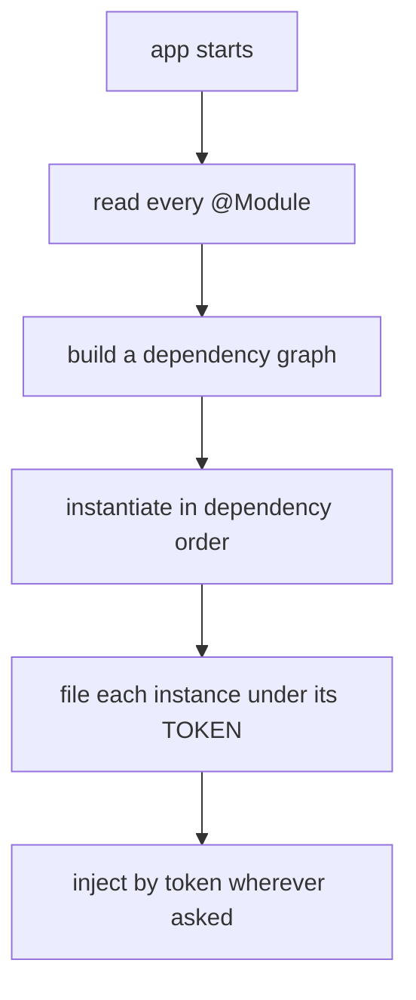
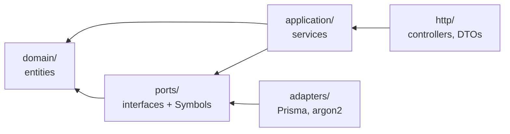
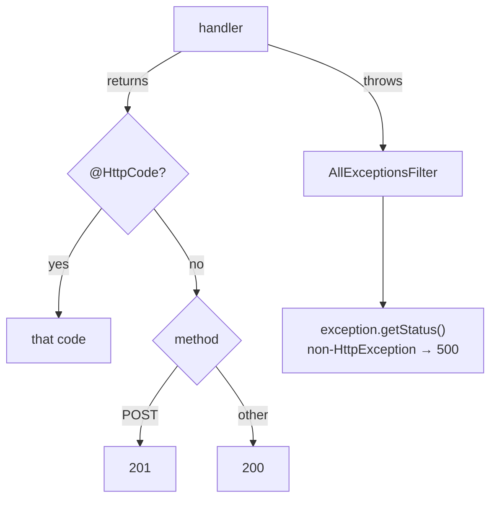

# NestJS — Week 1 revision workbook

### A graded rebuild of everything you built this week

---

## How to use this

This is **not** the reference guide. That's `apps/dojo/content/supplements/nestjs.md` — 21 parts,
look things up there. This is the thing you work *through*, once, on the weekend, to find out what
you actually learned versus what you copied.

**The rules:**

1. **Close your editor for Part A.** If you look at your own code, the exercise measures nothing.
2. **Write your answers in a scratch file.** Number them. Paste the whole thing to me.
3. **Answers are deliberately not in this document.** You'd read them. Everyone does.
4. **Guessing is allowed and encouraged.** A wrong answer you committed to teaches more than a
   blank — and it tells me exactly which model in your head is broken.

**Scoring — 100 points:**

| Part | What it tests | Points |
|---|---|---|
| **A** — Concept recall | Can you explain it without notes? | 30 |
| **B** — Spot the bug | Can you *see* a defect? The real skill | 30 |
| **C** — Design decisions | Can you defend a choice? Interview content | 20 |
| **D** — Rebuild from blank | Can you produce it alone? | 20 |

Below 60 means re-read the sections you lost points in before Week 2. **Above 85 means you're
ready to be asked about this in an interview.**

---

# The five ideas everything else hangs off

Read this section properly. The exercises assume it.

## 1. Nest is a container that builds your objects for you

You never write `new AuthService(...)`. You declare what a class needs, and Nest works out the
order to build things in.



**The token is the whole mechanism.** A provider is stored under a key:

- `AuthService` — the class itself is the key
- `PASSWORD_HASHER` — a `Symbol` is the key, and `useClass` says what to build

`@Inject(PASSWORD_HASHER)` means *"look up whatever is filed under this Symbol"*. The interface
`PasswordHasher` is **erased at compile time** — it cannot be a token. That's why ports need a
Symbol and services don't.

> **The one sentence:** *the interface says WHAT, the module says WHICH, and at runtime there is
> only the object.*

## 2. A provider is private to its module

Two doors, both must be open:

```
UsersModule:  exports: [UsersService]      ← the door out
AuthModule:   imports: [UsersModule]       ← the door in
```

`USERS_REPOSITORY` is in `UsersModule`'s providers but **not** its exports — so `AuthModule` can
use `UsersService` and cannot touch the database directly. That's not an accident, it's the
boundary.

**`@Global()` is the exception**, not a convenience. `PrismaModule` uses it because one database
connection is genuinely app-wide. Use it twice more and you've made every dependency invisible.

## 3. A module gives you a tool. Only the pipeline makes things automatic

This is the one you got wrong mid-week, and it's worth stating flatly:

> **`JwtModule.registerAsync` does not verify anything.** It puts a configured `JwtService` in the
> container. Nothing is checked until *you* call `verifyAsync`.

The only things that run on every request are ones you registered in the **pipeline**:

```
middleware → GUARD → interceptor → PIPE → handler → FILTER
```

Your `main.ts` has exactly three: `cookieParser`, `ValidationPipe`, `AllExceptionsFilter`. Task 5.1
adds a fourth.

## 4. Dependencies point inward



**Nothing inward knows anything outward.** `AuthService` names `PasswordHasher`, never `Argon2Hasher`.
`RefreshTokenService` names `RefreshTokenRepository`, never `PrismaRefreshTokenRepository`.

The test: **if you swapped Postgres for Mongo, which files change?** Only `adapters/`. If any other
file would change, the rule is broken somewhere.

The payoff is not theoretical — it's why your `argon2-password.hasher.spec.ts` needed no Nest, no
database, and ran in 0.8 seconds.

## 5. Return a value or throw — two different paths to a response



`POST → 201` is hardcoded in Nest's source. That's why `login` needed `@HttpCode(200)` — it creates
nothing.

---

# PART A — Concept recall · 30 points

**Close the editor.** Answer in your own words. One short paragraph each, not an essay.

**A1 (3 pts).** Your `AuthService` constructor injects `UsersService` normally but needs
`@Inject(PASSWORD_HASHER)` for the hasher. Why does one need the decorator and the other doesn't?

**A2 (3 pts).** `AuthModule` imports `UsersModule`. Can `AuthService` inject `USERS_REPOSITORY`?
Explain your answer using the words *providers* and *exports*.

**A3 (3 pts).** What exactly does `JwtModule.registerAsync` put into your application? What does it
**not** do?

**A4 (3 pts).** Why does `registerAsync` exist at all — why couldn't you write
`JwtModule.register({ secret: process.env.JWT_SECRET })`? Give two reasons.

**A5 (3 pts).** `verify()` appears twice in your codebase with completely different meanings. Name
both, say what each compares, and why one takes two arguments and the other takes one.

**A6 (3 pts).** A JWT arrives at your server. Describe, in order, the steps that decide whether it's
genuine. At which step does the payload become trustworthy?

**A7 (3 pts).** Why is the refresh token **not** a JWT? What would break if you made it one?

**A8 (3 pts).** Why is `revoke()` an `update` and not a `delete`? Name the specific capability you'd
lose.

**A9 (3 pts).** What is a token *family*, and what is the one question `revokeFamily` answers that
`revoke` cannot?

**A10 (3 pts).** Your DTO properties are declared `email!: string` with a `!`. What is the `!` doing,
why is the code *correct* despite the assertion, and what enforces that correctness at runtime?

---

# PART B — Spot the bug · 30 points

**Every one of these is a bug that actually appeared in your code this week.** Three points each:
1 for spotting it, 1 for explaining the mechanism, 1 for the fix.

Some snippets have **no** bug. Saying "correct" when it is correct scores full marks; inventing a
problem scores zero.

**B1.**
```ts
@Injectable()
export class AuthService {
  private readonly dummyHash = this.hasher.hash(randomBytes(32).toString('hex'));
  constructor(@Inject(PASSWORD_HASHER) private readonly hasher: PasswordHasher) {}
}
```

**B2.**
```ts
const expiresAt = new Date(Date.now() + 7 * 24 * 60 * 60);
```

**B3.**
```ts
async revokeFamily(family: string): Promise<void> {
  await this.prisma.refreshToken.updateMany({
    where: { family },
    data: { revokedAt: null },
  });
}
```

**B4.**
```ts
async login(dto: LoginDto) {
  const user = await this.users.getCredentialsByEmail(dto.email);
  if (!user) throw new UnauthorizedException('No account with that email');
  const ok = await this.hasher.verify(user.passwordHash, dto.password);
  if (!ok) throw new UnauthorizedException('Incorrect password');
  return { accessToken: await this.jwt.signAsync({ sub: user.id }) };
}
```
*(There are **three** separate problems here. One point each — this question is worth 3 on its own.)*

**B5.**
```ts
async findByEmail(email: string): Promise<User | null> {
  const user = await this.prisma.user.findUnique({ where: { email } });
  return user;
}
```

**B6.**
```ts
@Module({
  controllers: [AuthController],
  providers: [AuthService],
  imports: [UsersService],
})
export class AuthModule {}
```

**B7.**
```ts
async refresh(presented: string) {
  const row = await this.tokens.findByHash(this.hash(presented));
  if (!row) throw new UnauthorizedException();
  if (row.expiresAt < new Date()) throw new UnauthorizedException();
  if (row.revokedAt !== null) {
    await this.tokens.revokeFamily(row.family);
    throw new UnauthorizedException();
  }
  await this.tokens.revoke(row.id);
  return this.issue(row.userId, row.family);
}
```

**B8.**
```ts
async refresh(@Res({ passthrough: true }) res: Response, @Req() req: Request) {
  const presented = req.cookies['refresh'];
  const { accessToken } = await this.service.refresh(presented);
  this.setRefreshCookie(res, presented);
  return { accessToken };
}
```

**B9.**
```ts
private setRefreshCookie(res: Response, token: string): void {
  res.cookie('refresh', token, {
    httpOnly: true,
    secure: true,
    sameSite: 'lax',
    path: '/auth',
    maxAge: 7 * 24 * 60 * 60 * 1000,
  });
}
```
*(Assume `NODE_ENV=development` and you're testing on `http://localhost:3000`.)*

**B10.**
```ts
async logout(token: string | undefined): Promise<void> {
  if (!token) throw new UnauthorizedException();
  await this.refreshTokenService.revokeSession(token);
}
```

---

# PART C — Design decisions · 20 points

Five points each. **Answer as if in an interview** — state the decision, the alternative you
rejected, and *why*. An answer with no rejected alternative scores at most 2.

**C1.** Argon2id for passwords, SHA-256 for refresh tokens. Justify using **different** hashes for
two things that are both "secrets in a database".

**C2.** Access token in memory, refresh token in an httpOnly cookie. Walk through both attacks this
defends against and name what each half gives up.

**C3.** The guard is registered **globally with a `@Public()` opt-out** rather than applied
per-route. Argue for this over the alternative, and name the failure mode of each.

**C4.** You return the **same** 401 for an unknown email, a wrong password, an expired refresh
token, and a replayed one. Someone on your team says the different messages make debugging easier.
Respond.

---

# PART D — Rebuild from blank · 20 points

**Close everything. New empty file.** From memory, write:

**D1 (12 pts).** The complete `RefreshTokenService.rotate()` method — every check, in the right
order, with the right consequence for each.

Marked on: all five checks present (5), **correct order** (3), `revokeFamily` on the right branch (2),
same family passed to `issue` (1), identical errors (1).

**D2 (8 pts).** The `PasswordHasher` port and its argon2 adapter — interface, Symbol, class, both
methods with correct argument order.

Marked on: interface shape (2), the Symbol and why (2), `implements` not `extends` (1),
**`verify(hash, plain)` order** (2), no constructor (1).

> **Why from blank and not "explain it":** you can recognise correct code and still be unable to
> produce it. Recognition is what fails you in an interview. This is the only exercise here that
> tests production.

---

# Tips — how to think about these

**When something "doesn't work", check the boring things first.** Three of this week's worst
time-sinks were a stale server on port 3001, a stale TypeScript server in the editor, and a branch
switch. Before any clever theory:

```bash
ss -ltnp | grep 3001     # exactly ONE pid?
git status               # the branch you think you're on?
pnpm --filter api exec tsc --noEmit   # does the compiler agree with your editor?
```

**When your editor and the compiler disagree, the compiler is right.**

---

**A green `tsc` proves shape, never meaning.** Both of these compiled fine and were catastrophic:

```ts
data: { revokedAt: null }          // un-revokes the family it was meant to kill
this.setRefreshCookie(res, presented);   // stores the token rotation just revoked
```

Type-checking asks *"do these fit together?"*, never *"is this what you meant?"* The second question
is what tests are for — which is why 7.1 exists.

---

**`where` filters. `data` writes.** If you ever stare at a Prisma call and feel lost, ask which of
those two jobs each block is doing. Most confusion there is the two blurring together.

---

**Read the error's first line, not the last.** `Property 'data' is missing`,
`Expected 1 arguments, but got 0`, `Cannot find name 'refreshToken'` — every one of those named the
fix exactly. The stack below is noise.

---

**"Same shape, different meaning" is where bugs live.** `verify` on a hasher vs a JWT. `revoke` vs
`revokeFamily`. `token` vs `tokenHash`. `presented` vs `rotated`. Name variables so the *pair*
can't be confused — `presented`/`rotated` exists precisely because `refreshToken`/`refreshToken`
caused a real bug.

---

**When designing, ask "what changes if I swap the database?"** If the answer is more than
`adapters/`, something is in the wrong layer. That single question resolves most "where does this
code go" moments without any theory.

---

**Security decisions need a rejected alternative.** "I used Argon2" proves nothing. "I used Argon2id
over bcrypt because bcrypt's work factor doesn't scale with *memory*, and GPU attacks are
memory-cheap" proves you understood the trade-off. Every ADR you write should read like the second.

---

# Submitting

Paste your answers as one message:

```
A1. ...
A2. ...
B1. bug / no bug — mechanism — fix
...
D1.
```

I'll return a score out of 100, a breakdown per part, and — for anything you lost points on — the
specific thing to re-read rather than a general "study more".

**Do Part D last and do it honestly.** It's the one that predicts whether you could build this
again in three weeks without help.
