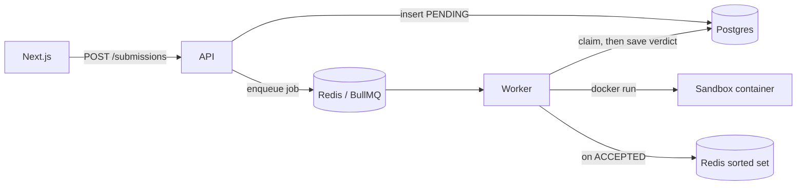

# CodeArena

CodeArena is a competitive programming platform: you pick a problem, submit a solution, and a worker runs it against hidden tests inside a locked-down Docker container and returns a verdict. Problems use stdin/stdout like Codeforces, and the plan is a LeetCode-style practice mode plus rated contests ([ADR-006](docs/adr/006-leetcode-codeforces-hybrid.md)).

It's a pnpm monorepo: a NestJS API, a NestJS judge worker, and a Next.js frontend, backed by Postgres and Redis.

## Status

Built and tested:

- **Auth**: register, login, logout, `/auth/me`. Passwords are hashed with Argon2id. Access tokens are short-lived JWTs kept in memory; refresh tokens sit in an httpOnly cookie, rotate on every use, and a reused token revokes its whole family. The credential endpoints are rate-limited per IP.
- **Problems**: a paginated list (keyset pagination) and a detail endpoint.
- **Submissions**: `POST /submissions` stores the submission, returns `202`, and puts a job on a BullMQ queue. The worker claims it, runs it, and writes the verdict (`ACCEPTED`, `WRONG_ANSWER`, `TIME_LIMIT`, `MEMORY_LIMIT`, `OUTPUT_LIMIT`, `RUNTIME_ERROR`). `GET /submissions/:id` returns the result to its owner.
- **Leaderboard**: a Redis sorted set, updated by the worker when a submission is accepted. Ties are broken by who got there first.

In progress:

- The judge runs **JavaScript** only for now; the schema already lists TypeScript, Python, C++ and Java.
- On the frontend, sign-in, registration, the problem list and the problem page use the API. The leaderboard, profile, settings and contests pages, and the editor's Run button, still use mock data.
- Next up: deployment (a VM, HTTPS, CI/CD), then an AI hint for failed submissions, run on a self-hosted model and measured with evals.

## How a submission is judged



The queue delivers each job at least once, so the worker has to cope with duplicates and crashes. Before running anything it claims the submission with a single conditional `UPDATE` that takes a lease. A second worker that gets the same job finds it already claimed and stops. If a worker dies mid-run, the lease expires and the job can be picked up again; if it fails for good, the submission ends as `SYSTEM_ERROR` instead of staying `PENDING` forever.

Each test runs in a fresh container with:

- no network (`--network none`);
- a read-only root filesystem, and a small `noexec` tmpfs for `/tmp`;
- a memory cap with swap disabled, a PID limit (no fork bombs), and one CPU;
- every Linux capability dropped, `no-new-privileges`, and the `nobody` user;
- the code mounted read-only.

The time limit is enforced from outside the container, by killing it. Six adversarial tests (a fork bomb, an infinite loop, a 4 GB allocation, a network call, a filesystem escape, reading `/etc/passwd`) run in CI against a real Docker daemon, and CI fails if a test leaves a container behind.

## Stack

| | |
| --- | --- |
| API and worker | NestJS 11, TypeScript, Prisma 7 |
| Frontend | Next.js 16, React 19, TanStack Query, Tailwind CSS 4 |
| Data | PostgreSQL 16, Redis 7 |
| Queue | BullMQ |
| Tests | Jest: unit tests against fakes, e2e tests against real Postgres and Redis, sandbox tests against real Docker |
| CI | GitHub Actions: lint, typecheck, build, all test suites, commit message checks, a gitleaks scan of the whole history |

The backend follows a ports-and-adapters layout: each module has `domain/`, `application/`, `ports/` and `adapters/` folders, so the services are unit-tested against in-memory fakes and the infrastructure (Prisma, BullMQ, Docker, Redis) stays at the edges.

## Running it locally

You need Node 24+, pnpm 10 and Docker.

```bash
pnpm install
pnpm infra:up                        # Postgres on 5433, Redis on 6379

cp apps/api/.env.example apps/api/.env
cp apps/worker/.env.example apps/worker/.env
cp apps/web/.env.example apps/web/.env.local

pnpm --filter api exec prisma migrate deploy
pnpm --filter api exec prisma generate   # generates the API's and the worker's clients
pnpm --filter api exec prisma db seed

pnpm dev:api       # http://localhost:3001
pnpm dev:worker
pnpm dev:web       # http://localhost:3000
```

Set `JWT_SECRET` in `apps/api/.env` to a random value first: `openssl rand -base64 32`.

## Tests

```bash
pnpm test                                      # unit tests, every package
pnpm --filter api test:e2e                     # needs Postgres and Redis running
pnpm --filter worker run test:integration      # needs Docker, Postgres and Redis
pnpm --filter worker run test:adversarial      # the six sandbox escapes
```

## Repository layout

```
apps/
  api/      REST API: auth, problems, submissions, leaderboard
  worker/   judge: queue consumer, Docker sandbox, verdicts
  web/      Next.js frontend
  dojo/     a study app I built alongside the project (see below)
docs/
  adr/      architecture decision records
  perf/     six slow queries, their EXPLAIN plans before and after, and the indexes that fixed them
```

## Design notes

- [Architecture decision records](docs/adr/README.md): password hashing, token rotation, where tokens are stored, rate limiting, the product direction, the query plans, and how the worker reaches the database.
- [Query performance](docs/perf/README.md): each query measured with `EXPLAIN (ANALYZE, BUFFERS)` on a seeded dataset, before and after its index.

## The dojo

`apps/dojo` is a separate Next.js app (`pnpm dev:dojo`, port 3002) that I use to learn the concepts behind each part of CodeArena: guides, generated quizzes, coding exercises run in a Web Worker, a DSA problem set, spaced review, and hands-on labs. The phase guides it renders live in `docs/`. It isn't part of the product, and nothing in the other apps depends on it.
