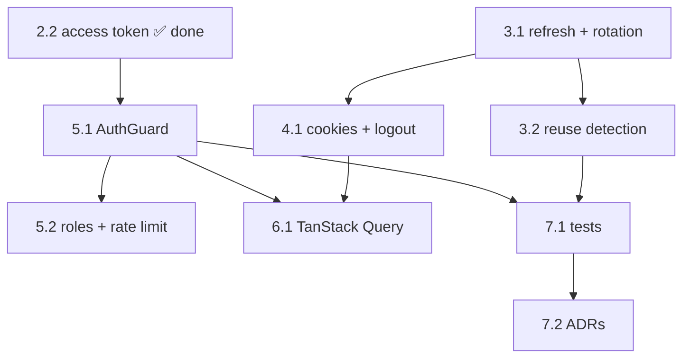
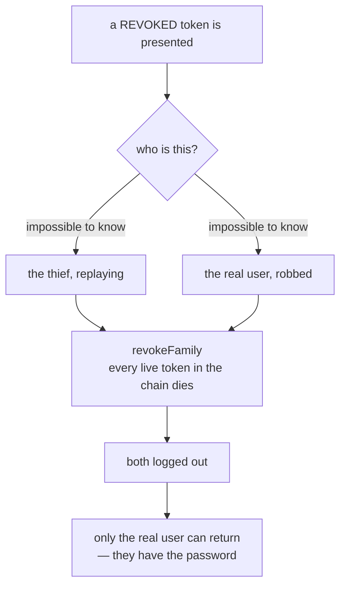
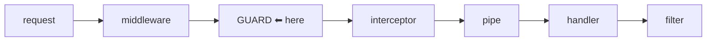

# Week 1 — Finish it in 2 days

### Tue 8 Sep → Wed 9 Sep 2026 · everything left, compressed

---

## Read this first

You have **9 tasks left** and 2 days. That is roughly 4 days of work. This document is written so
that **one read is enough** — every task tells you what to build, why it exists, the exact shape of
the files, the traps, and a command that proves you're done.

Three rules for these two days:

1. **Do not read anything not linked here.** The reading is already trimmed to what the task needs.
2. **Prove each task before moving on.** Every task ends with a copy-pasteable check. If it doesn't
   pass, you are not done, and building on top of it will cost you triple.
3. **If you fall behind, cut in this order:** 6.1 (TanStack) → 7.2 (ADRs) → 5.2 (roles).
   **Never cut 7.1 (tests) or 3.2 (reuse detection).** Those two are the interview content.

### The dependency map — why the order is what it is



**5.1 does not need cookies.** If 4.1 turns into a CORS fight, drop it and go straight to 5.1 —
nothing downstream except the frontend cares.

---

# DAY 1 — Tuesday

| Block | Time | What |
|---|---|---|
| ① Review | 0:30 | SRS queue. Do not skip |
| ② Build | 3:00 | **3.1** refresh + rotation |
| ③ Build | 1:00 | **3.2** reuse detection |
| — | 0:45 | Eat, away from the screen |
| ④ Build | 2:30 | **4.1** cookies + logout |
| ⑤ DSA | 1:00 | 2 problems, worked properly |
| ⑥ Write | 0:30 | Commit, and one line in `PROGRESS.md` |

---

## Task 3.1 — Refresh tokens and rotation

### What you're building, in one sentence

Login stops returning one token and starts returning **two**, and a new endpoint trades an old
refresh token for a fresh pair.

### Why, explained simply

Think of a **cinema**.

- The **access token** is your ticket stub. The usher glances at it — no phone call, no list, just
  looks at it. Fast. But once printed, **nobody can cancel it.** So you print it valid for 15
  minutes only.
- The **refresh token** is your **membership card**. It's in the cinema's computer. It lasts a year.
  If you report it stolen, they **delete the row** and it stops working instantly.

You show the stub hundreds of times (cheap, no lookup). You show the membership card once every 15
minutes to get a new stub (one lookup, but revocable).

**Rotation** is the extra rule: **every time you use the membership card, they shred it and give you
a new one.** Each card works exactly once.

### What already exists

- ✅ `RefreshToken` model in `schema.prisma` — `tokenHash`, `family`, `revokedAt`, `expiresAt`
- ✅ `ports/refresh-token.repository.ts`
- ✅ `adapters/prisma-refresh-token.repository.ts`
- ✅ `application/refresh-token.service.ts` — scaffolded with pseudocode, bodies empty

### Steps, in order

**Step 1 — fill in `hash()`.** SHA-256 of the token, hex. `node:crypto` → `createHash`.

> **Why SHA-256 and not Argon2?** Argon2 is slow *on purpose*, so that guessing a human password
> costs the attacker real money. A 32-byte random token has **nothing to guess** — there's no
> dictionary of likely values. And this runs on every refresh, so slowness would be pure cost.

**Step 2 — fill in `issue()`.** Follow the pseudocode in the file. Two values, don't confuse them:

```
token      = randomBytes(32).toString('base64url')   → returned to the client, NEVER stored
tokenHash  = sha256(token)                           → stored, NEVER leaves the server
```

**Step 3 — `issueForLogin()`.** One line: a fresh `randomUUID()` family, then `issue()`.

**Step 4 — wire the module.** In `auth.module.ts` providers, add `RefreshTokenService` and
`{ provide: REFRESH_TOKEN_REPOSITORY, useClass: PrismaRefreshTokenRepository }`.

**Step 5 — `AuthService.login()`** returns the pair instead of just `accessToken`.

**Step 6 — `rotate()`** and `POST /auth/refresh`. Follow the pseudocode. Order matters and the file
says why.

### The traps

| Trap | What happens | Fix |
|---|---|---|
| `Date.now() + 7*24*60*60` | Tokens expire in **10 minutes** — `Date.now()` is milliseconds | `* 1000` |
| Storing the raw token in `tokenHash` | Defeats the entire point of the column | Hash it |
| New `family` on rotation | Chain is orphaned, 3.2 never fires | Reuse `row.family` |
| Different 401 messages per failure | Tells an attacker which check failed | One message for all |

### ✅ Done when

```bash
# 1. login returns TWO tokens
curl -s -X POST localhost:3001/auth/login -H 'Content-Type: application/json' \
  -d '{"email":"YOU@test.com","password":"YOUR-PASSWORD"}' | jq

# 2. refresh returns a NEW pair
curl -s -X POST localhost:3001/auth/refresh -H 'Content-Type: application/json' \
  -d '{"refreshToken":"<R1>"}' | jq

# 3. the DB holds hashes, not tokens
docker exec -it codearena-postgres psql -U postgres -d codearena \
  -c 'SELECT "tokenHash", family, "revokedAt" FROM "RefreshToken" ORDER BY "createdAt";'
```

Row 1 must have a `revokedAt`; row 2 must be `null`; both must share a `family`. The `tokenHash`
values must be 64 hex characters — **nothing you could paste into curl.**

---

## Task 3.2 — Reuse detection

### What you're building

One `if` branch. That's genuinely all it is — and it's the most interview-worthy thing in Week 1.

### Why, explained simply

Someone photocopies your membership card. Now two people hold **the same card**.

Whoever uses it first gets a new card; the old one is shredded. When the second person turns up with
the shredded card, the cinema knows: **this card was already used.**

They cannot tell who's the thief and who's the victim. So they do the only safe thing — **cancel the
whole membership** and make you come to the desk with your passport.

Your passport is the password. The thief doesn't have one.



**Why a replay proves theft:** an honest client always holds the newest token. It has no reason to
ever send an old one. So an old one arriving means the chain leaked.

### Steps

In `rotate()`, before the expiry check:

```
if (row.revokedAt !== null) {
  await tokens.revokeFamily(row.family)
  throw Unauthorized
}
```

Check **this before expiry** — an expired *and* replayed token is still a replay, and you want the
family burned.

### ✅ Done when

```bash
# refresh once with R1 -> you get R2
# then send R1 AGAIN:
curl -s -o /dev/null -w '%{http_code}\n' -X POST localhost:3001/auth/refresh \
  -H 'Content-Type: application/json' -d '{"refreshToken":"<R1 again>"}'
# expect 401

# every row in that family now has a revokedAt:
docker exec -it codearena-postgres psql -U postgres -d codearena \
  -c "SELECT family, \"revokedAt\" FROM \"RefreshToken\" WHERE family = '<that family>';"
```

**No row may be null.** If R2 is still null, `revokeFamily` isn't being called or its `where` is
wrong.

Then try to use R2 — it must fail. That's the proof the thief was locked out too.

---

## Task 4.1 — httpOnly cookies, logout, CSRF

### What you're building

The refresh token stops travelling in the JSON body and starts living in a cookie the browser
manages. Plus `POST /auth/logout`.

### Why, explained simply — two burglars

**Burglar 1: XSS.** Someone gets their JavaScript running on your page (a bad npm package, an
unescaped comment). That script can read anything your own script can read — including
`localStorage`. It ships your token to them.

> **Rule: anything JavaScript can read is stolen the moment you have any XSS.**

**The fix:** an `httpOnly` cookie. The browser attaches it to requests automatically, and
`document.cookie` **cannot see it**. XSS has nothing to steal.

**Burglar 2: CSRF.** But now the browser sends that cookie **automatically, on every request to your
domain** — including requests started by a malicious page:

```html
<!-- on evil.com, while you're logged into your app -->
<form action="https://yourapp.com/transfer" method="POST">…</form>
<script>document.forms[0].submit()</script>
```

They can't *read* anything. They don't need to — the browser attaches the cookie for them.

**The fix:** `SameSite=Lax`. The browser refuses to attach the cookie to requests started by another
site, except top-level GET navigation (which is safe, because GETs must never change state).

### The decision table — this is the whole task

| | `localStorage` | httpOnly cookie | memory (a JS variable) |
|---|---|---|---|
| Readable by JS | ✅ **stolen by XSS** | ❌ safe | ✅ but dies on tab close |
| Sent automatically | ❌ | ✅ **CSRF risk** | ❌ |
| Survives refresh | ✅ | ✅ | ❌ |

**The verdict you must be able to defend:**
- **Refresh token → httpOnly cookie.** Long-lived, so XSS-proof storage matters most. CSRF handled by `SameSite`.
- **Access token → memory only.** Short-lived, never persisted, never sent automatically, so it can't be CSRF'd. Losing it on page refresh is fine — that's what the refresh cookie is for.

### Steps

**Step 1** — `pnpm --filter api add cookie-parser` and `-D @types/cookie-parser`, then
`app.use(cookieParser())` in `main.ts`.

**Step 2** — login and refresh set the cookie instead of returning `refreshToken` in the body. The
flags you need and what each does:

| Flag | Meaning | Value |
|---|---|---|
| `httpOnly` | JavaScript cannot read it | `true` |
| `secure` | HTTPS only | `NODE_ENV === 'production'` |
| `sameSite` | Don't attach on cross-site requests | `'lax'` |
| `path` | Only sent to this path | `'/auth'` |
| `maxAge` | Cookie lifetime, **milliseconds** | 7 days |

**Step 3** — `refresh` reads `req.cookies['refresh']` instead of a body field.

**Step 4** — `POST /auth/logout`: clear the cookie **and** `revokeFamily`. Must be **idempotent** —
clicking it twice succeeds twice. "Delete if exists", never "error if already gone".

**Step 5** — CORS. In `main.ts`, `enableCors` needs `credentials: true`, and the frontend fetch
needs `credentials: 'include'`.

### The CORS error you WILL hit

> `Access-Control-Allow-Origin` cannot be `*` when credentials are included.

**That's not a bug.** The browser refuses to send cookies to a wildcard origin — otherwise any site
could read your authenticated responses. You must name the exact origin. Yours already does
(`http://localhost:3000`), so you only need to add `credentials: true`.

### ✅ Done when

- DevTools → Application → Cookies shows `refresh` with **HttpOnly ✓** and **SameSite: Lax**
- `document.cookie` in the console does **not** show it
- Logout clears it, and a subsequent refresh returns 401
- Calling logout twice returns success both times

---

# DAY 2 — Wednesday

| Block | Time | What |
|---|---|---|
| ① Review | 0:30 | SRS queue |
| ② Build | 2:00 | **5.1** AuthGuard + `@CurrentUser()` |
| ③ Build | 1:15 | **5.2** roles + rate limiting |
| — | 0:45 | Eat |
| ④ Build | 2:00 | **7.1** tests — do this BEFORE TanStack |
| ⑤ Build | 2:30 | **6.1** TanStack Query |
| ⑥ Write | 1:00 | **7.2** ADRs + **7.3** retro |

**Tests before TanStack** deliberately. If the day runs out, you want the auth chain proven, not a
prettier frontend.

---

## Task 5.1 — AuthGuard and `@CurrentUser()`

### What you're building

The thing that **actually checks** your access tokens. Right now nothing does — `GET /problems`
returns 200 with `Authorization: Bearer total-nonsense`.

### Why, explained simply

Right now your app is a cinema that prints tickets and **has no usher.** Anyone walks in.

A **guard** is the usher. It stands before every screen, looks at the stub, and either lets you
through or turns you away. It does this in **one place** — you don't put an usher inside every seat.

### Where it runs



**Before the pipe, before the handler.** By the time your controller runs, the request is already
either authenticated or rejected. Your services never check a token.

### The three pieces

| Piece | What it is | What it does |
|---|---|---|
| `AuthGuard` | a class with `canActivate()` | reads the `Authorization` header, calls `jwt.verifyAsync`, attaches the payload to `request.user` |
| `@CurrentUser()` | a param decorator | pulls `request.user` into a handler argument, so controllers never touch `request` |
| `@Public()` | `SetMetadata('isPublic', true)` | marks a route as not needing a token |

### The design decision worth understanding

**Global with an opt-out, not per-route opt-in.**

If auth were opt-in, the day someone forgets the decorator you have an **open endpoint** and nobody
notices. If it's opt-out, forgetting means a route is **too protected** — which fails loudly and
safely.

> **Default to secure. Make the unsafe thing the one you have to type.**

Register it globally in `app.module.ts` providers with `{ provide: APP_GUARD, useClass: AuthGuard }`.

### How `@Public()` is read

`SetMetadata` writes a note onto the route. The guard reads it back with `Reflector`:

```
decorator writes the note  →  guard reads the note  →  decision
```

That two-step is the same mechanism `@Controller` and `@Post` use. Learn it once; it reappears
everywhere in Nest.

### ✅ Done when

```bash
curl -s -o /dev/null -w '%{http_code}\n' localhost:3001/problems?limit=1        # 200 (@Public)
curl -s -o /dev/null -w '%{http_code}\n' localhost:3001/auth/me                 # 401
curl -s -o /dev/null -w '%{http_code}\n' localhost:3001/auth/me \
  -H "Authorization: Bearer $TOKEN"                                             # 200
curl -s -o /dev/null -w '%{http_code}\n' localhost:3001/auth/me \
  -H "Authorization: Bearer garbage"                                            # 401
```

And: `grep -rn 'request.user\|req.user' apps/api/src --include='*.controller.ts'` returns **nothing**
outside the decorator.

---

## Task 5.2 — Roles and rate limiting

### Why, explained simply

**401 vs 403** — the distinction people fumble in interviews:

| | Meaning | Plain English |
|---|---|---|
| **401** Unauthorized | I don't know who you are | *"Who are you?"* |
| **403** Forbidden | I know who you are, and no | *"I know you. You still can't."* |

Authentication = **who are you**. Authorization = **may you do this**. Two guards, running in order.

**Rate limiting** is the other half of your password hashing. Argon2 takes 45ms *per guess*. Without
a rate limit, an attacker just makes a million guesses — slowly, but they get there.

> **A slow hash only matters if you also cap the number of attempts.** The two work together; either
> alone is close to useless.

### Steps

1. `pnpm --filter api add @nestjs/throttler`
2. `@Roles('ADMIN')` decorator + a `RolesGuard` that reads it via `Reflector` and compares against
   `request.user.role` — **which came from the JWT, so no database query**
3. One admin-only endpoint to prove it
4. `ThrottlerModule` with 5 requests per 60 seconds, applied to `/auth/login` and `/auth/register`
   only

**Per-IP is imperfect** — shared offices and mobile networks share IPs. It's still the standard first
line. Note the limitation in ADR-005; per-account lockout has its own denial-of-service trade-off and
is a later refinement.

### ✅ Done when

- A `USER` hitting the admin endpoint → **403**, not 401
- Six rapid login attempts → the sixth returns **429**
- `GET /problems` is not rate-limited

---

## Task 7.1 — Tests

### Why this is the highest-value hour of the two days

Everything else you built, you verified **by hand, once.** A test verifies it on every commit,
forever. And the e2e test below is the thing you'll describe in an interview.

### What to write

**1. Unit tests for `AuthService`** — with a **fake** `UsersRepository` and a **fake**
`PasswordHasher`. No database. No Argon2. Just objects with the right method names.

> **These must run in milliseconds.** If they don't, you're touching something real that should be
> behind a port — and the slow test is your architecture telling you it leaked.

Your ports exist precisely so this is possible. This test is the payoff for all that structure.

**2. One e2e test — write this one first:**

```
register → login → refresh → replay the OLD refresh token → expect 401
                                                          → expect the family dead
```

That single test proves rotation *and* reuse detection end to end. It is the most valuable test in
the repository.

**3. Add `pnpm --filter api test` to the CI workflow.**

### ✅ Done when

`pnpm --filter api test` green, CI green on `main`.

---

## Task 6.1 — TanStack Query

### Why, explained simply

Your `useState` + `useEffect` + `loading` + `error` dance is **re-implementing a cache, badly, in
every component.**

The insight: **server state is not your state.** It lives on the server. It can go stale. Two
components asking for the same thing should share **one** request, not fire two.

TanStack Query is that shared cache.

### Steps

1. `pnpm --filter web add @tanstack/react-query @tanstack/react-query-devtools`
2. `QueryClientProvider` at the app root, Devtools in development
3. `useProblems()` / `useProblem(slug)` replacing direct calls
4. `useLogin()` / `useRegister()` / `useLogout()` mutations
5. **Delete `apps/web/src/lib/api.ts`** — delete, don't comment

### The two things that decide whether this goes well

**Query keys are the entire API.** `['problems']`, `['problem', slug]`. Get the key design right and
invalidation is one line; get it wrong and you'll fight it all afternoon.

**Watch the Devtools panel while you work.** Navigate around and observe fetches, cache hits, stale
transitions. That visual builds the mental model faster than any explanation.

### The bug you must not ship

Your access token lives in memory and dies after 15 minutes. Without a **refresh interceptor** —
a wrapper that catches a 401, calls `/auth/refresh` once, and retries the original request — your
users get "randomly logged out" every 15 minutes.

**This is the single most common rookie auth bug.** Build the interceptor.

### ✅ Done when

- Navigating away from `/problems` and back does **not** refetch (watch Devtools)
- Logging in updates the header with no page reload
- `git ls-files apps/web/src/lib/api.ts` returns nothing
- Leave the tab for 20 minutes, come back, click something — **still logged in**

---

## Task 7.2 — ADRs · Task 7.3 — Retro

Four records, one page each, in `docs/adr/`:

- **ADR-002** — Argon2id over bcrypt
- **ADR-003** — access + refresh with rotation and reuse detection
- **ADR-004** — httpOnly cookie for refresh, memory for access
- **ADR-005** — per-IP rate limiting, and why not per-account

**The "Alternatives considered" section is the part interviewers read.** An ADR that lists only what
you chose proves nothing. One that says *"we rejected bcrypt because its work factor doesn't scale
with memory, and GPU attacks are memory-cheap"* proves you understood the trade-off.

Then in `PROGRESS.md`: what took longer than planned, what you skipped, what you'd do differently,
and your DSA counts. **Write it down.** The last plan died from debt that nothing reacted to.

---

# The gate — you are done when

- [ ] Register, login, refresh, logout all work
- [ ] Replaying a used refresh token → 401 **and** the family is dead
- [ ] Refresh token is httpOnly; `document.cookie` can't see it
- [ ] `GET /auth/me` → 401 without a token, 200 with one
- [ ] `@Roles('ADMIN')` → 403 for a normal user
- [ ] Six rapid logins → 429
- [ ] `pnpm --filter api test` green; CI green
- [ ] ADR-002 … 005 committed
- [ ] `PROGRESS.md` retro written

**If the gate fails, write down which box and why.** Week 2 opens by finishing it.

---

# DSA — 2 problems per day, not 3

You're behind on the build, so the DSA target drops. **Two properly-worked problems beat five
rushed ones.**

The method, unchanged:

1. **Brute force out loud first, with its complexity.** Always.
2. Ask what the brute force **repeats** — that repetition is what a hash map removes.
3. Only then write code.
4. After solving, **close it and re-derive the template from blank.**

Stay on Arrays & Hashing. Read the pattern's recognition block in the dojo guide before each
problem.

---

# One honest note

This plan is 4 days of work in 2. You will not finish all of it, and that is fine — the cut order at
the top exists for exactly that reason.

What must survive: **3.2, 5.1, and 7.1.** Reuse detection is the thing you'll be asked about. The
guard is what makes any of the auth real. The tests are what stop it silently breaking in Week 3.

Everything else can slide into Week 2 without costing you anything.
