# DSA Patterns — the families that cover most interviews

A Dojo guide. **DSA** = "Data Structures & Algorithms", the coding-puzzle part of tech interviews.
Here's the secret nobody tells beginners: these interviews reward **pattern recognition**, not raw
cleverness. Almost every problem is a re-skin of one of about twenty templates. Learn them and you'll
*recognize* far more than you ever have to invent.

We assume **no background.** §0 defines every data structure and every scary word from scratch — read
it first and the rest stops looking like a foreign language.

### What's in here

| Part | What it does |
|---|---|
| **§0 Building blocks** | Every structure and every bit of jargon, defined with pictures |
| **Recognising the pattern** | The prompt's own words → the pattern, as a lookup table |
| **Big-O refresher** | The growth ladder, and how to derive it rather than memorise it |
| **Reading the constraints** | Given `n`, what complexity fits — and what the setter *intends*. The highest-leverage 30 seconds in any problem |
| **Invariants** | How to *know* your loop is correct, instead of hoping. The skill the templates are made of |
| **The 22 pattern families** | One section each: the idea, the Big-O, the signals, **every variant as tested code**, and the traps |
| **Cross-cutting tricks** | Small reusable moves that live *inside* many patterns |
| **Three problems, solved out loud** | The whole loop end to end — classify → size → pick → prove → check |
| **Edge-case checklist** | The twenty-second sweep to run before you say "done" |
| **How to get faster** | The practice loop itself |

### The order is the curriculum

The sections are sequenced so that **nothing uses an idea it hasn't met yet.** If you're learning
rather than looking something up, read top to bottom — each block only needs the ones above it.

```
FOUNDATIONS      building blocks → classifying → Big-O → constraints → invariants
                        │
LINEAR           Arrays & Hashing → Two Pointers → Sliding Window → Linked List
                        │              (fast/slow carries straight into linked lists)
                 Stack → Monotonic Stack & Queue
                        │
SEARCH           Binary Search                       ← iterative; needs only arrays + invariants
                        │
RECURSION        Recursion & Backtracking            ← the hinge of the whole guide
                        │
                 ├── Sorting & Selection             ← merge sort IS recursion
                 └── Trees → DFS → BFS → Tries → Strings
                                │
                        Heaps → Graphs               ← Dijkstra needs a heap
                                │
OPTIMISATION     Intervals → Greedy                  ← "greedy fails here" is how you find DP
                        │
                 Bit Manipulation → Dynamic Programming   ← bitmask DP needs the bit idioms
                        │
                 Math & Geometry → Game Theory
```

Three dependencies are worth naming out loud, because they're the ones people trip over:

- **Recursion before Trees, DFS, Sorting and DP.** All four are recursion wearing different hats. A
  tree traversal *is* recursion; merge sort *is* recursion; DP is recursion plus a cache. Learn the
  choose → recurse → un-choose shape once and four sections become variations.
- **Heaps before Graphs**, because Dijkstra is BFS with a priority queue instead of a plain one.
  Reading Dijkstra without knowing what a heap costs is how people conclude it's magic.
- **Greedy before DP**, because the honest way to arrive at DP is to *try* greedy and find the
  counter-example. If you learn DP first you'll reach for it when a two-line greedy would do.

### How each pattern section is laid out

Always the same beats, so you can skim to the one you need:

0. **🔍 Recognise it** — the table you read *before* you know which pattern this is: the trigger
   words that appear in the prompt, the input shape, what the **constraint** is telling you, the
   complexity you're aiming for, and — the most useful row — **which pattern this gets confused
   with, and the one question that separates them.** Read this row for the two candidates you're
   torn between and the choice usually makes itself.
1. **The idea** — in plain words, with an analogy you can hold on to.
2. **Big-O** — time *and* space, because they always ask for both.
3. **Reach for it when** — the signals in the prompt that mean "this one".
4. **The variants** — the actual code. Most patterns have several skeletons that look similar and
   behave differently; each one says *use when* on the first line, and the near-identical pairs are
   contrasted directly, because that's exactly where bugs come from. **Each one states its own time
   and space complexity**, since that's what the constraints check is against.
4½. **Why it works** — the *invariant*: the one sentence that stays true through every iteration and
   hands you the answer at the end. This is the part worth reading twice. Code you can look up;
   knowing why a pointer is safe to move is what lets you rebuild it under pressure.
5. **Watch out for** — the traps, collected from the ways people actually lose the problem.

Then, near the end, **[Three problems, solved out loud](#three-problems-solved-out-loud)** runs all
of it together on problems you haven't been given the answer to — because knowing each piece and
being able to *sequence* them under pressure are different skills.

> **All the code here has been run.** Every skeleton was extracted from this file and executed
> against test cases — normal paths plus the edge cases (empty input, one element, all duplicates,
> no cycle, unreachable node, impossible target, disconnected graph, negative cycle).
> **81 programs, 126 assertions, all passing.** These are working programs, not pseudocode. Copy
> them if you like — but type each one at least once, because the muscle memory is the actual goal.

> **How to practise:** try each problem in the editor *before* revealing the solution. Getting stuck,
> then feeling the pattern click, is what builds recognition — problems run against real test cases
> in a sandbox, the same kind of judge you're building in CodeArena.

---

## 0. The building blocks, in plain words

An **algorithm** is just a step-by-step recipe. A **data structure** is a way of *organizing* data so
certain operations are fast. Here are the ones every pattern uses. Learn what each *is* and its
one-word superpower:

- **Array** — a numbered row of boxes, `a[0], a[1], a[2]…`. Jump to any box instantly by its number
  (index). Superpower: **instant access by position.** Weakness: inserting in the middle shoves
  everything over.
- **Hash map** (a.k.a. dictionary / object) — stores **key → value** pairs, like a real dictionary
  maps a word to its meaning. You look something up by *key* in ~one step, not by scanning.
  **Hash set** is the same thing storing just keys (a bag of "have I seen this?"). Superpower:
  **instant "do I have X?" and "what's X's value?"**
- **Stack** — a pile of plates: you add ("**push**") and remove ("**pop**") only from the **top**. The
  last thing in is the first thing out — called **LIFO** (Last In, First Out). Superpower: **remember
  what to deal with next, in reverse order** (undo, nesting, "most recent").
- **Queue** — a line at a shop: join at the back, leave from the front. First in, first out — **FIFO**.
  Superpower: **process things in arrival order** (fairness, "rings" of distance).
- **Deque** ("deck", double-ended queue) — a line you can add to or remove from **both** ends.
  Superpower: the flexible mix of stack and queue.
- **Linked list** — boxes connected by arrows: each box holds a value and a pointer to the *next* box.
  No numbered access; you follow arrows one at a time. Superpower: **rewiring/inserting without
  shifting everything.**
- **Tree** — a family tree: one **root** at top, each node has **children** below. A **binary tree**
  gives each node at most 2 children (left, right). A **BST** (binary *search* tree) keeps them
  sorted: smaller on the left, bigger on the right. Superpower: **hierarchy and fast sorted search.**
- **Graph** — dots (**nodes/vertices**) joined by lines (**edges**): a map of cities and roads, or
  friends and friendships. A tree is a special graph. A **grid** (like a game board) is also a graph —
  each cell connected to its neighbours. Superpower: **anything about connections, reachability,
  shortest routes.**
- **Heap / Priority Queue** — a magic bucket that always hands you the **smallest** (or largest) item
  next, even as new items pour in. Superpower: **"give me the current best" on repeat, cheaply.**

A few **recurring words** you'll meet everywhere — learn them once here:

- **In-place** — rearrange the input itself using no meaningful extra memory (O(1) space).
- **Monotonic** — always moving one way: only increasing, or only decreasing. A "monotonic stack" is a
  stack kept sorted.
- **Predicate** — a yes/no test, a function returning true/false ("is `k` big enough?").
- **Recursion** — a function that calls *itself* on a smaller piece of the problem (like standing
  between two mirrors). The **base case** is when it stops.
- **Backtracking** — try a choice, explore, then **undo it** and try the next — walking a tree of
  possibilities.
- **Memoization** — remember (cache) answers to subproblems you've already solved so you never redo
  them. ("Memo" = note-to-self.)
- **Invariant** — something that stays true the whole time; spotting one often cracks a puzzle instantly.
- **Amortized O(1)** — "on *average* per operation it's O(1)", even if one rare operation is pricier.
  (A stretchy array occasionally resizes, but averaged out each append is O(1).)

Keep this section bookmarked. Every pattern below is built from these pieces.

---

## How to recognize which pattern

Before writing any code, spend 30 seconds *classifying*. The **words in the prompt** usually name the
pattern for you:

| If the problem says… | Think… |
|---|---|
| "have I seen this", "count", "group by", "find the pair" | **Arrays & Hashing** |
| sorted array, "pair/triplet", palindrome, partition in place | **Two Pointers** |
| "longest/shortest/contains" over a *contiguous* subarray/substring | **Sliding Window** |
| matching brackets, "next greater/warmer", evaluate expression | **Stack** |
| "next greater" variants, spans, max/min of every window, "remove k to make smallest" | **Monotonic Stack & Queue** |
| sorted input, "find boundary/first-true", or "minimize the max k that works" | **Binary Search** |
| "all subsets/permutations/combinations", "generate every…" | **Backtracking** |
| binary tree / BST, "depth/path/ancestor" | **Trees** |
| "flood fill", "region", "can you reach", "all paths", path property in a tree | **DFS** |
| "shortest/fewest steps", "nearest X for every cell", level order, lock/word states | **BFS** |
| "starts with", autocomplete, dictionary with wildcards, many words vs one text | **Tries** |
| "k largest/smallest/closest", "most frequent", streaming median, changing minimum | **Heap / Priority Queue** |
| grid of cells, "islands/regions", "reachable", "shortest steps", prerequisites | **Graphs** |
| "reverse/reorder/merge a list", "n-th from end", cycle | **Linked List** |
| `[start, end]` pairs, "merge/overlap", "rooms/resources needed" | **Intervals** |
| "max/min you can achieve" with an obvious local choice | **Greedy** |
| "number of ways", "min/max cost", "can it be done", subsequences | **Dynamic Programming** |
| "appears once, rest twice", "without +", "O(1) space", sets of ≤ 32 items | **Bit Manipulation** |
| digits, primes, powers, rotate/spiral a matrix, overflow rules | **Math & Geometry** |
| "both play optimally", "who wins", one-line-answer puzzles | **Game Theory & Brain Teasers** |

Two habits that instantly make you sound senior: **say the Big-O of your idea out loud** (they always
ask, and it catches an accidental "oops, that's O(n²)" early), and if a simple greedy/one-pass idea has
a counter-example, **escalate to Dynamic Programming.**

## A Big-O refresher

**Big-O** measures how the work *grows* as the input `n` gets big, ignoring constants (full from-zero
explanation in [CS Fundamentals §6](/guides/cs-fundamentals)). Best to worst:
`O(1) < O(log n) < O(n) < O(n log n) < O(n²) < O(2ⁿ) < O(n!)`.

- **Time** = how many operations. **Space** = extra memory beyond the input (a recursion stack that
  goes `h` deep counts as O(h) space — recursion isn't free!).
- Landmarks to memorize: a hash lookup is **O(1)**; binary search is **O(log n)**; one scan is
  **O(n)**; a good sort is **O(n log n)**; a loop inside a loop is **O(n²)**; trying every subset is
  **O(2ⁿ)**; every ordering is **O(n!)**.
- Interviewers want the *dominant* term: `O(n + n log n)` is just `O(n log n)` (the bigger one wins).

---

## Reading the constraints — the highest-leverage 30 seconds

Before you write a line, scroll to **Constraints** and read `n`. It is not decoration: the problem
setter chose those bounds to *admit the intended solution and reject the naive one*. Read them right
and you often know the algorithm before you've finished reading the statement.

### The budget

A judge gives you roughly **one second**. The useful question is "how many real operations fit in
that?" — where "real" means array reads, comparisons, hash lookups, not empty loop iterations.

Measured on Node v24 (this dojo's runtime), doing actual algorithmic work:

| Work done | Time |
|---|---|
| 10⁷ ops — one pass over 10M items with a `Map` | **~120 ms** |
| 2.5 × 10⁷ ops — 5000 × 5000 DP table | **~80–215 ms** |
| 10⁸ ops — 10000 × 10000 DP table (typed array) | **~300 ms** |
| 10⁶ items sorted with a comparator | **~460 ms** |
| 11! ≈ 4 × 10⁷ permutations generated | **~900 ms** |

So the working rule:

> **10⁷ operations ≈ safe. 10⁸ ≈ the danger zone. 10⁹ ≈ TLE.**

Aim for **10⁷**. If your estimate lands at 10⁸ you're relying on a small constant factor and a
generous judge; at 10⁹ you are simply wrong and need a better algorithm, not a faster loop. (These
numbers are for JS/Java/C++. **Python is ~10–30× slower** — budget 10⁶ there, and expect to need
`sys.setrecursionlimit`, iteration instead of recursion, and built-ins doing the hot work.)

### The table — what each `n` permits

Find your `n`, read across. The right-hand column is what the setter almost certainly intends.

| Constraint | Ops at that bound | Affordable complexity | What the setter wants |
|---|---|---|---|
| **n ≤ 10** | 10! ≈ 3.6 × 10⁶ | **O(n!)**, O(n⁶) | Brute force. Generate every permutation. |
| **n ≤ 12** | 12! ≈ 4.8 × 10⁸ | O(n!) *with pruning* | Backtracking that prunes hard. |
| **n ≤ 20** | 2²⁰ ≈ 10⁶ | **O(2ⁿ)**, O(2ⁿ · n) | Subset enumeration, **bitmask DP**. |
| **n ≤ 24** | 2²⁴ ≈ 1.7 × 10⁷ | O(2ⁿ) | Still plain subsets — near the edge. |
| **n ≤ 40** | 2²⁰ per half | **O(2^(n/2))** | **Meet in the middle** — split, enumerate both halves, join. |
| **n ≤ 100** | 10⁸ | **O(n⁴)** | Four nested loops, or heavy interval DP. |
| **n ≤ 300** | 2.7 × 10⁷ | **O(n³)** | Interval DP, matrix-chain, Floyd–Warshall. (n ≤ 500 is 1.3 × 10⁸ — borderline; fine in C++/Java, ~1 s in JS.) |
| **n ≤ 5,000** | 2.5 × 10⁷ | **O(n²)** | 2-D DP: edit distance, LCS, palindromic substrings. |
| **n ≤ 10⁵** | 1.7 × 10⁶ | **O(n log n)** | Sort, heap, binary search, segment tree, sweep. |
| **n ≤ 10⁶** | 2 × 10⁷ | **O(n)**, O(n log n) tight | Two pointers, prefix sums, sieve, counting sort. |
| **n ≤ 10⁸** | — | **O(n)** with a tiny constant | Single streaming pass, no allocation. |
| **n ≤ 10⁹⁺** | — | **O(log n)** or **O(1)** | Binary search *on the answer*, closed-form math, matrix exponentiation. |

**The two boundaries worth memorising**, because they carry the most information:

- **n ≤ 20-ish → think in bits.** Nothing else explains such a tiny bound. `2ⁿ` subsets is the point,
  and if there's also a "for each subset, try each element" step, `O(2ⁿ · n)` at n=20 is 2 × 10⁷ —
  still fine. This is the single strongest signal in competitive programming.
- **n ≤ 5,000 → O(n²) is *intended*, not a fallback.** Don't burn twenty minutes hunting for an
  O(n log n) trick. The setter allowed quadratic on purpose. Conversely at **n ≤ 10⁵**, O(n²) = 10¹⁰
  and is instant death — that gap between 5,000 and 100,000 is where most TLEs live.

### Reading it backwards — inferring the algorithm

The bound doesn't just *permit* a complexity, it usually **names the algorithm**. Ask three questions
in order.

**Question 1 — what exactly is bounded?** Not just `n`. Note *every* bound: array length, value range,
number of queries, string length, alphabet size, coordinate range. The smallest bound is usually the
one the intended solution is exponential in.

**Question 2 — how do the bounds multiply?** When a problem gives you two bounds, the intended
complexity is almost always their product. `n ≤ 10⁵` with `k ≤ 10` means `O(n·k)`. `n ≤ 100` with
`W ≤ 10⁴` means `O(n·W)` — that's knapsack, and the `W` bound exists *only* to make the DP table fit.

**Question 3 — what shape is the answer?** "Count the ways" ≠ "find the best" ≠ "return any" ≠
"return all". Each points at a different family.

#### The exponential fingerprints (small `n` is the loudest signal)

A tiny bound is never an accident — it tells you the intended solution is exponential, and *which*
exponential. Computed ops at each bound:

| Bound | Ops | Algorithm the setter wants |
|---|---|---|
| `n ≤ 10` | 10! ≈ 3.6 × 10⁶ | Plain **permutation** backtracking |
| `n ≤ 12` | 2¹² · 12² ≈ 5.9 × 10⁵ | **Bitmask DP, TSP-shaped** — `dp[mask][last]` |
| `n ≤ 15–16` | 2¹⁶ · 16² ≈ 1.7 × 10⁷ | Bitmask DP with an `O(n²)` transition — the usual ceiling |
| `n ≤ 16–18` | 3¹⁶ ≈ 4.3 × 10⁷ | **Submask enumeration** (`for (s = m; s; s = (s-1) & m)`) — set-partition DP. Total work is `3ⁿ`, not `4ⁿ` |
| `n ≤ 20–22` | 2²⁰ · 20 ≈ 2.1 × 10⁷ | Bitmask DP with an `O(n)` transition, or plain subset enumeration |
| `n ≤ 24` | 2²⁴ ≈ 1.7 × 10⁷ | Enumerate all subsets, `O(1)` work each |
| `n ≤ 40` | 2²⁰ · 20 ≈ 2.1 × 10⁷ | **Meet in the middle** — the 40 is exactly 2 × 20 |

> **The `n ≤ 40` tell is the single most reliable one in the whole table.** 2⁴⁰ is 10¹² (hopeless) and
> there is no natural polynomial for subset-sum-flavoured problems, so 40 means *split into halves of
> 20, enumerate 2²⁰ each, sort one side, binary-search the other*. When you see 40 and "subsequence /
> subset / choose some elements", stop looking for anything cleverer.

#### The polynomial fingerprints

| Bound | Ops | Algorithm |
|---|---|---|
| `n ≤ 100` | 10⁸ | `O(n⁴)`, or `O(n³)` with a fat constant |
| `n ≤ 300` | 2.7 × 10⁷ | **Interval DP** — `dp[i][j]` over a range, `O(n³)`. Burst Balloons, matrix-chain, "remove boxes" |
| `n ≤ 400–500` | 1.3 × 10⁸ | **Floyd–Warshall** all-pairs shortest path. Genuinely borderline in JS — fine in C++/Java, expect ~0.5–1 s here |
| `n, m ≤ 500–1000` (**two** sequences) | 2.5 × 10⁵ – 10⁶ | **2-D DP on `(i, j)`** — edit distance, LCS, interleaving |
| `n ≤ 5,000` | 2.5 × 10⁷ | `O(n²)` — palindromic substrings, one-array 2-D DP |
| `n ≤ 10⁵` | 1.7 × 10⁶ | `O(n log n)` — sort, heap, binary search, **segment tree / BIT** if there are updates |
| `n ≤ 10⁶` | 2 × 10⁷ | `O(n)` — two pointers, prefix sums, sieve, counting |
| `n ≤ 10⁹`, one number | ~30 | **Binary search**, closed-form math, or **digit DP** |
| `n ≤ 10¹⁸` | `k³ log n` ≈ 10³ | **Matrix exponentiation** (linear recurrence) or pure math |

#### Two bounds — read the product

This is the part people miss, and it's where most of the information lives:

| You see | Intended | Why |
|---|---|---|
| `n ≤ 100`, `W ≤ 10⁴` | `O(n·W)` = 10⁶ | **0/1 knapsack.** The `W` bound *is* the DP dimension |
| `n ≤ 10⁵`, `k ≤ 10` | `O(n·k)` | k is small so it can be a loop or a DP dimension |
| `n ≤ 10⁵`, `k ≤ 20`, "choose k" | `O(n · 2ᵏ)` | k small enough to bitmask over |
| `n ≤ 2⁰⁰`, values `≤ 100` | `O(n · sum)` | Partition / subset-sum DP over the *total*, not over `n` |
| `n ≤ 10⁵`, `q ≤ 10⁵` queries | `O((n+q) log n)` | **Segment tree / BIT**, or sort the queries and go **offline** |
| `n ≤ 10⁵`, `q ≤ 10⁵`, *no updates* | `O(n + q)` | **Prefix sums** — no tree needed if nothing changes |
| grid `m, n ≤ 200` | `O(m·n)` or `O(m·n·4)` | BFS/DFS or grid DP; 200×200 = 4×10⁴ cells is tiny |
| `m·n ≤ 10⁵` (product bounded!) | `O(m·n)` | One dimension may be huge — never allocate `m×n` blindly |

#### Value-range signals

The *values* often matter more than the length:

| You see | Do |
|---|---|
| `1 ≤ a[i] ≤ n` | **Index-as-hash / cyclic sort.** O(1) space; the value *is* an index |
| values `≤ 100` or `≤ 10⁴`, `n` huge | **Counting / bucket sort** — complexity in the value range, not `n` |
| values up to `10⁹`, `n ≤ 10⁵` | **Coordinate compression** — only `n` distinct values matter |
| values up to `10⁹` but you need bits | **Binary trie** (max-XOR problems) — 30 levels, not `10⁹` |
| all values distinct | Ties can't happen — often removes a whole branch |
| alphabet is lowercase English | **26** — a fixed-size array beats a hash map, and 2²⁶ subsets is feasible |
| answer **mod 10⁹ + 7** | A **counting** problem → DP or combinatorics. The count is astronomically large, so there is no enumerate-then-count solution. *This is a very strong signal.* |
| "sum of `n` over all tests ≤ 10⁵" | Your *total* work is bounded, not per-test. Don't allocate `O(maxN)` per test case |

#### Graph-specific constraint reading

| You see | Algorithm |
|---|---|
| `n` nodes, `n-1` edges, connected | It's a **tree** — no cycles, so no visited-set needed going down; think tree DP / LCA |
| all edge weights equal (or unweighted) | **BFS**, not Dijkstra. Don't pay `log n` for nothing |
| weights are only 0 or 1 | **0-1 BFS** with a deque — `O(V+E)`, no heap |
| positive weights, `E log V` fits | **Dijkstra** with a binary heap |
| **negative** weights | **Bellman–Ford** (`O(V·E)`) — Dijkstra is simply wrong |
| "detect a negative cycle" | Bellman–Ford, `V`-th relaxation still improves |
| `V ≤ 400` and *all pairs* | **Floyd–Warshall**, `O(V³)` — simpler than `V` × Dijkstra |
| "prerequisites", "ordering", DAG | **Topological sort**, then DP along it |
| repeated "are these connected?" | **Union-Find** |

#### Answer-shape signals

| The question asks for | Family |
|---|---|
| "return **all** …" | Backtracking — and the output itself is exponential, hence tiny `n` |
| "return the **number of ways**" (esp. with a mod) | Counting **DP** / combinatorics |
| "return the **minimum / maximum** …" | DP, greedy, or **binary search on the answer** |
| "**minimum** largest / **maximum** smallest" | **Binary search on the answer**, near-certainly |
| "return **any** valid …" | **Greedy** |
| "return the **k-th** …" | Heap `O(n log k)`, quickselect `O(n)` avg, or binary search on value |
| "is it **possible** …" | Boolean DP, greedy, or graph reachability |
| "**in-place**, `O(1)` extra space" | Two pointers, cyclic sort, or marking inside the input |

#### Worked reads — constraints only, no statement

Cover the problem name and derive the algorithm from the bounds alone.

**1.** `1 <= nums.length <= 10` · *"return all possible subsets"*
→ Tiny `n` **and** "return all" ⇒ the *output* is `2ⁿ`. Backtracking. Nothing cleverer exists,
because just printing the answer is exponential.

**2.** `1 <= n <= 12` · a graph, *"shortest path visiting every node"*
→ 12 is the TSP fingerprint. `2¹² · 12² ≈ 5.9 × 10⁵`. **Bitmask DP** `dp[mask][last]` (or BFS over
`(node, mask)` states). Plain BFS over nodes can't work — you must remember *which set* you've visited.

**3.** `1 <= nums.length <= 40` · *"sum of a subsequence closest to goal"*
→ 40. `2⁴⁰ = 10¹²` is hopeless, `n²` makes no sense for subsequences. **Meet in the middle**: split
20/20, build `2²⁰ ≈ 10⁶` sums per half, sort one, binary-search the other.

**4.** `1 <= word1.length, word2.length <= 500` · *"minimum operations to convert"*
→ Two lengths, both ≤ 500 ⇒ `500 × 500 = 2.5 × 10⁵` states. **2-D DP on `(i, j)`.** Edit distance.

**5.** `1 <= weights.length <= 5·10⁴` · *"least capacity to ship within D days"*
→ "minimum capacity such that it fits in D days" is the **binary search on the answer** phrasing.
`ok(capacity)` is a linear greedy sweep. `O(n log(sum))` ≈ 5 × 10⁴ × 30 ≈ 1.5 × 10⁶.

**6.** `n == 300` · *"maximum coins from bursting balloons"*
→ 300 is the interval-DP fingerprint: `300³ = 2.7 × 10⁷`. **`dp[i][j]` over ranges**, iterating the
*last* balloon burst in the range.

**7.** `1 <= nums.length <= 10⁵`, `1 <= k <= nums.length` · *"k-th largest element"*
→ `10⁵` forbids `O(n²)`. Sorting is `O(n log n)` and fine, but the `k` in the statement invites
`O(n log k)` with a size-`k` **min-heap** — or quickselect for `O(n)` average.

**8.** `1 <= n <= 10⁹` · *"count numbers ≤ n with no repeated digits"*
→ `10⁹` with a **single** number and a *digit* property ⇒ never loop. **Digit DP** over ~10 digit
positions with a `used` bitmask and a `tight` flag.

### Other signals hiding in the statement

- **"The array is sorted"** — two pointers or binary search. Sortedness is never mentioned by accident.
- **"Return *any* valid answer"** — greedy is probably intended. A unique required answer leans DP.
- **"All values are distinct"** — often removes the tie-breaking case a hash/sort approach would need.
- **"Values can be negative"** — kills the sliding-window family (shrinking no longer monotonically
  reduces the sum). Escalate to prefix sums + hash map.
- **"Non-negative / positive only"** — re-enables sliding window. This one word changes the pattern.
- **"In-place" / "O(1) extra space"** — index swapping, the two-pointer partition, or cycle-sort
  style index-as-marker tricks. Also: negating `a[abs(x)]` to mark seen values.
- **Values up to 10⁹ but `n ≤ 10⁵`** — **coordinate compression**: only 10⁵ distinct values matter, so
  map them to `0…n-1` and index arrays by rank.
- **`1 ≤ a[i] ≤ n`** — a permutation-ish structure. Index-as-hash (put value `v` at position `v-1`)
  gives O(1) space where a hash map would cost O(n). Cyclic sort lives here.
- **Recursion depth vs `n`** — see the JS limit below. `n ≤ 10⁵` plus a linked list or skewed tree
  means an iterative solution, not recursion.

### JavaScript constant-factor traps — same Big-O, wildly different runtime

All measured on this machine. These turn a correct O(n) into an accidental O(n²) and cause TLEs that
look inexplicable because your complexity analysis was right.

| Trap | Measured | Fix |
|---|---|---|
| `queue.shift()` in a BFS loop | 10⁵ shifts = **354 ms** vs **3.9 ms** with a head index — **90×** | Keep `let head = 0` and read `q[head++]`. Never `shift()` a big queue. |
| `arr = [...arr, x]` to accumulate | 2 × 10⁴ appends = **1,868 ms** vs **0.5 ms** with `push` — **3,700×** | `arr.push(x)`. Spread copies the whole array each time: that's O(n²). |
| `arr.includes(x)` inside a loop | 5,000 lookups = **6.3 ms** vs **0.3 ms** with a `Set` — **21×** | Build a `Set` once, then `.has()`. |
| String building | **It depends — and the folklore is wrong.** 10⁶ single chars: `+=` **55 ms** vs `join` **32 ms** (join wins). 2×10⁵ *varying* strings: `+=` **2.7 ms** vs `join` **7.9 ms** (`+=` wins). | V8 builds a **rope** and only flattens on read, so `+=` is *not* the O(n²) trap it is in Java. Use whichever reads better; measure before optimising. |
| `Map` vs object vs typed array (integer keys) | 10⁶ writes: Map **89 ms**, object **36 ms**, `Int32Array` **2.7 ms** — **33×** | If keys are bounded integers, use a typed array. |

Two more that are correctness bugs, not just slowness:

- **`[10, 9, 1, 20].sort()` returns `[1, 10, 20, 9]`.** JavaScript's default sort is **lexicographic**,
  comparing numbers as *strings*. Always pass a comparator: `.sort((a, b) => a - b)`. This silently
  wrecks more LeetCode submissions than any other single line.
- **Recursion dies at ~12,544 frames** (measured; `RangeError: Maximum call stack size exceeded`).
  So a recursive DFS over a 10⁵-node linked list or a degenerate "linked-list-shaped" tree **will**
  crash. When `n ≥ 10⁴` and the structure can be skewed, convert to an explicit stack.

### When your estimate is over budget

Don't micro-optimise a doomed complexity. Climb this ladder instead — each rung is the standard way
to drop one complexity class:

1. **O(n²) → O(n log n):** sort first, then one pass (two pointers / sweep).
2. **O(n²) → O(n):** replace the inner "search for a partner" loop with a **hash map** of what you've
   already seen. This single move solves a startling share of array problems.
3. **O(n²) → O(n):** if the inner loop recomputes a range sum, use **prefix sums**; if it hunts for
   the next greater element, use a **monotonic stack**.
4. **O(n log n) → O(n):** counting sort / bucketing, when values are bounded.
5. **Exponential → polynomial:** find the **overlapping subproblems** and memoise. That's the whole
   of DP.
6. **O(2ⁿ) → O(2^(n/2)):** meet in the middle.
7. **Nothing works:** binary-search the *answer* instead of computing it — if checking a candidate is
   easy and monotonic, you get `O(n log(range))` for free.

> **Say the estimate out loud in an interview, before you code.** "n is up to 10⁵, so I need
> n log n or better; that rules out the nested loop, so I'll sort and use two pointers." That single
> sentence is what separates a candidate who *knows* their solution fits from one who's hoping.


---

## How to know your code is right — invariants

Every template on this page is really *one sentence that stays true*. Learn to name that sentence and
you stop memorising code, because you can rebuild any of them from the idea. Interviewers are
listening for exactly this: not "I've seen this problem" but "here's why my loop can't be wrong".

An **invariant** is a statement about your variables that is true **before the loop starts, after
every iteration, and therefore at the end** — where it hands you the answer. Three examples you've
already met:

| Template | The invariant | What it gives you at the end |
|---|---|---|
| Two pointers, converging | *the answer, if it exists, lies between `l` and `r`* | when `l` meets `r`, there's nowhere left — so there was no answer |
| Sliding window, longest | *`[l, r]` is always valid after the shrink loop* | every recorded length was legal |
| Binary search, first-true | *`ok` is false everywhere below `l`, true at `r`* | when `l === r`, that's the boundary |
| Monotonic stack | *the stack is decreasing, so anything popped has found its answer* | leftovers never had one |
| DSU | *every node points to a root; roots are their own parent* | `find(a) === find(b)` ⇔ same group |

### The three questions that build one

When you're stuck on correctness, ask in order:

1. **What must be true for my answer to be extractable at the end?** That's the invariant, working
   backwards from the finish line.
2. **Is it true before the first iteration?** (Usually trivially — an empty window is valid, an empty
   stack is decreasing.) If it isn't, your initialisation is wrong, not your loop.
3. **If it's true now, does one iteration keep it true?** This is where real bugs live. "I add `a[r]`
   — is the window still valid? No? Then I must shrink before recording." The invariant *tells you*
   where to put the shrink loop.

That third question is the one that decides `record before` vs `record after`, `r = m` vs `r = m-1`,
and `mid++` vs not — the exact places every one of these templates goes wrong.

### The other tool: the exchange argument

Greedy algorithms don't have a loop invariant so much as a *safety proof*. The standard shape:
**"take my greedy choice; if some optimal solution disagrees, I can swap mine in without making the
result worse — so an optimal solution containing my choice exists."**

For "maximum non-overlapping intervals", sorting by end time: suppose the optimal schedule starts
with some interval other than the earliest-finishing one. Swap it for the earliest-finishing one —
it ends no later, so it can't conflict with anything the optimal picked afterwards. The count is
unchanged and now it agrees with greedy. Repeat down the list and you've turned any optimal solution
into the greedy one.

If you can't build that argument, **you probably need DP** — and noticing that early is worth more
than any template here.

---


```check
recognize
```

## Arrays & Hashing

### 🔍 Recognise it

| | |
|---|---|
| **Trigger words** | "count", "unique", "duplicate", "anagram", "group by", "two numbers that…", "frequency", "seen before" |
| **Input shape** | an **unsorted** array or string, and the answer does not depend on order |
| **Constraint tell** | **n ≤ 10⁵–10⁶** while the obvious solution is O(n²) → they are paying for memory to buy a single pass |
| **Target complexity** | **O(n)** time · **O(n)** space |
| **Confused with** | **Two Pointers** — ask: *do I need the original indices?* Yes → hash map (sorting destroys them). No, and it's sorted → two pointers, O(1) space |


**The idea.** The most common trick in all of DSA: use a **hash map/set** to remember things you've
seen, turning "compare everything with everything" (slow, O(n²)) into a single pass (fast, O(n)).
Analogy: instead of re-reading the whole guest list for every arrival, you keep a *set* of names
already checked in and glance at it instantly. You trade a bit of memory for a huge speed win.

**Big-O.** Time O(n); space O(n) for the map — that memory is the price of the speed.

**Reach for it when** you'd otherwise compare every element with every other; when you need counts,
grouping by a computed key, removing duplicates, or finding a "partner" value. Keyword smell: "count",
"unique", "anagram/group", "two numbers that…".

### The variants

**(a) Seen-set / seen-map in one pass** — *the workhorse.*

**O(n)** time · **O(n)** space

```javascript
const seen = new Map();                    // value -> index (or count)
for (let i = 0; i < nums.length; i++) {
  const need = target - nums[i];
  if (seen.has(need)) return [seen.get(need), i];
  seen.set(nums[i], i);                    // record AFTER checking, so i != j
}
```

**(b) Prefix sums** — *range sums in O(1) after an O(n) build.*

**O(n)** build · **O(1)** per query · **O(n)** space

```javascript
function buildPrefix(a) {
  const p = [0];
  for (const x of a) p.push(p[p.length - 1] + x);
  return (i, j) => p[j + 1] - p[i];        // inclusive both ends
}
```

**(c) Prefix sum + hash map** — *count subarrays summing to `k`.* **Works with negatives**, which is
exactly where sliding window dies.

**O(n)** time · **O(n)** space

```javascript
function subarraySumK(a, k) {
  const seen = new Map([[0, 1]]);          // the empty prefix, seen once
  let sum = 0, count = 0;
  for (const x of a) {
    sum += x;
    count += seen.get(sum - k) || 0;       // look up BEFORE inserting
    seen.set(sum, (seen.get(sum) || 0) + 1);
  }
  return count;
}
```

> Two details *are* the template: seeding `{0: 1}` (so a prefix that already equals `k` counts), and
> looking up before inserting (so a zero-length subarray never counts itself).

**(d) 2-D prefix sum** — *rectangle sums by inclusion–exclusion.*

**O(R·C)** build · **O(1)** per query · **O(R·C)** space

```javascript
function prefix2D(g) {
  const R = g.length, C = g[0].length;
  const p = Array.from({ length: R + 1 }, () => new Array(C + 1).fill(0));
  for (let i = 0; i < R; i++)
    for (let j = 0; j < C; j++)
      p[i+1][j+1] = g[i][j] + p[i][j+1] + p[i+1][j] - p[i][j];   // add both, subtract the overlap
  return (r1, c1, r2, c2) => p[r2+1][c2+1] - p[r1][c2+1] - p[r2+1][c1] + p[r1][c1];
}
```


**(e) When the array *changes* — a segment tree**

**O(n)** build · **O(log n)** update *and* query · **O(n)** space

Prefix sums die the moment a value is updated: one write invalidates every prefix after it, so you'd
rebuild in O(n). A **segment tree** keeps both operations at O(log n).

```javascript
class SegTree {
  constructor(a, merge = (x, y) => x + y, identity = 0) {
    this.n = a.length; this.merge = merge; this.id = identity;
    this.t = new Array(2 * this.n).fill(identity);
    for (let i = 0; i < this.n; i++) this.t[this.n + i] = a[i];        // leaves
    for (let i = this.n - 1; i > 0; i--) this.t[i] = merge(this.t[2*i], this.t[2*i+1]);
  }
  update(i, v) {
    i += this.n; this.t[i] = v;
    for (i >>= 1; i > 0; i >>= 1) this.t[i] = this.merge(this.t[2*i], this.t[2*i+1]);
  }
  query(l, r) {                                                        // half-open [l, r)
    let res = this.id;
    for (l += this.n, r += this.n; l < r; l >>= 1, r >>= 1) {
      if (l & 1) res = this.merge(res, this.t[l++]);
      if (r & 1) res = this.merge(res, this.t[--r]);
    }
    return res;
  }
}
```

> **Swap `merge` and you change the question.** `(x,y) => x+y` with identity `0` gives range sums;
> `Math.min` with `Infinity` gives range minimums; `Math.max` with `-Infinity` gives maximums. Same
> tree, three different data structures — that's why it's worth memorising one implementation rather
> than three.
>
> **Choosing between them:** no updates → **prefix sums** (simpler, O(1) queries). Updates →
> **segment tree**. That's the whole decision, and the constraints usually tell you which: a `q`
> queries bound alongside "and the array may change" means segment tree.

**Watch out for** designing the right *key* (a sorted string for anagrams, a 26-length letter-count
for grouping, a running total for subarrays); JS `Set` compares objects/arrays by *reference*, not
contents; and reaching for a sort (O(n log n)) when a hash pass (O(n)) would do.

## Two Pointers

### 🔍 Recognise it

| | |
|---|---|
| **Trigger words** | "sorted array", "pair/triplet that sums to", "palindrome", "in place", "remove duplicates", "container/area" |
| **Input shape** | a **sorted** array (or one you may sort), or a string read from both ends |
| **Constraint tell** | **n ≤ 10⁵** with an O(1)-space requirement → sorting is allowed, a hash map is not |
| **Target complexity** | **O(n)** after the sort, so **O(n log n)** overall · **O(1)** space |
| **Confused with** | **Sliding Window** — ask: *are both pointers moving toward each other, or does the back one chase the front?* Converging → two pointers. Chasing → window |


**The idea.** Walk two index "fingers" over the data — usually starting at both ends and moving
**inward** — to collapse a slow O(n²) search into a fast O(n) one. This works only when the data is
**sorted** (or has some ordered property), because the sortedness is what tells you *which* finger to
move.

**Big-O.** Time O(n) after any needed sort (so O(n log n) if you must sort first); space O(1).

**Reach for it when** the array is sorted (or you can sort it) and you want a pair/triplet that sums to
a target, to check symmetry (palindrome), or to partition in place. Also the fast/slow variant for
"reorder/remove in place".

### The variants

**(a) Converging from both ends** — *sorted input, hunting a pair.*

**O(n)** time (plus **O(n log n)** if you must sort) · **O(1)** space

```javascript
function twoSumSorted(a, t) {
  let l = 0, r = a.length - 1;
  while (l < r) {
    const s = a[l] + a[r];
    if (s === t) return [l, r];
    if (s < t) l++;                        // need bigger → raise the floor
    else r--;                              // need smaller → lower the ceiling
  }
  return [-1, -1];
}
```

**(b) Fast & slow** — *cycles and midpoints, O(1) space.* Two pointers moving at different **speeds**
rather than from different ends. Shown on a linked list because that's where it earns its keep — the
next section covers that structure properly; here just read `head`/`.next` as "the first box, and the
arrow to the following one".

**O(n)** time · **O(1)** space

```javascript
function middleNode(head) {
  let slow = head, fast = head;
  while (fast && fast.next) { slow = slow.next; fast = fast.next.next; }
  return slow;                             // even length → the SECOND middle
}
```

**(c) Three-way partition (Dutch national flag)** — *sort into three buckets in one pass.*

**O(n)** time, single pass · **O(1)** space

```javascript
function dutchFlag(a) {
  let lo = 0, mid = 0, hi = a.length - 1;
  while (mid <= hi) {
    if (a[mid] === 0)      { [a[lo], a[mid]] = [a[mid], a[lo]]; lo++; mid++; }
    else if (a[mid] === 2) { [a[mid], a[hi]] = [a[hi], a[mid]]; hi--; }   // NOT mid++
    else mid++;
  }
  return a;
}
```

> **The one bug everybody writes:** incrementing `mid` in the `=== 2` branch. The value you just
> swapped in came from `hi` and you've never looked at it — you must examine it next iteration.

**(d) Merge from the back** — *merge into an array that already has room, no temp buffer.*

**O(m + n)** time · **O(1)** space

```javascript
function mergeFromBack(a, m, b, n) {       // a holds m values + n empty slots
  let i = m - 1, j = n - 1, k = m + n - 1;
  while (j >= 0) a[k--] = (i >= 0 && a[i] > b[j]) ? a[i--] : b[j--];
  return a;
}
```

> Filling from the **back** is what makes it safe: every slot you write is one you've already read.
> Forward-merging in place would overwrite data you still need.


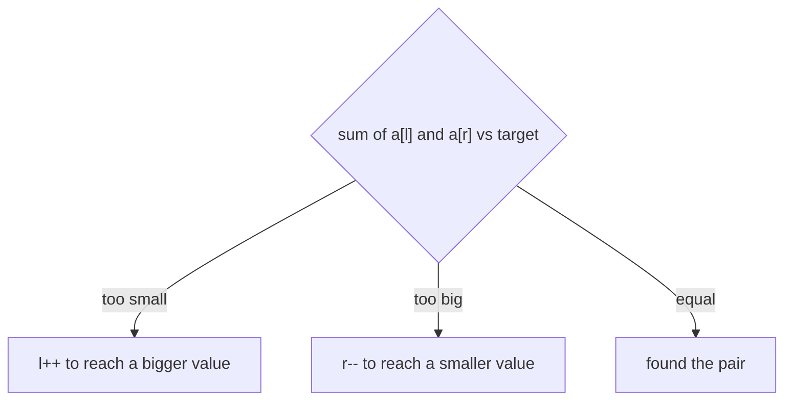

**Watch out for** being able to *justify* each move (why is it safe to skip `a[l]`? — because it's the
smallest and even paired with the largest it's too small); de-duplicating results (3Sum) by skipping
equal neighbours; and accidentally mutating the input when a copy was expected.

## Sliding Window

### 🔍 Recognise it

| | |
|---|---|
| **Trigger words** | "longest/shortest **substring/subarray**", "contiguous", "at most k", "all distinct", "contains all of" |
| **Input shape** | a **contiguous** run inside an array or string. **If the pieces need not be adjacent, this is not a window** — think DP or hashing |
| **Constraint tell** | **n ≤ 10⁵–10⁶** → each index must be touched a constant number of times |
| **Target complexity** | **O(n)** time · **O(k)** space for the window map |
| **Confused with** | **Prefix sum + hash map** — ask: *can the values be negative?* Yes → the window breaks (shrinking no longer helps) and you need prefix sums |


**The idea.** A "window" is a stretch `[l, r]` of the array you slide along. You **grow** it on the
right and **shrink** it on the left, keeping a running summary (a sum, a count, a set) as you go — so
each element is touched at most twice instead of re-scanning. Analogy: a magnifying glass sliding over
a row of numbers, stretching and squeezing to keep some rule satisfied.

**Big-O.** Time O(n) — each index enters and leaves the window once, so it's linear overall. Space
O(k) for the summary (O(1) for a fixed alphabet).

**Reach for it when** the answer is a **contiguous** run and the prompt says "longest/shortest/contains",
especially with a limit like "at most k of X" or "all distinct". If the pieces *don't* have to be
next to each other, it's NOT a window (think DP or hashing instead).

### The four variants

**(a) Fixed size `k`** — *the window never changes length.*

**O(n)** time · **O(1)** space

```javascript
function windowFixed(a, k) {
  let sum = 0, best = -Infinity;
  for (let i = 0; i < a.length; i++) {
    sum += a[i];
    if (i >= k) sum -= a[i - k];           // evict whatever fell out the back
    if (i >= k - 1) best = Math.max(best, sum);
  }
  return best;
}
```

**Why it works.** The invariant is *"`sum` always holds exactly the last `k` elements ending at
`i`"*. Adding `a[i]` and subtracting `a[i-k]` restores it in O(1) — the window moves without ever
being recomputed. That's the whole reason it's O(n) instead of O(n·k): **you never re-read what you
already summed.** Recognising when a quantity can be *repaired* rather than rebuilt is the sliding
window idea in one sentence.

**(b) Variable — longest valid**

**O(n)** time · **O(k)** space for the counter

```javascript
function longestVariable(s, k) {           // longest substring with ≤ k distinct
  const cnt = new Map();
  let l = 0, best = 0;
  for (let r = 0; r < s.length; r++) {
    cnt.set(s[r], (cnt.get(s[r]) || 0) + 1);
    while (cnt.size > k) {                 // shrink until legal again
      const c = s[l++];
      cnt.set(c, cnt.get(c) - 1);
      if (cnt.get(c) === 0) cnt.delete(c);
    }
    best = Math.max(best, r - l + 1);      // record AFTER the window is valid
  }
  return best;
}
```

**(c) Variable — shortest valid**

**O(n)** time · **O(1)** space

```javascript
function shortestVariable(a, target) {
  let l = 0, sum = 0, best = Infinity;
  for (let r = 0; r < a.length; r++) {
    sum += a[r];
    while (sum >= target) {                // record INSIDE, while still valid
      best = Math.min(best, r - l + 1);
      sum -= a[l++];
    }
  }
  return best === Infinity ? 0 : best;
}
```

> **Longest vs shortest is one line, and it's the line people get wrong.** *Longest* records
> **after** the `while` (you shrink until valid, then measure). *Shortest* records **inside** it
> (you're valid now, so measure before shrinking further). Swap them and half your tests fail in
> ways that look random.

**(d) Exactly K, via at-most-K** — *the window can't do "exactly" directly; the difference can.*

**O(n)** time (two passes) · **O(k)** space

```javascript
function atMostK(a, k) {
  const cnt = new Map();
  let l = 0, res = 0;
  for (let r = 0; r < a.length; r++) {
    cnt.set(a[r], (cnt.get(a[r]) || 0) + 1);
    while (cnt.size > k) { const x = a[l++]; cnt.set(x, cnt.get(x) - 1); if (!cnt.get(x)) cnt.delete(x); }
    res += r - l + 1;                      // every window ending at r is valid
  }
  return res;
}
const exactlyK = (a, k) => atMostK(a, k) - atMostK(a, k - 1);
```

> `res += r - l + 1` is the trick inside the trick: once `[l, r]` is valid, so is every window
> ending at `r` that starts at or after `l` — that's `r - l + 1` of them, counted in O(1).


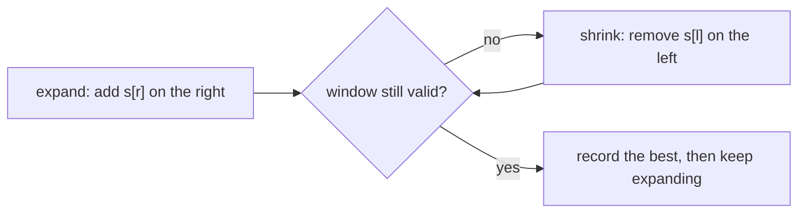

**Watch out for** confusing fixed-size (a constant width you roll along) with variable-size (grow/shrink
to a rule); recomputing the summary from scratch instead of nudging it as you add/remove; and the
"minimum window" flavor — grow until *good enough*, then shrink to *smallest still-good*.


```check
arrays
```

## Linked List

### 🔍 Recognise it

| | |
|---|---|
| **Trigger words** | "reverse", "merge two lists", "nth from the end", "detect a cycle", "reorder", "palindrome list" |
| **Input shape** | the input **is** a `ListNode` — no indices, no random access, you can only walk forward |
| **Constraint tell** | usually **O(1) extra space** stated outright — that phrase is the whole hint. It bans copying into an array |
| **Target complexity** | **O(n)** time · **O(1)** space |
| **Confused with** | **Two Pointers** — same fast/slow idea, different data structure. On a list you also have to *rewire* `next` pointers, which is where the bugs live |


**The idea.** It's all **pointer surgery** — rewiring the `.next` arrows from §0. Three tools cover
most problems: a **dummy head** (a fake node before the real first one, so you never special-case the
head), **fast/slow pointers** (one hops 2, one hops 1 — finds the middle, or a cycle, or the n-th from
the end), and **three-pointer reversal**.

**Big-O.** Time O(n); space O(1) — the whole point of lists is rewiring them in place with no extra
memory.

**Reach for it when** the input is a linked list and you must reverse, merge, reorder, find a position
relative to the end, detect a cycle, or test a palindrome.

### The variants

Two devices carry all five: a **dummy head** so the first node isn't a special case, and **two
pointers** at different speeds or offsets.

**(a) Reverse in place**

**O(n)** time · **O(1)** space

```javascript
function reverseList(head) {
  let prev = null, cur = head;
  while (cur) { const next = cur.next; cur.next = prev; prev = cur; cur = next; }
  return prev;                             // prev lands on the old tail = new head
}
```

**Why it works.** The invariant, true at the top of every iteration: *everything before `cur` is
already reversed and headed by `prev`; everything from `cur` on is untouched.* One step moves exactly
one node across that boundary.

The `next` temporary isn't optional and the order isn't arbitrary — the instant you write
`cur.next = prev` you've destroyed your only pointer to the rest of the list, so you save it first.
Draw three nodes and walk it once; that's the only thing that makes this stop feeling fiddly.

**(b) Remove the n-th node from the end** — *dummy + a fixed gap.*

**O(n)** time, one pass · **O(1)** space

```javascript
function removeNth(head, n) {
  const dummy = { next: head };            // makes "remove the head" an ordinary case
  let fast = dummy, slow = dummy;
  for (let i = 0; i < n; i++) fast = fast.next;   // open a gap of exactly n
  while (fast.next) { fast = fast.next; slow = slow.next; }
  slow.next = slow.next.next;
  return dummy.next;                       // NOT head — head may be gone
}
```

**Why it works.** Two ideas stacked. The **fixed gap**: advance `fast` by `n`, then move both
together — when `fast` reaches the last node, `slow` sits exactly `n` from the end. One pass, no
length count.

Then the **dummy head**. Deleting a node requires its *predecessor*, and the first node hasn't got
one — so the head is normally a special case with its own branch. Hanging a fake node in front gives
every real node a predecessor and the special case evaporates. Which is exactly why you return
`dummy.next`, not `head`: if the head is what got deleted, `head` now points at a node that's no
longer in the list.

**(c) Middle node**

**O(n)** time · **O(1)** space

```javascript
function middleNode(head) {
  let slow = head, fast = head;
  while (fast && fast.next) { slow = slow.next; fast = fast.next.next; }
  return slow;                             // even length → the SECOND middle
}
```

**(d) Merge two sorted lists**

**O(m + n)** time · **O(1)** space

```javascript
function mergeTwo(a, b) {
  const dummy = { next: null };
  let tail = dummy;
  while (a && b) {
    if (a.val <= b.val) { tail.next = a; a = a.next; }
    else                { tail.next = b; b = b.next; }
    tail = tail.next;
  }
  tail.next = a || b;                      // attach whatever's left, no loop needed
  return dummy.next;
}
```

**(e) Where the cycle begins (Floyd)**

**O(n)** time · **O(1)** space

```javascript
function cycleStart(head) {
  let slow = head, fast = head;
  while (fast && fast.next) {
    slow = slow.next; fast = fast.next.next;
    if (slow === fast) {                   // they meet somewhere inside the loop
      let p = head;
      while (p !== slow) { p = p.next; slow = slow.next; }   // both now at speed 1
      return p;                            // ← the entry point
    }
  }
  return null;
}
```

> **Why the second walk lands on the entrance.** With a tail of length `a` before a loop of length
> `c`, meeting `b` steps into the loop, the arithmetic works out to `a ≡ (c − b) mod c`. So a pointer
> from the head and one from the meeting point, both at speed 1, collide exactly at the entrance. You
> won't re-derive that at a whiteboard — but knowing a proof *exists* is the difference between
> memorised and understood.


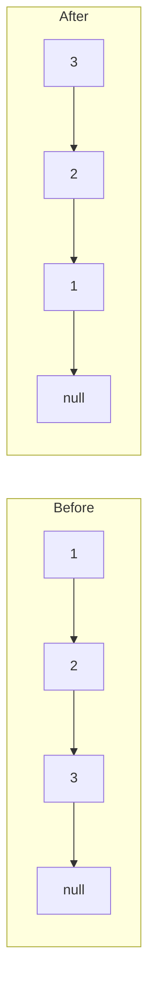

**(f) LRU cache** — *the classic "design" question: a hash map for O(1) lookup plus a
**doubly linked list** for O(1) eviction. In JavaScript, `Map` already is both.*

**O(1)** per `get` and `put` · **O(capacity)** space

```javascript
class LRUCache {
  constructor(capacity) { this.cap = capacity; this.m = new Map(); }
  get(k) {
    if (!this.m.has(k)) return -1;
    const v = this.m.get(k);
    this.m.delete(k); this.m.set(k, v);            // delete + re-insert = "move to newest"
    return v;
  }
  put(k, v) {
    if (this.m.has(k)) this.m.delete(k);
    else if (this.m.size === this.cap)
      this.m.delete(this.m.keys().next().value);   // first key = least recently used
    this.m.set(k, v);
  }
}
```

> **JavaScript hands you this one.** `Map` preserves *insertion order*, so "oldest key" is just
> `m.keys().next().value` and "touch this key" is delete-then-reinsert. Both O(1). In an interview
> say that out loud — then add that in Java or C++ you'd hand-roll a doubly linked list plus a hash
> map, because `HashMap` has no ordering. Knowing *why* the JS version is a one-liner is the answer
> they're looking for.

**Watch out for** losing the rest of the list (always save `next` *before* rewiring); using a dummy head
to simplify inserting/deleting at the front; and composing the primitives (find middle → reverse half →
merge) for reorder/palindrome problems.

## Stack

### 🔍 Recognise it

| | |
|---|---|
| **Trigger words** | "valid parentheses", "matching", "nesting", "evaluate expression", "undo", "innermost", "decode string" |
| **Input shape** | **pairs that must nest** — brackets, tags, open/close — or an expression in postfix form |
| **Constraint tell** | **n ≤ 10⁵–10⁶** → one linear pass, each element pushed and popped at most once |
| **Target complexity** | **O(n)** time · **O(n)** space |
| **Confused with** | **Monotonic Stack** — ask: *am I matching pairs, or comparing sizes?* Matching → plain stack. "Next greater/smaller" → monotonic |


**The idea.** A **stack** (pile of plates, LIFO) holds things whose turn hasn't come yet — the top is
always "what to handle next". It's perfect for **nesting** (brackets, tags) because the most recent
opener is the first you must close. A **monotonic** stack (kept sorted) answers "next greater/smaller
element" in one pass.

**Big-O.** Time O(n) — each element is pushed and popped at most once. Space O(n) for the stack.

**Reach for it when** there's matching/nesting (brackets), expression evaluation (postfix math), or the
tell-tale "for each element, find the next one bigger/smaller/warmer" (→ monotonic stack).

### The variants

*(For "next greater / next smaller", jump to **Monotonic Stack & Queue** below — that's a stack too,
kept sorted.)*

**(a) Matching brackets** — *the canonical LIFO problem.*

**O(n)** time · **O(n)** space worst case

```javascript
function validBrackets(s) {
  const pairs = { ')': '(', ']': '[', '}': '{' }, st = [];
  for (const ch of s) {
    if (ch === '(' || ch === '[' || ch === '{') st.push(ch);
    else if (pairs[ch]) { if (st.pop() !== pairs[ch]) return false; }
  }
  return st.length === 0;                          // leftovers = unclosed
}
```

> Two failure modes, two checks: a *mismatch* (`st.pop() !== pairs[ch]`, which also covers popping an
> empty stack — `undefined` never equals a bracket) and *unclosed* openers (`st.length` at the end).
> Forget the second and `"("` reports valid.

**(b) Evaluate reverse Polish notation** — *expression evaluation, the other classic.*

**O(n)** time · **O(n)** space

```javascript
function evalRPN(tokens) {
  const st = [];
  for (const t of tokens) {
    if (/^-?\d+$/.test(t)) st.push(+t);           // note: -?\d+ so "-5" is a number, not an operator
    else {
      const b = st.pop(), a = st.pop();            // b pops FIRST — order matters for - and /
      st.push(t === '+' ? a + b : t === '-' ? a - b : t === '*' ? a * b : Math.trunc(a / b));
    }
  }
  return st[0];
}
```

> `const b = st.pop(), a = st.pop()` — the **second** pop is the left operand. Reverse them and `+`
> and `*` still pass while `-` and `/` silently break, which is a miserable bug to find. Also
> `Math.trunc`, not `Math.floor`: integer division in these problems truncates toward zero, so
> `-7 / 2` is `-3`, not `-4`.

**(c) The stack *is* the call stack.** Every recursive function is a stack you didn't have to write.
When recursion would go too deep — JavaScript throws `RangeError` at roughly **12,500 frames** — you
convert it by making that stack explicit. The worked version lives in
**DFS → (b) Iterative DFS**, once graphs and recursion are both on the table.

**Watch out for** whether to store indices or values; the monotonic direction (increasing vs
decreasing); and adding a fake final element ("sentinel") to flush anything still waiting on the stack
(Largest Rectangle).

## Monotonic Stack & Queue

### 🔍 Recognise it

| | |
|---|---|
| **Trigger words** | "next greater/smaller element", "days until warmer", "largest rectangle", "span", "max of every window", "remove k digits" |
| **Input shape** | for **each** element you need the nearest one on a side that beats it — the brute force is a nested loop |
| **Constraint tell** | **n ≤ 10⁵+** while the naive answer is O(n²) → they want amortised linear |
| **Target complexity** | **O(n)** amortised · **O(n)** space |
| **Confused with** | **Heap** — ask: *do old elements ever become relevant again?* No, they can be discarded forever → monotonic. Yes → heap |


**The idea.** Keep a stack or **deque** *sorted* by throwing out every element the newcomer beats.
Because each element enters and leaves at most once, "for every element, find the next bigger/smaller"
drops from O(n²) to O(n). The **deque** version can evict at **both** ends — by *value* at the back, by
*age* at the front — which is exactly how you serve the max/min of a sliding window.

**Big-O.** Time O(n) amortized — pushed once, popped at most once. Space O(n).

**Reach for it when** you see "next greater/smaller", "how many days until warmer…", spans, "sum over
all subarrays of the min/max", the max/min of every window, or "remove k digits to make the smallest
number". When a plain sliding window breaks because the array has *negative* numbers, a monotonic deque
over running totals is usually the repair.

### The variants

**(a) Next greater element** — *the base case. Stack holds **indices**, not values.*

**O(n)** amortised · **O(n)** space

```javascript
function nextGreater(a) {
  const res = new Array(a.length).fill(-1), st = [];
  for (let i = 0; i < a.length; i++) {
    while (st.length && a[st[st.length - 1]] < a[i]) res[st.pop()] = a[i];
    st.push(i);                            // everything left on the stack has no greater element
  }
  return res;
}
```

**(b) Largest rectangle (sentinel flush)** — *the span where each bar is the minimum.*

**O(n)** amortised · **O(n)** space

```javascript
function largestRectangle(h) {
  const st = [], H = [...h, 0];            // the trailing 0 flushes the stack for you
  let best = 0;
  for (let i = 0; i < H.length; i++) {
    while (st.length && H[st[st.length - 1]] >= H[i]) {
      const height = H[st.pop()];
      const left = st.length ? st[st.length - 1] + 1 : 0;
      best = Math.max(best, height * (i - left));
    }
    st.push(i);
  }
  return best;
}
```

> Appending one `0` is a sentinel (see Cross-cutting tricks): it forces every remaining bar to pop,
> so you don't write the drain loop twice.

**(c) Monotonic deque — max of every window** — *evict by value at the back, by age at the front.*

**O(n)** amortised · **O(k)** space

```javascript
function windowMax(a, k) {
  const dq = [], out = [];                 // dq holds indices, values decreasing
  for (let i = 0; i < a.length; i++) {
    while (dq.length && a[dq[dq.length - 1]] <= a[i]) dq.pop();   // beaten → useless forever
    dq.push(i);
    if (dq[0] <= i - k) dq.shift();        // expired out of the window
    if (i >= k - 1) out.push(a[dq[0]]);    // the front is the max
  }
  return out;
}
```

> Why the front is always the answer: anything smaller *and older* was popped when the newer, bigger
> value arrived — a value can only survive if nothing after it beats it.


**Watch out for** the comparison's strictness — `<` vs `<=` decides how tied values behave (Sum of
Subarray Minimums needs strict on one side, non-strict on the other, or equal values get double-counted);
store *indices* whenever age/position matters; and remember popped elements can carry info out with them.


```check
linear
```

## Binary Search

### 🔍 Recognise it

| | |
|---|---|
| **Trigger words** | "sorted", "first/last position", "rotated sorted array", "**minimum** X such that…", "**maximum** capacity/speed so that…" |
| **Input shape** | either a sorted array, or a **monotone yes/no answer space** — once a candidate works, every larger one works too |
| **Constraint tell** | **n ≤ 10⁹ or larger**, or a huge value range with a small array → the `log` is the only thing that fits. Also: n ≤ 10⁵ with an O(n) *check* inside → O(n log n) total |
| **Target complexity** | **O(log n)** · **O(1)** space — × the cost of the feasibility check when searching the answer |
| **Confused with** | **Two Pointers** — ask: *am I searching a value, or scanning a range?* Halving a search space → binary search |


**The idea.** Repeatedly cut the search space in **half**. On a sorted array you check the middle and
throw away the wrong half — 1,000,000 items → ~20 checks. The powerful twist: it works on any
**monotonic predicate** (a yes/no test where once it's "yes" it stays "yes") — so you can binary-search
*the answer itself*: "what's the smallest capacity `k` that works?"

**Big-O.** Time O(log n) per search (× the cost of the feasibility check when searching the answer);
space O(1).

**Reach for it when** the input is sorted, you need a boundary/first-true, it's a rotated sorted array,
or — the leap — an optimization where *checking* a candidate answer is easy but *trying them all* is
too slow ("minimum speed/capacity/size such that…").

### The six variants — pick by what you're looking for

| You want | Loop | Bounds move | Returns |
|---|---|---|---|
| **(a)** is `t` present? | `l <= r` | `m±1` both sides | index or `-1` |
| **(b)** first index `≥ t` | `l < r` | `r = m` | insert position |
| **(c)** first index `> t` | `l < r` | `r = m` | end of a run |
| **(d)** last `true` | `l <= r` | record + `l = m+1` | last good index |
| **(e)** smallest workable answer | `l < r` | `r = m` | the answer itself |
| **(f)** rotated array | `l <= r` | depends on which half is sorted | index or `-1` |

**Always `Math.floor((l + r) / 2)`** — never `>>`, which silently breaks past 2³¹ (see the
constraints section).

**(a) Exact match** — *is `t` in this sorted array?*

**O(log n)** time · **O(1)** space

```javascript
function bsExact(a, t) {
  let l = 0, r = a.length - 1;
  while (l <= r) {                       // <= : both ends are live candidates
    const m = Math.floor((l + r) / 2);
    if (a[m] === t) return m;
    if (a[m] < t) l = m + 1; else r = m - 1;
  }
  return -1;
}
```

**(b) Lower bound** — *first index with `a[i] >= t`.* Insert position; also "how many are smaller".

**O(log n)** time · **O(1)** space

```javascript
function lowerBound(a, t) {
  let l = 0, r = a.length;                // r = length, NOT length-1
  while (l < r) {
    const m = Math.floor((l + r) / 2);
    if (a[m] >= t) r = m; else l = m + 1;
  }
  return l;                               // may equal a.length (everything is smaller)
}
```

**(c) Upper bound** — *first index with `a[i] > t`.*

**O(log n)** time · **O(1)** space

```javascript
function upperBound(a, t) {
  let l = 0, r = a.length;
  while (l < r) {
    const m = Math.floor((l + r) / 2);
    if (a[m] > t) r = m; else l = m + 1;
  }
  return l;
}
```

> **Use them as a pair.** `upperBound(a,t) - lowerBound(a,t)` = **how many times `t` occurs**, in
> O(log n). On `[1,3,3,3,5,7,9]` with `t=3`: `4 − 1 = 3`. ✓ That one line replaces a linear count.

**(d) Last true** — *predicate is `true…true,false…false`.*

**O(log n)** calls to `ok` · **O(1)** space

```javascript
function lastTrue(lo, hi, ok) {
  let l = lo, r = hi, ans = lo - 1;       // sentinel for "none"
  while (l <= r) {
    const m = Math.floor((l + r) / 2);
    if (ok(m)) { ans = m; l = m + 1; }    // record, then push right
    else r = m - 1;
  }
  return ans;
}
```

**(e) Binary search on the answer** — *the money variant.* When the question is "minimum X such that
it's possible", stop computing the answer and **search** for it.

**O(log(range))** calls to `ok` — multiply by `ok`'s own cost · **O(1)** space

```javascript
function bsAnswer(lo, hi, ok) {           // ok: false…false,true…true
  let l = lo, r = hi;
  while (l < r) {
    const m = Math.floor((l + r) / 2);
    if (ok(m)) r = m; else l = m + 1;     // r = m, because m might BE the answer
  }
  return l;
}

// "least ship capacity to finish in D days":
// bsAnswer(Math.max(...w), w.reduce((a,b)=>a+b), cap => daysNeeded(w, cap) <= D)
```

> **Why `r = m` and not `r = m - 1`.** If `ok(m)` is true, `m` is a *candidate* — `m - 1` would throw
> away the answer. It still terminates because the midpoint floors: with `l < r`, `m` is always
> strictly below `r`. That pairing is load-bearing — `l < r` with `r = m` terminates, `l <= r` with
> `r = m` spins forever.

**(f) Rotated sorted array**

**O(log n)** time · **O(1)** space

```javascript
function searchRotated(a, t) {
  let l = 0, r = a.length - 1;
  while (l <= r) {
    const m = Math.floor((l + r) / 2);
    if (a[m] === t) return m;
    if (a[l] <= a[m]) {                                  // left half is sorted
      if (a[l] <= t && t < a[m]) r = m - 1; else l = m + 1;
    } else {                                             // right half is sorted
      if (a[m] < t && t <= a[r]) l = m + 1; else r = m - 1;
    }
  }
  return -1;
}
```

> **The insight:** cut anywhere and *at least one half is still properly sorted*. Work out which,
> then ask whether the target lies inside that half — if yes go there, else go to the other one.

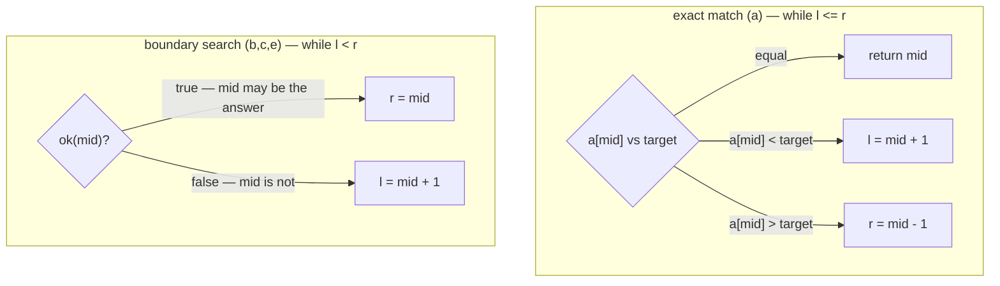

**Why `r = m` and not `r = m - 1` in the boundary variants.** If `ok(m)` is true, `m` is a *candidate answer* — writing
`r = m - 1` throws away the very thing you're looking for. And it can't loop forever, because the
midpoint floors: with `l < r`, `m` is always strictly less than `r`, so `r = m` genuinely shrinks the
range. That pairing is load-bearing — `l < r` with `r = m` terminates, `l <= r` with `r = m` spins.

**Watch out for:**

- **Mixing the two.** "Always move past the midpoint" is correct for (a) and *wrong* for (b). Decide
  which template you're writing before the first keystroke.
- **Never compute the midpoint with `>>` in JavaScript.** Every bit-shift operator coerces its
  operand to a **signed 32-bit int**, so any midpoint trick built on `>>` breaks silently once the
  numbers pass 2³¹:

  ```javascript
  // l = 0, r = 3e9  — a perfectly ordinary "search the answer" range
  (l + r) >> 1          // -647483648   ← negative! the loop never terminates
  l + ((r - l) >> 1)    // -647483648   ← the Java/C++ fix does NOT transfer
  Math.floor((l + r)/2) //  1500000000  ← correct
  ```

  `l + ((r - l) >> 1)` is the right answer in **Java and C++**, where it dodges *integer* overflow.
  In JavaScript it fixes nothing, because the `>>` is what truncates — it merely moves the failure
  from "`l + r` too big" to "`r - l` too big." Numbers in JS are doubles, exact to 2⁵³, so plain
  **`Math.floor((l + r) / 2)`** is both correct and simplest. Use it always.

  This matters precisely in "search the answer" problems, where `hi` is a **sum** rather than an
  array index — Split Array Largest Sum, Capacity to Ship Packages, Minimize Max Distance. With an
  array index you'll never notice; with a sum you get an infinite loop and no error message.
  (Writing Java for the same problem? Then `lo + ((hi - lo) >>> 1)` *is* what you want.)
- **Recognizing "search the answer"** when there's no array to search at all. The tell is a question
  of the form "minimum X such that a check passes", where the check is easy and monotonic: if
  capacity 20 works, 21 works too. Then `ok` is your check and `[lo, hi]` is the answer range.
- **An `ok` that isn't monotonic.** Binary search is only valid if the predicate never flips back.
  Say out loud why yours can't — that sentence is the proof of correctness interviewers want.


```check
search
```

## Recursion & Backtracking

### 🔍 Recognise it

| | |
|---|---|
| **Trigger words** | "return **all**", "generate **every**", "all combinations/permutations/subsets", "n-queens", "word search", "partition into" |
| **Input shape** | you must **list the possibilities**, not count them. The output is an array of arrays |
| **Constraint tell** | **n ≤ 10–20.** Such a tiny bound has only one explanation: the answer is exponential and that is intended |
| **Target complexity** | **O(2ⁿ)** subsets · **O(n!)** permutations · **O(n)** recursion depth |
| **Confused with** | **Dynamic Programming** — ask: *do I need every answer, or just the best/the count?* Every → backtracking. Best or count → DP |


**The idea.** Build an answer one choice at a time: **choose → recurse → un-choose** (that undo is the
"backtrack"). You're walking a tree of possibilities, abandoning any branch that can't lead to a valid
answer. Analogy: exploring a maze — take a turn, and if it dead-ends, walk back and try the next turn.

**Big-O.** Exponential by nature (it's the size of the possibility tree): **O(2ⁿ)** for subsets, **O(n!)**
for permutations, plus O(n) to copy each finished answer. Space O(n) for the recursion depth + current
candidate. Pruning cuts branches (the constant), not the worst-case class.

**Reach for it when** the prompt says "return **all** / generate **every**" — subsets, permutations,
combinations, partitions, board arrangements: anything enumerating possibilities under constraints. If
you only need the *count* or the *best*, that's usually DP, not enumeration.

### The variants

All four are **choose → recurse → un-choose**. What differs is how you avoid producing the same
answer twice.

**(a) Subsets — include / exclude**

**O(2ⁿ · n)** time (2ⁿ subsets, O(n) to copy each) · **O(n)** stack

```javascript
function subsets(nums) {
  const res = [], cur = [];
  (function go(i) {
    if (i === nums.length) { res.push([...cur]); return; }
    go(i + 1);                                    // exclude nums[i]
    cur.push(nums[i]); go(i + 1); cur.pop();      // include, recurse, undo
  })(0);
  return res;
}
```

**Why it works.** Every subset is a sequence of `n` independent yes/no decisions, so the recursion
tree is a perfect binary tree of depth `n` with 2ⁿ leaves — one leaf per subset, none repeated. The
`cur.pop()` restores `cur` to exactly the state the caller handed you: *on return, `cur` is
unchanged*. That's the **invariant** making a single shared array safe. Forget the pop and every
later branch inherits your leftovers.

And `res.push([...cur])` **copies**. Push `cur` itself and you store 2ⁿ references to one array that
keeps mutating — every entry ends up identical and empty.

**(b) Permutations — a `used[]` flag**

**O(n! · n)** time · **O(n)** stack + `used[]`

```javascript
function permutations(nums) {
  const res = [], used = new Array(nums.length).fill(false), cur = [];
  (function go() {
    if (cur.length === nums.length) { res.push([...cur]); return; }
    for (let i = 0; i < nums.length; i++) {
      if (used[i]) continue;
      used[i] = true; cur.push(nums[i]);
      go();
      cur.pop(); used[i] = false;                 // un-choose, both halves
    }
  })();
  return res;
}
```

**(c) Combinations — a `start` index**

**O(C(n,k) · k)** time · **O(k)** stack

```javascript
function combinations(n, k) {
  const res = [], cur = [];
  (function go(start) {
    if (cur.length === k) { res.push([...cur]); return; }
    for (let i = start; i <= n; i++) { cur.push(i); go(i + 1); cur.pop(); }
  })(1);
  return res;
}
```

> **`start` vs `used[]` is the whole distinction.** Order *doesn't* matter → carry a `start` so you
> only ever move forward (subsets, combinations). Order *does* matter → `used[]` and rescan from 0
> every level (permutations). Choose wrong and you either miss answers or emit duplicates.

**(d) With duplicates — sort, then skip siblings**

**O(2ⁿ · n)** time · **O(n)** stack

```javascript
function subsetsDup(nums) {
  nums = [...nums].sort((a, b) => a - b);         // duplicates must be adjacent
  const res = [], cur = [];
  (function go(start) {
    res.push([...cur]);
    for (let i = start; i < nums.length; i++) {
      if (i > start && nums[i] === nums[i - 1]) continue;   // NOT i > 0
      cur.push(nums[i]); go(i + 1); cur.pop();
    }
  })(0);
  return res;
}
```

> `i > start`, not `i > 0`. A repeated value is fine **deeper** in a branch (`[2,2]` is a real
> subset) and forbidden **across siblings at the same level** (two branches both starting with `2`
> would generate identical subtrees). That one comparison is the entire de-duplication.


The decision tree for the subsets of `{1, 2}` — each level is one "include it or not" choice:

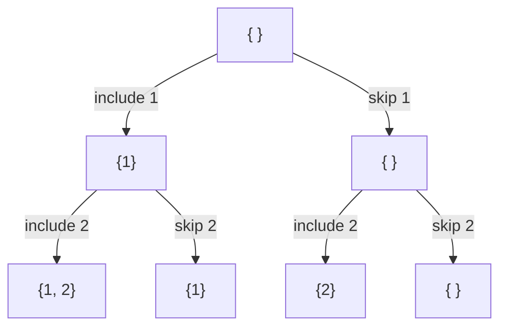

**(e) Pruned backtracking (N-Queens)** — *the real skill isn't enumerating, it's rejecting early.*

**O(n!)** worst case; pruning cuts the constant, not the class · **O(n)** space

```javascript
function nQueens(n) {
  let count = 0;
  const cols = new Set(), diag = new Set(), anti = new Set();
  const go = r => {
    if (r === n) { count++; return; }
    for (let c = 0; c < n; c++) {
      if (cols.has(c) || diag.has(r - c) || anti.has(r + c)) continue;   // O(1) conflict test
      cols.add(c); diag.add(r - c); anti.add(r + c);
      go(r + 1);
      cols.delete(c); diag.delete(r - c); anti.delete(r + c);
    }
  };
  go(0);
  return count;
}
```

> **The insight worth stealing:** every square on a ↘ diagonal shares `r - c`; every square on a ↙
> diagonal shares `r + c`. So three sets give O(1) conflict checks instead of re-scanning the board.
> Pruning doesn't change the worst-case class — it changes the constant, and here it's the
> difference between instant and forever.

**(f) Meet in the middle** — *the `n ≤ 40` fingerprint. Split, enumerate both halves, join.*

**O(2^(n/2) · n)** time · **O(2^(n/2))** space

```javascript
function closestSubsetSum(nums, goal) {
  const allSums = xs => {                          // 2^(n/2) subset sums
    const sums = [0];
    for (const x of xs) { const len = sums.length; for (let i = 0; i < len; i++) sums.push(sums[i] + x); }
    return sums;
  };
  const A = allSums(nums.slice(0, nums.length >> 1));
  const B = allSums(nums.slice(nums.length >> 1)).sort((x, y) => x - y);
  let best = Infinity;
  for (const a of A) {                             // binary-search B for the best partner
    const want = goal - a;
    let lo = 0, hi = B.length;
    while (lo < hi) { const m = Math.floor((lo + hi) / 2); if (B[m] >= want) hi = m; else lo = m + 1; }
    for (const idx of [lo - 1, lo])
      if (idx >= 0 && idx < B.length) best = Math.min(best, Math.abs(a + B[idx] - goal));
  }
  return best;
}
```

> **Why it works:** 2⁴⁰ is 10¹² and hopeless; 2 × 2²⁰ is 2 × 10⁶ and trivial. You trade one huge
> enumeration for two small ones plus a join. Check **both** `lo - 1` and `lo` after the binary
> search — the closest value can be on either side of the insertion point, and checking only one is
> the standard bug.

**Watch out for** pushing a *copy* of `cur` (it keeps mutating after you save it!); the `start`-index
(combinations, no reuse) vs `used`-array (permutations) vs same-`i` (reuse allowed) distinction;
de-duplicating with "sort, then skip equal siblings at the same depth"; and restoring shared state
(grid cells) on the way back up.

## Sorting & Selection

### 🔍 Recognise it

| | |
|---|---|
| **Trigger words** | "k-th largest/smallest", "median", "sort by", "custom order", "values are between 1 and n" |
| **Input shape** | order itself is the tool — either the answer needs it, or sorting unlocks two-pointers or a greedy sweep |
| **Constraint tell** | **n ≤ 10⁵** → O(n log n) is affordable and probably intended. **Small integer values** → counting sort, and complexity moves from `n` to the value range |
| **Target complexity** | **O(n log n)** comparison sort · **O(n)** average for quickselect · **O(n + k)** counting sort |
| **Confused with** | **Heap** — ask: *do I need the k-th element, or the whole order?* Just k-th → quickselect O(n) beats a full sort |


**The idea.** You'll rarely be asked to *implement* a sort — but you're constantly asked to reason
about one, and three of them appear inside other answers often enough to be worth knowing cold.
Sorting is also the cheapest way to *unlock* a pattern: sorted input turns hashing into two pointers,
and turns "search everything" into binary search.

**Big-O.** Comparison sorts cannot beat **O(n log n)** — that's a proven lower bound, and saying so
is a good interview beat. Counting/radix sorts get O(n) by *not comparing*, at the cost of needing a
bounded value range.

**Reach for it when** you need order to unlock a two-pointer or greedy; when the question is "k-th
something" (→ quickselect); or when values are small integers (→ counting sort, and the complexity
moves from `n` to the value range).

### The variants

**(a) Merge sort — and counting inversions**

**O(n log n)** time · **O(n)** space (not in-place)

Worth knowing because the *merge step* is where the extra information lives: it's how you count
inversions, and it's the stable O(n log n) sort for linked lists (no random access needed).

```javascript
function mergeSortCountInv(a) {
  let inv = 0;
  const sort = arr => {
    if (arr.length < 2) return arr;
    const mid = arr.length >> 1;
    const L = sort(arr.slice(0, mid)), R = sort(arr.slice(mid));
    const out = []; let i = 0, j = 0;
    while (i < L.length && j < R.length) {
      if (L[i] <= R[j]) out.push(L[i++]);          // <= keeps it STABLE
      else { inv += L.length - i; out.push(R[j++]); }   // L[i..] ALL beat R[j] → count them at once
    }
    while (i < L.length) out.push(L[i++]);
    while (j < R.length) out.push(R[j++]);
    return out;
  };
  return { sorted: sort(a), inversions: inv };
}
```

> `inv += L.length - i` is the whole inversion trick: when `R[j]` wins, it is smaller than **every
> remaining element of `L`**, so you count them all in O(1) instead of one at a time. That single
> line turns an O(n²) count into O(n log n).

**(b) Quickselect — the k-th element in O(n) average**

**O(n)** average, **O(n²)** worst · **O(1)** extra

```javascript
function quickSelect(a, k) {                       // k-th smallest, 0-indexed
  a = [...a];
  let lo = 0, hi = a.length - 1;
  for (;;) {
    const pivot = a[hi];
    let s = lo;
    for (let i = lo; i < hi; i++) if (a[i] < pivot) { [a[i], a[s]] = [a[s], a[i]]; s++; }
    [a[s], a[hi]] = [a[hi], a[s]];                 // pivot lands at its final index s
    if (s === k) return a[s];
    if (s < k) lo = s + 1; else hi = s - 1;        // recurse into ONE side only
  }
}
```

> **Why it beats sorting:** quicksort recurses into *both* halves (O(n log n)); quickselect only
> needs the half containing `k`, so the work halves each round — `n + n/2 + n/4 + … = 2n`. Worst case
> is still O(n²) on adversarial pivots, which is exactly the trade-off to state out loud: "O(n)
> average, O(n²) worst; a random pivot makes the bad case vanishingly unlikely, or use a heap for a
> guaranteed O(n log k)."

**(c) Counting sort — O(n) when values are bounded**

**O(n + maxV)** time · **O(maxV)** space

```javascript
function countingSort(a, maxV) {
  const cnt = new Array(maxV + 1).fill(0);
  for (const x of a) cnt[x]++;
  const out = [];
  for (let v = 0; v <= maxV; v++) for (let i = 0; i < cnt[v]; i++) out.push(v);
  return out;
}
```

> This is the constraints table in action: when the statement bounds *values* (`a[i] ≤ 10⁴`) rather
> than only length, the intended complexity is often in the **value range**, not `n`. O(n + maxV)
> beats O(n log n) whenever `maxV` is small — and loses badly when it isn't.

**Watch out for** JavaScript's `[10, 9, 1].sort()` returning `[1, 10, 9]` — the default comparator is
**lexicographic**, so always pass `(a, b) => a - b`; assuming `sort` is stable (it is, in modern JS,
but say so rather than relying on it silently); and copying vs mutating — `.sort()` sorts **in
place** and returns the same array, which surprises callers who still needed the original order.


```check
backtracking
```

## Trees

### 🔍 Recognise it

| | |
|---|---|
| **Trigger words** | "binary tree", "BST", "depth/height", "root-to-leaf path", "symmetric", "lowest common ancestor", "validate" |
| **Input shape** | a `TreeNode` root. **BST** in the prompt is a strong extra hint — it means sorted order is available for free |
| **Constraint tell** | **n ≤ 10⁴–10⁵** → one visit per node. If recursion depth could reach 10⁵, they want iteration |
| **Target complexity** | **O(n)** time · **O(h)** space, `h` = height — O(log n) balanced, **O(n) worst case** |
| **Confused with** | **BFS vs DFS** — ask: *does the answer care about levels?* "Level by level", "right side view" → BFS. Path, depth, subtree → DFS |


**The idea.** A tree is a hierarchy, and the natural way to work on it is **recursion**: solve a node
using its children's answers. Analogy: to count everyone under you in a company org chart, ask each
direct report for *their* count and add. **DFS** goes deep first; **BFS** goes level by level; a
**BST**'s sorted order lets you skip whole branches.

**Big-O.** Time O(n) — each node visited once. Space O(h) for the recursion stack, `h` = height:
O(log n) if balanced, O(n) worst case (a tree shaped like a line). BFS uses O(width) for its queue.

**Reach for it when** the input is a binary tree / BST and you need depth, a path, symmetry, a
traversal order, validation, or an ancestor. "Level by level" → BFS; "path/subtree/depth" → DFS;
"ordered/search tree" → exploit BST bounds.

### The variants

**(a) DFS, answer from children (post-order)** — *depth, size, balance, path sums.*

**O(n)** time · **O(h)** stack — `h` = height, so O(log n) balanced, O(n) skewed

```javascript
function depth(node) {
  if (!node) return 0;                     // base case FIRST, always
  return 1 + Math.max(depth(node.left), depth(node.right));
}
```

**(b) BFS level order** — *"level by level", right-side view, minimum depth.* This is **breadth-first
search**, meeting it here on a tree where it's simplest; the [BFS](#bfs-breadth-first-search) section
generalises the same loop to grids and graphs.

**O(n)** time · **O(w)** space — `w` = widest level

```javascript
function levelOrder(root) {
  const res = [];
  if (!root) return res;
  let cur = [root];
  while (cur.length) {
    const vals = [], next = [];
    for (const n of cur) { vals.push(n.val); if (n.left) next.push(n.left); if (n.right) next.push(n.right); }
    res.push(vals);
    cur = next;                            // swap frontiers — never queue.shift()
  }
  return res;
}
```

**(c) Validate a BST — tightening bounds**

**O(n)** time · **O(h)** stack

```javascript
function isBST(node, lo = -Infinity, hi = Infinity) {
  if (!node) return true;
  if (node.val <= lo || node.val >= hi) return false;
  return isBST(node.left, lo, node.val) && isBST(node.right, node.val, hi);
}
```

> **Why parent-vs-child is not enough:** `[5,1,4,null,null,3,6]`. Every node beats its own parent,
> yet `3` sits in `5`'s *right* subtree and is smaller than 5. Only a range carried down catches it.

**(d) Iterative in-order** — *when `n` could blow the ~12,500-frame call stack.*

**O(n)** time · **O(h)** explicit stack — no recursion limit

```javascript
function inorderIter(root) {
  const res = [], st = [];
  let cur = root;
  while (cur || st.length) {
    while (cur) { st.push(cur); cur = cur.left; }   // dive left, remembering the way back
    cur = st.pop();
    res.push(cur.val);
    cur = cur.right;
  }
  return res;
}
```

**Why it works.** It is the call stack, made explicit. The invariant: *the stack holds exactly the
ancestors whose left subtree you are currently inside, in order.* The inner `while` dives left,
pushing the trail behind it; popping then gives the deepest unvisited node — which, because you went
as far left as possible, is the next one in sorted order. Step right and repeat.

Line it up against the recursive version: same three moves, same order. The only difference is *who*
remembers the way back. That substitution is the general recipe for de-recursing anything.

**(e) LCA in a BST** — *the split point is the answer.*

**O(h)** time · **O(1)** space

```javascript
function lcaBST(root, p, q) {
  let cur = root;
  while (cur) {
    if (p < cur.val && q < cur.val) cur = cur.left;
    else if (p > cur.val && q > cur.val) cur = cur.right;
    else return cur;                       // they diverge here → this is the LCA
  }
  return null;
}
```

**Why it works.** "Both targets are on the same side" means this node isn't between them, so it
cannot be the lowest common ancestor — the answer is deeper. The first node where they **split**
(one smaller, one bigger, or one equal to the node) is by definition the deepest node with both in
its subtree.

The habit to steal: you're not searching, you're **eliminating**. Each comparison discards an entire
subtree, which is why it's O(h) and needs no recursion.

**(f) LCA in a general binary tree**

**O(n)** time · **O(h)** stack

```javascript
function lcaBinary(root, p, q) {
  if (!root || root.val === p || root.val === q) return root;
  const L = lcaBinary(root.left, p, q);
  const R = lcaBinary(root.right, p, q);
  return L && R ? root : (L || R);         // found on BOTH sides → this node is it
}
```

**Why it works.** With no ordering to exploit you can't eliminate, so you ask both subtrees. Fix the
contract first — *this function returns a target, or an ancestor of one, if this subtree contains
any* — and three cases cover everything:

- **Both sides answered** → the targets sit in different subtrees, so this node is the lowest one
  containing both. Return it.
- **One side answered** → everything relevant is down there; pass that answer up unchanged.
- **Neither** → return `null`.

The base case returns as soon as `root.val === p`, *without* checking whether `q` is below it. That's
deliberate: if `q` is in `p`'s subtree then `p` really is the LCA, and if it isn't, the other branch
finds `q` and the `L && R` case resolves it correctly one level up.


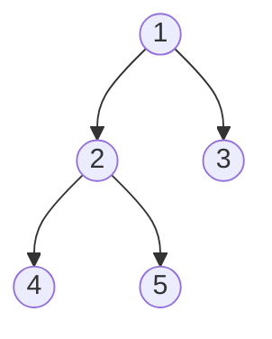

DFS (depth-first) dives `1 → 2 → 4`, backtracks, then explores `5` and `3`; BFS (breadth-first) visits
level by level: `1`, then `2, 3`, then `4, 5`.

**Watch out for** the empty-tree base case (always handle `null` first); validating a BST against a
*tightening (lo, hi) range*, not just parent-vs-child; and folding two answers into one pass
(height + is-balanced together) to avoid an O(n²) re-walk.

## DFS (Depth-First Search)

### 🔍 Recognise it

| | |
|---|---|
| **Trigger words** | "flood fill", "island/region", "can you reach", "does a path exist", "all paths", "connected component" |
| **Input shape** | a grid or graph where you need **existence or structure**, not distance |
| **Constraint tell** | **rows × cols ≤ 10⁶**, or V + E ≤ 10⁵–10⁶ → every cell/edge visited once |
| **Target complexity** | **O(V + E)** time · **O(depth)** space for the stack |
| **Confused with** | **BFS** — ask: *do I need the SHORTEST path?* Yes → BFS. DFS finds *a* path, and it is usually not the shortest |


**The idea.** "Go as deep as you can, then back up and try the next branch." The recursion (or an
explicit stack) *is* your to-do list. Crucial habit: mark a spot **visited before** you descend, so you
never loop back onto it. Analogy: exploring a cave system by always taking the next unexplored tunnel,
dropping a breadcrumb at each junction.

**Big-O.** Time O(V + E) — every node and edge once (grids: O(rows × cols)). Space O(depth) for the
recursion stack, up to O(V) worst case.

**Reach for it when** the words are "flood fill", "region/island", "can you reach", "does a path exist",
"all paths" (add backtracking), or a property of the root-to-node path in a tree (thread the state down
as a parameter). DFS answers *existence and structure* — it does **not** give shortest paths.

**(a) Recursive grid DFS** — *the default; the call stack does the remembering.*

**O(R·C)** time · **O(R·C)** recursion stack worst case

```javascript
function dfs(r, c) {
  if (r < 0 || c < 0 || r >= R || c >= C) return;  // bounds first
  if (grid[r][c] !== TARGET) return;               // wrong value or visited
  grid[r][c] = MARK;                               // visit BEFORE recursing
  dfs(r + 1, c); dfs(r - 1, c); dfs(r, c + 1); dfs(r, c - 1);
}
```

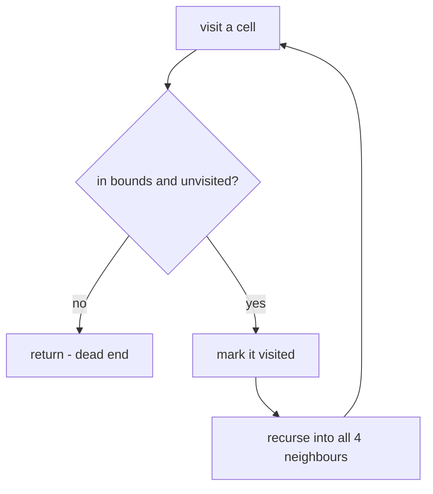

**(b) Iterative DFS** — *an explicit stack instead of recursion, for when depth would blow the ~12,500-frame call stack.*

*(First use of an **adjacency list**: `adj[u]` is simply the array of nodes `u` connects to, so
`adj = [[1,2],[3],[3],[]]` means 0→1, 0→2, 1→3, 2→3. It's the standard way to hand a graph to a
function, and the Graphs section leans on it throughout.)*

**O(V + E)** time · **O(V)** space

```javascript
function iterativeDFS(n, adj, src) {
  const seen = new Array(n).fill(false), order = [], st = [src];
  seen[src] = true;
  while (st.length) {
    const u = st.pop();
    order.push(u);
    for (let i = adj[u].length - 1; i >= 0; i--) { // push in REVERSE to visit in order
      const v = adj[u][i];
      if (!seen[v]) { seen[v] = true; st.push(v); }
    }
  }
  return order;
}
```

> **The stack *is* the recursion** — that's the whole conversion, and it's the answer when an
> interviewer asks "what if the graph is a million nodes deep?". Push neighbours in reverse so they
> pop in the original order; and mark `seen` on **push**, not on pop, or the same node lands on the
> stack many times.


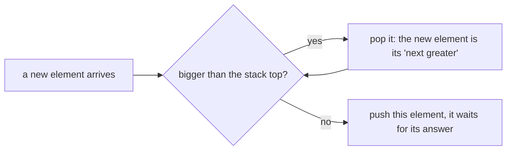

**Watch out for** marking visited too late (leads to exponential re-visits); using the grid itself as
the visited-marker but forgetting to restore it when the caller still needs the original (the
backtracking mark-and-restore); and the DFS/BFS choice: "any path" = DFS, "shortest path" = BFS.

## BFS (Breadth-First Search)

### 🔍 Recognise it

| | |
|---|---|
| **Trigger words** | "**shortest** path", "**fewest** steps/moves/mutations/turns", "minimum operations", "nearest X for every cell", "level order" |
| **Input shape** | a graph with **equal-cost edges**. The states may be invisible — words, lock combinations, gene strings are all "a state plus one-step moves" |
| **Constraint tell** | **V + E ≤ 10⁵–10⁶**, or a grid up to ~10⁶ cells |
| **Target complexity** | **O(V + E)** time · **O(V)** space for the widest ring |
| **Confused with** | **Dijkstra** — ask: *do all moves cost the same?* Yes → BFS. Different weights → Dijkstra with a heap. Using BFS on a weighted graph is a classic wrong answer |


**The idea.** Explore in **rings** using a queue (FIFO): everything 1 step away, then everything 2 steps
away, and so on. Because you reach nearer things first, **the first time BFS hits a target, it's via a
shortest path** (when every move costs 1). Analogy: a drop of ink in water spreading outward in even
circles. Two signature moves: **level-by-level** counting, and **multi-source** (drop *several* ink
drops at once — "nearest X for every cell" starts from all the X's).

**Big-O.** Time O(V + E). Space up to O(V) for the widest ring.

**Reach for it when** you see "shortest/fewest steps", "minimum moves/mutations/turns", "nearest X for
every cell", or level-order over a tree. States can be *invisible* — lock combinations, words, gene
strings are all "a state + one-step moves" graphs with no explicit map. If moves have *different* costs,
BFS is wrong — that's Dijkstra (see Graphs).

### The variants

**(a) Level-by-level** — *count rings; the first arrival is a shortest path.*

**O(V + E)** time · **O(V)** space for the widest ring

```javascript
let frontier = [start], steps = 0;
seen.add(start);
while (frontier.length) {
  steps++;
  const next = [];
  for (const cur of frontier) {
    for (const nb of neighbours(cur)) {
      if (seen.has(nb)) continue;
      if (nb === goal) return steps;
      seen.add(nb);                   // mark when ENQUEUED, not when popped
      next.push(nb);
    }
  }
  frontier = next;                    // swap frontiers — never queue.shift()
}
```

**(b) Multi-source** — *"nearest X for every cell": seed the queue with **all** the X's.*

**O(R·C)** time · **O(R·C)** space

```javascript
function multiSourceBFS(g) {
  const R = g.length, C = g[0].length;
  const dist = Array.from({ length: R }, () => new Array(C).fill(-1));
  let q = [];
  for (let r = 0; r < R; r++) for (let c = 0; c < C; c++)
    if (g[r][c] === 1) { dist[r][c] = 0; q.push([r, c]); }    // ALL sources at distance 0
  let d = 0;
  while (q.length) {
    const next = []; d++;
    for (const [r, c] of q) for (const [dr, dc] of DIRS) {
      const nr = r + dr, nc = c + dc;
      if (nr < 0 || nc < 0 || nr >= R || nc >= C || dist[nr][nc] !== -1) continue;
      dist[nr][nc] = d; next.push([nr, nc]);
    }
    q = next;
  }
  return dist;
}
```

> Running one BFS per source is O(V²). Seeding them all at once is O(V) and gives the identical
> answer, because the rings expand simultaneously and the first to reach a cell is the nearest one.


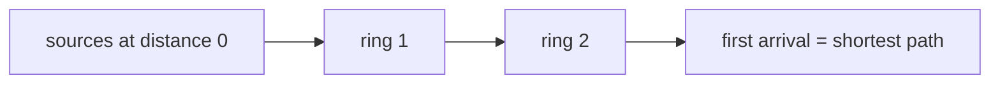

**Watch out for** marking visited on *dequeue* instead of *enqueue* (the queue explodes with
duplicates); using `Array.shift()` on a huge queue (it's O(n) each time — use a head index or swap
frontiers); and remembering a node with one child isn't a leaf when the goal is "shortest depth to a
leaf".


```check
traversal
```

## Tries

### 🔍 Recognise it

| | |
|---|---|
| **Trigger words** | "starts with", "prefix", "autocomplete", "dictionary", "word search II", "maximum XOR pair" |
| **Input shape** | **many** strings queried against **many** prefixes. One string against one pattern does not need a trie |
| **Constraint tell** | total characters ≤ ~10⁶, and the naive answer is words × queries |
| **Target complexity** | build **O(total chars)** · query **O(query length)** · space **O(total chars)** |
| **Confused with** | **Hash set** — ask: *do I need whole-word lookup, or prefixes?* Whole words only → a `Set` is simpler and faster. Prefixes → trie |


**The idea.** A **trie** ("try", a prefix tree) is a tree with one node per *prefix*: each node points
to children by letter, plus a flag "a word ends here". All words sharing a prefix share one path, so
"does anything start with `pre`?" costs O(length of `pre`), *no matter how many words* are stored.
Analogy: a phone tree / choose-your-own-adventure where each letter you type walks you one node deeper.

**Big-O.** Build O(total characters). Query O(query length). Space O(total characters) — the price for
the speed.

**Reach for it when** you see "starts with", autocomplete/suggestions, wildcard dictionary matching
(a wildcard turns the walk into a small DFS over children), searching many words against one grid/text
at once, or — the leap — maximum pairwise XOR (numbers are just bit-strings, so a *binary* trie works).

### The template

```javascript
class Trie {
  constructor() { this.root = {}; }
  insert(w) { let n = this.root; for (const c of w) n = n[c] || (n[c] = {}); n.$ = true; }
  search(w)     { const n = this._walk(w); return !!(n && n.$); }   // needs the end-of-word flag
  startsWith(p) { return !!this._walk(p); }                          // doesn't
  _walk(s) { let n = this.root; for (const c of s) { if (!n[c]) return null; n = n[c]; } return n; }
}
```

> **`search` and `startsWith` differ by exactly one check** — `$`. That flag is the only thing
> separating "this is a word" from "words continue past here", and forgetting it is the classic trie
> bug.

**The binary-trie variant.** For maximum-XOR problems, build the same structure over *bits* instead
of letters: children are `0`/`1`, depth is 30 (not 10⁹), and you greedily walk toward the opposite
bit at each level to maximise the XOR.


**Watch out for** the word-vs-prefix distinction (do you require the end-of-word flag, or not? — one
line apart); and when searching a grid for many words (Word Search II), carry the trie node *along with*
the recursion so a missing child prunes an entire branch instantly.

## Strings & Pattern Matching

### 🔍 Recognise it

| | |
|---|---|
| **Trigger words** | "find the pattern in the text", "count occurrences", "repeated substring", "shortest palindrome", "period" |
| **Input shape** | one long text, one pattern, and you must not re-scan characters |
| **Constraint tell** | **|text| ≤ 10⁵–10⁶** where naive O(n·m) would be 10¹⁰ → they want linear |
| **Target complexity** | **O(n + m)** with KMP or Z-function · **O(m)** space |
| **Confused with** | **Sliding Window** — ask: *is the target a fixed known string, or a property (all distinct, at most k)?* Fixed string → KMP. Property → window |


**The idea.** Most "string problems" are really array problems wearing a costume — anagram counting
is hashing, palindromes are two pointers, longest-substring is a sliding window. What's genuinely
*string-specific* is **substring search**: finding a pattern inside a text faster than the obvious
O(n·m) of "try every starting position".

**Big-O.** Naive search O(n·m). **KMP** O(n + m), and it never re-reads a character of the text.

**Reach for it when** you must locate a pattern in a long text, count occurrences, or detect
periodicity/repeats. For "does this string contain that one" in an interview, `indexOf` is a fine
answer — *knowing how it could work* is what's being tested.

### The variants

**(a) KMP — linear substring search**

**O(n + m)** time · **O(m)** space for the table

```javascript
function kmpSearch(text, pat) {
  if (!pat.length) return 0;
  const lps = new Array(pat.length).fill(0);       // lps[i] = longest proper prefix that is also a suffix
  for (let i = 1, len = 0; i < pat.length; ) {
    if (pat[i] === pat[len]) lps[i++] = ++len;
    else if (len) len = lps[len - 1];              // fall back within the pattern
    else lps[i++] = 0;
  }
  for (let i = 0, j = 0; i < text.length; ) {
    if (text[i] === pat[j]) {
      i++; j++;
      if (j === pat.length) return i - j;          // full match
    } else if (j) j = lps[j - 1];                  // slide the pattern, never rewind i
    else i++;
  }
  return -1;
}
```

> **The one idea in KMP:** when a match fails partway, you already know the last `j` characters of
> the text — they're the pattern's own prefix. So instead of restarting the text pointer, you slide
> the *pattern* to the longest prefix that's also a suffix of what matched. `i` only ever moves
> forward, which is why it's O(n + m). The `lps` table is the pattern comparing itself against
> itself, using the same logic.

**(b) Rolling hash (Rabin–Karp), in one paragraph**

**O(n + m)** expected · **O(1)** space

Treat a window of characters as a number in base 256 (mod a large prime). Sliding the window one step
is O(1): subtract the outgoing character's contribution, multiply by the base, add the incoming one.
Compare hashes first, and only compare actual characters when hashes match — so it's O(n + m)
*expected*, with a small chance of collisions to verify. It's the right tool when you need **many**
patterns at once, or substring equality checks scattered across a text.

**Watch out for** the assumption that string concatenation in a loop is free — see the constant-factor
table in the constraints section; comparing strings with `===` (fine, but it's O(length), not O(1),
which matters inside a loop); and Unicode — `"é".length` can be 2, and `[...str]` iterates code
points while `str[i]` indexes code *units*.


## Heaps and Priority Queues

### 🔍 Recognise it

| | |
|---|---|
| **Trigger words** | "k largest/smallest/closest/most frequent", "**median** of a stream", "merge k sorted lists", "cheapest next", "schedule by priority" |
| **Input shape** | you repeatedly need **the current extreme** from a set that keeps changing |
| **Constraint tell** | **n ≤ 10⁵–10⁶ with k ≪ n** → O(n log k) beats sorting everything. A *stream* also rules out sorting |
| **Target complexity** | push/pop **O(log n)** · peek **O(1)** · top-k **O(n log k)** time, **O(k)** space |
| **Confused with** | **Sorting** — ask: *is the data arriving over time, or all present?* Streaming → heap. All present and you need only the k-th → quickselect |


**The idea.** A **heap** is the "magic bucket" from §0: it always gives you the smallest (min-heap) or
largest (max-heap) item next, in O(log n), while items keep arriving. It's *the* tool for "I keep
needing the current best." (Under the hood it's a clever array-as-tree; JS has no built-in, so memorize
the ~20-line version: parent `(i-1)>>1`, children `2i+1`/`2i+2`, sift up on push, sift down on pop.)

**Big-O.** Push/pop O(log n), peek O(1). Top-k over n items: O(n log k) time, O(k) space.

**Reach for it when** you see "k largest/smallest/closest/most frequent" (keep a size-k heap with the
comparator **inverted** — the root is the boundary element, the next to be kicked out), streaming
**medians** (two heaps, each holding one half), or greedy simulations whose "current extreme" keeps
changing (merge the cheapest sticks; climb the biggest steps).

### The implementation you must memorise

JavaScript has no built-in heap. ~20 lines, and it unlocks the whole pattern:

```javascript
class MinHeap {
  constructor(cmp = (a, b) => a - b) { this.a = []; this.c = cmp; }
  get size() { return this.a.length; }
  peek() { return this.a[0]; }
  push(x) {
    this.a.push(x);
    let i = this.a.length - 1;
    while (i > 0) {                                   // sift up
      const p = (i - 1) >> 1;
      if (this.c(this.a[i], this.a[p]) >= 0) break;
      [this.a[i], this.a[p]] = [this.a[p], this.a[i]];
      i = p;
    }
  }
  pop() {
    const top = this.a[0], last = this.a.pop();
    if (this.a.length) {
      this.a[0] = last;
      let i = 0;
      for (;;) {                                      // sift down
        const l = 2*i + 1, r = l + 1;
        let s = i;
        if (l < this.a.length && this.c(this.a[l], this.a[s]) < 0) s = l;
        if (r < this.a.length && this.c(this.a[r], this.a[s]) < 0) s = r;
        if (s === i) break;
        [this.a[i], this.a[s]] = [this.a[s], this.a[i]];
        i = s;
      }
    }
    return top;
  }
}
```

*(`(i-1) >> 1` is safe here — array indices never approach 2³¹.)*

### The variants

**(a) Top-k with a size-k heap**

**O(n log k)** time · **O(k)** space — works on a stream

```javascript
function kthLargest(nums, k) {
  const h = new MinHeap();                 // MIN-heap for the k LARGEST
  for (const x of nums) { h.push(x); if (h.size > k) h.pop(); }
  return h.peek();                         // the root is the boundary element
}
```

> **Re-derive the inversion instead of memorising it:** the root is *whoever leaves next*. For the
> k largest, the one you'd evict is the smallest of your keepers → min-heap. O(n log k), O(k) space,
> and it works on a stream you can't re-read.

**(b) Two heaps for a running median**

**O(log n)** per insert · **O(1)** per query · **O(n)** space

```javascript
class MedianFinder {
  constructor() {
    this.lo = new MinHeap((a, b) => b - a);      // max-heap: the smaller half
    this.hi = new MinHeap();                     // min-heap: the larger half
  }
  add(x) {
    this.lo.push(x);
    this.hi.push(this.lo.pop());                 // funnel through to keep order
    if (this.hi.size > this.lo.size) this.lo.push(this.hi.pop());   // rebalance
  }
  median() {
    return this.lo.size > this.hi.size ? this.lo.peek()
         : (this.lo.peek() + this.hi.peek()) / 2;
  }
}
```

> The push → pop → rebalance dance guarantees *every* element of `lo` ≤ *every* element of `hi`
> without ever comparing the two heaps directly. Both roots are then the middle of the data.


**Watch out for** the inverted-comparator brain-twist (k *largest* wants a *min*-heap — re-derive it
from "the root is whoever leaves next"); reaching for a heap where a plain sort is fine at small n (say
the trade-off out loud in interviews); and remembering heap-order only relates parent↔child, never
siblings.


```check
structures
```

## Graphs

### 🔍 Recognise it

| | |
|---|---|
| **Trigger words** | "islands/regions", "prerequisites", "dependencies", "course schedule", "network/connections", "are these in the same group" |
| **Input shape** | explicit nodes and edges, an adjacency list, or a grid you treat as a graph |
| **Constraint tell** | **V + E ≤ 10⁵–10⁶** → linear traversal. Repeated "same group?" queries → Union-Find, near-O(1) each |
| **Target complexity** | **O(V + E)** traversal · **O(V)** space · Union-Find **O(α(n))** ≈ O(1) per operation |
| **Confused with** | **Topological sort vs cycle detection** — both walk a DAG. Ask: *do I need an ORDER, or just "is it possible"?* Order → topological sort. Possible → cycle detection |


**The idea.** Nodes joined by edges, explored with **DFS** (deep) or **BFS** (in rings). Remember from
§0: a **grid is a graph** (each cell linked to its 4 neighbours), and a tree is a graph too. One special
tool, **Union-Find**, answers pure "are these two in the same group?" questions super fast.

**Big-O.** Time O(V + E) (grid: O(rows·cols)); space O(V) for the visited set/queue/stack. Union-Find is
~O(E·α(V)) ≈ near-linear (α is a function so slow-growing it's basically a small constant).

**Reach for it when** you see a grid with "islands/regions/reach", explicit nodes and edges,
prerequisites/dependencies (→ cycle detection / **topological sort**, i.e. ordering tasks so each comes
after what it depends on), or "fewest steps in an unweighted graph" (→ **BFS gives shortest paths**).
"Same group?" asked repeatedly → Union-Find.

### Choosing the shortest-path algorithm

Decide this *before* you write anything — it's the most common wrong turn in graph problems.

| Situation | Use | Cost |
|---|---|---|
| Unweighted (every edge costs 1) | **BFS** | O(V+E) |
| Weights are only 0 or 1 | **0-1 BFS** (deque) | O(V+E) |
| Non-negative weights | **Dijkstra** (heap) | O(E log V) |
| Any negative weight | **Bellman–Ford** | O(V·E) |
| All pairs, V ≤ 400 | **Floyd–Warshall** | O(V³) |

### The variants

**(a) Grid DFS (flood fill)**

**O(R·C)** time · **O(R·C)** recursion stack worst case

```javascript
const DIRS = [[1,0],[-1,0],[0,1],[0,-1]];
function countIslands(g) {
  const R = g.length, C = g[0].length;
  let count = 0;
  const dfs = (r, c) => {
    if (r < 0 || c < 0 || r >= R || c >= C || g[r][c] !== '1') return;
    g[r][c] = '0';                                 // mark BEFORE recursing
    for (const [dr, dc] of DIRS) dfs(r + dr, c + dc);
  };
  for (let r = 0; r < R; r++) for (let c = 0; c < C; c++)
    if (g[r][c] === '1') { count++; dfs(r, c); }
  return count;
}
```

**(b) Topological sort (Kahn's)** — *prerequisites, build order. Detects cycles for free.*

**O(V + E)** time · **O(V)** space

```javascript
function topoKahn(n, edges) {
  const adj = Array.from({ length: n }, () => []), indeg = new Array(n).fill(0);
  for (const [u, v] of edges) { adj[u].push(v); indeg[v]++; }
  const q = [];
  for (let i = 0; i < n; i++) if (!indeg[i]) q.push(i);
  const order = [];
  let head = 0;
  while (head < q.length) {                        // head index, never shift()
    const u = q[head++];
    order.push(u);
    for (const v of adj[u]) if (--indeg[v] === 0) q.push(v);
  }
  return order.length === n ? order : [];          // short → there's a cycle
}
```

> The cycle check is free: if some node never reached in-degree 0, it's stuck behind a cycle, so the
> order comes up short. No separate detection pass needed.

**(c) Union-Find** — *"are these connected?" asked repeatedly; Kruskal's MST.*

**O(α(n))** amortised per operation — effectively constant · **O(n)** space

```javascript
class DSU {
  constructor(n) { this.p = [...Array(n).keys()]; this.r = new Array(n).fill(0); }
  find(x) {
    while (this.p[x] !== x) { this.p[x] = this.p[this.p[x]]; x = this.p[x]; }  // path halving
    return x;
  }
  union(a, b) {
    a = this.find(a); b = this.find(b);
    if (a === b) return false;                     // already joined → this edge closes a cycle
    if (this.r[a] < this.r[b]) [a, b] = [b, a];    // union by rank
    this.p[b] = a;
    if (this.r[a] === this.r[b]) this.r[a]++;
    return true;
  }
}
```

> `union` returning `false` **is** the cycle detector — that's exactly how Kruskal's rejects an edge.

**(d) Dijkstra** — *non-negative weights.*

**O(E log V)** with a real heap · **O(V)** space

```javascript
function dijkstra(n, adj, src) {                   // adj[u] = [[v, w], …]
  const dist = new Array(n).fill(Infinity);
  dist[src] = 0;
  const pq = [[0, src]];                           // use the MinHeap above for real graphs
  while (pq.length) {
    pq.sort((x, y) => x[0] - y[0]);
    const [d, u] = pq.shift();
    if (d > dist[u]) continue;                     // stale entry — skip it
    for (const [v, w] of adj[u]) if (d + w < dist[v]) { dist[v] = d + w; pq.push([dist[v], v]); }
  }
  return dist;
}
```

> `if (d > dist[u]) continue` is **not** optional. You never delete outdated entries from the queue —
> you just ignore them when they surface. Drop that line and you re-expand nodes forever.

**(e) 0-1 BFS** — *weights are only 0 or 1: a deque beats a heap, no `log`.*

**O(V + E)** time — no `log` factor · **O(V)** space

```javascript
function zeroOneBFS(n, adj, src) {
  const dist = new Array(n).fill(Infinity);
  dist[src] = 0;
  const dq = [src];
  while (dq.length) {
    const u = dq.shift();
    for (const [v, w] of adj[u]) if (dist[u] + w < dist[v]) {
      dist[v] = dist[u] + w;
      w === 0 ? dq.unshift(v) : dq.push(v);        // 0 → front, 1 → back
    }
  }
  return dist;
}
```

**Why it works.** Dijkstra needs a heap only to answer "which frontier node is nearest?". With
weights of just 0 and 1 the deque answers that for free: everything inside it is at distance `d` or
`d+1` and *never anything else*, so the front is always the minimum. A 0-edge reaches a node at the
same distance → **front**, joining the current wave. A 1-edge reaches it one further → **back**, the
next wave.

That invariant — *the deque holds at most two distinct distances, in order* — is precisely what
replaces the heap, and why the `log V` disappears.


BFS expands in rings of equal distance from the source(s) — which is why it finds shortest paths in an
unweighted graph:

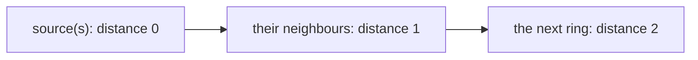

**(f) Topological sort via DFS** — *the alternative to Kahn's; also detects cycles, with three colours.*

**O(V + E)** time · **O(V)** space

```javascript
function topoDFS(n, adj) {
  const state = new Array(n).fill(0), out = [];    // 0 = new, 1 = in progress, 2 = done
  let ok = true;
  const go = u => {
    state[u] = 1;
    for (const v of adj[u]) {
      if (state[v] === 1) { ok = false; return; }  // back-edge → cycle
      if (!state[v]) go(v);
    }
    state[u] = 2; out.push(u);                     // finished → push
  };
  for (let i = 0; i < n; i++) if (!state[i]) go(i);
  return ok ? out.reverse() : [];                  // reverse finish order = topo order
}
```

> **Two colours aren't enough.** "Visited" can't distinguish *currently on the stack* (a real cycle)
> from *finished long ago* (a harmless cross-edge). The three-state colouring is the whole trick for
> **directed** cycle detection — in an *undirected* graph you'd instead skip the edge you arrived on.

**(g) Bellman–Ford** — *the only one that survives negative weights, and the only one that detects a
negative cycle.*

**O(V · E)** time · **O(V)** space

```javascript
function bellmanFord(n, edges, src) {              // edges = [[u, v, w], …]
  const dist = new Array(n).fill(Infinity);
  dist[src] = 0;
  for (let i = 0; i < n - 1; i++)                  // n-1 rounds is always enough
    for (const [u, v, w] of edges)
      if (dist[u] !== Infinity && dist[u] + w < dist[v]) dist[v] = dist[u] + w;

  for (const [u, v, w] of edges)                   // one EXTRA pass
    if (dist[u] !== Infinity && dist[u] + w < dist[v]) return null;   // still improving → neg cycle
  return dist;
}
```

> **Why `n - 1` rounds:** any shortest path visits at most `n` nodes, so it has at most `n-1` edges,
> and each round settles at least one more edge of it. If an `n`-th pass *still* improves something,
> no shortest path exists — you've found a negative cycle. That extra pass is the detector, and it's
> free.

**(h) Floyd–Warshall** — *all pairs, `V ≤ 400`, five lines.*

**O(V³)** time · **O(V²)** space

```javascript
function floydWarshall(n, edges) {
  const d = Array.from({length: n}, (_, i) =>
            Array.from({length: n}, (_, j) => i === j ? 0 : Infinity));
  for (const [u, v, w] of edges) d[u][v] = Math.min(d[u][v], w);
  for (let k = 0; k < n; k++)                      // k MUST be the outermost loop
    for (let i = 0; i < n; i++)
      for (let j = 0; j < n; j++)
        if (d[i][k] + d[k][j] < d[i][j]) d[i][j] = d[i][k] + d[k][j];
  return d;
}
```

> **`k` outermost is not a style choice.** The loop means "allowing only nodes `0…k` as intermediate
> stops, what's the best `i → j`?" Put `k` inside and you're using half-finished answers, and the
> result is quietly wrong. Also: `d[i][i] < 0` afterwards means a negative cycle through `i`.

**(i) Kruskal's MST** — *sort the edges, take any that doesn't close a cycle.*

**O(E log E)** time (the sort dominates) · **O(V)** space

```javascript
function kruskal(n, edges) {                       // edges = [[u, v, w], …]
  const es = [...edges].sort((x, y) => x[2] - y[2]);
  const dsu = new DSU(n);
  let total = 0, used = 0;
  for (const [u, v, w] of es) if (dsu.union(u, v)) { total += w; used++; }
  return used === n - 1 ? total : -1;              // fewer than n-1 edges → disconnected
}
```

> This is the payoff for Union-Find: `union` returning `false` *is* "this edge would close a cycle",
> so the entire algorithm is one sort plus one filter. Greedy is provably correct here by the cut
> property — the cheapest edge crossing any partition is always safe to take.

**Watch out for** forgetting to mark visited (you loop forever / recount); using BFS — not DFS — for
shortest path; multi-source BFS (seed the queue with all sources) for "simultaneous spread"; and the
extra "in-progress vs done" colouring needed to detect cycles in a *directed* graph.


```check
graphs
```

## Intervals

### 🔍 Recognise it

| | |
|---|---|
| **Trigger words** | "overlapping", "merge intervals", "meeting rooms", "insert interval", "non-overlapping", "[start, end]" |
| **Input shape** | the input is literally an array of `[start, end]` pairs |
| **Constraint tell** | **n ≤ 10⁵** → the sort dominates and is intended |
| **Target complexity** | **O(n log n)** time (the sort) · **O(n)** space |
| **Confused with** | **Greedy** — they overlap. Sorting by *end* time and taking greedily is the standard "remove fewest to de-overlap" answer. Sort by **start** to merge, by **end** to schedule |


**The idea.** Given `[start, end]` ranges, **sort them by one endpoint, then sweep through once** —
merging overlaps or counting how many are active. The sort is the magic: once ranges are in order, a
single left-to-right pass is correct. Analogy: merging overlapping calendar events by lining them up by
start time and gluing touching ones together.

**Big-O.** Time O(n log n) (the sort dominates; the sweep is O(n)); space O(n) for the output.

**Reach for it when** the input is `[start, end]` pairs and you must merge/insert overlaps, count how
many to remove to de-overlap, or size a resource ("how many meeting rooms?"). Keyword smell:
"overlapping", "merge", "meeting rooms".

### The variants

**The sort key decides correctness.** This is the most common silent wrong answer in the pattern.

**(a) Merge overlapping — sort by `start`**

**O(n log n)** time (the sort) · **O(n)** output

```javascript
function mergeIntervals(iv) {
  if (!iv.length) return [];
  const a = [...iv].sort((x, y) => x[0] - y[0]);
  const res = [a[0].slice()];
  for (const [s, e] of a.slice(1)) {
    const last = res[res.length - 1];
    if (s <= last[1]) last[1] = Math.max(last[1], e);   // extend, don't just take e
    else res.push([s, e]);
  }
  return res;
}
```

**(b) Maximum non-overlapping — sort by `end`**

**O(n log n)** time · **O(1)** extra

```javascript
function maxNonOverlap(iv) {
  const a = [...iv].sort((x, y) => x[1] - y[1]);        // by END
  let end = -Infinity, count = 0;
  for (const [s, e] of a) if (s >= end) { count++; end = e; }
  return count;
}
```

> **Same greedy, different sort key, different answer.** On `[[1,10],[2,3],[4,5],[6,7]]`: sorting by
> start picks **1** interval; sorting by end picks **3**. Finishing earliest leaves the most room for
> everything that follows — that's the whole proof.

**(c) Minimum rooms — sweep two sorted lists**

**O(n log n)** time · **O(n)** space

```javascript
function minRooms(iv) {
  const starts = iv.map(x => x[0]).sort((a, b) => a - b);
  const ends   = iv.map(x => x[1]).sort((a, b) => a - b);
  let i = 0, j = 0, cur = 0, best = 0;
  while (i < starts.length) {
    if (starts[i] < ends[j]) { cur++; i++; best = Math.max(best, cur); }
    else { cur--; j++; }
  }
  return best;
}
```

> You deliberately **break the pairing** between a start and its own end — only the counts matter, so
> two independently sorted lists suffice. That's the sweep-line idea in its smallest possible form.


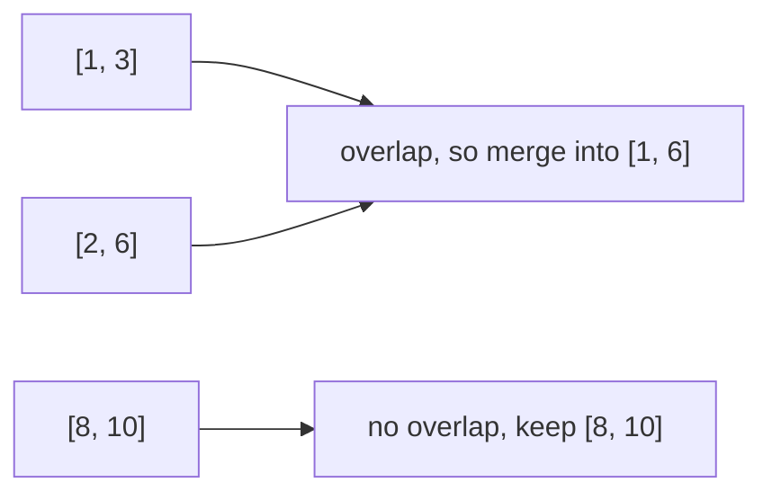

**Watch out for** sorting by the *right* key — by **start** to merge; by **end** for "keep the most /
remove the fewest" (activity selection); and the "max concurrent" pattern (separate and sort the starts
and ends, then sweep) which is secretly a heap.

## Greedy

### 🔍 Recognise it

| | |
|---|---|
| **Trigger words** | "minimum number of", "maximum you can", "can you reach", "gas station", "jump game", "assign/schedule" |
| **Input shape** | there is an obvious **best next move**, and taking it never blocks a better future |
| **Constraint tell** | **n ≤ 10⁵–10⁶** with a DP that would be O(n²) → the setter expects the shortcut |
| **Target complexity** | **O(n)**, or **O(n log n)** if a sort sets up the order · **O(1)** space |
| **Confused with** | **Dynamic Programming** — ask: *can I build a small counter-example where the greedy choice loses?* If yes, it is DP. If you can argue an **exchange argument** (swapping in the greedy choice never makes the result worse), greedy is safe |


**The idea.** At each step, grab the choice that looks best *right now* and never look back. Fast and
simple — **when** the greedy choice is provably safe. The whole difficulty is the proof (or finding the
counter-example that says "no, you need DP"). Analogy: filling a bag by always adding the highest
value-per-kilo item next — great for some problems, a trap for others.

**Big-O.** Usually O(n), or O(n log n) if a sort sets up the order; space O(1). Cheaper than DP *when
it's correct.*

**Reach for it when** there's an obvious "best next move" and you can argue an **exchange argument**
("swapping in the greedy choice never makes the result worse"). Classic homes: intervals, jump/reach,
gas-station, scheduling. If you can build a small counter-example, drop greedy for DP.

**Template.**

```javascript
sortBySomeKey(items);          // often the setup
let state = init;
for (const item of items) {
  if (canTake(item, state)) state = take(item, state);   // commit, never undo
}
```

**Watch out for** greedy that *looks* right but isn't — Coin Change with coins [1,3,4] making 6: greedy
grabs 4+1+1 = 3 coins, but the best is 3+3 = 2 coins. Always sanity-check with a small example; and the
frequent need to sort first to expose the safe order.

## Bit Manipulation

### 🔍 Recognise it

| | |
|---|---|
| **Trigger words** | "appears once, the rest twice", "count set bits", "without using + or -", "**O(1) extra space**", "subsets of at most 32/26 items" |
| **Input shape** | numbers treated as bit-strings, or a **small universe** (≤ 32 items, 26 letters) packed into one integer |
| **Constraint tell** | **n ≤ 20-ish → think in bits.** Nothing else explains such a tiny bound. This is the strongest single signal in the whole table |
| **Target complexity** | **O(1)** per operation · **O(32)** = O(1) for a bit loop · **O(2ⁿ · n)** for bitmask DP |
| **Confused with** | **Hash map** — ask: *is O(1) extra space demanded?* Yes → XOR tricks. Otherwise a map is clearer and just as fast |


**The idea.** A number is secretly **32 on/off switches** (bits). Three tricks do most of the work: XOR
cancels pairs (`x ^ x = 0`), `n & (n - 1)` erases the lowest "on" switch, and `1 << i` flips switch `i`
— so a small *set* of items can live inside a single integer, and some problems needing O(n) memory
collapse to O(1). (XOR = "exclusive or": 1 if the bits differ, 0 if same — which is why a value XOR'd
with itself vanishes.)

**Big-O.** Each operation O(1); a loop over the 32 bit positions is O(32) = O(1). The payoff is usually
*space* and small constant factors.

**Reach for it when** the prompt says "appears once, the rest twice" (XOR them all — pairs cancel, the
loner survives), "count the set bits", "add without using +", "O(1) extra space" on a counting problem,
or a small universe (≤ 32 things, 26 letters) needs fast overlap tests — pack each set into a bitmask.

**Template (the four core moves).**

```javascript
acc ^= x;                      // pair cancellation
n = n & (n - 1);               // drop the lowest set bit
mask |= 1 << i;                // add item i to a set
const disjoint = (m1 & m2) === 0;  // do two sets share nothing?
```

**The full idiom set — memorise these seven.**

```javascript
mask & (1 << i)          // is bit i set?
mask | (1 << i)          // set bit i
mask & ~(1 << i)         // clear bit i
mask ^ (1 << i)          // flip bit i
mask & (mask - 1)        // clear the LOWEST set bit   → the popcount loop
mask & -mask             // isolate the lowest set bit
for (let s = mask; s; s = (s - 1) & mask)   // every non-empty SUBMASK of mask
```

> That last line enumerates each submask exactly once, and running it over **all** masks costs
> exactly **3ⁿ** in total — verified: n=13 gives 1,594,323 = 3¹³. Not 4ⁿ, which is why set-partition
> DP stays feasible up to about n = 16.

**Watch out for** JS specifics: bitwise operators treat numbers as **signed** 32-bit — `>>>` is the
*unsigned* shift, `1 << 31` comes out negative, and results touching bit 31 are safer built
arithmetically (`res * 2 + bit`). Elements appearing in *triples* defeat plain XOR — that needs a mod-3
bit-counting trick.


```check
greedy
```

## Dynamic Programming

### 🔍 Recognise it

| | |
|---|---|
| **Trigger words** | "**number of ways**", "**minimum/maximum** cost/length", "**can** it be done", "longest subsequence", "take it or leave it" |
| **Input shape** | overlapping subproblems — the same smaller question is asked many times — and choices that pile up |
| **Constraint tell** | **n ≤ 5,000 → O(n²) is INTENDED**, not a fallback. Do not burn 20 minutes hunting an O(n log n) trick. **n ≤ 20** → bitmask DP |
| **Target complexity** | **states × work-per-state** — 1-D → O(n) · 2-D grid → O(n²) · bitmask → O(2ⁿ · n) |
| **Confused with** | **Backtracking** — ask: *do I need to LIST the answers or COUNT/optimise them?* List → backtracking. Count or best → DP. Also **Greedy**: if a counter-example exists, it is DP |


**The idea.** **DP** = solve a big problem by combining answers to smaller overlapping subproblems, and
**never solve the same subproblem twice** (that's the whole win). It applies when the problem has
*overlapping subproblems* (the same little question comes up again and again) and *optimal substructure*
(the best big answer is built from best small answers). You define a **state**, write a **recurrence**
(how a state depends on smaller ones), set base cases, and fill a table. Analogy: computing Fibonacci by
writing each number down once instead of re-deriving it a thousand times.

**Big-O.** **states × work-per-state.** 1-D over n with O(1) transition → O(n); a 2-D grid → O(n²); k
choices per state → O(n·k). Memory = the table size (often shrinkable to the last few rows).

**Reach for it when** the prompt asks "**number of ways**", "**min/max** cost/length", "**can** it be
done", or is about subsequences — and brute force smells exponential because of piled-up "take it or
leave it" choices.

### The variants

**(a) Top-down memoisation** — *write this FIRST.* The recursion mirrors the problem statement, so
it's the easiest to get right; the cache is one line.

**O(states × transitions)** time · **O(states)** memo + **O(depth)** stack

```javascript
function coinChangeMemo(coins, amount) {
  const memo = new Map();
  const go = rem => {
    if (rem === 0) return 0;                       // base case
    if (rem < 0) return Infinity;                  // invalid branch
    if (memo.has(rem)) return memo.get(rem);       // ← the ONLY line that makes it fast
    let best = Infinity;
    for (const c of coins) best = Math.min(best, go(rem - c) + 1);
    memo.set(rem, best);
    return best;
  };
  const r = go(amount);
  return r === Infinity ? -1 : r;
}
```

> **The ladder to climb, every time:** brute-force recursion → add a `memo` → *then* invert it into a
> bottom-up table if you need the speed or the space control. Jumping straight to the table is how
> people get the recurrence wrong. And the memo key is exactly your **state** — if you can't name the
> key, you haven't found the state yet.

**(b) 1-D linear** — *each state depends on a fixed number of earlier ones.*

**O(n)** time · **O(n)** space — collapsible to **O(1)**

```javascript
function climbStairs(n) {
  const dp = new Array(n + 1).fill(0);
  dp[0] = 1; if (n >= 1) dp[1] = 1;
  for (let i = 2; i <= n; i++) dp[i] = dp[i - 1] + dp[i - 2];
  return dp[n];
}
```

**(c) 0/1 knapsack — each item at most once.** Iterate capacity **downward**.

**O(n · W)** time · **O(W)** space

```javascript
function knapsack01(w, v, W) {
  const dp = new Array(W + 1).fill(0);
  for (let i = 0; i < w.length; i++)
    for (let c = W; c >= w[i]; c--)        // ← DOWNWARD
      dp[c] = Math.max(dp[c], dp[c - w[i]] + v[i]);
  return dp[W];
}
```

**(d) Unbounded knapsack — each item unlimited.** Identical, but **upward**.

**O(n · W)** time · **O(W)** space

```javascript
function coinChange(coins, amount) {
  const dp = new Array(amount + 1).fill(Infinity);
  dp[0] = 0;
  for (const c of coins)
    for (let a = c; a <= amount; a++)      // ← UPWARD
      dp[a] = Math.min(dp[a], dp[a - c] + 1);
  return dp[amount] === Infinity ? -1 : dp[amount];
}
```

> **The single most useful DP fact on this page.** Downward = each item used at most once, because
> `dp[c - w[i]]` still holds the *previous* item's row. Upward = unlimited, because it already holds
> *this* item's row and happily reuses it. One loop direction is the entire difference between 0/1
> and unbounded. Say that out loud in an interview and you sound like you've actually done this.

**(e) 2-D over two sequences** — *LCS, edit distance, interleaving.*

**O(n · m)** time · **O(n · m)** space — collapsible to **O(min(n,m))**

```javascript
function lcs(a, b) {
  const n = a.length, m = b.length;
  const dp = Array.from({ length: n + 1 }, () => new Array(m + 1).fill(0));
  for (let i = 1; i <= n; i++)
    for (let j = 1; j <= m; j++)
      dp[i][j] = a[i-1] === b[j-1] ? dp[i-1][j-1] + 1 : Math.max(dp[i-1][j], dp[i][j-1]);
  return dp[n][m];
}
```

**(f) Interval DP** — *the `n ≤ 300` fingerprint. `dp[i][j]` over a range, split at some `k` inside.*

**O(n³)** time · **O(n²)** space

```javascript
function burstBalloons(nums) {
  const a = [1, ...nums, 1], n = a.length;          // sentinels at both ends
  const dp = Array.from({ length: n }, () => new Array(n).fill(0));
  for (let len = 2; len < n; len++)                 // by RANGE LENGTH, outermost
    for (let i = 0; i + len < n; i++) {
      const j = i + len;
      for (let k = i + 1; k < j; k++)               // k = the LAST one burst
        dp[i][j] = Math.max(dp[i][j], dp[i][k] + a[i]*a[k]*a[j] + dp[k][j]);
    }
  return dp[0][n - 1];
}
```

> Two things make interval DP work: looping by **length** (so every smaller range is already solved)
> and choosing `k` as the **last** action, not the first — which is what leaves two *independent*
> subranges. Pick `k` as the first action and the halves still interact, and the recurrence is wrong.

**(g) Bitmask DP** — *the `n ≤ 20` fingerprint. Subsets as states.*

**O(2ⁿ · n)** time · **O(2ⁿ)** space

```javascript
function assignmentCost(cost) {                     // cost[person][task]
  const n = cost.length, FULL = (1 << n) - 1;
  const dp = new Array(1 << n).fill(Infinity);
  dp[0] = 0;
  for (let mask = 0; mask < FULL; mask++) {
    if (dp[mask] === Infinity) continue;
    const i = popcount(mask);                       // #assigned = who's next
    for (let j = 0; j < n; j++)
      if (!(mask & (1 << j)))
        dp[mask | (1 << j)] = Math.min(dp[mask | (1 << j)], dp[mask] + cost[i][j]);
  }
  return dp[FULL];
}
const popcount = m => { let c = 0; while (m) { m &= m - 1; c++; } return c; };
```

**Why it works.** The state is *the set of tasks already assigned* — and a set of ≤ 20 things is just
an integer, one bit each. That's the whole trick: **a subset is a number**, so an array indexed
`0…2ⁿ-1` is a table indexed by subsets.

Two things make the recurrence sound. Masks are visited in increasing numeric order and setting a bit
always *increases* the number, so `dp[mask]` is final before anything reads it. And `popcount(mask)`
already tells you how many are assigned — hence **which person is next** — so you don't need a second
dimension for "whose turn", saving a factor of `n`.

The transferable question: when `n ≤ 20`, ask *"what if my DP state were a set?"* That tiny bound is
what's hinting at it.


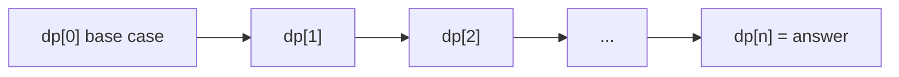

Each `dp[i]` is built from earlier states via the recurrence — solve each subproblem once, reuse it
forever.

**(h) Digit DP** — *the `n ≤ 10⁹` fingerprint: count numbers with a digit property, without looping.*

**O(digits × states × 10)** time · **O(digits × states)** memo

```javascript
function countNoRepeatedDigit(n) {                 // how many of 1..n have all-distinct digits
  const s = String(n), memo = new Map();
  const go = (i, mask, tight, started) => {
    if (i === s.length) return started ? 1 : 0;
    const key = `${i}|${mask}|${tight?1:0}|${started?1:0}`;
    if (memo.has(key)) return memo.get(key);
    const limit = tight ? +s[i] : 9;               // tight → can't exceed n's digit here
    let total = 0;
    for (let d = 0; d <= limit; d++) {
      if (started && (mask & (1 << d))) continue;  // digit already used
      const nStarted = started || d > 0;           // leading zeros aren't "used" digits
      total += go(i + 1, nStarted ? (mask | (1 << d)) : 0, tight && d === limit, nStarted);
    }
    memo.set(key, total);
    return total;
  };
  return go(0, 0, true, false);
}
```

> Three flags carry the whole technique: **`tight`** (are we still hugging `n`'s prefix, so this
> digit is capped?), **`started`** (have we placed a non-zero digit yet — leading zeros must not
> count as "used"), and whatever **state** the property needs (here a 10-bit `mask`). Get `started`
> wrong and every answer is off by the count of shorter numbers.

**Watch out for** the real difficulty being *defining the state and the recurrence*: write the
brute-force recursion first, add memoization (top-down), *then* invert it to a bottom-up table. Mind the
base cases, and 1-D (Coin Change over an amount) vs 2-D (Longest Common Subsequence over two strings)
state; collapse the memory when only the last few states matter.


```check
dp
```

## Math & Geometry

### 🔍 Recognise it

| | |
|---|---|
| **Trigger words** | "digits", "primes", "powers", "modulo 10⁹+7", "rotate the matrix", "spiral", "points on a line", "overflow" |
| **Input shape** | the problem is about number properties or a grid walked in a fixed geometric pattern |
| **Constraint tell** | **n ≤ 10⁹ or 10¹⁸** with no array → a closed-form formula or O(log n) fast power. "Modulo 10⁹+7" always means the answer is astronomically large |
| **Target complexity** | digit loop **O(log₁₀ n)** · sieve **O(n log log n)** · fast power **O(log n)** |
| **Confused with** | **Simulation** — before you simulate, ask what the process **secretly counts**. Bulb Switcher secretly counts divisors, so the answer is `floor(sqrt(n))` — one line, no loop |


**The idea.** Less a single template, more a toolbox: the **digit loop** (`n % 10` peels off the last
digit, `n / 10 | 0` drops it), sieve-style batch precomputation of primes, **fast exponentiation**
(squaring to compute `x^p` in O(log p)), careful matrix walking with shrinking boundaries, and
exact-fraction keys where floating-point would lie to you.

**Big-O.** Digit loops O(log₁₀ n). Sieve O(n log log n). Fast power O(log n). Matrix walks O(cells).

**Reach for it when** the problem is about digits, primes, powers, imposed overflow rules, rotating or
spiral-walking a matrix, or points on a line. The recurring meta-move: before you simulate, ask what the
process *secretly counts* (Bulb Switcher secretly counts divisors) — sometimes the answer is a one-line
formula, not an algorithm.

**Template (digit loop, fast power).**

```javascript
while (n > 0) {                     // peel digits right to left
  const d = n % 10;
  n = Math.floor(n / 10);
}
while (p > 0) {                     // x^p in O(log p)
  if (p % 2 === 1) result *= x;
  x *= x;
  p = Math.floor(p / 2);
}
```

### The toolkit

**(a) GCD (Euclid) and LCM**

**O(log min(a, b))** time · **O(1)** space (iterative)

```javascript
const gcd = (a, b) => b === 0 ? a : gcd(b, a % b);
const lcm = (a, b) => a / gcd(a, b) * b;           // divide FIRST — avoids overflow
```

**(b) Fast exponentiation** — *`x^p` in O(log p), and the modular version you need for counting.*

**O(log p)** multiplications · **O(1)** space

```javascript
function fastPow(base, exp, mod) {
  let res = 1n, b = BigInt(base) % BigInt(mod), e = BigInt(exp);
  const m = BigInt(mod);
  while (e > 0n) {
    if (e & 1n) res = res * b % m;                 // this bit is set → multiply it in
    b = b * b % m;                                 // square for the next bit
    e >>= 1n;
  }
  return Number(res);
}
```

> **Use `BigInt` when a modulus is involved.** With `mod = 10⁹+7`, the product of two residues
> approaches 10¹⁸ — past 2⁵³, so plain numbers silently lose precision. This is the single most
> common source of "my answer is right for small inputs" in counting problems.

**(c) Sieve of Eratosthenes** — *all primes ≤ n in O(n log log n).*

**O(n log log n)** time · **O(n)** space

```javascript
function sieve(n) {
  const is = new Array(n + 1).fill(true);
  is[0] = is[1] = false;
  for (let i = 2; i * i <= n; i++)                 // stop at √n
    if (is[i]) for (let j = i * i; j <= n; j += i) is[j] = false;   // start at i², not 2i
  return is.reduce((acc, v, i) => (v && acc.push(i), acc), []);
}
```

> Two optimisations that are the difference between fast and slow: the outer loop stops at **√n**
> (any composite has a factor below its square root), and the inner loop starts at **i²** (everything
> smaller was already crossed off by a smaller prime).

**(d) Matrix exponentiation** — *the `n ≤ 10¹⁸` fingerprint: a linear recurrence in O(log n).*

**O(k³ log n)** time for a k×k matrix · **O(k²)** space

```javascript
function matrixPowFib(n) {                          // F(n) via [[1,1],[1,0]]^n
  const mul = (A, B) => [
    [A[0][0]*B[0][0] + A[0][1]*B[1][0], A[0][0]*B[0][1] + A[0][1]*B[1][1]],
    [A[1][0]*B[0][0] + A[1][1]*B[1][0], A[1][0]*B[0][1] + A[1][1]*B[1][1]]];
  let result = [[1,0],[0,1]], base = [[1,1],[1,0]], e = n;   // identity matrix
  while (e > 0) { if (e & 1) result = mul(result, base); base = mul(base, base); e >>= 1; }
  return result[0][1];
}
```

> Same skeleton as fast exponentiation — only the "multiply" changed. Any recurrence where each term
> is a fixed linear combination of the previous `k` can be written as a `k × k` matrix and raised to
> a power, turning O(n) into O(k³ log n). That's how you answer "F(10¹⁸) mod p".

**Watch out for** overflow rules the *problem* imposes (JS numbers won't actually overflow at these
sizes, but performing the check is still your job); in-place matrix edits needing phase separation
(record first, write second — or fresh zeros trigger yet more zeros); and floats as map keys — reduce
fractions with gcd and normalize the sign instead.

## Game Theory & Brain Teasers

### 🔍 Recognise it

| | |
|---|---|
| **Trigger words** | "**both play optimally**", "who wins", "can the first player force a win", "Nim", "stones/coins taken in turns" |
| **Input shape** | two players alternating, or a puzzle that smells like it has a slick one-line answer |
| **Constraint tell** | **n ≤ 20** → bitmask over states. **n up to 10⁹** → there is a formula, find the invariant |
| **Target complexity** | state-space DP **O(states × moves)** · bitmask games **O(2ⁿ · n)** · invariant answers **O(1)** |
| **Confused with** | **DP** — game theory *is* DP over states, with the twist that you **minimise the opponent's best reply**. If n is huge, stop coding and hunt for the pattern by hand on n = 1, 2, 3, 4 |


**The idea.** Two smart players take turns. Label each position **winning** (some move hands the
opponent a *losing* position) or **losing** (every move hands them a *winning* one), and compute that
backwards with memoized recursion. Even better: find the hidden **invariant** (a parity rule, multiples
of 4, an XOR) that decides the game instantly with no search. For score games, track the best *score
difference*; flipping its sign on each recursive call encodes the turn-swap ("minimax" in one line).

**Big-O.** State-space DP: O(states × moves) — bitmask games O(2ⁿ · n). Invariant answers: O(n) or O(1).

**Reach for it when** you read "both play optimally", "who wins", "can the first player force a win…" —
or a puzzle that smells like it has a slick one-line answer (light bulbs, pigs, eggs): hunt for what the
process counts before you simulate.

**Template (winning/losing memo).**

```javascript
function canWin(state) {
  if (memo.has(state)) return memo.get(state);
  for (const next of moves(state)) {
    if (!canWin(next)) {        // some move traps the opponent
      memo.set(state, true);
      return true;
    }
  }
  memo.set(state, false);       // every move helps them
  return false;
}
```

**Watch out for** forgetting memoization (game trees explode exponentially); mixing up the conventions
"loses if it can't move" vs "wins on reaching X"; and trusting a *guessed* invariant — verify it against
the brute-force DP on small `n` first (Divisor Game is the drill for exactly this habit).

## Cross-cutting tricks — the reusable micro-moves

These aren't patterns; they're small techniques that show up *inside* many patterns. Each one is
worth recognising on sight.

**Sentinels and dummy heads.** Put a fake element at the boundary so the special case disappears.
A `dummy` node before a linked list's head means "delete the first node" needs no `if`. Appending a
`0` to the end of a heights array forces a monotonic stack to flush itself, so you don't duplicate
the drain logic after the loop. Wrapping a grid in a border of walls removes every bounds check.
*The trick is always the same: make the edge case an ordinary case.*

**Two passes instead of one clever one.** When a value depends on *both* what's left of it and what's
right of it, stop trying to do it in one sweep — do a left-to-right pass, then a right-to-left pass,
then combine. Product Except Self (prefix products × suffix products), Trapping Rain Water
(max-so-far from each side), and Candy (satisfy the left neighbour, then the right) are all the same
move. Two O(n) passes are still O(n), and vastly easier to get right.

**Complement thinking.** Counting the thing you want is sometimes far harder than counting its
opposite and subtracting. "Subarrays with at most K distinct" is easy; "exactly K" is
`atMost(K) − atMost(K−1)`. "Probability of at least one collision" is `1 − P(no collision)`. When a
condition has an awkward "at least / at most / exactly" shape, try inverting it.

**In-place marking — O(1) space by writing into the input.** When values are guaranteed to be in
`1…n`, the array *is* a hash table: to mark "I've seen value `v`", negate `a[v-1]`. Verified:

```javascript
findDuplicates([4,3,2,7,8,2,3,1])  →  [2, 3]      // O(1) extra space
// for each x: i = abs(x)-1; if a[i] < 0 it's a repeat, else a[i] = -a[i]
```

Its sibling, **cyclic sort**, puts each value at its own index and then reads off whatever is out of
place — the whole "missing / duplicate number in 1…n" family in O(n) time and O(1) space:

```javascript
function cyclicSortMissing(a) {                    // values 1..n, find the missing one
  let i = 0;
  while (i < a.length) {
    const target = a[i] - 1;                       // where a[i] belongs
    if (a[i] > 0 && a[i] <= a.length && a[target] !== a[i])
      [a[i], a[target]] = [a[target], a[i]];       // swap it home, DON'T advance
    else i++;                                      // already home (or a duplicate) → move on
  }
  for (let j = 0; j < a.length; j++) if (a[j] !== j + 1) return j + 1;
  return a.length + 1;
}
```

> **Don't advance `i` after a swap** — the value you just received is unexamined and may itself belong
> elsewhere. Each swap puts at least one value permanently home, so despite the nested feel it's O(n)
> total. The constraint `1 ≤ a[i] ≤ n` is the tell that this applies.

**Sort by the *right* endpoint.** Which key you sort intervals by decides whether a greedy is correct,
and this is the most common silent wrong answer in the Intervals pattern:

- **Merging** overlaps → sort by **start**.
- **Maximum number of non-overlapping** intervals (activity selection, "minimum removals", "burst
  balloons with fewest arrows") → sort by **end**.

Measured on `[[1,10],[2,3],[4,5],[6,7]]` with the same greedy: sorting by **start** picks **1**
interval; sorting by **end** picks **3**. Same code, same data — only the sort key differs. Sorting
by end works because finishing earliest leaves the most room for everything after it.

**Encode 2D coordinates into one number.** A `Set` of `[r, c]` arrays never works — arrays compare by
reference. Use `r * COLS + c` (or a `` `${r},${c}` `` string when you don't care about speed):

```javascript
const key = r * COLS + c;        // decode: [Math.floor(key/COLS), key % COLS]
```

**Direction arrays.** Replace four near-identical recursive calls with a loop:

```javascript
const DIRS = [[1,0],[-1,0],[0,1],[0,-1]];        // add diagonals for 8-way
for (const [dr, dc] of DIRS) { const nr = r+dr, nc = c+dc; /* … */ }
```

**Binary search the answer.** Covered above in the constraints section, but it deserves repeating as a
*trick*: when the question is "the minimum X such that something is possible" and *checking* a given
X is easy, don't compute the answer — search for it. The check becomes your `ok()` predicate.

**Sort to unlock a greedy.** Many greedy problems are only obvious after the right sort — by ratio
(value ÷ weight), by deadline, by end time, by "cost of doing this one last". If a greedy feels
*nearly* right but has a counter-example, try a different sort key before abandoning it for DP.

**Skipping duplicates in backtracking.** To generate unique subsets/permutations from an input with
repeats: sort first, then at each level skip a candidate equal to the previous one *at the same
depth*:

```javascript
for (let i = start; i < nums.length; i++) {
  if (i > start && nums[i] === nums[i-1]) continue;   // same value, same level → skip
  // choose → recurse → un-choose
}
```

That `i > start` (not `i > 0`) is the whole subtlety: duplicates are fine *down* a branch, forbidden
*across* siblings.

**Modular arithmetic — two traps.** When a problem says "answer modulo 10⁹ + 7": take the mod after
**every** addition and multiplication, not once at the end, or you overflow long before you finish.
And in JavaScript, `%` is *remainder*, not mathematical modulo — it keeps the sign of the dividend:

```javascript
-7 % 3            // -1   ← not 2
((-7 % 3) + 3) % 3 //  2   ← the correct form when negatives are possible
```

**Where numbers actually break.** In JS the danger point is **2⁵³**, not 2³¹ — `2**53 === 2**53 + 1`
is `true`. So integer overflow in the C/Java sense won't bite you, but silent precision loss will,
especially when multiplying two large values before taking a mod. Use `BigInt` when a product can
exceed 2⁵³. (Writing the same solution in Java? There `int` overflows at 2³¹ — use `long`.)

**Reverse the problem.** Iterating from the end is sometimes trivially easier: building a suffix
maximum, walking a DP backwards from the goal state, or merging two sorted arrays in place by filling
from the *back* so you never overwrite unread data.

---

## Three problems, solved out loud

Everything above is a separate skill — classify, size the constraints, pick a variant, name the
invariant, check the edges. Here they run **together, on problems you haven't been told the answer
to.** The point isn't the three solutions; it's the *order of the thinking*, which is identical every
time.

Each walkthrough follows the same six steps. Read them as a script you can run on any problem:

> **① Restate it** → **② Read the constraints** → **③ Classify** → **④ Brute force, then find the
> waste** → **⑤ Pick the variant and name the invariant** → **⑥ Run the edge-case checklist**

---

### Walkthrough A — the prompt names the pattern

> *"Given a string `s`, find the length of the longest substring without repeating characters."*
> `0 <= s.length <= 5 * 10⁴`

**① Restate.** Longest run with no character appearing twice. Return a *length*, not the substring.

**② Constraints.** `5 × 10⁴`. From the table: `n²` would be 2.5 × 10⁹ — dead. I need **O(n) or
O(n log n)**. That single line has already eliminated "check every substring."

**③ Classify.** The words *longest* + *substring* (contiguous) + *a rule about the contents* are the
sliding-window signature, straight off the classification table. And it's the **longest** flavour,
so from §Sliding Window that's variant **(b)**.

**④ Brute force, and where it wastes.** Try every start, extend while distinct: O(n²). The waste is
obvious once you look — when the window from `l` fails at `r`, we throw it away and restart at
`l+1`, re-checking almost the same characters. **But we already know everything between `l` and `r`
is distinct.** That knowledge is what the window keeps.

**⑤ The variant and the invariant.**

*Invariant: `[l, r]` contains no duplicate characters — always true at the point we measure.*

The naive repair is "shrink `l` one at a time until the duplicate is gone." That works. But we can do
better: a `Map` of *last seen index* lets us jump `l` straight past the previous occurrence.

```javascript
function lengthOfLongestSubstring(s) {
  const last = new Map();               // char -> the last index we saw it at
  let l = 0, best = 0;
  for (let r = 0; r < s.length; r++) {
    const c = s[r];
    if (last.has(c) && last.get(c) >= l) l = last.get(c) + 1;   // jump l past the old copy
    last.set(c, r);
    best = Math.max(best, r - l + 1);   // measured only while the invariant holds
  }
  return best;
}
```

**The `>= l` is the whole subtlety, and it's where people lose this problem.** The map remembers
characters that have already fallen *behind* the window. On `"abba"`: at the final `a`, the map says
"last seen at index 0" — but `l` is already 2, so that `a` is ancient history and must be ignored. Drop
the `>= l` and `l` jumps *backwards* to 1, the window grows illegally, and you return 3 instead of 2.

**⑥ Edges.** `""` → 0 ✓ (the loop never runs). `"a"` → 1 ✓. `"bbbbb"` → 1 ✓. `"abcdef"` → 6 ✓
(nothing ever jumps). `"abba"` → 2 ✓ — the case above. **O(n)** time, **O(min(n, alphabet))** space.

---

### Walkthrough B — the constraints name the pattern

> *"Packages must ship within `D` days, in the given order. Find the least ship capacity."*
> `1 <= D <= weights.length <= 5 * 10⁴`, `1 <= weights[i] <= 500`

**① Restate.** Cut the array into `≤ D` contiguous chunks, minimising the largest chunk sum.

**② Constraints.** `5 × 10⁴` again rules out anything quadratic. But look at the *shape of the
question*: **"the least X such that something is possible."** From the answer-shape table, that is
binary search on the answer, near-certainly.

**③ Classify.** Confirm it with the two tests that make binary search legal:

- Is the answer **bounded**? Yes — at least `max(weights)` (one package must fit) and at most
  `sum(weights)` (ship everything in one day).
- Is the predicate **monotonic**? If capacity 20 works, does 21? Obviously — more room never hurts.
  So `ok` is `false…false,true…true`. **That's the proof of correctness**, and it's the sentence to
  say out loud.

**④ Brute force, and the reframe.** Trying every capacity from `max` to `sum` is O(sum × n) —
far too slow. But notice you never needed to *construct* the answer, only to **test** one. Testing is
a simple greedy sweep in O(n). Cheap test + monotonic + bounded = search the answer space.

**⑤ The variant and the invariant.** §Binary Search variant **(e)**.

*Invariant: `ok` is false everywhere below `lo`, and true at `hi`. The answer is always in `[lo, hi]`.*

```javascript
function shipWithinDays(weights, D) {
  const daysNeeded = cap => {                    // the ok() predicate, as a greedy sweep
    let days = 1, cur = 0;
    for (const w of weights) {
      if (cur + w > cap) { days++; cur = 0; }    // this package won't fit → start a new day
      cur += w;
    }
    return days;
  };
  let lo = Math.max(...weights), hi = weights.reduce((a, b) => a + b, 0);
  while (lo < hi) {
    const mid = Math.floor((lo + hi) / 2);
    if (daysNeeded(mid) <= D) hi = mid;          // mid works — it might BE the answer, keep it
    else lo = mid + 1;                           // mid fails — discard it
  }
  return lo;
}
```

Two things worth defending. `lo` starts at `max(weights)`, not `0` — a capacity that can't hold the
heaviest single package is not merely bad, it's *invalid*, and starting below it would make `ok`
non-monotonic at the bottom. And `hi = mid`, never `mid - 1`, because a working capacity is a
candidate (§Binary Search, variant (e)).

**⑥ Edges.** `D = 1` → must be `sum` ✓. `D = n` → must be `max` ✓. One package ✓. **O(n log(sum))**
time — about 5 × 10⁴ × 25 ≈ 1.2 × 10⁶ operations, comfortably inside budget — **O(1)** space.

---

### Walkthrough C — greedy looks right, and isn't

> *"Given coin denominations and an `amount`, return the fewest coins that make it, or -1."*
> `1 <= coins.length <= 12`, `1 <= coins[i] <= 2³¹-1`, `0 <= amount <= 10⁴`

**① Restate.** Minimum count of coins (unlimited supply of each) summing exactly to `amount`.

**② Constraints — and the trap.** `coins.length ≤ 12` *screams* "exponential in the number of coins",
and you might reach for a bitmask. **Don't.** Look at the other bound: `amount ≤ 10⁴`. Two bounds
means read the product — `12 × 10⁴ = 1.2 × 10⁵`, trivially cheap. The dimension that matters is the
**amount**, not the coin count.

**③ Classify.** "Fewest / minimum" + "unlimited supply" + "make exactly a target" is either greedy or
DP. Try greedy first — it's cheaper, and *failing* is how you learn which one it is.

**④ Try greedy, then break it.** Greedy = always take the largest coin that fits. On `[1, 5, 10, 25]`
making 30 it gives `25 + 5` = 2 coins, optimal. So far so good. Now hunt a counter-example — and the
way to hunt is to look for a case where a big coin *strands* you:

```
coins = [1, 3, 4], amount = 6
greedy:  4 + 1 + 1  = 3 coins
optimal: 3 + 3      = 2 coins     ← taking the 4 was a trap
```

Greedy is **dead**, and you found out in thirty seconds. That failure is the signal: a locally best
choice isn't safe here, so you must consider *all* choices — which is exactly what DP does. (Try to
build the exchange argument from §Invariants and you'll see it collapse: swapping the 4 in doesn't
leave the rest of the solution intact.)

**⑤ The variant and the recurrence.** Each coin is reusable → §DP variant **(d), unbounded knapsack**.
Write the recursion first, as the DP section insists:

> *"Fewest coins for `a`" = 1 + min over coins c of "fewest coins for `a − c`".*

Base case: `dp[0] = 0`. Unreachable: `Infinity`.

```javascript
function coinChange(coins, amount) {
  const dp = new Array(amount + 1).fill(Infinity);
  dp[0] = 0;
  for (const c of coins)
    for (let a = c; a <= amount; a++)          // UPWARD → each coin reusable
      dp[a] = Math.min(dp[a], dp[a - c] + 1);
  return dp[amount] === Infinity ? -1 : dp[amount];
}
```

*Invariant: after processing the first `k` coins, `dp[a]` is the true minimum using only those coins.*

The loop direction is the whole thing (§DP (c) vs (d)): going **upward**, `dp[a - c]` may already
include coin `c`, so it can be used again — which is what "unlimited supply" means. Flip it downward
and each coin is used at most once, silently solving a different problem.

**⑥ Edges.** `amount = 0` → 0 ✓. Impossible (`[2]`, amount 3) → -1 ✓, and `Infinity` is what makes
that detectable rather than a wrong number. Note `coins[i]` can reach 2³¹ — larger than `amount`, so
the inner loop simply never runs for that coin, which is correct and needs no special case.
**O(n · amount)** time, **O(amount)** space.

---

### What the three have in common

Notice what you did *not* do in any of them: recall a memorised solution. You read the bound, named
the shape, wrote something slow, found the specific waste, and reached for the variant that removes
exactly that waste.

- **A** — the *prompt's words* named the pattern; the work was in the invariant (`>= l`).
- **B** — the *constraints and the question's shape* named it; the work was proving monotonicity.
- **C** — nothing named it. You *tried* the cheap answer, broke it with a deliberate counter-example,
  and escalated.

**C is the one to practise.** Attempting greedy and hunting a counter-example takes under a minute and
tells you more than any amount of staring. When it survives, you've got the simplest solution; when
it dies, it hands you the reason you need DP — which is exactly what an interviewer wants you to say
out loud.

---

## Before you say "done" — the edge-case checklist

Run this list in your head before you claim a solution. It takes twenty seconds and catches most of
what interviewers probe for. The habit itself is a signal: candidates who volunteer their own edge
cases read as senior.

### Always, on every problem

- [ ] **Empty input.** `[]`, `""`, `null` head, no nodes. Does it return the *right* empty answer
      (`0`, `[]`, `-1`) rather than crashing or returning `undefined`?
- [ ] **One element.** Single-node list, one-character string, `n = 1`. Two-pointer and window loops
      love to skip or double-count here.
- [ ] **Two elements.** The smallest case where "left" and "right" are actually different — where an
      off-by-one first becomes visible.
- [ ] **All identical.** `[5,5,5,5]`. Breaks de-duplication, tie-breaking, and any `<` that should
      have been `<=`.
- [ ] **Already sorted, and reverse sorted.** Best and worst case for anything greedy or partitioning.
- [ ] **The answer doesn't exist.** Target absent, no valid path, no solution. Do you return the
      documented sentinel (`-1`, `null`, `[]`) — and does your caller distinguish it from a real `0`?
- [ ] **The answer is the first or the last element.** Boundary handling, in one test.

### By shape

- [ ] **Numbers:** negatives · zero · duplicates · a single huge value. Negatives specifically kill
      sliding windows and any "sum only grows" assumption.
- [ ] **Overflow / precision:** does any product exceed **2⁵³**? If a modulus is involved, take it
      after every multiply, and reach for `BigInt`. (In Java, `int` dies at 2³¹ — use `long`.)
- [ ] **Strings:** empty · one char · all same char · pattern longer than text · Unicode
      (`"é".length` can be 2).
- [ ] **Linked lists:** `null` head · one node · two nodes · a cycle · deleting the head.
- [ ] **Trees:** `null` root · one node · a completely skewed tree (this is also your **recursion
      depth** check — ~12,500 frames in JS) · duplicate values.
- [ ] **Graphs:** disconnected · self-loop · a node with no edges · a cycle · already-visited
      revisits · `n = 0`.
- [ ] **Grids:** 1×1 · a single row · a single column · fully blocked · start equals goal.
- [ ] **Intervals:** touching but not overlapping (`[1,2]` and `[2,3]` — do they merge? *ask*) ·
      one fully containing another · unsorted input.

### Then, before you stop typing

- [ ] **Re-check the complexity against the constraints.** Does your `n²` actually fit the stated `n`?
- [ ] **Did you mutate the input?** `.sort()` sorts in place. If the caller needed the original order,
      you've broken it silently.
- [ ] **Every loop bound and every comparison:** `<` vs `<=`, `i` vs `i+1`, `n` vs `n-1`. Say each one
      out loud once — you'll hear the wrong one.
- [ ] **State the invariant** (see the section above). If you can't, you don't yet know whether it's
      correct — you know it passed the sample.

> **The single most useful habit here:** narrate two or three of these *before* the interviewer asks.
> "Let me check the empty case and the all-duplicates case" turns a code review into a collaboration,
> and it's the cheapest seniority signal available to you.

---


```check
rest
```

## How to get faster

1. **Classify before coding.** Use the signal table up top. The template then writes most of it for you.
2. **State the Big-O out loud** — time *and* space. It's always asked, and it catches an accidental n².
3. **Solve, then re-solve.** Come back to hard problems days later. Recalling under mild difficulty is
   exactly where fluency forms (it's the same spaced-repetition idea the dojo's review queue uses).
4. **Explain the *why*.** If you can't say why the pointer move is safe, why the greedy holds, or why
   the DP state is enough, you've memorized, not learned — and memorized patterns don't transfer.
5. **Escalate deliberately.** Brute force → spot the wasted work (repeated? already sorted? a safe local
   choice?) → apply the matching pattern. That escalation *is* the skill.
