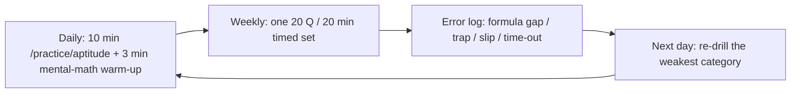

# Aptitude & Reasoning — speed math and logic for the services-firm filter

A Dojo supplement guide — a full course, not a formula sheet. At IT-services firms (Capgemini,
Deloitte, IBM, CGI, Accenture-style pipelines) the timed aptitude test is the **first and
deadliest filter**: most candidates are eliminated here, before any human ever reads their CV.
This course teaches every question category from zero — what the concept *is*, why each formula
works (so you can rebuild it when memory fails), several fully worked examples at exam level, the
traps examiners deliberately set, and a practice set per topic. Drill alongside it in
[/practice/aptitude](/practice/aptitude), which generates fresh numbers every attempt, exactly
like the real test.

**The target that means "ready":** 80%+ on mixed sessions at ~1 minute per question.

## 1. What the test is and how to beat it

A typical services-firm test: 40–60 questions in 40–60 minutes, split across **quantitative
aptitude** (arithmetic under time pressure), **logical reasoning** (patterns, deduction) and
**verbal ability** (grammar, comprehension). Nothing is beyond middle-school math. The test is
*not* measuring mathematical ability — it measures whether you can recall a method instantly,
execute it without slips, and manage your time ruthlessly. That's why preparation works so well:
every question belongs to one of maybe 25 recognizable types, and this course covers all of them.

### The five habits that add 20 percentage points

1. **Read the options before computing.** The options tell you how precise you must be. If they
   are 240, 480, 720, 960 — a rough estimate picks the answer; exact computation is wasted time.
   Options also enable **back-substitution**: plug an option into the problem's condition and see
   if it fits, which is often faster than solving forward.
2. **Approximate aggressively when options are far apart.** 49 × 21: think 50 × 21 = 1050, minus
   21 ⇒ 1029. Or rougher: ≈ 50 × 20 = 1000, pick the option near 1000.
3. **Skip discipline.** If 20 seconds pass with no method in sight, flag it and move on. Every
   stubborn 3-minute question costs you three easy questions elsewhere. You return with fresh
   eyes if time remains.
4. **Name the base before any percentage step.** "Increased by 20%" — 20% *of what*? Most
   percentage traps are base confusions. Say the base to yourself before computing.
5. **Keep an error log.** After each drill, classify every miss as: *formula gap* (relearn the
   section), *trap* (re-read the trap list), *arithmetic slip* (do mental-math warm-ups), or
   *time-out* (skip faster next time). Different diseases, different medicine.

### Guessing policy

- No negative marking (most online filters): **never leave a blank**.
- Negative marking (usually −0.25 to −0.33 per wrong): guess only when you can eliminate at
  least two options; otherwise skip.

## 2. Mental-math foundation (do this before anything else)

Speed on every later topic reduces to a small set of number facts and techniques. Fifteen minutes
a day for a week installs them.

### 2.1 The fraction–percentage dictionary

Percentages *are* fractions. Converting between them instantly is the single biggest speed
upgrade, because "37.5% of 640" is terrifying as arithmetic and trivial as a fraction:

| Fraction | % | Fraction | % | Fraction | % |
|---|---|---|---|---|---|
| 1/2 | 50 | 1/3 | 33.33 | 2/3 | 66.67 |
| 1/4 | 25 | 3/4 | 75 | 1/5 | 20 |
| 2/5 | 40 | 3/5 | 60 | 4/5 | 80 |
| 1/6 | 16.67 | 5/6 | 83.33 | 1/8 | 12.5 |
| 3/8 | 37.5 | 5/8 | 62.5 | 7/8 | 87.5 |
| 1/9 | 11.11 | 1/11 | 9.09 | 1/12 | 8.33 |

So 37.5% of 640 = (3/8) × 640 = 3 × 80 = **240**. No long multiplication, ever.

### 2.2 Multiplication tricks you'll actually use

- **× 5** = × 10 ÷ 2. (86 × 5 = 860/2 = 430.)
- **× 25** = × 100 ÷ 4. (48 × 25 = 4800/4 = 1200.)
- **× 11** for two digits: write the digits apart, put their sum in the middle.
  (72 × 11 → 7 (7+2) 2 → 792. Carry if the sum ≥ 10: 68 × 11 → 6 (14) 8 → 748.)
- **× 99** = × 100 − the number. (34 × 99 = 3400 − 34 = 3366.)
- **Near-100 pairs**: 97 × 96 = (97−4)(…) — use (100−a)(100−b) = 100(100−a−b) + ab:
  97 × 96 → 100 × (97−4) + (3×4) = 9300 + 12 = 9312.
- **Squares ending in 5**: n5² = n(n+1) followed by 25. (65² = 6×7 = 42 → 4225.)

### 2.3 Facts to memorize cold

- Squares 1–30 (at minimum 1–20). Cubes 1–12. Powers of 2 up to 2¹⁰ = 1024.
- Primes under 100 — needed for series and odd-one-out questions.
- 86,400 seconds/day (≈ 100k for estimation); 1 km/h = 5/18 m/s.

**Daily warm-up (3 minutes):** ten random two-digit × two-digit products, five
fraction↔percentage conversions, three "X% of Y" using the dictionary. Build it once, run it
before every timed set.

## 3. Percentages

### The concept

"Percent" = "per hundred". x% of N means (x/100) × N. Every percentage statement has three
parts — the **part**, the **base** (the "of what"), and the **rate** — and every trap in this
topic comes from mistaking the base.

### Why the successive-change formula works

Grow N by a%, then by b%. After step one you have N(1 + a/100). Growing *that* by b% multiplies
again: N(1 + a/100)(1 + b/100). Expand the brackets:

```text
(1 + a/100)(1 + b/100) = 1 + a/100 + b/100 + ab/10000
                       = 1 + (a + b + ab/100)/100
```

So the **net change is a + b + ab/100** (use signs: a decrease is negative). The cross-term
ab/100 is why +20% then −20% is *not* zero: 20 − 20 + (20)(−20)/100 = **−4%**. Intuition: the
decrease acts on a *bigger* base than the increase acted on, so it removes more than the
increase added.

### Worked examples

**Example 1 — straightforward, with the dictionary.**
*What is 12.5% of 480 plus 33.33% of 96?*
12.5% = 1/8 ⇒ 480/8 = 60. 33.33% = 1/3 ⇒ 96/3 = 32. Answer: 60 + 32 = **92**. (Ten seconds,
zero long multiplication.)

**Example 2 — successive change.**
*A shirt's price is raised 30%, then the new price is cut 10% in a sale. Net change?*
Net = 30 − 10 + (30)(−10)/100 = 20 − 3 = **+17%**.
Check with money: 100 → 130 → 117. ✓

**Example 3 — the base-switch trap.**
*A's salary is 25% more than B's. By what percent is B's salary less than A's?*
Not 25%! The base changed. Let B = 100 ⇒ A = 125. B is 25 less than A's 125:
25/125 = 1/5 = **20% less**. General shortcut: r% more one way ⇔ 100r/(100+r) % less the other
way. (25 ⇢ 20, 50 ⇢ 33.33, 100 ⇢ 50 — worth memorizing as pairs.)

**Example 4 — percentage points vs percent.**
*A party's vote share rises from 20% to 25%. The rise is…?*
Five **percentage points**, but 5/20 = **25 percent** relative increase. Tests exploit the
wording; read which one is asked.

**Example 5 — population/compound growth.**
*A town of 8,000 grows 5% per year. Population after 2 years?*
8000 × 1.05 × 1.05 = 8000 × 1.1025 = **8,820**. (Same mathematics as compound interest, §9.)

### Traps

- Successive ±x% is never net zero (the −x²/100 cross-term).
- "More than" / "less than" reverses the base (Example 3).
- Percentage *points* ≠ percent (Example 4).
- A 200% increase means ×3, not ×2 ("increase BY" adds to the original).

### Practice (answers at the end of the section)

1. 62.5% of 320?
2. Price rises 25% then falls 20%. Net?
3. B is 20% less than A. A is what % more than B?
4. In an election with two candidates, the winner got 60% of votes and won by 1,440 votes. Total votes?
5. A number increased by 150% becomes 375. The number?

**Answers:** (1) 5/8 × 320 = 200. (2) 25 − 20 − 5 = 0% — unchanged. (3) 25% (100×20/80).
(4) Margin = 60% − 40% = 20% of total = 1,440 ⇒ total = 7,200. (5) ×2.5 = 375 ⇒ 150.

## 4. Profit, loss and discount

### The concept and the one rule

Everything happens on a number line of three prices: **cost price (CP)** — what the seller paid;
**marked price (MP)** — the label; **selling price (SP)** — what the buyer actually paid.

The one rule that prevents every trap: **profit and loss percentages are computed on CP; discount
percentage is computed on MP.** Different bases, deliberately mixed by examiners.

```text
Profit% = (SP − CP)/CP × 100        SP = CP × (1 + p/100)
Discount% = (MP − SP)/MP × 100      SP = MP × (1 − d/100)
```

Markup then discount chain: CP → (markup m%) → MP → (discount d%) → SP, so the net effect on CP
is exactly a successive change: **net = m − d − md/100** — the §3 formula reused.

### Worked examples

**Example 1 — the standard chain.**
*A trader marks goods 40% above cost and gives a 25% discount. Profit or loss?*
Net = 40 − 25 − (40)(25)/100 = 15 − 10 = **+5% profit**.
Money check: CP 100 → MP 140 → SP 140 × 0.75 = 105. ✓

**Example 2 — reverse-engineering CP.**
*Selling at 920 gives a 15% profit. What price gives a 25% profit?*
CP = 920/1.15 = 800. New SP = 800 × 1.25 = **1,000**.
(Divide out one multiplier, apply the other — never compute "15% of 920".)

**Example 3 — same price, profit and loss (a classic).**
*Two items each sell for 1,200; one at 20% profit, the other at 20% loss. Net result?*
CPs: 1200/1.2 = 1000 and 1200/0.8 = 1500. Total CP = 2500, total SP = 2400 ⇒ **loss of 100**
(4%). Rule worth knowing: selling two items at the same price with equal ±x% always nets a
**loss** of x²/100 % — the successive-change cross-term again.

**Example 4 — the dishonest scale.**
*A shopkeeper "sells at cost price" but uses a 900 g weight for 1 kg. Gain%?*
He gives 900 g of value and charges for 1000 g. Gain = extra/actual-given =
100/900 = **11.11%** (= 1/9, from the dictionary). General: gain% = false excess / true measure.

### Traps

- Discount is on MP, profit on CP — never mix bases.
- "Loss of 20% then compute a target profit": always recover CP first (divide by 0.8), then
  re-multiply.
- Equal ±x% at the same selling price = guaranteed x²/100 % loss.

### Practice

1. CP 640, sold at 12.5% profit. SP?
2. Marked 60% above cost; what discount yields exactly 20% profit?
3. Sold at 690 with 8% loss. CP?
4. A dealer sells 950 ml as a litre at cost price. Gain%?

**Answers:** (1) 640 × 9/8 = 720. (2) Need net +20: 60 − d − 60d/100 = 20 ⇒ 40 = d(1.6) ⇒
d = 25%. (3) 690/0.92 = 750. (4) 50/950 = 5.26%.

## 5. Ratio, proportion and mixtures

### The concept

A ratio a : b says "for every a units of the first, b of the second" — it fixes *relative* size,
not absolute. To split a total T in ratio a : b : c, the total number of "parts" is a + b + c and
each part is worth T/(a+b+c).

**Combining chained ratios**: if A:B = 2:3 and B:C = 4:5, the two Bs must refer to the same
quantity, so scale both ratios until B matches: A:B = 8:12, B:C = 12:15 ⇒ **A:B:C = 8:12:15**.
(You're just making B's two numbers equal — 12 is the **LCM**, "least common multiple", the
smallest number both 3 and 4 divide into evenly.)

### Alligation — why the "X rule" works

Mix a cheap ingredient (price c) with a dear one (price d) to get mixture price m. Each unit of
cheap is "below target" by (m − c); each unit of dear is "above target" by (d − m). For the
mixture to balance at m, total shortfall must equal total excess:

```text
(quantity of cheap) × (m − c) = (quantity of dear) × (d − m)
⇒ cheap : dear = (d − m) : (m − c)
```

It's a see-saw: quantities are inversely proportional to distances from the mean. Draw it as an
X — target in the middle, prices on the left, cross-differences on the right.

### Worked examples

**Example 1 — splitting.**
*Divide 7,200 MAD among A, B, C in ratio 2 : 3 : 4.*
9 parts ⇒ 800 each ⇒ **1,600 / 2,400 / 3,200**.

**Example 2 — chained ratios.**
*A:B = 3:4, B:C = 2:5. Find A:C.*
Scale B to 4: B:C = 4:10. So A:B:C = 3:4:10 ⇒ A:C = **3:10**.

**Example 3 — alligation.**
*Rice at 30 MAD/kg is mixed with rice at 42 MAD/kg to sell at 34 MAD/kg. Ratio?*
cheap:dear = (42−34):(34−30) = 8:4 = **2:1**. (Twice as much cheap — the target sits closer to
the cheap price, so cheap dominates. Sanity-check with the see-saw intuition every time.)

**Example 4 — partnership.**
*A invests 50,000 for 12 months; B invests 80,000 for 6 months. Split a 74,000 profit.*
Shares ∝ capital × time: A = 600k-units, B = 480k-units ⇒ 5:4 ⇒ **A 41,111 ≈ / B 32,889** —
actually compute: 74,000 × 5/9 = 41,111 and × 4/9 = 32,889.

**Example 5 — replacement (repeated dilution).**
*A vessel has 40 L of milk; 8 L are removed and replaced with water, twice. Milk left?*
Each cycle keeps fraction (1 − 8/40) = 4/5 of the milk: 40 × (4/5)² = **25.6 L**.
General: final = initial × (1 − removed/total)ⁿ.

### Practice

1. Split 900 in ratio 2 : 3 : 5? — 2. A:B = 5:6, B:C = 3:7; A:B:C? — 3. In what ratio must
water (free) be mixed with juice at 24 MAD/L to sell at 18 MAD/L? — 4. 60 L of 90% acid; 15 L
replaced by water. New concentration?

**Answers:** (1) 180/270/450. (2) B→6: 5:6 and 6:14 ⇒ 5:6:14. (3) water:juice =
(24−18):(18−0) = 1:3. (4) 90% × 45/60 = 67.5%.

## 6. Averages

### The concept

The average is the "fair-share" value: total ÷ count. **Always work through totals** — averages
don't add, totals do. Two instant consequences:

- Evenly spaced lists (consecutive numbers, multiples): average = middle term = (first + last)/2.
- Changing one member from x to y in a group of n moves the average by (y − x)/n — the change
  spreads over everyone.

**Weighted average** is just the totals rule dressed up: combined average =
(n₁a₁ + n₂a₂)/(n₁ + n₂). It always lands *between* the group averages, closer to the bigger
group — a free sanity check. And alligation (§5) works here too: group sizes are inversely
proportional to distances from the combined mean.

### Worked examples

**Example 1 — through totals.**
*A batsman averages 38 over 9 innings. What must he score in the 10th to average 40?*
Needed total = 400; current = 342 ⇒ **58**.

**Example 2 — the departure.**
*Average of 5 numbers is 27. One number leaves; average of the rest is 25. Which left?*
Totals: 135 − 100 = **35**.

**Example 3 — weighted, with alligation.**
*Class A (30 students) averages 60; class B averages 75; combined average is 69. Size of B?*
Distances: 69−60 = 9 and 75−69 = 6 ⇒ sizes A:B = 6:9 = 2:3 ⇒ B = 30 × 3/2 = **45**.

**Example 4 — the teacher joins.**
*Average age of 24 students is 12. With the teacher included the average becomes 13. Teacher's age?*
New total = 25 × 13 = 325; old = 288 ⇒ **37**. Shortcut: the teacher is the new average plus
one point per pre-existing member: 13 + 24×1 = 37 — because her surplus over 13 must fund
everyone's +1.

### Practice

1. Average of first 25 natural numbers? — 2. Average of 8 numbers is 20; two more with average
26 join. New average? — 3. A car averages 60 km/h for 2 h and 40 km/h for 3 h. Average speed?

**Answers:** (1) 13 (middle term). (2) (160+52)/10 = 21.2. (3) total 240 km / 5 h = 48 km/h —
*time-weighted*, not (60+40)/2.

## 7. Time and work

### The concept — think in rates, never in days

"A finishes in 12 days" is useless mid-problem; "A does **1/12 of the job per day**" is
composable, because **rates add**. Everything in this topic is one identity:

```text
work done = rate × time,   with the whole job = 1
```

Two people together: rate 1/x + 1/y ⇒ time together = xy/(x+y) (just the reciprocal of the sum —
don't memorize it as magic). An outlet pipe or a saboteur is a **negative rate**. "M men working
H hours/day for D days" gives man-hours M·D·H — equate man-hours across scenarios:
**M₁D₁H₁ = M₂D₂H₂** (scale by work ratio W₂/W₁ if the job changes size).

### Worked examples

**Example 1 — together.**
*A does a job in 12 days, B in 18. Together?*
Rates: 1/12 + 1/18 = 3/36 + 2/36 = 5/36 per day ⇒ 36/5 = **7.2 days**.

**Example 2 — one leaves midway.**
*A (10 days) and B (15 days) start together; A leaves after 2 days. Total time?*
Two days together: 2 × (1/10 + 1/15) = 2 × 1/6 = 1/3 done. B finishes 2/3 alone at 1/15/day:
(2/3)/(1/15) = 10 days. Total = **12 days**.

**Example 3 — pipes with an outlet.**
*Pipe P fills a tank in 6 h, pipe Q in 8 h; drain R empties it in 12 h. All open — time to fill?*
Net rate = 1/6 + 1/8 − 1/12 = 4/24 + 3/24 − 2/24 = 5/24 ⇒ **4.8 hours**.

**Example 4 — man-days.**
*20 workers build a wall in 30 days working 8 h/day. How many days for 16 workers at 10 h/day?*
Man-hours needed: 20×30×8 = 4800. New: 16×10×D = 4800 ⇒ D = **30 days**.

**Example 5 — pairwise rates (the A+B, B+C, A+C pattern).**
*A+B do a job in 12 days, B+C in 15, A+C in 20. All three together?*
Sum the three rates: (A+B)+(B+C)+(A+C) = 2(A+B+C) = 1/12 + 1/15 + 1/20 = 5/60+4/60+3/60 = 1/5.
So A+B+C = 1/10 ⇒ **10 days**.

### Traps

- Never average days ("12 and 18 ⇒ 15 together" is wrong twice over — it's 7.2, and less than
  either alone, as it must be: help can't slow you down).
- Efficiency statements: "A is 50% more efficient than B" means rate_A = 1.5 × rate_B, so A's
  *time* is B's time ÷ 1.5.

### Practice

1. A in 8 days, B in 12: together? — 2. 12 workers, 20 days; after 5 days, 3 leave. Total time?
— 3. A tap fills in 4 h; with a leak it takes 4.8 h. Leak alone empties in?

**Answers:** (1) 24/5 = 4.8 days. (2) The whole job is 12 × 20 = 240 worker-days. In the first 5
days, 12 workers do 12 × 5 = 60 worker-days, leaving 180. Then 3 leave, so 9 workers remain:
180 / 9 = 20 more days ⇒ **25 days** total. (3) 1/4 − 1/L = 1/4.8 ⇒ 1/L = 1/4 − 5/24 = 1/24 ⇒ 24 h.

## 8. Speed, distance, trains and boats

### The concept

One identity again: **distance = speed × time**. Everything else is unit conversion and relative
motion.

- km/h → m/s: multiply by 5/18 (because 1000 m / 3600 s). m/s → km/h: × 18/5.
- **Relative speed**: approaching head-on, speeds **add**; chasing in the same direction, they
  **subtract**. (Stand on one object; how fast does the other approach?)
- **Average speed** over equal *distances* is `2ab/(a+b)` (this is called the "harmonic mean" —
  just a name for that formula), **not** the plain `(a+b)/2` — because you spend more *time* at the
  slower speed, so it drags the average down. Over equal *times*, it *is* the plain `(a+b)/2`.

### Why trains "add their lengths"

A 180 m train "passes" a 120 m platform when its *tail* clears the platform's *end* — the front
must travel platform + train = 300 m. Passing a pole (a point), only the train's own length
matters. Two trains passing each other: sum of both lengths at their relative speed.

### Worked examples

**Example 1 — average speed trap.**
*Drive to work at 60 km/h and back at 40 km/h. Average speed?*
2×60×40/(60+40) = 4800/100 = **48 km/h**. (More time at 40 drags it below 50.)

**Example 2 — train and platform.**
*A 180 m train at 54 km/h crosses a 120 m platform in…?*
54 km/h = 15 m/s. Distance = 300 m ⇒ 300/15 = **20 s**.

**Example 3 — opposite trains.**
*Trains 150 m and 100 m long run at 60 and 30 km/h toward each other. Time to cross?*
Relative = 90 km/h = 25 m/s; distance = 250 m ⇒ **10 s**.

**Example 4 — boats.**
*A boat goes 30 km downstream in 2 h and back in 3 h. Boat and stream speeds?*
Down = 15, up = 10 ⇒ boat = (15+10)/2 = **12.5 km/h**, stream = (15−10)/2 = **2.5 km/h**.
(Downstream = b + s, upstream = b − s; solve the pair.)

**Example 5 — early/late (a recurring pattern).**
*Walking at 5 km/h a student is 6 min late; at 6 km/h, 4 min early. Distance to school?*
Time difference = 10 min = 1/6 h between the two speeds:
d/5 − d/6 = 1/6 ⇒ d/30 = 1/6 ⇒ d = **5 km**.

### Practice

1. Convert 72 km/h to m/s. — 2. A 240 m train passes a pole in 16 s. Speed in km/h? —
3. Same direction: 80 km/h car overtakes a 62 km/h truck 90 m ahead. Time to fully pass (car
4.5 m, truck 13.5 m)? — 4. Equal times: 1 h at 40 then 1 h at 60 — average?

**Answers:** (1) 20 m/s. (2) 15 m/s = 54 km/h. (3) relative 18 km/h = 5 m/s; distance = 90 +
4.5 + 13.5 = 108 m ⇒ 21.6 s. (4) 50 km/h (equal *times* ⇒ arithmetic mean).

## 9. Interest — simple and compound

### The concept, and why CI − SI = P(r/100)²

- **Simple interest** pays on the principal only: the same P·r/100 every year, so
  SI = P·r·t/100 — linear growth.
- **Compound interest** pays on principal *plus accumulated interest*:
  A = P(1 + r/100)ᵗ — the same multiplier as population growth and successive change.

For **two years**, why is the difference exactly P(r/100)²? Year 1 is identical under both.
In year 2, CI additionally pays interest on year 1's interest: interest-on-interest =
(P·r/100) × (r/100) = **P(r/100)²**. That's the whole proof — and a very common exam question.

Rule of 72: money at compound r% doubles in ≈ 72/r years (10% ⇒ ~7.2 years).

### Worked examples

**Example 1 — the difference formula.**
*P = 12,000, r = 10%. CI − SI over 2 years?*
12,000 × (0.1)² = **120**. (Full check: SI = 2,400; CI = 12,000 × 1.21 − 12,000 = 2,520. ✓)

**Example 2 — finding the rate from growth.**
*A sum becomes 1.44× itself in 2 years at compound interest. Rate?*
(1 + r/100)² = 1.44 ⇒ 1 + r/100 = 1.2 ⇒ **20%**. (Spot squares: 1.21 ⇒ 10%, 1.44 ⇒ 20%,
1.69 ⇒ 30%.)

**Example 3 — non-annual compounding.**
*20% per annum compounded half-yearly for 1 year on 5,000?*
Half-yearly means r/2 = 10% per period, 2 periods: 5000 × 1.1² = **6,050** (vs 6,000 annually —
compounding more often always pays slightly more).

**Example 4 — SI backwards.**
*At simple interest a sum grows to 1,320 in 2 years and 1,440 in 3 years. Principal and rate?*
Yearly SI = 1,440 − 1,320 = 120 (constant under SI!). So 2 years earlier: P = 1,320 − 240 =
1,080; rate = 120/1080 = **11.11%** (= 1/9).

### Practice

1. SI on 8,000 at 9% for 3 years? — 2. CI − SI (2 yrs) on 15,000 at 8%? — 3. Sum doubles in 8
years at compound interest — approximate rate? — 4. 10,000 at 12% compounded annually, 2 years?

**Answers:** (1) 2,160. (2) 15,000 × 0.0064 = 96. (3) ≈ 72/8 = 9%. (4) 10,000 × 1.2544 = 12,544.

## 10. Counting — permutations and combinations

### The two rules everything reduces to

- **Rule of product**: independent choices multiply. 3 shirts × 4 trousers = 12 outfits.
- **Rule of sum**: mutually exclusive cases add. (Routes via A) + (routes via B).

From the product rule: arrangements of n distinct items = n! (n choices for the first spot, then
n−1 left for the second, then n−2…). That "!" is the **factorial** symbol: `n!` just means
`n × (n−1) × (n−2) × … × 1` — so `4! = 4×3×2×1 = 24`, and by convention `0! = 1`.
Choosing r of n **where order matters**: nPr = n!/(n−r)! (same countdown, stopped after r
picks). **Where order doesn't matter**, every group of r was counted r! times over ⇒ divide:
**nCr = n!/(r!(n−r)!)**. That division-by-overcount is the entire relationship — if you
remember why, you can rebuild both formulas.

Useful identities: nCr = nC(n−r) (choosing r to keep = choosing n−r to discard);
repeated letters: arrangements of n items with duplicates = n!/(k₁!k₂!…); circular
arrangements = (n−1)! (fix one person to kill rotational duplicates).

### Worked examples

**Example 1 — order matters or not?**
*From 8 runners: how many podiums (gold/silver/bronze)? How many qualifying trios?*
Podium = ordered ⇒ 8P3 = 8×7×6 = **336**. Trio = unordered ⇒ 8C3 = 336/3! = **56**.
Ask "does swapping two people change the outcome?" — yes ⇒ permutation, no ⇒ combination.

**Example 2 — the glue trick.**
*6 people in a row; Amal and Badr must sit together.*
Glue them into one block: 5 units ⇒ 5! orders; the block itself arranges 2 ways ⇒
5! × 2 = **240**. *Must NOT sit together*: total − together = 720 − 240 = **480**.

**Example 3 — word arrangements with repeats.**
*Arrangements of the letters of "ARRANGE"?*
7 letters with A×2, R×2: 7!/(2!·2!) = 5040/4 = **1,260**.

**Example 4 — committee with a constraint.**
*From 6 men and 4 women, form a committee of 5 with at least 3 women.*
Cases (rule of sum): exactly 3W+2M: 4C3·6C2 = 4·15 = 60; exactly 4W+1M: 1·6 = 6.
Total = **66**. ("At least" ⇒ split into exact cases, or use the complement.)

**Example 5 — circular.**
*8 delegates at a round table?* (8−1)! = **5,040**. If two must sit together: glue ⇒ (7−1)!×2 =
1,440.

### Practice

1. 4-digit codes from digits 1–9, no repeats? — 2. Arrangements of "LEVEL"? — 3. Choose 2
questions from section A (5) and 3 from section B (6)? — 4. 5 boys, 3 girls in a row, no two
girls adjacent?

**Answers:** (1) 9P4 = 3,024. (2) 5!/(2!·2!) = 30. (3) 5C2 × 6C3 = 10 × 20 = 200.
(4) Seat boys: 5! = 120; girls choose 3 of the 6 gaps around them: 6P3 = 120 ⇒ 14,400.

## 11. Probability

### The concept

For equally likely outcomes: P(event) = favourable / total. Probability lives in [0, 1];
P(not A) = 1 − P(A). Two workhorse rules:

- **Independent events multiply**: P(A and B) = P(A)·P(B) when one doesn't affect the other.
- **Exclusive events add**: P(A or B) = P(A) + P(B) when they can't co-occur (in general,
  subtract the overlap: + P(A) + P(B) − P(A and B)).

**The complement trick** is the biggest time-saver in the topic: "at least one" explodes into
many cases forward, but its complement — "none" — is a single case:
**P(at least one) = 1 − P(none)**. Reach for it the instant you read "at least".

Standard sample spaces to know: a die (6), two dice (36 ordered pairs — and the number of ways
to roll sum s is 6 − |s − 7|, peaking at 7 with 6 ways), a coin (2ⁿ for n tosses), a 52-card
deck (4 suits × 13 ranks, 12 face cards, 26 red).

### Worked examples

**Example 1 — two dice.**
*P(sum = 9)?* Ways = 6 − |9−7| = 4 (viz. 3+6, 4+5, 5+4, 6+3) ⇒ 4/36 = **1/9**.

**Example 2 — complement.**
*P(at least one six in 3 rolls)?*
P(none) = (5/6)³ = 125/216 ⇒ 1 − 125/216 = **91/216** ≈ 0.42.

**Example 3 — without replacement.**
*Two cards drawn; P(both aces)?*
4/52 × 3/51 = 12/2652 = **1/221**. (The second probability is *conditional* — one ace and one
card are gone.)

**Example 4 — combined draw via combinations.**
*A bag has 5 red and 3 blue balls; draw 2. P(one of each)?*
Favourable = 5C1 × 3C1 = 15; total = 8C2 = 28 ⇒ **15/28**.

**Example 5 — "or" with overlap.**
*One card: P(king or heart)?*
4/52 + 13/52 − 1/52 (the king of hearts counted twice) = 16/52 = **4/13**.

### Practice

1. P(exactly two heads in 3 coin tosses)? — 2. P(no six in 2 rolls)? — 3. From 52 cards,
P(face card)? — 4. Bag: 4 white, 6 black; two drawn without replacement. P(both black)?

**Answers:** (1) 3C2/2³ = 3/8. (2) 25/36. (3) 12/52 = 3/13. (4) 6/10 × 5/9 = 1/3.

## 12. Logical reasoning — a method per question type

Reasoning questions are speed-solvable only if you have a *procedure* for each type. Never
"stare and hope" — run the procedure.

### 12.1 Number series — the checklist

Test hypotheses **in this order** (each takes ~2 seconds):

1. Constant difference? (7, 12, 17, 22 → +5)
2. Growing difference — check the differences of differences.
   *3, 4, 7, 12, 19, ?* → diffs 1, 3, 5, 7 (odd numbers) → next diff 9 ⇒ **28**.
3. Ratios? (4, 12, 36 → ×3). Mixed ×a ± b? (5, 11, 23, 47 → ×2+1).
4. Squares/cubes ± k? (2, 5, 10, 17, 26 → n²+1)
5. Primes? (2, 3, 5, 7, 11, 13)
6. **Alternating/interleaved**: check odd positions and even positions as separate series.
   *1, 50, 4, 45, 9, 40, ?* → odds: 1, 4, 9 (squares) ⇒ **16**; evens: 50, 45, 40.
7. Fibonacci-style: each term = sum of previous two.

### 12.2 Letter series

Convert letters to positions (A=1 … Z=26) and re-run the number checklist. Watch for skips that
grow: B, D, G, K, P → +2, +3, +4, +5 ⇒ next +6 = **V**. Know the alphabet's midpoint (M=13,
N=14) and "opposite" pairs (A↔Z, B↔Y: positions summing to 27) — asked directly in
coding questions.

### 12.3 Coding–decoding

Find the transformation with the **first two letters only**, then verify once:
- Fixed shift? (CAT → FDW is +3.)
- Reversal? (CAT → TAC.)
- Position arithmetic? (A=1 so CAT → 3-1-20.)
*If DELHI is coded CDKGH, code MUMBAI.* Each letter −1 ⇒ **LTLAZH**.

### 12.4 Syllogisms — draw, then attack

Represent each premise as circles: "All A are B" = A inside B; "Some A are B" = overlapping
circles; "No A is B" = disjoint circles. A conclusion is valid **only if it holds in every
diagram consistent with the premises** — so your job is to hunt for one counterexample diagram.

*Premises: All coders are logical. Some logical people are artists. Conclusion: Some coders are
artists?*
Draw coders inside logical. The artist circle must overlap logical — but nothing forces it to
touch the coders circle. A diagram where artists overlap only the non-coder part of logical
satisfies both premises and breaks the conclusion ⇒ **does not follow**.

Two reliable rules: from two "some" premises, nothing ever follows; "all A are B" does **not**
imply "all B are A" (the converse trap).

### 12.5 Blood relations — notate, never narrate

Build a tree with symbols: ♂/♀ for gender, `=` marriage, vertical line for parent→child.
Process the sentence **from the end backwards** (start from the person whose identity you know).

*"Pointing to a photo, Karim says: she is the daughter of my grandfather's only son."*
Grandfather's only son = Karim's father (Karim's father is a son of the grandfather; "only"
seals it). The father's daughter = Karim's **sister**.

### 12.6 Directions — coordinates, not imagination

Put the walker at (0, 0), track every move as a vector (N = +y, E = +x), and answer with the
final displacement. Right/left turns: **right = clockwise 90°**, left = counter-clockwise —
relative to the *current* heading.

*A man walks 4 km north, turns right and walks 3 km. How far from the start, and which
direction?*
(0,0) → (0,4) → east 3 → (3,4). Distance = √(9+16) = **5 km, north-east** (a 3-4-5 triangle —
they almost always are).

### 12.7 Seating arrangements

Draw immediately (row = a line of slots, circle = a clock face). Place the **most-constrained**
person first, keep a list of unplaced people, and remember: in a circle facing the centre,
*"left" is clockwise* from the sitter's own point of view. If a clue is conditional ("B is next
to A or C"), fork into two diagrams and let later clues kill one.

### 12.8 Odd one out

Test in order: category (3 mammals + 1 bird), then property — parity, primality, perfect
square/cube, letter pattern, vowel count. The odd item differs on exactly **one clean
dimension**; if your rule feels forced, keep looking.
*8, 27, 64, 100, 125* → cubes… except **100** (a square, not a cube).

## 13. Verbal ability — the quick wins

- **Reading comprehension**: read the *questions* first, then scan the passage for their
  keywords. The right answer is **stated or directly implied in the passage**; the classic wrong
  option is *true in real life but absent from the text*. Never import outside knowledge.
- **Subject–verb agreement across a phrase**: "The list of items **is** long" (subject = list).
  "Each/every/either" take singular verbs. "Neither A nor B" agrees with the *nearer* subject.
- **Fewer vs less**: fewer for countables (fewer bugs), less for mass nouns (less noise).
  **Who vs whom**: substitute he/him — he ⇒ who, him ⇒ whom.
- **Parallel structure**: items in a list share grammatical form ("reading, coding and
  swimming", not "…and to swim").
- **Synonyms by charge**: decide first whether the word feels positive or negative, discard
  opposite-charge options, then use roots (bene- good, mal- bad, -phile loving, -phobe fearing).
- **Para-jumbles**: the opener introduces a topic with no pronouns or connectors; then chain
  references — every "this/it/they/however" must point at a sentence already placed.

## 14. The drill protocol



- **Daily**: the §2.3 warm-up, then 10 minutes in [/practice/aptitude](/practice/aptitude).
  The generators produce fresh numbers per attempt — the same muscle the real test uses.
- **Weekly**: one 20-question mixed set at exam pace with full skip discipline. Track accuracy
  *and* average seconds per question; both must improve for three consecutive weeks.
- Misses feed the [spaced-review queue](/practice/review) — drain it daily so decayed formulas
  resurface before the real test finds them.
- **Gate** (from the [Interview Playbook](/guides/interview-playbook)): 80%+ on mixed sessions
  at ~1 min/question, and the formula sheet below written from memory without hesitation.

## Formula sheet — one screen, memorize cold

| Topic | The formulas |
|---|---|
| Percentages | net of ±a, ±b = a + b + ab/100 • r% more ⇔ 100r/(100+r)% less • x% of N = fraction × N |
| Profit/loss | P% = (SP−CP)/CP·100, base = **cost** • discount base = **marked** • equal ±x% same-SP ⇒ loss x²/100 % • false scale: gain = excess/true |
| Ratios | share = T·a/(a+b+c) • alligation: cheap:dear = (d−m):(m−c) • dilution: ×(1−k/total)ⁿ |
| Averages | totals, not averages • consecutive ⇒ middle • replace x→y in n: shift (y−x)/n • combined avg sits nearer the bigger group |
| Time & work | rates add: together = xy/(x+y) • M₁D₁H₁ = M₂D₂H₂ • outlet = negative rate • 50% more efficient ⇒ time ÷ 1.5 |
| Speed | d = st • km/h→m/s ×5/18 • equal distances: avg = 2ab/(a+b) • trains: lengths add; relative speed: opposite add, same subtract • boats: b = (down+up)/2 |
| Interest | SI = Prt/100 • A = P(1+r/100)ᵗ • CI−SI (2y) = P(r/100)² • doubling ≈ 72/r years |
| Counting | nPr = n!/(n−r)! • nCr = n!/(r!(n−r)!) • repeats: n!/k₁!k₂! • together: glue • circle: (n−1)! |
| Probability | fav/total • at least one = 1 − P(none) • two dice: sum s in 6−\|s−7\| ways • independent ⇒ multiply • or ⇒ add − overlap |

## Mastery checklist — you can…

- Write every row of the formula sheet from memory — **and explain where each formula comes
  from** (the derivations in this guide).
- Do 49×21, 375÷1.5, 37.5% of 640 mentally within 5 seconds each, via the tricks in §2.
- Solve any worked-example-level question in this guide in under 60 seconds.
- Run the correct *procedure* (not intuition) for each reasoning type: series checklist, Venn
  diagrams, relation trees, coordinate walks, seating sketches.
- Finish a 20 Q / 20 min mixed set at ≥80% with no question held past 90 seconds.

## Self-quiz (answered)

1. **A price falls 20% then rises 25%. Net?** −20 + 25 + (−20)(25)/100 = 0 ⇒ **unchanged**
   (0.8 × 1.25 = 1 exactly).
2. **CP 800, marked 25% up, discount 10%. Profit%?** SP = 1000 × 0.9 = 900 ⇒ 100/800 = **12.5%**.
3. **A (10 days) and B (15) start together; A leaves after 2 days. Total?** 2×(1/6) = 1/3 done;
   B: (2/3)÷(1/15) = 10 ⇒ **12 days**.
4. **60 km/h out, 40 km/h back — average?** 2·60·40/100 = **48 km/h** — harmonic, because more
   time is spent at 40.
5. **4 boys, 2 girls in a row, girls never together?** 6! − 5!·2! = 720 − 240 = **480**.
6. **P(at least one head in 3 tosses)?** 1 − (1/2)³ = **7/8**.
7. **Series: 3, 4, 7, 12, 19, ?** Differences 1, 3, 5, 7 ⇒ +9 ⇒ **28**.
8. **"All coders are logical; some logical are artists" ⇒ "some coders are artists"?** **No** —
   a Venn with the artist overlap entirely outside coders satisfies both premises.
9. **CI − SI over 2 years, P = 15,000, r = 8%?** 15,000 × (0.08)² = **96** — it's exactly the
   interest on year-one's interest.
10. **A is 25% richer than B; B is poorer than A by?** 100×25/125 = **20%** — the base switched.

## Exercises

1. Hand-write the formula sheet from memory daily until perfect three days running; then weekly.
2. Build the §2.3 mental-math warm-up (10 products, 5 conversions, 3 percentages) and run it
   before every timed session for two weeks.
3. Work all five practice sets in this guide (§3–§11) on paper, timed at 1 min/question — then
   compare against the answers and error-log every miss by category.
4. Ten consecutive days of 10-minute [/practice/aptitude](/practice/aptitude) sessions,
   error-logged; each morning, re-drill yesterday's weakest category first.
5. One full 20 Q / 20 min mixed set per week; graph accuracy and sec/question. Three rising
   weeks = station green.
6. Teach alligation and syllogisms to a friend in five minutes each, with the see-saw and the
   counterexample-Venn. If you can't teach it, you've memorized it, not learned it.

## Reading list

- The [Interview Playbook](/guides/interview-playbook) — where this test sits in each company's
  pipeline, and the mock protocols that follow it.
- Any Vedic-mathematics shortcut compilation — mine it for the multiplication tricks in §2 only.
- IndiaBix / PrepInsta-style free question banks — unlimited timed volume, mapped 1:1 to this
  guide's sections, once the Dojo pool feels familiar.
- Martin Gardner's puzzle collections — optional, for making the reasoning section genuinely fun.
