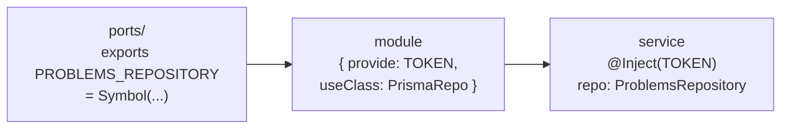
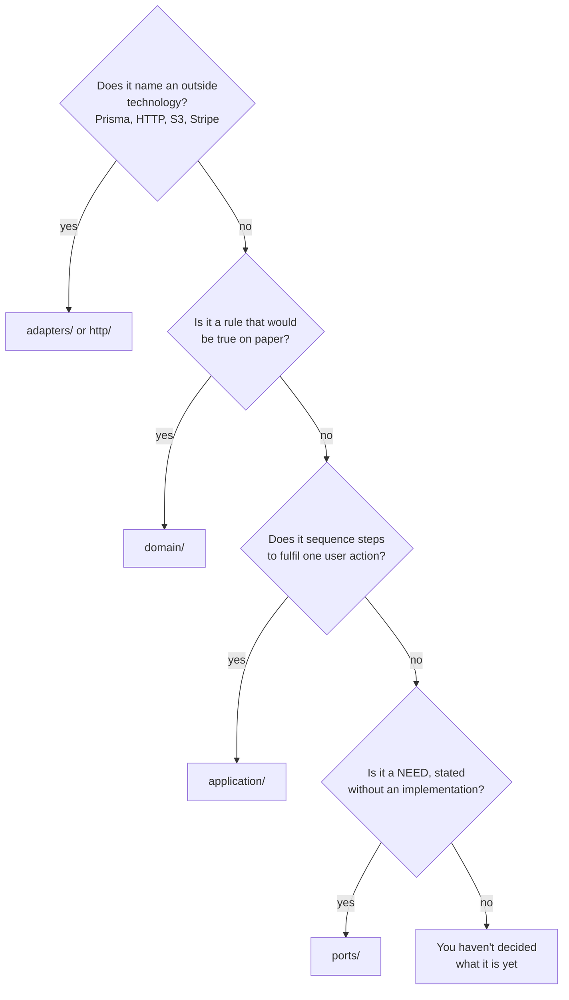
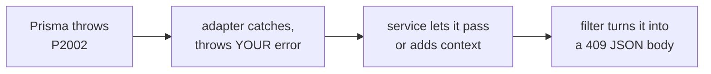
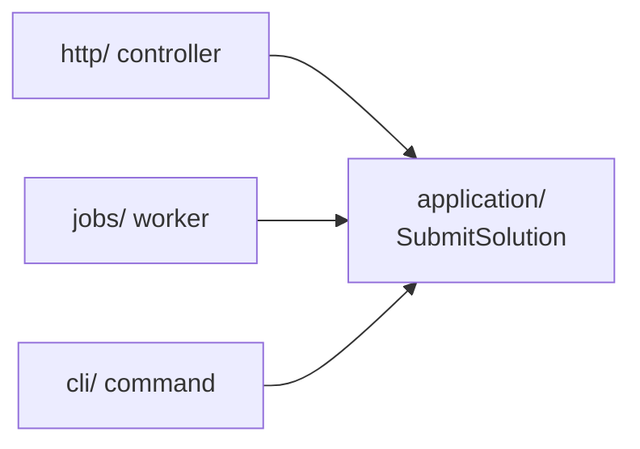

# Backend Architecture — where code goes, and why

You can copy a folder structure in ten minutes. Knowing *which file a new piece of code belongs in*
takes years, and it is the whole skill. This guide is about the second thing.

It pairs with [NestJS](/guides/nestjs) — that one covers framework mechanics (controllers,
providers, the request lifecycle). This one is deliberately framework-agnostic: everything here
applies in Spring, .NET, Django, Rails, or plain Express. The names change. The arrows don't.

**The one sentence the whole guide hangs on:**

> *Dependencies point inward, toward the code that changes least.*

Everything else is a consequence.

---

# Part 0 — A story about a codebase that ate itself

Let me tell you about `OrderService`.

It started at 40 lines. One method: `placeOrder`. It read a cart, made a row in `orders`, returned
an id. Beautiful.

Then payments arrived, so it called Stripe. Then someone wanted a confirmation email, so it called
SendGrid. Then a "loyalty points" feature, so it wrote to `loyalty_ledger`. Then EU tax rules, so
it got a `if (country === 'DE')`. Then a mobile app needed a slightly different response, so it got
a `format` parameter. Then someone added retry logic for Stripe. Then a metrics counter. Then a
feature flag for the new checkout.

Two years in, `OrderService.placeOrder` was **1,900 lines** and eleven people had touched it.
Nobody could change it. Not *wouldn't* — **couldn't**. Its test file needed a database, a Stripe
sandbox, a mail catcher, and Redis, took 90 seconds to run, and failed randomly about one time in
six, so people stopped trusting it and then stopped running it.

The tax change that should have been a two-line edit took a senior engineer nine days.

**Nobody made a bad decision.** Every single addition was reasonable in isolation. There was never
a moment where someone said "let's make this unmaintainable." That's the thing about architecture:
it doesn't decay through bad decisions, it decays through **good decisions with no rule about where
things go.**

This guide is that rule.

---

# Part 1 — Why structure at all

## The thing structure prevents

Here's a login endpoint with no structure. It works. Ship it and users can log in:

```ts
@Post('login')
async login(@Body() body: any) {
  const user = await this.prisma.user.findUnique({ where: { email: body.email } });
  if (!user) throw new UnauthorizedException();
  const ok = await bcrypt.compare(body.password, user.passwordHash);
  if (!ok) throw new UnauthorizedException();
  if (user.failedAttempts > 5) throw new ForbiddenException('Locked');
  const token = jwt.sign({ sub: user.id }, process.env.JWT_SECRET);
  await this.prisma.user.update({ where: { id: user.id }, data: { lastLogin: new Date() } });
  await this.mailer.send(user.email, 'New login detected');
  return { token };
}
```

Now count what this one file knows about:

HTTP · Prisma · bcrypt · JWT · environment variables · email · and the lockout rule.

**Seven reasons for one file to change.** A database migration touches it. Swapping bcrypt for
argon2 touches it. Changing the lockout threshold touches it. Moving to GraphQL touches it.
Switching mail providers touches it.

And the killer: the *only interesting logic in the whole method* — "five failed attempts locks the
account" — **cannot be tested** without a database, a mail server, and an HTTP request.

That's the disease. Not ugliness. **Untestability and unchangeability.**

## Coupling, precisely

**Coupling** is how much one piece of code must know about another.

The controller above is coupled to Prisma's API shape. Change how users are stored and this file
breaks — even though *logging in*, conceptually, hasn't changed at all.

Here's the part people get wrong: **the goal is not zero coupling.** That's impossible; code has to
call code. The goal is to *choose* what's coupled to what.

> **Couple the things that change together. Separate the things that change for different reasons.**

Login logic and the lockout rule change together — they're both "how authentication works." Login
logic and your ORM choice change for completely unrelated reasons. So the first pair can live
together; the second pair must not.

## Cohesion, the other half

**Cohesion** is how related the things inside one unit are.

A file called `UserService` with `createUser`, `deleteUser`, `resetPassword` has high cohesion —
it's all about users. A file called `Helpers` with `formatDate`, `parseCSV`, `sendEmail`, and
`calculateTax` has none. Nothing connects them except that someone had nowhere else to put them.

> **High cohesion, low coupling.** It's the oldest advice in software design and it's still the
> whole game. Everything in this guide is a technique for achieving it.

## The two questions any structure must answer

1. **Where do I put this new code?** If five developers answer differently, you don't have a
   structure — you have folders.
2. **What can I change without breaking everything else?**

Hold those two in mind. The rest of this guide is machinery for answering them.

---

# Part 2 — The one rule

## Sort your code by volatility

Not by *what it does* — by **how often it changes for reasons outside your control**:

| Layer | Changes when | Frequency | Who forces the change |
|---|---|---|---|
| **Domain** — what a Problem *is*, business rules | the business changes | rarely | your product |
| **Application** — use cases | a feature changes | sometimes | your product |
| **Adapters** — Prisma, Stripe, email | a vendor or protocol changes | often | **someone else** |

That last column is the point. Prisma 7 removed `datasourceUrl` and you had to change code. **You
didn't ask for that.** A vendor decided, and your code had to move.

Now the rule:

> ### Volatile code depends on stable code. Never the reverse.

Prisma may depend on your business rules. **Your business rules must never depend on Prisma.**


## Look at the adapter's arrow

Everyone skims past this. Don't.

The adapter's arrow points **at** the port. Prisma depends on *your* interface; your interface knows
nothing about Prisma. The dependency runs backwards from what you'd expect.

That reversal has a name — **dependency inversion**, the D in SOLID — and it's the entire trick.
Everything else in this guide is bookkeeping around that one move.

## Why "inward" and not "downward"

The old picture was a stack. HTTP on top, business logic in the middle, database at the bottom,
arrows pointing down.

That picture puts **the database at the foundation**. And it shows: in codebases built that way,
business logic imports database types, entities are ORM models, and the shape of your tables leaks
into every decision you make. Ask "can we switch databases?" and the answer is a two-year project.

Turning it inward puts **business rules at the centre** and makes the database a detail that plugs
in from outside. Same code, same files, better direction.

## An honest caveat

You will read blog posts claiming this makes swapping your database easy. **It rarely happens, and
that's a weak argument for the pattern.** Nobody swaps Postgres for Mongo on a Tuesday.

The real, daily benefit is subtler and much more valuable: **your business logic never learns to
speak your vendor's language.** Your service doesn't know what a `WhereUniqueInput` is. It doesn't
know `P2002` means "duplicate". Six months of that discipline is the difference between a codebase
you can reason about and one you can only poke at.

The swap is a bonus. The vocabulary boundary is the point.

---

# Part 3 — The five layers, in depth

| Folder | Holds | May import | The test |
|---|---|---|---|
| `domain/` | Entities, value objects, rules | **nothing** | *"True on paper, with no computer?"* |
| `ports/` | Interfaces stating needs + tokens | `domain/` | *"I need something that can ___"* |
| `application/` | Use cases | ports, domain | *"Reads as a sentence"* |
| `adapters/` | One implementation per outside thing | ports, domain, the library | *"Translates between two worlds"* |
| `http/` | Controllers, DTOs | `application/` | *"Turns HTTP into a call, and back"* |

## `domain/` — the things themselves

Plain types and functions. **Zero imports.** No framework, no database, no HTTP, no logging library.

```ts
// domain/problem.entity.ts
export type Difficulty = 'EASY' | 'MEDIUM' | 'HARD';

export interface Problem {
  id: number;
  slug: string;
  difficulty: Difficulty;
  tags: string[];
}
```

Business *rules* live here too, as pure functions:

```ts
// domain/submission.rules.ts
export function isAccepted(results: TestResult[]): boolean {
  return results.length > 0 && results.every((r) => r.passed);
}
```

That function is testable in under a millisecond with no setup whatsoever. No database, no mocks,
no `beforeEach`.

> **The domain test:** could you explain this file to a domain expert who has never programmed? If
> yes, it's domain. If explaining it requires saying "well, the ORM…", it isn't.

### The trap: a `domain/` with only types

Very common, including in your own repo right now. Your `Problem` and `User` entities are pure data
with no functions.

**That's fine early**, and it's honest — you haven't discovered many rules yet. But watch for the
smell: if six months from now `domain/` is still only types while your services have grown `if`
statements about business conditions, you have an **anaemic domain model**. The rules exist; they're
just scattered somewhere they can't be tested cheaply.

The fix is not ceremony. It's noticing that `if (user.failedAttempts > 5)` is a *business rule*
wearing an `if` costume, and giving it a name and a home.

## `ports/` — what you need, not how

A port is an interface written in **your** vocabulary:

```ts
// ports/problems.repository.ts
export interface ProblemsRepository {
  findBySlug(slug: string): Promise<Problem | null>;
  findMany(params: FindManyParams): Promise<Problem[]>;
}

export const PROBLEMS_REPOSITORY = Symbol('ProblemsRepository');
```

Notice what's absent: no SQL, no `where` clause, no `include`, no Prisma type. It states *what you
need done*, never *how*.

**Ports aren't only for databases.** Every outside system gets one:

| Port | Wraps |
|---|---|
| `ProblemsRepository` | your database |
| `PasswordHasher` | argon2 |
| `EmailSender` | SendGrid |
| `PaymentGateway` | Stripe |
| `CodeRunner` | your sandbox |
| `Clock` | **the current time** |
| `IdGenerator` | uuid / cuid |
| `FileStorage` | S3 |

### Yes, `Clock` — this one is worth the detour

Time is an outside system. It changes without asking you, and you can't control it in a test.

```ts
// Untestable: to test "expires after 7 days" you must wait 7 days
if (Date.now() > token.expiresAt) throw new Error('expired');

// Testable: inject a clock, hand the test a fake that returns any moment you like
if (this.clock.now() > token.expiresAt) throw new Error('expired');
```

`Math.random()` has the identical problem, and so does `crypto.randomUUID()`. Anything
non-deterministic is an outside dependency, even though it feels like a language feature. **You'll
need this in Week 1** for refresh-token expiry.

## `application/` — use cases

One class (or function) per thing a user can **do**. It *orchestrates*; it does not do the work
itself.

```ts
// application/problems.service.ts
async getBySlug(slug: string): Promise<Problem> {
  const problem = await this.repo.findBySlug(slug);
  if (!problem) throw new NotFoundException(`Problem "${slug}" not found`);
  return problem;
}
```

Read it aloud: *"fetch it; if it isn't there, that's a not-found."* That's a use case.

> **If you cannot read a service method aloud as a sentence, it's doing too much.**

A longer one still reads as a sentence — a compound one:

```
register: check the email isn't taken, hash the password, save the user, send a welcome email
```

Four steps, four collaborators, still one story. The moment you need "and also, separately…" you
have two use cases.

### Thin services are allowed

A service method that only forwards to the repository:

```ts
getById(id: string) { return this.users.findById(id); }
```

That's not a failure. It's a **seam** — a place where a rule will land the first time one appears,
without every caller needing to change. Don't invent rules to justify the layer, and don't delete
the layer because a rule hasn't arrived yet.

## `adapters/` — one implementation per outside thing

```ts
export class PrismaProblemsRepository implements ProblemsRepository {
  async findBySlug(slug: string): Promise<Problem | null> {
    const row = await this.prisma.problem.findUnique({
      where: { slug },
      include: { tags: true },
    });
    if (!row) return null;
    return {                                   // ← translation, field by field
      id: row.id,
      slug: row.slug,
      difficulty: row.difficulty,
      tags: row.tags.map((t) => t.name),
    };
  }
}
```

**That return block is the entire reason the layer exists.** A Prisma row has `tags: Tag[]` —
objects with ids and timestamps. Your domain wants `tags: string[]`. The adapter converts, and
nothing above it ever sees a Prisma shape.

### ⚠️ Never `return row` or `{ ...row }`

This is worth its own warning because **TypeScript will not stop you**:

```ts
return row;                                    // ❌ compiles. Leaks every column
return { ...row, tags: row.tags.map(t => t.name) };  // ❌ compiles. Same leak
return { id: row.id, slug: row.slug, ... };    // ✅ the boundary is real
```

Excess-property checking only fires on **object literals written inline**. A returned *variable* or
a **spread** skips the check entirely. So `createdAt`, `updatedAt`, internal flags — and
`passwordHash` — sail straight through your type annotation and out of your API.

> **If your adapter isn't naming fields one by one, you don't have a boundary. You have a type
> annotation and a false sense of security.**

Every `find*` in your users repository names four fields explicitly, and that omission of
`passwordHash` is a **security control**, not a style choice.

## `http/` — the outermost shell

Controllers do exactly three things: **receive, delegate, translate back.**

```ts
@Get(':slug')
async detail(@Param('slug') slug: string) {
  const p = await this.problems.getBySlug(slug);
  return { ...p, difficulty: DISPLAY[p.difficulty] };   // EASY → "Easy"
}
```

That enum mapping is **presentation**. It belongs here, at the edge — not in the service (business
logic must not know about display strings) and not in the schema (that would contort your data
model to suit one consumer).

> **A controller containing an `if` about business rules is a controller doing the service's job.**

---

# Part 4 — Domain modelling: the vocabulary you'll be asked about

This is where interviews go once they're past "what's a REST API".

## Entities vs value objects

| | Entity | Value object |
|---|---|---|
| Identity | has an **id**; two are different even if identical | **is** its values; two with equal values are the same |
| Mutable? | changes over time, stays the same thing | replaced, never mutated |
| Example | `User`, `Problem`, `Submission` | `Money`, `EmailAddress`, `DateRange` |

Two users named "Ayoub" with the same email are still two users if they have different ids. Two
`Money(10, 'EUR')` objects are **the same amount** — there's no meaningful "which ten euros".

**Why it matters practically:** value objects are where validation lives naturally. An
`EmailAddress` type that can only be constructed from a valid string means every function taking
one can stop checking. You've made the invalid state *unrepresentable* rather than merely *checked*.

You don't have value objects yet, and you don't need them yet. Recognise the concept; reach for it
when you notice the same validation repeated in five places.

## Invariants — the thing that must always be true

An **invariant** is a rule that must hold at all times, not just at creation:

- A submission can't be `ACCEPTED` with zero passing tests
- A refresh token can't be both `revoked` and `active`
- An order's total must equal the sum of its lines

**Where do invariants live?** In the domain, enforced at the boundary of the thing they protect. The
danger is an invariant enforced in *one* code path — because the second code path, added later by
someone else, won't know about it.

That's the deep argument for aggregates.

## Aggregates — a cluster with one door

An **aggregate** is a group of objects treated as a unit, with one **root** that's the only way in.

`Order` is the root; `OrderLine`s are inside. You never load or modify an `OrderLine` directly —
you fetch the `Order` and ask *it* to change a line. Why? Because "total equals sum of lines" can
only be guaranteed if every mutation goes through one place.

> **The aggregate root is where invariants are enforced, and the reason it exists is that there is
> exactly one door.**

**Your `Problem` is an aggregate root.** `ProblemExample` rows belong to it, are loaded with it, and
are meaningless alone — which is precisely why `onDelete: Cascade` is right there.

Aggregates get deep (transaction boundaries, eventual consistency between them). For now: notice
that some tables are *owned* by other tables, and let the owner be the door.

## Ubiquitous language

The names in your code should be the names your users and product people say out loud.

If the business says "submission" and your table says `code_run`, every conversation needs a
translation step, and translation steps are where bugs breed. If a domain expert can't read your
type names, your model has drifted from the thing it models.

**Cheap test:** show `domain/` to someone non-technical. They should recognise most of the nouns.

---

# Part 5 — Ports and adapters, mechanically

## What the interface actually buys — three things

1. **Substitution** — swap Prisma for an in-memory fake, or Postgres for anything else
2. **A compiler-checked contract** — `implements` forces every method to match
3. **A vocabulary boundary** — your core never learns to speak the vendor's language

**Only the third one pays daily.** Substitution sounds great in blog posts and you'll do it about
twice in your career. Not accidentally coupling your business rules to a vendor's data shapes is a
benefit you collect every single day.

## Two adapters, one port

```ts
class PrismaProblemsRepository   implements ProblemsRepository { /* real SQL */ }
class InMemoryProblemsRepository implements ProblemsRepository { /* an array */ }
```

Same contract, no shared code, and the service cannot tell them apart. That's how a unit test runs
in milliseconds with no Docker.

## Why the DI token (TypeScript only)

Here's the mechanical problem, and it looks arbitrary until you know it.

**TypeScript interfaces are erased at compile time.** They do not exist when the program runs.
NestJS matches dependencies by runtime type — so there is literally nothing named
`ProblemsRepository` for it to find.

So you supply an explicit key:



`Symbol('X')` creates a value unique forever — two symbols with the same description are still
different, so accidental collisions are impossible.

**In Java or C# the interface survives to runtime**, so DI matches on it directly and no token is
needed. The layering is identical; only this plumbing differs. That's worth knowing before a Spring
interview.

## The rule people get backwards

> **You inject a port to *use* it. You implement a port to *provide* it. Never both.**

| Class | implements | injects |
|---|---|---|
| `ProblemsService` (consumer) | — | `PROBLEMS_REPOSITORY` ✅ |
| `PrismaProblemsRepository` (provider) | `ProblemsRepository` | `PrismaService` ✅ |
| `Argon2Hasher` (provider) | `PasswordHasher` | **nothing** — argon2 is a plain import ✅ |

An adapter injecting the port it implements is asking DI for itself. That's infinite recursion, and
it's the single most common first mistake with this pattern.

---

# Part 6 — Where does this code go? The procedure

This is the part that turns copying into understanding. **Four questions, in order. Stop at the
first yes.**



## Sixteen real cases

| Code | Where | Why |
|---|---|---|
| "A submission is accepted when all tests pass" | `domain/` | True on paper |
| `SELECT ... WHERE slug = $1` | `adapters/` | Names SQL |
| "Fetch the problem; 404 if missing" | `application/` | Sequences steps for one action |
| "I need something that can find problems" | `ports/` | A need, no implementation |
| `EASY` → `"Easy"` for the UI | `http/` | Presentation. Only this consumer cares |
| "Password must be 12+ characters" | `domain/` | A business rule |
| "Reject a body with extra fields" | `http/` | About HTTP payloads, not your business |
| "Charge the card, then email the receipt" | `application/` | Orchestration across two ports |
| Retry Stripe 3× on a 503 | `adapters/` | A Stripe transport detail |
| "Only the author may edit this" | `application/` | Needs the record loaded |
| "Admins only" on a route | guard (`http/`) | A route fact, no data needed |
| Translating `P2002` into a conflict | `adapters/` | A Prisma error code |
| Deciding a conflict is a 409 | `http/` or `application/` | HTTP semantics |
| Caching a repository's results | `adapters/` | A decorator around another adapter |
| `Date.now()` | behind a `Clock` port | Non-deterministic = outside system |
| "Send a welcome email on register" | `application/` | Orchestration |

## The ten-second audit

```bash
grep -r "prisma" src/problems/domain/ src/problems/application/
```

**Zero hits, or the layering leaked.**

It isn't ceremony. If a Prisma type reached your service, then Prisma's shapes have become your
business logic's vocabulary and the boundary is gone — regardless of how the folders are named.

Put it in CI once you trust it. A folder structure nothing enforces is a folder structure that
decays.

---

# Part 7 — Errors deserve their own architecture

Most codebases have layers for data and no layers for errors. Then a Prisma error code ends up in
a React component and everybody is sad.

## Three kinds of error, three homes

| Kind | Example | Thrown in | Becomes |
|---|---|---|---|
| **Domain** | "Contest is closed" | `domain/` or `application/` | 409 / 422 |
| **Infrastructure** | connection refused, timeout | `adapters/` | 503, retried, or logged |
| **Programmer** | `undefined is not a function` | anywhere | **500, always** |

The third kind is the one people mishandle. A bug is not a case to `catch` — it's a case to **log
loudly and return 500**. Catching it and returning something friendly hides the bug and makes it
permanent.

## Translate at each boundary



Each layer receives an error in a vocabulary it understands and re-throws in the vocabulary of the
layer above. Exactly what your adapters do for *data* — applied to failures.

**The rule:** a `P2002` string must never appear in `application/`. If it does, your business logic
now depends on Prisma's error catalogue, and swapping ORMs means auditing every catch block.

## Throw or return?

Two schools, both defensible:

**Throw** — the happy path stays clean, errors travel up automatically. Cost: the signature doesn't
tell you what can fail. `getBySlug(): Promise<Problem>` hides that it can 404.

**Return a Result type** — `Promise<Result<Problem, NotFoundError>>`. Failure becomes part of the
type, so the compiler forces you to handle it. Cost: verbose, and it fights every JS library.

**In TypeScript + NestJS, throwing is idiomatic** and fighting that costs more than it earns. But
know that Rust and Go chose the other side, and know *why*: they wanted failure visible in the
signature.

## Never catch what you can't handle

```ts
try { ... } catch (e) { console.log(e); }        // ❌ the bug is now invisible
try { ... } catch (e) { throw new Error('failed'); }  // ❌ the cause is destroyed
```

**Catch only when you have a better action than failing**: a fallback, a retry, or a genuinely more
useful error. Otherwise let it propagate — your exception filter already turns it into a clean 500
with a logged stack.

And when you do catch selectively, **rethrow the rest**:

```ts
if (isP2002(e)) throw new ConflictException(...);
throw e;                                          // ← without this, a DB outage becomes "409"
```

---

# Part 8 — Transactions, and why they're architecturally awkward

## The problem

A use case often needs several writes to succeed or fail **together**. Create a user *and* a welcome
credit. Deduct stock *and* record the order.

The obvious code puts `prisma.$transaction` in your service — which imports Prisma into
`application/` and breaks the rule.

## The Unit of Work port

Express the *requirement* without the *mechanism*:

```ts
// ports/unit-of-work.port.ts
export interface UnitOfWork {
  run<T>(work: () => Promise<T>): Promise<T>;
}
```

The service says **what must be atomic**. The adapter knows **how** (`prisma.$transaction`,
`BEGIN/COMMIT`, whatever). Your business logic states the constraint and stays vendor-free.

## The thing nobody tells juniors

**You cannot put a network call inside a database transaction and expect sanity.**

```ts
await uow.run(async () => {
  await users.create(...);
  await stripe.charge(...);     // ← 3 seconds. Holding DB locks the whole time
  await ledger.record(...);
});
```

Two failures waiting:
1. **Locks held for seconds** across a network call, throttling everything else
2. If the charge succeeds and the commit then fails, you've **taken money with no record of it**

This is the *dual-write problem*, and it's a genuinely hard distributed-systems issue. The standard
answer is the **outbox pattern**: inside the transaction, write a row saying "charge this card
later"; a separate worker reads the outbox and performs the side effect, retrying safely because the
operation is idempotent.

That's Week 4 material. For now, the rule that will keep you safe:

> **Database work inside the transaction. Network calls outside it.**

---

# Part 9 — Where every backend concern plugs in

Once the skeleton exists, **every new concept has an obvious home.** That's the real payoff — not
elegance, but never again wondering where something goes.

| Concern | Where | Why |
|---|---|---|
| **Authentication** ("who are you?") | Guard, before the controller | Nothing below should run for an unknown user |
| **Authorization: roles** | Guard | A route fact — needs no data |
| **Authorization: ownership** | `application/` | "Only the author" needs the record loaded |
| **Input shape validation** | DTO + pipe in `http/` | Shape checking belongs at the boundary |
| **Business validation** | `domain/` | "Contest is closed" is a rule, not a shape |
| **Transactions** | `application/` via a port | The use case knows what must be atomic |
| **Caching** | `adapters/` — a decorator | The service shouldn't know a cache exists |
| **Background jobs** | `application/` enqueues; a worker calls the same use case | A job is a second entry point, like HTTP |
| **Rate limiting** | Guard / middleware | Protocol-level, never business |
| **Request logging** | Interceptor | Cross-cutting, not a use case |
| **Domain event logging** | `application/` | "Submission rejected" is a business fact |
| **Retries (transport)** | `adapters/` | A vendor's flakiness is a vendor detail |
| **Idempotency keys** | `application/` | A business guarantee about repeated requests |
| **File uploads** | A `FileStorage` port, S3 adapter | Swap for local disk in tests |
| **External APIs** | **Always** a port | The one you'll be gladdest you wrapped |
| **Feature flags** | A port, checked in `application/` | Flags gate use cases |
| **Pagination** | `ports/` params, `adapters/` implements | Port says "20 after this"; adapter knows it's a cursor |
| **Metrics** | Interceptor, or `application/` for business metrics | "Request duration" ≠ "signups today" |
| **Emails** | An `EmailSender` port | Never call SendGrid from a service |
| **Time** | A `Clock` port | Non-deterministic input |

## Caching, expanded — because it's the one that shows off the pattern

A second adapter that **wraps the first**:

```ts
class CachedProblemsRepository implements ProblemsRepository {
  constructor(private inner: ProblemsRepository, private cache: Cache) {}

  async findBySlug(slug: string) {
    const hit = await this.cache.get(slug);
    if (hit) return hit;
    const result = await this.inner.findBySlug(slug);
    await this.cache.set(slug, result);
    return result;
  }
}
```

Both implement the same port, so **nothing else in the application changes** — one line in the
module chooses which one is provided.

That's the substitution benefit finally becoming real, and it's why the interface was worth writing.
It's also the **Decorator pattern**, which you now have a concrete example of for interviews.

## Background jobs, expanded

The mistake: putting the job's logic *in the job handler*. Then the same logic exists twice — once
for HTTP, once for the queue — and they drift.

The fix: **a job is just another entry point.** It parses its payload and calls the same use case
the controller calls. `http/` and `jobs/` are siblings, both thin, both delegating inward.



Three doors, one room. That's what "use case" means.

---

# Part 10 — Sizing and chunking

## One file, one reason to change

That's the **Single Responsibility Principle**, and it's about *reasons to change*, not line count.

A 300-line file that only changes when tax law changes is fine. A 40-line file that changes for four
unrelated reasons is not.

Ask: *"what future change would make me edit this file?"* If you get several unrelated answers,
split it.

## Signs a service has grown too big

| Sign | Usually means |
|---|---|
| More than ~5 constructor dependencies | It's doing several jobs |
| A method you can't read as one sentence | Extract the middle into a domain function |
| The word "and" in a method name | `createUserAndSendEmail` → two use cases |
| A test needs elaborate setup | Too much coupling; a port is missing |
| You scroll to understand one method | Extract |
| Two people always conflict in it | It has two responsibilities and two owners |

## Where "helper" functions go

**Nowhere called `utils/`.** That folder is where responsibility goes to hide. Six months later it's
40 unrelated functions nobody dares delete because nobody knows who calls them.

Ask what the helper is *about*:

| The helper is about… | It goes in… |
|---|---|
| a business concept | `domain/`, as a named function |
| how one vendor formats data | that vendor's file in `adapters/` |
| genuinely universal mechanics (`chunk`, `sleep`) | a shared package — and there should be very few |

If you can't say what it's about, you haven't understood it yet. That's information, not an
inconvenience.

## The honest answer on "less code"

**Layering does not reduce lines. It increases them.** One endpoint became seven files.

| You lose | You gain |
|---|---|
| ~40% more files | Each file small, one job |
| Indirection to follow | You can find things by *kind* |
| Setup ceremony | Tests in milliseconds |
| — | Vendor changes touch one file |
| — | Five developers agree where code goes |

**If you want less code, the lever is fewer features**, not fewer layers. The second-best lever is
deleting layers you don't need — which is Part 12.

---

# Part 11 — Bounded contexts: when one module becomes two

## The same word means different things

"User" in your auth module is `{ id, email, passwordHash, role }`.
"User" on a leaderboard is `{ id, username, rating, rank }`.
"User" in a submission is `{ id, username }`.

**These are not the same object**, and forcing them to be one class produces a monster with thirty
fields, half null in any given context.

A **bounded context** is a boundary within which a word has one consistent meaning. Auth and Ratings
are different contexts. They both have a "user", and that's fine — they're different users.

## Practically: when do I split?

**Split when the same entity is being pulled in incompatible directions.**

Signs:

- The type has fields only meaningful to some callers
- Different features need different subsets, so everything is optional
- Two teams keep conflicting in the same file
- You're adding `if (context === 'admin')` to a shared model

**Do not split early.** Two modules that constantly import each other are worse than one module.
Premature context-splitting is as damaging as premature layering.

## Your live example

You have `src/users/` as a sibling of `src/auth/`, having moved it out of `auth/`.

That was the right call, and here's the reasoning to record: `auth` cares about credentials;
`users` owns identity; Week 5's ratings and profiles will need users **without** caring about
passwords. Nesting users under auth would have forced a ratings feature to import from an auth
module — which reads wrong because it *is* wrong.

**How they talk:** `auth` imports `UsersModule` and uses `UsersService`. The arrow points one way.
The day it points both ways, you have a circular dependency and a design problem.

---

# Part 12 — When NOT to do any of this

Skipping this section is how people end up with `AbstractRepositoryFactoryProvider` in a to-do app.

## The cost is real

Every layer is indirection. Reading one request now means opening four files. For a small app with
one developer and no plans to swap anything, that is a genuine loss, not a hidden win.

## The three-question test

Before adding a port, ask:

1. **Will more than one implementation ever exist?** (A test fake counts — that's legitimate)
2. **Is this a boundary I don't control?** (a vendor, a protocol, the clock)
3. **Would I be unhappy if this vendor's shapes spread through my code?**

**Zero yeses → don't add the port.** Call the library directly. Extracting a port later is a
mechanical refactor; carrying one you never needed is years of overhead.

## Where each level fits

| Situation | Structure |
|---|---|
| Script, prototype, weekend hack | **One file.** Genuinely |
| CRUD admin panel, no real rules | Controller → service → ORM. Skip ports |
| Product with real business rules | Full layering, at least for the complex modules |
| Multiple teams, long-lived system | Full layering, enforced in CI |

**Mixed is normal and correct.** Your `Problems` module deserves the hexagon — it has pagination
rules and a frontend contract. A future three-line `Tags` module does not. Consistency matters less
than each module being *appropriately* structured.

> **The costliest mistake is not "too little structure" — it's structure you can't justify.** If you
> can't say in one sentence what a layer protects you from, delete it.

## The Rule of Three

Don't abstract on the first occurrence. Don't abstract on the second. **On the third, you finally
know what varies** — and the abstraction you build will fit.

Two data points define infinite lines. Three constrain the shape.

---

# Part 13 — How you actually get here (the evolution)

Nobody starts with five folders. Here's the real path, and the **trigger** for each step:

### Stage 1 — one file
```
app.ts
```
**Right for:** prototypes. Ship it.
**Trigger to move on:** you can't find things.

### Stage 2 — split by technical role
```
controllers/  services/  models/
```
**Trigger:** you keep opening three folders to change one feature. Everything about "orders" is
scattered across all three.

### Stage 3 — split by feature
```
orders/   users/   problems/
```
**A huge improvement, and most apps should stop here.** Everything about a feature lives together.
**Trigger:** your services are full of ORM calls and you can't test a rule without a database.

### Stage 4 — layers inside features
```
problems/{domain,ports,adapters,application,http}
```
**Trigger:** vendor changes ripple through business logic; tests need Docker.

### Stage 5 — separate deployables
```
api/   worker/   scheduler/
```
**Trigger:** different scaling or availability needs. **Not** because microservices sound modern.

**You are at stage 4**, which is correct for a portfolio project that's demonstrating engineering
judgement. Most professional codebases live happily at stage 3.

> The interesting question in an interview is never "do you know clean architecture" — it's **"how
> do you know when you need it?"** Stages and triggers are the answer.

---

# Part 14 — Testing, layer by layer

The architecture's payoff is most visible here.

| Layer | Test type | Dependencies | Speed |
|---|---|---|---|
| `domain/` | Unit | **none** | microseconds |
| `application/` | Unit with fakes | fake ports | milliseconds |
| `adapters/` | **Integration** | real database | seconds |
| `http/` | e2e | whole stack | seconds |

## Domain tests are free

```ts
expect(isAccepted([{ passed: true }, { passed: false }])).toBe(false);
```

No setup. No mocks. No `beforeEach`. If your business rules aren't testable like this, they aren't
in the domain.

## Application tests use fakes, not mocks

```ts
const fakeRepo: ProblemsRepository = {
  findBySlug: (slug) => Promise.resolve(slug === 'two-sum' ? sample : null),
  findMany: () => Promise.resolve([sample]),
};
const service = new ProblemsService(fakeRepo);
```

**No framework, no container, no database.** A plain constructor call — possible only because the
service declares its dependencies instead of building them.

> **If your unit tests are slow, the architecture leaked.** Speed is a design signal, not a
> convenience.

## Don't unit-test adapters with mocked drivers

A test that mocks Prisma and asserts you called `findUnique` with the right arguments **tests your
mock**. It passes when the query is wrong, and it breaks when you refactor without changing
behaviour. Worst of both.

Adapters get **integration** tests against a real database (Testcontainers is the standard tool), or
they're covered by e2e tests. Both are legitimate. Mocking the driver is not.

## What to test where

| Test this | Here |
|---|---|
| "All tests passing means accepted" | domain |
| "Missing slug throws NotFound" | application, fake repo |
| "Rows map to entities correctly" | adapter, real DB |
| "P2002 becomes a 409" | adapter, real DB |
| "Cursor paging has no duplicates" | e2e |
| "limit=99999 gets a 400" | e2e |

---

# Part 15 — The anti-pattern gallery

Named villains. Naming them makes them easier to spot in your own code.

## The God Service
`OrderService` with 1,900 lines and eleven dependencies. Part 0's story.
**Fix:** one class per use case. `PlaceOrder`, `CancelOrder`, `RefundOrder`.

## The Anaemic Domain Model
Entities are bare data bags; every rule lives in services. Technically fine, but the "domain" is
just a database schema in TypeScript clothing.
**Fix:** move rules that don't need I/O into `domain/` as named functions.
**Counterpoint worth knowing:** plenty of serious engineers think anaemic models are fine for
CRUD-heavy apps. Have an opinion and know why.

## The Leaky Port
```ts
findBySlug(slug: string): Promise<Prisma.ProblemGetPayload<{ include: { tags: true } }>>
```
Not a port. Prisma with extra steps.
**Fix:** ports return **your** types, always.

## The Utils Junk Drawer
`utils/` with 40 unrelated functions. Part 10.
**Fix:** every function belongs somewhere with a name.

## The Repository Per Table
One repository per database table, mirroring the schema exactly.
**Fix:** ports model *needs*, not tables. `ProblemsRepository` may read three tables in one call —
that's correct and good.

## Ceremony Without Cause
A hexagon around a three-field lookup table.
**Fix:** Part 12.

## The Circular Import
Auth imports Users, Users imports Auth. Your framework will complain; the framework is right.
**Fix:** one of them is doing too much, or a shared concept belongs in a third place.

## The Silent Catch
```ts
catch (e) { console.log(e); }
```
The bug is now invisible and permanent.
**Fix:** catch only what you can handle. Rethrow the rest.

---

# Part 16 — The same skeleton elsewhere

This is why it ranks high in career value — it transfers whole.

| Concept | NestJS | Spring (Java) | .NET | Django |
|---|---|---|---|---|
| Port | `interface` + Symbol token | `interface` | `interface` | ABC / Protocol |
| Adapter | `@Injectable()` class | `@Repository` | class + DI registration | a concrete class |
| Wiring | `{ provide, useClass }` | `@Bean` / component scan | `services.AddScoped<I,C>()` | manual / settings |
| Use case | `@Injectable()` service | `@Service` | service class | service module |
| Controller | `@Controller` | `@RestController` | `ControllerBase` | view |
| Transaction | a port | `@Transactional` | `TransactionScope` | `atomic()` |
| DI resolution | by token (types erased) | **by interface type** | **by interface type** | manual |

**The names change; the arrows don't.** Learn it once and you can read a Spring codebase on day one
of a Java job — which is exactly what Weeks 9–11 of your plan are for.

---

# Where to go deeper

Ranked by how much you'll get per hour.

## Read first

| | |
|---|---|
| **`docs/phase-0` §C.1–C.6** | Your own guide — coupling, SOLID, hexagonal, repository, DDD, CQRS |
| **"The Clean Architecture"** — Uncle Bob, 2012 blog post | The original diagram. 15 minutes. Free |
| **"Hexagonal Architecture"** — Alistair Cockburn | The 2005 source. Older, clearer, less dogmatic than the clean-architecture crowd |

## Books that repay the time

| Book | Why |
|---|---|
| ***Designing Data-Intensive Applications*** — Kleppmann | **The best backend book that exists.** Not about layering — about what's actually true of databases, replication, consistency. A chapter a month for a year |
| ***Domain-Driven Design Distilled*** — Vaughn Vernon | Short. Entities, value objects, aggregates, bounded contexts, properly. Read this before the 600-page Evans book |
| ***Clean Architecture*** — Robert Martin | The layering argument at book length. Skim the middle; the dependency-rule chapters are the value |
| ***Implementing Domain-Driven Design*** — Vernon | When you're ready for aggregates and events in anger. Not yet |
| ***Refactoring*** — Fowler | How to *get* to a good structure from a bad one, in small safe steps. Underrated for this topic |

## Talks worth an evening

- **"Architecture the Lost Years"** — Robert Martin. Where "the web is a detail" comes from
- **"Domain Modeling Made Functional"** — Scott Wlaschin. Types making illegal states unrepresentable. Genuinely fun
- Anything by **Kevlin Henney** on naming and design. Entertaining and quotable

## Practise, not reading

1. **Take a rule out of a service and put it in `domain/`.** Watch its test get faster
2. **Write an in-memory adapter** for a port you already have. Feel the substitution work
3. **Add a `Clock` port** and test something time-based without waiting
4. **Do the audit** — `grep -r prisma domain/ application/` — and put it in CI
5. **Build a module from scratch, closed-book.** If you can't, you know exactly what to re-read

---

## Mastery checklist — you can…

- [ ] State the dependency rule in one sentence, and say which way the adapter's arrow points
- [ ] Explain why business rules must not import Prisma, without saying "clean code"
- [ ] Place any piece of code using the four-question procedure
- [ ] Name the three benefits of a port, and which one actually pays daily
- [ ] Explain why TypeScript needs a DI token when Java doesn't
- [ ] Distinguish an entity from a value object, with an example of each
- [ ] Say what an aggregate root is and what it protects
- [ ] Name the two-second command that verifies the layering
- [ ] Place auth, transactions, caching, jobs, and time each in the right layer
- [ ] Explain why a network call inside a transaction is dangerous
- [ ] Give two situations where this architecture is the **wrong** choice
- [ ] Describe the five evolution stages and the trigger between each
- [ ] Say why mocking Prisma in a unit test is worse than useless
- [ ] Name four anti-patterns and their fixes
- [ ] Translate the whole structure into Spring or .NET vocabulary

## Self-quiz — answers included

**1. Why can't the service call `prisma.$transaction` directly?**
It imports Prisma into `application/`, coupling use cases to a vendor. Express it as a `UnitOfWork`
port: the service states what must be atomic, the adapter supplies the mechanism.

**2. Where does "an admin can edit any problem, an author only their own" go?**
Split it. "Must be logged in" and "must have a role" are guard concerns — route facts. "Must be
*this* record's author" needs the record loaded, so it's `application/`.

**3. You add Redis caching. How many existing files change?**
One — the module line choosing which adapter to provide. The cache is a decorator implementing the
same port.

**4. Your port returns `Promise<Prisma.User>`. What's wrong?**
The vendor's type escaped through the boundary. Every consumer now depends on Prisma's shapes, so
the port protects nothing. Return your own type.

**5. When is skipping all of this right?**
Prototypes, scripts, and CRUD with no rules — where indirection costs more than coupling. Extracting
a port later is mechanical; premature layering is years of overhead.

**6. Why is `return { ...row }` in an adapter a bug even though it compiles?**
Excess-property checking only fires on inline object literals. A spread or a returned variable skips
it, so `passwordHash` and every other column reach your API silently.

**7. What's the difference between a fake and a mock, and which do you want?**
A fake is a working simple implementation (an in-memory array). A mock asserts it was *called* a
certain way. You almost always want a fake — mocks couple tests to implementation details.

**8. Your `domain/` folder contains only type definitions. Problem?**
Not necessarily — early on it's honest. It becomes an anaemic domain model if rules exist but live
as `if` statements in services where they can't be tested cheaply.

**9. Two modules import each other. What does that tell you?**
Either one is doing too much, or there's a shared concept that belongs in a third place. Circular
dependencies between modules are always a design signal, not a wiring problem.

**10. Why is a background job "just another entry point"?**
Because the logic belongs in the use case, not the handler. `http/` and `jobs/` are both thin doors
into the same room — otherwise the logic exists twice and drifts.
