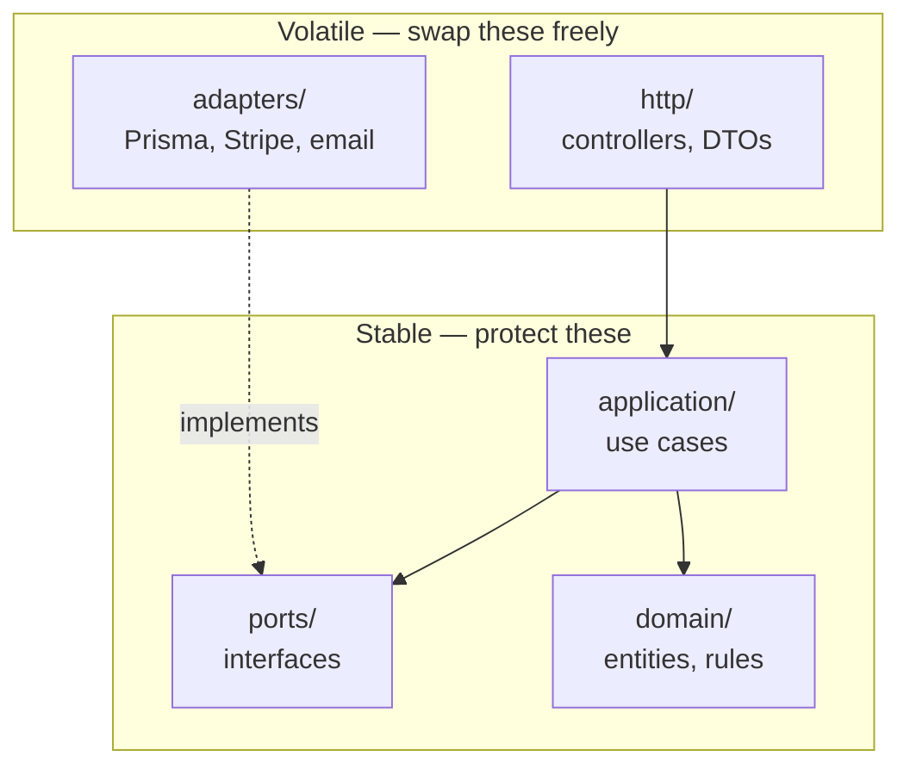
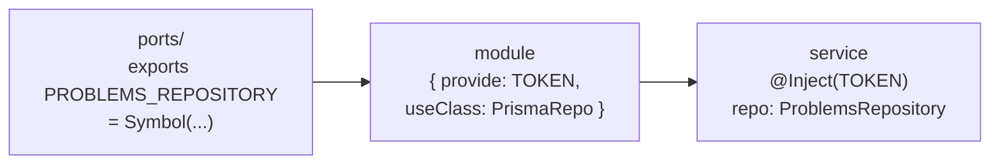
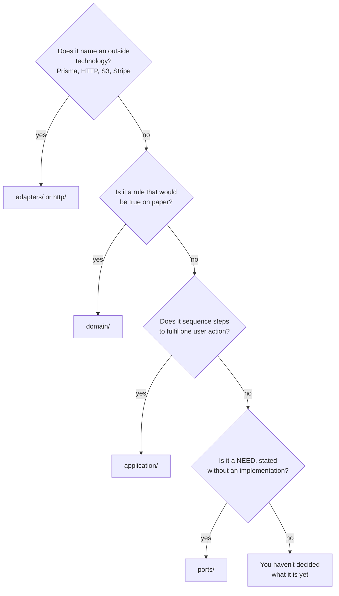

# Backend Architecture — where code goes, and why

You can copy a folder structure in ten minutes. Knowing *which file a new piece of code belongs in*
takes longer, and it's the whole skill. This guide is about the second thing.

It pairs with [NestJS](/guides/nestjs), which covers the framework mechanics — controllers,
providers, modules, the request lifecycle. This one is framework-agnostic: the same reasoning
applies in Spring, .NET, Django, or plain Express.

**The one sentence:** *dependencies point inward, toward code that changes least.* Everything else
in this guide is a consequence of that.

---

# Part 1 — Why structure at all

## The thing structure prevents

Here's a login endpoint written with no structure — and honestly, it works:

```ts
@Post('login')
async login(@Body() body: any) {
  const user = await this.prisma.user.findUnique({ where: { email: body.email } });
  if (!user) throw new UnauthorizedException();
  const ok = await bcrypt.compare(body.password, user.passwordHash);
  if (!ok) throw new UnauthorizedException();
  if (user.failedAttempts > 5) throw new ForbiddenException('Locked');
  const token = jwt.sign({ sub: user.id }, process.env.JWT_SECRET);
  await this.prisma.user.update({ where: { id: user.id }, data: { lastLogin: new Date() } });
  await this.mailer.send(user.email, 'New login detected');
  return { token };
}
```

Nothing here is *wrong*. The problem is what this file now knows about:

HTTP · Prisma · bcrypt · JWT · environment variables · email · the lockout rule.

**Seven reasons for one file to change.** A database migration touches it. Switching from bcrypt to
argon2 touches it. Changing the lockout threshold touches it. Moving from REST to GraphQL touches
it. And you cannot test the lockout rule — the *only* interesting logic here — without a database,
a mail server, and an HTTP request.

## Coupling, precisely

**Coupling** = how much one piece of code must know about another.

The controller above is coupled to Prisma's API shape. Change how you store users and this file
breaks — even though *logging in* hasn't changed at all.

**The goal isn't zero coupling.** That's impossible; code has to talk to code. The goal is to
*choose* what's coupled to what:

> Couple the things that change together. Separate the things that change for different reasons.

## The two questions any structure must answer

1. **Where do I put this new code?** — if a team of five answers differently, you have no structure
2. **What can I change without breaking everything else?**

Hold those two. Everything below is machinery for answering them.

---

# Part 2 — The one rule

## Dependencies point inward

Sort your code by **how often it changes for reasons outside your control**:

| Layer | Changes when | How often |
|---|---|---|
| **Domain** — what a Problem *is*, business rules | the business changes | rarely |
| **Application** — use cases, orchestration | a feature changes | sometimes |
| **Adapters** — Prisma, HTTP, email, Stripe | a vendor or protocol changes | often |

Now the rule:

> **Volatile code depends on stable code. Never the reverse.**

Prisma may depend on your business rules. Your business rules must never depend on Prisma.



**Look at the adapter's arrow.** It points *at* the port — Prisma depends on your interface, and
your interface knows nothing about Prisma. That reversal has a name: **dependency inversion**, the
D in SOLID. It's the entire trick, and everything else is bookkeeping.

## Why "inward" and not "downward"

The old picture was a stack: HTTP on top, business logic in the middle, database at the bottom,
arrows pointing down. That put the **database at the foundation** — so your business logic imported
database types and inherited its shape.

Turning it inward puts *business rules* at the centre and makes the database a detail that plugs
in. Same code, better direction.

---

# Part 3 — The four layers

## What lives where

| Folder | Holds | May import | Rule of thumb |
|---|---|---|---|
| `domain/` | Entities, value objects, business rules | **nothing** | Would this still be true on paper, with no computers? |
| `ports/` | Interfaces describing needs | `domain/` | A sentence starting "I need something that can…" |
| `application/` | Use cases — one per thing a user can do | `ports/`, `domain/` | The *story* of an operation |
| `adapters/` | Implementations: Prisma, HTTP clients, email | `ports/`, `domain/`, the library | Translation between your world and theirs |
| `http/` | Controllers, DTOs | `application/` | Turning HTTP into a use-case call and back |

## Layer by layer

### `domain/` — the things themselves

Plain types and functions. **Zero imports.** No framework, no database, no HTTP.

```ts
// domain/problem.entity.ts
export type Difficulty = 'EASY' | 'MEDIUM' | 'HARD';

export interface Problem {
  id: number;
  slug: string;
  difficulty: Difficulty;
  tags: string[];
}
```

Business *rules* live here too, as pure functions:

```ts
// domain/submission.rules.ts
export function isAccepted(results: TestResult[]): boolean {
  return results.length > 0 && results.every((r) => r.passed);
}
```

That function is testable in a millisecond with no setup. **If a rule can be expressed without
mentioning a database or a request, it belongs here.**

> **The test:** could you explain this file to a domain expert who doesn't code? If yes, it's domain.

### `ports/` — what you need, not how

A port is an interface written in *your* vocabulary:

```ts
// ports/problems.repository.ts
export interface ProblemsRepository {
  findBySlug(slug: string): Promise<Problem | null>;
  findMany(params: FindManyParams): Promise<Problem[]>;
}

export const PROBLEMS_REPOSITORY = Symbol('ProblemsRepository');
```

Notice what's absent: no SQL, no `where` clause, no Prisma type. It says *what you need done*, never
*how*.

**Ports aren't only for databases.** `EmailSender`, `PaymentGateway`, `CodeRunner`, `Clock` — every
outside system gets one.

> Yes, `Clock`. Injecting time instead of calling `Date.now()` makes "expires in 7 days" testable
> without waiting a week. This is a real and common port.

### `application/` — use cases

One class (or function) per thing a user can do. It **orchestrates**; it doesn't do the work:

```ts
// application/problems.service.ts
async getBySlug(slug: string): Promise<Problem> {
  const problem = await this.repo.findBySlug(slug);
  if (!problem) throw new NotFoundException(`Problem "${slug}" not found`);
  return problem;
}
```

Read it aloud: *"fetch it; if it isn't there, that's a not-found."* That's the use case. **If you
can't read a service method as a sentence, it's doing too much.**

### `adapters/` — one implementation per outside thing

```ts
// adapters/prisma-problems.repository.ts
export class PrismaProblemsRepository implements ProblemsRepository {
  async findBySlug(slug: string): Promise<Problem | null> {
    const row = await this.prisma.problem.findUnique({
      where: { slug },
      include: { tags: true },
    });
    if (!row) return null;
    return {                                    // ← translation, field by field
      id: row.id,
      slug: row.slug,
      difficulty: row.difficulty,
      tags: row.tags.map((t) => t.name),
    };
  }
}
```

**That return block is the whole point of the layer.** A Prisma row has `tags: Tag[]` (objects with
ids); your domain wants `tags: string[]`. The adapter converts. Nothing above ever sees a Prisma
shape.

> ⚠️ **Do not write `return { ...row, tags: ... }`.** The spread copies *every* column — including
> `createdAt`, `updatedAt`, and anything you add later — straight into your domain object and out
> through your API. Worse, **TypeScript won't stop you**: excess-property checking is skipped for
> spread properties, so the extra fields pass compilation silently and only appear at runtime.
> Listing fields explicitly is what makes the boundary real.

### `http/` — the outermost shell

Controllers do three things and nothing else: **receive, delegate, translate back.**

```ts
@Get(':slug')
async detail(@Param('slug') slug: string) {
  const p = await this.problems.getBySlug(slug);
  return { ...p, difficulty: DISPLAY[p.difficulty] };   // EASY → "Easy"
}
```

That enum mapping is presentation. It belongs here, at the edge — not in the service (business
logic shouldn't know about display strings), and not in the database (that would contort your
schema for one consumer).

> **A controller with an `if` about business rules is a controller doing the service's job.**

---

# Part 4 — Ports and adapters, mechanically

## What the interface actually buys

Three things, and only the third is hard to see:

1. **Substitution** — swap Prisma for an in-memory fake, or Postgres for Mongo, with one line changed
2. **A compiler-checked contract** — `implements` forces every method to match
3. **A vocabulary boundary** — the interface is written in *your* words, so your core never learns to speak Prisma

The third is what actually pays off. Substitution sounds great and you'll rarely do it. **Not
accidentally coupling your business rules to a vendor's data shapes is the daily win.**

## Two adapters, one port

```ts
class PrismaProblemsRepository  implements ProblemsRepository { /* real SQL */ }
class InMemoryProblemsRepository implements ProblemsRepository { /* an array */ }
```

Same contract, no shared code, and the service can't tell them apart. That's how a unit test runs
in milliseconds with no database.

## Why the DI token (TypeScript-specific)

**TypeScript interfaces are erased at compile time.** They do not exist when the program runs. So
NestJS — which matches dependencies by runtime type — has nothing named `ProblemsRepository` to
find.

You supply an explicit key instead:



`Symbol('ProblemsRepository')` creates a value that is unique forever — two symbols with the same
description are still different. That makes accidental collisions impossible.

**The swap point is one line** in the module. Nothing in `application/` or `domain/` changes.

> In Java or C# the interface survives to runtime, so DI matches on it directly and no token is
> needed. The layering is identical; only this plumbing differs.

---

# Part 5 — How to decide where code goes

This is the part that turns copying into understanding. **Ask four questions, in order, and stop at
the first yes.**



## Eight real cases

| Code | Where | Why |
|---|---|---|
| "A submission is accepted when all tests pass" | `domain/` | True on paper. No technology named |
| `SELECT ... WHERE slug = $1` | `adapters/` | Names SQL |
| "Fetch the problem; 404 if missing" | `application/` | Sequences steps for one user action |
| "I need something that can find problems" | `ports/` | A need, no implementation |
| `EASY` → `"Easy"` for the UI | `http/` | Presentation. Only this consumer cares |
| "Password must be 12+ chars with a digit" | `domain/` | A business rule |
| "Reject the request if the body has extra fields" | `http/` | About HTTP payloads, not your business |
| "Charge the card, then email the receipt" | `application/` | Orchestration across two ports |

## The two-second audit

```bash
grep -r "prisma" src/problems/domain/ src/problems/application/
```

**Zero hits, or the layering leaked.** Ten seconds, and it's the only check that actually verifies
the architecture rather than the folder names.

Add it to CI once you trust it.

---

# Part 6 — Chunking: how big should things be?

You asked how to keep code small and well-divided. Here's the honest answer.

## One file, one reason to change

That's the **Single Responsibility Principle** — and it's about *reasons to change*, not line
count. A 300-line file that changes only when tax law changes is fine. A 40-line file that changes
for four unrelated reasons is not.

Ask: *"what future change would make me edit this file?"* More than one answer that aren't related
→ split it.

## Signs a service is too big

| Sign | What it usually means |
|---|---|
| More than ~5 constructor dependencies | It's doing several jobs |
| A method you can't read as one sentence | Extract the middle into a domain function |
| The word "and" in a method name | `createUserAndSendEmail` → two use cases |
| A test needs elaborate setup | Too much coupling; a port is missing |

## Where "helper" functions go

**Nowhere called `utils/`.** That folder is where responsibility goes to hide — six months later
it's 40 unrelated functions nobody dares delete.

Instead, ask what the helper is *about*:

| The helper is about… | It goes in… |
|---|---|
| a business concept | `domain/` as a named function |
| how one vendor formats data | that vendor's `adapters/` file |
| genuinely universal mechanics (`chunk`, `sleep`) | a shared package, and there should be very few |

## The honest answer on "minimise code"

**Layering doesn't reduce lines. It increases them.** One endpoint became seven files.

What you actually get:

| You lose | You gain |
|---|---|
| ~40% more files | Each file is small and has one job |
| Indirection to follow | You can find things by *kind* |
| Setup ceremony | Tests that run in milliseconds |
| — | Vendor changes touch one file |

**If you want less code, the lever isn't fewer layers — it's fewer features.** The second-best lever
is deleting layers you don't need, which is Part 7.

---

# Part 7 — When NOT to do this

Skipping this section is how people end up with `AbstractRepositoryFactoryProvider` in a to-do app.

## The cost is real

Every layer is indirection. Reading a request now means opening four files instead of one. For a
small app with one developer and no plans to swap anything, that's a genuine loss.

## The three-question test

Before adding a port, ask:

1. **Will more than one implementation ever exist?** (Counting a test fake — that's legitimate)
2. **Is this a boundary I don't control?** (a vendor, a protocol, the clock)
3. **Would I be sad if this vendor's shapes spread through my code?**

**Zero yeses → don't add the port.** Call the library directly. You can extract a port later; that
refactor is mechanical.

## Where each level fits

| Situation | Structure |
|---|---|
| Script, prototype, weekend project | One file. Seriously |
| CRUD admin panel, no real rules | Controller → service → ORM. Skip ports |
| Product with real business rules | Full layering, at least for the complex modules |
| Multiple teams, long-lived system | Full layering everywhere, enforced in CI |

**Mixed is fine and normal.** In your own repo, `Problems` deserves the hexagon because it has
pagination rules and a frontend contract. A future `Tags` module that's three lines of CRUD does
not. Consistency matters less than each module being *appropriately* structured.

> **The mistake that costs most is not "too little structure" — it's structure with no
> justification.** If you can't say what a layer protects you from, delete it.

---

# Part 8 — Where every backend concern plugs in

This is the payoff. Once the skeleton exists, **every new backend concept has an obvious home.**

| Concern | Where | Why |
|---|---|---|
| **Authentication** ("who are you?") | Guard, before the controller | Nothing below should run for an unknown user |
| **Authorization** ("may you?") | Guard for role checks; `application/` for ownership | "Admins only" is a route fact; "only the author may edit" needs the record |
| **Input validation** | DTO + pipe in `http/` | Shape checking belongs at the boundary |
| **Business validation** | `domain/` | "Can't submit to a closed contest" is a rule, not a shape |
| **Transactions** | `application/`, via a port | The use case knows what must be atomic; keep the vendor's transaction API in the adapter |
| **Caching** | `adapters/` — a decorator around the repository | The service shouldn't know a cache exists |
| **Background jobs** | `application/` enqueues; a worker calls the same use case | The job is a second entry point, like HTTP |
| **Rate limiting** | Guard / middleware | Protocol-level, never business |
| **Logging** | Interceptor for requests; `application/` for meaningful events | "Request took 40ms" ≠ "submission rejected" |
| **Retries & idempotency** | `adapters/` for transport retries; `application/` for idempotency keys | Different problems |
| **File uploads** | A `FileStorage` port, S3 adapter | Swap S3 for local disk in tests |
| **External APIs** | Always a port | The one you'll be gladdest you wrapped |
| **Feature flags** | A port, checked in `application/` | Flags gate use cases |
| **Pagination** | `ports/` params; `adapters/` implements | The port says "give me 20 after this"; the adapter knows it's a cursor |

## Two worth expanding

### Transactions

Tempting to put `prisma.$transaction` in the service — but that imports Prisma into
`application/`, breaking the rule.

Instead the port offers a unit of work: `runInTransaction(fn)`. The service says *what* must be
atomic; the adapter knows *how*. **The service stays honest and still expresses the requirement.**

### Caching, as a decorator

A second adapter that wraps the first:

```ts
class CachedProblemsRepository implements ProblemsRepository {
  constructor(private inner: ProblemsRepository, private cache: Cache) {}

  async findBySlug(slug: string) {
    const hit = await this.cache.get(slug);
    if (hit) return hit;
    const result = await this.inner.findBySlug(slug);
    await this.cache.set(slug, result);
    return result;
  }
}
```

Both implement the same port, so nothing else changes — one line in the module. **That's the
"substitution" benefit finally being real**, and it's why the interface was worth writing.

---

# Part 9 — The same skeleton elsewhere

This transfers, which is why it ranks high in career value:

| Concept | NestJS | Spring (Java) | .NET | Django |
|---|---|---|---|---|
| Port | `interface` + Symbol token | `interface` | `interface` | ABC / Protocol |
| Adapter | `@Injectable()` class | `@Repository` | class + DI registration | a concrete class |
| Wiring | `{ provide, useClass }` | `@Bean` / component scan | `services.AddScoped<I, C>()` | manual / settings |
| Use case | `@Injectable()` service | `@Service` | service class | service module |
| Controller | `@Controller` | `@RestController` | `ControllerBase` | view |

**The names change; the arrows don't.** Learn it once and you can read a Spring codebase on day one
of a Java job.

---

# Part 10 — Five mistakes people make

**1. Anaemic domain.** Entities are bare data bags and every rule sits in services. If `domain/` has
no functions, you have a data structure, not a domain. Move rules in.

**2. Leaking the ORM type.** A port returning `Prisma.ProblemGetPayload<...>` isn't a port — it's
Prisma with extra steps. Ports return **your** types.

**3. One port per table.** Ports model *needs*, not tables. `ProblemsRepository` may read three
tables in one call. That's correct and good.

**4. A `utils/` folder.** Every function there belongs somewhere with a name. See Part 6.

**5. Layering everything on principle.** A three-field lookup table does not need a hexagon. See
Part 7.

---

## Mastery checklist — you can…

- [ ] State the dependency rule in one sentence and say which direction the arrows point
- [ ] Explain why business rules must not import Prisma, without saying "clean code"
- [ ] Given a piece of code, name its layer using the four-question procedure
- [ ] Say what a port buys you, and which of the three benefits actually pays off daily
- [ ] Explain why TypeScript needs a DI token when Java doesn't
- [ ] Name the two-second command that verifies the layering
- [ ] Say where auth, transactions, caching and background jobs each plug in
- [ ] Give two situations where this architecture is the **wrong** choice
- [ ] Explain why `utils/` is a smell and where those functions actually go
- [ ] Translate the structure into Spring or .NET vocabulary

## Self-quiz

**1. Why can't the service call `prisma.$transaction` directly?**
It would import Prisma into `application/`, coupling your use cases to a vendor. Express it as a
port (`runInTransaction`) so the service states the requirement and the adapter supplies the
mechanism.

**2. Where does "an admin can edit any problem, an author only their own" go?**
Split it. "Must be logged in" and "must have a role" are guard concerns. "Must be *this* record's
author" needs the record loaded — that's `application/`, because it's a business rule about data.

**3. You add Redis caching. How many existing files change?**
One — the module line choosing which adapter to provide. That's the substitution benefit made real.

**4. Your port returns `Promise<Prisma.Problem>`. What's wrong?**
The vendor's type has escaped through the boundary. Every consumer now depends on Prisma's shapes,
so the port protects nothing. Return your own `Problem`.

**5. When is skipping all of this the right call?**
Prototypes, scripts, and CRUD with no rules — where the indirection costs more than the coupling.
Extracting a port later is a mechanical refactor; premature layering is dead weight you maintain
for years.
