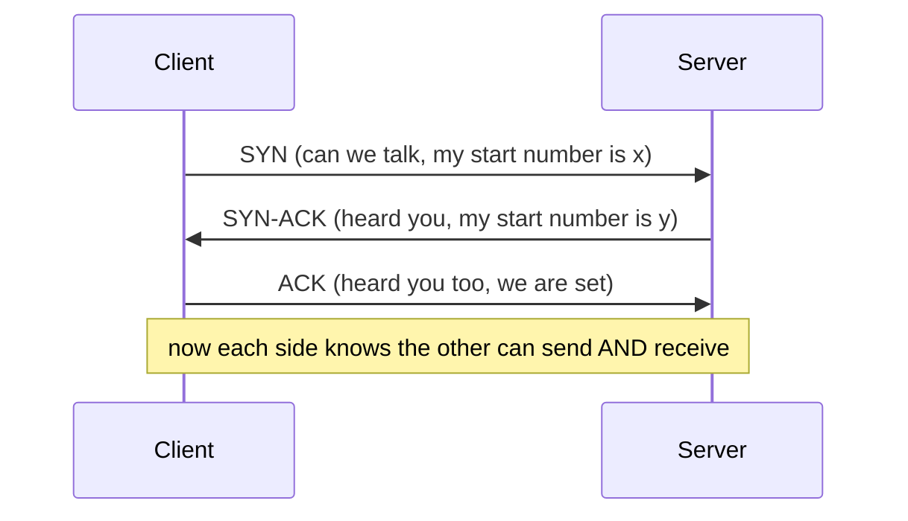
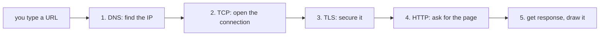

# CS Fundamentals — the rapid-fire interview layer

A Dojo course: the operating-systems, networking, database and OOP knowledge behind the
[CS Fundamentals drills](/practice/cs-fundamentals). IT-services interviews (IBM, Capgemini,
Deloitte, CGI, Atos) run this as rapid-fire Q&A; Oracle and Amazon probe it deeper.

We assume **no CS background** — if you can write a small program, you're ready. Every buzzword gets
a plain-English meaning and a picture before we use it. Nothing here is memorization for its own
sake; each idea comes with a little story you can retell.

> **The winning answer shape**, every time: **one-sentence definition → a concrete example → a
> trade-off or limit.** Practice answering *aloud* in that shape. An interviewer forgets your
> definition of a race condition in seconds; they remember the *story* of the lost increment. The
> stories below are the real product of this guide.

---

## 1. Processes and threads

### First, the picture

Your computer runs many programs at once — a browser, a music app, your code editor. The operating
system (the "OS", the master program that runs all the others — Windows, macOS, Linux) has to keep
them from stepping on each other. Two words for the units of running work:

- A **process** is *one running program*, given its own private stretch of memory to work in.
  Picture a program as a **worker in their own private office** — their own desk, whiteboard, and
  filing cabinet that no other worker can walk into. That private memory is called its **address
  space** (just "the range of memory addresses this program is allowed to touch"). Your browser and
  your editor are separate processes: separate offices.
- A **thread** is *one line of work happening inside a process.* Picture **several people working in
  the same office**, sharing the one whiteboard and filing cabinet. Threads inside a process share
  the same memory. A program can have one thread (one worker) or many (a team in one office).

The key difference — and why interviews love it — is what's shared:

| | Process (private office) | Thread (a person in a shared office) |
|---|---|---|
| Memory | Its own, isolated | Shares the office's memory with sibling threads |
| Cost to start / switch | Heavy — set up a whole new office | Light — just add a person |
| If one crashes | The others are unharmed (separate offices) | One bad thread can wreck the shared office for all |
| How they talk | Through official channels (pipes, sockets) — "IPC" | Just read/write the shared whiteboard — which is exactly why they need **locks** (below) |

> ("IPC" = *inter-process communication*, the official channels one process uses to talk to another,
> since they can't touch each other's memory directly.)

**Two words interviewers swap by mistake — keep them apart:**

- **Concurrency** = *structuring* work so many tasks make progress by taking turns. Like one chef
  juggling three pans, switching between them. Possible even with a single cook.
- **Parallelism** = *actually doing* things at the same instant, on multiple cooks (CPU cores).

A one-cook kitchen can be concurrent (juggling) but never parallel (only one pair of hands). The
example to cite: **Node.js is one thread, but massively concurrent** through its "event loop" (it
juggles thousands of waiting network requests without extra threads).

### Worked scenario: the lost increment (a "race condition", step by step)

This is *the* concurrency story. Learn to tell it.

Two threads each run `count++` one time, starting from `count = 0`. You'd expect the answer to be 2.
The catch: **`count++` is secretly three steps** — *read* the current value, *add* one, *write* it
back. Now watch what happens if the two threads interleave (take turns) at the wrong moments:

| Time | Thread A | Thread B | `count` in memory |
|---|---|---|---|
| t1 | reads `count` → sees 0 | | 0 |
| t2 | | reads `count` → sees 0 | 0 |
| t3 | computes 0 + 1 = 1 | | 0 |
| t4 | | computes 0 + 1 = 1 | 0 |
| t5 | writes 1 | | 1 |
| t6 | | writes 1 | **1 — should be 2!** |

Both threads did their own work perfectly. The *timing* destroyed an update: B read `0` before A had
written its result, so B overwrote A's work. That is a **race condition** — *shared data + at least
one writer + a result that depends on timing.* Run this a thousand times per thread and you'll get
some unpredictable number between 1,000 and 2,000, different every run. That unpredictability is why
races are the nastiest bugs to reproduce.

Three fixes, in the order you'd offer them in an interview:

```java
// 1. MUTUAL EXCLUSION — only one thread allowed in the "critical section" at a time.
//    A "lock" (mutex) is a talking-stick: you must hold it to touch count; others wait their turn.
synchronized (lock) { count++; }

// 2. ATOMIC operation — the hardware does read-add-write as ONE indivisible step,
//    so no other thread can sneak in between. "Atomic" = "cannot be split".
AtomicInteger count = new AtomicInteger();
count.incrementAndGet();          // no lost updates, no explicit lock

// 3. DON'T SHARE at all — hand work through a queue so only one worker touches the data.
//    (Your CodeArena BullMQ workers never share memory: the queue serializes access.
//     Saying that in an interview turns theory into your own experience.)
```

Two more terms you'll be asked, defined simply:

- A **mutex** ("mutual exclusion") is a lock that exactly **one** holder can own at a time (the
  talking-stick). A **semaphore** is a lock with **N** permits — it lets up to N holders in at once
  (think a parking lot with N spaces). A mutex is basically a semaphore with 1 permit, plus
  ownership.
- A **context switch** is when the OS **freezes one thread** (saves where it was — its "registers",
  the CPU's tiny scratch values) and **resumes another.** It's pure overhead — time spent managing
  work instead of doing it — which is why thread pools reuse threads and why juggling I/O (Node's
  style) beats spawning a thread per connection.

### Worked scenario: the textbook deadlock

**Deadlock** = two threads each waiting for something the *other* is holding, so both wait forever.
Like two people in a doorway, each saying "you go first" — and neither ever moves.

Thread A locks **account 1**, then wants **account 2**. Thread B locks **account 2**, then wants
**account 1**:

| Time | Thread A | Thread B |
|---|---|---|
| t1 | lock(acc1) ✓ | |
| t2 | | lock(acc2) ✓ |
| t3 | wants acc2 — **blocks** (B holds it) | |
| t4 | | wants acc1 — **blocks** (A holds it) |
| t5+ | waits forever | waits forever |

Deadlock needs **all four** of the "Coffman conditions" at once (you don't need to worship the name,
just know breaking *any one* makes deadlock impossible):

1. **Mutual exclusion** — the resource can't be shared (only one holder).
2. **Hold-and-wait** — a thread holds one thing while reaching for another.
3. **No preemption** — nobody can forcibly take a lock away.
4. **Circular wait** — a loop of "A waits for B waits for A."

The standard practical fix breaks #4 (circular wait): **always grab locks in the same fixed order.**
If both threads must lock the lower-numbered account *first*, then B at t2 would try acc1, wait
politely, and A would finish — no cycle, no deadlock. (Other options: `tryLock` with a timeout, which
breaks hold-and-wait by giving up; or one big coarse lock over everything.)

> **Don't confuse deadlock with starvation.** In *deadlock*, nobody can move — there's a genuine
> cycle. In **starvation**, the system is fine and moving, but one unlucky low-priority thread keeps
> getting skipped and never gets a turn. Deadlock needs prevention; starvation needs *fairness*
> (e.g. letting a task's priority rise the longer it waits — "aging").

---

## 2. Memory and scheduling

### Stack vs heap — named after the two crashes they cause

A running program keeps its data in two different regions of memory. The names sound scary; the ideas
are simple.

- **The stack** — scratch space for *function calls*, stacked like a pile of plates. Every time you
  call a function, a new "plate" (called a **stack frame** — its local variables and where to return)
  is placed on top; when the function returns, its plate is removed. It's small (~1 MB) and automatic.
  Every recursive call in your [DSA tree problems](/dsa/trees) adds a plate. Recurse 100,000 levels
  deep and the pile topples: **StackOverflowError.** *That's exactly why an iterative loop can handle
  inputs a deep recursion crashes on.*
- **The heap** — the big general storage room for things you make with `new` that must outlive a
  single function and can be shared between threads. Fill it up (load a 10-GB file into a list) and
  you get **OutOfMemoryError.**

Memory hook: **Stack Overflow** = too many nested calls; **Out Of Memory** = too much stored data.
The two error names *tell you which region blew up.*

### Virtual memory, page faults, thrashing — the "office desk vs warehouse" story

Here's a magic trick the OS plays. Each program *thinks* it has a huge private block of memory
(section 1's address space) — but physical RAM is limited and shared. The OS fakes it: this is
**virtual memory.** It chops memory into fixed chunks called **pages** (usually 4 KB each) and keeps
a lookup table ("page table") mapping each virtual page to where it *really* is. A tiny cache of the
most recent lookups (the **TLB**) makes this fast. You don't need those acronyms for most interviews;
you need the story:

Think of **RAM as your desk** (fast, small) and **the disk as a warehouse** (huge, slow). You can
only keep a few folders (pages) on the desk. When your program needs a page that's not on the desk,
that's a **page fault** — "fetch it from the warehouse." The OS pauses the program, brings the page
in from disk (removing some other page to make room, usually the least-recently-used one), and
resumes. This is *routine and invisible* — happens constantly, all fine.

**Thrashing** is when it goes pathological: too many programs want more pages than the desk holds, so
every fetch kicks out a page that some program needs *right away*, which faults it back, kicking out
another needed page… The machine spends all its time shuttling folders to and from the warehouse and
almost none doing actual work. **Memorize the symptom signature — it's a favorite diagnosis question:
CPU usage LOW, disk screaming busy, throughput collapsed.** The computer isn't computing; it's just
swapping. Fixes: add RAM (a bigger desk), run fewer programs at once, or make each need less memory.
*(Contrast: if the CPU is pinned at 100% and the disk is quiet, that's an overworked processor, not
thrashing — opposite fix.)*

### Scheduling in one breath

Many threads, few CPU cores — so the OS gives each thread a short turn ("time slice"), then switches.
Three words to know: **time slice** (the length of a turn), **priority** (some threads get turns more
often), and **preemption** (the OS *forcibly* takes the CPU back with a timer — the thread doesn't get
to hog it voluntarily). Also worth one line: **user mode vs kernel mode.** Normal code runs in the
locked-down "user mode"; when it needs the OS to do something privileged (read a file, use the
network), it makes a **system call** that jumps into the powerful "kernel mode." Crossing that
boundary costs time — which is *why* I/O is "expensive" and why we batch and buffer it.

---

## 3. Networking

### The layers — envelopes inside envelopes

When your computer sends data across the internet, it's wrapped in layers, like putting a letter in
an envelope, inside a bigger envelope, inside a mailbag. Each layer has one job and doesn't care what
the layers above it are doing. The practical four-layer view, top (meaning) to bottom (wires):

| Layer | Its one job | Names you already know |
|---|---|---|
| Application | The actual *meaning* — a web request, a lookup | HTTP, DNS, TLS |
| Transport | Deliver to the right *program* on a machine (via "ports") | TCP, UDP |
| Internet | Route between the right *machines* | IP addresses |
| Link | The physical hop over a wire or radio | Ethernet, Wi-Fi |

(A **port** is just a numbered mailbox on a machine so one computer can run many programs at once —
web on 443, database on 5432. A machine is found by its **IP address**; a *program on it* by its
port.)

### TCP vs UDP — the reliable call vs the quick shout

These are the two "transport" options, and choosing between them is a classic question.

- **TCP** is like a **phone call**: first you both say hello and confirm you can hear each other (a
  "handshake"), then everything you say arrives *in order*, and if a word is missed it's repeated.
  Reliable, ordered — but with the overhead of all that confirming.
- **UDP** is like **shouting across a room**: no hello, you just fire off messages. Some might not
  land, and they can arrive out of order, but it's fast and cheap.

| | TCP (phone call) | UDP (shouting) |
|---|---|---|
| Setup | 3-step handshake first | none, just send |
| Guarantees | in-order, reliable, no duplicates | best-effort, may drop/reorder |
| Overhead | acknowledgements, resends | almost none |
| Use it for | web pages, databases, file downloads — correctness first | live video, games, DNS — speed first |

The handshake (why it takes *three* messages):



Why not two messages? After only the first two, the *server* has spoken but hasn't been told its
message was heard — it doesn't yet know the client can receive. The third message closes that gap.
Three is the minimum for *both* sides to be sure the other can both hear and speak. *(A "SYN flood"
attack abuses this: send thousands of first-messages and never reply, filling the server's table of
half-open calls.)*

**The choosing rule to recite:** when *freshness beats completeness* — a resent stale video frame is
worthless — use UDP. When *every byte must arrive in order* — web pages, files, your judge's results
— use TCP.

### Worked scenario: what happens when you type a URL

The single most-asked networking question in Morocco's IT-services (ESN) interviews. Tell it as a
chain, and drop in rough time estimates — *the numbers are what make you sound like an engineer.*



1. **DNS lookup** (~0–100 ms). DNS is the internet's **phone book**: it turns a name like
   `example.com` into an IP address (the actual number). Your computer checks caches first (browser,
   then OS, then your provider's resolver) before anyone walks the full directory. Caching is why
   this is usually near-instant and why the whole system scales.
2. **TCP handshake** (~10–50 ms) — the three-step hello from above, to the server's port 443.
3. **TLS handshake** (~one round trip). **TLS** is what puts the "S" (secure) in HTTPS. The server
   proves it's really who it claims (with a **certificate** — a digital ID signed by a trusted
   authority), and both sides agree on a secret key to scramble the rest. Bonus line for the
   interviewer: *identity is checked with slow "asymmetric" crypto, then the bulk traffic uses fast
   "symmetric" crypto — right tool for each job.*
4. **HTTP request/response.** Now the browser finally asks: `GET /` → the server sends back HTML. The
   browser reads it, discovers it needs images/CSS/JS, fetches those (often in parallel, often from a
   nearby **CDN** — a network of servers that keep copies close to users), and draws the page.

Notice each step **needs the one before it**: you can't connect without an address, can't secure
without a connection, can't ask without a secure channel. Derive the order from that logic instead of
memorizing it.

### HTTP facts that win rapid-fire rounds

- **Verbs and "idempotency".** *Idempotent* means "doing it twice leaves the same result as doing it
  once." GET (just reads — safe), PUT (sets a value — same twice = same state), and DELETE are
  idempotent. **POST is not** — it *creates* something, so sending it twice can make two orders.
  That's the answer to "why can't you blindly retry a POST?" The fix is an **idempotency key**: tag
  the request with a unique id so the server ignores a duplicate.
- **Status codes** (the number the server replies with): 200 OK · 201 Created · 301/302 redirect ·
  400 bad input · **401 = "who are you?" (not logged in) vs 403 = "I know you, but you're not
  allowed"** · 404 not found · 409 conflict · 429 too many requests (rate-limited) · 500 server bug ·
  503 overloaded/down.
- **HTTP is "stateless"** — each request stands alone; the server doesn't remember you between them.
  So your identity must ride along *every* request: via a **cookie** (the browser attaches it
  automatically) or a **bearer token** (your code adds it in a header). Full story in
  [Phase 1 §B](/guides/phase-1-auth-data-frontend) and the [Auth drills](/practice/auth).
- A **socket** is one endpoint of a connection = IP + port + protocol. Ports are how one machine runs
  many services — your own Docker Compose file is the example: 443 web, 5432 Postgres, 6379 Redis.

---

## 4. Databases

Deep coverage is in [Phase 1 §A](/guides/phase-1-auth-data-frontend) and the
[SQL drills](/practice/sql-data); here's the interview layer with the stories attached. (A
**database** stores your app's data in **tables** — grids of **rows** and **columns**, like
spreadsheets that can be linked together.)

### Keys and normalization — the "duplicated address" story

- A **primary key** is the column that uniquely names each row (like a student ID — never blank,
  never repeated). A **foreign key** is a column that *points* at another table's primary key,
  enforcing "this must refer to something real" (an order's `customer_id` must be a real customer).
  That guarantee is called **referential integrity.**
- Prefer a **surrogate key** — a meaningless auto-generated id (1, 2, 3… or a random UUID) — over a
  "natural" one like an email, because real-world facts change (people retype their email) and you
  don't want your identities shifting under you.

**Normalization** is the practice of *not duplicating data*, and it exists because duplication causes
**anomalies** (things going wrong). Concrete story: an `orders` table that copies the customer's home
address onto *every* order row —

- **Update anomaly:** the customer moves → you must fix 500 rows; miss one and now "the truth"
  disagrees with itself.
- **Insert anomaly:** you can't even record a new customer until they place an order (nowhere to put
  them).
- **Delete anomaly:** deleting their last order erases the customer entirely.

Splitting into two tables — `customers` (address stored *once*) and `orders` (just a `customer_id`
pointing at it) — kills all three. That tidy split is roughly what "**3rd Normal Form**" means:
*every fact depends on the key, the whole key, and nothing but the key.* The reverse move,
**denormalization**, is deliberately copying data back in for read speed — a *trade-off you name and
own*, not a mistake (your Phase 5 leaderboard does exactly this).

### ACID — the four promises a transaction makes

A **transaction** is a group of database steps treated as one all-or-nothing unit ("take money from
A **and** give it to B — both or neither"). **ACID** is the four guarantees:

- **A — Atomicity:** all steps happen, or none do. No half-done transfers.
- **C — Consistency:** the rules (constraints) always hold before and after.
- **I — Isolation:** transactions running at the same time don't see each other's half-finished work.
- **D — Durability:** once it says "done" (committed), a power cut can't lose it.

**Isolation levels** — this is easier than it sounds. Databases let you *dial* how strictly
transactions are kept apart, trading safety for speed. The clearest way to learn them is by the *one
bad thing each level still allows.* Here's a **non-repeatable read** (reading the same row twice and
getting two answers), which Postgres's default level permits:

| Time | Transaction 1 | Transaction 2 |
|---|---|---|
| t1 | `SELECT balance` → 100 | |
| t2 | | `UPDATE balance = 50; COMMIT` |
| t3 | `SELECT balance` → **50** — it changed mid-transaction! | |

The ladder, loosest (fast, risky) to strictest (safe, slow):

| Level | Stops | Still allows |
|---|---|---|
| Read uncommitted | nothing | **dirty reads** — seeing another transaction's *uncommitted* data that might vanish |
| Read committed | dirty reads | **non-repeatable reads** — the timeline above |
| Repeatable read | non-repeatable reads | **phantoms** — re-running a *range* query ("all rows where x>10") sees newly-inserted rows |
| Serializable | everything — behaves as if transactions ran one at a time | (nothing — but costs speed and may force retries) |

Senior-signal nuance to volunteer: the SQL standard says repeatable read allows phantoms, but
**Postgres's implementation actually blocks most of them** — naming that gap between "standard" and
"real implementation" impresses interviewers.

### Indexes — the "index at the back of a book"

An **index** makes lookups fast the same way a book's index does: instead of reading all 1,000 pages
to find "photosynthesis," you check the sorted index and jump straight there. Databases use a
structure called a **B-tree** that finds a row in about **O(log n)** steps (see §6 — roughly "even if
the table has a million rows, it takes ~20 hops") instead of scanning all n rows. The cost: every
insert must also update the index, so indexes make writes a bit slower and use extra space.

```sql
-- 1,000,000-row submissions table, NO index:
EXPLAIN ANALYZE SELECT * FROM submissions WHERE user_id = 42;
-- "Seq Scan" (reads ALL million rows to find 50)  → ~120 ms

CREATE INDEX idx_submissions_user ON submissions (user_id);

EXPLAIN ANALYZE SELECT * FROM submissions WHERE user_id = 42;
-- "Index Scan" (jumps straight to them)  → ~0.4 ms   — about 300× faster
```

(`EXPLAIN ANALYZE` asks the database to *show you its plan* and the real time — an "x-ray" of the
query.) Two facts that decide follow-up questions:

- **Leftmost-prefix rule.** A combined index on `(a, b)` is sorted by `a` first, then `b` within each
  `a` — like a phone book sorted by last name, then first name. It speeds up searches that fix `a`
  (`WHERE a = …`, or `a` and `b` together), but **not** `WHERE b = …` alone — searching by first name
  only in a book sorted by last name is no help; the first names are scattered everywhere.
- **When an index *hurts*:** on write-heavy tables (every write pays to update every index), and on
  columns with few distinct values (an index on a `status` that's only "active/inactive/banned"
  barely narrows anything — the database will just ignore it).

### SQL vs NoSQL, one defensible line each

- **SQL / relational** (tables with strict shape, links, and multi-row transactions): pick it when
  correctness spans rows — money, inventory, anything with invariants.
- **NoSQL / document or key-value** (flexible blobs, easy to spread across many machines): pick it
  when each record is self-contained, or when sheer scale forces you to split data across servers
  ("**sharding**").
- The intern answer that lands: *"I'd start relational — Postgres scales further than people think,
  and I can denormalize the hot read paths later. My leaderboard does exactly that."*

---

## 5. OOP and design

**OOP** (object-oriented programming) organizes code into **objects** — bundles of data plus the
methods that act on it. Four "pillars", each with code you can defend:

```typescript
// 1. ENCAPSULATION — hide the data behind a guardrail so it can never go invalid.
class Rating {
  private value = 1500;                              // "private" = nobody outside can touch it
  applyResult(delta: number) {
    this.value = Math.max(0, this.value + delta);    // the rule ("never below 0") lives HERE, guarded
  }
}

// 2. ABSTRACTION — callers see WHAT it does, not HOW. They depend on the shape, not the guts.
interface Queue { enqueue(job: Job): Promise<void> }  // Is it BullMQ? RabbitMQ? Caller can't tell — good.

// 3. INHERITANCE ("is-a", handy but easy to overuse) vs COMPOSITION ("has-a", usually better):
class TimedContest extends Contest {}                       // rigid — locked to one parent
class Contest { constructor(private timing: TimingPolicy) {} }  // flexible — plug the behavior in

// 4. POLYMORPHISM — one call, many behaviors chosen automatically ("many shapes").
interface Runner { run(code: string): Verdict }
class PythonRunner implements Runner { /* … */ }
class JsRunner implements Runner { /* … */ }
judge.run(submission);   // calls the right runner automatically — no big if/switch needed
```

Plain glosses: **encapsulation** = keep data private behind methods that guard its rules;
**abstraction** = expose a simple "what", hide the messy "how"; **inheritance** = a child class reuses
a parent's stuff; **composition** = a class is *built from* smaller parts you hand it; **polymorphism**
= the same call does the right thing for whatever object it's given.

> **"Prefer composition over inheritance"** — the most-quoted OOP advice. Inheritance locks you to one
> rigid family tree; composition lets you *swap parts* freely (inject a different `TimingPolicy`
> without touching `Contest`). Say it and mean it.

### SOLID — five design rules, each as a symptom + fix

**SOLID** is five guidelines for code that's easy to change. Don't recite the definitions — learn to
**diagnose them from symptoms**, which is what interviewers actually test:

| Letter | Symptom you'd notice | The fix |
|---|---|---|
| **S** — Single Responsibility | "Every unrelated change touches this one file" — it does validation *and* rating math *and* logging | Split it; each class has one reason to change |
| **O** — Open/Closed | A `switch(language)` that grows a new case every time you add a runner | Add a *new class* implementing `Runner` instead of editing the switch |
| **L** — Liskov Substitution | A `ReadOnlyRepo` that `extends Repo` but throws on `save()` — code holding a `Repo` breaks | Don't inherit a contract you can't honor; use separate interfaces |
| **I** — Interface Segregation | One giant `Repository` with 30 methods, forcing fake stubs everywhere | Small focused interfaces (`Reader`, `Writer`) |
| **D** — Dependency Inversion | `new PostgresUserRepo()` written *inside* business logic — can't test without a real database | Depend on a `UserRepo` *interface*; inject the real one from outside (this is *why* NestJS and Spring have "DI containers") |

The interview move is direction: *symptom → letter → fix.* "I can't unit-test without Docker" → **D**.
"One change ripples through five files" → **S**. The [drills](/practice/cs-fundamentals) train exactly
that reflex.

**Design patterns worth naming** (a pattern = a reusable solution shape), one honest use each:
Singleton (one shared connection pool — mention its testing downside), Factory (build the right judge
runner per language), Strategy (swap the rating algorithm: Elo vs Glicko-2 — your Phase 3), Observer
(submission events notify the leaderboard — your Phase 5), MVC (every web framework). One real
sentence beats five memorized ones.

---

## 6. Complexity (Big-O) — from zero

**Big-O** answers one question: *as the input gets big, how fast does the work grow?* It ignores exact
numbers and constants and keeps only the *shape* of the growth. Analogy: you don't care that a task
takes 3 seconds vs 5 seconds; you care whether **doubling the input doubles the time, or quadruples
it, or barely changes it.** That shape is what survives at scale.

The common shapes, best to worst, with a picture:

- **O(1)** — constant. Same time no matter the size. *Looking up a value by its key in a hash map.*
- **O(log n)** — logarithmic. Grows *incredibly* slowly; doubling the data adds just one step.
  *Binary search: halve the search each step. A million items → only ~20 steps.*
- **O(n)** — linear. Double the data, double the time. *One loop over everything.*
- **O(n log n)** — the speed of a good sort.
- **O(n²)** — quadratic. Double the data, *quadruple* the time. *A loop inside a loop.* Gets slow fast.
- **O(2ⁿ)** — exponential. Adding *one* item doubles the time. *Trying every subset.* Basically
  unusable beyond tiny inputs.

How to *derive* it (this is what the [practice topic](/practice/cs-fundamentals) and the whole
[DSA track](/dsa) drill), no memorizing:

- One loop over `n`, constant work inside → **O(n)**.
- Each step **halves** the problem (`i = i/2`, binary search, walking down a balanced tree) →
  **O(log n)**.
- A loop inside a loop → **O(n²)** (even if the inner one starts at `i+1`; that's n²/2, and Big-O
  drops the constant ½).
- Steps that run **one after another add** (sort `O(n log n)`, then a scan `O(n)` = `O(n log n)`, the
  bigger one wins); steps **nested inside each other multiply.**
- Always ask **"could an adversary force the worst case?"** — e.g. a hash map is O(1) *on average*
  but O(n) if every key collides into one bucket (Java 8+ softens this by turning huge buckets into
  trees, O(log n) — saying so answers the follow-up before it's asked).

The data-structure cheat table (the "n" is the number of items; "avg" = typical case):

| Structure | Get by position | Search for a value | Insert | Delete | Notes |
|---|---|---|---|---|---|
| Array | O(1) | O(n) | O(n) (at the end: O(1) usually) | O(n) | contiguous, very cache-friendly |
| Linked list | O(n) | O(n) | O(1) at a known spot | O(1) at a known spot | follows pointers node to node |
| Hash map / set | — | O(1) avg, O(n) worst | O(1) avg | O(1) avg | worst case = many collisions |
| Balanced tree (TreeMap) | O(log n) | O(log n) | O(log n) | O(log n) | keeps keys sorted for free |
| Binary heap | peek O(1) | O(n) | O(log n) | O(log n) to pop | great for "top-k" / schedulers |
| B-tree (DB index) | O(log n) | O(log n) | O(log n) | O(log n) | wide + shallow → few disk hops |

---

## Mastery checklist — you can…

- Tell the lost-increment story with the six-row timeline, then give all three fixes.
- Recite the four deadlock conditions and *show* lock-ordering killing the t1–t5 timeline.
- Diagnose "CPU low, disk screaming" as thrashing — and "CPU pinned" as its opposite.
- Tell the type-a-URL story with rough latencies in under 90 seconds.
- Draw the TCP handshake and explain why two messages aren't enough.
- Walk the two-transaction timeline and place it on the isolation ladder.
- Read an `EXPLAIN`, explain the ~300× index speedup, and the leftmost-prefix rule.
- Map every SOLID letter to a symptom and a fix from your own codebase.
- *Derive* — not recall — the Big-O of any snippet in the table above.

## Self-quiz

Answer each **aloud** in the *definition + example + trade-off* shape before reading the answer.

1. **Why is creating a thread cheaper than a process?**
   *Answer:* No new private memory/address space to set up — just a stack and registers. Same-process
   switches also skip some bookkeeping (no TLB flush). It's "add a person to the office" vs "build a
   new office."
2. **Two threads increment a counter 1,000 times each; the result is 1,730. Why?**
   *Answer:* `count++` is read-modify-write; interleaved reads overwrite each other and lose updates —
   a race condition. Fix with an atomic increment or a mutex.
3. **401 vs 403?**
   *Answer:* 401 = not authenticated ("who are you?"). 403 = authenticated but not permitted ("I know
   you, you still can't").
4. **Why can't `WHERE b = ?` use the composite index `(a, b)`?**
   *Answer:* The index is sorted by `a` first; without fixing `a`, the `b` values are scattered
   throughout — like searching a last-name-sorted phone book by first name. Leftmost-prefix rule.
5. **A transfer debits one account, the server dies before the credit. Which ACID letter saves you?**
   *Answer:* **A**tomicity — the transaction never half-commits; on restart the debit is rolled back.
   All or nothing.
6. **Repeatable read still allows which anomaly?**
   *Answer:* Phantoms — a re-run *range* query can see newly inserted rows (per the standard; Postgres
   actually prevents most — that nuance is bonus points).
7. **Inheritance or composition for a `TimedContest`, and why?**
   *Answer:* Composition — inject a timing policy. The behavior varies on its own axis; inheritance
   would lock you to one rigid base class.
8. **Why is a hash map O(n) worst case, and what does Java do about it?**
   *Answer:* If every key collides into one bucket it degrades to scanning a list. Java 8+ turns
   oversized buckets into balanced trees, softening the worst case to O(log n).
9. **Your API is slow; CPU is 8%, disk I/O saturated, RAM full. Diagnosis?**
   *Answer:* Thrashing — the machine is paging to/from disk, not computing. Add RAM or cut the number
   of concurrent working sets.
10. **Why is POST not safely retryable but PUT is?**
    *Answer:* PUT sets a value (twice = same state — idempotent). POST creates (twice = two orders).
    Retried POSTs need an idempotency key.

## Exercises

1. Drill [CS Fundamentals](/practice/cs-fundamentals) to 90%+, answering each **aloud** in the
   *definition + example + trade-off* shape before revealing.
2. Reproduce the lost increment for real — two workers incrementing a shared counter (Node
   `worker_threads` + `SharedArrayBuffer`, or two Java threads). Watch it lose updates; fix with an
   atomic. Nothing cements the timeline like seeing 1,730 with your own eyes.
3. Record yourself telling the type-a-URL story and the deadlock story; cut both under 90 seconds.
4. On your CodeArena `submissions` table, run the §4 `EXPLAIN` experiment for real: measure
   before/after adding the index, then force the slow scan back (`SET enable_indexscan = off`) and
   explain why the planner flipped.
5. Open two `psql` sessions and reproduce the non-repeatable-read timeline, then raise the isolation
   level and watch it disappear. Ten minutes, permanent understanding.
6. Write one paragraph mapping each SOLID letter to a real file in your codebase — doubles as
   interview ammunition.

## Reading list

- *Operating Systems: Three Easy Pieces* (free online) — virtualization, concurrency, persistence;
  skim for mental models.
- [Beej's Guide to Network Programming](https://beej.us/guide/bgnet/) — sockets made concrete.
- [Use The Index, Luke](https://use-the-index-luke.com/) — B-tree indexing and leftmost prefixes.
- *Head First Design Patterns* — Strategy/Observer/Factory chapters map straight onto CodeArena.
- Dojo tie-ins: [Phase 1](/guides/phase-1-auth-data-frontend) (DB + auth depth),
  [Phase 2](/guides/phase-2-execution-sandboxing) (isolation, queues),
  [System Design fundamentals](/guides/system-design-fundamentals),
  [Java & Spring Boot](/guides/java-spring-boot) (the same questions in Java).
