# Git — Workflow & Command Reference

Git is the tool you'll touch more than any other on a team, and the one an internship silently assumes you already know. Not the trivia — the *fluency*: branch without thinking, stage the right changes, rebase to tidy up, resolve a conflict calmly, undo safely, and open a pull request a reviewer enjoys reading.

This guide is both halves: the **workflow** (parts 1–7) and the **complete command surface** (parts 8–16), with diagrams for every operation that moves history around.

The one idea that makes everything else click: **Git stores snapshots, and commits are cheap, immutable, and identified by a hash.** Branches and tags are just movable labels pointing at commits. Almost every command is moving a label or making a new snapshot.

> **Drill this guide** in [Practice → Git & Workflow](/practice/git) — 62 exercises, concept cards plus type-the-command recall.
>
> **Next:** [Team Workflow — Hooks, CI & Pull Requests](/guides/team-workflow) covers the system around these commands: hooks, commitlint, CI, pull requests, review and protection.

---

---

## ⌨️ This guide is interactive

**Twelve exercises are embedded below.** Git drills are command recall and scenario reasoning, so
most ask you to write the command you would actually type, or to say what one did.

They are weighted toward the situations that **feel like lost work and are not** — a branch switch
that seems to delete your edits, `branch -d` succeeding on an unmerged branch, `reset --hard`
twice. Three of those cost real hours in this project. Only one row in the final triage exercise is
genuine loss.

# Part 1 — The mental model

## The four places your code lives

Nearly every confusing Git moment comes from not knowing which of these four you're touching.

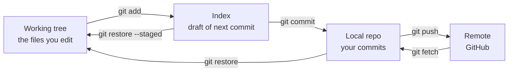

| Place | What it is | Can you lose work here? |
| --- | --- | --- |
| **Working tree** | The files you actually edit | **Yes** — never committed, so Git has no copy |
| **Index** (staging area) | A draft of your next commit | Rarely |
| **Local repo** | Your commit history, in `.git/` | Almost never — `git reflog` |
| **Remote** | The shared copy (GitHub) | Only via `--force` |

**Why the index exists:** it lets you commit *some* of your changes. You fixed a bug and also left a debug print — stage the fix, commit it, keep the print. Without staging you'd commit both or neither.

`git status` tells you where everything sits. Run it constantly.
```exercise
four-places
```

```exercise
commit-am-trap
```


## The everyday loop

```bash
git switch -c fix-login        # branch off main
# …edit files…
git status                     # what changed, what's staged
git add .                      # stage everything (or `git add -p` to pick hunks)
git commit -m "fix login redirect"
git push -u origin fix-login   # publish the branch
# …open a pull request…
```

That's 90% of daily Git. The rest of this guide is the other 10% — the moments that trip people up.

---

# Part 2 — Branching

A branch is **a movable pointer to a commit**. Creating one is instant and costs nothing.

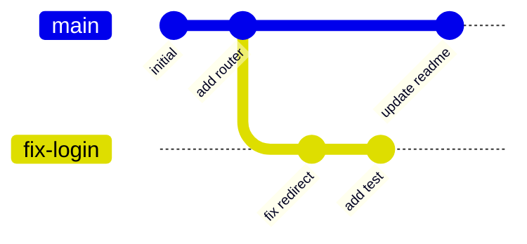

Two lines of history now exist. `main` never saw your half-finished work, and you never blocked anyone else.

| Command | When |
| --- | --- |
| `git branch` | List local branches |
| `git branch -a` | Include remote branches |
| `git branch -v` | With each one's last commit |
| `git switch -c feature` | **Create and move to** a branch (modern) |
| `git checkout -b feature` | Same thing (older, still everywhere) |
| `git switch main` | Move to an existing branch |
| `git switch -` | Back to the previous branch — like `cd -` |
| `git branch -d feature` | Delete — refuses if unmerged |
| `git branch -D feature` | Delete, **force**, even if unmerged |
| `git branch -m old new` | Rename |

**`switch` vs `checkout`:** `checkout` did too many unrelated jobs — switch branches, restore files, detach HEAD. `git checkout main` moves branch; `git checkout main.ts` *destroys your edits to that file*. One character apart, wildly different outcomes. Git 2.23 split it into `switch` (branches) and `restore` (files). Use the new ones; recognise the old ones in tutorials.

**Detached HEAD:** `HEAD` means "where you are". Check out a *commit* instead of a branch and `HEAD` points at no branch — commits you make there belong to nothing and are easy to lose. Make a branch first.

---

# Part 3 — The staging area

The index is what makes Git commits *good*. Because you choose exactly which changes go in, one commit can be a single focused, reviewable unit.

### `git status` — reading `--short` output

**Left column = index. Right column = working tree.**

| Symbol | Meaning |
| --- | --- |
| `A ` | Added, staged |
| `M ` | Modified, **staged** |
| ` M` | Modified, **not staged** |
| `MM` | Staged changes *and* newer unstaged ones in the same file |
| `D ` | Deleted, staged |
| `??` | Untracked — Git doesn't know it exists |

**`MM` is the one that bites.** You staged, then edited again. Committing now saves the *older* version. Re-run `git add` first.

### `git add` — choose what goes in

| Command | When |
| --- | --- |
| `git add file.ts` | One specific file |
| `git add src/` | Everything under a folder |
| `git add .` | Everything under the current directory |
| `git add -A` | Everything in the repo, **including deletions** |
| `git add -p` | **Interactively, hunk by hunk** |
| `git add -u` | Only files already tracked (no new files) |
| `git add -f file` | Force-add past a `.gitignore` rule |

**`git add -p` is the one worth learning.** It walks you through each change asking y/n/s (split). It's what makes "commit the fix, keep the experiment" a first-class move — and it forces you to re-read your own diff, which catches a surprising number of leftover debug lines.

### `git commit`

| Command | When |
| --- | --- |
| `git commit -m "message"` | Normal |
| `git commit` | Opens your editor — for a multi-line message with a body |
| `git commit -am "message"` | Stage all *tracked* files and commit. **Skips new files** |
| `git commit --amend` | Fix the **last** commit (message or content) |
| `git commit --amend --no-edit` | Add staged changes to the last commit, keep its message |
| `git commit --no-verify` | Skip pre-commit hooks |

**The `-am` trap:** `-a` means "stage all modified and deleted **tracked** files". A brand-new file has never been tracked, so `-am` skips it *silently* — no error, no warning. You find out when the build breaks for someone else.

**When to `--amend`:** you forgot a file or made a typo, **and haven't pushed yet**. Amending doesn't edit a commit — it *replaces* it with a new hash. Invisible if nobody has the old one; a diverged history if they do.

### `git diff` — see the actual changes

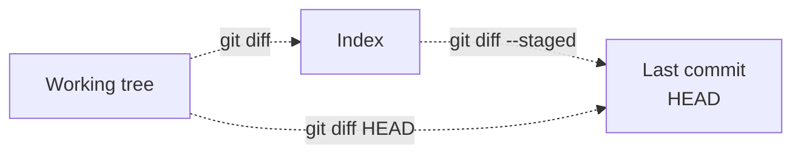

| Command | Shows |
| --- | --- |
| `git diff` | Working tree vs index — **what you haven't staged** |
| `git diff --staged` | Index vs last commit — **what you're about to commit** |
| `git diff HEAD` | Everything uncommitted |
| `git diff main..feature` | Difference between two branches |
| `git diff --stat` | Just file names and line counts |

**The one people get wrong:** plain `git diff` shows nothing after `git add`. Not a bug — you asked "what's unstaged?" and the answer is "nothing". Use `--staged`.

In a diff, `-` lines were removed, `+` added; a header `@@ -a,b +c,d @@` marks the region.

---

# Part 4 — Merge vs rebase

Both bring branch A's work into branch B. They differ in **the shape of the history they leave**.

## Merge — preserves what happened

```bash
git switch main
git merge feature
```

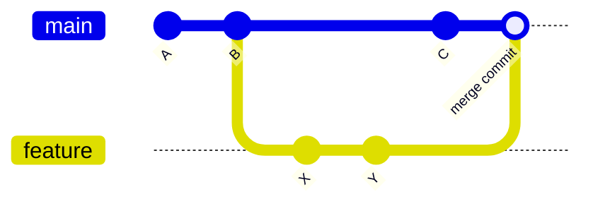

A **merge commit** with two parents ties the histories together. The branch remains visible forever: you can see it existed, what was on it, and when it landed. Cost: a busier, forked graph.

| Flag | When |
| --- | --- |
| `git merge feature` | Normal |
| `git merge --no-ff feature` | Force a merge commit even when it could fast-forward |
| `git merge --squash feature` | Combine everything into **one** staged change, you commit it |
| `git merge --abort` | Conflict, and you want out |

**Use merge when:** landing a finished feature into `main`, or the branch is shared. Non-destructive and honest.

## Rebase — rewrites for a straight line

```bash
git switch feature
git rebase main
```

**Before** — `feature` branched off an old `main`:

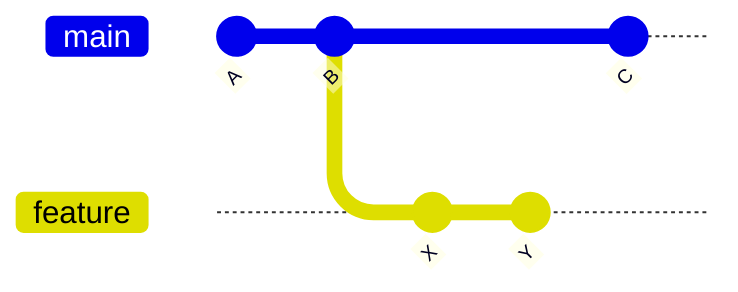

**After** — your commits are *replayed* on top of `C` as **new commits with new hashes** (`X'`, `Y'`):

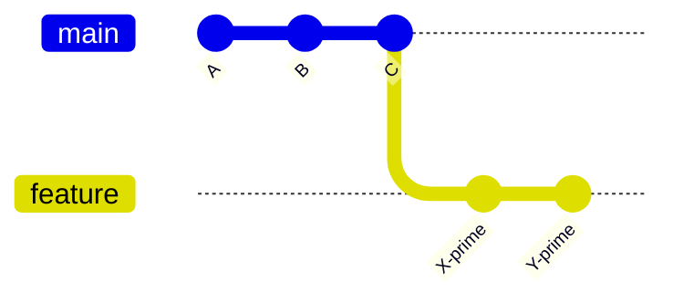

No merge commit. History reads as if you'd started work today.

| Flag | When |
| --- | --- |
| `git rebase main` | Update your branch with the latest main |
| `git rebase -i HEAD~5` | **Interactive** — reorder, squash, reword, drop |
| `git rebase --continue` | After resolving a conflict |
| `git rebase --abort` | Give up, return to exactly where you started |
| `git rebase --skip` | Drop the conflicting commit |

## 🚨 The golden rule of rebase

> **Never rebase commits others have already pulled.**

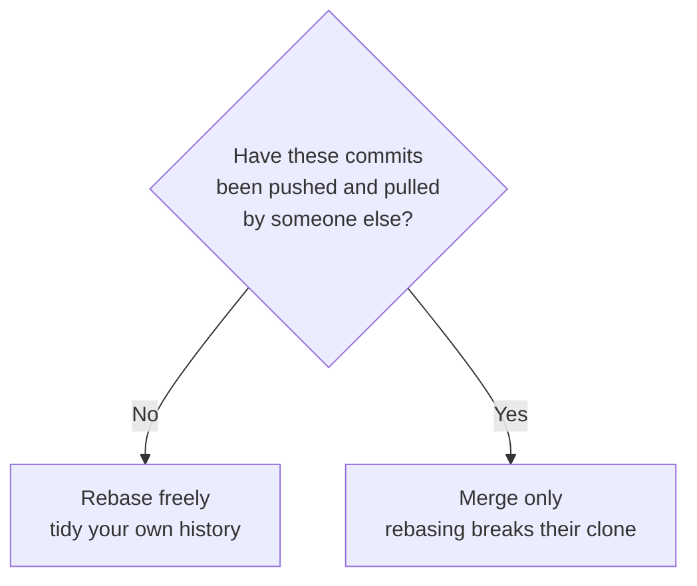

Rebase creates *new* commits with new hashes, so the originals your teammates based work on effectively vanish — their history and yours diverge and everyone fights conflicts. Rebase private work; merge public work.

A common workflow: **rebase your feature branch onto `main` to tidy it before opening the PR**, then **merge the PR**.
```exercise
rebase-golden-rule
```


## `git rebase -i` — the history editor

```bash
git rebase -i HEAD~3
```

Opens an editor listing your last 3 commits:

```
pick a1b2c3d add login form
pick d4e5f6g fix typo
pick h7i8j9k fix another typo
```

| Keyword | Does |
| --- | --- |
| `pick` | Keep as-is |
| `reword` | Keep the changes, edit the message |
| `squash` | Merge into the commit above, **combine** both messages |
| `fixup` | Merge into the one above, **discard** this message |
| `drop` | Delete the commit and its changes entirely |
| `edit` | Pause here so you can amend the content |

**When:** before opening a PR, to turn "add login / fix typo / fix typo again" into one clean commit.

---

# Part 5 — Conflicts

A conflict happens when two branches changed the same lines. Git pauses and fences both versions in the file:

```
<<<<<<< HEAD
const timeout = 3000;          // your current branch's version
=======
const timeout = 5000;          // the incoming branch's version
>>>>>>> feature
```

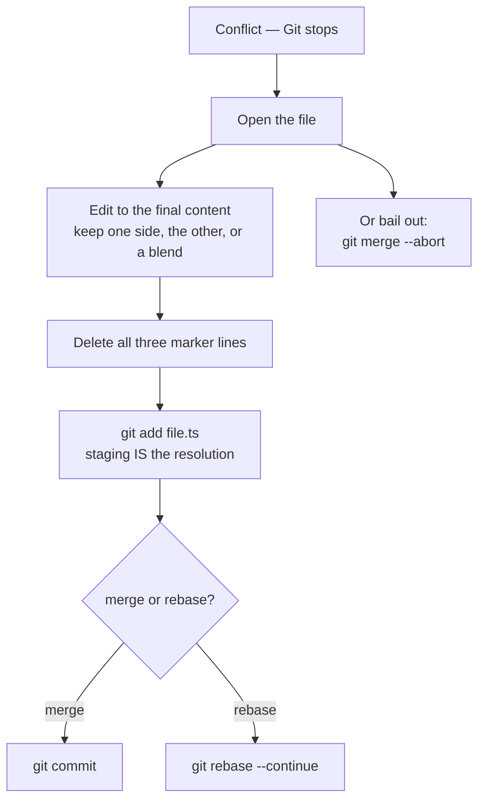

**There is no separate 'resolve' command** — `git add` is how you tell Git the file is settled.

| Command | When |
| --- | --- |
| `git status` | Lists exactly which files are conflicted |
| `git diff` | Shows only the conflicted hunks |
| `git checkout --ours file.ts` | Take your side wholesale |
| `git checkout --theirs file.ts` | Take their side wholesale |
| `git merge --abort` | Back out entirely |
| `git rebase --abort` | Same, for a rebase |

**⚠️ During a rebase, "ours" and "theirs" are swapped** relative to intuition, because rebase replays *your* commits onto *their* base. Check with `git status` rather than trusting the name.
```exercise
conflict-resolution
```


---

# Part 6 — Undoing things

The section everyone needs and nobody remembers. **First ask: what am I undoing, and is it shared yet?**

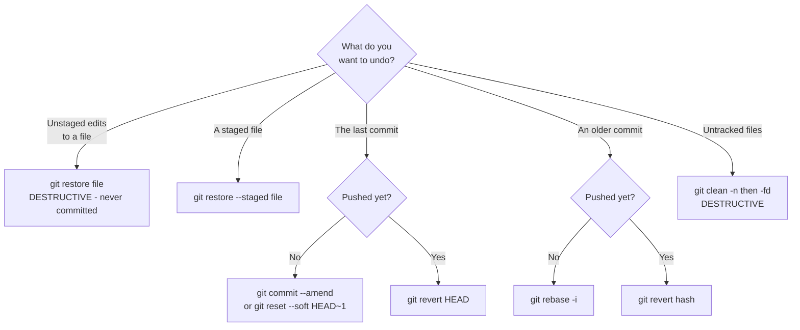

## The three resets

`git reset` moves your branch pointer backwards. The flag decides what happens to the changes:

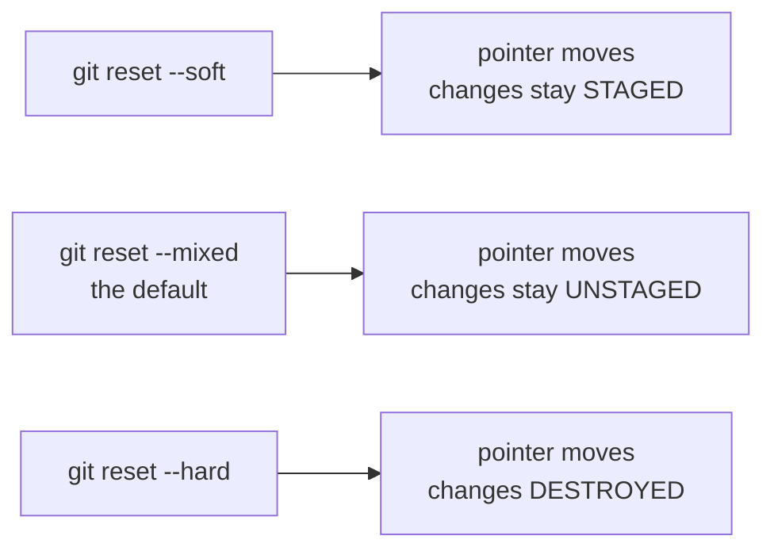

| Flag | Changes end up | Use when |
| --- | --- | --- |
| `--soft` | Staged | Redo the commit; squash the last N into one |
| `--mixed` (default) | Unstaged, on disk | Re-stage things differently; split one commit into two |
| `--hard` | **Gone** ⚠️ | You're certain. The one command that routinely loses work |

`git reset --soft HEAD~3` then a single `git commit` is the quickest way to squash three commits without an interactive rebase.

## reset vs revert — the distinction that matters

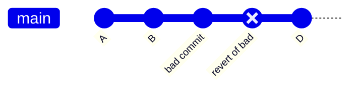

`revert` *adds* a commit that applies the inverse change. Nothing is removed, so everyone else's history stays valid.

| | `git reset` | `git revert` |
| --- | --- | --- |
| How | Deletes the commit from history | Adds a **new** commit undoing it |
| History | Rewritten | Preserved |
| Safe on pushed commits? | **No** | **Yes** |

> **Not pushed → `reset`. Already pushed → `revert`.**

```exercise
reset-vs-revert
```

## `git restore` — file-level undo

```bash
git restore file.ts                    # discard unstaged edits ⚠️ unrecoverable
git restore --staged file.ts           # unstage, keep the edits
git restore --source=HEAD~2 file.ts    # get the version from 2 commits ago
```

**Why unstaged edits are the dangerous case:** they were never committed, so Git has no copy. Everything else is recoverable; this isn't. `git stash` when unsure.

## `git clean` — delete untracked files

```bash
git clean -n     # DRY RUN — always do this first
git clean -fd    # actually delete files (-f) and directories (-d)
git clean -fdx   # also delete gitignored files (node_modules, .env) ⚠️
```

**Always `-n` first.** These files were never in a commit, so there is no reflog, no stash, nothing to recover from.

## `git reflog` — the undo button for your undo button

```bash
git reflog                       # find the hash from before the mistake
git reset --hard a1b2c3d         # go back to it
```

A log of **everywhere HEAD has been**, including commits you "deleted". Entries last ~90 days.

**Reflog is why almost nothing committed is truly lost.** It's local-only, and it cannot recover work that was never committed — that's the real dividing line:

> **Commit-level mistakes are recoverable. Working-tree mistakes are not.**

```exercise
recover-reset-hard
```

---

# Part 7 — Stashing

```bash
git stash                    # shelve all changes, clean working tree
git stash push -m "wip auth" # with a label
git stash -u                 # include untracked files
git stash list               # see the shelf
git stash pop                # apply the newest and REMOVE it from the shelf
git stash apply              # apply but KEEP it on the shelf
git stash show -p            # what's in it?
git stash drop               # delete one
git stash clear              # delete all ⚠️
```

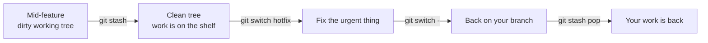

**Plain `git stash` only shelves tracked files** — new files stay behind and follow you onto the other branch, which is usually a nasty surprise. Use `-u`.

**`pop` vs `apply`:** `pop` removes the entry on success (usually what you want — a forgotten stash causes confusion later). `apply` keeps it, for applying the same work to two branches.

---

# Part 8 — Remotes

| Command | When |
| --- | --- |
| `git remote -v` | Which remotes exist and their URLs |
| `git remote add origin <url>` | After `git init`, to connect to GitHub |
| `git remote set-url origin <url>` | The URL changed (HTTPS → SSH) |

`git clone` **already sets up `origin`.** You only run `git remote add` after `git init`.

## fetch vs pull

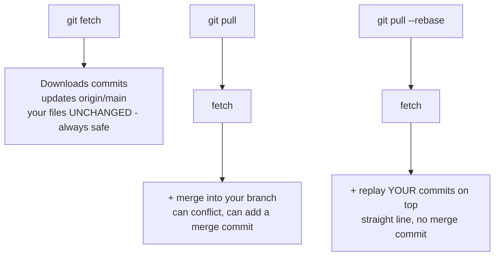

**`git fetch` is always safe.** It updates your knowledge of the remote without touching your work — then `git log origin/main` lets you look before integrating.

Set rebase as your pull default: `git config --global pull.rebase true`.

## push

| Command | When |
| --- | --- |
| `git push` | Branch already tracks a remote |
| `git push -u origin feature` | **First** push of a new branch — `-u` remembers it |
| `git push --force-with-lease` | You rewrote history and must replace the remote |
| `git push --force` | ⚠️ Same, but ignores whether someone else pushed |
| `git push --tags` | Tags aren't pushed by default |
| `git push origin --delete feature` | Delete a remote branch |

### `--force-with-lease`, not `--force`

| | Behaviour |
| --- | --- |
| `--force` | "Replace it, no questions." Silently destroys anyone else's commits |
| `--force-with-lease` | "Replace it, **only if nothing changed since I last fetched**." Aborts otherwise |

A compare-and-swap instead of a blind write. It costs nothing and it's the habit you want before the day it matters.
```exercise
force-with-lease
```


> **Caveat:** the lease compares your remote-*tracking* ref, which a background fetch (including your IDE's) can silently update. The airtight form names the hash: `--force-with-lease=main:<hash>`.

---

# Part 9 — Reading history

| Command | When |
| --- | --- |
| `git log --oneline` | One line per commit — the everyday form |
| `git log --oneline --graph --all` | ASCII branch diagram |
| `git log -p` | With the actual diffs |
| `git log --stat` | With file/line counts |
| `git log -- file.ts` | Only commits touching that file |
| `git log --grep "auth"` | Search commit **messages** |
| `git log -S "functionName"` | Search commits that **added or removed that string** |
| `git log --author "Ayoub"` | By author |
| `git log main..feature` | Commits on feature, not on main |
| `git shortlog -sn` | Commit count per author |

**`git log -S` is the underrated one.** "When did this function get deleted?" — `--grep` searches messages and won't help if nobody named it; `-S` (the "pickaxe") searches *content* and finds the exact commit.

```bash
git show a1b2c3d           # everything about one commit
git show a1b2c3d:file.ts   # that file, as it was then — read-only
git blame file.ts          # who last touched each line, and in which commit
git blame -L 10,20 file.ts # just lines 10–20
```

**Blame is not for assigning fault** — it's for finding the *commit*, so you can read its message and learn why the line exists.

## `git bisect` — binary-search for the breaking commit

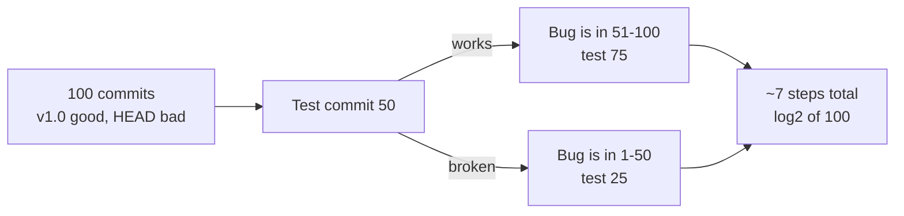

```bash
git bisect start
git bisect bad             # current version is broken
git bisect good v1.0       # this old version worked
# Git checks out a commit in the middle. Test it, then:
git bisect good   # or: git bisect bad
# repeat — Git halves the range each time
git bisect reset           # done
```

**It only works if you have many small commits.** One giant commit gives it nothing to search — a concrete reason to commit in slices.
```exercise
find-the-breakage
```

```exercise
find-deleted-code
```


---

# Part 10 — Moving commits around

## `git cherry-pick`

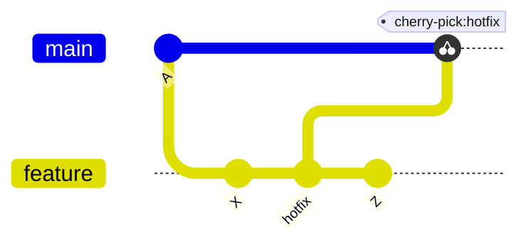

```bash
git cherry-pick a1b2c3d          # copy one commit onto the current branch
git cherry-pick a1b2c3d..f4e5d6c # a range
```

**When:** a bug fix on `feature` is needed on `main` right now, without the rest of the branch. Overuse duplicates work across branches and makes later merges conflict — treat it as an exception, not a workflow.

## `git tag`

```bash
git tag v1.0.0                       # lightweight — just a name
git tag -a v1.0.0 -m "First release" # annotated — author, date, message
git push --tags                      # tags are NOT pushed by default
git tag -d v1.0.0                    # delete locally
```

Use `-a` for anything real. A lightweight tag records no author or message — exactly the metadata you'll want months later.

---

# Part 11 — Files and .gitignore

| Command | When |
| --- | --- |
| `git rm file.ts` | Delete the file **and** stop tracking it |
| `git rm --cached file.ts` | **Stop tracking, keep on disk** |
| `git mv old.ts new.ts` | Rename |
| `git ls-files` | Every file Git is tracking |
| `git check-ignore -v file` | Which ignore rule is hiding this file? |

### The rule everyone learns the hard way

> **`.gitignore` only affects files Git isn't already tracking.**

Adding `.env` to `.gitignore` does nothing if `.env` was already committed — Git keeps updating it forever. Untrack it:

```bash
git rm --cached .env
```

**And if a secret was ever committed: rotate the credential first.** It's in the history permanently; `.gitignore` doesn't remove it, and if it was pushed publicly, assume it was scraped within minutes. Cleaning history is cleanup, not remediation.

---

# Part 12 — Pull requests

A PR is where your code meets the team. What makes one good:

- **Small and focused.** One logical change. A 40-file PR gets a rubber-stamp; a 3-file PR gets a real review. Keep unrelated refactors separate.
- **A clear description.** What changed and *why* — the diff shows the what, never the why.
- **Green CI before you ask.** Passing tests and lint respect the reviewer's time.
- **A readable commit history.** Squash the "fix typo" noise before review.

When a reviewer comments, treat it as **collaboration, not criticism**: address or reply to each thread (fix it, or explain why not), push follow-up commits so the discussion stays reviewable, then re-request review. Don't silently force-push away the context they commented on, and don't argue every point to exhaustion. Reviewing and being reviewed well is the actual teamwork skill an internship is testing.

---

# Part 13 — After the merge: syncing and deleting branches

The single most common way a beginner *thinks* they've lost work is here — in the five minutes after a PR is merged. Almost always, nothing is lost. What's missing is a mental model of **which repository you're talking to.**

## Two repos, two `main`s

When you clone, you don't get a live window into GitHub. You get a **complete, independent copy**. From then on there are two histories that only touch when you explicitly tell them to.

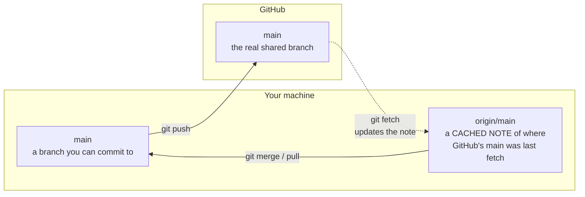

| Ref | What it actually is | Who moves it |
| --- | --- | --- |
| `main` | Your local branch | You — commit, merge, pull, reset |
| `origin/main` | Your **cached note** of GitHub's `main` | Only `git fetch` (and `pull`, which fetches) |
| GitHub's `main` | The shared truth | Your `push`, or a PR merge on the website |

> **`origin/main` is not GitHub.** It's a sticky note saying *"last time I looked, GitHub's main was at this commit."* It can be hours stale and Git will never warn you. `git fetch` is how you look again.

## Merging a PR happens on GitHub's copy

This is the step that catches everyone. You click **Merge pull request** in the browser — and your machine learns nothing.

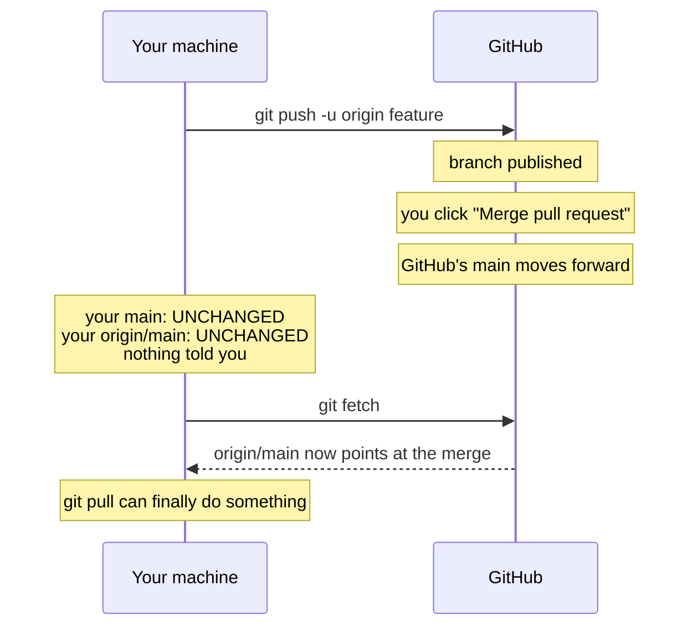

So when you run `git pull` **before** merging the PR, it correctly does nothing — there is nothing on GitHub to pull yet. `main` stays where it was, your feature files aren't on disk (you're standing on a commit that predates them), and it looks exactly like the work evaporated.

It didn't. You're on the wrong branch, one commit away.

## The correct order

```bash
# 0. PRE-FLIGHT — did the merge actually happen?
git fetch
git log --oneline origin/main -1     # is your commit at the top?
```

**If your commit isn't there, stop.** The merge hasn't happened and the next three commands have nothing to do.

```bash
# 1. Merge the PR on GitHub          ← in the browser
# 2. Then sync and clean up:
git switch main
git pull                             # local main catches up
git branch -d feature-name           # delete the local label
git push origin --delete feature-name  # and the remote one (or GitHub's button)
```

The pre-flight check is the whole lesson. **Never run cleanup commands on faith that a remote action succeeded.** Ten seconds of `git fetch && git log` replaces an hour of panic.
```exercise
post-merge-sync
```


## What `git branch -d` actually checks

"`-d` is the safe one, it refuses if unmerged" is the folk wisdom — and it's imprecise in a way that will surprise you. Here's Git's real rule, from the manual:

> The branch must be fully merged in its **upstream** branch, or in **HEAD** if no upstream was set.

Note what's absent: **`main` is not mentioned.** `-d` does not care whether you merged into `main`. It cares whether the commits exist *somewhere else that isn't about to disappear.*

Verified, on a scratch repo:

```console
$ git branch -d unpushed                        # never pushed, no upstream
error: the branch 'unpushed' is not fully merged.
If you are sure you want to delete it, run 'git branch -D unpushed'

$ git branch -d pushed                          # pushed, upstream set
warning: deleting branch 'pushed' that has been merged to
         'refs/remotes/origin/pushed', but not yet merged to HEAD
Deleted branch pushed (was 282d9c8).
```

The second branch was **not** merged into `main` — and `-d` deleted it anyway, with a warning that spells out exactly why: the commits are safe on the remote, so throwing away the local label loses nothing.

| | Rule | Use when |
| --- | --- | --- |
| `git branch -d` | Refuses unless merged into **upstream or HEAD** | Always. Let it be the judge |
| `git branch -D` | Deletes unconditionally | You're certain the work is disposable |
```exercise
branch-d-rule
```


**`-d` protects commits, not branch names.** It guarantees you won't strand a commit with no way back. It makes no promise that you'll still have a branch you wanted to keep working on.

## Branch names are sticky notes

This is the idea that dissolves the whole category of panic.

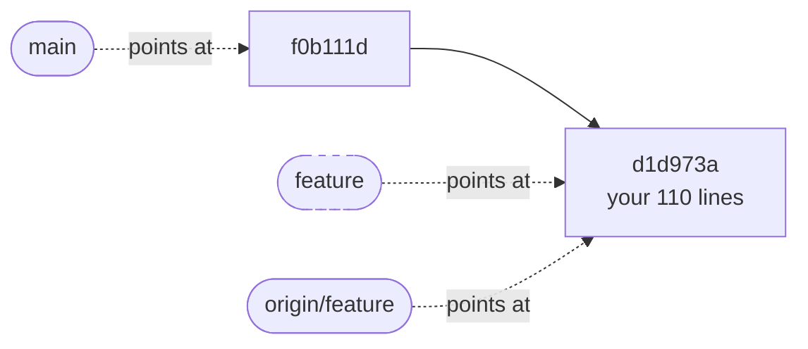

A branch is a **41-byte file containing a commit hash.** That's the entire implementation — look at `.git/refs/heads/` and you'll see them.

Deleting `feature` removes one sticky note. Commit `d1d973a` is untouched: it's still in `.git/objects/`, still pointed at by `origin/feature`, still findable in the reflog. **You cannot lose a commit by deleting a branch** — you can only lose the convenient name you were using to reach it.

## Recovering a deleted branch — three routes

**If it was pushed** (the common case), one command:

```bash
git switch feature-name
```

No `-b`, no flags. Git finds no local branch by that name, sees exactly **one** remote that has it, and recreates the local branch tracking it. That's "DWIM" — it only works when the name is unambiguous across remotes; with two remotes carrying it, Git refuses and you name one:

```bash
git switch -c feature-name origin/feature-name
```

**If it was never pushed**, the reflog remembers every commit HEAD ever pointed at:

```bash
git reflog                                   # find the hash
git switch -c feature-name <hash>
```

**If you don't know where it went**, ask which refs contain it:

```bash
git branch -a --contains <hash>    # every local + remote branch holding this commit
git log --oneline --graph --all    # the whole picture, all refs at once
```

## "I think I lost my work" — the diagnosis table

Run `git status -sb` and `git log --oneline --all` first. Then:

| Symptom | What's actually true | Fix |
| --- | --- | --- |
| Files gone after `switch main` | You're on a commit that predates them | `git switch <branch>` |
| Branch missing after `branch -d` | Its commits are on the remote | `git switch <name>` (DWIM) |
| `git pull` "did nothing" | The PR wasn't merged yet | Merge it, then pull |
| `main` behind after merging a PR | You haven't fetched since | `git pull` |
| Commits vanished after `reset --hard` | Still in the object store | `git reflog`, then `git reset --hard <hash>` |
| Uncommitted edits gone | **Genuinely lost** — Git never had a copy | None. This is why you commit often |

Only the last row is real loss. **Everything Git has ever committed is recoverable**; only the working tree is fragile. That asymmetry is the argument for committing early and often, even messily — you can always tidy history later with `rebase -i`, but you cannot recover a file Git never saw.

---

# Part 14 — Setup and config

| Command | When |
| --- | --- |
| `git config --global user.name "Your Name"` | First install |
| `git config --global user.email "you@example.com"` | First install — appears in every commit |
| `git config --global init.defaultBranch main` | Stop new repos defaulting to `master` |
| `git config --global pull.rebase true` | Prefer rebase over merge on pull |
| `git config --list` | See everything currently set |
| `git config user.email "work@company.com"` | **Without `--global`** — this repo only |

```bash
git config --global alias.st status
git config --global alias.lg "log --oneline --graph --all"
```

**When to add an alias:** after you've typed the same long command three times.

---

# Part 15 — Cheat sheet: "I want to…"

| Situation | Command |
| --- | --- |
| See what changed | `git status` then `git diff` |
| See what I'm about to commit | `git diff --staged` |
| Stage part of a file | `git add -p` |
| Fix the message of the last commit | `git commit --amend` |
| Forgot a file in the last commit | `git add f && git commit --amend --no-edit` |
| Unstage a file, keep edits | `git restore --staged file` |
| Undo last commit, keep work staged | `git reset --soft HEAD~1` |
| Undo a **pushed** commit | `git revert <hash>` |
| Throw away my local mess | `git restore .` ⚠️ |
| Switch branches with dirty files | `git stash -u` → switch → `git stash pop` |
| Update my branch with main | `git rebase main` (private) / `git merge main` (shared) |
| Combine my last 3 commits | `git rebase -i HEAD~3`, mark two as `squash` |
| Copy one commit to another branch | `git cherry-pick <hash>` |
| Find what broke it | `git bisect` |
| Find who wrote this line and why | `git blame` then `git show <hash>` |
| Find when a function disappeared | `git log -S "functionName"` |
| I destroyed something | `git reflog` |
| Push a rewritten branch | `git push --force-with-lease` |
| Stop tracking a committed file | `git rm --cached <file>` |
| Why is my file ignored? | `git check-ignore -v <file>` |
| Did my PR actually merge? | `git fetch && git log --oneline origin/main -1` |
| I deleted a branch I still needed | `git switch <name>` — recreates it from the remote |
| My `main` is behind after a PR merge | `git switch main && git pull` |

---

# Part 16 — The dangerous commands

Everything else in Git is recoverable. These lose work.

| Command | Risk | Safety net |
| --- | --- | --- |
| `git reset --hard` | Destroys uncommitted changes | `git stash` first; `git reflog` for commits |
| `git clean -fd` | Deletes untracked files permanently | **Always `git clean -n` first** |
| `git restore <file>` | Discards unstaged edits | `git stash` if unsure |
| `git push --force` | Destroys others' commits on the remote | Use `--force-with-lease` |
| `git branch -D` | Deletes an unmerged branch | `git reflog` usually still has it. Prefer `-d`, which refuses unless the commits are safe in the **upstream or HEAD** — see Part 13 |
| `git stash clear` | Deletes all stashes | None. Use `git stash drop` on one |
| `git rebase` on shared branches | Breaks everyone else's history | The golden rule: never |

**The pattern:** anything touching the **working tree** is genuinely dangerous, because Git never had a copy. Anything touching **commits** is usually recoverable via `git reflog`.
```exercise
lost-work-triage
```


---

## Mastery checklist — you can…

- [ ] Name the four places code lives and which command moves between each
- [ ] Read `git status --short`, including what `MM` means
- [ ] Use `git add -p` to split one file's changes into two commits
- [ ] Say why `git diff` shows nothing after `git add`, and what to run instead
- [ ] Explain why `git commit -am` silently skips a new file
- [ ] Draw what merge leaves behind vs what rebase leaves behind
- [ ] State the golden rule of rebase and why it exists
- [ ] Resolve a conflict, and explain why `git add` is the resolution
- [ ] Pick `--soft` / `--mixed` / `--hard` from a description
- [ ] Choose `reset` vs `revert` based on whether the commit was pushed
- [ ] Recover a commit destroyed by `reset --hard` using `reflog`
- [ ] Say which mistakes `reflog` can **not** recover, and why
- [ ] Squash three messy commits with `rebase -i`
- [ ] Find the breaking commit with `bisect`, and say why it needs small commits
- [ ] Find when a line was deleted using `log -S`
- [ ] Explain why `.gitignore` doesn't untrack an already-committed file
- [ ] Explain why `--force-with-lease` beats `--force`
- [ ] Open a small, well-described PR and respond to review like a teammate
- [ ] Explain why `origin/main` can be stale, and which single command updates it
- [ ] Say why `git pull` does nothing when you run it before merging the PR
- [ ] State what `git branch -d` actually checks — and why it isn't `main`
- [ ] Recover a deleted branch that was pushed, in one command
- [ ] Name the only category of work Git genuinely cannot recover
