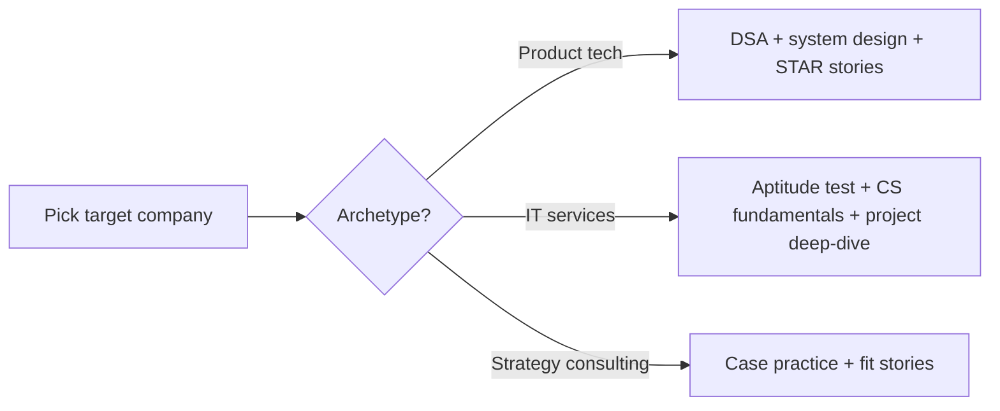

# Big-Company Interview Playbook

A Dojo guide. Amazon, Deloitte, BCG, and Capgemini do **not** run the same interview — preparing for
"big companies" as one blob wastes effort. This playbook maps each company *archetype* to its actual
pipeline, tells you which Dojo tool drills each stage, and ends with the aptitude formula sheet and
the guide to presenting **CodeArena itself** — your strongest interview asset.

> How to use it: find your target's archetype, read that section, then practice its stages with the
> matching Dojo tools — [Aptitude & Reasoning](/practice/aptitude) and
> [CS Fundamentals](/practice/cs-fundamentals) drills, and the [DSA problem sets](/dsa).

## The three archetypes

| Archetype | Companies | What they actually test |
|---|---|---|
| **Product tech** | Amazon, Google, Meta, Microsoft, Uber | DSA coding rounds, system design, structured behavioral (STAR) |
| **IT services & consulting** | Deloitte, Capgemini, Accenture, TCS, Infosys, Cognizant, EY/KPMG/PwC tech | Online aptitude test → CS fundamentals + your project → HR/fit |
| **Strategy consulting (+ tech arms)** | BCG, McKinsey, Bain — and BCG X, McKinsey Digital, Bain Vector | Case interviews (+ coding/architecture for the tech arms) |

## Amazon (and product tech generally)

**Pipeline.** Online assessment (OA — an automated coding test you take from home: 2 DSA problems +
a work-style survey) → 1 phone screen → "the Loop":
4–5 back-to-back interviews, each pairing a technical exercise with behavioral questions. One
interviewer is the **Bar Raiser** — a veteran from another team with veto power, hunting for
long-term signal, not checklist answers.

**The technical bar.** OA and phone-screen problems are "LeetCode-medium" (LeetCode is the standard
practice site; "medium" is its middle difficulty tier — not easy, not brutal): exactly the Dojo's DSA
track. Arrays & Hashing, Two Pointers, Sliding Window, Trees, BFS/DFS, and Heap dominate Amazon's
actual question pool. Senior loops add a system-design round (drill the
[System Design guide](/guides/system-design-fundamentals) + the
[System Design drills](/practice/system-design-drills)) and
sometimes low-level object-oriented design ("design a parking lot / locker system").

**The behavioral bar — half your loop.** Amazon interviews are built around the 16 **Leadership
Principles**. The ones that generate the most questions:

- **Customer Obsession** — "Tell me about a time you went above and beyond for a user."
- **Ownership** — "Tell me about a time you took on something outside your responsibility."
- **Dive Deep** — "Walk me through the hardest bug you've debugged."
- **Bias for Action** / **Deliver Results** — deadlines, trade-offs, shipping.
- **Earn Trust** / **Have Backbone; Disagree and Commit** — conflict, feedback, being wrong.
- **Invent and Simplify** — a time you replaced complexity with something simpler.
- **Learn and Be Curious** — CodeArena *is* this answer.

**Answer in STAR** — Situation (2 sentences of context), Task (your responsibility), Action (what
*you* did — "I", never "we", with specifics), Result (quantified: numbers, time saved, bugs
prevented, users served). Interviewers probe: "What would you do differently?", "What was the
hardest part?", "What did your teammate think?". A story you can't survive three follow-ups on is a
story you don't own.

**Prepare a story bank, not scripts:** 8–10 real situations, each tagged with the 2–3 principles it
can serve. Mine CodeArena for at least half of them (see the last section). Then rehearse each one
out loud, against a timer, until follow-ups stop surprising you.

## Deloitte, Capgemini, Accenture (IT services)

**Pipeline.** Online aptitude + technical MCQ test (the real filter — most candidates die here) →
technical interview (CS fundamentals + a walk through *your project*) → HR/fit round. Coding, when
present, is one or two easy problems — your DSA track covers it several times over.

**Stage 1 — the aptitude test.** Timed (usually under a minute per question), covering quantitative
aptitude (percentages, profit & loss, ratios, time & work, speed & distance, interest, averages,
permutations, probability), logical reasoning (series, odd-one-out, syllogisms), and verbal
ability. Speed comes from having the formula sheet (below) internalized — drill
[Aptitude & Reasoning](/practice/aptitude) daily; the generators produce fresh numbers every
attempt, like the real test.

**Stage 2 — the technical interview.** Rapid-fire fundamentals: process vs thread, deadlock, paging,
TCP vs UDP, what happens when you type a URL, primary vs foreign keys, normalization, SQL vs NoSQL,
OOP pillars, SOLID. Depth expected is definition + one concrete example + one trade-off. Drill
[CS Fundamentals](/practice/cs-fundamentals) and the [SQL topic](/practice/sql-data). Then: "tell
me about your project" — see the CodeArena section; for services firms this is often 50% of the
interview and where offers are actually won.

**Stage 3 — HR.** "Why Deloitte/Capgemini?", relocation, salary, a light behavioral pass. Have a
2-sentence company-specific answer (a practice area, a client story, a technology bet of theirs)
and reuse two STAR stories.

## BCG, McKinsey, Bain (and their tech arms)

**Generalist track = case interviews.** A business problem solved out loud in 30–40 minutes:
"A retailer's profits fell 20% — diagnose it." Structure beats brilliance:

1. **Clarify** the objective (metric, timeframe, scope) with 2–3 questions.
2. **Structure**: state a framework *tree* — e.g. Profit = Revenue (price × volume, mix) − Costs
   (fixed, variable) — and say which branch you'll explore first and why.
3. **Analyze**: they feed you data (tables, charts) as you ask; do arithmetic OUT LOUD and cleanly
   (the aptitude drills sharpen exactly this mental math).
4. **Synthesize**: "My recommendation is X, driven by A and B; risks are C; next I'd verify D."

Market-sizing warm-ups ("How many coffees does Paris drink daily?") reward stated assumptions ×
clean segmentation × round numbers. Practice by working prompts out loud against a timer, stating
every assumption before you compute it.

**Tech track (BCG X, McKinsey Digital).** Case-lite + real technical: a coding exercise (Dojo DSA
easy/medium), an architecture discussion (system-design guide), and product sense ("How would you
build a rating system?" — you *literally built one*; tell that story).

**Fit questions** at all three: "Why consulting?", "Lead a team through ambiguity" — same STAR bank
as Amazon, delivered more top-down: answer first, then evidence.

## Aptitude formula sheet

Internalize these — the test rewards recall speed, not derivation:

- **Percentages.** ±a% then ±b% ⇒ net = a + b + ab/100 (signs included). Successive discounts
  multiply: ×(1−a/100)(1−b/100).
- **Profit & loss.** Profit% = (SP − CP)/CP × 100 — the base is always **cost** price unless stated.
- **Ratios.** Split T in a : b : c ⇒ shares are T·a/(a+b+c), etc.
- **Time & work.** Rates add: A in x days + B in y days ⇒ together xy/(x+y) days. Think "work per
  day", never "days".
- **Speed & distance.** Average speed over equal distances = 2ab/(a+b) (harmonic, NOT (a+b)/2).
  Trains: relative speed = sum (opposite directions) or difference (same); time to cross = total
  length ÷ relative speed. km/h → m/s: × 5/18.
- **Interest.** SI = P·r·t/100. CI (2 yrs) = P(1 + r/100)² − P; CI − SI (2 yrs) = P(r/100)².
- **Averages.** n consecutive integers: the middle one. Replacing x by y in a group of n shifts the
  average by (y − x)/n.
- **Counting.** nPr = n!/(n−r)! (order matters), nCr = n!/(r!(n−r)!) (order doesn't). Arrangements
  of n distinct items: n!.
- **Probability.** favourable/total. Two dice: 36 outcomes; sum s has 6 − |s − 7| ways.

## Presenting CodeArena — your project deep-dive

Every archetype ends up asking about your project; services firms practically hire on it. Prepare
three altitudes:

**The 30-second pitch.** "I'm building CodeArena, a competitive-programming platform: users solve
problems in a sandboxed judge, get rated with Glicko-2, and a recommendation engine schedules what
they practice next. NestJS/Next.js/Postgres/Redis monorepo — I built it phase by phase to learn
production engineering, not just to ship features."

**The architecture story (2–3 min, whiteboardable).** Client → API (NestJS, hexagonal) → Postgres +
Redis; async judge workers consuming a BullMQ queue; WebSockets for live contest leaderboards
(CQRS projection). Practice drawing it in under a minute.

**Three "hard problem" deep-dives** — pick the ones you've actually built, one per interview theme:

- *Security*: running untrusted code — container isolation, namespaces/seccomp, resource limits,
  and the threat model that drove them (Phase 2).
- *Math/data*: rating with Glicko-2 and scheduling reviews with FSRS — why Elo wasn't enough,
  how uncertainty is modeled (Phase 3).
- *Scale/consistency*: a live leaderboard under write pressure — CQRS, Redis sorted sets,
  eventual consistency trade-offs (Phase 5).

For each: the problem → 2 options you considered → what you chose and why → a number (latency,
throughput, test count). "I considered X and Y, chose Y because Z" is the sentence that separates
builders from tutorial-followers.

## Readiness checklist

You're ready when you can:

- Solve a random unseen problem from the first 10 DSA categories in under 25 minutes, narrating.
- Score 80%+ on mixed [Aptitude](/practice/aptitude) sessions at ~1 minute per question.
- Answer any [CS Fundamentals](/practice/cs-fundamentals) drill with definition + example +
  trade-off, out loud.
- Tell 8 STAR stories (≥4 from CodeArena), each surviving three follow-up probes.
- Draw CodeArena's architecture in 60 seconds and go deep on all three hard-problem stories.
- Structure a profitability case to a recommendation in 30 minutes in the case mock.
