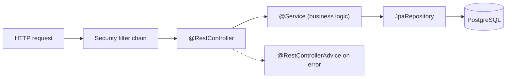

# Java & Spring Boot — the enterprise bridge for a TypeScript developer

A Dojo supplement guide. **Java** is the language, **Spring Boot** is the most popular framework for
building web servers in it — and together they're the widest door into Morocco's enterprise market
(Capgemini, SG ATS, CGI, Inetum, IBM, SQLI all screen for it). Good news: if you've done the NestJS
phase, you already know the *shape* of Spring, because NestJS deliberately copied it. You're learning a
**dialect, not a new world.**

We assume **no Java background.** Every Java/Spring word gets a plain meaning the first time it appears.
If you *also* know NestJS, the "you know" columns are a bonus lens; if you don't yet, ignore them — the
plain explanations stand on their own. Endgame: one small **bridge service** beside CodeArena you can
build, test, and defend in an interview.

> A few words we'll reuse, defined once (they're the same in NestJS and Spring):
> **Dependency Injection (DI)** = instead of a class building the helpers it needs, the framework
> *hands* them in — so you can swap a real database for a fake one in tests. **Controller** = the class
> that receives web requests. **Service** = the class with your business logic. **Repository** = the
> class that talks to the database. **DTO** ("Data Transfer Object") = a plain shape for data crossing
> the boundary (the JSON in/out). **Entity** = a class mapped to a database table.


---

## ⌨️ This guide is interactive

**Eight exercises are embedded below**, written for someone arriving from NestJS: each names the
concept you already own, then Spring's word for it.

The genuinely new material is the **persistence context** — an entity that saves itself with no
`save()` call, and silently saves nothing when you forget `@Transactional`. Two exercises cover it,
because it is the biggest conceptual jump from Prisma.
## 1. The mental model: you already know Spring

Spring is built from the same parts as NestJS, under different names. Skim this map; the rest of the
guide fills in each row:

| You know (NestJS/TS) | Java/Spring equivalent | In plain words |
|---|---|---|
| `@Injectable()` service | `@Service` / `@Component` **bean** | A "bean" is just an object Spring creates and manages for you. The manager is called the *ApplicationContext* (the DI container). |
| `@Module()` wiring | Component scanning + `@Configuration` | Spring auto-discovers your beans by scanning your packages — no module files to write. |
| `@Controller()` + decorators | `@RestController` + `@GetMapping`… | Almost identical. ("Annotations" are Java's word for decorators — the `@Thing` tags.) |
| Constructor injection | Constructor injection | The preferred style in both. (Field `@Autowired` is the old style interviewers ask you to *criticize*.) |
| Pipes + `class-validator` | Bean Validation (`@Valid`, `jakarta.validation`) | Put `@NotBlank`, `@Size`, `@Email` on DTO fields; the framework checks them. |
| Exception filters | `@RestControllerAdvice` + `@ExceptionHandler` | One class turns your errors into HTTP responses. |
| Guards / middleware | Spring Security filter chain | Gatekeeper code that runs *before* your controller. |
| Interceptors | AOP aspects / `HandlerInterceptor` | "Wrap extra behavior around methods" (logging, timing). |
| Prisma | Spring Data JPA (Hibernate) | Turns Java objects into SQL. (More below.) |
| `npm`/`pnpm` + `package.json` | Maven (`pom.xml`) or Gradle | The tool that downloads libraries and builds your app. |
| `main.ts` bootstrap | `@SpringBootApplication` + `main()` | One annotation switches the whole framework on. |



Read the diagram as the life of one request: it enters, passes the **security gate**, hits your
**controller**, which calls a **service** (your logic), which calls a **repository** (the database),
and if anything throws, the **advice** turns it into a clean error response. That's a Spring app.


```exercise
nest-to-spring
```

## 2. Java for the TypeScript brain

First, the runtime words interviewers love, in one breath. You write Java source → the compiler turns
it into **bytecode** (a portable half-compiled form) → the **JVM** ("Java Virtual Machine") runs that
bytecode on any operating system. The JVM **JIT-compiles** hot code to native speed as it runs, and a
**garbage collector (GC)** automatically frees memory you're no longer using (so you never `free()`
manually — but know the words *heap*, *stack*, *GC* for interviews; they're in
[CS Fundamentals §2](/guides/cs-fundamentals)).

Two structural facts: Java is **nominally typed** (a type is its *declared name*, not just its shape —
so a class must literally say `implements Shape`, unlike TypeScript where matching shape is enough), and
**everything lives inside a class** (no loose top-level functions).

| TypeScript | Java | Watch out |
|---|---|---|
| `string`, `number`, `boolean` | `String`, `int`/`long`/`double`, `boolean` | Java has two flavors of number: fast **primitives** (`int`) and object **wrappers** (`Integer`). Collections only hold the object kind — "boxing" converts between them. |
| `const x = …` | `final var x = …` | `var` infers the type of locals (Java 10+); `final` means "can't be reassigned." |
| `interface Shape { area(): number }` | `interface Shape { double area(); }` | A class must *declare* `implements Shape`; matching methods by accident isn't enough (nominal typing). |
| `type User = {name: string}` | `record User(String name) {}` | A **record** is a short, immutable data holder — you get `equals`/`hashCode`/`toString` for free. |
| `x?.y ?? z` | `Optional<T>`, or explicit null checks | Java has no `undefined`, but `null` exists — dereferencing it throws the infamous `NullPointerException`. `Optional` is a box that may or may not hold a value. |
| `Array<T>`, `Map<K,V>` | `List<T>`, `Map<K,V>` | "Program to the interface": `List<User> u = new ArrayList<>();` (declare the general type, build the specific one). |
| `throw` anything | Checked vs unchecked exceptions | **Checked** exceptions (`IOException`) *must* be declared or caught — the compiler forces you. **Unchecked** (`RuntimeException`) need not be. |
| `===` | `==` compares **references**, not contents! | For objects, **always use `.equals()`** to compare contents. `==` only asks "is it the literally same object?" — the #1 Java interview trap. |
| Template literals | `String.format`, text blocks `"""` | Strings are **immutable** (never change in place) and reused from a shared "string pool." |

Two idioms to burn in early:

```java
// == vs .equals() : the classic trap
String a = new String("hello");   // forced to be a brand-new object
String b = "hello";               // comes from the shared pool
a == b;        // false — different objects in memory
a.equals(b);   // true  — same characters inside

// Maps of lists, the clean way (computeIfAbsent = "get it, or create it if missing")
Map<String, List<Integer>> scores = new HashMap<>();
scores.computeIfAbsent("amani", k -> new ArrayList<>()).add(95);
```


```exercise
java-optional
```

## 3. Collections you must know cold

**Collections** are Java's built-in data structures (see [DSA Patterns §0](/guides/dsa-patterns) for
what each *is*). Know these six and their speeds:

| Structure | It's a… | Get | Insert | Contains | Interview hook |
|---|---|---|---|---|---|
| `ArrayList` | resizable array | O(1) | O(1) amortized | O(n) | Almost always beats `LinkedList` (memory is contiguous → cache-friendly). |
| `HashMap` | key→value store | O(1) avg | O(1) avg | O(1) avg | Uses "buckets"; after ~8 keys collide in one bucket it upgrades that bucket to a **red-black tree** (a balanced tree) so the worst case is O(log n), not O(n). Java 8+. |
| `HashSet` | a set of keys | — | O(1) | O(1) | For removing duplicates. (It's a `HashMap` underneath.) |
| `TreeMap` | sorted key→value | O(log n) | O(log n) | O(log n) | Keeps keys in sorted order → range queries. |
| `ArrayDeque` | double-ended queue | — | O(1) both ends | — | Use this for stacks *and* queues (the old `Stack` class is legacy — avoid). |
| `PriorityQueue` | a heap | peek O(1) | O(log n) | — | Your Dojo "heap" pattern, built in. |

**The `equals`/`hashCode` contract** (a favorite question): any object you use as a `HashMap` *key* must
implement both methods consistently — *equal objects must return equal hash codes* — or the map loses
your entries. Records implement both for free; say that in interviews.

## 4. Streams: your array methods, Java-flavored

A **Stream** is Java's version of chaining `.map()`/`.filter()` over a list. You start a stream, chain
some *lazy* steps, and finish with one *terminal* step that actually runs it:

```java
List<String> names = users.stream()
    .filter(u -> u.age() >= 18)          // like .filter(u => …)
    .sorted(Comparator.comparing(User::name))
    .map(User::name)                     // like .map(u => u.name)
    .toList();                           // terminal step: run it, collect results

// Group and count, in one pass:
Map<String, Long> byCity = users.stream()
    .collect(Collectors.groupingBy(User::city, Collectors.counting()));
```

`User::name` is a **method reference** — shorthand for `u -> u.name()`. The intermediate steps
(`filter`, `map`) are *lazy* (they do nothing until the terminal step). One rule of taste: **don't
over-stream in interviews** — a plain `for` loop you can explain beats a clever pipeline you can't.


```exercise
streams
```

## 5. Project setup: Maven and Spring Initializr

**Maven** is the build tool (Java's `npm`), and its `pom.xml` is your `package.json` — it lists your
libraries and defines build steps. Generate a ready project at [start.spring.io](https://start.spring.io):
choose Maven, Java 21 or 25 (both long-term-support releases), the current Spring Boot (4.x since November 2025; 3.x is what most existing codebases still run, and the concepts here are the same), and add the starter dependencies **Spring Web, Spring Data JPA,
Validation, PostgreSQL Driver, Spring Security, Springdoc OpenAPI** (a "starter" bundles everything one
feature needs). Key commands (the `./mvnw` is the "Maven wrapper" — a bundled Maven so teammates don't
need it pre-installed):

```bash
./mvnw spring-boot:run     # = pnpm dev  (start the server)
./mvnw test                # = pnpm test
./mvnw package             # build one runnable .jar file
```

Layout convention: group files **by feature, not by type** — `com.codearena.bridge.contest/` holds that
feature's controller, service, repository, and entity together (the same bounded-context instinct as a
NestJS module). ("Packages" are Java's folders/namespaces.)

## 6. REST with Spring Boot

A **REST endpoint** is one URL your server answers. Here's a controller — read the annotations as labels
Spring reads to wire everything:

```java
@RestController                              // "this class handles web requests, replies with JSON"
@RequestMapping("/api/contests")             // every route below starts with this path
class ContestController {
  private final ContestService service;      // the service is injected (handed in) below
  ContestController(ContestService service) { this.service = service; }   // constructor injection

  @GetMapping("/{id}")                        // GET /api/contests/{id}
  ContestDto find(@PathVariable long id) { return service.find(id); }     // {id} → the id argument

  @PostMapping
  @ResponseStatus(HttpStatus.CREATED)         // reply 201 on success
  ContestDto create(@Valid @RequestBody CreateContestDto dto) { return service.create(dto); }
}

record CreateContestDto(                       // the expected JSON body, with validation rules on it
  @NotBlank @Size(max = 120) String name,      // must be non-empty, ≤ 120 chars
  @Future Instant startsAt                     // must be a future date
) {}
```

`@Valid` tells Spring to check those rules and auto-reject bad input with a 400 before your method even
runs. Turning errors into responses (the "exception filter" idea):

```java
@RestControllerAdvice                          // one class that catches errors app-wide
class ApiErrors {
  @ExceptionHandler(ContestNotFound.class)     // when this exception is thrown anywhere…
  ResponseEntity<ProblemDetail> notFound(ContestNotFound e) {
    return ResponseEntity.status(404)          // …reply with a clean 404
        .body(ProblemDetail.forStatusAndDetail(HttpStatus.NOT_FOUND, e.getMessage()));
  }
}
```


```exercise
spring-controller
```

## 7. Data with Spring Data JPA

**JPA** ("Java Persistence API") is the standard for mapping Java objects to database rows;
**Hibernate** is the engine that implements it. Where Prisma generates a client from a schema file, JPA
works the opposite way: you annotate **entity** classes (each = one table) and declare **repository**
*interfaces*, and Spring *writes the SQL for you*:

```java
@Entity                                          // this class maps to a database table
class Submission {
  @Id @GeneratedValue Long id;                   // primary key, auto-generated
  @ManyToOne(fetch = FetchType.LAZY) User author;// many submissions → one user; LAZY = don't load
  @Enumerated(EnumType.STRING) Status status;    //   the user until actually asked for it
  Instant createdAt;
}

interface SubmissionRepository extends JpaRepository<Submission, Long> {
  // Spring reads this METHOD NAME and generates the SQL — you write no body:
  List<Submission> findByAuthorIdOrderByCreatedAtDesc(Long authorId);

  // "join fetch" loads submissions AND their authors in one query (see N+1 below):
  @Query("select s from Submission s join fetch s.author where s.status = :status")
  List<Submission> withAuthorByStatus(Status status);
}
```

Your Phase 1 database knowledge transfers directly:

- **The N+1 problem** (the big one). If you fetch 50 submissions and then, in a loop, touch each one's
  `author` (a LAZY relation), JPA fires **1 query for the list + 1 more per row = 51 queries** — slow.
  The fix is `join fetch` (or `@EntityGraph`): load everything in **one** query. Being able to *name and
  fix* N+1 is a top interview signal.
- **Transactions** are added with `@Transactional` on a service method — it wraps the whole method in one
  all-or-nothing database transaction (by default it rolls back on unchecked exceptions — a classic
  subtlety). **How it actually works is the next section, and it is the most-asked Spring trap.**
- **Indexes** still live in the database, declared via `@Table(indexes = …)` or a migration tool (Flyway).

### The persistence context — the one mental model that makes JPA make sense

This is the piece TypeScript developers miss, because Prisma has nothing like it. Inside a
transaction, JPA keeps a **persistence context**: an in-memory map of every entity it has loaded,
keyed by primary key. It is a first-level cache *and* a change tracker, and it is why JPA behaves in
ways that look like magic until you know it exists.

An entity is in one of three states:

| State | Meaning | Changes get saved? |
|---|---|---|
| **Managed** | Loaded inside an open persistence context (or just `save`d) | **Yes — automatically** |
| **Detached** | The context that loaded it has closed (transaction ended) | No |
| **Transient** | A `new` object JPA has never seen | No, until you persist it |

Three consequences that will otherwise look like bugs:

```java
@Transactional
public void renameUser(Long id, String name) {
  User u = repo.findById(id).orElseThrow();
  u.setName(name);
  // NO repo.save(u) — and it still writes to the database.
}
```

**Dirty checking.** `u` is *managed*. At commit, JPA compares every managed entity to the snapshot
it took at load time, and issues an `UPDATE` for whatever changed. Calling `save()` here is
harmless but redundant. Coming from Prisma — where nothing persists unless you explicitly call it —
this is genuinely surprising, and it is why an accidental setter inside a transaction can silently
write to your database.

```java
User a = repo.findById(1L).orElseThrow();
User b = repo.findById(1L).orElseThrow();
a == b;   // TRUE — same transaction, same persistence context, one instance
```

**First-level cache.** The second `findById` never hits the database; the context already holds
that row. This is per-transaction and always on — you cannot disable it.

```java
// no @Transactional here
User u = repo.findById(id).orElseThrow();   // context opens and CLOSES inside this call
u.getSubmissions().size();                  // 💥 LazyInitializationException
```

**The classic crash.** `submissions` is a LAZY relation — a proxy that fetches on first touch. But
the persistence context closed when the repository call returned, so there is no open connection to
fetch through. The three real fixes, in order of preference: `join fetch`/`@EntityGraph` to load it
upfront, a DTO projection that never exposes the relation, or widening the transaction to cover the
access. **The fix that is not a fix** is `spring.jpa.open-in-view=true` (Spring Boot's default!) —
it keeps the context open for the whole HTTP request, which makes the exception disappear and
quietly reintroduces N+1 queries in your view layer. Turn it off and fix the real cause; saying so
in an interview lands well.

### `@Transactional` is a proxy — and that explains every case where it "doesn't work"

Spring does not rewrite your method. It wraps your bean in a **proxy** object: a generated subclass
that starts a transaction, calls your method, then commits or rolls back. Everything injected
elsewhere holds *the proxy*, not your object. Draw it once and the failure modes become obvious:

```
caller ──► [ proxy: begin tx ] ──► your bean.method() ──► [ proxy: commit ]
```

The proxy can only act on calls that **cross the boundary from outside**. So:

```java
@Service
public class Orders {
  public void importAll(List<Row> rows) {
    for (Row r : rows) this.saveOne(r);    // ❌ self-call: `this` is your bean, NOT the proxy
  }
  @Transactional
  public void saveOne(Row r) { ... }       // annotation silently does NOTHING here
}
```

Four rules follow directly from the picture, and they are the interview answers:

1. **Self-invocation bypasses it.** `this.saveOne()` never leaves the object, so the proxy never
   sees the call. Fix: move `saveOne` into a separate bean and inject it (or self-inject, or use
   `TransactionTemplate`).
2. **`private`, `static`, and `final` methods can't be advised.** A subclass proxy cannot override
   them. The annotation compiles fine and does nothing — no warning.
3. **Only unchecked exceptions roll back by default.** A checked exception (`IOException`) commits
   the transaction on its way out. Use `@Transactional(rollbackFor = Exception.class)` if you want
   the other behavior.
4. **`@Transactional(readOnly = true)` on queries** lets Hibernate skip dirty-checking snapshots and
   lets the driver hint the database. Cheap, and a signal you know what the context is doing.

> **How to spot it in code review:** an `@Transactional` annotation on a method that is `private`,
> or one that is only ever called from inside its own class, is dead code. Both are common in real
> codebases, and both are the reason someone's "atomic" import half-committed.

> **⚠️ Beginner trap:** `@ManyToOne` relations are **EAGER by default** (loaded immediately, even when
> you don't need them), while `@OneToMany` is LAZY. This surprises everyone — override the fetch type
> deliberately, as shown above.


```exercise
jpa-entity
```

```exercise
persistence-context
```

```exercise
jpa-n-plus-one
```

## 8. Security in one page

**Spring Security** puts a chain of gatekeepers (**servlet filters** — code that runs before your
controller) in front of your app. For a token-based API it's mostly configuration:

```java
@Bean                                            // "@Bean" = "Spring, manage this object"
SecurityFilterChain security(HttpSecurity http) throws Exception {
  return http
    .csrf(csrf -> csrf.disable())                // off for a stateless token API (see Auth guide)
    .sessionManagement(s -> s.sessionCreationPolicy(SessionCreationPolicy.STATELESS))  // no server sessions
    .authorizeHttpRequests(auth -> auth
        .requestMatchers("/api/public/**").permitAll()   // these paths need no login
        .anyRequest().authenticated())                    // everything else requires a valid token
    .oauth2ResourceServer(o -> o.jwt(Customizer.withDefaults()))  // verify JWTs
    .build();
}

@Bean
PasswordEncoder passwordEncoder() { return new BCryptPasswordEncoder(); }  // same bcrypt as Phase 1
```

Everything from the Auth & security topic ([drill it](/practice/auth)) applies unchanged: **bcrypt**
(the slow password hasher), **JWT** (the signed token proving who you are), refresh rotation, and why
filter order matters.

## 9. Testing: the JUnit/Mockito trio

Three levels, each testing a different slice. (**JUnit** = the test framework; **Mockito** = the tool
for making fake dependencies; **Testcontainers** = spins up a real database in Docker just for the test.)

| Level | What it checks | Tools |
|---|---|---|
| Unit | one service's logic in isolation (fakes for the database) | JUnit 5 + Mockito (`@Mock`, `when(…).thenReturn(…)`) |
| Web slice | the HTTP layer: routing, validation, error mapping | `@WebMvcTest` + `MockMvc` |
| Integration | the real thing end-to-end against a real Postgres | `@SpringBootTest` + Testcontainers |

```java
@Test
void rejectsPastStartDate() {
  when(repo.existsByName("x")).thenReturn(false);         // arrange the fake
  assertThatThrownBy(() -> service.create(new CreateContestDto("x", past)))
      .isInstanceOf(ValidationException.class);           // assert it throws
}
```

Testcontainers is a differentiator: *"my integration tests run against a real Postgres container"* is a
sentence very few intern candidates can say.


```exercise
spring-test
```

## 10. The worked feature slice — every file, annotated

Everything above, assembled into ONE complete feature you can type out today:
`GET/POST /api/contests/{id}/results`. This is the slice interviewers ask you to whiteboard; owning every
line is the difference between "used Spring once" and "can *defend* Spring."

### The wiring (application.yml — your config file)

```yaml
spring:
  datasource:
    url: jdbc:postgresql://localhost:5432/codearena
    username: bridge_readwrite
    password: ${DB_PASSWORD}          # read from an env var — never hard-code a password
  jpa:
    hibernate.ddl-auto: validate      # NEVER 'update' beyond a toy: real schema changes go through migrations
    open-in-view: false               # interview flex: prevents lazy-loading surprises in the response layer
```

### The entity — a table, annotated

```java
@Entity
@Table(name = "contest_results",
       indexes = @Index(name = "idx_results_contest", columnList = "contest_id, points DESC"))
public class ContestResult {
  @Id @GeneratedValue(strategy = GenerationType.IDENTITY)   // Postgres auto-increment id
  private Long id;

  @ManyToOne(fetch = FetchType.LAZY)   // LAZY: don't load the contest until asked.
  @JoinColumn(name = "contest_id")     // (@ManyToOne is EAGER by default — overriding it is the
  private Contest contest;             //  single most-asked JPA interview detail.)

  @Column(nullable = false) private Long userId;
  @Column(nullable = false) private int points;
  private Instant submittedAt;

  protected ContestResult() {}         // JPA needs a no-arg constructor; 'protected' hides it from your code

  public ContestResult(Contest contest, Long userId, int points) {
    this.contest = contest;
    this.userId = userId;
    this.points = points;
    this.submittedAt = Instant.now();
  }
  // getters omitted for space — or use Lombok/records judiciously
}
```

### The repository — queries from method names, and the N+1 killer

```java
public interface ContestResultRepository extends JpaRepository<ContestResult, Long> {

  // Derived query: Spring PARSES this method name into SQL — no body needed.
  List<ContestResult> findByContestIdOrderByPointsDesc(Long contestId);

  // The N+1 fix: without 'join fetch', looping results and touching r.getContest()
  // fires one extra query PER ROW (50 rows = 51 queries). This does it in ONE:
  @Query("select r from ContestResult r join fetch r.contest where r.contest.id = :contestId")
  List<ContestResult> withContestByContestId(Long contestId);

  boolean existsByContestIdAndUserId(Long contestId, Long userId);
}
```

### DTOs — records + Bean Validation

```java
public record SubmitResultDto(
    @NotNull Long userId,
    @Min(0) @Max(10_000) int points          // the validation rules live ON the type
) {}

public record ResultDto(Long userId, int points, Instant submittedAt) {
  static ResultDto from(ContestResult r) {   // convert entity → DTO at the boundary, so database
    return new ResultDto(r.getUserId(), r.getPoints(), r.getSubmittedAt());  // objects never leak out as JSON
  }
}
```

### The service — business rules + the transaction boundary

```java
@Service
public class ResultService {
  private final ContestResultRepository results;
  private final ContestRepository contests;

  ResultService(ContestResultRepository results, ContestRepository contests) {
    this.results = results;         // constructor injection: final fields, can't exist half-built, easy to test
    this.contests = contests;
  }

  @Transactional                    // wrap the whole method in ONE transaction: the existence
  public ResultDto submit(long contestId, SubmitResultDto dto) {   // check and the insert are all-or-nothing
    Contest contest = contests.findById(contestId)
        .orElseThrow(() -> new ContestNotFound(contestId));        // Optional forces you to handle "missing"
    if (contest.isClosed()) throw new ContestClosed(contestId);    // unchecked → the advice maps it to 409
    if (results.existsByContestIdAndUserId(contestId, dto.userId()))
      throw new AlreadySubmitted(contestId, dto.userId());
    ContestResult saved = results.save(new ContestResult(contest, dto.userId(), dto.points()));
    return ResultDto.from(saved);
  }

  @Transactional(readOnly = true)   // read-only: lets Hibernate skip change-tracking → free speed
  public List<ResultDto> leaderboard(long contestId) {
    return results.withContestByContestId(contestId).stream().map(ResultDto::from).toList();
  }
}
```

### Controller + error mapping

```java
@RestController
@RequestMapping("/api/contests/{contestId}/results")
class ResultController {
  private final ResultService service;
  ResultController(ResultService service) { this.service = service; }

  @GetMapping
  List<ResultDto> leaderboard(@PathVariable long contestId) {
    return service.leaderboard(contestId);
  }

  @PostMapping
  @ResponseStatus(HttpStatus.CREATED)
  ResultDto submit(@PathVariable long contestId, @Valid @RequestBody SubmitResultDto dto) {
    return service.submit(contestId, dto);    // @Valid → 400 automatically if the body breaks a rule
  }
}

@RestControllerAdvice
class ApiErrors {
  @ExceptionHandler(ContestNotFound.class)
  ProblemDetail notFound(ContestNotFound e) {
    return ProblemDetail.forStatusAndDetail(HttpStatus.NOT_FOUND, e.getMessage());
  }
  @ExceptionHandler({ContestClosed.class, AlreadySubmitted.class})
  ProblemDetail conflict(RuntimeException e) {
    return ProblemDetail.forStatusAndDetail(HttpStatus.CONFLICT, e.getMessage());
  }
}
```

### The request timeline — what actually happens on POST

Rehearse narrating this table; it's the "walk me through your code" answer:

| Step | Component | What happens |
|---|---|---|
| 1 | Security filter chain | The token is verified; a bad one is rejected with 401 *here* — the controller never runs. |
| 2 | DispatcherServlet | Spring's traffic router sends `POST /api/contests/7/results` to `ResultController.submit`. |
| 3 | Jackson | The JSON→object converter turns the request body into a `SubmitResultDto`. |
| 4 | Bean Validation | `@Min/@Max/@NotNull` are checked; a violation → 400 with field errors, method never entered. |
| 5 | Service proxy | Spring's wrapper OPENS the transaction (`@Transactional`) — *this is why calling the method from inside the same class bypasses it.* |
| 6 | Service body | Existence check, business rules, `save()` — one atomic unit. |
| 7 | Hibernate | Sends the `INSERT` at commit; a constraint violation rolls the whole method back. |
| 8 | Advice / Jackson | An error becomes a ProblemDetail JSON, or the DTO becomes a 201 with a JSON body. |

### Three tests, one per layer

```java
// 1. UNIT — service logic, fake repos, no Spring, runs in milliseconds
@ExtendWith(MockitoExtension.class)
class ResultServiceTest {
  @Mock ContestResultRepository results;
  @Mock ContestRepository contests;
  @InjectMocks ResultService service;

  @Test void rejectsDuplicateSubmission() {
    when(contests.findById(7L)).thenReturn(Optional.of(openContest()));
    when(results.existsByContestIdAndUserId(7L, 42L)).thenReturn(true);
    assertThatThrownBy(() -> service.submit(7L, new SubmitResultDto(42L, 100)))
        .isInstanceOf(AlreadySubmitted.class);
    verify(results, never()).save(any());          // prove the rule stopped the write
  }
}

// 2. WEB SLICE — HTTP behavior only: routing, validation, error mapping
@WebMvcTest(ResultController.class)
class ResultControllerTest {
  @Autowired MockMvc mvc;
  @MockitoBean ResultService service;

  @Test void invalidPayloadIs400() throws Exception {
    mvc.perform(post("/api/contests/7/results")
            .contentType(MediaType.APPLICATION_JSON)
            .content("{\"userId\": null, \"points\": -5}"))
        .andExpect(status().isBadRequest());       // Bean Validation, not the service, rejected it
  }
}

// 3. INTEGRATION — a REAL Postgres via Testcontainers: SQL, mappings, transactions
@SpringBootTest
@Testcontainers
class ResultIntegrationTest {
  @Container @ServiceConnection
  static PostgreSQLContainer<?> pg = new PostgreSQLContainer<>("postgres:16");

  @Autowired ResultService service;

  @Test void submitThenLeaderboardRoundTrip() {
    ResultDto saved = service.submit(seedContest().getId(), new SubmitResultDto(42L, 100));
    assertThat(service.leaderboard(seedContest().getId()))
        .extracting(ResultDto::userId).contains(42L);
  }
}
```

What each level protects: **unit** = your business rules; **slice** = the HTTP contract; **integration**
= the real SQL/mapping/transaction behavior. When an interviewer asks "what would you test?", answer with
this three-layer split and name one concrete test per layer — a complete answer in 30 seconds.

## 11. The bridge service — your end-to-end build

Build **one** small real service beside CodeArena — suggested: a **contest-results service** that reads
finished contests and exposes reporting endpoints. Acceptance criteria:

- Spring Boot 3 + Java 21, Maven, feature-package layout.
- 3–4 REST endpoints with DTOs + Bean Validation + `@RestControllerAdvice` errors.
- JPA entities over the CodeArena Postgres (a read-only role), with one `join fetch` query you can
  explain as an N+1 fix.
- A `@Transactional` service layer; one deliberate rollback test.
- Spring Security JWT resource server sharing CodeArena's token secret/issuer.
- OpenAPI UI via springdoc (auto-generated API docs); a multi-stage Dockerfile (build → slim JRE image);
  tests at all three levels.
- A README section: "Why this service exists" (the enterprise-bridge story you'll tell interviewers).

## 12. The questions ESN interviewers actually ask

Rehearse these aloud in the *definition + example + trade-off* shape
([CS-fundamentals style](/practice/cs-fundamentals)):

- JDK vs JRE vs JVM. What bytecode is; what the JIT does. *(JDK = the kit to build Java; JRE = just
  enough to run it; JVM = the engine inside the JRE.)*
- `==` vs `.equals()`; the `equals`/`hashCode` contract; why records help.
- String immutability and the string pool.
- `ArrayList` vs `LinkedList`; how `HashMap` works inside (buckets, load factor, treeification).
- Checked vs unchecked exceptions — and when you'd create each.
- Interface vs abstract class; default methods.
- Constructor injection vs field `@Autowired` (testability, immutability, fail-fast).
- Bean scopes (singleton by default, prototype, request); the bean lifecycle at a high level.
- What `@Transactional` does, its default rollback rules, and why it fails on self-invocation.
- Lazy vs eager fetching; the N+1 problem and two fixes.
- What `@SpringBootApplication` actually turns on (auto-configuration + component scan).

## Mastery checklist — you can…

- Write a Java class/record/interface without looking up syntax; explain nominal vs structural typing.
- Choose the right collection with its Big-O and justify it.
- Build a validated CRUD REST endpoint with proper error handling from memory.
- Explain DI in Spring by mapping it to NestJS, both directions.
- Diagnose an N+1 in JPA and fix it two ways.
- Sketch the JWT security config and say what each line does.
- Run unit, slice and Testcontainers tests and say what each protects.
- Tell the bridge-service story in 90 seconds: why it exists, one design decision, one number.

## Self-quiz

Answer each aloud before reading the answer under it.

1. **Why does `Map<int, String>` not compile?**
   *Answer:* Generics require *object* types, and `int` is a primitive. Use the wrapper: `Map<Integer,
   String>`.
2. **Two `String`s are `==`-equal. What do you actually know?**
   *Answer:* They're the literally same object (likely both from the string pool). To compare *contents*
   you must still use `.equals()`.
3. **A `@Transactional` method calls another `@Transactional` method on `this`. What happens?**
   *Answer:* The inner transaction annotation is ignored — Spring's proxy only wraps calls that come in
   from *outside*, so a self-call (`this.other()`) bypasses it.
4. **Your list endpoint fires 51 queries for 50 rows. Diagnose it.**
   *Answer:* Classic N+1 — one query for the list, then one lazy-load per row's relation. Fix with `join
   fetch` / `@EntityGraph`, or a DTO projection.
5. **Why prefer constructor injection over field `@Autowired`?**
   *Answer:* Dependencies are explicit and `final` (immutable), the object can't exist half-wired
   (fail-fast), and you can unit-test with plain `new` — no Spring container needed.
6. **When does a `HashMap` bucket become a tree?**
   *Answer:* After ~8 entries collide in one bucket (and the table is ≥ 64), it converts to a red-black
   tree, turning that bucket's worst case from O(n) to O(log n).
7. **Checked or unchecked exception for "contest not found"?**
   *Answer:* Unchecked (extends `RuntimeException`) — it's normal control flow, handled once by the advice
   layer. Forcing every caller to declare it would add noise, not safety.
8. **What does `spring-boot-starter-web` pull in?**
   *Answer:* An embedded web server (Tomcat), Spring MVC, and JSON support (Jackson) — which is why
   `main()` alone can serve HTTP with no external server to install.

## Exercises

1. Re-implement three Dojo DSA problems (one array, one map-heavy, one heap) in Java — same logic, Java
   collections. Feel where the friction is.
2. Port your NestJS auth DTOs to Java records with Bean Validation; write the slice test that proves a
   bad payload returns 400.
3. Type out the §10 worked slice from scratch (no copy-paste), entity to integration test — then build
   the bridge service to the §11 acceptance list, one feature slice per evening.
4. Explain aloud (recorded, 60s each): `HashMap` internals; N+1 and its fixes; why constructor injection;
   the §10 request timeline. Then answer §12 top-to-bottom cold.

## Reading list

- [Spring Boot reference — Getting Started](https://docs.spring.io/spring-boot/index.html) and the
  official [Building a RESTful Web Service](https://spring.io/guides/gs/rest-service) guide.
- [Baeldung](https://www.baeldung.com/) — the de-facto Spring cookbook (JPA, security, testing).
- *Effective Java* (Bloch) — items on equals/hashCode, immutability, generics; read selectively.
- [Java 21 API docs](https://docs.oracle.com/en/java/javase/21/docs/api/) — collections & streams.
- Dojo tie-ins: [Phase 0 guide](/guides/phase-0-foundations) (DI, hexagonal),
  [Phase 1 §A](/guides/phase-1-auth-data-frontend) (indexes, transactions, N+1 — all reappear here),
  [Auth drills](/practice/auth), [SQL drills](/practice/sql-data).
