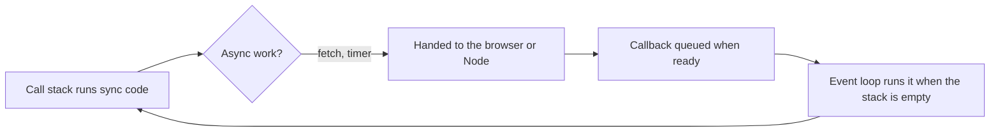

# JavaScript — the syntax and semantics you keep getting wrong

A Dojo supplement guide. JavaScript is the language under React, Next, and Node — so *every* front-of-house
bug you'll ever hit is, underneath, a JavaScript bug. The good news: the language runs on about ten mental
models, and once you own them the "weird" behaviour stops being weird. We build all ten from zero. If you can
write a function and call it, you're ready.

> **How to read this.** Keep a scratch `.js` file (or the browser console) open and *type* every snippet —
> don't paste, and predict the output before you run it. When your prediction is wrong, you've just found a
> gap worth closing. Each section ends with **the bug it prevents**, because that's when the idea sticks. This
> guide is the reading behind the **JavaScript** coding track — read a section, then go drill it.

---


---

## ⌨️ This guide is interactive

**Eight exercises are embedded below** — the language's sharp edges, in the order they cut:
reference semantics, coercion, `this`, and the event loop.

Two are predictions rather than code. Getting those wrong on paper is cheap; getting them wrong in
a debugger costs an afternoon.
## 0. Five words the rest of this guide stands on

- **Value** — a piece of data: a number, a string, a boolean.
- **Reference** — a *pointer* to an object/array, not the object itself. Two variables can point at the same object.
- **Primitive** — the seven simple, immutable types: `number`, `string`, `boolean`, `null`, `undefined`, `symbol`, `bigint`. Everything else is an object.
- **Truthy / falsy** — how a value behaves in a boolean context (`if`, `&&`, `||`). Eight values are falsy; the rest are truthy.
- **Scope** — the region of code where a variable is visible. Modern JS is *block*-scoped.

Keep those in your pocket. Now the models.

---

## 1. Primitives are copied; objects are shared

This is the root of more bugs than any other single idea.

```js
let a = 1;
let b = a;   // b gets a COPY of the value
b = 2;
console.log(a); // 1  — a is untouched

const user = { name: "Ada" };
const alias = user;      // alias points at the SAME object
alias.name = "Grace";
console.log(user.name);  // "Grace"  — one object, two names for it
```

Primitives are copied *by value*: changing `b` can't affect `a`. Objects and arrays are copied *by reference*:
`alias = user` copies the pointer, not the contents, so mutating through either name changes the one shared
object. This is also why `{} === {}` is `false` — two different objects, even with identical contents, are
different references.

To actually *copy* an object, spread it: `const copy = { ...user }` (a shallow copy — nested objects are still
shared). This copy-don't-mutate discipline is exactly what React relies on to detect changes.

**The bug it prevents.** You "update a copy" of some state, the original changes too, and two components fight
over one object. It wasn't a copy — it was a second reference.

---


```exercise
reference-semantics
```

## 2. `const`, `let`, `var` — and why `var` is retired

```js
const PI = 3.14159;  // can't be reassigned
let count = 0;       // can be reassigned
count = 1;
```

- **`const`** — the binding can't be reassigned. Use it by default. Note it does *not* freeze the value: `const u = {}` still allows `u.name = "x"`; it only forbids `u = somethingElse`.
- **`let`** — use only when you genuinely must reassign.
- **`var`** — avoid. It's *function*-scoped (leaks out of `if`/`for` blocks) and hoisted as `undefined`, two footguns.

Both `const` and `let` are **block-scoped** (live only inside the nearest `{ }`) and sit in a **temporal dead
zone** — referencing them before their declaration line throws, instead of silently giving `undefined` like
`var` does. That's a feature: it catches typos and use-before-define.

**The bug it prevents.** The classic `var`-in-a-loop trap:

```js
for (var i = 0; i < 3; i++) {
  setTimeout(() => console.log(i), 0); // 3, 3, 3
}
for (let i = 0; i < 3; i++) {
  setTimeout(() => console.log(i), 0); // 0, 1, 2
}
```

`var i` is ONE variable shared by every callback, so by the time they run it's 3. `let i` creates a fresh
binding *per iteration* — each closure captures its own. (More on closures in §5.)

---

```check
values
```

## 3. Coercion, equality, and truthiness

The eight falsy values — memorise them, everything else is truthy:

`false`, `0`, `-0`, `0n`, `""` (empty string), `null`, `undefined`, `NaN`.

So `"0"`, `"false"`, `[]`, and `{}` are all **truthy** (non-empty-looking or not, they're not in the list).

**Always use `===` (strict equality).** Loose `==` performs type coercion with genuinely bizarre results:

```js
0 == "";       // true
0 == "0";      // true
"" == "0";     // false   (so == is not even transitive!)
[] == false;   // true
null == undefined; // true
```

The one blessed exception: **`x == null`** is the idiomatic check for "null OR undefined" (it matches both and
nothing else). Everywhere else, `===`.

```js
if (value === undefined) …     // exactly undefined
if (value == null) …           // null or undefined (the one ok use of ==)
```

**`??` vs `||` — the difference is which values count as "empty".**

```js
config.port ?? 3000   // default only when port is null/undefined  → keeps a real 0
config.port || 3000   // default on ANY falsy → a real 0 becomes 3000 (bug!)
name || "Anonymous"   // here you WANT "" to become Anonymous, so || is right
```

Use `??` when only "not provided" should default; use `||` when any falsy value should. This one distinction
fixes a huge share of "why is my 0 disappearing" bugs.

**The bug it prevents.** A valid `0`, `""`, or `false` gets silently swapped for a default because someone
reached for `||` when they needed `??`.

---


```exercise
coercion-predict
```

```check
coercion
```

## 4. Functions, arrows, and the two returns

Three ways to make a function; the differences matter:

```js
function add(a, b) { return a + b; }       // declaration — hoisted
const sub = function (a, b) { return a - b; }; // expression
const mul = (a, b) => a * b;               // arrow — implicit return
```

Arrow functions have **implicit return** when there's no `{ }` body: `x => x * 2` returns `x * 2`. But to return
an *object literal* you must wrap it in parentheses, or the `{` is read as a function body:

```js
const toPoint = (x, y) => { x, y };    // WRONG — {} is a block, returns undefined
const toPoint = (x, y) => ({ x, y });  // right — parens force "object literal"
```

**Default parameters** fill in only for `undefined` — not `null`, `0`, or `""`:

```js
function greet(name, greeting = "Hi") { … }
greet("Sam");            // greeting = "Hi"
greet("Sam", undefined); // greeting = "Hi"
greet("Sam", null);      // greeting = null  (default does NOT apply)
```

**The bug it prevents.** `.map(u => { active: u.isActive })` returning a list of `undefined`: without
parentheses the braces are a function body and `active:` is a label. (Put a spread in there,
`u => { ...u, active: true }`, and it doesn't even parse: a `SyntaxError`.)

---

## 5. Closures — functions that remember

A **closure** is a function that keeps access to the variables from where it was *defined*, even after that
outer scope has returned. It's how JavaScript does private state.

```js
function makeCounter() {
  let count = 0;                 // private
  return function () {
    count += 1;
    return count;
  };
}
const next = makeCounter();
next(); // 1
next(); // 2  — count survived, and nothing outside can touch it
```

Each call to `makeCounter()` makes a *fresh* `count`, so two counters are independent. Closures power React
hooks (`useState` closes over its state), event handlers, memoisation, and the module pattern. The `var`-in-a-loop
bug from §2 is a closure bug: every callback closed over the *same* shared variable.

**The bug it prevents.** "Stale" values in callbacks — a function using an old copy of a variable because it
closed over it at definition time, not call time.

---


```exercise
closure-counter
```

## 6. `this` — decided by the call, not the definition

For a **regular** function, `this` is whatever is to the LEFT of the dot when you call it — so a bare callback
loses its object:

```js
const timer = {
  seconds: 0,
  start() {
    setInterval(function () {
      this.seconds += 1;   // BROKEN — this is not `timer` here
    }, 1000);
  },
};
```

An **arrow** function has no `this` of its own — it uses `this` from where it was *written* (lexical). That's
exactly why arrow callbacks fix the problem:

```js
start() {
  setInterval(() => {
    this.seconds += 1;   // arrow keeps `this` = timer
  }, 1000);
}
```

The rule: **methods that need their own `this` stay regular functions; callbacks that should keep the outer
`this` are arrows.** (Before arrows, people wrote `const self = this` or `.bind(this)`.)

**The bug it prevents.** A timer stuck at 0. `setInterval` calls a regular function with a `this` of its own:
`globalThis` (`window`) in a browser ([MDN: setInterval](https://developer.mozilla.org/en-US/docs/Web/API/Window/setInterval)),
a `Timeout` object in Node. So `this.seconds += 1` quietly writes `NaN` onto the wrong object. Callers that pass
no `this` at all, like `forEach` in strict code, give `undefined`, and then you get
`Cannot read properties of undefined`.

---


```exercise
this-binding
```

```check
functions
```

## 7. Destructuring, spread, and rest

Pull fields out by name (objects) or position (arrays), with defaults:

```js
const { name, role = "member" } = user;     // object, with default
const [first, ...rest] = items;              // array + rest element
function f({ id, tags = [] }) { … }          // destructure a parameter
```

**Spread** (`...`) *expands*; **rest** (`...`) *collects* — same three dots, opposite jobs:

```js
const merged = { ...a, ...b };   // spread: copy a's fields then b's (b wins on conflicts)
const copy = [...arr, item];     // spread: new array, immutably appended
function sum(...nums) { … }      // rest: gather all args into an array
sum(...[1, 2, 3]);               // spread: expand the array back to arguments
```

Spread order is load-bearing: `{ ...user, ...patch }` lets `patch` override; flip it and the original wins
(a real bug). Spread is a *shallow* copy — nested objects/arrays are still shared, so to update `user.address.city`
you spread at each level.

**The bug it prevents.** Mutating state with `push`/`splice`/`sort` (which change in place) instead of building
a new value with spread/`map`/`filter` — leaving React blind to the change.

---


```exercise
optional-chaining
```

## 8. The array-method toolbox

Learn these cold; they replace almost every hand-written loop:

| Method | Returns | Use when |
| --- | --- | --- |
| `map(fn)` | new array, same length | transform each element |
| `filter(pred)` | new array, subset | keep the elements that match |
| `reduce(fn, seed)` | one value | fold many items into one (sum, max, group) |
| `find(pred)` | first match or `undefined` | you want one item |
| `some(pred)` / `every(pred)` | boolean | "any?" / "all?" |
| `sort(cmp)` | the *same* array (mutates!) | ordering — always pass a comparator |

Two traps worth carving in:

```js
[10, 2, 1].sort();               // [1, 10, 2] — default sort is LEXICOGRAPHIC
[10, 2, 1].sort((a, b) => a - b); // [1, 2, 10] — numeric comparator
const sorted = [...nums].sort((a, b) => b - a); // copy first: sort mutates!

[].reduce((a, b) => a + b);      // THROWS — no seed, empty array
[].reduce((a, b) => a + b, 0);   // 0 — always seed reduce
```

`map`/`filter`/`reduce` are pure — new array out, input untouched — which is why they're safe for state. `sort`
is the odd one: it mutates and returns the same array, so sort a *copy*.

**The bug it prevents.** `[10, 2, 1]` sorting to `[1, 10, 2]`, and a shared array getting silently reordered by
a `.sort()` you thought was pure.

---


```exercise
array-toolbox
```

```check
data
```

## 9. Async — the event loop, promises, and `async/await`

JavaScript is single-threaded: it runs one thing at a time and never blocks on I/O. Slow work (network, timers)
is handed off and its callback is queued to run *later*, on the **event loop**.



A **Promise** represents a value that isn't ready yet — it's `pending`, then either `fulfilled` or `rejected`.
`async/await` is syntax over promises that reads like straight-line code:

```js
async function loadUser(id) {
  try {
    const user = await fetchUser(id); // pause until the promise settles
    return user;                      // an async function always returns a Promise
  } catch (err) {                     // a rejected promise throws here
    return null;
  }
}
```

Two rules save you constantly:

**1. Don't `await` in a loop when the calls are independent — that's a waterfall.** Fire them together:

```js
// slow: each waits for the previous
for (const id of ids) { results.push(await fetchUser(id)); }

// fast: all at once, then wait for the batch (results stay in order)
const results = await Promise.all(ids.map((id) => fetchUser(id)));
```

**2. Forgetting `await` gives you the Promise, not the value.** `const u = fetchUser(1)` makes `u` a pending
Promise; you must `await` it (or `.then`).

**The bug it prevents.** A page that loads three times slower than it should (sequential awaits), and
`[object Promise]` showing up where you expected data (a missing `await`).

---


```exercise
event-loop-order
```

```exercise
await-in-loop
```

## 10. Modules — `import` / `export`

Modern JS splits code into files that explicitly share what they mean to:

```js
// math.js
export function add(a, b) { return a + b; }   // named export
export default class Calculator {}            // one default export per file

// app.js
import Calculator, { add } from "./math.js";
```

Named exports are imported by their exact name in `{ }`; the default is imported without braces under any name.
Modules are singletons (evaluated once, cached) and run in strict mode automatically.

---

```check
async
```

## Mastery checklist — you can…

- [ ] explain why `{} === {}` is false, and copy an object without aliasing it
- [ ] recite the eight falsy values and pick `===` / `== null` / `??` / `||` correctly each time
- [ ] parenthesise an arrow that returns an object, and predict a default-parameter edge with `null`
- [ ] write a `makeCounter` closure and explain the `var`-in-a-loop bug in the same breath
- [ ] fix a broken `this` with an arrow callback and say *why* it works
- [ ] reach for `map`/`filter`/`reduce`/`find`/`some`/`every` without thinking, and sort a copy with a comparator
- [ ] turn a sequential `await` loop into a parallel `Promise.all`, and spot a missing `await`

## Self-quiz

Answer each aloud before reading the answer under it.

1. **What does `[1,2,3].map(n => { double: n*2 })` return, and why?**
   *Answer:* **`[undefined, undefined, undefined]`.** The `{` right after `=>` is parsed as a
   **block body**, not an object literal. Inside that block, `double:` is a *label* and `n*2` is an
   expression statement — nothing is returned, so every element is `undefined`. Fix by
   parenthesising the object so it's an expression: `n => ({ double: n*2 })`.

2. **`config.retries || 3` vs `config.retries ?? 3` — for which value do they differ?**
   *Answer:* For any **falsy but defined** value — `0`, `""`, `false`, `NaN`. The one that bites in
   real code is `retries = 0`: `||` sees falsy and returns **3**, overriding an explicit "don't
   retry"; `??` returns **0**, because it only falls back on `null`/`undefined`. Use `??` for
   defaults; use `||` only when you genuinely want every falsy value replaced.

3. **Why does `const [head, ...tail] = []` give `undefined` rather than throwing?**
   *Answer:* Array destructuring pulls from the **iterator**. When the iterator is already
   exhausted, missing bindings are filled with `undefined` — exactly like reading `arr[0]` past the
   end — and a rest element collects the remainder, here `[]`. Destructuring only *throws* when the
   right-hand side isn't iterable at all (`const [x] = null` → TypeError).

4. **Rewrite the sequential loop to run in parallel.**
   *Answer:* `const data = await Promise.all(ids.map(id => get(id)));`
   The original awaits inside the loop, so each request waits for the previous one — N round-trips
   end to end. `.map` starts every request immediately and `Promise.all` waits once, so the total is
   roughly one round-trip. Caveat worth saying out loud: `Promise.all` **rejects on the first
   failure** and you lose the other results — use `Promise.allSettled` when you need every outcome,
   and cap concurrency (a pool, or chunking) when N is large enough to flood the target.

5. **Inside `arr.forEach(function () { this.x })`, what is `this`?**
   *Answer:* **`undefined`** in a module or strict mode (the global object in sloppy mode) — *not*
   the array, and not the surrounding `this`. A plain `function` gets its `this` from **how it's
   called**, and `forEach` invokes it with no receiver. Two fixes: use an **arrow function**, which
   has no `this` of its own and closes over the enclosing one; or pass `forEach`'s second argument,
   `thisArg` (`arr.forEach(function () { … }, this)`).

> **Tip.** Whenever a snippet surprises you, don't move on — reduce it to the smallest version that still
> surprises you, then explain it out loud. That five-minute habit is the fastest route to fluency, and it's
> exactly what the JavaScript coding track makes you do on a schedule.
