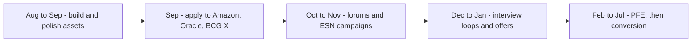

# Morocco SWE Internship Playbook — 2026/27 Season

A Dojo guide — the market map: who hires software interns in Morocco, how each pipeline actually
works, when the windows open, and where your applications should go. Its sibling, the
[Interview Preparation Playbook](./interview-playbook.md), covers *how to prepare* for everything
this guide tells you to apply to. Compiled from company career pages, live job postings, and
candidate interview reports (research snapshot: July 2026 — always re-verify on the official
career page before applying).

## The core verdict

**Do not restart from zero.** Keep TypeScript/NestJS as your production stack, add focused
Java/Spring Boot competence to pass enterprise filters, and prove both through one deployed,
tested, cloud-ready CodeArena. In 3–4 months the highest-ROI profile is: strong Node/NestJS
backend skill + credible Java/Spring + solid DSA/SQL + one production-grade deployed system + an
aggressive application loop. That profile competes across the whole Moroccan enterprise market and
opens the BCG X / global product-company doors.

**The biggest constraint to plan around:** many Moroccan enterprise internships prefer or require
final-year **Bac+5 / engineering-school** profiles (*Bac+5* = five years of study after the
baccalauréat — i.e. a master's or engineering-school level). A strong portfolio helps but may not bypass
strict HR filters — so the strategy combines direct applications, referrals, visible proof of
skill, and a wide funnel that includes junior/associate roles and pre-employment internships.
Where Bac+5 is explicit, apply only if your status genuinely fits; never misrepresent education.

## Two games, one preparation

Morocco's software-intern market splits into two "games". One term first: an **ESN**
(*Entreprise de Services du Numérique*) is a French-style IT-services company that builds software
for other companies under contract — these are the biggest intern recruiters in Morocco.

| | Game 1 — global bar | Game 2 — ESN / delivery centers |
|---|---|---|
| Companies | Amazon (Rabat), Oracle R&D (Casa), BCG X | Capgemini, Alten, Atos/Eviden, CGI, SQLI, Sopra Steria, Inetum, Deloitte delivery |
| Screen | Online assessment: timed DSA + work-style | CV screen → technical MCQ/coding test |
| Interviews | Live DSA coding + heavy behavioral, **in English** | Project/stack deep-dive + HR round, **mostly in French** |
| Bar | LeetCode-medium, structured STAR | Defend every CV line: Java/Spring or .NET, SQL, OOP, your project |

The two games overlap ~60% — prepare for both simultaneously. English is the single cheapest
differentiator: every multinational lists it, Game 1 interviews in it, and most local candidates
are weaker at it than at French.

## How the market works

**The PFE system.** The *Projet de Fin d'Études* (4–6 months, typically February–July) is
Morocco's main junior-hiring funnel: ESNs open hundreds of subjects per season (Capgemini ~700 and
Alten ~500 in big years), and a large share of PFE interns get a *pré-embauche* (pre-hire) offer into a **CDI** (*contrat à durée
indéterminée* — a permanent, open-ended employment contract).
Earlier-year *stages d'initiation/application* build the CV, but the PFE is the one that converts.

**Where the jobs physically are.** Casablanca — **Casanearshore** (Sidi Maârouf, Africa's largest
nearshore IT park: Capgemini, Atos, CGI, Sopra Steria, Deloitte delivery, SQLI…) and Casablanca
Finance City/downtown (BCG, Deloitte consulting, SG ATS, HPS). Rabat — **Technopolis** and
Agdal/Hay Riad (Amazon, Alten, SQLI, Sofrecom, CGI, ST Microelectronics). Also: Fès/Tétouan
(Alten), Oujda (SQLI's biggest site).

**Money.** No legal minimum for internship stipends; serious companies pay 1,500–7,000 MAD/month,
with Amazon/BCG/Oracle at the top or above. Post-conversion junior CDI at ESNs: ~7,000–12,000
MAD/month gross; noticeably higher at Amazon/Oracle/SG ATS/HPS.

### The annual calendar — plan around this

| Period | What happens | What YOU do |
|---|---|---|
| Jul–Sep | Amazon/Oracle/BCG open intern reqs on global portals; ESNs prepare campaigns | Build skills + portfolio; CV/LinkedIn/GitHub ready in FR **and** EN; apply to Game 1 the day postings appear |
| Oct–Nov | **Forum GENI** (ENSIAS/INPT/INSEA, mid-Oct, 60+ companies), **Forum EMI-Entreprises** (Rabat, the country's biggest); ESN PFE campaigns open | Attend forums with printed CVs; apply to every relevant campaign; first tests/interviews |
| Dec–Jan | Peak PFE interviewing and offers; Deloitte/CGI/Atos/SG ATS post continuously | Interview loops; follow-ups; take offers seriously — good subjects go fast |
| Feb–Jul | PFE internships run; conversion talks in the final month | Perform: your PFE defense + manager review is effectively your first job interview |

## The employers — deep dive

Tier A = highest priority, B = core volume, C = monitor/widener. Every "likely process" is a
preparation model, not a guarantee — local teams change rounds by role and manager.

### 1. Amazon (Rabat) — Tier A, Game 1

The only Big Tech with a genuine **SDE presence in Morocco**: Rabat hires SDE interns (3 or 6
months) writing production software with a manager and dedicated mentor; intern projects ship to
real customers and strong interns get return offers.
**Process:** apply on amazon.jobs ("Software Dev Engineer Intern Morocco") → OA ~90 min: 2 coding
problems (one easier, one harder) + ~60–70 Leadership-Principle work-style scenarios → 2–3
interviews of 45–60 min: live DSA coding + heavy behavioral scored directly against the 16 LPs.
All English. **Stack:** one language deeply (Java or Python recommended; TypeScript accepted),
LeetCode-style DSA, complexity fluency. No AWS knowledge required.
**Tips:** prepare the 8–10 STAR stories BEFORE the OA — the work-style section already tests LPs,
and inconsistency is flagged. Apply the day postings open (early autumn); Morocco slots are few
and fill fast. CV in English, one page, quantified. Reality check: don't build the whole plan
around Amazon — prepare to Amazon standards because it transfers everywhere, but keep local
applications running in parallel.

### 2. Oracle R&D Center (Casablanca) — Tier A, Game 1

A true **R&D center** (not nearshore support): analytics, ML, application security, programming
languages, graph processing, database/AI platform tech — part of Oracle's global product org, with
a strong mentorship culture. Closer to the Amazon bar than the ESN bar.
**Process:** careers.oracle.com (filter Morocco) → recruiter screen → technical interviews mixing
DSA with CS fundamentals (SQL, OS, OOP) → hiring-manager round. English throughout.
**Stack:** Java + SQL deeply; algorithms; Python + ML basics for data teams.
**Tips:** fewer intern posts than Amazon but direct new-grad hiring too — apply to both intern and
campus/early-career reqs. Mentioning specific center topics (graph processing, MySQL, security)
shows homework. The free **OCI Foundations cert** is a cheap, relevant signal.

### 3. BCG X (Casablanca) — Tier A, Game 1 + case

BCG's Casablanca office (130+ people) hosts **BCG X Delivery** — the tech build unit — recruiting
Software Engineering, Data Engineering and Data Analyst interns; a recent Delivery AI SWE intern
role was a real 6-month internship open to final-year Bachelor's/Master's and recent grads.
Hybrid consulting/engineering: AI/data products for real client cases.
**Process:** application (a tailored cover letter helps here more than anywhere) → proctored
CodeSignal-style assessment (data roles: ~90 min, 5 questions — cleaning, preprocessing, training
a classifier, aggregation, probability) → technical rounds + a problem-solving/case-style
interview. **Stack:** NestJS/Node listed explicitly for SWE; Python (pandas, scikit-learn) + SQL
for data; clean code, testing, cloud, Docker/K8s.
**Tips:** practice case basics even for engineering (structure out loud, quick mental math).
School alumni referrals dramatically raise reply rates — hunt them on LinkedIn. Their internship
is six months; apply only if that duration works for you.

### 4. Capgemini & Capgemini Engineering (Casanearshore) — Tier A, Game 2

One of Morocco's largest tech employers, two entities: **Capgemini TS** (Java/.NET/web application
services for European clients — a July 2026 Casablanca intern posting accepted Java Spring Boot
**or** Node.js) and **Capgemini Engineering** (ex-Altran: automotive, embedded, testing &
validation). Historically the biggest PFE recruiter (700+ subjects in big years).
**Process:** campaign application (dedicated email or portal — campaigns publish exact application
emails and subject-line formats) or rekrute/LinkedIn → CV screen → technical test (MCQ/coding) →
technical interview → HR. Mostly French.
**Stack:** TS side: Java/Spring **or** Node, REST, SQL, Git, React/Angular, Docker, CI/CD.
Engineering side: C/C++, Python, embedded concepts (CAN, AUTOSAR awareness), test automation
(Selenium/Robot Framework).
**Tips:** watch the "Capgemini Maroc" LinkedIn page from September. On the Engineering side,
candidates who **propose their own internship subject** (one page: problem, approach, deliverable)
are ahead of 90% of applicants.

### 5. ALTEN Maroc (Casa, Rabat, Fès, Tétouan) — Tier A/B, Game 2

Delivery centers for European R&D and IT (automotive, aeronautics, banking, telecom); one of the
largest annual PFE intakes (~500 subjects across four sites).
**Process (official):** CV + cover letter → possible phone pre-screen → interview 1: technical
with your future manager/client team → interview 2: HR (motivation, career plan). Mostly French.
**Stack:** Java/Spring or C#/.NET + Angular + SQL for IT; C/C++/Python for embedded; ISTQB-style
testing basics for validation subjects.
**Tips:** subjects post on rekrute.com, stagiaires.ma and alten.ma — each subject is screened
separately, so apply to several. **Being open to Fès/Tétouan cuts competition dramatically.**

### 6. Société Générale ATS (Casablanca) — Tier A, Game 2 + finance

SG's Casablanca tech center for the group's **global-markets/trading IT** — capital-markets
software, data, testing, financial engineering. The standout stat: **~70% of trainees join after
their internship**. "Best Place to Work Morocco 2023".
**Process:** careers.societegenerale.com / LinkedIn / rekrute → HR screen → technical interview
(programming + sometimes finance/logic) → manager interview.
**Stack:** Java or C#/.NET dominate + Spring, SQL (PostgreSQL/Oracle), JUnit/Cucumber, OAuth2,
OpenAPI, Kafka, Jenkins, Docker/K8s; Python for data/quant subjects.
**Tips:** postings appear **year-round**, not just campaign season. Learn basic market vocabulary
(derivative, index, P&L). A small market-data dashboard or backtester side project is a
devastatingly effective CV line here.

### 7. Deloitte (Casablanca) — Tier B, Game 2 + consulting polish

Two doors: **Deloitte Morocco** (consulting — tech-flavored transformation internships) and
**Deloitte Extended Services / Morocco Delivery Center** (100% subsidiary of Deloitte France — a
real nearshore engineering center on AWS/Azure/GCP; roles include AI SWE, Full Stack, SRE, cloud,
PFE development). Both convert well.
**Process (reported):** application → HR screen (motivation/communication, largely French) →
technical test → technical/manager interview on your projects → fit round. Structured; 2–4 weeks.
**Stack:** Java/Spring or .NET + Angular/React + SQL + one cloud. An **AWS CCP or Azure AZ-900
cert is an easy differentiator** here.
**Tips:** apply to both doors separately. Deloitte weighs "client-ready" polish more than ESNs —
dress and speak accordingly. Delivery-center postings appear continuously on LinkedIn/rekrute.
Read responsibilities carefully: some "Technology & Transformation" internships are functional
(AMOA), not coding-heavy.

### 8. Atos / Eviden (Casa & Rabat) — Tier B, Game 2

~600 employees since 2003; European banking/telecom delivery, plus **Eviden** for cybersecurity,
cloud and HPC. Regular PFE campaigns: Java banking apps, TIBCO integration, .NET full-stack,
Java/Angular, production/infra, cyber subjects.
**Process:** CV (campaigns publish **direct recruiting emails** on dreamjob.ma/rekrute) →
technical test → technical interview → HR. French-dominant.
**Stack:** Java + Spring + SQL + Angular; REST/SOAP and messaging concepts (JMS/Kafka) for
integration subjects. **Tip:** a clean targeted email with CV + short pitch works; mention Eviden
explicitly for security/cloud subjects.

### 9. CGI (Casa, Rabat, Fès) — Tier B, Game 2

1,300+ professionals delivering for (mostly French) European clients; steady PFE intake across
development (Java/.NET), systems, testing, cloud migration — some subjects open to Bac+3. Culture
("members", ownership) hires PFEs to keep them.
**Process:** cgi.com or rekrute → HR screen → technical interview → manager/fit. French with an
English check. **Stack:** Java/Spring + Angular/Vue + SQL + Kafka; Linux basics; ITIL awareness
for systems subjects.
**Tips:** posts steadily from autumn with less publicity than Capgemini/Alten — **lower
competition per subject**; a strong high-probability target to pair with reach applications.

### 10. SQLI (Rabat, Oujda, Casa) — Tier B, Game 2 + competition

French digital-experience specialist (e-commerce, web platforms); one of Oujda's biggest tech
employers. Java, PHP/Magento, JS frameworks, mobile, data, QA.
**The unique channel: e-Challenge** — SQLI's national coding competition (20th edition announced
for 2025/26): winners get cash prizes (12,000 / 8,000 / 6,000 MAD) **plus pre-hire PFE
internships**, and even finalists get recruiter attention. Registration opens in autumn at
e-challenge.sqli.com.
**Process (classic):** CV → technical test → technical + HR interviews. **Stack:** Java or PHP + a
JS framework + SQL; your Node/TypeScript profile is directly relevant. For e-Challenge:
competitive-programming practice under time pressure — exactly the Dojo's DSA track.

### 11. Inetum (Casablanca) — Tier B, Game 2

20+ years in Morocco, 800+ employees, shared-services center + FabLab. Java/Spring Boot + Angular
+ cloud roles; PFE Java/PHP subjects appear.
**Process:** CV/recruiter screen → technical interview or test → project/manager discussion → HR.
**Stack:** Java/Spring, Angular, some PHP, SQL/PostgreSQL/MariaDB, Redis, Elasticsearch, K8s.
**Tip:** project quality varies across outsourcing teams — in the interview, ask about the exact
project, stack, mentorship, code-review practices and conversion path before accepting.

### 12. Orange Business / Sofrecom (Rabat, Casa) — Tier B

Technology organization covering connectivity, cloud, data/AI, cyber, IoT; past Morocco campaigns
included development, DevOps, test automation, data engineering and cybersecurity. Sofrecom
(Orange group, Rabat) does steady Java/Angular telecom software hiring.
**Process (likely):** application → recruiter conversation → manager/technical interview →
possible assessment → offer. **Stack:** Java or Python, APIs, Linux, Git, CI/CD, Docker, cloud
fundamentals, observability, networking + security basics.
**Tips:** filter carefully — Orange has many job families and not every "technology" role is
software. Prepare reliability/automation stories: debugging, incident thinking, monitoring.

### 13. IBM Client Innovation Center (Casablanca) — Tier B

Consulting-delivery brand with Java and .NET client work; IBM's official guidance prepares
candidates for coding assessments and technical interviews, and IBM interviews famously probe
**whether you truly understand everything on your CV**.
**Process (typical):** application → possible online assessment → recruiter screen →
technical/project deep-dive + behavioral → decision.
**Stack:** Java/J2EE, Spring, .NET/C#, Angular, SQL, cloud, Agile/DevOps, testing.
**Tip:** openings fluctuate and some roles are client-specific — apply to several relevant reqs,
each CV truthful and aligned; be ready to defend one failure, one trade-off, one team conflict.

### 14. OCP Group / OCP Digital — Tier B/C

Morocco's industrial giant; digital covers advanced analytics, supply-chain, digital products
(recent ChargeX internship sought hardware/software engineering interns). Campaign-based and less
predictable than ESNs.
**Stack:** Python/data/AI, backend APIs, cloud, IoT/industrial integration.
**Tip:** prepare one industrially relevant case (monitoring, predictive maintenance, supply-chain
visibility) with measurable impact; use alerts + spontaneous applications, but keep higher-volume
targets first.

### Wideners — honorable mentions

| Company | Where | Why apply |
|---|---|---|
| **HPS** | Casablanca | World-class Moroccan fintech (PowerCARD, 450+ institutions); welcomes spontaneous CVs; payments expertise is a career-long asset |
| **Dell Technologies** | Casablanca | Large multinational site; EMEA internship/graduate programs (software, test automation, security) |
| **Sopra Steria** | Casanearshore | Major French ESN; continuous Bac+5 junior/intern recruiting |
| **SII Services Maroc** | Casablanca | Branded annual PFE campaign; embedded + IT |
| **Intelcia IT Solutions** | Casablanca | Fast-growing Moroccan group's IT arm; web/cloud delivery |
| **ST Microelectronics** | Rabat (Bouknadel) | THE embedded employer if you lean low-level (C, firmware, validation) |

**Funnel strategy:** 2–3 reach targets (Amazon, Oracle, BCG X) + 4–5 core (Capgemini, Alten,
Deloitte, Atos, SG ATS, CGI, SQLI) + 3–4 wideners. 10–12 quality applications beat 50
spray-and-pray — but fewer than 8 is under-diversified, because campaign screening has real
randomness.

## Applying — channels, cadence, hygiene

**Channels ranked:** (1) company career portals (amazon.jobs, careers.oracle.com,
careers.bcg.com, capgemini.com/ma-en, alten.ma, jobs.atos.net, cgi.com, sqli.com/ma-fr,
careers.societegenerale.com, deloitte.com, hps-worldwide.com/careers, jobs.dell.com);
(2) LinkedIn — postings AND recruiter/alumni outreach; alerts on "stage PFE" + "software intern
Morocco"; (3) school career forums — Forum GENI (mid-Oct), Forum EMI-Entreprises (Rabat), your
school's own day; bring printed CVs and talk to engineers, not just HR; (4) Moroccan boards —
rekrute.com (the ESNs' favorite), stagiaires.ma, emploi.ma, dreamjob.ma (publishes campaign
emails), ma.indeed.com; (5) campaign emails / spontaneous applications — precise subject line
("Candidature Stage PFE 2027 — Génie Logiciel — [Name]"); (6) **referrals** — one alumnus
forwarding your CV ≈ 10 cold applications.

**Cadence from the moment applications open:** Tier A 5–8/week, Tier B 5–8/week, wideners
5/week, 10 thoughtful networking messages/week, one polite follow-up per application after 7–10
days. Track everything in a sheet: company, role, date, channel, contact, status, next follow-up.
Silence after one follow-up = move on (ESNs ghost heavily; it's not personal).

**Red flags to avoid as a candidate:** a 3-page CV or Word file with a selfie (instant filter);
claiming skills you can't defend for five minutes (ESN interviewers probe the CV line by line);
being unprepared for "Can you continue in English?" (now standard even at French ESNs); accepting
an unpaid no-name "PFE" out of panic in November — the campaign season runs through January and
this list is deep enough.

## Prep resources

- Amazon official OA prep: amazon.jobs/content/en/how-we-hire/university/sde-oa · Leadership
  Principles: amazon.jobs/en/principles
- Dojo: [DSA problem sets](/dsa) (20 categories, 200 problems), [Aptitude & Reasoning](/practice/aptitude),
  [CS Fundamentals](/practice/cs-fundamentals), [SQL](/practice/sql-data),
  [System Design drills](/practice/system-design-drills)
- Codingame (ESN-style tests), CodeSignal practice (BCG X-style), sqlzoo.net
- Free cloud certs: AWS Skill Builder (CCP), Microsoft Learn (AZ-900), Oracle University (OCI
  Foundations — free exam windows)

**Next:** the [Interview Preparation Playbook](./interview-playbook.md) turns this map into a
week-by-week preparation system.
