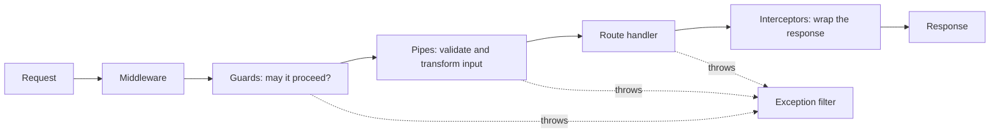

# NestJS — a structured Node backend that thinks like Spring

A Dojo supplement guide. NestJS is a TypeScript framework for building server-side applications with real
architecture: dependency injection, modules, and a decorator style that maps almost one-to-one onto Java's Spring
Boot. If you've met Spring, you already know the shapes; if you haven't, Nest is the gentlest way to learn them.
This guide builds the whole request lifecycle — controllers, providers, modules, then the cross-cutting layers
(pipes, guards, interceptors, filters) — from zero.

> **How to read this.** You need TypeScript (decorators, classes, DI-by-constructor) — this guide leans on it.
> Scaffold with `nest new` and add each piece. Each section ends with **the bug it prevents**, and calls out the
> Spring parallel. This is the reading behind the **NestJS** coding track.

---

## 0. Five words the rest of this guide stands on

- **Controller** — a class that handles incoming requests for a set of routes.
- **Provider** — an injectable class (usually a service) that holds logic the container manages.
- **Module** — the unit that groups controllers and providers and wires them together.
- **Dependency Injection (DI)** — you *declare* what you need in a constructor; the framework *supplies* it.
- **Decorator** — the `@Something()` annotations that tell Nest what a class or parameter is.

---

## 1. The three building blocks: controller, provider, module

A **controller** maps routes to methods; a **provider** holds the logic; a **module** binds them:

```ts
@Controller("cats")              // routes under /cats
export class CatsController {
  constructor(private readonly catsService: CatsService) {}  // DI

  @Get()
  findAll() {
    return this.catsService.findAll();  // delegate to the service
  }
}

@Injectable()                    // a provider Nest can manage & inject
export class CatsService {
  findAll() { return []; }
}

@Module({                        // wires the two together
  controllers: [CatsController],
  providers: [CatsService],
})
export class CatsModule {}
```

Keep controllers **thin** — parse the request, call a service, return the result. All real work lives in
providers. That separation is what keeps the app testable and the routes readable.

> **Spring parallel.** `@Controller`≈`@RestController`, `@Injectable`≈`@Service`, `@Module` groups beans the way a
> Spring configuration/package does. Constructor injection is identical.

**The bug it prevents.** Business logic stuffed into controllers, so nothing can be unit-tested without spinning
up HTTP.

---

## 2. Dependency injection — declare, don't construct

You never write `new CatsService()`. You declare the dependency as a constructor parameter and Nest's IoC
container supplies the single managed instance:

```ts
constructor(private readonly catsService: CatsService) {}
```

That one line does two things: TypeScript's *parameter property* shorthand declares and assigns `this.catsService`,
and Nest reads the `CatsService` type (via metadata) to inject the right provider. Providers are singletons by
default, so everyone shares one instance.

Why DI matters: the class doesn't know or care how its dependencies are built, so in a test you just pass a mock
(`new CatsController(fakeService)`). Dependencies are explicit and swappable.

**The bug it prevents.** Hard-`new`-ing dependencies, which makes classes impossible to test and couples them to
concrete implementations. (And: forgetting to list a provider in a module's `providers` → a "can't resolve
dependency" error at boot.)

---

## 3. Modules — the app's wiring diagram

A module declares what's available *within* it. To use a provider from another module, the owner **exports** it
and the consumer **imports** the module:

```ts
@Module({
  providers: [CatsService],
  exports: [CatsService],       // make it available to importers
})
export class CatsModule {}

@Module({
  imports: [CatsModule],        // now can inject CatsService
  controllers: [VetController],
})
export class VetModule {}
```

The root `AppModule` imports all feature modules; together they form the graph Nest boots. Modules keep the app
in cohesive slices (a `cats` module, an `auth` module) with clear boundaries.

> **Spring parallel.** `exports`/`imports` is Nest making bean visibility explicit, where Spring's component scan
> is more implicit.

**The bug it prevents.** A tangled app where everything can reach everything — modules force you to decide what a
feature actually exposes.

---

## 4. Handling the request: params, query, body

Parameter decorators pull each part of the request into your handler:

```ts
@Get(":id")
findOne(@Param("id") id: string) {}          // /cats/42 → path segment

@Get()
list(@Query("limit") limit: string) {}       // /cats?limit=10 → query string

@Post()
create(@Body() dto: CreateCatDto) {}         // JSON body → typed DTO
```

`@Param`, `@Query`, `@Body`, `@Headers` all follow the same shape. A **DTO** (Data Transfer Object) is a plain
class describing the shape of incoming data — worth having even before validation, because it documents the
contract and types the handler.

> **Spring parallel.** `@Param`≈`@PathVariable`, `@Query`≈`@RequestParam`, `@Body`≈`@RequestBody`.

**The bug it prevents.** Reading raw `req.params`/`req.body` and losing all typing — and every handler
re-parsing the request by hand.

---

## 5. The request lifecycle — where the cross-cutting layers plug in

A request flows through a fixed pipeline. Knowing the order tells you *where* to put each concern:



- **Guards** decide *yes/no* (auth) before anything runs.
- **Pipes** validate and transform the *input*.
- **Interceptors** wrap the handler to touch the *output* (logging, caching, response envelopes).
- **Exception filters** turn thrown errors into HTTP responses.

Each is a small, injectable, reusable class — that's the whole point. Let's take them in turn.

---

## 6. Pipes — validate and transform input

A pipe runs on a parameter before the handler sees it. Built-in ones parse:

```ts
@Get(":id")
findOne(@Param("id", ParseIntPipe) id: number) {}  // string → number, or 400
```

A custom pipe implements the one-method `PipeTransform`:

```ts
@Injectable()
export class TrimPipe implements PipeTransform {
  transform(value: unknown, metadata: ArgumentMetadata) {
    return typeof value === "string" ? value.trim() : value;
  }
}
```

The big one is **validation**. Put class-validator decorators on a DTO, enable a global `ValidationPipe`, and Nest
rejects bad bodies with a 400 automatically:

```ts
export class CreateCatDto {
  @IsString() @IsNotEmpty() name: string;
  @IsNumber() age: number;
}
// in main.ts: app.useGlobalPipes(new ValidationPipe());
```

Now your handler only ever runs on valid data.

> **Spring parallel.** DTO validation ≈ `@Valid` + Bean Validation (`@NotBlank`, `@Email`).

**The bug it prevents.** Hand-written `if (!body.name) …` checks scattered through controllers, and handlers that
crash on malformed input.

---

## 7. Guards — authentication and authorization

A guard answers one question — "may this request proceed?" — *before* the handler:

```ts
@Injectable()
export class AuthGuard implements CanActivate {
  canActivate(context: ExecutionContext): boolean {
    const request = context.switchToHttp().getRequest();
    return Boolean(request.headers.authorization);
  }
}
```

`canActivate` returns a boolean (or a promise/observable of one); `false` short-circuits with a 403. Apply it with
`@UseGuards`:

```ts
@Post()
@UseGuards(AuthGuard)
create() { … }
```

Put it on a method (one route), a `@Controller` (all its routes), or register it globally. Because a guard is a
provider, Nest injects whatever it needs (a `JwtService`, say) — which is why guards are classes, not plain
middleware.

**The bug it prevents.** Auth checks copy-pasted into every handler, drifting out of sync — one guard, applied
declaratively, is the single source of truth.

---

## 8. Interceptors — wrap the response

An interceptor runs code before *and* after the handler by operating on the returned RxJS Observable:

```ts
@Injectable()
export class LoggingInterceptor implements NestInterceptor {
  intercept(context: ExecutionContext, next: CallHandler) {
    console.log("before");
    return next.handle().pipe(tap(() => console.log("after")));
  }
}
```

`next.handle()` invokes the handler and returns an Observable of its result; `.pipe(map(...))` reshapes every
response, `tap(...)` logs timing, `catchError(...)` transforms errors. This is Nest's aspect-oriented layer — ideal
for logging, caching, and uniform response envelopes.

**The bug it prevents.** Duplicated logging/timing/response-shaping code in every handler, instead of one wrapper.

---

## 9. Exception filters — errors become HTTP

Throw a built-in HTTP exception from anywhere and Nest's global filter turns it into the right status and body:

```ts
findOne(id: number) {
  const cat = this.cats.find((c) => c.id === id);
  if (!cat) throw new NotFoundException("Cat not found"); // → 404
  return cat;
}
```

`NotFoundException` (404), `BadRequestException` (400), `UnauthorizedException` (401), `ForbiddenException` (403)…
Your service speaks in domain terms and never touches the response object — the framework does the HTTP
translation. For custom mapping, write a class implementing `ExceptionFilter`.

> **Spring parallel.** These map onto `@ResponseStatus` exceptions and `@RestControllerAdvice`/`@ExceptionHandler`.

**The bug it prevents.** `try/catch` blocks building error responses by hand in every handler, with inconsistent
status codes.

---

## Mastery checklist — you can…

- [ ] draw the request lifecycle and say which layer (guard/pipe/interceptor/filter) handles which concern
- [ ] wire a controller, service, and module, injecting the service by constructor
- [ ] explain why you never `new` a provider, and what breaks if it's missing from `providers`
- [ ] read `@Param`/`@Query`/`@Body` into a typed DTO
- [ ] validate a DTO with class-validator + a global `ValidationPipe`
- [ ] write a guard (`CanActivate`) and apply it with `@UseGuards`
- [ ] write a custom pipe (`PipeTransform`) and an interceptor (`NestInterceptor`)
- [ ] throw `NotFoundException` and explain how it becomes a 404

## Self-quiz

Answer each aloud before reading the answer under it.

1. **A provider works in one controller but errors ("can't resolve") in another module. Why?**
   *Answer:* **Providers are scoped to the module that declares them.** Injection works inside that
   module; anywhere else it fails unless *two* things are true — the declaring module lists the
   provider in `exports`, and the consuming module lists the declaring module in `imports`.
   Forgetting either produces the same "Nest can't resolve dependencies" error. Read the error's
   bracket notation: it names the missing token and the module it was looked up from.

2. **Does a guard run before or after a pipe? Why does the order make sense?**
   *Answer:* **Guards run first** (middleware → guards → interceptors → pipes → handler). It's the
   right order for two reasons: authorization is cheap and coarse, so you reject an unauthorized
   caller before spending work parsing and validating a body you were never going to use; and it
   avoids leaking information — a caller with no right to touch the route shouldn't learn the shape
   of its DTO from your validation errors.

3. **What's the difference in job between a pipe and a guard?**
   *Answer:* A **guard** answers *"may this request reach the handler at all?"* — one boolean
   decision, seeing the request as a whole, rejecting with a 403-flavoured result. A **pipe**
   answers *"is this particular argument valid, and in what form should the handler receive it?"* —
   validation *and* transformation, per parameter, rejecting with a 400-flavoured result. Guard =
   permission. Pipe = shape.

4. **How does an interceptor run code *after* the handler, given it's called before?**
   *Answer:* Because it doesn't call the handler directly — it receives `next` and returns
   `next.handle()`, which is an **RxJS Observable** of the handler's eventual result. Code you put
   before that line runs before the handler; behaviour you attach as *operators* on the returned
   stream (`tap`, `map`, `catchError`, `timeout`) runs when the handler emits. That's how one class
   can time a request: record `Date.now()` before, then `.pipe(tap(() => log(Date.now() - start)))`.

5. **Where does the HTTP status come from when a service throws `NotFoundException`?**
   *Answer:* From the **exception filter** — the built-in one reads the status off the
   `HttpException` and renders the response. That's better than returning a 404 by hand for three
   reasons: the service stays **transport-agnostic** (it reports a domain fact, not an HTTP code, so
   the same service works unchanged behind a CLI, a queue consumer or a gRPC endpoint); every error
   gets an **identical response shape** for free instead of each controller inventing one; and error
   handling stops being duplicated in every handler's `if` branches.

> **Tip.** For any cross-cutting need — "log every request", "check a token", "trim inputs", "shape every
> response" — ask *which lifecycle layer owns this?* Naming the layer (guard, pipe, interceptor, filter) is
> usually the whole design decision.
