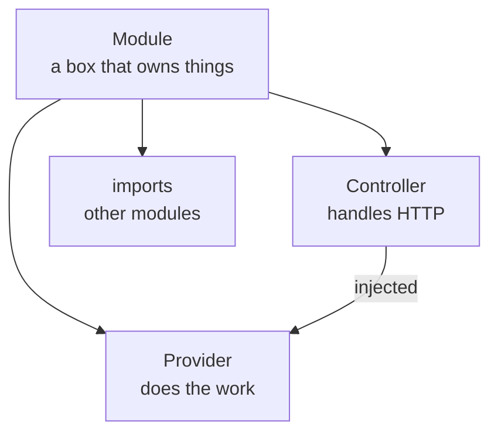
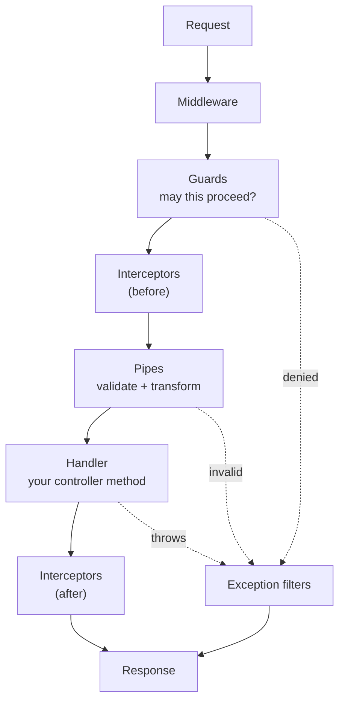
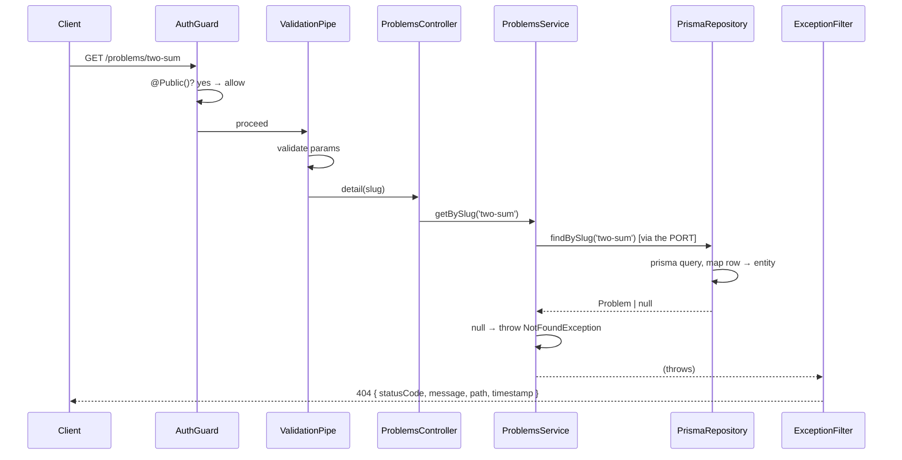

# NestJS — the complete working guide

Every piece of NestJS you will touch, what it does, how it talks to the other pieces, and an
example under each one. Written for someone using it for the first time.

**How to read it:** parts 1–5 are the foundation — read those in order, once. Parts 6–14 are the
request pipeline, which you can read as you meet each piece. Parts 15+ are reference.

**Its companions:**
[Backend Architecture](/guides/backend-architecture) — *where* code goes and why ·
`docs/phase-0` **Part B** — dependency injection derived slowly from first principles.
This guide is the mechanics.

---


## 🕹️ Play your way through

**Nine stations are waiting below**, where you are the container, the router or the pipeline. Each has a goal; meet it and
it gets a stamp. Nothing is timed, and nothing can be lost: a wrong move tells you why.

```sim
map
```

---

## ⌨️ This guide is interactive

**Fourteen exercises are embedded in the text**, each under the section that teaches it. You write
the code; the guide names which ideas you got and which you missed:

> ✅ `imports` holds the module · ❌ never puts a SERVICE in `imports`

Imports and surrounding context are given to you in an **Already in scope** panel — you never guess
a path. There's a hint, and a **👁 Show answer** on every one.

Several are repairs of code that **compiles and fails at boot**, which is the failure mode NestJS
specialises in and the one that costs whole afternoons.
## Contents

| Part | |
|---|---|
| 1 | [What NestJS is, and why it exists](#part-1--what-nestjs-is-and-why-it-exists) |
| 2 | [Decorators — the foundation](#part-2--decorators-the-foundation) |
| 3 | [The four building blocks](#part-3--the-four-building-blocks) |
| 4 | [Modules, completely](#part-4--modules-completely) |
| 5 | [Providers, completely](#part-5--providers-completely) |
| 6 | [Controllers and routing](#part-6--controllers-and-routing) |
| 7 | [Getting data out of a request](#part-7--getting-data-out-of-a-request) |
| 8 | [DTOs and validation](#part-8--dtos-and-validation) |
| 9 | [The request lifecycle](#part-9--the-request-lifecycle-in-full) |
| 10 | [Pipes](#part-10--pipes) |
| 11 | [Guards](#part-11--guards) |
| 12 | [Interceptors](#part-12--interceptors) |
| 13 | [Exception filters](#part-13--exception-filters) |
| 14 | [Middleware](#part-14--middleware) |
| 15 | [Custom decorators](#part-15--custom-decorators) |
| 16 | [Lifecycle hooks](#part-16--lifecycle-hooks) |
| 17 | [Configuration](#part-17--configuration) |
| 18 | [Testing](#part-18--testing) |
| 19 | [One request, traced end to end](#part-19--one-request-traced-end-to-end) |
| 20 | [Every error you'll hit](#part-20--every-error-youll-hit-and-what-it-means) |
| 21 | [The CLI](#part-21--the-cli) |

---

# Part 1 — What NestJS is, and why it exists

## The problem it solves

Here is an Express app. It works:

```ts
app.post('/users', async (req, res) => {
  const user = await db.query('INSERT INTO users ...');
  res.json(user);
});
```

Express gives you routing and nothing else. Every architectural decision is yours: where services
live, how you share a database connection, how validation happens, how errors become responses,
how you test any of it. Ten developers produce ten different codebases.

**NestJS is Express (or Fastify) with the architectural decisions already made.** It gives you:

| | |
|---|---|
| **Modules** | a unit of organisation |
| **Dependency injection** | a way to share and swap things |
| **A request pipeline** | fixed places for auth, validation, logging, errors |
| **Testability** | by construction, because nothing constructs its own dependencies |

## "Thinks like Spring"

If you've seen Java's Spring or .NET's ASP.NET Core, Nest will feel familiar — that's deliberate.
It borrows the module/provider/injection model wholesale.

**This is why it's worth learning even if you end up writing Java.** The vocabulary transfers
almost one-to-one, which is the whole point of Weeks 9–11 of your plan.

## What it's built on

Nest doesn't handle HTTP itself. It sits on **Express** by default (Fastify optionally) and adds
structure on top. That matters twice:

- Express's `Request`/`Response` objects are still underneath, and you can reach them
- Express middleware works unchanged

---

# Part 2 — Decorators, the foundation

Everything in Nest is decorators, so this has to come first.

## What a decorator actually is

**A function that runs when the class is defined, and attaches metadata to it.** It does not change
what your code does.

```ts
@Controller('problems')
export class ProblemsController {}
```

That attaches *"this class handles URLs under /problems"* to the class. Nothing else happens. Then
at startup, Nest walks every class asking *"what metadata is on you?"* and builds the application
from the answers.

> **Nest never reads your source code.** It reads the labels you attached. That's the whole
> mechanism, and it explains every "why isn't this working" you'll have.

## Where decorators can go

```ts
@Injectable()                                    // ← on a CLASS
export class ProblemsService {
  constructor(@Inject(TOKEN) private repo: R) {} // ← on a PARAMETER

  @Get(':slug')                                  // ← on a METHOD
  detail(@Param('slug') slug: string) {}         // ← on a PARAMETER
}
```

## Why they need special tsconfig flags

```json
"experimentalDecorators": true,
"emitDecoratorMetadata": true
```

The first enables the syntax. **The second is the magic one** — it makes TypeScript emit the
*types* of constructor parameters into the compiled JavaScript, so Nest can read them at runtime
and know what to inject.

Without `emitDecoratorMetadata`, `constructor(private prisma: PrismaService)` compiles to a
constructor taking one anonymous argument, and Nest has no idea what to put there.

**This is also why interfaces don't work as injection tokens** — they vanish entirely at compile
time, so there's no type to emit. Hence Part 5's tokens.

## The failure mode to recognise

Forget `@Injectable()` and **nothing errors at compile time.** But TypeScript emits type metadata
only "for declarations that have decorators"
([TypeScript handbook: decorator metadata](https://www.typescriptlang.org/docs/handbook/decorators.html#metadata)),
so an undecorated class has no record of its constructor's parameter types. Nest sees a parameter
it can't identify, and you get a runtime error at boot:

```
Nest can't resolve dependencies of ProblemsService (?)
```

When you see that, check decorators before anything else.

```check
decorators
```

---

# Part 3 — The four building blocks



| Block | Job | Decorator |
|---|---|---|
| **Module** | Group related things, declare what's shared | `@Module()` |
| **Controller** | Receive HTTP, delegate, respond | `@Controller()` |
| **Provider** | Anything injectable — services, repositories, factories | `@Injectable()` |
| **Container** | Constructs providers and wires them together | *(invisible)* |

### The smallest complete example

```ts
// cats.service.ts
@Injectable()
export class CatsService {
  findAll() { return ['Tom', 'Felix']; }
}

// cats.controller.ts
@Controller('cats')
export class CatsController {
  constructor(private readonly cats: CatsService) {}   // ← injected

  @Get()
  findAll() { return this.cats.findAll(); }             // → GET /cats
}

// cats.module.ts
@Module({
  controllers: [CatsController],
  providers: [CatsService],
})
export class CatsModule {}
```

Three files. `CatsModule` must then appear in `AppModule`'s `imports`, or none of it exists.

> **Every module must be reachable from `AppModule`, directly or through a chain of imports.** A
> module nobody imports is dead code that silently does nothing.

```sim
di
```

---

# Part 4 — Modules, completely

```ts
@Module({
  imports:     [OtherModule],    // modules whose EXPORTS I want to use
  controllers: [MyController],   // HTTP entry points owned by this module
  providers:   [MyService],      // things this module constructs
  exports:     [MyService],      // which of MY providers others may use
})
export class MyModule {}
```

## The rule that trips everyone

> **A provider is private to its module.** To use it elsewhere you must `export` it there **and**
> `import` that module here. **Both.**

Two failure modes, and you will hit both:

| You did | Error |
|---|---|
| Exported, but didn't import | `Nest can't resolve dependencies of X` |
| Imported, but didn't export | same error, different cause |
| Put a **service** in `imports` | `"X" is decorated with @Injectable() and cannot appear in the "imports" array` |
| Exported something you don't own | `Nest cannot export a provider that is not part of the currently processed module` |

**`imports` takes modules. `providers` takes classes.** Mixing them up is the single most common
beginner error.
```exercise
module-wiring
```

```exercise
invalid-module
```


### Example — two modules talking

```ts
// users.module.ts — owns UsersService, opens the door
@Module({
  providers: [UsersService, { provide: USERS_REPOSITORY, useClass: PrismaUsersRepository }],
  exports:   [UsersService],          // ← the door
})
export class UsersModule {}

// auth.module.ts — walks through it
@Module({
  imports:     [UsersModule],         // ← now AuthService can inject UsersService
  controllers: [AuthController],
  providers:   [AuthService, { provide: PASSWORD_HASHER, useClass: Argon2Hasher }],
})
export class AuthModule {}
```

Note what `AuthModule` does **not** export. It consumes; it doesn't republish.

### ⚠️ Never re-declare another module's provider

If `UsersService` won't resolve, Nest's error suggests *"move it to the providers array of the
importing module."* **Don't.** That creates a **second, separate instance** with its own
dependencies — and `AuthModule` doesn't provide `USERS_REPOSITORY`, so it fails worse. Two
instances of a stateful service is a genuinely nasty bug class.

**Import the module. Never copy the provider.**

## Global modules

```ts
@Global()
@Module({ providers: [PrismaService], exports: [PrismaService] })
export class PrismaModule {}
```

`@Global()` removes the need to *import* — register once in `AppModule` and every module can inject
it.

**`exports` is still required.** `@Global()` only handles the import half.

**Use it for:** config, database, logging — genuinely cross-cutting things.
**Don't use it for:** anything else. Global modules hide your dependency graph, and a graph you
can't see is one you can't reason about.

## Dynamic modules — `forRoot` and `forRootAsync`

Most modules are static. Some need **arguments**:

```ts
ConfigModule.forRoot({ isGlobal: true, validate: validateEnv })
```

`forRoot()` is a **static method that returns a module object**. It's a naming convention, not
syntax — `forRoot` for once at the root, `forFeature` for per-module configuration
(`TypeOrmModule.forFeature([User])`).

### ⚠️ It must go inside `imports`

```ts
// ❌ runs, result discarded, Nest never sees it
export class AppModule {}
ConfigModule.forRoot({ ... });

// ✅
@Module({ imports: [ConfigModule.forRoot({ ... })] })
export class AppModule {}
```

`forRoot()` *returns* a module. It has to be **given** to Nest.

### `forRootAsync` — when config needs config

```ts
JwtModule.registerAsync({
  imports: [ConfigModule],
  inject: [ConfigService],
  useFactory: (config: ConfigService) => ({
    secret: config.getOrThrow<string>('JWT_SECRET'),
    signOptions: { expiresIn: '15m' },
  }),
})
```

You need this whenever a module's options come from injected values — which is **exactly your
Week 1 JWT setup**, because the secret lives in validated config, not a literal.
```exercise
dynamic-module
```


```check
modules
```

```sim
modules
```

---

# Part 5 — Providers, completely

A **provider** is anything the container can construct and inject. Services, repositories,
factories, constants, even plain values.

## The four ways to provide something

### `useClass` — construct this class

```ts
providers: [CatsService]
// shorthand for:
providers: [{ provide: CatsService, useClass: CatsService }]
```

The class is its own token, because classes exist at runtime.

**With a different token** — this is the ports-and-adapters wiring:

```ts
{ provide: PROBLEMS_REPOSITORY, useClass: PrismaProblemsRepository }
```

*"When someone asks for this token, construct that class."* Swapping implementations is this one
line.

### `useValue` — inject something you already have

```ts
{ provide: 'CONFIG', useValue: { retries: 3 } }
```

**This is what tests use** to substitute a fake:

```ts
{ provide: PROBLEMS_REPOSITORY, useValue: fakeRepo }
```

### `useFactory` — construction needs logic

```ts
{
  provide: 'CONNECTION',
  inject: [ConfigService],
  useFactory: (config: ConfigService) => new Connection(config.get('DB_URL')),
}
```

`inject` lists what the factory itself needs. Factories may be `async`.

### `useExisting` — an alias

```ts
{ provide: 'LOGGER', useExisting: WinstonLogger }
```

Two tokens, **one instance**. Rare, but useful for renaming without duplicating.
```exercise
custom-provider
```


## Tokens — and why TypeScript needs them

Nest matches dependencies by **runtime type**. Classes exist at runtime. **Interfaces do not.**

```ts
constructor(private repo: ProblemsRepository) {}   // ❌ nothing to match at runtime
```

So you supply an explicit key:

```ts
// ports/problems.repository.ts
export const PROBLEMS_REPOSITORY = Symbol('ProblemsRepository');

// module
{ provide: PROBLEMS_REPOSITORY, useClass: PrismaProblemsRepository }

// consumer
constructor(@Inject(PROBLEMS_REPOSITORY) private repo: ProblemsRepository) {}
```

`Symbol('x')` is unique forever — two symbols with identical descriptions are still different, so
collisions are impossible. A string token works too and is easier to debug; a symbol is safer.

> **In Java and C# the interface survives to runtime**, so DI matches on it directly and no token is
> needed. This is the one place Nest is more verbose than Spring, and now you know why.

## Injection scopes

```ts
@Injectable({ scope: Scope.DEFAULT })    // singleton — ONE instance for the whole app
@Injectable({ scope: Scope.REQUEST })    // a new instance per request
@Injectable({ scope: Scope.TRANSIENT })  // a new instance per consumer
```

**Default is singleton, and that's what you want ~99% of the time.**

`REQUEST` scope is tempting for "current user" state and it's usually a mistake — it forces every
consumer up the chain to become request-scoped too, and performance drops noticeably. Pass the user
as an argument instead.

## Circular dependencies

If `A` needs `B` and `B` needs `A`, Nest throws. `forwardRef()` exists to break the cycle:

```ts
constructor(@Inject(forwardRef(() => B)) private b: B) {}
```

**Treat it as a smell, not a solution.** A cycle means either one class is doing too much, or a
shared concept belongs in a third place. Reach for `forwardRef` only after you've tried to remove
the cycle.

```check
providers
```

```sim
providers
```

```sim
leak
```

---

# Part 6 — Controllers and routing

## Routing is NOT file-based

If you're coming from Next.js: **folders mean nothing to the Nest router.** Only decorators define
routes. You could put every controller in a folder called `banana/` and the URLs would be identical.

```ts
@Controller('auth')        // ← prefix
export class AuthController {
  @Post('register')        // ← suffix    →  POST /auth/register
  @Post('login')           //             →  POST /auth/login
}
```

**`@Controller(prefix)` + `@Method(suffix)` = the full path.** Concatenated. That's all.

**One controller, many routes.** Register and login are two routes on one resource — not two
controllers, and definitely not two folders.

## Every HTTP method decorator

| Decorator | Verb | Use for |
|---|---|---|
| `@Get()` | GET | read. **Never** for anything secret or state-changing |
| `@Post()` | POST | create, or anything with a secret in the body |
| `@Put()` | PUT | replace a whole resource |
| `@Patch()` | PATCH | update part of a resource |
| `@Delete()` | DELETE | delete |
| `@Head()`, `@Options()` | | rare |
| `@All()` | any | rare, usually a smell |

> **Login is a POST.** A GET puts the password in the URL — which lands in browser history, server
> logs, the `Referer` header, and proxy caches.

## Route parameters and wildcards

```ts
@Get(':slug')            // /problems/two-sum
@Get(':category/:slug')  // /problems/arrays/two-sum
@Get('search/*')         // wildcard
```

### ⚠️ Order matters

```ts
@Get(':slug')      // declared first — matches EVERYTHING, including "featured"
@Get('featured')   // unreachable
```

**Static routes must be declared before dynamic ones.** "Nest registers routes in declaration
order", so on Express a parameter route can silently shadow a more specific one declared after it,
and this produces a genuinely baffling bug the first time
([Nest docs: controllers](https://docs.nestjs.com/controllers)). NestJS v12 adds an opt-in
`routeResolutionStrategy: 'specificity'` that registers the most specific routes first; the
default is still declaration order.

## Response control

```ts
@Post()
@HttpCode(201)                              // default for @Post is already 201
@Header('Cache-Control', 'no-store')
@Redirect('https://example.com', 302)
create() { return { ok: true }; }
```

**Default status codes:** `200` for everything except `@Post`, which is `201`.

**Whatever you return is serialised to JSON.** You don't touch the response object — that's Nest's
job, and staying out of it is what keeps controllers testable.
```exercise
status-codes
```


```sim
routes
```

---

# Part 7 — Getting data out of a request

| Decorator | Reads | Example |
|---|---|---|
| `@Body()` | the whole JSON body | `@Body() dto: RegisterDto` |
| `@Body('email')` | one field | `@Body('email') email: string` |
| `@Param()` | all route params | `@Param() params: any` |
| `@Param('slug')` | one route param | `@Param('slug') slug: string` |
| `@Query()` | the whole query string | `@Query() q: ListProblemsDto` |
| `@Query('limit')` | one query param | `@Query('limit') limit: string` |
| `@Headers('authorization')` | one header | |
| `@Ip()` | client IP | |
| `@Session()` | the session object | |
| `@Req()` | the raw Express request | escape hatch |
| `@Res()` | the raw Express response | ⚠️ see below |

### Example

```ts
@Get(':slug')
async detail(
  @Param('slug') slug: string,
  @Query() query: DetailQueryDto,
  @Headers('accept-language') lang: string,
) { ... }
```

### ⚠️ `@Res()` disables Nest's response handling

The moment you inject `@Res()`, Nest stops serialising your return value — **you must call
`res.json()` yourself**, and forgetting to leaves the request hanging until it times out.

If you need the response object only to set a cookie, use the passthrough form:

```ts
@Res({ passthrough: true }) res: Response
```

Now you can call `res.cookie(...)` **and** still return a value normally. This is exactly what
you'll want for httpOnly refresh cookies.

```check
routing
```

---

# Part 8 — DTOs and validation

A **DTO** (Data Transfer Object) is a class describing the shape of data crossing your HTTP
boundary.

### ⚠️ It must be a `class`, never an `interface`

Interfaces vanish at compile time, so the decorators would have nothing to attach to and validation
would silently do **nothing**. This is a genuinely dangerous mistake — it fails open.

### Example

```ts
export class RegisterDto {
  @IsEmail()
  email: string;

  @IsString()
  @MinLength(3)
  @MaxLength(20)
  username: string;

  @IsString()
  @MinLength(12)          // NIST: length over complexity. Don't require symbols
  password: string;
}
```

## The three moving parts

| Piece | Job |
|---|---|
| **class-validator** | the rules — `@IsEmail()`, `@Min()` |
| **class-transformer** | plain object → class instance, and type conversion |
| **ValidationPipe** | runs both; throws 400 on failure |

It only works because of this in `main.ts`:

```ts
app.useGlobalPipes(new ValidationPipe({ whitelist: true, transform: true }));
```

| Option | Does | Why you want it |
|---|---|---|
| `whitelist: true` | **strips** undeclared properties | **Security.** See below |
| `forbidNonWhitelisted: true` | 400s instead of stripping | Stricter; louder for API clients |
| `transform: true` | plain object → DTO instance, applies `@Type` | Without it `?limit=20` stays the string `"20"` |
| `transformOptions.enableImplicitConversion` | infers conversions from TS types | Convenient, slightly magic |

### `whitelist: true` is a security control

Without it, a body of `{ email, password, role: "ADMIN" }` passes `role` through untouched. If any
code later spreads that object into a database write, the client just made themselves an admin.

That's **mass assignment**, a real vulnerability class, and a standard interview question.

## Query strings are always strings

```ts
export class ListProblemsDto {
  @IsOptional()
  @Type(() => Number)      // ← "20" → 20 BEFORE validation runs
  @IsInt()
  @Min(1)
  @Max(100)                // ← without this, a client asks for a million rows
  limit: number = 20;
}
```

⚠️ **Booleans are a trap.** `Boolean("false")` is `true`. Use
`@Transform(({ value }) => value === 'true')`, never `@Type(() => Boolean)`.
```exercise
dto-coercion
```


## The decorators you'll actually use

| Need | Decorator |
|---|---|
| Text | `@IsString()` `@MinLength()` `@MaxLength()` `@Matches(/re/)` |
| Numbers | `@IsInt()` `@IsNumber()` `@Min()` `@Max()` `@IsPositive()` |
| Choice | `@IsIn([...])` `@IsEnum(MyEnum)` |
| Formats | `@IsEmail()` `@IsUrl()` `@IsUUID()` `@IsDateString()` |
| Optional | `@IsOptional()` — **without it every field is required** |
| Arrays | `@IsArray()` `@ArrayMinSize()` `@ValidateNested({ each: true })` |
| Nested | `@ValidateNested()` + `@Type(() => ChildDto)` |
```exercise
login-dto
```


```check
dtos
```

```sim
validation
```

---

# Part 9 — The request lifecycle, in full

This is the map. Knowing the order tells you where every piece of code belongs.



**The exact order**, which is worth memorising:

1. Middleware (global, then module-bound)
2. **Guards** (global → controller → route)
3. **Interceptors**, before-half (global → controller → route)
4. **Pipes** (global → controller → route → parameter)
5. **Your handler**
6. **Interceptors**, after-half (route → controller → global — *reversed*)
7. **Exception filters** if anything threw (route → controller → global)
8. Response

## Where each concern belongs

| Concern | Stage | Why |
|---|---|---|
| Parsing cookies, raw body | Middleware | Before anything else needs it |
| "Are you logged in?" | **Guard** | Nothing below should run for an unknown user |
| "Do you have the role?" | **Guard** | A route fact |
| "Do you own this record?" | **Service** | Needs the record loaded |
| Validating the body shape | **Pipe** | At the boundary |
| Business rules | **Service / domain** | Not the pipeline's job |
| Timing, logging | **Interceptor** | Wraps before and after |
| Turning errors into JSON | **Filter** | Last stop |

> **Cross-cutting concerns live in the pipeline, never in your business logic.** Your service should
> never contain `if (!user) throw`.
```exercise
pipeline-order
```


```check
lifecycle
```

```sim
pipeline
```

---

# Part 10 — Pipes

A pipe **transforms or validates** a value before the handler sees it.

## Built-in

```ts
@Get(':id')
findOne(@Param('id', ParseIntPipe) id: number) {}     // "42" → 42, or 400
```

| Pipe | Does |
|---|---|
| `ValidationPipe` | runs class-validator on a DTO |
| `ParseIntPipe` / `ParseFloatPipe` | string → number, or 400 |
| `ParseBoolPipe` | `"true"` → `true` |
| `ParseUUIDPipe` | validates a UUID |
| `ParseArrayPipe` | comma-separated → array |
| `DefaultValuePipe` | supplies a fallback |

## Custom

```ts
@Injectable()
export class TrimPipe implements PipeTransform {
  transform(value: unknown, metadata: ArgumentMetadata) {
    return typeof value === 'string' ? value.trim() : value;
  }
}
```

## Three levels of application

```ts
app.useGlobalPipes(new ValidationPipe())    // every route
@UsePipes(new ValidationPipe())             // one controller or method
@Param('id', ParseIntPipe)                  // one parameter
```

**Global is the right default for `ValidationPipe`** — you want validation everywhere, and
opting *out* per route is safer than remembering to opt in.

---

# Part 11 — Guards

A guard answers exactly one question: **"may this request proceed?"** Return `true` or `false`.

```ts
@Injectable()
export class AuthGuard implements CanActivate {
  canActivate(context: ExecutionContext): boolean | Promise<boolean> {
    const request = context.switchToHttp().getRequest();
    const token = request.headers.authorization?.split(' ')[1];
    if (!token) return false;                    // → 403 by default
    request.user = verify(token);                // attach for later
    return true;
  }
}
```

`ExecutionContext` is generic because Nest also supports WebSockets and gRPC.
`switchToHttp()` narrows it.

## Reading metadata — the `Reflector`

This is how `@Public()` and `@Roles()` work:

```ts
export const Public = () => SetMetadata('isPublic', true);

@Injectable()
export class AuthGuard implements CanActivate {
  constructor(private reflector: Reflector) {}

  canActivate(ctx: ExecutionContext) {
    const isPublic = this.reflector.getAllAndOverride<boolean>('isPublic', [
      ctx.getHandler(),    // the method — checked FIRST
      ctx.getClass(),      // the controller — fallback
    ]);
    if (isPublic) return true;
    // ...
  }
}
```

`getAllAndOverride` checks the method before the class, so a route-level decorator **overrides** a
controller-level one. That ordering is why it isn't just `get`.

## Global with opt-out, not per-route opt-in

If auth is opt-in, forgetting the decorator leaves an endpoint **open**. If it's opt-out, forgetting
means a route is *over*-protected — which fails loudly and safely.

> **Default to secure.**

## 401 vs 403

| Code | Means |
|---|---|
| **401 Unauthorized** | "I don't know who you are" — missing or invalid token |
| **403 Forbidden** | "I know who you are, and you may not" |

A guard returning `false` produces **403** by default. For a missing token you usually want 401, so
throw `new UnauthorizedException()` instead of returning `false`.
```exercise
auth-guard
```

```exercise
global-guard
```


```check
guards
```

---

# Part 12 — Interceptors

Interceptors wrap the handler — they run code **before and after**, and can transform the response.

```ts
@Injectable()
export class LoggingInterceptor implements NestInterceptor {
  intercept(ctx: ExecutionContext, next: CallHandler): Observable<unknown> {
    const start = Date.now();
    const req = ctx.switchToHttp().getRequest();

    return next.handle().pipe(              // ← everything after next.handle() is "after"
      tap(() => console.log(`${req.method} ${req.url} — ${Date.now() - start}ms`)),
    );
  }
}
```

`next.handle()` returns an **RxJS Observable**. You don't need to know RxJS deeply — three
operators cover almost everything:

| Operator | Does |
|---|---|
| `tap(fn)` | side effect, doesn't change the value — logging, metrics |
| `map(fn)` | transform the response — wrap in an envelope |
| `catchError(fn)` | intercept errors |

**Good uses:** request timing, response envelopes, caching, stripping fields.
**Not for:** business logic, or auth (that's a guard).

---

# Part 13 — Exception filters

## The built-in hierarchy

```ts
throw new NotFoundException('Problem not found');      // 404
throw new BadRequestException();                       // 400
throw new UnauthorizedException();                     // 401
throw new ForbiddenException();                        // 403
throw new ConflictException('Email taken');            // 409
throw new UnprocessableEntityException();              // 422
throw new InternalServerErrorException();              // 500
```

All extend `HttpException`, which you can also use directly:

```ts
throw new HttpException('Custom', HttpStatus.I_AM_A_TEAPOT);
```

Nest catches these automatically and produces sensible JSON. **A plain `new Error()` becomes a
500** — which is why `throw new Error('Email taken')` gives the client a server error for their own
fixable mistake.

## A custom filter

```ts
@Catch()                                   // no argument = catch EVERYTHING
export class AllExceptionsFilter implements ExceptionFilter {
  catch(exception: unknown, host: ArgumentsHost) {
    const ctx = host.switchToHttp();
    const response = ctx.getResponse<Response>();
    const request = ctx.getRequest<Request>();

    const isHttp = exception instanceof HttpException;
    const status = isHttp ? exception.getStatus() : 500;
    const message = isHttp ? exception.message : 'Internal server error';
    //                                          ↑ never leak a stack trace

    response.status(status).json({
      statusCode: status, message, path: request.url, timestamp: new Date().toISOString(),
    });
  }
}
```

`@Catch(HttpException)` would catch only those. `@Catch()` catches everything — use it for the
global fallback.

Register it: `app.useGlobalFilters(new AllExceptionsFilter());`

> **Writing the filter does nothing until you register it.** If your 404s still look like Nest's
> defaults, that's the missing line.
```exercise
exception-filter
```


---

# Part 14 — Middleware

Plain Express middleware. Runs **before** everything else, has no access to Nest's `ExecutionContext`.

```ts
@Injectable()
export class LoggerMiddleware implements NestMiddleware {
  use(req: Request, res: Response, next: NextFunction) {
    console.log(`${req.method} ${req.url}`);
    next();                                      // ← forget this and the request hangs
  }
}

@Module({})
export class AppModule implements NestModule {
  configure(consumer: MiddlewareConsumer) {
    consumer.apply(LoggerMiddleware).forRoutes('*');
  }
}
```

**Use middleware for:** cookie parsing, raw body capture, third-party Express libraries (helmet,
compression).
**Use a guard or interceptor instead for:** anything that needs to know which controller or handler
is running — middleware runs too early to know.

```check
wrappers
```

```sim
placement
```

---

# Part 15 — Custom decorators

## Metadata decorators — attach a label

```ts
export const Roles = (...roles: string[]) => SetMetadata('roles', roles);
export const Public = () => SetMetadata('isPublic', true);

@Roles('ADMIN')
@Delete(':id')
remove() {}
```

Read back with `Reflector`, as in Part 11.

## Parameter decorators — extract from the request

```ts
export const CurrentUser = createParamDecorator(
  (data: unknown, ctx: ExecutionContext) => ctx.switchToHttp().getRequest().user,
);

@Get('me')
me(@CurrentUser() user: User) { return user; }
```

**This is the payoff of a guard attaching `request.user`.** Your controller never touches the raw
request object — cleaner, and trivially testable.

## Composing them

```ts
export const Auth = (...roles: string[]) =>
  applyDecorators(UseGuards(AuthGuard, RolesGuard), Roles(...roles));

@Auth('ADMIN')       // one decorator, three behaviours
@Delete(':id')
remove() {}
```
```exercise
custom-decorators
```


---

# Part 16 — Lifecycle hooks

Methods Nest calls at known moments, if your class declares them:

| Hook | When |
|---|---|
| `onModuleInit()` | once, after this module's dependencies are ready |
| `onApplicationBootstrap()` | after **all** modules are initialised |
| `onModuleDestroy()` | shutdown begins |
| `beforeApplicationShutdown()` | after `onModuleDestroy` |
| `onApplicationShutdown(signal)` | last chance |

```ts
@Injectable()
export class PrismaService extends PrismaClient implements OnModuleInit, OnModuleDestroy {
  async onModuleInit()    { await this.$connect(); }
  async onModuleDestroy() { await this.$disconnect(); }
}
```

### ⚠️ Shutdown hooks need enabling

```ts
app.enableShutdownHooks();
```

The destroy and shutdown hooks run when you call `app.close()` yourself. A **signal** is another
matter: Nest listens for `SIGTERM` and friends only after `enableShutdownHooks()`, because the
listeners cost resources and are off by default
([Nest docs: application shutdown](https://docs.nestjs.com/fundamentals/lifecycle-events#application-shutdown)).
Without it, `docker stop` (which sends `SIGTERM`) ends the process without running
`onModuleDestroy`, and the database connection is never closed cleanly.

> Note this class uses `extends` **and** `implements` for different reasons: `extends PrismaClient`
> to inherit its query methods, `implements OnModuleInit` so the compiler checks you spelled the
> hooks correctly. Interfaces contribute no code.

---

# Part 17 — Configuration

```ts
@Module({
  imports: [ConfigModule.forRoot({ isGlobal: true, validate: validateEnv })],
})
export class AppModule {}
```

| Option | Does |
|---|---|
| `isGlobal: true` | inject `ConfigService` anywhere without importing |
| `validate` | **your function**, run once at boot. Throwing aborts startup |
| `envFilePath` | which `.env` file(s) |
| `load` | custom config factories |

## Reading values

```ts
constructor(private config: ConfigService) {}

this.config.get<number>('PORT');            // number | undefined
this.config.getOrThrow<string>('DB_URL');   // throws if missing — usually what you want
```

In `main.ts` there's no constructor to inject into, so pull it out manually:

```ts
const config = app.get(ConfigService);
```

## Fail fast

Validate at boot with a Zod (or Joi) schema and **throw** on failure. The app then refuses to start
with a message naming the bad variable — instead of booting happily and dying on the first request
at 3am with an error that mentions nothing useful.

```check
extras
```

---

# Part 18 — Testing

## Unit test — no Nest at all

```ts
const fakeRepo: ProblemsRepository = {
  findBySlug: (slug) => Promise.resolve(slug === 'two-sum' ? sample : null),
  findMany:   () => Promise.resolve([sample]),
};

const service = new ProblemsService(fakeRepo);    // ← a plain constructor call
```

**This is the payoff for dependency injection.** No container, no database, milliseconds. Possible
only because the service *declares* its dependencies instead of constructing them.

> If your unit tests need `Test.createTestingModule`, ask whether you actually need the framework —
> usually you don't.
```exercise
unit-test-no-nest
```


## Integration test — with the container

```ts
const moduleRef = await Test.createTestingModule({
  controllers: [ProblemsController],
  providers: [ProblemsService, { provide: PROBLEMS_REPOSITORY, useValue: fakeRepo }],
}).compile();

const controller = moduleRef.get<ProblemsController>(ProblemsController);
```

`overrideProvider` swaps a real dependency in a full module:

```ts
.overrideProvider(PROBLEMS_REPOSITORY).useValue(fakeRepo)
```

## e2e — the whole app over HTTP

```ts
const app = moduleRef.createNestApplication();
await app.init();
await request(app.getHttpServer()).get('/problems').expect(200);
```

⚠️ **e2e tests don't get your `main.ts` setup automatically.** Global pipes and filters are
configured on the app instance there, so you must repeat them in the test — otherwise validation
silently doesn't run and your test passes for the wrong reason.

---

# Part 19 — One request, traced end to end

`GET /problems/two-sum` — every piece, in order.



**Step by step:**

1. **Route matching** — Nest finds `@Controller('problems')` + `@Get(':slug')`
2. **Guard** — global `AuthGuard` runs, sees `@Public()` metadata via `Reflector`, returns `true`
3. **Interceptor (before)** — logging starts a timer
4. **Pipe** — `ValidationPipe` validates and transforms parameters
5. **Handler** — the controller method runs with `slug` already a clean string
6. **Service** — the use case: fetch, and 404 if absent
7. **Port → adapter** — the service calls the *interface*; DI supplied the Prisma implementation
8. **Adapter** — queries Prisma, maps the row to your domain entity field by field
9. **Return or throw** — on success it flows back; on `null` the service throws
10. **Interceptor (after)** — logs the duration
11. **Filter** — catches the exception, produces your JSON shape
12. **Response**

**Notice what each layer knows:** the controller knows HTTP but not Prisma. The service knows
business rules but not HTTP or Prisma. The adapter knows Prisma but not HTTP. That separation is
the whole point, and the pipeline is what makes it possible.

---

# Part 20 — Every error you'll hit, and what it means

| Error | Cause | Fix |
|---|---|---|
| `Nest can't resolve dependencies of X (?)` | The `?` marks which parameter. Not provided, not exported, module not imported, or missing `@Injectable()` | Check all four |
| `"X" is decorated with @Injectable() and cannot appear in the "imports" array` | You put a **service** in `imports` | `imports` takes **modules** |
| `Nest cannot export a provider that is not part of the currently processed module` | Exporting something you don't own | Import the owning module; don't re-export |
| `Cannot determine a type for the dependency` | An **interface** used as a token | Use a `Symbol` + `@Inject()` |
| `A circular dependency has been detected` | A ↔ B | Redesign; `forwardRef` only as a last resort |
| Route returns 404 that should exist | Controller missing from `controllers`, or a dynamic route declared before a static one | Check both |
| Validation silently doesn't run | DTO is an `interface`, or `ValidationPipe` not registered, or `transform: false` | All three are silent failures |
| Request hangs forever | `@Res()` without responding, or middleware that never calls `next()` | |
| `Cannot read properties of undefined (reading 'user')` | Guard didn't attach it, or guard didn't run | Check guard registration |
| Your filter's shape isn't used | `useGlobalFilters` never called | Register it in `main.ts` |
| Config is `undefined` | `ConfigModule` not imported, or not `isGlobal` | |

## The debugging order

1. **Read the error literally.** Nest's messages are unusually good — the `(?)` marks the exact
   failing parameter
2. **Check decorators** — `@Injectable()` on the class?
3. **Check the module** — is it in `providers`? `exports`? Is the module in `imports`?
4. **Check `AppModule`** — is this module reachable at all?
5. **Check the startup log** — `Mapped {/problems, GET} route` lines tell you exactly which routes
   exist
```exercise
resolve-dependencies
```


```check
testing
```

```sim
clinic
```

---

# Part 21 — The CLI

```bash
pnpm exec nest g module problems        # generates + registers in AppModule
pnpm exec nest g controller problems
pnpm exec nest g service problems
pnpm exec nest g resource problems      # module + controller + service + DTOs + tests
pnpm exec nest g guard auth
pnpm exec nest g interceptor logging
pnpm exec nest g filter all-exceptions
pnpm exec nest g decorator current-user

nest g module problems --dry-run        # preview without writing
```

`nest g module` also **adds it to `AppModule`'s imports** for you — a genuine time-saver and one
less thing to forget.

Generated files land in flat folders. Restructure them into
`domain/ ports/ adapters/ application/ http/` afterwards — see
[Backend Architecture](/guides/backend-architecture).

---

## Mastery checklist — you can…

- [ ] Explain what a decorator does and why `emitDecoratorMetadata` is required
- [ ] Name the four things a `@Module()` declares and what each array takes
- [ ] Say why `imports` takes modules and `providers` takes classes
- [ ] Explain why re-declaring another module's provider is a bug, not a fix
- [ ] Give the four provider forms and when each is right
- [ ] Explain why TypeScript needs an injection token when Java doesn't
- [ ] Build a route path from `@Controller` + `@Get` without guessing
- [ ] Say why static routes must precede dynamic ones
- [ ] List the six pipeline stages **in order**
- [ ] Place auth, validation, logging and error-shaping in the right stage
- [ ] Explain what `whitelist: true` prevents, by name
- [ ] Say why a DTO must be a class
- [ ] Use `Reflector` to read metadata in a guard, and say why `getAllAndOverride`
- [ ] Explain what `@Res()` breaks and what `passthrough` restores
- [ ] Unit-test a service with **no** Nest at all

## Self-quiz — answers included

**1. Why can't an interface be an injection token?**
Interfaces are erased at compile time, so there's nothing at runtime to match against. Use a
`Symbol` and `@Inject()`.

**2. `Nest can't resolve dependencies of AuthService (?, UsersService)` — what does `?` mean?**
The **first** constructor parameter can't be resolved. Nest prints resolved names and `?` for the
one that failed — it's telling you exactly which.

**3. You need `UsersService` in `AuthModule`. Two things must be true.**
`UsersModule` must **export** it, and `AuthModule` must **import** `UsersModule`. Adding it to
`AuthModule`'s providers creates a second, broken instance.

**4. `@Get('featured')` returns "problem not found". Why?**
A `@Get(':slug')` is declared above it, so `featured` matched as a slug. Static routes first.

**5. Your validation isn't running. Three possible causes.**
The DTO is an `interface` not a `class`; `ValidationPipe` isn't registered globally; or
`transform: false` so `@Type()` never converts. All three fail silently.

**6. Where does "only the author may edit" belong — guard or service?**
Service. A guard can't know it without loading the record. "Must be an admin" *is* a guard — that's
a route fact.

**7. What breaks when you add `@Res()`?**
Nest stops serialising your return value. You must call `res.json()` yourself. Use
`@Res({ passthrough: true })` if you only need to set a cookie.

**8. Why does `onModuleDestroy` sometimes not run when the container stops?**
`app.enableShutdownHooks()` wasn't called, so Nest isn't listening for `SIGTERM`. (An explicit
`app.close()` runs the hooks either way.)

**9. Difference between a guard returning `false` and throwing `UnauthorizedException`?**
`false` → 403 Forbidden. The exception → 401 Unauthorized. Use 401 for "who are you?", 403 for
"you may not".

**10. Why can you unit-test a service without Nest?**
Because it takes its dependencies as constructor parameters. `new Service(fake)` is just JavaScript
— the container is only needed to wire the real app.
