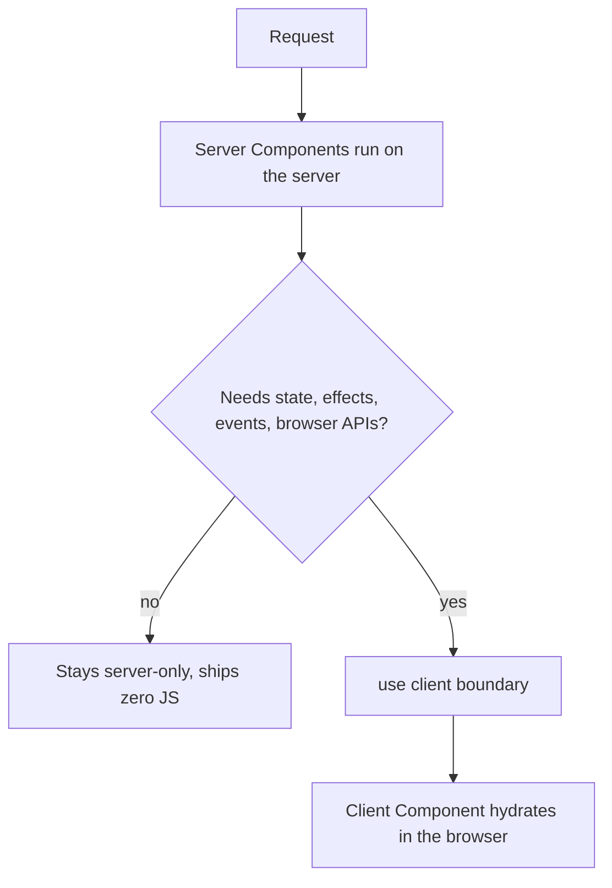

# Next.js — the App Router, from mental model to muscle memory

A Dojo supplement guide. Next.js is React plus a *framework*: routing, server rendering, data fetching, caching,
and a server↔client boundary, all with conventions instead of config. The App Router (the `app/` directory) is a
genuine shift from plain React — most confusion comes from not knowing *where code runs*. We fix that first, then
build up routing, data, mutations, and the hooks React alone doesn't give you.

> **How to read this.** You need React fundamentals first (components, state, effects) — this guide assumes them.
> Spin up `npx create-next-app` and try each convention. Each section ends with **the bug it prevents**. This is
> the reading behind the **Next.js** coding track.

---

## 0. The one idea everything hangs on: where does this run?

In the App Router, every component is a **Server Component by default**. It runs on the server, never ships to the
browser, and can `await` data directly. A component becomes a **Client Component** — interactive, with state and
effects — only when its file starts with the `"use client"` directive.



The instinct to build: **keep components on the server unless they need interactivity.** Server Components mean
less JavaScript shipped, direct data access, and secrets that stay secret. Push `"use client"` down to the small
leaf that actually needs a button or `useState` — a chart, a search box — not up at the page.

**The bug it prevents.** `useState is not defined` / hydration errors, from putting hooks in a Server Component —
or shipping your whole page (and its data-fetching secrets) to the browser by marking the top `"use client"`.

---

## 1. Routing is the file system

Folders under `app/` are URL segments; a `page.tsx` makes a segment routable:

```
app/
  page.tsx              → /
  about/page.tsx        → /about
  blog/[slug]/page.tsx  → /blog/:slug   (dynamic segment)
  layout.tsx            → wraps every page (shared shell, persists across nav)
  loading.tsx           → instant loading UI while a segment streams in
  error.tsx             → error boundary for the segment
```

A **dynamic segment** `[slug]` becomes the `params` prop on the server:

```tsx
export default async function Page({ params }: { params: Promise<{ slug: string }> }) {
  const { slug } = await params;
  return <Article slug={slug} />;
}
```

**Layouts** wrap their subtree and — crucially — *persist* across navigation within that subtree (state and scroll
survive), while pages swap underneath. **`loading.tsx`** is sugar for a Suspense boundary: Next shows it instantly
while the async page streams in. **`error.tsx`** catches errors in that segment.

**The bug it prevents.** Re-implementing a router, or losing sidebar state on every navigation because you rebuilt
the shell in each page instead of a shared `layout`.

---

## 2. Fetching data — on the server, with `await`

Server Components can be `async` and fetch inline. No `useEffect`, no loading state, no client bundle:

```tsx
export default async function Page() {
  const res = await fetch("https://api.example.com/users");
  const users = await res.json();
  return (
    <ul>
      {users.map((u) => <li key={u.id}>{u.name}</li>)}
    </ul>
  );
}
```

Two habits that pay off immediately:

**Parallelise independent requests** — don't create a waterfall:

```tsx
// slow: posts waits for user
const user = await getUser();
const posts = await getPosts();

// fast: both at once
const [user, posts] = await Promise.all([getUser(), getPosts()]);
```

**Control caching per request** via the `next` option:

```tsx
fetch(url, { cache: "no-store" });            // always fresh (dynamic)
fetch(url, { next: { revalidate: 60 } });     // ISR: cached, refreshed ≤ every 60s
fetch(url, { next: { tags: ["users"] } });    // tag it, purge later with revalidateTag
```

Next also *dedupes* identical `fetch`es within a render, so two components asking for the same data hit the
network once.

**The bug it prevents.** A page three times slower than needed (sequential awaits), and stale-or-too-fresh data
from not choosing a caching strategy.

---

## 3. Mutations — Server Actions and forms

A **Server Action** is a function marked `"use server"` that runs on the server but is callable from the client —
no API route, no `fetch`. Wire it straight to a form:

```tsx
"use server";
import { revalidatePath } from "next/cache";

export async function createTodo(formData: FormData) {
  const text = formData.get("text");
  await db.todo.create({ data: { text } });
  revalidatePath("/todos"); // tell Next the cached list is stale
}
```

```tsx
<form action={createTodo}>
  <input name="text" />
  <SubmitButton />
</form>
```

After a mutation you **must** revalidate the cache (`revalidatePath` or `revalidateTag`) or the UI shows stale
data. For pending state, read the nearest form's status with `useFormStatus` — in a *child* Client Component:

```tsx
"use client";
import { useFormStatus } from "react-dom";

function SubmitButton() {
  const { pending } = useFormStatus();
  return <button disabled={pending}>{pending ? "Saving…" : "Save"}</button>;
}
```

For instant feedback before the server responds, `useOptimistic` layers a temporary value over real state and
discards it when the truth arrives. For validation/return values, `useActionState` wraps the action and exposes
its result.

**The bug it prevents.** Building a REST endpoint + `fetch` + `useState` for every form, and a list that doesn't
update after a create because nothing revalidated the cache.

---

## 4. Route handlers — when you do need an endpoint

For webhooks, third-party callbacks, or non-form APIs, a `route.ts` exports functions **named after HTTP verbs**;
the folder path is the URL:

```tsx
// app/api/health/route.ts
import { NextResponse } from "next/server";

export async function GET() {
  return NextResponse.json({ status: "ok" });
}
```

`GET`, `POST`, `PUT`, `DELETE` — no router config. This replaces the Pages Router's `pages/api`.

**The bug it prevents.** Reaching for a route handler when a Server Action would do (most form mutations don't
need a public endpoint) — or vice versa, trying to make a form post to a Server Component.

---

## 5. The client hooks React alone doesn't have

These live in `next/navigation` (App Router — *not* the old `next/router`) and only work in Client Components:

```tsx
"use client";
import { useRouter, usePathname, useSearchParams, useParams } from "next/navigation";

const router = useRouter();          // router.push("/x"), router.replace, router.refresh
const pathname = usePathname();      // "/blog/hello" — re-renders on navigation
const searchParams = useSearchParams(); // read ?q=… with .get("q")
const params = useParams();          // dynamic segments: { slug }
```

`router.push` adds a history entry (client-side, no reload); `replace` doesn't. Prefer `<Link href>` over `<a>`
for navigation — it prefetches the target in the background, so clicks feel instant. `usePathname` is the idiomatic
way to compute an active link.

On the server, redirect and set metadata declaratively:

```tsx
import { redirect } from "next/navigation";
if (!session) redirect("/login");    // throws to redirect; code after never runs

export async function generateMetadata({ params }) {  // dynamic <title>
  const { slug } = await params;
  return { title: slug };
}
```

`redirect()` from a Server Component is safer than a client redirect — the protected content is never sent to the
browser at all.

**The bug it prevents.** Importing from `next/router` (Pages Router) and getting a runtime error, and building a
`<head>` by hand instead of exporting metadata.

---

## 6. Putting it together — a mental checklist for any feature

```mermaid
flowchart TD
  A[New feature] --> B{Needs interactivity?}
  B -->|no| C[Server Component: await data, render]
  B -->|yes| D[Small "use client" leaf for the interactive bit]
  A --> E{Changes data?}
  E -->|yes| F[Server Action + revalidatePath/Tag]
  E -->|reads only| G[fetch with the right cache option]
```

- **Read** → Server Component + `fetch` (choose the cache strategy).
- **Interact** → a small Client Component leaf.
- **Mutate** → Server Action + revalidate.
- **External API in** → `route.ts` handler.

---

## Mastery checklist — you can…

- [ ] say for any component whether it runs on the server or client, and why
- [ ] push `"use client"` to the smallest leaf instead of the page
- [ ] build a route with a dynamic segment, a shared layout, and a `loading.tsx`
- [ ] fetch in parallel with `Promise.all` and pick a `cache` / `revalidate` strategy per request
- [ ] write a Server Action, wire it to a `<form action>`, and revalidate after it
- [ ] show pending state with `useFormStatus` in a child component
- [ ] use `useRouter`/`usePathname`/`useSearchParams` from `next/navigation`, and `redirect()` on the server

## Self-quiz

Answer each aloud before reading the answer under it.

1. **A component uses `onClick` and `useState`. What must its file contain, and where should it live?**
   *Answer:* `"use client"` as the **first line of the file**. And it should sit as **low in the tree
   as possible** — a leaf. `"use client"` marks a *boundary*, not a single component: everything that
   file imports becomes part of the client bundle too. So keep pages and layouts as Server
   Components and push interactivity down into small client leaves, rather than marking a top-level
   layout and dragging the whole subtree across with it.

2. **Why doesn't a list refresh after a Server Action creates a row?**
   *Answer:* Because the route's rendered output is **cached** — the write happened, but nothing told
   Next.js the page's data is now stale, so it re-serves the existing render. Fix it inside the
   action, after the write: `revalidatePath("/things")` (or `revalidateTag("things")` if you tagged
   the fetch). The mental model: mutating data and *invalidating the cache that displayed it* are two
   separate steps, and you own the second one.

3. **`router.push` vs `redirect()` — which runs where?**
   *Answer:* `router.push` is **client-side** — from `next/navigation`, inside a Client Component,
   in response to an event. `redirect()` runs on the **server**, inside a Server Component, Server
   Action or Route Handler, and works by throwing a special error that aborts rendering (so code
   after it never runs — and never wrap it in a `try/catch` that swallows everything). Pick
   `redirect()` when the server already knows the answer: after a mutation, or an auth check during
   render. Pick `router.push` when the decision belongs to a client interaction.

4. **`cache: "no-store"` vs `next: { revalidate: 60 }`?**
   *Answer:* `no-store` means **never cache** — every request refetches, making the route dynamic.
   `revalidate: 60` means **cache and serve the cached copy**, refreshing it in the background at
   most once a minute (stale-while-revalidate). The trade is freshness against throughput:
   `no-store` for anything per-user or genuinely live (a cart, a balance); `revalidate` when you can
   name an acceptable staleness window, which is most content — and it keeps nearly every request
   cheap.

5. **Why must `useFormStatus` live in a *child* of the `<form>`?**
   *Answer:* Because it reads the state of the **nearest ancestor `<form>`** through context. The
   component that *renders* the form is the form's parent, not its descendant — there's no `<form>`
   above it — so the hook finds nothing and returns `pending: false` forever, giving you a submit
   button that never shows a loading state. Extract the button into its own child component that
   calls `useFormStatus`, and render that inside the `<form>`.

> **Tip.** When something behaves oddly, first answer "is this running on the server or the client?" — nine times
> out of ten the bug is a boundary mistake, and naming the boundary out loud solves it.
