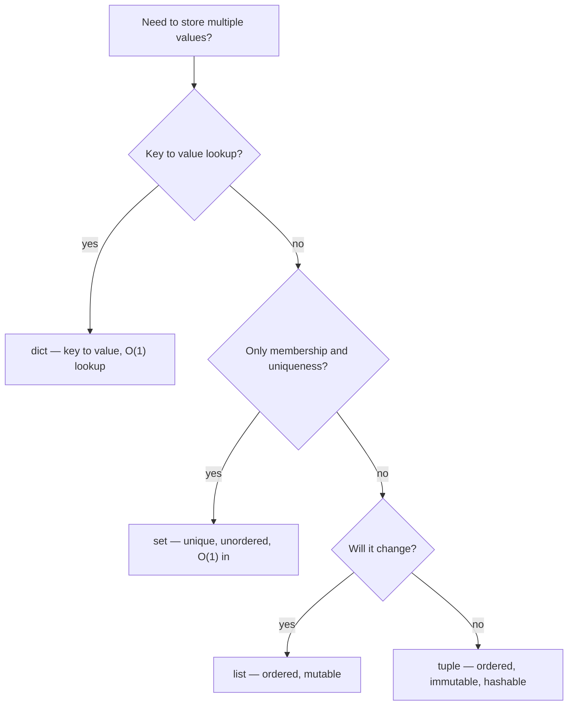
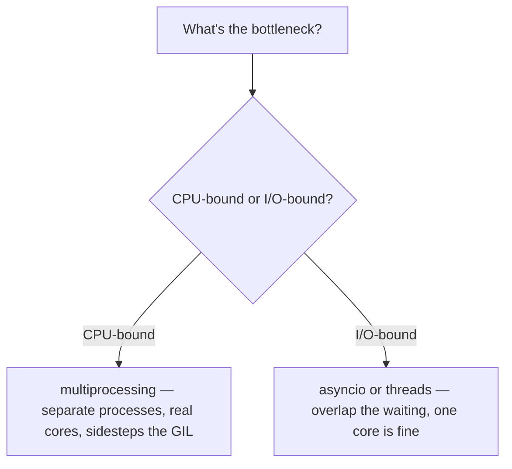

# Python — Fundamentals

Python is the language of data, ML, scripting, automation, and a huge slice of backend web work — and it's the one most interviewers will let you *solve algorithm problems in*, because it gets out of your way. This guide is the whole language in one place: the core model, the data structures, the idioms that mark fluency, and the famous traps that catch everyone once. It pairs with two dojo tracks — the **Python coding track** (write real Python, checked for idiomatic shape) and the **Python quiz topic** (concepts + gotchas, spaced-repeated).

The mindset to carry through: **Python optimises for readability and for the programmer's time.** "There should be one — and preferably only one — obvious way to do it." When two solutions work, the *Pythonic* one is usually shorter and reads like English.

## Where Python fits

Python dominates **data science / ML** (NumPy, pandas, PyTorch), **scripting & automation**, **AI tooling**, and plenty of **web backends** (Django, FastAPI, Flask). It trades raw speed for developer speed: dynamically typed, interpreted, batteries-included. Where it's *not* usually the first pick — extreme-throughput low-latency core services — is exactly where the JVM/Go shine (see the Java and System Design guides). Knowing that trade-off is itself an interview answer.

## Running Python and the whitespace rule

Python runs top-to-bottom; there are no braces and no semicolons. **Indentation is syntax** — a block is defined by its indent level (4 spaces by convention), so a misindented line is a real bug, not a style nit:

```python
def classify(n):
    if n < 0:
        return "negative"
    return "non-negative"   # dedent ends the if-block
```

Mixing tabs and spaces is an error. Pick 4 spaces and let your editor enforce it.

## Variables and dynamic typing

No type declarations — a name is just a label bound to an object, and it can be rebound to anything:

```python
x = 5        # x is an int
x = "hello"  # now a str — legal
```

Python is **dynamically typed** (types live on values, checked at runtime) but **strongly typed** (it won't silently coerce `"3" + 5`). Assignment binds a *name to an object*; two names can point at the same object — the root of the copy and identity gotchas below.

### Type hints (optional, not enforced)

You can annotate for readers and tools — but Python **ignores them at runtime**:

```python
def greet(name: str) -> str:
    return f"Hello, {name}!"

greet(123)   # runs anyway — hints are NOT enforced
```

Their value is tooling: editor autocomplete, catching bugs via a separate `mypy`/`pyright` run in CI, and documentation that can't drift silently. Modern syntax: `list[int]`, `dict[str, int]`, `int | None` (a value that may be missing).

## Core types and f-strings

`int` (arbitrary precision — no overflow), `float`, `str`, `bool` (`True`/`False`), and `None` (the absence of a value). Build strings with **f-strings**:

```python
name, unread = "Ada", 3
msg = f"Hi {name}, you have {unread} messages."
pi = f"{3.14159:.2f}"   # "3.14" — format spec after the colon
debug = f"{unread=}"     # "unread=3" — self-documenting (3.8+)
```

The `f` prefix is what activates interpolation; anything in `{ }` is evaluated. It beats `"Hi " + name` and `.format()` on both readability and safety.

## The four collections

The single most important Python decision is which built-in container to reach for:



- **`list`** `[1, 2, 3]` — ordered, mutable, indexed by position. O(1) index/append. The default sequence.
- **`tuple`** `(x, y)` — ordered, **immutable**, therefore **hashable** (can be a dict key or set member). Signals "fixed record"; used for coordinates, multiple return values.
- **`set`** `{1, 2, 3}` — unordered, unique elements, O(1) membership and fast union/intersection. Dedupe a list with `set(items)`.
- **`dict`** `{"a": 1}` — key→value, O(1) average lookup/insert, **insertion-ordered** since 3.7. The workhorse for lookups, counting, grouping, JSON-shaped data.

Mutability drives hashability: you can't use a `list` as a dict key (mutable → unhashable), but a `tuple` works.

## Slicing

Every sequence supports `seq[start:stop:step]`; omit parts for defaults. A slice returns a **copy**:

```python
a = [0, 1, 2, 3, 4, 5]
a[1:4]    # [1, 2, 3]      stop is exclusive
a[:3]     # [0, 1, 2]      first three
a[-2:]    # [4, 5]         last two
a[::2]    # [0, 2, 4]      every second
a[::-1]   # [5, 4, 3, 2, 1, 0]   reversed
```

Works on strings and tuples too (`"hello"[::-1]` → `"olleh"`).


```check
basics
```

## Comprehensions

The Pythonic replacement for map/filter + an accumulator loop — `[expr for item in iterable if condition]`:

```python
[x * x for x in range(5)]                    # list:  [0, 1, 4, 9, 16]
[x for x in range(10) if x % 2 == 0]         # filter: [0, 2, 4, 6, 8]
{w: len(w) for w in words}                   # dict comprehension
{c for c in "banana"}                        # set:   {'b', 'a', 'n'}
(x * x for x in range(5))                    # GENERATOR (lazy) — note the ()
[x for row in matrix for x in row]           # nested: flatten, loops read L→R
```

The transform comes *before* the `for`; the optional filter comes *after*. In a nested comprehension the `for` clauses read in the same order as equivalent nested loops.

## Truthiness and the walrus

Python treats **empty and zero as falsy**: `None`, `False`, `0`, `0.0`, `""`, `[]`, `{}`, `()`, `set()`. So the idiomatic empty-check is `if not items:`, not `if len(items) == 0`. The trap: `if x:` treats `0` and `None` alike, so when 0 is a valid value, test `if x is None:` explicitly.

The **walrus** `:=` assigns *and* returns inside an expression:

```python
while (line := f.readline()):        # read and test in one step
    process(line)

if (n := len(data)) > 100:           # reuse n without a separate line
    print(f"large: {n}")
```

Always parenthesise it, and use it sparingly — clarity first.

## Control flow

`for` iterates any iterable (not C-style indices); reach for `range`, `enumerate`, and `zip` instead of manual index math:

```python
for i, item in enumerate(items):     # index + value — never `for i in range(len(items))`
    ...
for name, score in zip(names, scores):  # walk two lists in lockstep
    ...
```

`for`/`while` can carry an `else` that runs only if the loop finished *without* `break` (useful for search loops). Multiple assignment and unpacking are everywhere: `a, b = b, a` swaps; `first, *rest = [1, 2, 3]` captures the rest.

## Functions

```python
def scale(value, factor=2, *args, unit="px", **kwargs):
    return f"{value * factor}{unit}"
```

- **Default arguments** fill in missing values — but **defaults evaluate ONCE at definition**. A mutable default (`bucket=[]`) is shared across calls and accumulates; use `None` and set it inside (see Gotchas).
- **`*args`** collects extra positional args into a **tuple**; **`**kwargs`** collects extra keyword args into a **dict**.
- The same `*`/`**` **unpack** at the call site: `scale(*[10, 3], **{"unit": "em"})`.
- **`lambda`** makes a one-expression anonymous function: `sorted(words, key=lambda w: len(w))`.


```check
functions
```

## Iterators and generators

An **iterator** produces values one at a time; a **generator** (a function with `yield`) is the easy way to make one, producing values **lazily** in O(1) memory:

```python
def evens(n):
    for i in range(n):
        if i % 2 == 0:
            yield i           # pauses here, resumes on next()

total = sum(evens(1_000_000))  # never builds a million-element list
```

Calling a generator runs nothing until you iterate; each `yield` pauses and resumes. That means constant memory regardless of length, infinite streams, and one-item-at-a-time pipelines — at the cost that a generator is single-use once consumed. The inline form is a **generator expression**: `sum(i for i in range(n) if i % 2 == 0)`.

## The built-in toolbox

Reach for these before hand-rolling loops:

```python
sorted(words, key=len, reverse=True)   # sort by a key function
any(x > 0 for x in nums)               # short-circuits on first True
all(x > 0 for x in nums)
min(items, key=lambda p: p.cost)
sum(nums)  # max, len, abs, round, zip, map, filter, reversed
```

And `collections` / `itertools`:

- **`Counter(items)`** — tally occurrences; `.most_common(k)` for top-k.
- **`defaultdict(list)`** — missing keys auto-create a value; `d[k].append(x)` just works. `defaultdict(int)` counts from 0.
- **`deque`** — O(1) append/pop at *both* ends (a `list` is O(n) at the front).
- **`namedtuple`** — a lightweight immutable record with named fields.
- **`itertools`** — `chain`, `groupby`, `combinations`, `product`, `accumulate` for lazy pipelines.

## Classes and OOP

```python
class Circle:
    PI = 3.14159                      # class attribute (shared)

    def __init__(self, radius):       # constructor; self = the instance
        self.radius = radius          # instance attribute

    @property
    def area(self):                   # accessed as c.area, no parentheses
        return Circle.PI * self.radius ** 2

    def __repr__(self):               # dunder: how it prints
        return f"Circle(r={self.radius})"
```

- **`self`** is the explicit first parameter of every instance method (Python doesn't hide it).
- **Dunder ("double-underscore") methods** hook into syntax: `__init__` (construct), `__repr__`/`__str__` (print), `__eq__` (`==`), `__len__`, `__iter__`, `__enter__`/`__exit__` (context managers).
- **`@property`** exposes a method as a read-only attribute — the Pythonic alternative to Java-style `getArea()`.
- **`@classmethod`** (receives the class) and **`@staticmethod`** (receives nothing) for alternate constructors / namespaced helpers.
- **Inheritance** with `class Dog(Animal):` and `super().__init__(...)`; multiple inheritance resolves via the **MRO** (method resolution order).

### dataclasses

For a class that's mostly typed data, `@dataclass` writes the boilerplate:

```python
from dataclasses import dataclass

@dataclass
class Point:
    x: int
    y: int
# auto-generates __init__, __repr__, __eq__.  frozen=True → immutable+hashable
```

### Duck typing

Python cares about *behaviour*, not declared type: "if it walks like a duck and quacks like a duck…". A function that calls `.read()` works on any object with a `read` method — no interface to declare. This is why Python leans on **EAFP** over type checks.


```check
iterators
```

## Errors: EAFP and exceptions

**EAFP** — "easier to ask forgiveness than permission" — attempt the operation and catch failure, rather than checking first (**LBYL**). It's often faster (no double lookup) and avoids check-then-use races:

```python
try:
    value = config[key]
except KeyError:
    value = default
else:
    log(value)          # runs only if no exception
finally:
    cleanup()           # always runs
```

Rules: catch a **specific** exception (`KeyError`, `ValueError`), never a bare `except:` (it swallows bugs and Ctrl-C); keep the `try` body minimal; `raise ValueError("message")` to signal your own errors; subclass `Exception` for custom ones.

## Context managers: `with`

A `with` block guarantees cleanup even on exception — the reason it always beats a manual `open`/`close`:

```python
with open("data.txt") as f:
    contents = f.read()
# f is closed here no matter what — return, exception, or normal exit
```

The same pattern manages locks, DB transactions, and temp resources. Build your own with `__enter__`/`__exit__` or the `@contextmanager` decorator.

## Decorators

A decorator is a function that takes a function and returns a **replacement** — `@logged` above a function is exactly `func = logged(func)`:

```python
import functools

def logged(func):
    @functools.wraps(func)                 # preserve func's name/docstring
    def wrapper(*args, **kwargs):
        print(f"calling {func.__name__}")
        return func(*args, **kwargs)       # forward ANY signature
    return wrapper

@logged
def work(x): ...
```

Forwarding `*args, **kwargs` lets one decorator wrap any function. It's how Python does cross-cutting concerns — `@lru_cache`, `@property`, framework routes (`@app.get("/")`).

## Modules, packages, and environments

Every `.py` file is a module; `import` brings it in. The idiom to make a file both importable *and* runnable:

```python
def main(): ...

if __name__ == "__main__":   # true only when run directly, not when imported
    main()
```

Isolate dependencies per project with a **virtual environment** so projects don't share/clash packages:

```bash
python -m venv .venv
source .venv/bin/activate      # Windows: .venv\Scripts\activate
pip install requests
pip freeze > requirements.txt
```

Never `pip install` into the system Python; always into a venv (or use `poetry`/`uv`).


```check
errors
```

## Concurrency and the GIL

The **GIL (Global Interpreter Lock)** lets only one thread execute Python bytecode at a time. This shapes every concurrency decision:



- **CPU-bound** (number crunching): threads give **no** speedup (the GIL serialises them). Use **`multiprocessing`** — separate processes each with their own interpreter, truly parallel across cores. (Or native libraries like NumPy that release the GIL.)
- **I/O-bound** (thousands of network/DB calls): the GIL is released during I/O waits, so you just need concurrency, not cores. Use **`asyncio`** (one thread, an event loop) or a **thread pool**.

`asyncio` with `async`/`await`:

```python
import asyncio

async def fetch(url):
    ...                     # awaits I/O without blocking the event loop
    return data

async def main():
    results = await asyncio.gather(fetch(a), fetch(b))  # overlap them
```

(CPython 3.13 added an experimental free-threaded, no-GIL build; 3.14 made it officially supported ([PEP 779](https://docs.python.org/3/whatsnew/3.14.html)), with a 5–10% single-thread cost. It's a separate build you opt into: the default `python` still has the GIL, so the advice above is still the practical reality.)

## The gotchas that catch everyone

- **Mutable default arguments.** `def f(x, acc=[])` — the `[]` is created once and shared, so it accumulates across calls. Use `acc=None` + `if acc is None: acc = []`.
- **`is` vs `==`.** `==` compares *values*; `is` compares *identity*. Use `is` only for `None`/`True`/`False` (`if x is None`). Two equal ints above 256 can be different objects: `a = 1000; b = int("1000"); a is b` is `False`, because CPython caches only -5..256. (A literal `1000 is 1000` prints `True` with a `SyntaxWarning`: the interpreter itself telling you to use `==`.)
- **Late-binding closures.** `[lambda: i for i in range(3)]` all return `2` — closures capture the *variable*, not its value. Fix with a default: `lambda i=i: i`.
- **Shallow vs deep copy.** `b = a` binds the *same* object. `a.copy()`/`a[:]` copies the outer container but shares nested objects; only `copy.deepcopy(a)` clones all the way down.
- **Mutating while iterating.** Don't add/remove from a list (or dict) you're looping over — iterate a copy (`for x in items[:]`) or build a new list.
- **Integer/float division.** `/` always gives a float (`4 / 2 == 2.0`); use `//` for floor division and `%` for remainder.


```check
gil
```

## Testing (pytest, briefly)

Python's de-facto test runner is **pytest**: plain functions named `test_*`, plain `assert`:

```python
def test_adds():
    assert sum([2, 3]) == 5
```

Fixtures (`@pytest.fixture`) inject setup; `pytest.raises` checks exceptions; `@pytest.mark.parametrize` runs one test over many inputs. The testing *principles* (pyramid, mock/stub, behaviour over implementation) are language-agnostic — see the **Testing guide**.

## Pythonic style

- **PEP 8**: `snake_case` for functions/variables, `CapWords` for classes, `UPPER_CASE` for constants; 4-space indents; format with `black`, lint with `ruff`/`flake8`.
- Prefer comprehensions, unpacking, `enumerate`/`zip`, and the `collections` toolbox over manual loops and indices.
- Favour readability: "explicit is better than implicit", "flat is better than nested", "there should be one obvious way to do it" (`import this` for the full Zen).

## Mastery checklist — you can…

- Explain dynamic-but-strong typing, and that hints aren't enforced.
- Pick list vs tuple vs set vs dict, and say which are mutable/hashable.
- Slice with `start:stop:step`, including `[::-1]` and `[::2]`.
- Write list/dict/set/generator comprehensions, with filters and nesting.
- Use `*args`/`**kwargs` and unpacking, and avoid the mutable-default trap.
- Write a generator with `yield` and say why it's memory-cheap.
- Reach for `Counter`/`defaultdict`/`deque`/`enumerate`/`sorted(key=…)`.
- Build a class with dunder methods, `@property`, and `@dataclass`.
- Handle errors EAFP-style with specific exceptions, and manage resources with `with`.
- Write a decorator that forwards `*args, **kwargs`.
- Choose multiprocessing vs asyncio/threads based on the GIL.
- Spot `is`-vs-`==`, late-binding closures, and shallow-copy bugs on sight.
