# React Fundamentals — every hook, from useState to useOptimistic

A Dojo supplement guide. React is the library that runs the whole `apps/web` frontend, and almost
every bug beginners hit comes from *six* mental models, not from the syntax. We build all six from
zero (sections 1–8), then work through **every hook you'll be asked about** (sections 9–20). If you
can write a JavaScript function and you know what an HTML button is, you're ready — we define
everything else as it comes up.

> **How to read this.** Keep a scratch React file open and *type* each snippet — don't paste. React
> is a set of reflexes; reflexes come from your fingers, not your eyes. Every section ends by telling
> you the bug it prevents, because that's when the idea sticks.

> **Sections 1–8 are the mental models** — read them in order, they build on each other. **Sections
> 9–20 are the rest of the hooks**, each self-contained: skim the cheat-sheet in section 20 first,
> then read whichever section you got asked about. Written against **React 19**, which is what this
> repo runs.

---


---

## ⌨️ This guide is interactive

**Twelve exercises are embedded below**, at the end of the section that teaches each one.

Almost every React bug is one of three things: reading a **stale value from a closure**, **storing
what you could compute**, or reaching for an **effect where no effect is needed**. Ten of the twelve
are repairs of exactly those.
## 0. The five words the rest of this guide stands on

Before any rules, five plain definitions. Re-read them once; everything below leans on them.

- **Component** — a JavaScript *function* that returns a description of some UI. That's the whole
  idea: a component is a function whose output is "what should be on screen." Its name is
  Capitalized (`Counter`, `ProfileForm`) so React can tell it apart from a normal HTML tag.
- **JSX** — the HTML-looking code you write *inside* JavaScript, like `<button>{count}</button>`.
  It's not really HTML; it's a convenient way to write "the UI description" a component returns. The
  `{ }` means "drop this JavaScript value in here."
- **Props** — the *inputs* to a component, passed like HTML attributes: `<Avatar size={40} />`. Same
  role as function arguments. The component reads them; it never edits them.
- **State** — a component's private *memory that survives across re-runs.* A normal variable inside a
  function is forgotten the moment the function returns. State is the box React keeps for you between
  runs, so a counter can remember it's at 3. You create it with `useState`.
- **The DOM** — the actual, live page in the browser (the real buttons and text the user sees). Your
  component returns a *description*; React's job is to make the real DOM match that description.

- **Hook** — any function whose name starts with `use` (`useState`, `useEffect`, `useMemo`). Hooks
  are how a component plugs into React's features (memory, side-effects, caching). One rule for now:
  call them at the top level of your component, never inside an `if` or a loop.

Keep those in your pocket. Now the six models.

---

## 1. A component runs top-to-bottom every time — and each run is a frozen photograph

Here is the engine of all of React. When something changes, React **calls your component function
again, from the top.** It runs the whole body, gets the returned JSX (the new UI description),
compares it to the previous description, and changes the real DOM only where they differ.

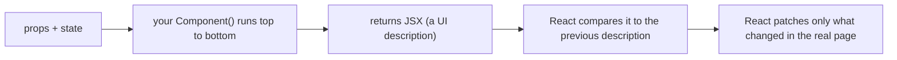

The word for "React runs your component again" is a **render**. You'll hear "it re-renders" — that
just means "React called the function again." Two consequences flow from this, and they cause most
beginner bugs:

**Consequence 1 — everything inside the body re-runs on every render.** Any calculation you write
inline runs again. Any object, array, or function you *create* inline is **built fresh, as a brand-new
thing**, every single render — even if it looks identical. (Hold onto that; sections 7 and 8 depend
on it.)

**Consequence 2 — each render is a frozen photograph.** This is the big one. The values a particular
render sees — its props, its state — are **fixed for that run, like a photo.** They do not update
underneath you. Any function you create during that render (a click handler, an effect) "remembers"
*that photo's* values, forever.

Watch this trip everyone up:

```tsx
function Counter() {
  const [count, setCount] = useState(0); // count is 0 in this render's photo

  function handleClick() {
    // `count` here is a fixed 0 from THIS render — not a live, updating variable.
    setCount(count + 1); // "set it to 0 + 1 = 1"
    setCount(count + 1); // "set it to 0 + 1 = 1"  ← same photo, same 0, same 1
  }

  return <button onClick={handleClick}>{count}</button>;
}
```

You'd *expect* two `+1`s to add 2. It adds **1**. Both lines read the same photograph where
`count` is `0`, so both compute `1` and both say "set it to 1." To fix it, we need a way to say "add
one to whatever it is *now*" instead of "set it to this fixed number" — which is exactly section 2.

> **Memory hook:** *a render is a photo, not a live video feed.* State variables don't change during a
> render; they get a new value on the *next* render.

---

## 2. The updater function: "change it based on whatever it is now"

`setCount` accepts two things. You've seen the first — a plain value (`setCount(5)` = "make it 5").
The second is a **function**, and it's the fix for section 1:

```tsx
setCount(c => c + 1); // "whatever count is right now, hand it to me as c, and add 1"
```

When you pass a function, React calls it for you and feeds in the **latest** pending value — not the
frozen photo. So they stack:

```tsx
setCount(c => c + 1); // c is the current 0 → 1
setCount(c => c + 1); // c is now the pending 1 → 2   ✓ really +2
```

**The rule to burn in: if the next state is built *from* the previous state, use the function form.**
Counting, toggling, adding to a list, incrementing — all "based on the old value," all use `c => …`.

One more term you'll hear: **batching.** Within a single event (one click), React collects all your
`setState` calls and does **one** re-render at the end, not one per call — for speed. Don't confuse
the two ideas: *batching* decides **when** the re-render happens; the *updater function* decides
**what value** each update is based on. Different jobs.

---


```exercise
updater-function
```


```check
renders
```

## 3. Effects: reaching outside React to the real world

Most of your code just turns state into JSX — that stays inside React. But sometimes you must touch
the **outside world**: fetch data from a server, start a timer, subscribe to something, set the page
title. That "reaching outside" is called a **side effect**, and the tool for it is `useEffect`.

```tsx
useEffect(fn, deps);
```

React runs `fn` **after** the render is painted, but only when something in the `deps` list (the
"dependencies") changed since last time. The `deps` list is how you say *when* to re-run:

| What you pass as deps | When `fn` runs |
|---|---|
| nothing (omitted) | after **every** render |
| `[]` (empty list) | **once**, after the first render only |
| `[a, b]` | after the first render, then any render where `a` or `b` changed |

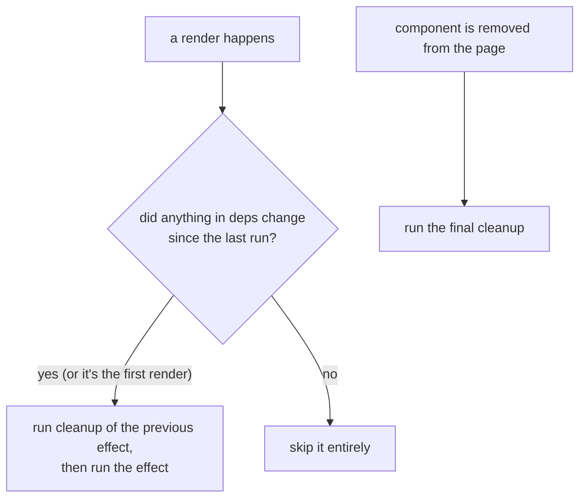

**"Cleanup"** is the return value of your effect — a little function that undoes what the effect set
up (stop the timer, cancel the subscription). React runs it before the next effect and when the
component leaves the screen, so nothing is left dangling.

A real, important pattern — a fetch that ignores stale answers:

```tsx
useEffect(() => {
  let alive = true;                       // this render's private flag
  getProblems().then(data => {
    if (alive) setProblems(data);         // only use the result if we're still current
  });
  return () => { alive = false; };        // cleanup: mark this run "no longer current"
}, []);
```

Without the `alive` flag, a slow response can arrive *after* the component was removed, or after a
newer request already answered, and overwrite your state with stale data. The flag says "if I've been
cleaned up, throw this answer away." (That's the same idea a Run button needs when a user mashes it.)

> **⚠️ The #1 effect mistake: using an effect to *compute* a value.** If you can calculate something
> from existing state during the render — a filtered list, a total, sorted rows — **just calculate it
> there.** Don't copy it into its own state with an effect. Doing so causes an extra render and
> creates two copies that drift out of sync. Effects are for *synchronizing with the outside world*,
> not for math. (Section 8 hammers this.)

---


```exercise
effect-cleanup
```

## 4. Stale closures — the classic timer bug (and what a "closure" even is)

First, the missing word. A **closure** is just this: *a function remembers the variables that were
around when it was created.* When you write a function inside another function, the inner one keeps
a hold of the outer one's variables — even after the outer function has finished. That "remembering"
is a closure. It's normal and useful; it only bites when the remembered value is *stale* (out of
date).

Now the bug. Combine "a render is a photograph" (section 1) with closures:

```tsx
useEffect(() => {
  const id = setInterval(() => setCount(count + 1), 1000); // runs every second
  return () => clearInterval(id);
}, []); // deps [] → this effect runs ONCE, in the first render's photo, where count = 0
```

The interval fires every second forever, but its function was created **once**, inside the first
render's photograph, where `count` was `0`. It closed over that `0` and never sees a newer one. So it
forever computes `0 + 1 = 1`. The counter freezes at 1.

Three fixes, best first:

1. **Use the updater function** (section 2): `setInterval(() => setCount(c => c + 1), 1000)`. Now it
   asks for the *current* value each tick instead of trusting a captured one. No stale photo, no bug.
2. **Add `count` to the deps** so the effect re-creates with each fresh value — but this also restarts
   the interval every second, which is often *not* what you want.
3. **Hold the value in a ref** (`useRef`) — a mutable box that isn't a photograph, so the interval can
   read the *current* value without being re-created. That's the "latest ref" pattern, and it's the
   general answer when the updater form doesn't apply (section 10).

Reach for #1 by reflex. "Timer/interval + state that grows → updater function" is a rule worth
memorizing whole.

---


```exercise
stale-closure
```


```check
effects
```

## 5. Keys: how React tells list items apart across renders

When you render a list, React needs to match each *old* item to the corresponding *new* item so it can
move state (open menus, typed-in text, focus) correctly. You tell it how to match with a **`key`** — a
unique id on each item.

The trap is `key={index}` (using the item's position, 0,1,2… as its identity):

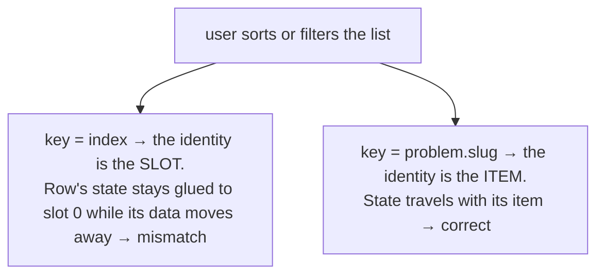

With `key={index}`, the identity is "position 0, position 1…", so when the data reorders, each row's
state stays stuck to its *slot* while the data slides out from under it — an open menu ends up on the
wrong row, an input shows another item's text. Use a **stable id from the data itself**
(`key={problem.slug}`) and state follows its item wherever it moves.

This is a **correctness** rule, not a style nitpick. The yellow console warning is just the smoke;
the fire is silently wrong UI after a sort. (Index keys are fine *only* for a list that never
reorders, filters, or has items inserted — a static list.)

---


```exercise
list-keys
```

## 6. Controlled inputs: who owns the text in the box?

A text input has to store its current text *somewhere*. There are two choices, and picking on purpose
is the whole lesson.

**Controlled** — React state owns the value:

```tsx
const [query, setQuery] = useState("");
<input value={query} onChange={e => setQuery(e.target.value)} />
```

Read the loop: the box shows `query`; every keystroke fires `onChange`, which updates `query`, which
re-renders, which shows the new `query`. Every character flows through your state. Because state is the
single source of truth, you can validate as they type, transform input (uppercase, strip spaces),
clear the field in code, and derive other UI (a live-filtered list) from that same `query`.

**Uncontrolled** — the browser's DOM owns the value, and you only read it at the end (via
`defaultValue` + `FormData` or a ref on submit). Less code, less live control. React 19's form
actions (`useActionState` + `<form action>`) are a modern take on this uncontrolled side — section 19.

> **⚠️ The bug factory: the half-controlled input** — one that has `value={query}` but *no*
> `onChange`. You've told React it owns the value but never let it update, so the box freezes and
> won't type. Rule: if you set `value`, you must set `onChange` (or switch to `defaultValue` and go
> uncontrolled). Pick an owner on purpose.

---


```exercise
controlled-input
```


```check
lists
```

## 7. Context: handing a value to deep children without passing it down every level

Normally data flows down one level at a time through props. If a value is needed 4 levels deep, you'd
have to pass it through every component in between — even ones that don't care ("prop drilling").
**Context** is a pipe that lets a value skip the middlemen and be read at any depth.

```tsx
// `Workspace` is a TYPE you define — the shape of what you'll share:
type Language = "javascript" | "typescript" | "python";
interface Workspace {
  language: Language;
  setLanguage: (lang: Language) => void;
}

const WorkspaceContext = createContext<Workspace | null>(null);
//                       └─ function ─┘└── type arg ───┘ └ default
```

Three separate things live on that one line:

- **`createContext(...)`** — a real function you call at runtime. It creates the pipe.
- **`<Workspace | null>`** — TypeScript *only*. The angle brackets are a **generic type argument**:
  "the value in this pipe is a `Workspace`, or `null`." It compiles away to nothing — it's not code,
  it's a promise to the type-checker. So `Workspace` is a **type**, not a value.
- **`(null)`** — the **runtime default**: what a consumer gets if it reads this context with *no
  Provider above it*. Why `null`? At the moment this line runs there's no Provider yet, so there's no
  real `language`/`setLanguage` to hand out — `null` is the honest "nobody's providing yet" default,
  and that's exactly why the type has to include `| null`.

```tsx
function Provider({ children }) {
  const [language, setLanguage] = useState<Language>("javascript");
  // See section 1: an inline object is a NEW object every render. Memoize it (section 8):
  const value = useMemo(() => ({ language, setLanguage }), [language]);
  return <WorkspaceContext.Provider value={value}>{children}</WorkspaceContext.Provider>;
}
```

React 19 also accepts the context itself as the provider, `<WorkspaceContext value={value}>`; `.Provider`
still works and will be deprecated in a future version
([React 19 release post](https://react.dev/blog/2024/12/05/react-19)). You'll meet both.

### How a child actually reads it

A child does **not** receive the workspace as a prop — nobody passes it one. Instead it *pulls* the
value out of the pipe with `useContext`, no matter how deep it sits:

```tsx
function LanguagePicker() {
  const ws = useContext(WorkspaceContext);   // reach into the pipe
  if (!ws) return null;                       // type is Workspace | null, so handle null

  // `ws` is now the SAME object the Provider memoized: { language, setLanguage }
  return (
    <select
      value={ws.language}
      onChange={(e) => ws.setLanguage(e.target.value as Language)}
    >
      <option value="javascript">JavaScript</option>
      <option value="typescript">TypeScript</option>
      <option value="python">Python</option>
    </select>
  );
}
```

Calling `ws.setLanguage(...)` updates the state **inside the Provider**, which re-renders every
consumer reading `language` — a sibling status bar, the editor, anything. That's the payoff: the child
reads and writes shared state without a single prop being threaded through the tree.

**The `| null` gets annoying fast** (every consumer has to check it), so the standard idiom is one
custom hook that checks once and hands back a clean, non-null `Workspace`:

```tsx
function useWorkspace(): Workspace {
  const ws = useContext(WorkspaceContext);
  if (!ws) throw new Error("useWorkspace must be used inside a <Provider>");
  return ws;                                  // TS now knows it's Workspace, never null
}

// consumers become one clean line — no null dance:
const { language, setLanguage } = useWorkspace();
```

The `throw` also turns "you forgot the Provider" from a silent `null` bug into a loud, obvious error.

### Wiring it together — how the value actually reaches the children

The Provider and the consumers don't find each other by magic: a consumer can read the pipe **only if
it's rendered *inside* the Provider's tag**. So somewhere up top you wrap them:

```tsx
export default function App() {
  return (
    <Provider>            {/* owns the state, feeds the pipe */}
      <LanguagePicker />  {/* inside → useContext works */}
      <StatusBar />       {/* inside → sees the same language */}
    </Provider>
  );
}
```

`LanguagePicker` and `StatusBar` get nothing passed as props — they're just placed *within*
`<Provider>...</Provider>`. Being inside is what connects them to the pipe. Anything you render between
those tags (at any depth — a child of a child of a child) can call `useWorkspace()` and read the same
`language`. Anything rendered *outside* `<Provider>` cannot, and would hit that `throw`.

This is the whole flow in three roles:

```
<Provider>          creates the value  →  puts it in the pipe (value={...})
   <Child/>         is inside the pipe →  pulls the value out (useContext)
```

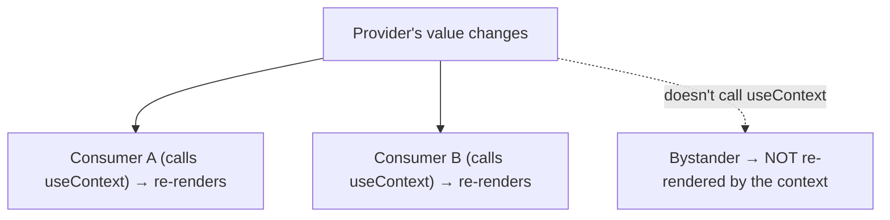

Three things that matter:

- **Only actual consumers react.** A component re-renders from a context change *only* if it calls
  `useContext` for that context. Others under the provider are untouched by it.
- **The value is compared by identity, so memoize it.** Remember section 1: an inline
  `value={{ language, setLanguage }}` is a *brand-new object every render*, so React thinks the value
  "changed" every time the provider's parent re-renders, and wakes every consumer for nothing.
  Wrapping it in `useMemo` (section 8) keeps the *same* object until `language` actually changes.
- **Context is a delivery pipe, not a state store.** The state still lives in `useState` inside the
  provider; context only *transports* it. Use it when siblings at different depths need the same state
  (an editor's toolbar, panel, and output sharing one workspace). Passing a prop down one level is not
  a crime — reach for context when the drilling gets deep.

---


```exercise
context-split
```

## 8. useMemo & derived state: cache a calculation, and don't store what you can compute

Two ideas, one section, because they're the same instinct: **don't redo work, and don't duplicate
truth.**

**`useMemo(fn, deps)`** remembers (caches) the result of `fn` and reuses it until something in `deps`
changes. It's for skipping an *expensive* recalculation on renders where the inputs didn't change:

```tsx
const rows = useMemo(() => rank(sort(entries, sortKey)), [entries, sortKey]);
```

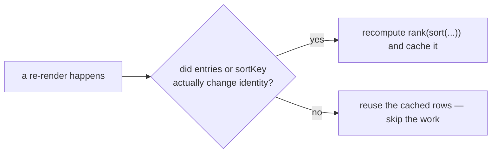

Four things to know:

- It recomputes only when a dep fails an *identity* check versus last render (React uses `Object.is`,
  basically `===`). Same inputs → cached result reused.
- It's a **performance** tool, **not** a correctness one. Your code must already be correct without it;
  `useMemo` only makes it faster. Never rely on it to "fix" a bug.
- It's **defeated by unstable inputs.** If a parent passes a freshly-built `entries` array every render
  (section 1!), the dep "changes" every time and the memo recomputes every time — useless. Stability
  has to hold along the whole chain.
- When you sort, **sort a copy**: `[...entries].sort(...)`. Plain `.sort()` mutates the array in place,
  and mutating a prop quietly corrupts the real source of truth upstream.

**Derived state — the golden rule:** if a value can be *computed from* state, compute it during render;
do **not** give it its own `useState`. Totals, filtered views, ranks, percentages, "is the form valid"
— all derived. The moment you copy a derived value into its own state, you have **two sources of truth**
that inevitably drift (the list updates, the count doesn't). One source of truth, computed on the fly,
can never disagree with itself.

> **Memory hook:** *derive, don't store; memo only if it's slow.* First make it correct by computing
> from one source; add `useMemo` **only** if you measure a real cost.

---


```exercise
derived-state
```

```exercise
effect-not-needed
```


```check
context
```

## Part II — the rest of the hooks

Sections 1–8 gave you the models. Everything below is a *tool*, and each one exists because of a
model you already have. Where a section says "because a render is a photo" or "because inline objects
are new every render," that's section 1 doing the work again.

---

## 9. The Rules of Hooks — and the one implementation detail that explains them

You've been told: *call hooks at the top level, never inside an `if` or a loop.* Here's **why**, because
the reason makes the rule impossible to forget.

React does not know your hooks by name. It stores them in **a list, in call order**, per component
instance. On every render it walks that list from the top, handing back slot 1 to the first hook you
call, slot 2 to the second, and so on:

```tsx
function Profile() {
  const [name, setName] = useState("");   // ← slot 0
  const [age, setAge]   = useState(0);    // ← slot 1
  useEffect(() => { … }, [name]);         // ← slot 2
}
```

Nothing links `name` to slot 0 except **the order you called it in**. So if the order changes between
renders, every hook after the change gets handed the wrong slot:

```tsx
function Broken({ showName }) {
  if (showName) {
    const [name, setName] = useState("");  // ❌ sometimes slot 0, sometimes doesn't exist
  }
  const [age, setAge] = useState(0);       // ❌ slot 1 on some renders, slot 0 on others
}
```

Flip `showName` and `age` silently starts reading the *name's* box. That's why the rule is absolute:

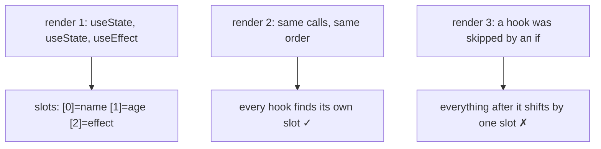

The rules, in full:

1. **Only call hooks at the top level** of a component or of another hook — never inside `if`, `for`,
   `while`, `try`, a nested function, or after an early `return`.
2. **Only call hooks from React functions** — a component (Capitalized) or a custom hook (`useX`).
   Never from a plain helper, a click handler, or a class.

Both are enforced by `eslint-plugin-react-hooks`. **Leave that lint rule on.** The same plugin's
`exhaustive-deps` warning is the other one people silence and regret: a missing dep is exactly the
stale-closure bug from section 4.

> **Want a conditional hook?** You can't — but you can put the condition *inside*: `useEffect(() => {
> if (!enabled) return; … }, [enabled])`. Move the branch in, keep the call unconditional. (The one
> real exception in all of React is `use()` — section 19 — which was designed to be callable
> conditionally.)

> **Memory hook:** *hooks are numbered by call order, not by name.* Same calls, same order, every
> render.

---


```exercise
rules-of-hooks
```

## 10. `useRef` — the box that isn't a photograph

This is the hook you were asked about, and it's the natural partner to section 1. A render is a
photo; **a ref is the one thing that isn't.**

```tsx
const ref = useRef(initialValue);   // ref is { current: initialValue }
```

Three facts, and they're the entire hook:

1. `useRef` returns **the same object** on every render — the identical `{ current: … }`, never rebuilt.
2. You may **read and write `ref.current` freely.** It's a plain mutable property.
3. **Changing `ref.current` does not re-render.** React doesn't watch it. Nothing happens.

That last one is the point. State is "data the UI is made of" — changing it must repaint. A ref is
"data I need to remember but the UI isn't made of" — changing it shouldn't repaint.

| | `useState` | `useRef` |
|---|---|---|
| Changing it re-renders? | **Yes** | **No** |
| Value during a render | frozen photo of this render | always the *latest* value |
| How you change it | `setX(next)` (async, next render) | `ref.current = next` (immediate) |
| Safe to read/write during render? | read yes, write no | **no** (see the purity rule below) |
| Use it for | anything the user sees | timer ids, DOM nodes, "did I already…", previous values |

### Job 1 — grabbing a real DOM node

Your components describe UI; sometimes you need the *actual* element to focus it, scroll it, measure
it, or play it. Pass a ref to the `ref` attribute and React puts the DOM node in `.current` after it
mounts:

```tsx
function SearchBox() {
  const inputRef = useRef(null);

  useEffect(() => {
    inputRef.current.focus();   // the real <input> — only exists after mount
  }, []);

  return <input ref={inputRef} placeholder="Search…" />;
}
```

Note **when** it's read: inside an effect, not during render. During render the DOM node doesn't exist
yet — `.current` is still `null`. That's the ordering to keep straight:

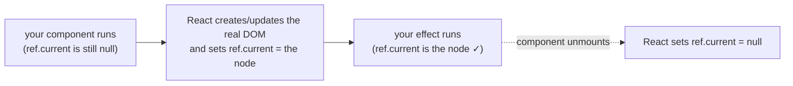

### Job 2 — remembering a value across renders without re-rendering

Anything you'd otherwise stash in a variable and lose on the next render:

```tsx
function RenderCounter() {
  const renders = useRef(0);
  renders.current += 1;              // survives every render, triggers none
  return <p>Rendered {renders.current} times</p>;
}
```

Try that with `useState` and you get an **infinite loop**: setting state re-renders, which sets state,
forever. That's the bug a ref prevents. Same story for a `setInterval` id, a "have I already sent the
analytics event" flag, or an `AbortController`.

### The purity rule (the one gotcha)

**Don't read or write `ref.current` *during* rendering** — do it in effects and event handlers. A
render must be pure: same props and state in, same JSX out. A ref read during render makes the output
depend on hidden mutable data, which breaks Strict Mode's double-render check and future concurrent
features. (`RenderCounter` above is the deliberate exception — a debug toy that's *about* counting
renders.)

### The "latest ref" pattern — the one you'll be asked to write

Section 4's `useInterval`: you want an interval that always calls the **newest** callback but doesn't
restart every time the parent re-renders. Ref in one effect, interval in another:

```tsx
function useInterval(callback, delay) {
  const savedCallback = useRef(callback);

  useEffect(() => {
    savedCallback.current = callback;      // keep the box up to date, no restart
  }, [callback]);

  useEffect(() => {
    const id = setInterval(() => savedCallback.current(), delay);
    return () => clearInterval(id);        // restarts ONLY when `delay` changes
  }, [delay]);
}
```

The interval closes over `savedCallback` — a box that never changes identity — instead of over
`callback`, whose value it would freeze. Read it once, out loud: *the effect captures the box, and
the box always holds the latest thing.*

The same trick powers `usePrevious`, the other classic:

```tsx
function usePrevious(value) {
  const ref = useRef(undefined);
  useEffect(() => { ref.current = value; }, [value]);  // updates AFTER the render
  return ref.current;                                  // so this render sees the OLD one
}
```

It works precisely because effects run *after* render: this render returns the value the effect stored
last time.

### Ref callbacks

Instead of a ref object you can pass a **function** to `ref`, and React calls it with the node when it
mounts. Handy for measuring, or for a list of nodes. In React 19 that function may **return a cleanup**:

```tsx
<div ref={(node) => {
  if (!node) return;
  const observer = new ResizeObserver(…);
  observer.observe(node);
  return () => observer.disconnect();   // React 19: cleanup on unmount
}} />
```

> **Memory hook:** *state is what the UI is made of; a ref is what the component remembers.* If
> changing it should redraw the screen, it's state. Otherwise it's a ref.

---


```exercise
useref-vs-state
```


```check
refs
```

## 11. `useCallback` and `React.memo` — when a function's *identity* is the bug

Straight from section 1's Consequence 1: **every render creates brand-new function objects.** Usually
harmless. It stops being harmless in exactly two situations.

**`useCallback(fn, deps)`** hands back the *same* function object until a dep changes. It is literally
`useMemo(() => fn, deps)` — memoizing a function instead of a computed value.

**`React.memo(Component)`** wraps a component so React **skips re-rendering it** when its props are
shallowly equal (`===` on each prop) to last time.

Here's the trap — memo alone does nothing:

```tsx
const Row = React.memo(function Row({ item, onSelect }) { … });

function List({ items }) {
  // ❌ brand-new function every render → onSelect prop always "changed" → memo never skips
  return items.map(i => <Row key={i.id} item={i} onSelect={(id) => console.log(id)} />);
}
```

`React.memo` compares props, sees a different `onSelect` every time, and re-renders anyway. You paid
for the comparison and got nothing. Fix the identity:

```tsx
const onSelect = useCallback((id) => { console.log(id); }, []);   // ✓ stable forever
return items.map(i => <Row key={i.id} item={i} onSelect={onSelect} />);
```

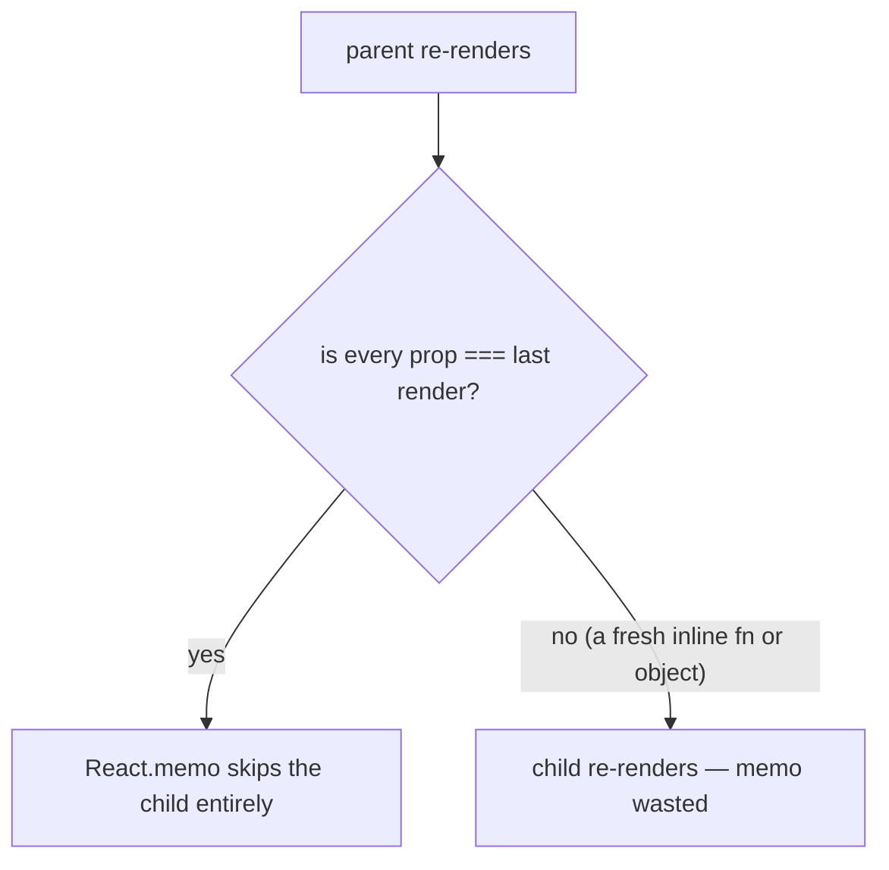

The three memo hooks split by *what* they preserve:

| Hook | Preserves | Reach for it when |
|---|---|---|
| `useMemo(fn, deps)` | the **result** of a calculation | the calculation is expensive, or its result is a dep/prop that must stay stable |
| `useCallback(fn, deps)` | the **function itself** | you pass it to a `React.memo` child, or it's in another hook's deps |
| `React.memo(Comp)` | the **child's render** | the child is expensive and its props rarely change |

**When `useCallback` is actually required** — only two cases:

1. The function is passed to a **memoized** child (above).
2. The function appears in another hook's **dependency array** — an unstable function in `useEffect`
   deps re-runs the effect every render, which is how you get infinite fetch loops.

Everywhere else it's noise: you added a hook, a deps array, and a maintenance burden to save React
allocating one closure, which is free. **Don't wrap everything.**

> **The deps chain rule:** memoization is only as strong as its weakest link. A `useCallback` whose
> deps include a freshly-built array is re-created every render anyway. Stability has to hold all the
> way up.

> **On the React Compiler:** React's compiler can insert this memoization automatically, which is the
> long-term direction. Until a codebase turns it on, you do it by hand — and you still need to
> *understand* it to answer for the code you already have.

> **Memory hook:** *`useMemo` caches a value, `useCallback` caches a function, `memo` caches a render
> — and the first two are pointless unless something downstream compares identities.*

---


```exercise
usecallback-memo
```

## 12. `useReducer` — every transition in one place

`useState` is perfect until a component has five pieces of state that change together and eight
handlers each spreading the same object. At that point the logic is scattered across the component
and drifts. `useReducer` collects it into **one pure function**.

Two new words:

- **Action** — a plain object describing *what happened*: `{ type: "toggle", id: 3 }`. A fact, not a
  command.
- **Reducer** — a **pure** function `(state, action) => newState`. Same inputs, same output, no
  mutation, no fetching, no `Math.random()`, no side effects.

```tsx
function todosReducer(state, action) {
  switch (action.type) {
    case "add":
      return [...state, { id: action.id, text: action.text, done: false }];
    case "toggle":
      return state.map(t => t.id === action.id ? { ...t, done: !t.done } : t);
    case "remove":
      return state.filter(t => t.id !== action.id);
    default:
      return state;
  }
}

function Todos() {
  const [todos, dispatch] = useReducer(todosReducer, []);
  return <button onClick={() => dispatch({ type: "add", id: 1, text: "Ship it" })}>Add</button>;
}
```

`dispatch(action)` sends the action; React calls your reducer with the current state and stores the
result.

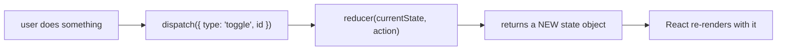

**Never mutate `state`.** `state.push(...)` or `item.done = true` keeps the *same reference*, so React's
identity check says "nothing changed" and either nothing re-renders or a memoized child skips an update
whose data really did change (section 11). Always spread a copy — `map`, `filter`, `[...arr]`,
`{ ...obj }`.

**Reach for `useReducer` when:**
- several fields change together as one transition,
- the next state depends on the previous in more than a "+1" way,
- the same update logic fires from many places (naming it `"reset"` beats repeating five spreads),
- you want to unit-test the logic — a reducer is a plain function, testable with zero React.

**Two free bonuses:**
- **`dispatch` has a stable identity** — React guarantees it never changes. Pass it to memoized
  children or omit it from deps without a second thought. (`setState` functions are stable too.)
- **Lazy init:** `useReducer(reducer, initialArg, init)` calls `init(initialArg)` once, on mount —
  same idea as `useState(() => expensive())`, which also exists and matters: `useState(expensive())`
  runs `expensive()` on *every* render because JavaScript evaluates the argument before React ever
  sees it.

**`useReducer` + `useContext`** is the classic "mini-Redux": the provider holds the reducer, context
delivers `state` and `dispatch` to any depth. That's the shape a `WorkspaceProvider` grows into.

> **Memory hook:** *`useState` for a fact, `useReducer` for a state machine.*

---

## 13. Custom hooks — your own `use…` functions

A **custom hook** is just a function whose name starts with `use` and that calls other hooks. There's
no special API — the naming convention is what tells React (and the linter) to apply the Rules of
Hooks to it.

```tsx
function useToggle(initial = false) {
  const [on, setOn] = useState(initial);
  const toggle = useCallback(() => setOn(o => !o), []);   // updater form — section 2
  return [on, toggle];
}

// any component:
const [isOpen, toggleOpen] = useToggle();
```

**The one thing people get wrong: a custom hook shares *logic*, not *state*.** Two components calling
`useToggle()` get **two completely separate** pieces of state — the hook body runs fresh inside each
component, creating that component's own slots. If you want components to share the *same* value,
that's context (section 7) or a store (section 15), not a custom hook.

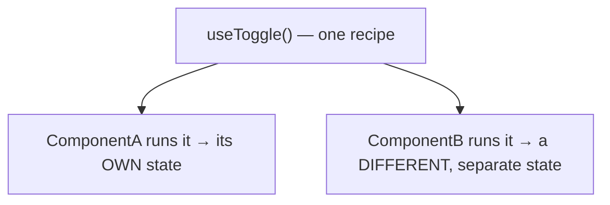

Three you should be able to write from memory, because they're standard interview asks:

```tsx
// Debounce: only report a value after it stops changing for `delay` ms.
function useDebouncedValue(value, delay) {
  const [debounced, setDebounced] = useState(value);
  useEffect(() => {
    const id = setTimeout(() => setDebounced(value), delay);
    return () => clearTimeout(id);   // each keystroke cancels the previous timer
  }, [value, delay]);
  return debounced;
}

// Click outside: close a menu when the user clicks anywhere else.
function useOnClickOutside(ref, handler) {
  useEffect(() => {
    function onPointerDown(e) {
      if (ref.current && !ref.current.contains(e.target)) handler(e);
    }
    document.addEventListener("pointerdown", onPointerDown);
    return () => document.removeEventListener("pointerdown", onPointerDown);
  }, [ref, handler]);
}

// Media query: re-render when a CSS breakpoint flips.
function useMediaQuery(query) {
  const [matches, setMatches] = useState(() => window.matchMedia(query).matches);
  useEffect(() => {
    const mql = window.matchMedia(query);
    const onChange = (e) => setMatches(e.matches);
    mql.addEventListener("change", onChange);
    setMatches(mql.matches);                    // catch a change during mount
    return () => mql.removeEventListener("change", onChange);
  }, [query]);
  return matches;
}
```

Notice all three follow the same skeleton: **state + an effect that subscribes and cleans up.** That's
what a custom hook usually *is*. Once you see the pattern, `useWindowSize`, `useLocalStorage`,
`useOnlineStatus` and `useHover` are the same five lines with a different subscription.

**Conventions worth copying:** return an array when there are exactly two things and the order is
obvious (`[value, setter]`, mirroring `useState`); return an object once there are three or more, so
callers destructure by name. Extract a hook when the logic is duplicated *or* when pulling it out
makes the component readable — not on principle.

> **Memory hook:** *a custom hook is a recipe, not a shared pot.* Each caller cooks its own.

---


```exercise
custom-hook
```


```check
memo
```

## 14. `useLayoutEffect` — the effect that runs *before* the browser paints

`useEffect` runs **after** the browser has painted, so the user briefly sees the pre-effect state. Almost
always fine — and that's why it's the default. But if the effect *moves or resizes something visible*,
the user sees a flicker: the tooltip appears at 0,0 and then jumps.

`useLayoutEffect` has the identical signature and runs **synchronously after React updates the DOM but
before the browser paints.** The user never sees the intermediate frame.

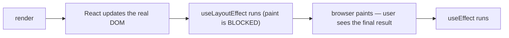

```tsx
useLayoutEffect(() => {
  const { height } = ref.current.getBoundingClientRect();
  setTooltipTop(anchorTop - height);   // measured and corrected before anyone sees it
}, [anchorTop]);
```

**The trade:** it blocks painting, so slow work here freezes the UI. Rules of thumb:

- **Default to `useEffect`.** Switch only when you *measure the DOM and immediately change it*, and you
  can see the flicker.
- `useLayoutEffect` **does not run during server rendering**: the server's HTML shows the pre-measure
  state until the browser takes over. React 18 printed a warning about this; React 19 removed the warning
  ([the React commit](https://github.com/facebook/react/commit/f77099b6f1ccc658eff3467c6b9337e1b77ec854)),
  but the effect still runs only in the browser. Anything needed for SSR belongs in `useEffect` (or
  `useSyncExternalStore` with a server snapshot).

> **Memory hook:** *`useEffect` = after the paint; `useLayoutEffect` = before it.* Measure-then-move
> is the only common reason to pay the second one's cost.

---

## 15. `useSyncExternalStore` — reading a value that lives outside React

Some values don't live in any component: `navigator.onLine`, `localStorage`, a Zustand/Redux store, a
`matchMedia`. The naive approach is `useState` + `useEffect` + a subscription (that's `useMediaQuery`
above, and it's fine for simple cases). The sanctioned approach is one hook:

```tsx
function useOnlineStatus() {
  return useSyncExternalStore(
    (callback) => {                                  // subscribe: how React gets notified
      window.addEventListener("online", callback);
      window.addEventListener("offline", callback);
      return () => {                                 // …and how to stop listening
        window.removeEventListener("online", callback);
        window.removeEventListener("offline", callback);
      };
    },
    () => navigator.onLine,                          // getSnapshot: read the current value
    () => true,                                      // getServerSnapshot: value during SSR
  );
}
```

- **`subscribe(callback)`** — register `callback` to fire on change; return the unsubscribe function.
- **`getSnapshot()`** — return the current value. React calls it after every notification and
  re-renders if the result differs by `Object.is`.
- **`getServerSnapshot()`** — optional; what to return during server rendering and hydration.

**Why not just `useEffect` + `useState`?** Two reasons that only show up in real apps:

1. **Tearing.** With concurrent rendering React can pause mid-render; an external value that changes
   during that pause can leave two components in the same paint showing *different* values.
   `useSyncExternalStore` forces a consistent read.
2. **SSR and hydration.** The effect version renders the wrong value on the server, then flips after
   mount — a hydration mismatch. `getServerSnapshot` handles it directly.

> **⚠️ The classic crash: an infinite loop from `getSnapshot`.** It must return a **cached, stable**
> value. `() => ({ online: navigator.onLine })` builds a new object every call, so `Object.is` says
> "changed" forever and React loops. Return a primitive, or a cached object the store hands out by
> reference.

This dojo's own progress store is built on this hook — that's why refreshing keeps your streak
consistent across every panel at once.

> **Memory hook:** *state inside React → `useState`; state outside React → `useSyncExternalStore`.*

---

## 16. Refs that point at *components* — `forwardRef` & `useImperativeHandle`

A ref on a DOM tag gives you the node (section 10). What about `<FancyInput ref={…} />`? A component
isn't a DOM node — React has to be told what the ref should point at.

**In React 19, `ref` is just a regular prop** on function components. No wrapper needed:

```tsx
function TextField({ ref, ...props }) {
  return <input ref={ref} {...props} />;   // React 19 — ref arrives as a prop
}
```

**`forwardRef`** is how you did this before 19, and you'll meet it in every existing codebase:

```tsx
const TextField = forwardRef(function TextField(props, ref) {
  return <input ref={ref} {...props} />;   // ref is the SECOND argument
});
```

Both hand the parent the raw `<input>`. Sometimes you don't want that — the parent could read its
value, restyle it, do anything. **`useImperativeHandle(ref, create, deps)`** lets you decide exactly
what the ref points at:

```tsx
const FancyInput = forwardRef(function FancyInput(props, ref) {
  const inputRef = useRef(null);

  useImperativeHandle(ref, () => ({
    focus: () => inputRef.current.focus(),   // the parent gets ONLY this
  }), []);

  return <input ref={inputRef} {...props} />;
});
```

The parent can now call `fancy.current.focus()` and nothing else. That's encapsulation: a deliberate,
minimal imperative API instead of a leaked DOM node.

**Use it sparingly.** It's the escape hatch for the genuinely imperative things the DOM owns — focus,
scroll, select, play/pause, canvas drawing. Anything expressible as "the parent tells the child what
to show" is a **prop**, and props are always the better answer. If you're reaching for
`useImperativeHandle` to push data down, you've inverted the data flow.

> **Memory hook:** *`forwardRef` decides **whether** a ref gets through; `useImperativeHandle` decides
> **what it points at**.*

---

## 17. `useId` — stable ids for accessibility

A label needs `htmlFor` to match its input's `id`. Hard-coding `id="email"` breaks the moment the
component is rendered twice on one page. Generating one with `Math.random()` breaks server rendering,
because the server and the client generate different values and hydration mismatches.

`useId` returns an opaque string that is **unique per component instance and identical on server and
client**:

```tsx
function Field({ label, ...props }) {
  const id = useId();
  return (
    <>
      <label htmlFor={id}>{label}</label>
      <input id={id} aria-describedby={`${id}-hint`} {...props} />
      <p id={`${id}-hint`}>Must be a work address.</p>
    </>
  );
}
```

Need several ids in one component? Call `useId` **once** and suffix it, as above — don't call it four
times.

> **`useId` is not for list keys.** Keys come from your data (section 5). `useId` identifies a *DOM
> element*, not a *list item*.

---

## 18. `useTransition` & `useDeferredValue` — keeping the UI responsive

Some updates must feel instant (typing a character). Others are allowed to lag (re-filtering 5,000
rows). By default React treats every update as equally urgent, so the expensive one blocks the
keystroke and typing feels like mud.

**`useTransition`** lets you mark an update as *non-urgent* — interruptible, so a keystroke can jump the
queue:

```tsx
const [isPending, startTransition] = useTransition();

function onChange(e) {
  setQuery(e.target.value);                              // urgent: the box must update NOW
  startTransition(() => setResults(filter(e.target.value)));  // can wait, can be interrupted
}

return <>{isPending && <Spinner />}<Results items={results} /></>;
```

`isPending` is the free bonus: a ready-made "this is still working" flag for a spinner or a dimmed list.

**`useDeferredValue`** is the same idea when you *don't own the setter* — you're handed a value as a
prop and just want a lagging copy of it:

```tsx
const deferredQuery = useDeferredValue(query);
const results = useMemo(() => filter(deferredQuery), [deferredQuery]);
const isStale = query !== deferredQuery;   // dim the list while it catches up
```

React renders with the old value first, then re-renders with the new one in the background.

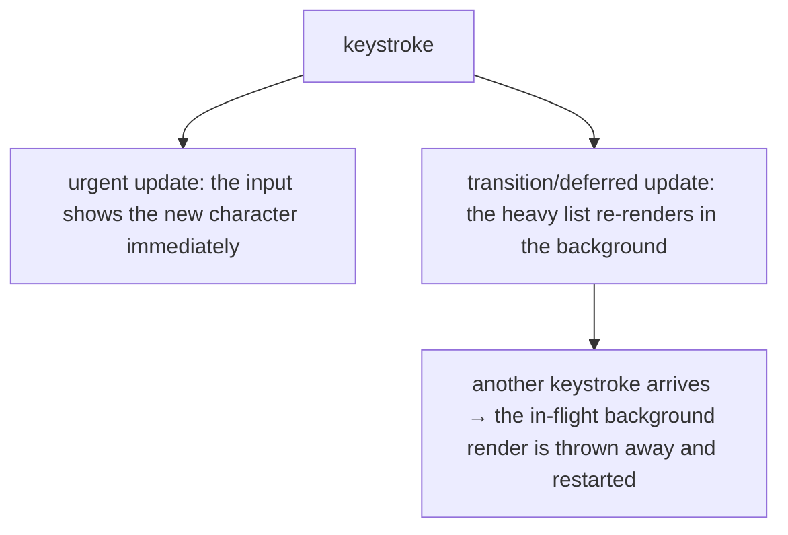

| | Reach for it when |
|---|---|
| `useTransition` | you **call the setter** and can wrap it |
| `useDeferredValue` | you only **receive the value** (a prop, a context value) |

**React 19 addition:** `startTransition` accepts **async** functions, and `isPending` stays true across
the `await`. That's the foundation of "Actions" — the next section.

> **Neither one makes the work faster.** They change what's allowed to be interrupted. If a render is
> slow because it's genuinely doing too much, fix that first (`useMemo`, virtualization, less data).

---


```check
concurrent
```

## 19. React 19's async & form hooks — `useActionState`, `useFormStatus`, `useOptimistic`, `use`

React 19 turned the "submit a form, show a spinner, show an error, update the list" dance into
first-class hooks. All four show up in modern interviews now.

### `useActionState` — a form submission with its state, error and pending flag

```tsx
const [state, formAction, isPending] = useActionState(
  async (prevState, formData) => {
    const title = formData.get("title");
    const res = await createProblem(title);
    if (!res.ok) return { error: "Could not save." };   // returned value becomes `state`
    return { ok: true };
  },
  { }   // initial state
);

return (
  <form action={formAction}>
    <input name="title" />
    <button disabled={isPending}>{isPending ? "Saving…" : "Save"}</button>
    {state.error && <p role="alert">{state.error}</p>}
  </form>
);
```

The action receives `(previousState, formData)` and returns the next state. React handles the pending
flag and re-render for you — no `useState` for loading, no `useState` for error, no `onSubmit` with
`preventDefault`.

### `useFormStatus` — a child that knows the form is submitting

Imported from **`react-dom`**, and it reads the status of the nearest `<form>` **above** it. That's the
whole point: a shared `<SubmitButton />` needs no props.

```tsx
import { useFormStatus } from "react-dom";

function SubmitButton() {
  const { pending } = useFormStatus();          // must be INSIDE the <form>, not in the component that renders it
  return <button disabled={pending}>{pending ? "Saving…" : "Save"}</button>;
}
```

### `useOptimistic` — show the result before the server confirms it

```tsx
const [optimisticTodos, addOptimisticTodo] = useOptimistic(
  todos,
  (current, newTodo) => [...current, { ...newTodo, sending: true }],
);

async function submit(formData) {
  const text = formData.get("text");
  addOptimisticTodo({ id: "temp", text });   // appears instantly
  await saveTodo(text);                      // when this settles, React reverts to the real `todos`
}
```

The optimistic value lasts only for the duration of the action; when the real state arrives (or the
action fails), React drops it automatically. No manual rollback.

### `use` — read a promise or a context, *conditionally*

```tsx
function Comments({ commentsPromise }) {
  const comments = use(commentsPromise);   // suspends until it resolves
  return comments.map(c => <p key={c.id}>{c.text}</p>);
}
```

`use` is the **one exception** to section 9's rules: it may be called inside conditions and loops. Reading
a promise suspends the component, so the nearest `<Suspense fallback>` shows meanwhile, and a thrown
rejection hits the nearest error boundary. It also reads context — `use(ThemeContext)` — which is
handy when you need a context value only in one branch.

> **Don't create the promise inside the component that `use`s it** — a new promise every render means it
> never resolves the same way twice. Create it in a Server Component or an event and pass it down.

> **Memory hook:** *`useActionState` owns the submit, `useFormStatus` reports it downward,
> `useOptimistic` fakes the result, `use` unwraps the promise.*

---


```check
react19
```

## 20. Which hook do I reach for? — the cheat sheet

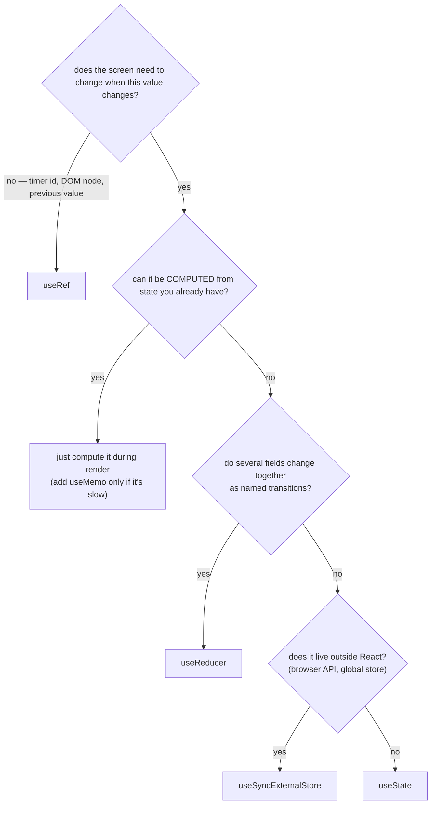

| Hook | One-line job | The bug it prevents |
|---|---|---|
| `useState` | memory that survives renders | recomputing from a variable that resets every render |
| `useReducer` | all transitions in one pure function | update logic scattered across ten handlers |
| `useEffect` | sync with the outside world after paint | leaked timers/subscriptions; stale responses |
| `useLayoutEffect` | measure & adjust *before* paint | a visible flicker/jump |
| `useRef` | a mutable box that doesn't re-render | infinite loops; lost timer ids; stale-closure intervals |
| `useMemo` | cache an expensive calculation | recomputing heavy work; unstable deps downstream |
| `useCallback` | cache a **function's identity** | a `React.memo` child that never actually skips |
| `React.memo` | skip a child's re-render | an expensive subtree re-rendering for nothing |
| `useContext` | read a value from any depth | prop drilling through components that don't care |
| `useSyncExternalStore` | read state outside React, safely | tearing; hydration mismatches |
| `useId` | a stable, SSR-safe unique id | duplicate `id`s; hydration mismatch from `Math.random()` |
| `useTransition` | mark an update non-urgent | typing that lags behind an expensive list |
| `useDeferredValue` | a lagging copy of a value you don't set | same, when you only receive the value |
| `useImperativeHandle` | choose what a forwarded ref exposes | leaking the raw DOM node to the parent |
| `useActionState` | form action + state + pending | three `useState`s and a manual `preventDefault` |
| `useFormStatus` | pending status of the enclosing form | prop-drilling `isSubmitting` into every button |
| `useOptimistic` | show the result before it lands | a UI that feels frozen while the server thinks |
| `use` | unwrap a promise or context (conditionally!) | effect-plus-state data fetching boilerplate |
| `useDebugValue` | label a custom hook in DevTools | (not a bug — a debugging nicety) |

**Cross-cutting rules, one line each:**

- Hooks are matched **by call order** — top level only, always (section 9).
- A render is a **photo**; refs are the only live box (sections 1, 10).
- If the next state is built from the previous, use `setX(prev => …)` (section 2).
- Effects **sync**; they don't compute (section 3).
- **Derive, don't store**; memoize only what you measured (section 8).
- Everything created inline is **new every render** — that's what breaks memo, deps, and context
  (sections 1, 7, 11).

---

## Tips & tricks to internalise React faster

- **"A render is a photo."** State is frozen per render; it gets a new value on the *next* render, not
  during this one. This single sentence explains the double-`setCount`, the stale timer, and more.
- **"Based on the old value? Use `c => …`."** Any update built from the previous state takes the
  updater function. Reflex.
- **"Effects sync with the outside world; they don't do math."** Fetch, timers, subscriptions → effect.
  Totals, filters, sorts → just compute them.
- **"Derive, don't store."** Two `useState`s for the same fact will drift. Keep one source of truth.
- **"`value` needs `onChange`."** A controlled input without `onChange` is frozen — the most common
  "why won't it type" bug.
- **"Keys are identity, not decoration."** Stable id from the data, never the array index, for any list
  that can reorder.
- **"Redraw? state. Remember? ref."** The one question that decides `useState` vs `useRef` every time.
- **"Hooks are numbered, not named."** They're matched by call order, which is the whole reason for
  the top-level rule.
- **"Memoize for a consumer, not for comfort."** `useCallback`/`useMemo` only pay off when a memoized
  child or a deps array is comparing identities. Otherwise you added a hook for nothing.
- **"A custom hook is a recipe, not a shared pot."** Every caller gets its own state; sharing state is
  context's job.
- **Read the React DevTools "why did this render?"** and add a `console.log` at the top of a component
  to *see* how often it runs. Watching renders happen builds the intuition faster than reading does.
- **Keep `eslint-plugin-react-hooks` on, including `exhaustive-deps`.** Nearly every "React is being
  weird" bug is a dependency you silenced.

---

## Self-quiz

Answer each out loud before reading the answer under it.

1. **Why does calling `setN(n + 1)` three times in one click handler add only 1, not 3?**
   *Answer:* All three calls read the **same render photograph** of `n`, so all three compute the
   same result and queue "set to that same value." Net effect: +1. The updater form
   `setN(x => x + 1)` fixes it because each call gets the latest pending value.
2. **When exactly does an effect with deps `[query]` run?**
   *Answer:* After the **first** render, then after **any** later render where `query` is not
   `Object.is`-equal to its previous value. Renders where `query` didn't change → skipped.
3. **When a context's value changes, which components re-render?**
   *Answer:* Every mounted component that **calls `useContext`** for that context — and nobody else
   (beyond the normal re-renders any parent would cause anyway).
4. **Why must you memoize a provider's `value` object?**
   *Answer:* Because an inline object literal is a **new object every render** (section 1), so
   without `useMemo` the context looks "changed" on every parent re-render and needlessly
   re-renders *all* consumers.
5. **When is `key={index}` actually safe?**
   *Answer:* Only for a **static list** that never sorts, filters, or has items inserted/removed.
   Any reordering needs a stable id key, or item state ends up on the wrong row.
6. **`useState` or `useRef` — how do you decide in one question?**
   *Answer:* "Should changing this redraw the screen?" Yes → state. No (timer id, DOM node, a
   'did I already do this' flag, the previous value) → ref. Writing `ref.current` never re-renders.
7. **Why can't you call a hook inside an `if`?**
   *Answer:* React matches hooks to their stored state **by call order**, not by name. Skip one and
   every hook after it reads the previous hook's slot. Put the condition *inside* the hook instead.
8. **You wrapped a child in `React.memo` and it still re-renders every time. Why?**
   *Answer:* A prop is a **freshly created object or function** each render (section 1), so the
   shallow prop comparison always fails. Stabilise it with `useCallback`/`useMemo` — or the memo is
   pure overhead.
9. **What does `useRef` return, exactly, and why does the "latest ref" pattern work?**
   *Answer:* The **same** `{ current }` object on every render. An interval created once closes over
   that unchanging box, and a separate effect keeps `box.current` pointed at the newest callback — so
   the interval always calls fresh code without being torn down and restarted.
10. **When must a reducer return a new object, and what breaks if it doesn't?**
    *Answer:* Always. Mutating `state` keeps the same reference, so React's `Object.is` check sees no
    change: nothing re-renders, or a memoized child skips an update whose data really did change.
11. **`useEffect` or `useLayoutEffect`?**
    *Answer:* `useEffect` by default (runs after paint, doesn't block). `useLayoutEffect` only when you
    **measure the DOM and immediately move something** — it runs before paint, so the user never sees
    the intermediate frame. It doesn't run during SSR.
12. **`useTransition` vs `useDeferredValue`?**
    *Answer:* Same goal — mark work as interruptible so urgent updates (typing) win. Use
    `useTransition` when you **call the setter**; `useDeferredValue` when you only **receive the
    value**. Neither makes the work faster.
13. **Which hook can legally be called inside an `if`?**
    *Answer:* `use()` — the only exception, by design. It reads a promise (suspending until it
    resolves) or a context.

## Exercises

Do them in the Dojo `React hooks & state` practice tab, then in real code. Hints + "done when" below.

1. **Reproduce and fix the frozen timer.** Build a component with the stale `setInterval(() =>
   setCount(count + 1))` bug and watch it stick at 1. Then fix it with the updater form.
   *Done when:* the number climbs every second, and you can explain out loud which "photo" the broken
   version was stuck in.

2. **Write a race-proof fetch.** Add an `alive` flag to a fetch effect, then deliberately resolve two
   overlapping requests out of order and prove the stale one is ignored.
   *Hint:* the cleanup sets `alive = false`; the `.then` checks it before `setState`.
   *Done when:* the slow, older response never overwrites the fast, newer one.

3. **Feel the un-memoized provider.** Build a context provider whose `value` is a plain inline object,
   `console.log` inside every consumer, and watch them all re-render on unrelated parent updates. Then
   wrap `value` in `useMemo` and watch the logs go quiet.
   *Done when:* consumers re-render only when the value they use actually changes.

4. **Prove the ref/state difference in one component.** Keep a counter in `useState` and a second in
   `useRef`, bump both in the same click handler, and render both.
   *Hint:* the ref's displayed number lags — it only appears once *something else* re-renders.
   *Done when:* you can explain why the ref value was already correct in memory but not yet on screen.

5. **Write `usePrevious` and `useInterval` from a blank file.** No peeking at section 10.
   *Done when:* `useInterval`'s interval survives a parent re-render without restarting, but still
   calls the newest callback — verify with a `console.log` of a prop that changes every second.

6. **Break, then fix, a `React.memo`.** Wrap a `Row` in `React.memo`, `console.log` inside it, pass an
   inline `onSelect`, and watch every row re-render on every parent update. Wrap the handler in
   `useCallback` and watch the logs stop.
   *Done when:* you can say out loud which prop failed the identity check and why.

7. **Convert a five-`useState` form to `useReducer`.** Then write plain unit tests for the reducer
   with no React at all.
   *Done when:* the tests pass and each action returns a brand-new object — check with
   `expect(next).not.toBe(prev)`.

8. **Build the same subscription twice.** Write `useOnlineStatus` with `useState` + `useEffect`, then
   with `useSyncExternalStore` and a `getServerSnapshot`.
   *Hint:* make `getSnapshot` return an object literal once, on purpose, to see the infinite loop the
   guide warns about — then fix it.
   *Done when:* the second version renders the right value on the first paint with no flash after
   hydration.

9. **Kill a flicker with `useLayoutEffect`.** Position a tooltip above its anchor by measuring its
   height in a `useEffect`, watch it jump, then switch to `useLayoutEffect`.
   *Done when:* the jump is gone and you can describe exactly which frame the user was seeing before.

10. **Wire a React 19 form.** Build a submit form with `useActionState` (returning an error string on
    failure), a `<SubmitButton />` child using `useFormStatus`, and `useOptimistic` to show the new
    row instantly.
    *Done when:* a deliberately failing action rolls the optimistic row back on its own — you wrote no
    rollback code.
