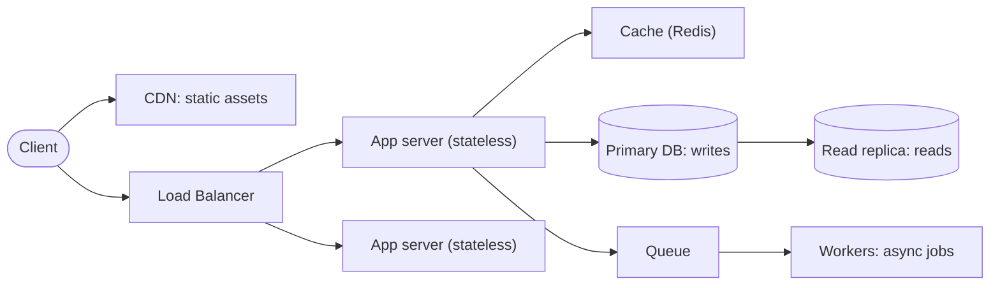
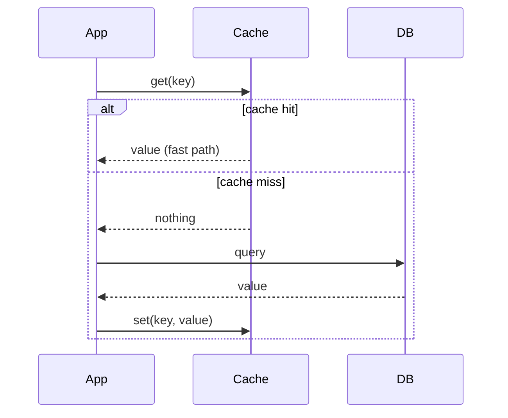
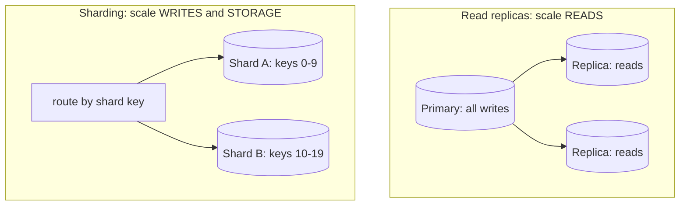
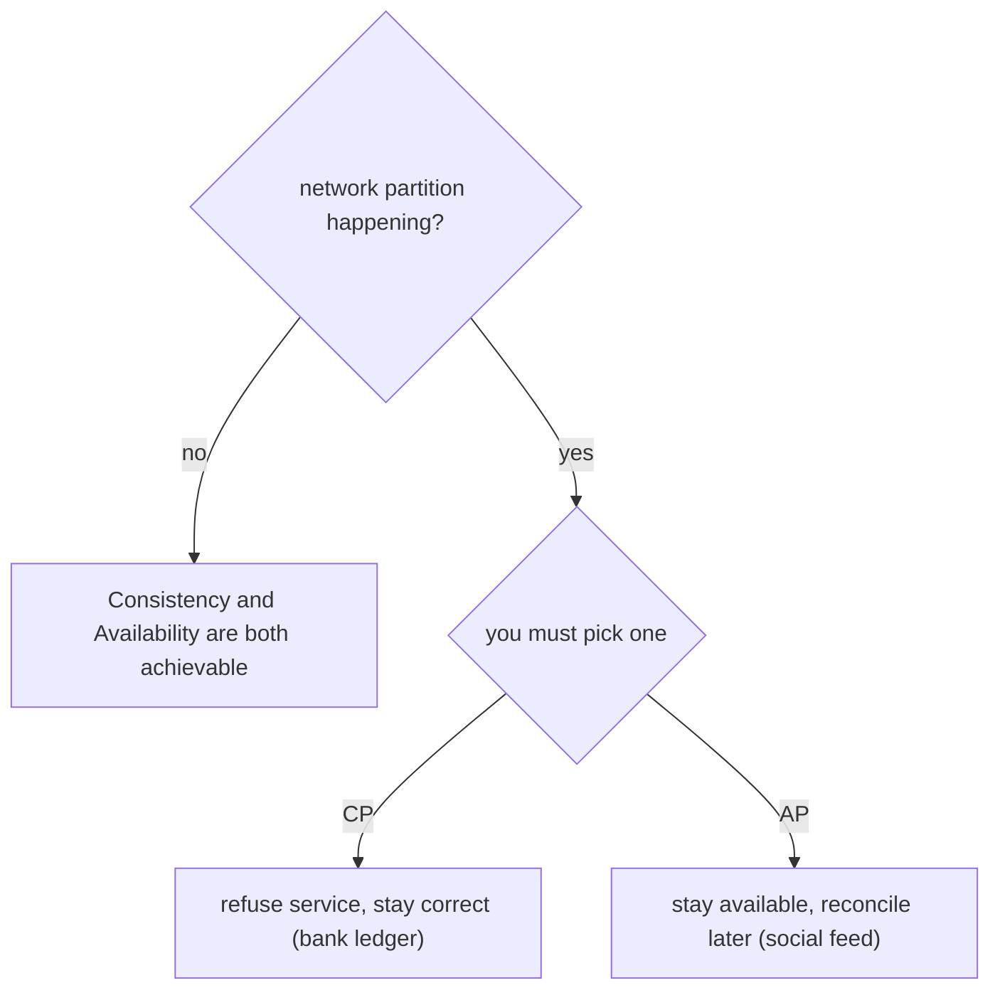
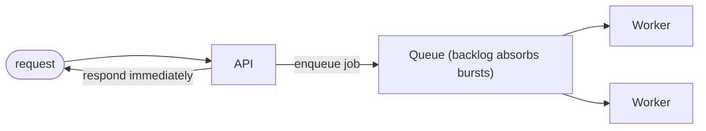
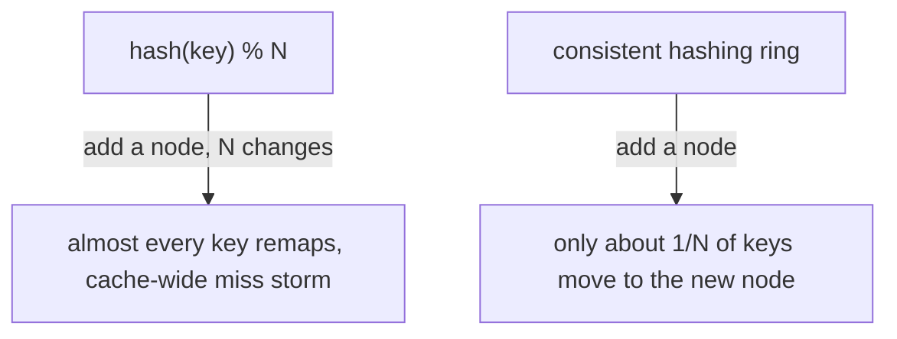
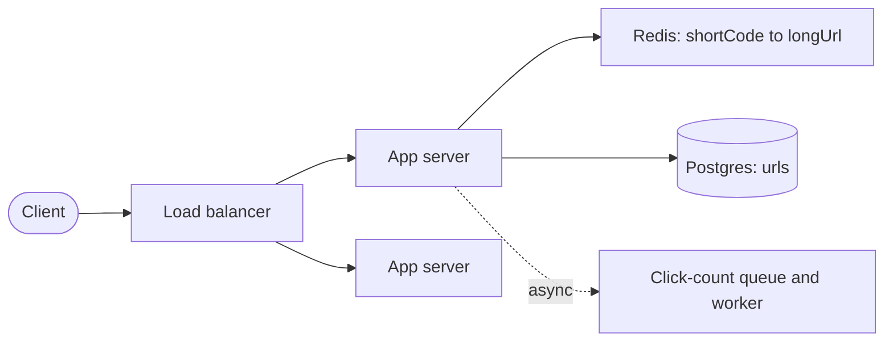
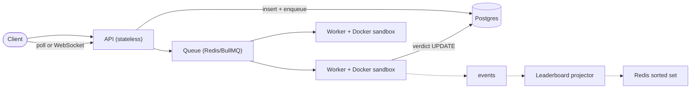

# System Design — Fundamentals

A Dojo guide. **System design** means: given an app that has to serve a *lot* of people at once, how
do you arrange the pieces — the servers, the database, the caches — so it stays fast and doesn't fall
over? It's like being the architect of a building: you combine well-understood parts (walls, plumbing,
elevators) to meet a need, and you *explain why* you chose each one.

We assume **no background** here. Every scary word gets a plain meaning and a picture before we lean on
it. And the golden truth of this whole topic: **there is rarely one right answer — there's a right way
to reason.** Interviewers grade your reasoning, not a magic diagram.

> How to use it: read this, then drill the **System Design** topic in
> [Practice](/practice/system-design). The questions are scenarios ("reads are 10k/s, data changes
> rarely — what first?") and rough estimates, because that's what the interview actually is.

---

## 0. The words that scare people (they're simple)

Read these once. Every later section reuses them. The running analogy is a **restaurant**, because
scaling a website is genuinely like scaling a restaurant.

- **Server** — a computer that answers requests (cooks food). **Client** — whoever's asking (the
  customer: a phone, a browser).
- **Request** — one thing a client asks for ("give me this page"). **Latency** — how long *one*
  request takes to answer (how fast one dish comes out). Lower is better.
- **Throughput** — how *many* requests you can handle per second (dishes per hour). Higher is better.
  Latency is speed per item; throughput is total volume — a kitchen can be fast per-dish yet low
  volume, or vice-versa.
- **QPS** — "**Q**ueries **P**er **S**econd", the standard throughput number: requests hitting your
  system each second. "1,000 QPS" = a thousand customers ordering every second.
- **Scale** — handling *more*. Two ways:
  - **Vertical scaling** = a *bigger* server (one super-chef). Easy, but there's a limit to how big
    one machine gets, and it gets expensive fast.
  - **Horizontal scaling** = *more* servers (more cooks). Harder to coordinate, but nearly unlimited —
    this is how big systems grow.
- **Availability** — the % of time the system is up and answering (the restaurant's doors are open).
  "Highly available" = almost never down.
- **Bottleneck** — the one slowest part that limits everything else (a single dishwasher that the
  whole kitchen waits on). Design work is mostly *finding and widening the current bottleneck.*
- **Stateless** — a server that remembers *nothing* between requests; any server can handle any
  request. (Any cook can take any order because all the info is on the ticket, not in one cook's
  head.) This is what makes "just add more cooks" work — hold that thought for §Load balancing.

That's the vocabulary. Now the method.

---

## A framework for any design question

When someone says "design Twitter," don't panic and start drawing. Follow five steps, every time:

1. **Clarify the requirements.** What must it *do* (functional: post, follow, search)? And the
   *non-functional* constraints: how many users, how fast, how available, how consistent? **Numbers
   change everything** — "1,000 users" and "100 million users" are different buildings. Always ask
   "how many?"
2. **Estimate the scale.** Do rough QPS and storage math (next section). This tells you whether you
   even *have* a scaling problem, and *where* it is. Often the estimate itself decides the design.
3. **Sketch the happy path.** The simplest version that works end to end:
   `client → load balancer → app servers → database`. Get data flowing *before* optimizing anything.
4. **Find the bottleneck, apply ONE tool, repeat.** Reads too high? Add a cache, then replicas.
   Writes/storage too high? Shard. Slow far-away assets? Add a CDN. Each tool fixes one specific
   pressure. Name the pressure, apply one tool, ask "what breaks next?"
5. **Talk about failure & trade-offs.** What if a server dies? What do you give up for what? *Saying
   the trade-off out loud is the whole game* — there's no perfect design, only well-defended ones.

Most designs end up as variations of one reference picture:



Don't memorize it — by the end of this guide you'll be able to *derive* it, because you'll know what
each box is for.

---

## Back-of-envelope estimation

"Back-of-envelope" means rough math you could do on a napkin. Interviewers don't want exact numbers —
they want to see you **size the problem** so your design targets the real pressure. Four facts make it
easy:

- **A day has ≈ 86,400 seconds ≈ 100,000 (100k).** So *average QPS = daily requests ÷ 100k.* Round
  freely.
- **Peak traffic is ≈ 2–5× the average** (everyone shows up at lunch). Build for the peak, not the
  average.
- **Byte sizes in powers of ten:** 1 KB ≈ 10³ (a thousand bytes), 1 MB ≈ 10⁶ (a million), 1 GB ≈ 10⁹
  (a billion), 1 TB ≈ 10¹² (a trillion).
- **Storage per day** = (records written per day) × (bytes per record). × 365 for a year, then × 2–4
  for the real footprint (databases keep backups and indexes, which cost extra space).

Worked example, slowly: *10 million daily users, each making 10 requests a day.*
That's 100 million requests/day. Divide by 100k seconds → **~1,000 QPS average.** Peak ≈ 3–5× →
**plan for ~3,000–5,000 QPS.** In two lines of arithmetic you now know the size of your problem.

> **Memory hook:** *seconds in a day ≈ 100k.* That single number turns "requests per day" into "QPS"
> instantly, which is 90% of estimation.

---

## Latency numbers every programmer should know

Different kinds of storage and network hops are *wildly* different speeds — and knowing the rough
ratios is what lets you say "that design does a disk seek per request, it'll never hit the latency
target" on the spot. You don't memorize exact nanoseconds; you memorize the **ladder of orders of
magnitude** (this is Jeff Dean's famous list, rounded to what's worth remembering):

| Operation | Rough time | In human terms (if 1 ns = 1 second) |
|---|---|---|
| Read from **CPU cache** (L1) | ~1 ns | 1 second |
| Read from **main memory (RAM)** | ~100 ns | ~2 minutes |
| Read 1 MB sequentially from RAM | ~250 µs | ~3 days |
| **Round trip inside one datacenter** | ~500 µs | ~6 days |
| Read 4 KB randomly from **SSD** | ~150 µs | ~2 days |
| Read 1 MB sequentially from **SSD** | ~1 ms | ~11 days |
| **Disk (HDD) seek** | ~10 ms | ~4 months |
| Read 1 MB sequentially from **HDD** | ~30 ms | ~1 year |
| **Round trip across the world** (e.g. California ↔ Netherlands) | ~150 ms | ~5 years |

The three ratios that actually decide designs:

- **RAM is ~100,000× faster than a disk seek.** *This is the entire reason caches exist* — keeping
  hot data in memory instead of hitting disk is a 5-orders-of-magnitude win.
- **Sequential is far faster than random.** Reading 1 MB in order beats scattered small reads by a
  lot — why databases store rows together and why "read the whole page, filter in memory" can beat
  many pinpoint reads.
- **A cross-continent round trip (~150 ms) is an eternity.** A handful of back-and-forth calls to a
  far server blows any snappy budget — this is why CDNs push content near users and why chatty APIs
  (many round trips) are a design smell.

> **Memory hook:** *memory = nanoseconds, SSD = microseconds, disk & cross-country network =
> milliseconds.* Each step down is roughly 1000× slower. "Is this on the memory rung or the disk
> rung?" answers most latency questions.

---

## Availability: measuring uptime in "nines"

**Availability** is the % of time the system is up. It's quoted in "nines", and the jump between each
level is bigger than it looks — here's what the downtime budget actually is:

| Availability | Nickname | Downtime per year | Downtime per month |
|---|---|---|---|
| 99% | "two nines" | ~3.65 days | ~7.2 hours |
| 99.9% | "three nines" | ~8.8 hours | ~43 minutes |
| 99.99% | "four nines" | ~52 minutes | ~4.4 minutes |
| 99.999% | "five nines" | ~5 minutes | ~26 seconds |

Two facts interviewers love, because they explain *why* redundancy works:

- **Components in a chain (series) multiply — availability goes DOWN.** If a request must pass through
  two things that are each 99.9% available, the total is `0.999 × 0.999 = 99.8%`. Every extra hop in
  the critical path *subtracts* reliability. (This is also the argument against a long chain of
  synchronous service calls.)
- **Redundant copies (parallel) make it go UP.** Two components doing the same job in parallel fail
  only if *both* fail: `1 − (1 − 0.999) × (1 − 0.999) = 99.9999%`. Two "three-nines" boxes in
  parallel give "six nines". **This is the whole point of running two of everything.**

> **Memory hook:** *in series, availabilities multiply (worse); in parallel, the failure chances
> multiply (better).* Redundancy in parallel is how you buy nines. (Closely related interview
> vocabulary: an **SLA** is the availability you *promise* customers; an **SLO** is the internal
> target you aim for to keep that promise.)

---

## Caching

A **cache** is a small, super-fast store that keeps a copy of expensive-to-get data *close by*, so you
don't redo the expensive work every time. Analogy: instead of walking to the library (the database)
for a fact you look up constantly, you write it on a **sticky note on your monitor** (the cache). The
sticky note is instant; the library is slow.

- **Why it's powerful:** a **cache hit** (the data's on the sticky note) skips the database entirely —
  often 10–100× faster and cheaper. Caches shine for data that's **read a lot and changes rarely.**
- **Cache-aside (the common pattern):** the app asks the cache first; on a **miss** (not there), it
  loads from the database and *then writes it to the cache* for next time. Simple, and the cache never
  needs to understand the database.
- **Write-through / write-back:** send *writes* through the cache too, to keep it fresh — trading a bit
  of write speed (or a durability risk) for reads that are never stale.
- **The two hard parts** (there's a famous joke: "the two hardest things in computer science are naming
  things, cache **invalidation**, and off-by-one errors"):
  - **Invalidation** — knowing *when* the sticky note is out of date and must be tossed.
  - **Cache stampede** — a popular item expires and suddenly *thousands* of requests all miss at once
    and pile onto the database together, possibly crushing it. Fixes: add a little randomness to expiry
    times so they don't all expire at once (**"jitter"**), let only one request refill it while others
    wait (**single-flight lock**), or keep serving the slightly-stale value while you refresh in the
    background (**stale-while-revalidate**).



---

## Cache update patterns — who writes to the cache, and when

"Add a cache" raises a follow-up: *how do the cache and the database stay in step?* There are five
named patterns, and knowing the trade-offs is a strong interview signal:

- **Cache-aside (lazy loading)** — the *application* manages it: on a read, check the cache; on a
  miss, load from the DB and put it in the cache. (The pattern from above.) ✅ Only requested data is
  cached. ⚠️ A miss costs 3 trips (cache→DB→cache), data can go stale after a DB write, and a fresh
  empty cache node starts slow.
- **Read-through** — same idea, but the *cache library itself* loads from the DB on a miss, so your
  app just asks the cache and never talks to the DB directly. Cleaner app code; the cache has to know
  how to load.
- **Write-through** — writes go **to the cache, which synchronously writes to the DB** before
  returning. ✅ The cache is never stale and just-written data reads fast. ⚠️ Every write pays the
  cache+DB cost (slower writes), and data never read still fills the cache (use a TTL).
- **Write-behind (write-back)** — writes go to the cache and are flushed to the DB **asynchronously**
  later. ✅ Very fast writes (great for write-heavy bursts). ⚠️ **Data loss if the cache dies before
  flushing**, and it's more complex.
- **Refresh-ahead** — the cache *proactively* refreshes popular entries **just before they expire**,
  so hot keys never actually miss. ✅ Low latency on predictable hot data. ⚠️ If it guesses wrong
  about what's "hot", it wastes work.

> **Memory hook:** *cache-aside = lazy (fill on miss); write-through = safe but slow writes;
> write-behind = fast but riskier writes; refresh-ahead = pre-warm the hot keys.* Default to
> cache-aside; reach for the others only when a specific pressure demands it.

---

## Load balancing & stateless services

A **load balancer** (LB) is the traffic cop that sits in front of your servers and spreads incoming
requests across them so no single one is overwhelmed. (The restaurant *host* who seats each new party
at the least-busy section.) It can spread by simple rotation (**round-robin**), by who's **least busy**
(least-connections), or by hashing the client's address (IP-hash).

- **Keep app servers stateless** (remember §0). If no request depends on *which* server handled the
  last one, you can add or remove servers freely and reroute around a dead one with zero data loss.
  That freedom is *the* enabler of horizontal scaling.
- So where does "who's logged in" live if not on the server? In a **shared store** both servers can
  reach (like Redis), or inside a **signed token** the client carries on each request. Never stuck to
  one server's memory.
- The load balancer itself must not become a **single point of failure** (one thing whose death takes
  everything down). Run two of them with health checks so one covers if the other dies.

> **Single point of failure (SPOF)** is a phrase to keep on your tongue. In any diagram, hunt for the
> one box with no backup — that's the SPOF, and removing it is a reliable interview point.

---

## DNS — the internet's phone book (as a building block)

**DNS** ("Domain Name System") turns a name like `example.com` into a server's IP address (the actual
number the network routes to). You met it in the "type a URL" story; in *system design* it's also a
tool you actively use:

- **Record types** worth naming: **A** (name → IP address), **CNAME** (name → another name, an
  alias), **MX** (mail servers), **NS** (which DNS servers are authoritative). Each has a **TTL**
  (time-to-live) that controls how long answers are cached.
- **DNS as a routing tool:** because *you* control the answer, DNS can do **geo-routing** (send Europe
  to the EU datacenter, the US to the US one), **latency-based routing** (send each user to the
  closest healthy region), and **failover** (stop handing out a dead datacenter's IP). This is the
  first layer of "get the user to the right place".
- ⚠️ It's a subtle **single point of failure** and a caching gotcha: changes take up to the TTL to
  spread ("DNS propagation"), so don't rely on instant DNS changes for fast failover.

---

## Reverse proxy (and how it differs from a load balancer)

A **reverse proxy** is a server that sits *in front of* your app servers; clients talk only to it, and
it forwards requests to whichever backend should handle them. Analogy: a **receptionist** who greets
every visitor, handles the paperwork, and sends them to the right office — visitors never wander the
building.

What a reverse proxy centralizes (so each app server doesn't repeat it): **TLS termination**
(decrypting HTTPS once), **compression**, **caching** of common responses, **request routing**, and
hiding your backend layout (security). 

How is that different from a load balancer? A **load balancer is a *kind of* reverse proxy** whose
specific job is spreading traffic across identical servers. In practice one box (nginx, Envoy) often
does both. Interview one-liner: *"a load balancer distributes load across many identical servers; a
reverse proxy is the front door that can also do TLS, caching, and routing — and an LB is one flavor
of reverse proxy."*

---

## Application layer: splitting the web tier from the workers (and microservices)

So far "app server" was one box. As you grow, split it into **separate layers that scale
independently**: a thin **web tier** that handles requests fast, and an **application/worker tier**
that does heavier work. Now a flood of slow jobs can't starve quick requests, and you scale each to
its own load.

Taken further, that's **microservices**: instead of one big program ("the monolith"), you split the
app into small, independently-deployable services, each owning one job (users, payments, search).
Analogy: **a food court of specialist stalls** vs one giant kitchen cooking every cuisine.

- ✅ Each service scales, deploys, and fails on its own; teams work in parallel; you can pick the best
  tool per service.
- ⚠️ The cost is real: services now talk over the **network** (slower, can fail — see the latency
  numbers), debugging spans many services, and data consistency across them is hard. **Most apps
  should start as a monolith** and split only when a piece genuinely needs to — say that out loud;
  reaching for microservices on day one is a red flag.

Because service instances constantly come and go (autoscaling, crashes, deploys), services can't
hard-code each other's addresses. **Service discovery** solves this: a **registry** (Consul, etcd,
ZooKeeper) that every service registers with on startup and queries to find healthy instances of the
services it needs — a live phone book for your internal services, with health checks removing dead
entries.

---

## Scaling the database

The database is usually the first thing to strain, because unlike stateless app servers you can't just
clone it (they'd disagree about the data). Match the tool to *which dimension* is saturated:

- **Too many reads → read replicas.** A **replica** is a copy of the database. One **primary** takes
  all the writes and continuously streams its changes to several read-only **replicas** that serve
  reads. Now reads scale horizontally. The catch: **replication lag** — a replica can be a split-second
  behind, so a user who *just* saved something and immediately reloads might hit a stale replica and
  see the *old* value ("where'd my edit go?!"). Fix: **read-your-writes** — briefly route *that* user's
  reads to the primary so they always see their own change.
- **Too many writes, or too much data → sharding.** **Sharding** = splitting the data across multiple
  databases, each owning a *slice* (shard A holds users A–M, shard B holds N–Z). Now writes and storage
  scale horizontally. The make-or-break choice is the **shard key** (what you split on): pick badly and
  one shard gets all the traffic (a **hot shard**) while others idle; also, questions that span shards
  (joins, transactions) get much harder.
- **Vertical scaling** (just buy a bigger database machine) is the *easy first step* — do it before
  anything fancy — but it hits a hard ceiling and a steep price.
- **SQL vs NoSQL** is about *access patterns*: relational SQL for interconnected data needing
  transactions and joins; NoSQL for huge-volume, flexible-shape, simple-lookup data that must spread
  across many machines. **Most apps start perfectly fine on one Postgres box** — say that; over-engineering
  is a red flag.



> **Memory hook:** *replicas for reads, shards for writes.* Reads = copies everyone can read from;
> writes = split the load into separate pieces.

---

## Database replication: master-slave vs master-master

Replication means keeping copies of the database in sync. Two arrangements:

- **Master-slave** (a.k.a. primary-replica) — **one** master takes all writes and streams them to
  read-only slaves. This is the "read replicas" pattern above. ⚠️ If the master dies you must
  **promote a slave to master** (extra machinery), and there's **replication lag**.
- **Master-master** (a.k.a. multi-primary) — **two or more** masters each take reads *and* writes and
  sync with each other. ✅ No single write bottleneck; write to whichever is closest. ⚠️ Now two
  places can edit the same row at once → you need **conflict resolution**, and such systems are either
  **loosely consistent** (may briefly disagree) or pay **extra write latency** to coordinate.

> **Memory hook:** *master-slave = one writer, easy but a write bottleneck + failover pain;
> master-master = many writers, no bottleneck but conflict headaches.*

---

## Federation, denormalization, and SQL tuning

Three more database scaling tools beyond replicas and shards:

- **Federation (split by function)** — instead of one giant database, use several split *by feature*:
  a `users` DB, a `products` DB, a `forums` DB. ✅ Each is smaller, gets less traffic, and can scale
  on its own. ⚠️ Joining across two databases is now hard, and the app must route each query to the
  right one. (This is the database version of splitting into services.)
- **Denormalization** — deliberately **copy data into extra tables to avoid expensive joins.** Reads
  usually outnumber writes 100:1, so a read that would need a big join is worth precomputing. ✅ Fast
  reads. ⚠️ Duplicated data must be kept in sync (via triggers or event handlers), and it slows
  writes. (Your CodeArena leaderboard is exactly this: normalized submissions for correctness, a
  denormalized read model for speed.)
- **SQL tuning** — making the *existing* database faster before adding hardware. The big levers:
  **right data types** (`INT` for numbers, `DECIMAL` for money — never floats, `NOT NULL` where you
  can), **indexes** on the columns you filter/join/sort on (a B-tree → O(log n) lookups, at the cost
  of slower writes and more space), and **query hygiene** (avoid `SELECT *`, read an `EXPLAIN` plan,
  kill N+1 query loops — see [CS Fundamentals §4](/guides/cs-fundamentals)).

---

## NoSQL: the four flavors, and when to pick each

"NoSQL" isn't one thing — it's four families, each a different trade of guarantees for scale/flexibility.
The key idea: each drops SQL's joins/transactions in exchange for something (speed, flexible shape, or
horizontal scale).

| Type | Think of it as… | Great for | Example |
|---|---|---|---|
| **Key-value** | a giant hash table (O(1) get/set by key) | caching, sessions, counters, anything looked up by one key | Redis, DynamoDB |
| **Document** | key-value where each value is a whole JSON document you can query inside | flexible/evolving shapes, content, catalogs — one object per document | MongoDB, CouchDB |
| **Wide-column** | rows where each row can have billions of columns, grouped in "column families" | *huge* datasets with heavy writes (time-series, event logs) | Cassandra, HBase, Bigtable |
| **Graph** | nodes joined by edges | data that's mostly *relationships* — social graphs, recommendations, fraud rings | Neo4j |

**How to choose SQL vs NoSQL in an interview** — match guarantees to the data, don't say "NoSQL is
modern":

- **Reach for relational (SQL)** when data is interconnected and correctness spans rows —
  orders + payments + inventory need ACID transactions and joins.
- **Reach for NoSQL** when each record is self-contained, the shape changes often, or the scale forces
  you to spread across many machines — and pick the flavor by access pattern (look-up-by-key →
  key-value; nested documents → document; massive write volume → wide-column; relationship-walking →
  graph).
- The honest default: **most apps start perfectly fine on Postgres** (which even has a JSON column
  type when you want document-style flexibility).

---

## Consistency & the CAP theorem

First, three definitions:

- **Consistency** — everyone sees the *same, latest* data at the same time. (Two ATMs always agree on
  your balance.)
- **Availability** — the system always answers, even if some parts are broken.
- **Partition** — when the network *splits* and two halves of your system can't talk to each other for
  a moment (a cut cable between two data centers).

The **CAP theorem** says: *during a partition*, you must choose — you can be **C**onsistent **or**
**A**vailable, not both. Why? If the two halves can't talk, either they refuse to answer until they
reconnect (consistent but not available) or they each answer on their own and risk disagreeing
(available but not consistent). You can't escape it, because in a distributed system partitions
*will* happen (the "P" is not optional).

- **CP — choose Consistency** (a bank ledger): better to *refuse* service for a moment than show two
  different balances. Correctness over uptime.
- **AP — choose Availability** (a social media feed): better to stay up and show a slightly stale
  like-count, reconciling later. Uptime over perfect freshness.
- The everyday version of the same dial is **strong vs eventual consistency.** *Eventual* ("it'll be
  correct in a second") is cheaper and more available; use *strong* ("correct right now, always") only
  where it truly matters — money, inventory.



---

## Consistency patterns (weak → eventual → strong)

CAP forces a choice; *consistency patterns* are the three concrete levels of "how fresh is a read
after a write?", from loosest to strictest:

- **Weak consistency** — after a write, a read **may or may not** see it; it's best-effort. Fine when
  a missed update is cheap and speed is everything. *Used by:* live video/VoIP, multiplayer games,
  memcached. (Miss a frame? Move on.)
- **Eventual consistency** — after a write, reads will see it **soon** (usually milliseconds), once
  the change finishes replicating asynchronously. *Used by:* DNS, email, and most highly-available
  (AP) systems. This is the everyday default for things like a like-count.
- **Strong consistency** — after a write, **every** read sees it immediately, because data is
  replicated synchronously before the write returns. *Used by:* relational databases, file systems,
  anything transactional (money, inventory).

> **Memory hook:** *weak = maybe, eventual = soon, strong = now.* Freshness costs availability and
> latency — use strong only where being wrong is expensive.

---

## Availability patterns (how you actually stay up)

Two building blocks keep a system available when a machine dies:

- **Fail-over** — a standby takes over when the active machine fails. Two styles:
  - **Active-passive** — the active server serves traffic while a passive standby watches via a
    **heartbeat**; if the heartbeat stops, the passive one takes over the IP and resumes. (Also called
    master-slave failover.) Simple, but you pay for an idle standby and lose the in-flight moment.
  - **Active-active** — **both** servers serve traffic and share the load; if one dies, the other
    already carries everything. (Also called master-master failover.) No idle hardware, no single
    point of failure — but both must be kept in sync and traffic must be spread to both.
- **Replication** — keeping synced copies (master-slave / master-master, from the database section) so
  a copy can take over.

⚠️ Fail-over isn't free: it adds hardware and complexity, and there's a **data-loss window** — if the
active machine dies *after* accepting a write but *before* replicating it, that write is gone. Naming
that window is a senior-level point.

---

## Asynchronous work & message queues

Some work doesn't need to finish before you answer the user — sending a welcome email, making a
thumbnail, warming a cache. Making the user *wait* for it is silly. So you push it **off the request
path** onto a **queue.**

A **queue** is a waiting line for tasks (the rail of order-tickets in a kitchen). The app **enqueues**
a job (clips the ticket to the rail) and immediately answers the user; separate programs called
**workers** (the cooks) pull tickets off and do the slow work later.

- **Why it's great:** the producer (app) and consumers (workers) scale and fail **independently**, and
  the queue **smooths out bursts** — a sudden flood grows the *line* instead of toppling the kitchen.
- **The catch — "at-least-once" delivery:** to be safe against crashes, queues guarantee a job runs *at
  least* once, which means it can occasionally run **twice.** So workers must be **idempotent** — doing
  the job twice must equal doing it once. The trick: tag each job with an id and *no-op* (do nothing) if
  you've already handled that id. (The same idea guards a payment API with an **idempotency key** so a
  retried request never charges twice.)



> **Memory hook:** *enqueue and return; make workers idempotent.* Answer fast, do slow work later, and
> assume every job might run twice.

---

## Task queues & back pressure

Two refinements on the queue idea that come up constantly:

- **Message queue vs task queue.** A **message queue** just receives, holds, and delivers messages
  (Redis, RabbitMQ, Amazon SQS). A **task queue** is higher-level: it takes tasks *with their data*,
  runs them, tracks their results, and often supports **scheduling** and retries (Celery, and your
  own **BullMQ**). For "run a job in the background", you usually want a task queue.
- **Back pressure** — the safety valve. If work arrives faster than workers can drain it, the queue
  grows without bound: it outgrows memory, spills to disk, and everything slows down — a queue that's
  "helping" can actually take the system down. **Back pressure caps the queue**: once it's full, new
  requests are rejected fast (an HTTP **503 "busy, try later"**) so the jobs already queued keep
  flowing at a healthy rate. Clients retry later with **exponential backoff**. Analogy: a kitchen that
  *stops taking new orders* when the ticket rail is full, instead of accepting infinite tickets and
  melting down.

> **Memory hook:** *an unbounded queue is a slow-motion outage.* Bound it, shed load with 503s, and
> let clients back off.

---

## Rate limiting

**Rate limiting** = capping how many requests one client (or API key) may make in a window, to protect
you from abuse and overload. ("Max 100 requests per minute.")

- **Token bucket** (the interview favorite): imagine each client has a bucket that holds up to 100
  **tokens**, refilling steadily at 100 tokens/minute. Each request spends one token; no tokens → you're
  rejected. This caps the *sustained* rate but still permits a short **burst** (spend a full bucket at
  once), which matches real usage. Only two numbers to tune (bucket size, refill rate).
- **Fixed window** is the simplest (just a counter reset each minute) but allows ~2× bursts right at the
  boundary (100 at 11:59:59 *plus* 100 at 12:00:01). **Sliding window** and **leaky bucket** are
  smoother but more complex. Start with token bucket and name the trade-off.

---

## Communication: how the pieces talk to each other

### TCP vs UDP (the transport choice)

Recap from [CS Fundamentals §3](/guides/cs-fundamentals), because it shows up in designs too: **TCP**
is the reliable phone call (handshake first, then ordered, guaranteed, resent-if-lost bytes) — use it
when every byte must arrive (web, databases, files). **UDP** is shouting across a room (no setup,
fire-and-forget, may drop or reorder) — use it when *freshness beats completeness* (live video,
games, DNS). One line: **"correctness → TCP; low-latency-and-a-lost-packet-is-fine → UDP."**

### RPC vs REST (how services call each other)

Two styles for one service to ask another to do something:

- **RPC (Remote Procedure Call)** — call a function on another machine *as if it were local*
  (`getUser(42)`); the framework hides the network. **Focused on behaviors/actions.** ✅ Fast and
  compact — great for chatty *internal* service-to-service calls (gRPC, Thrift, Protobuf). ⚠️ Clients
  are **tightly coupled** to the service, you define a new call per operation, and it's harder to
  cache/debug with standard web tooling.
- **REST** — expose **resources** (`/users/42`) and act on them with standard HTTP **verbs**.
  **Focused on data/resources.** ✅ Loosely coupled, uses standard HTTP (caching, browsers, tooling all
  work), and being **stateless** it scales horizontally — the default for **public** APIs. ⚠️ Fetching
  deeply nested data can take several round trips, and responses can bloat as fields accumulate (part
  of why GraphQL exists).

One line: **"REST for public, resource-shaped, cache-friendly APIs; RPC for fast internal
service-to-service calls."**

### HTTP verbs — and why idempotency decides retries

An **idempotent** verb gives the same result no matter how many times you send it — which is exactly
what makes a request **safe to retry** after a timeout:

| Verb | Does | Idempotent? | Safe? (read-only) | Retry a timeout blindly? |
|---|---|---|---|---|
| GET | read a resource | ✅ | ✅ | ✅ yes |
| PUT | create/replace at a known id | ✅ | ❌ | ✅ yes |
| DELETE | remove a resource | ✅ | ❌ | ✅ yes |
| PATCH | partially update | usually ❌ | ❌ | ⚠️ careful |
| POST | create / trigger an action | ❌ | ❌ | ❌ no — needs an idempotency key |

This is why "a client times out and retries POST /charge" needs an **idempotency key** (from the rate
limiter and worker sections): POST isn't idempotent, so the key is what makes the retry safe.

---

## CDNs & consistent hashing

- **CDN** ("**C**ontent **D**elivery **N**etwork"): a fleet of servers spread around the world that keep
  copies of your *static* files (images, CSS, JavaScript) at **edge** locations physically near users.
  So a user in Morocco loads your logo from a nearby city instead of a server in Virginia — turning a
  slow cross-planet trip into a fast local one, and taking load off your origin. Trick of the trade:
  put a version hash in filenames (`app.4f3a.js`) so you can cache them *forever* and just change the
  name when the file changes. Two ways a CDN gets your content: **push** (you upload files to the CDN
  when they change — good for infrequently-updated assets, less origin traffic) vs **pull** (the CDN
  fetches from your origin on the first request for a file, then caches it — less work to set up, but
  the first user in each region pays a slow "cache-fill" request).
- **Consistent hashing** — solves a subtle problem. To spread keys across N cache servers you might do
  `hash(key) % N` (a number trick that maps each key to a server 0…N-1). But the moment you add a server
  (N changes), *almost every key* maps somewhere new → a system-wide cache **miss storm** as everything
  reloads at once. **Consistent hashing** arranges servers and keys around an imaginary **ring** so that
  adding or removing a server only moves about **1/N** of the keys (just the neighbors), not all of them.
  (Plus "**virtual nodes**" to keep the spread even.) It's the standard fix for sharded caches and
  distributed databases.



---

## Worked design #1 — a URL shortener (the canonical opener)

The most common *first* design question. Work it end-to-end with the five-step framework; aim to
deliver it in ~20 minutes on a whiteboard. (A "URL shortener" turns a long link into a short one, like
bit.ly.)

**1. Requirements.** *Functional:* shorten a long URL into a short code; when someone visits the short
code, redirect them to the long one; optional custom aliases and expiry dates. *Non-functional:*
redirects must be **fast** (a user is waiting on them) and highly available; *creating* a short link can
be slower (nobody's blocked). State a scale assumption aloud: 100M new URLs/month, and links are read
~10× more than they're created (10:1 read:write).

**2. Estimation.** Writes: 100M/month ÷ ~2.6M seconds/month ≈ **~40 writes/s** (peak ~150/s). Reads:
10× that ≈ **~400/s** (peak ~1,500/s). Storage: 100M × ~500 bytes ≈ 50 GB/month → ~3 TB over 5 years —
**one Postgres box handles this easily.** The punch line to say out loud: *"the numbers say **reads**,
not storage, are the thing to engineer."* That sentence is the entire point of estimating.

**3. API + data model.** (An **API** is the list of requests your service accepts.)

```
POST /api/urls        {longUrl, customAlias?, expiresAt?}  → {shortCode}
GET  /{shortCode}     → 301/302 redirect
```

One table: `urls(short_code PK, long_url, owner_id, created_at, expires_at)`. The interesting decision
is **how to generate the short code.** Hashing the URL (take an MD5 hash, keep 7 characters) risks two
URLs colliding on the same code. Better: keep a **counter** and convert it to **base-62** (using
`0-9`, `a-z`, `A-Z` = 62 symbols; 62⁷ ≈ 3.5 *trillion* codes, so 7 characters lasts forever) — no
collisions, ever. Trade-off to name: a single global counter is a coordination bottleneck, so hand each
app server a **range** to hand out (server A owns 1–100,000, B owns 100,001–200,000) — now they mint
codes without talking to each other.

**4. Architecture + the bottleneck walk.**



A redirect is just one key→value lookup, and hot links get hit constantly, so put a **cache-aside
Redis** in front of Postgres — it serves nearly all reads in ~1 ms. Detail worth raising: **301 vs
302.** A 301 ("permanent") lets browsers *remember* the redirect — great for reducing load, but then you
never see repeat clicks (bad for analytics). A 302 ("temporary") sends every click through you. Choose
per requirements — and *say the trade-off.* Counting clicks doesn't belong on the fast redirect path:
drop an event on a queue and let a worker tally it up.

**5. Failure & follow-ups they'll ask.** Cache down? Postgres still serves 1,500 reads/s with an index —
slower, not an outage. Custom alias already taken? Unique constraint → return 409 (conflict). Expired
links? Filter them out at read time + a nightly cleanup job. Abuse? Rate-limit the `POST` per API key.
Multiple regions? Read replicas per region — and since codes never change, replication lag only delays
brand-new links, it can never corrupt an existing one.

---

## Worked design #2 — a code-submission judge (your CodeArena story)

"Design a platform where users submit code, it runs against tests, and they get a verdict" — for 10,000
daily users. **This is the design you can tell better than anyone, because you built it.** Structure it
exactly like an interview.

**1. Requirements.** *Functional:* submit code, run it against hidden tests inside a safe sandbox,
return a verdict + runtime; create/edit problems; per-user history; a contest leaderboard.
*Non-functional:* **submissions must never be lost** (durability); running untrusted code must be
**isolated** (it's literally strangers' code!); verdicts should come back in under ~30s for 95% of
submissions; and the read side (problems, leaderboards) must stay fast even during a contest rush.

**2. Estimation.** 10,000 users × ~10 submissions/day ≈ 100k/day ≈ **~1–2 submissions/s on average** —
*but contests are bursty*: 1,000 people submitting within a 2-hour window peaks at **~20–50/s.** Each run
uses 1–10 seconds of CPU, so you **cannot** run it inside the web request (the user would wait forever
and one server would choke). The estimate *forces* the architecture: **an async queue with many
workers.**

**3. API + data model.**

```
POST /api/submissions   {problemId, language, code} → 202 {submissionId}   ← returns IMMEDIATELY
GET  /api/submissions/{id}                          → {status, verdict?, runtimeMs?}
GET  /api/contests/{id}/leaderboard                 → [{rank, userId, score}]
```

(That `202` status means "Accepted — I've taken your request and will work on it," *not* "done.") Tables:
`users`, `problems`, `test_cases(problem_id, input, expected, version)`,
`submissions(id, user_id, problem_id, code, status, verdict, runtime_ms, created_at)`. The `status` walks
a tiny **state machine** (a fixed set of allowed stages): `queued → running → {accepted, wrong_answer,
runtime_error, timeout}`. Index `(user_id, created_at)` for history and `(problem_id, status)` for stats.

**4. Architecture.**



Narrate it piece by piece. The API **saves the submission to the database first, *then* puts it on the
queue** — so work is never lost; the database row is the source of truth and the queue is just a
delivery belt. Workers pull jobs and run the code inside a **Docker sandbox** — a locked-down container
with *no network, a read-only filesystem, and CPU/memory/time limits.* (This is your security
deep-dive: if you can name **namespaces, cgroups, and seccomp** — the Linux features that isolate the
container — you've separated yourself from every other candidate.) The verdict updates the row; the
client either **polls** ("done yet? done yet?") or gets a live **WebSocket** push (a two-way always-open
connection). The leaderboard uses **CQRS** — "Command Query Responsibility Segregation," a fancy name for
a simple idea: *keep the write model and the read model separate.* Submission events feed a **Redis
sorted set** (a structure that keeps items ranked by score, with O(log n) rank lookups via `ZINCRBY` /
`ZRANGE`), because re-ranking with a live SQL query during a contest burst would hammer the write
database.

**5. Failure & trade-offs — the follow-up gauntlet.**
- *Worker dies mid-job?* At-least-once redelivery means the job reruns → executions must be
  **idempotent**: keyed by submission id, the verdict UPDATE is a harmless no-op the second time.
- *Queue backs up during a contest?* That's the design *working* — the backlog absorbs the burst.
  Autoscale workers based on queue depth; show the p95 target vs the backlog math.
- *Malicious code?* Fork bombs → limit process count; infinite loops → the time limit; network calls →
  no network namespace; peeking at other submissions → a fresh container per run.
- *Leaderboard consistency?* Eventually consistent *by design* — a few seconds of lag on rankings is
  fine; the submission record itself stays strongly consistent. **Naming exactly where you relaxed
  consistency, and why, is the trade-off muscle interviewers grade.**
- *10× the users?* API and workers scale horizontally (they're stateless); Postgres gets read
  replicas; test cases move to object storage + a CDN; the queue partitions by language.

---

## Worked design #3 — an API rate limiter (short, sharp)

Often a focused 15-minute question: "limit each API key to 100 requests/minute."

**Algorithm choice.** Fixed window (a per-key, per-minute counter) is simplest but allows the ~2× boundary
burst (100 requests at 11:59:59 + 100 at 12:00:01). **Token bucket** wins the interview: a bucket of 100
tokens refilling at 100/min — sustained rate capped, short bursts allowed, only two numbers to tune. The
state per key is tiny: `{tokens, lastRefillAt}`.

**Where it lives.** In one server's memory it fails the instant you have two servers (each would allow
100/min → 200 total). So centralize it in **Redis.** But many servers hitting the same counter is a
read-modify-write **race condition** (see [CS Fundamentals](/guides/cs-fundamentals)) — so make the
check atomic by running refill+deduct as a single **Lua script** inside Redis (~1 ms, indivisible). On
rejection, return **429** ("Too Many Requests") with a `Retry-After` header telling them when to try
again.

**The trade-off they're fishing for:** what if *Redis itself* is down? **Fail open** (allow all traffic
— availability over enforcement, risking overload) or **fail closed** (reject all traffic — protection
over availability)? For a public API, fail open with an alert is the defensible default; for a payments
endpoint, fail closed. *There is no universally right answer — there's a named trade-off, which is the
entire game.*

---

## Worked design #4 — a news feed / timeline (the classic hard one)

"Design the home feed: users follow others and see recent posts." Read-heavy — say 100M DAU opening the feed
~10×/day, so ~10k+ read QPS against far fewer writes.

**The one decision the whole question turns on: fan-out on write vs fan-out on read.**

- **Fan-out on write (push).** When you post, immediately append the post id into each follower's precomputed
  feed list (a per-user list in Redis). Reads are then trivially O(1) — just read your list. The killer: a
  celebrity with 50M followers means 50M writes for one post (the **hot-key / celebrity problem**).
- **Fan-out on read (pull).** Store each post once; at read time, gather recent posts from everyone you follow
  and merge them. Cheap writes, expensive reads.
- **Hybrid — the interview answer.** Push for normal accounts (fast reads for the 99%); pull for the handful of
  celebrities and merge their posts in at read time. You get O(1) reads for almost everyone without the fan-out
  explosion.

**What breaks next:** ranking (chronological is easy; ML-ranked needs a scoring service), feed caching + cursor
pagination (never `OFFSET` at this scale), and keeping the precomputed lists bounded (store the latest ~1000).

---

## Worked design #5 — a chat / messaging system

"1:1 and group messaging with delivery and ordering." The new ingredient is a **persistent connection**.

**Connections.** HTTP request/response can't push; use **WebSockets** through a gateway tier. A connection registry
(in Redis) maps `userId → which gateway server holds their socket`, so a message can be routed to the right box.

**Delivery.** The message service **persists first, then routes**: write the message (durable), deliver to the
recipient's socket if online, otherwise store it and fire a push notification. Delivery is **at-least-once**, so
the client **dedupes by message id**.

**Ordering.** Use a **per-conversation sequence number**, not a global clock — global ordering across all chats is
unnecessary and unscalable. Shard storage **by conversation id** so a chat's messages live together.

**Presence** is heartbeats: clients ping every N seconds, writing a key with a TTL in Redis; no heartbeat → the key
expires → offline. **What breaks next:** group fan-out, read receipts, and the reconnect storm when a gateway
restarts (jittered backoff).

---

## Worked design #6 — a notification system

"Send push/email/SMS on events, at high volume." This is a **fan-out + queue** problem.

**Pipeline:** `event → queue → workers → per-channel providers` (APNs/FCM for push, SES for email, Twilio for SMS).
The queue is load-bearing: it absorbs bursts, decouples producers from slow third-party providers, and gives you
retries for free.

**Idempotency:** dedupe on a key per `(user, event)` so a re-delivered event (queues are at-least-once) doesn't
double-notify. **Preferences + rate limits:** before sending, check the user's opt-outs and a per-user cap
(token bucket) so you don't spam them.

**Failure handling:** providers fail — retry with exponential backoff, and after N tries move the message to a
**dead-letter queue** for inspection instead of losing it or looping forever. **What breaks next:** fanning a
single event to millions of users (batch + shard the work), and priority (a 2FA code must jump the marketing
queue).

---

## Worked design #7 — search autocomplete (typeahead)

"Suggest top completions as the user types, in under 100 ms." Reads dominate massively; the data barely changes
minute to minute.

**Data structure: a trie** (prefix tree) where each node **caches its own top-k completions**, precomputed. A
lookup is then a single short traversal to the prefix node and a read of its cached list — no scan, no sort at
request time. Hold the trie **in memory** (sharded by first letters), fronted by a cache.

**Ranking** is by popularity (query frequency). Crucially, that ranking is refreshed **offline in batch** from
query logs — real-time popularity is unnecessary and turns a simple read system into a hard streaming one. **What
breaks next:** typo tolerance, personalization, and the separate write pipeline that aggregates query counts.

---

## Worked design #8 — a web crawler

"Crawl billions of pages." A pipeline with two hard sub-problems: **dedup at scale** and **politeness**.

**Components:** a **URL frontier** (a prioritized queue of URLs to fetch) → **fetchers** → a **parser** (extract
links, feed new URLs back to the frontier) → **content store**.

**Dedup:** you can't keep billions of seen-URLs in a hash set. Use a **bloom filter** — probabilistic, tiny memory,
"definitely new or probably seen" (a rare false positive just skips a page, which is acceptable). Detect duplicate
*content* by hashing the page.

**Politeness:** obey `robots.txt` and apply a **per-domain rate limit** so you don't hammer one host. **What breaks
next:** crawler traps (infinitely generated URLs), freshness (when to re-crawl), and distributing the frontier
across machines without losing priority.

---

## Worked design #9 — a leaderboard (your CodeArena story)

"Rank users by rating in real time: show the top 100, and any user's own rank." Sounds like `ORDER BY rating` —
which is O(n log n) per query and dies under load.

**Data structure: a Redis sorted set (ZSET).** Each member (userId) has a score (rating); the ZSET keeps them
ordered. Updates are `ZADD` (O(log n)), the top-k is `ZREVRANGE 0 99` (O(log n + k)), and a user's rank is a single
`ZREVRANK` (O(log n)). One structure answers every query fast. The **database stays the source of truth**; the ZSET
is the **serving layer**, rebuilt from it if lost.

**Scale:** one ZSET handles millions of members; shard by league/region if you must. **What breaks next:** ties
(pack a timestamp into the score as a tie-breaker), write bursts during a live contest (queue rating updates and
batch them), and exact rank for a user buried at position 4,000,000 (often an approximate percentile is enough).
This is a real thing you built — say so, and walk your actual choices.

---

## Daily self-drill — how to practise one design each morning

Reading designs is not the same as *producing* them under pressure. Turn this guide into a daily rep:

1. **Pick one prompt** from the rotation below (or the [Teacher's system-design mock](/teacher), which gates the
   stages and adds a live twist).
2. **Set a 20-minute timer** and, from a blank page, run the framework out loud: requirements → estimation → API +
   data model → happy-path diagram → name the first bottleneck → apply ONE tool → "what breaks next?" → failure
   modes + trade-offs.
3. **Score yourself** against the rubric. Anything below 3/5 is tomorrow's re-drill.

**The 6-point rubric — did I…**

- **Scope it?** Asked "who, how many, which path is latency-sensitive" before drawing anything.
- **Estimate?** Produced a QPS/storage number and said *"…so the pressure is X."*
- **Draw the happy path first?** Client → LB → stateless app → DB, *then* evolved it.
- **Name pressure → one tool → what breaks next?** One change at a time, not five bolted on at once.
- **Kill the SPOF?** Found the box with no twin and removed it.
- **End every answer in a trade-off?** "I'd do X, which trades A for B." The trade-off *is* the score.

**A two-week rotation (one per morning):** URL shortener · rate limiter · code judge (yours) · news feed · chat ·
notifications · autocomplete · web crawler · leaderboard (yours) · a photo-sharing service · a ride-hailing
dispatch · a payments ledger (CP!) · a distributed cache · a metrics/monitoring system. Cycle back and beat your
previous time.

---

## How to run the 40-minute interview

A script that works with any prompt, including the three above:

- **0–5 min — requirements:** "Who uses it, how many, and which path is latency-sensitive?"
- **5–10 min — estimation:** QPS and storage math, ending with *"…so the pressure is X."*
- **10–15 min — API + data model.**
- **15–30 min — architecture:** draw the happy path first, *then* walk the bottleneck — name the
  pressure, apply ONE tool, ask "what breaks next?"
- **30–40 min — failure modes + trade-offs**, whether or not you're asked.

Practice against the [Teacher's system-design mock](/teacher) — it gates these exact stages and throws
in the mid-design twist real interviewers love.

## Mastery checklist — you can…

- Turn a vague prompt into requirements + a QPS/storage estimate.
- Sketch client → LB → stateless app → DB, then name the first bottleneck and the one tool for it.
- Explain replicas vs sharding and which pressure each relieves.
- State a CAP choice for a given system and defend it.
- Say why a queue helps *and* why its consumers must be idempotent.
- Spot a single point of failure in a diagram and remove it.
- Deliver each of the three worked designs from a blank whiteboard in ~20 minutes, including the
  estimation that justifies the architecture.
- Answer the judge design's follow-up gauntlet (dead worker, contest burst, malicious code) without
  pausing — it's your own system.

## Self-quiz

Answer each aloud (name the trade-off!) before reading the answer under it.

1. **Reads are 10k/s and the data changes only daily — first move?**
   *Answer:* Cache the read (cache-aside). With rarely-changing data the hit rate is near 100%, so the
   origin database barely gets touched.
2. **A user sees their own edit revert when they refresh — why, and the fix?**
   *Answer:* Replication lag — their reload hit a read replica that's a moment behind the primary. Fix
   with read-your-writes: briefly route *their* reads to the primary.
3. **Why must queue consumers be idempotent?**
   *Answer:* Queues deliver at-least-once, so a job can occasionally run twice; idempotent workers make
   the second run a harmless no-op (key by id).
4. **What goes wrong with `hash(key) % N` when you add a cache server?**
   *Answer:* N changes, so nearly every key remaps to a different server → a cache-wide miss storm. Use
   consistent hashing (a ring) so only ~1/N of keys move.
5. **A bank ledger during a network partition — CP or AP, and why?**
   *Answer:* CP — refuse service rather than risk showing two different balances. Correctness beats
   uptime for money.

## Tips & tricks to internalise this faster

- **Always ask "how many?" first.** Numbers pick the building. No numbers = you're guessing.
- **"Seconds in a day ≈ 100k."** Turns requests/day into QPS in one division.
- **"Replicas for reads, shards for writes."** The single most useful scaling reflex.
- **Name the pressure, apply ONE tool, ask what breaks next.** Don't bolt on five things at once.
- **Hunt the single point of failure** in every diagram — the box with no twin.
- **Every answer ends in a trade-off.** "I'd do X, which trades A for B" scores higher than a perfect
  silent diagram. The trade-off *is* the skill.
- **Rehearse your CodeArena judge design out loud** — it's a real system you built, which beats any
  memorized template. Being able to say "here's what I actually chose and why" is your edge.
