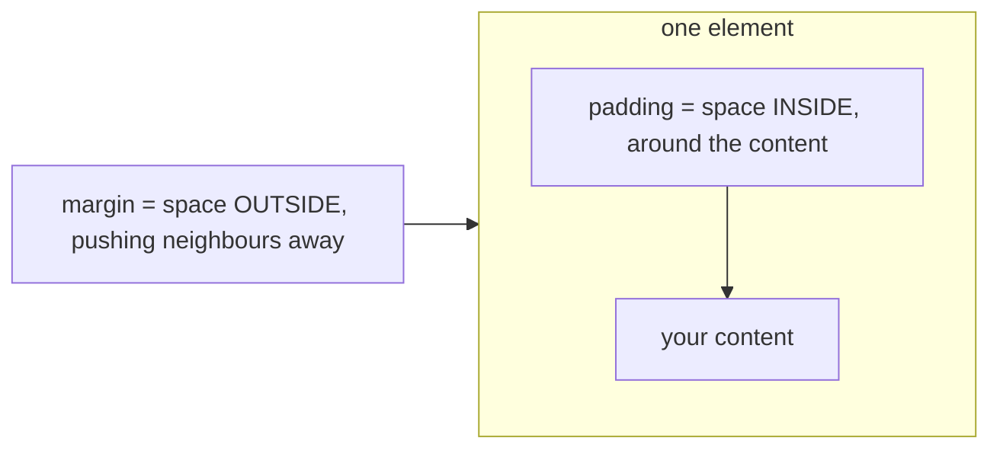
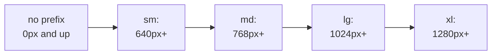
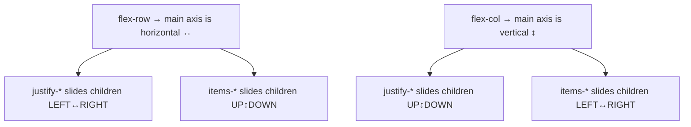
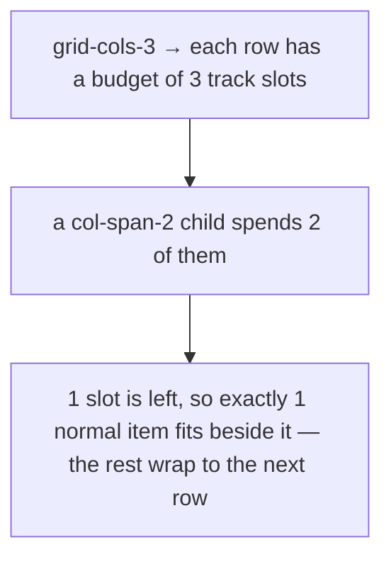
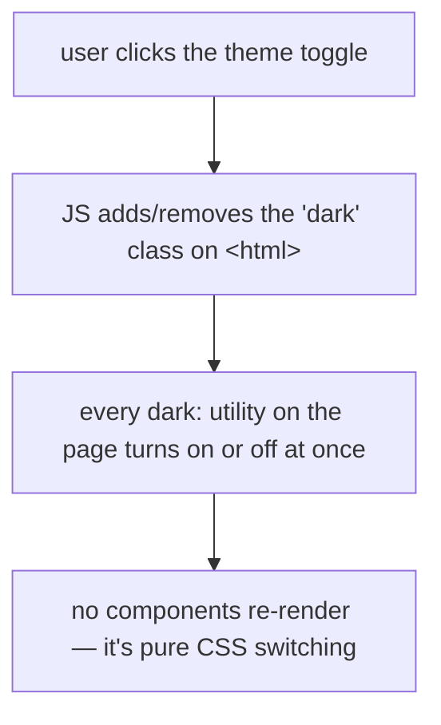
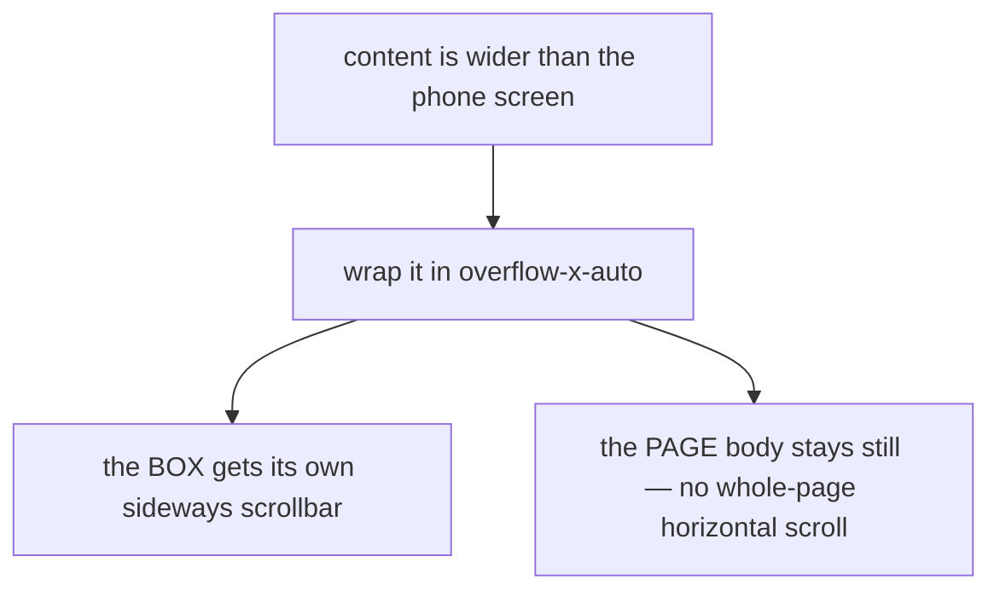

# Tailwind Responsive Design — the layout system in your head

A Dojo supplement guide. By the end you'll be able to build a layout that looks right on a phone
*and* a laptop, in light *and* dark mode, without guessing. We go slowly and define every word the
first time it shows up — if you've never written a line of CSS, you're still in the right place.

> **How to read this.** Don't just skim it. Open the `apps/web` home page in one window and this
> guide in another, and try each little example as you meet it. The skill lives in your fingers,
> not on the page.

---

## 0. First, three CSS words we can't avoid

Tailwind is a faster way to write **CSS**. CSS ("Cascading Style Sheets") is the language that
decides how things *look* on a web page — colours, sizes, spacing, position. Before we touch
Tailwind, we need exactly three CSS ideas. That's it.

**1. `padding` — space *inside* a box, between its edge and its contents.** Imagine a picture in a
picture frame with a wide white mat around it. That white mat is padding. More padding = the
content sits further from the edge.

**2. `margin` — space *outside* a box, pushing other boxes away.** If padding is the mat inside the
frame, margin is the empty wall space you leave *between* two framed pictures so they don't touch.

**3. `rem` and `px` — two units for measuring length.** `px` is "pixels", the tiny dots on your
screen. `rem` is a relative unit: **1rem = 16px** by default. So `1rem` and `16px` are the same
size; `0.25rem` is `4px`. Tailwind measures in `rem` under the hood but it's easiest to *think* in
pixels, and we'll always give you both.



That's the whole prerequisite. Everything below is built from these.

---

## 1. What Tailwind actually is: pre-made classes you stick on the element

Normally, styling a page means writing CSS in one file and your HTML in another, then wiring them
together with names you invent:

```html
<!-- the old way: two files, invented names -->
<div class="card">Hello</div>
```
```css
/* somewhere else, in a .css file */
.card { padding: 16px; background: white; border-radius: 12px; }
```

Tailwind flips this. Instead of inventing `card` and writing its rules elsewhere, you drop lots of
**tiny pre-made classes** directly onto the element, each doing *one* small thing:

```html
<!-- the Tailwind way: many tiny classes, right here -->
<div class="p-4 bg-white rounded-xl">Hello</div>
```

That's the same result. Read the classes like a sentence: `p-4` = padding of 4 steps, `bg-white` =
white background, `rounded-xl` = extra-large rounded corners.

**The word to learn: a "utility class."** A utility class is one of these tiny single-job classes.
`p-4` is a utility. `bg-white` is a utility. You build a design by *stacking* utilities.

> **Analogy.** Old-school CSS is sculpting from a lump of clay — total freedom, but you shape every
> curve yourself. Tailwind is building with LEGO bricks — you snap together small standard pieces.
> You lose a little freedom and gain a lot of speed and consistency, because everyone's bricks are
> the same size.

**Why anyone does this** (you'll appreciate it later, believe it for now): you style *while looking
at the element*, so you never invent names or hunt across files, and because everyone uses the same
bricks (`p-4` is always 16px), pages come out consistent by default.

Under the hood each utility is still just plain CSS. `p-4` literally becomes `padding: 1rem;`.
Nothing magic — Tailwind just wrote that CSS for you.

---

## 2. A utility is a tiny CSS rule; a "variant" is a condition glued to the front

Here's the mental model that makes *everything* else click. Each class is one small CSS rule. You
can glue a **condition** onto the front of it with a `word:` prefix, and that condition says *when*
the rule is allowed to apply. That prefix is called a **variant**.

```
p-4                →  padding: 1rem            (always on)
hover:underline    →  underline, but only WHILE the mouse is hovering
md:p-8             →  padding: 2rem, but only WHEN the screen is ≥ 768px wide
dark:bg-slate-900  →  dark background, but only WHEN the page is in dark mode
```

Read the colon as the word **"when"**: `hover:underline` = "underline *when* hovered". `md:p-8` =
"padding-8 *when* medium screen or bigger". Once you hear "when" every time you see a `:`, Tailwind
stops looking like alphabet soup.

> **The `md:` kind of condition has a proper name: a *media query*.** A media query is a CSS rule
> that says "only apply this when the screen matches some condition" — usually a width. You don't
> write the media query yourself; the `md:` prefix *is* the media query. That's all "responsive"
> means: rules that switch on screen width.

**One consequence that surprises everyone: the order of the classes in the string does not matter.**
`md:p-8 p-4` and `p-4 md:p-8` behave *identically*. Why? Because which rule wins isn't decided by
position in the string — it's decided by the *condition*. The `md:` (screen ≥ 768px) rule simply
outranks the plain one whenever it's active, no matter where you typed it. So don't waste a second
worrying about class order for behaviour. (Order them however's easiest to *read* — a common habit
is layout → spacing → colour → states.)

---

## 3. Mobile-first: no prefix means "all sizes"; `md:` means "this size and BIGGER"

This is the single most important rule in the whole guide. Read it twice.

**A class with no prefix applies at every screen width. A prefixed class like `md:` *adds* its rule
from that width upward — and leaves everything smaller untouched.**

Tailwind's built-in width labels (called **breakpoints** — the widths where your layout is allowed
to "break" into a new shape):

| Prefix | Turns on at width | Real-world device to picture |
|---|---|---|
| *(none)* | 0px — always | the phone; this is your **base** design |
| `sm:` | 640px and up | big phone held sideways |
| `md:` | 768px and up | tablet |
| `lg:` | 1024px and up | laptop |
| `xl:` | 1280px and up | desktop monitor |



Notice the arrows only point one way — **rightward, toward bigger screens.** A prefix never affects
anything *smaller* than itself. `md:` touches tablets, laptops, and desktops; it does nothing to
phones.

**Why it's called "mobile-first."** You describe the phone layout with plain, unprefixed classes —
the smallest, simplest case. Then, as the screen gets wider and you have more room, you *add*
overrides that only switch on at bigger widths. You build up, never down.

Let's walk one real example one class at a time:

```html
<div class="flex flex-col gap-4 lg:flex-row lg:gap-8">
```

- `flex` — turn on flexbox layout for this box (section 4 explains flexbox; ignore it for a second).
- `flex-col` — **on every screen**, stack the children in a **col**umn (top to bottom).
- `gap-4` — **on every screen**, put a 16px gap between the children.
- `lg:flex-row` — **once the screen hits 1024px (laptop)**, switch them to a **row** (side by side).
- `lg:gap-8` — **at that same laptop width**, widen the gap to 32px.

So: **on a phone you'd see the items stacked vertically with a small gap; on a laptop you'd see them
sitting side by side with a bigger gap.** The phone version is the plain classes; the laptop version
is the `lg:` overrides layered on top. That's mobile-first in one line.

> **⚠️ Common mistake — building it backwards.** Beginners often write the *desktop* layout with
> plain classes (`flex-row`) and then try to *undo* it for phones. You'll feel it: you keep adding
> resets and fighting the tool. The fix is always the same — describe the phone first with plain
> classes, then add bigger-screen overrides. If you're subtracting instead of adding, flip it.
>
> (There *is* a `max-md:` family that means "below this width", for rare exceptions. If you're
> reaching for it constantly, it's a sign your base layout was written for desktop by accident.)

**Memory hook:** *plain = phone, prefix = pump it up.* Small screen is the default; every prefix
"pumps up" the design for a bigger screen.

---

## 4. Flexbox: line children up along ONE axis

**Flexbox** is a layout mode for arranging children in a single line — a row *or* a column. You turn
it on with the class `flex` on the *parent* (the container). Then two things matter: which direction
the line runs, and how the children are positioned along it.

**Direction** — pick one:
- `flex-row` → children flow **left to right** (a horizontal line).
- `flex-col` → children flow **top to bottom** (a vertical line).

Now the part everyone finds confusing, explained slowly. Flexbox has **two axes** (directions), and
they have names:

- The **main axis** is the direction your line runs. In `flex-row` the main axis is horizontal; in
  `flex-col` the main axis is vertical.
- The **cross axis** is the *other* direction, at 90° to the main one.

And there are exactly two alignment tools, one per axis:

- **`justify-*` moves children along the MAIN axis** (the direction of the line).
- **`items-*` moves children along the CROSS axis** (across the line).



Look carefully at the diagram: **`justify-*` does *different physical things* depending on the
direction.** In a row it moves things left/right; in a column it moves things up/down. That's why
you must memorise it as *"justify = main axis"* and **never** as *"justify = horizontal"* — the
horizontal version is only true half the time and will betray you the moment you switch to a column.

The common values, in plain English:

| Class | What it does | Picture |
|---|---|---|
| `justify-center` | bunch children in the middle of the main axis | `[  ▢▢▢  ]` |
| `justify-between` | first child at the start, last at the end, gaps spread evenly | `[▢   ▢   ▢]` |
| `justify-end` | push children to the end of the main axis | `[     ▢▢▢]` |
| `items-center` | centre children on the cross axis | vertically centred in a row |
| `items-start` | line children up at the start of the cross axis | tops aligned in a row |

**The one recipe you'll use a thousand times — perfect centering:**

```html
<div class="flex items-center justify-center">
```

`flex` turns on flexbox, `justify-center` centres along the main axis, `items-center` centres along
the cross axis → the child sits dead-centre both ways. Memorise this trio as a single unit.

**Four sizing helpers for children inside a flex row** (you'll reach for these constantly):

- `flex-1` — "grow to fill the leftover space, and share it fairly with other `flex-1` siblings."
  This is how you make a search box stretch to fill a toolbar.
- `shrink-0` — "never shrink me; keep my natural size." Use it on an icon or button you don't want
  squished when space runs low.
- `gap-4` — put space *between* the children (see section 6). Prefer this over adding margins.
- `min-w-0` — the fix for a bug you *will* hit: a long line of text refuses to shrink and instead
  pushes the layout wider than the screen. Adding `min-w-0` to the text's flex child lets it shrink
  (and then `truncate` can add the "…"). Odd, but memorise it as "the truncation unlock".

**When to use flex:** when the *content* should decide the shape — toolbars, navigation bars, a row
of tags, a button next to a label. Anything that's "a few things in a line."

---

## 5. Grid: a fixed set of columns, filled like a shelf

**Grid** is the other layout mode. Where flex is one line, grid is a proper **table of rows and
columns**. Turn it on with `grid` on the parent, then declare how many columns you want:

```html
<div class="grid grid-cols-3 gap-4">
```

- `grid` — turn on grid layout.
- `grid-cols-3` — make **3 equal columns**.
- `gap-4` — 16px gap between every cell.

The children now drop into the cells **left to right, top to bottom**, like books filling a shelf:
first three children fill row one, the next three fill row two, and so on. You don't place them by
hand; they flow.

**Think of the columns as a *budget* each row gets to spend.** A row of `grid-cols-3` has a budget
of 3 "column slots" (called **tracks**). Normally each child spends 1 slot. But a child can spend
*more* than one with `col-span-2`:



So `col-span-2` doesn't create a new column; it just *eats two slots of the existing three*. This
"tracks as a budget" picture is what makes grid predictable: count the slots, subtract the spans,
whatever's left wraps.

**The two recipes you'll actually type:**

```html
<!-- Responsive card grid: 1 column on phones, 2 on big phones, 3 on laptops -->
<div class="grid grid-cols-1 gap-6 sm:grid-cols-2 lg:grid-cols-3">
```

Read it mobile-first (section 3): plain `grid-cols-1` is the phone (one card per row), `sm:` bumps
to 2, `lg:` bumps to 3. **You'd see** one stacked column on a phone, a neat 3-across gallery on a
laptop — and the cards resize themselves as you drag the window.

```html
<!-- Sidebar + main content, that collapses to stacked on phones -->
<div class="grid gap-8 lg:grid-cols-[16rem_minmax(0,1fr)]">
```

Here there's no plain `grid-cols-*`, so on phones it's a single stacked column. At `lg:` it becomes
two columns: a fixed **16rem (256px)** sidebar, and a `minmax(0,1fr)` main area — read that as "take
all the remaining space, and you're allowed to get narrow enough to fit" (the `0` is what lets it
shrink instead of overflowing — same idea as `min-w-0`).

**A free gift from grid: equal heights.** Cells in the same row automatically stretch to match the
tallest one, so a card grid gives you tidy equal-height cards *for free* — no effort. (If a wrapper
*inside* a card breaks that, add `h-full` to make the inner piece fill its cell again.)

**Flex vs grid — the one-line rule:** use **grid** when the *container* owns the shape (a uniform
gallery of cards, a page skeleton with fixed regions); use **flex** when the *content* owns the
shape (a toolbar, a tag row, a nav bar). If you can say "N columns", it's grid. If you can only say
"some things in a line", it's flex.

---

## 6. The spacing scale: one number system for everything

Every spacing number in Tailwind comes from **one scale, and one rule: each step is 4px.** So
multiply the number by 4 and you have the pixels:

```
p-2  → 2 × 4 = 8px       gap-6 → 6 × 4 = 24px
p-4  → 4 × 4 = 16px      m-8   → 8 × 4 = 32px
w-64 → 64 × 4 = 256px    (yes, even widths use it)
```

**Memory hook: "times four."** See a spacing class, multiply by 4, that's the pixels. `p-5`? 20px.
`gap-3`? 12px. This one trick lets you read any spacing utility instantly.

The *same* scale drives padding (`p-`), margin (`m-`), the gap between children (`gap-`), and
width/height (`w-`, `h-`). Because it's all one system, spacing across your whole page lines up on a
tidy rhythm without you thinking about it — that's the real payoff.

**Two habits that make layouts look designed instead of accidental:**

1. **Stick to even steps** — 2, 4, 6, 8, 12, 16. A consistent rhythm (everything a multiple of 8px,
   say) reads as intentional; a mess of `p-3 p-7 p-5` reads as random, even if the viewer can't say
   why.

2. **Put space *between* children with the parent's `gap`, not a margin on each child.** Here's the
   difference, and why it matters:

```html
<!-- Meh: each child carries its own margin — change the spacing and you edit every child -->
<div class="flex flex-col"><div class="mb-4">A</div><div class="mb-4">B</div><div>C</div></div>

<!-- Better: the PARENT owns the spacing in one place -->
<div class="flex flex-col gap-4"><div>A</div><div>B</div><div>C</div></div>
```

`gap` puts the spacing decision in *one spot* (the parent), and it never adds a stray margin before
the first child or after the last. Margins-per-child scatter the decision across every child and
cause classic "why is there extra space at the top" bugs.

**The container recipe you'll type forever:**

```html
<div class="mx-auto max-w-6xl px-4 sm:px-6">
```

- `mx-auto` — set left+right margin to "auto", which **centres the box horizontally** in its parent.
- `max-w-6xl` — "never get wider than 6xl (72rem / 1152px)"; on a huge monitor the content stops
  stretching and stays a comfortable reading width.
- `px-4` — 16px of padding on the left and right, so text never kisses the screen edge on a phone.
- `sm:px-6` — bump that side padding to 24px once there's a bit more room.

**You'd see** a centred column that grows with the window up to a cap, then stops, always with a
little breathing room at the sides. Nearly every page you build wraps its content in some version of
this line.

---

## 7. Dark mode: one class flips the whole page

**Dark mode** is the dark-background colour theme. CodeArena implements it with the **"class
strategy"**: there's a single CSS class named `dark` sitting on the top-level `<html>` element. When
that class is present, every `dark:` utility on the page switches on; remove it and they all switch
off. One class, whole-page flip.

That's not Tailwind v4's default: out of the box, `dark:` follows the operating system's setting (the
`prefers-color-scheme` media query). The class strategy is one line of CSS, right after the import,
and it's line 11 of CodeArena's `apps/web/src/app/globals.css`
([Tailwind docs: dark mode](https://tailwindcss.com/docs/dark-mode)):

```css
@import "tailwindcss";
@custom-variant dark (&:where(.dark, .dark *));
```

How you write it — **style both colours right next to each other, as you go:**

```html
<div class="bg-white dark:bg-slate-900 border-slate-200 dark:border-slate-800">
```

Read it in pairs: background is white normally, dark slate *when* dark mode; border is light grey
normally, dark grey *when* dark mode. The `dark:` version only wins while the `.dark` class is up on
the page.



Three things worth knowing:

- **It's instant and cheap.** Flipping one class re-styles the entire page through CSS. Nothing in
  React re-runs; there's no per-component "am I dark?" logic to write.
- **The user's choice beats the operating system.** If the visitor picked light, they get light even
  on a dark-themed OS. The OS preference only decides the *default* the very first time, before
  they've chosen. (Their choice is saved in the browser's `localStorage` so it survives a reload.)
- **Style dark as you build, not later.** Adding a `dark:` colour every time you add a background,
  border, or text colour costs seconds. *Retrofitting* dark onto a finished page means re-opening
  every element and editing its colours twice — hours of tedium. Pair them up front.

> **⚠️ Common mistake — forgetting text colour.** People set `dark:bg-slate-900` and stop, then wonder
> why the page is dark with invisible near-black text. Every surface colour needs its text partner:
> `text-slate-900 dark:text-slate-100`. Background *and* foreground, always as a pair.

---

## 8. Wide content: scroll the box, never the whole page

Some content is just wider than a phone — a data table with lots of columns, a long code line, a
heatmap. If you do nothing, that wide thing shoves the entire page sideways, and now the *whole
page* scrolls left-right. That feels broken: headers drift, everything jiggles.

**The rule: the page body must never scroll horizontally.** Instead, give the wide thing its *own*
little scroll window, so only *it* pans while the page stays put.

The pattern — wrap the wide thing in a box with `overflow-x-auto`:

```html
<div class="overflow-x-auto rounded-xl border">
  <table class="w-full min-w-[640px]"> … many columns … </table>
</div>
```

- `overflow-x-auto` on the wrapper — "if your content is too wide, give *yourself* a horizontal
  scrollbar." The panning is now trapped inside this box.
- `min-w-[640px]` on the table — "never squish below 640px wide", so columns stay readable instead
  of collapsing into an unreadable mush; the wrapper scrolls to reveal the rest.



The exact same wrapper tames a long code block (`<pre class="overflow-x-auto">`) or anything
grid-shaped. For overflowing **text** specifically, two smaller tools: `truncate` cuts one line to
a single line with a "…" (remember it needs the `min-w-0` unlock from section 4 inside a flex row),
and `line-clamp-2` allows two lines then cuts with "…".

---

## 9. Putting it together: the order to think in

When you build any section, decide these five things **in this order**. They map one-to-one onto the
classes you type, so this doubles as a checklist:

1. **Stacking** — what's the *phone* layout? Usually `flex flex-col gap-*` (a stack) or
   `grid grid-cols-1` (one column). Start here, always. *(Section 3, 4, 5.)*
2. **Breakpoints** — where does the shape change as it gets wider? Add the overrides:
   `md:grid-cols-2 lg:grid-cols-3`. *(Section 3.)*
3. **Alignment** — centred or start-aligned, on each axis? `items-*`, `justify-*`,
   `text-center lg:text-left`. *(Section 4.)*
4. **Container** — cap the width and pad the edges: `mx-auto max-w-6xl px-4 sm:px-6`. *(Section 6.)*
5. **Theme** — give every surface, border, and text you added its `dark:` partner. *(Section 7.)*

Do them in that order and you'll never stare at a blank element wondering what to type — the
question "what's the phone layout?" always comes first, and each following step is a small addition.

---

## Tips & tricks to internalise this faster

- **Say the colon as "when".** `md:p-8` is "padding-8 *when* medium screen". This alone removes most
  of the confusion.
- **Say "plain = phone, prefix = pump it up."** The unprefixed classes are your phone design; every
  prefix upgrades it for a bigger screen.
- **Multiply spacing by 4** to read it in pixels. `gap-6` → 24px, on sight.
- **`justify` = main axis, `items` = cross axis** — never "justify = horizontal". Chant it until
  it's reflex; it's most of layout fluency.
- **"Can I say N columns?" → grid. "Just some things in a line?" → flex.**
- **Style `dark:` in the same breath** as the light colour, always as a pair, text included.
- **Don't worry about class order** for behaviour — it never changes what you see.
- **Resize the window constantly while you build.** Drag it narrow, drag it wide, toggle dark. The
  fast feedback loop is how the model burns in. Reading can't replace dragging that window edge.

---

## Self-quiz

Say each answer out loud first, *then* read the answer under it. (No peeking — the struggle is what
makes it stick.)

1. **What does `md:grid-cols-3` do on a 400px-wide phone?**
   *Answer:* **Nothing.** `md:` only turns on at 768px and up; at 400px the unprefixed `grid-cols-1`
   is in charge. Prefixes only ever affect *their width and bigger*.
2. **In a `flex flex-col` container, which class centres the children left-to-right —
   `items-center` or `justify-center`?**
   *Answer:* **`items-center`.** In `flex-col` the main axis is vertical, so left-to-right is the
   *cross* axis — and `items-*` controls the cross axis. (`justify-center` would centre them
   top-to-bottom here.)
3. **`gap-6` is how many pixels?**
   *Answer:* **24px.** 6 × 4px. (Times four, every time.)
4. **Your layout looks great on desktop but broken on phones, and you keep adding "resets". What
   did you probably do wrong?**
   *Answer:* You **built desktop-first** — the plain, unprefixed classes described the desktop, so
   on phones you're stuck subtracting. Rewrite the base classes as the *phone* layout, then add
   `lg:` overrides for desktop.
5. **A table is too wide on phones and drags the whole page sideways. What's your first move?**
   *Answer:* Wrap the table in a box with **`overflow-x-auto`**, and give the table a `min-w-[…]`
   so it stays readable while the *box* (not the page) scrolls sideways.

## Exercises

Do these by hand — type them, drag the window, toggle dark. Hints and "you're done when" included.

1. **The hero.** Build a hero section: on phones, a heading and a paragraph stacked and centred; from
   `lg:` up, two columns side by side with the text left-aligned.
   *Hint:* start `flex flex-col items-center text-center`, then add `lg:flex-row lg:text-left`.
   *Done when:* it stacks-and-centres narrow, splits into two left-aligned columns wide, and you
   never wrote a single "reset".

2. **The card grid.** Make a grid of 6 cards that shows 1 column on phones, 2 on `sm:`, 3 on `lg:`,
   with equal-height cards. Then deliberately break the equal heights (put a tall wrapper inside one
   card) and fix it with `h-full`.
   *Hint:* `grid grid-cols-1 gap-6 sm:grid-cols-2 lg:grid-cols-3`.
   *Done when:* the columns change at each width and every card in a row is the same height.

3. **The wide table.** Take any table with lots of columns, make it phone-safe with the
   `overflow-x-auto` + `min-w-[…]` wrapper, and confirm the *page* itself never scrolls sideways —
   only the table's own box does.
   *Done when:* on a narrow window the page body doesn't pan, but the table scrolls within its border.
