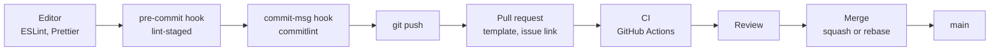

# Team Workflow — Hooks, CI & Pull Requests

On a professional team, nobody's code reaches `main` because they decided it was ready. It goes
through a **pipeline**: checks on your laptop, a pull request, a clean machine that builds and tests
it, a reviewer, and rules on GitHub that nobody can skip. Each layer catches what it can, as early
as it can.

CodeArena already has most of that pipeline, and you used every layer this autumn, often without
seeing it. This guide shows you each layer: **what it catches, how it works, how to set it up from
zero, and how to explain it in an interview.**

> **Where this fits.** [Git — Workflow & Command Reference](/guides/git-workflow) teaches the
> commands: branches, staging, merge and rebase, undo. This guide teaches the **system around
> them**: hooks, commitlint, CI, pull requests, review, protection.
>
> **Drill it** in [Practice → Git & Workflow](/practice/git): its team-workflow cards come back in
> your spaced review.

---

## ⌨️ This guide is interactive

**Eleven exercises are embedded below.** Most ask you to write what you'd write on a real team: a
commit message, a hook, a PR description, a review comment, or the steps you'd take. Each answer is
checked line by line, and the model answer appears after a pass, or when you ask for it.

Every output quoted in this guide is real: it comes from CodeArena itself, or from the lab in
part 13, run on 2 Nov 2026.

---

## 1. The pipeline, from keystroke to `main`



| Layer | Runs on | When | What it checks in CodeArena | Time | Can it be skipped? |
|---|---|---|---|---|---|
| Editor | your laptop | as you type | ESLint and Prettier rules, type errors | instant | yes: ignore the squiggles |
| `pre-commit` hook | your laptop | `git commit`, before the message | lint-staged: ESLint `--fix` on the staged files, then a typecheck of each app you touched | seconds | yes: `--no-verify`, `HUSKY=0` |
| `commit-msg` hook | your laptop | right after you write the message | commitlint: Conventional Commits, plus your list of scopes | instant | yes: `--no-verify` |
| Pull request | GitHub | when you open it | the template asks: What, Why, How I tested it, Security notes | — | a lazy description |
| CI | a fresh machine on GitHub | every push to a PR, and to `main` | lint, typecheck, build, API unit tests; API e2e against Postgres; dojo content checks | minutes | only if `main` isn't protected |
| Review | a person | before merging | design, correctness, security, naming: what tools can't judge | hours | when you work alone, it's you |
| Protection | GitHub | at merge time | a PR is required, CI is green, the branch is up to date, no force-push | instant | no, when nobody is on the bypass list |

Two principles explain the whole table:

- **Shift left.** The earlier a problem is caught, the cheaper it is. A squiggle costs a second, a
  red CI run costs a context switch, and a bug in production costs a night. So each check runs at
  the earliest layer that can catch it.
- **Local layers are for speed; server layers are for trust.** Hooks run on one laptop, and anyone
  can skip them. CI and protection run on GitHub, for everyone, and nobody can skip them. That's why
  some checks run twice: once on the laptop for speed, once in CI for trust.

```exercise
which-layer
```

---

## 2. Conventional Commits

### The format

```
<type>(<scope>)!: <subject>

<body: what changed and why, wrapped at 100 characters>

<footers: BREAKING CHANGE: …, Refs: #12>
```

Only the first line, the **header**, is required. The `!` and the `BREAKING CHANGE:` footer mark a
change that breaks its callers. The spec is short, and worth reading once:
[conventionalcommits.org](https://www.conventionalcommits.org/en/v1.0.0/).

From your own history:

```
a9a86cb fix(api): generate the Prisma client without .js import extensions (#3)
b06c097 feat(worker): scaffold the judge as a separate process
ecdf6ae docs: add the week 2 plan, mornings revising and afternoons building
```

### The types

These are exactly the types `@commitlint/config-conventional` allows:

| Type | Use it for | Example |
|---|---|---|
| `feat` | a capability a user or a caller can notice | `feat(api): add refresh token rotation` |
| `fix` | a bug fix | `fix(web): keep the session after a refresh` |
| `docs` | documentation only | `docs(adr): record the stdin/stdout judging decision` |
| `test` | tests only | `test(api): cover reuse detection end to end` |
| `refactor` | different code, **same behaviour** | `refactor(api): extract the token hasher` |
| `perf` | faster, same behaviour | `perf(api): index submissions by user and date` |
| `build` | the build system, dependencies | `build(deps): bump prisma to 7.2` |
| `ci` | CI configuration | `ci: run the worker's tests` |
| `chore` | maintenance that fits nowhere else | `chore(repo): add a pull request template` |
| `style` | formatting only | `style(web): apply prettier` |
| `revert` | undoes an earlier commit | `revert: feat(api): add refresh token rotation` |

Git's own `Revert "…"` messages, merge commits and `fixup!` commits pass too: commitlint ignores
them by default.

### Scopes: your list

CodeArena allows exactly these scopes: `api`, `worker`, `web`, `dojo`, `shared`, `docs`, `adr`,
`repo`, `infra`, `deps`. A scope is optional, but when you write one, it must be on the list. A
fixed list keeps spelling consistent (never `api` on one commit and `backend` on the next), so a
search like `git log --oneline --grep 'fix(api)'` finds every API fix.

### The subject: five rules

| Rule | Why | ✗ | ✓ |
|---|---|---|---|
| **Imperative mood** | it completes *"If applied, this commit will …"*, like Git's own `Merge …` and `Revert …` | `added login` | `add login` |
| **Lowercase start** (`subject-case`) | consistent, scannable history | `fix: Handle the cursor` | `fix: handle the cursor` |
| **No full stop** (`subject-full-stop`) | it's a title, not a sentence | `…the cursor.` | `…the cursor` |
| **Header of 100 characters or fewer** (`header-max-length`) | it fits in `git log --oneline` and in GitHub's lists. Leave room: a squash merge adds ` (#12)` | | |
| **Say what changes, not what you did** | the reader wants the effect | `fix: some changes` | `fix(api): reject expired refresh tokens` |

### The body: the why

The diff shows **what** changed. Only you know **why**. The body is where that goes: what was wrong,
why this fix, what you didn't do and why. Leave a blank line after the header, and wrap lines at 100
characters (`body-max-line-length`). Your I-1 commit is a model:

```
fix(api): generate the Prisma client without .js import extensions (#3)

The e2e suites failed before running a single test: the generated
client imports "./internal/class.js", which only exists as a .ts
file. tsc maps .js to .ts under nodenext resolution; Jest's own
resolver does not.

The API is CommonJS, so extensionless imports are what it runs with
anyway. Fixing the generator rather than adding a Jest module mapper
keeps tests resolving modules the same way Node does in production.
```

Paragraph one: the symptom and the cause. Paragraph two: why this fix and not the obvious
alternative. A reviewer, or you in six months, needs nothing else.

### Breaking changes and versions

Tools such as [release-please](https://github.com/googleapis/release-please) and semantic-release
read these headers to choose the next version ([Semantic Versioning](https://semver.org/)) and to
write the changelog:

| The header starts with | From 1.2.3, the next version is |
|---|---|
| `fix:` | 1.2.**4** (patch) |
| `feat:` | 1.**3**.0 (minor) |
| `feat!:`, or any commit with a `BREAKING CHANGE:` footer | **2**.0.0 (major) |
| `docs:`, `test:`, `ci:`, `refactor:`, `chore:` … | no release |

CodeArena doesn't publish versions yet. The habit is what matters: a reviewer knows what kind of
change a commit is before opening it, and a `refactor:` that changes behaviour is a bug by
definition.

```exercise
fix-commit-messages
```

---

## 3. Git hooks and husky

### What a hook is

A hook is a script that Git runs at a fixed moment. If it exits with `0`, Git carries on. With
anything else, Git stops.

| Hook | When it runs | Its usual job |
|---|---|---|
| `pre-commit` | before the commit is created, before you write the message | lint, format, typecheck the staged files |
| `commit-msg` | after the message is written, before the commit exists | check the message (commitlint) |
| `pre-push` | before anything is sent to the remote | run the tests, refuse pushes to `main` |
| `post-merge`, `post-checkout` | after a pull, after a branch switch | `pnpm install` when the lockfile changed |

Git looks for hooks in `.git/hooks/`, and that folder is **not versioned**. A teammate who clones
your repo gets none of your hooks.

### What husky adds

Husky makes hooks part of the repository:

1. Your hooks live in **`.husky/`**, which is committed. CodeArena has `.husky/pre-commit` and
   `.husky/commit-msg`.
2. The root `package.json` has **`"prepare": "husky"`**. pnpm runs `prepare` after every
   `pnpm install`, so every clone gets the hooks without anyone thinking about it.
3. Running `husky` changes **one Git setting**: `core.hooksPath = .husky/_`. That folder holds small
   generated stubs (Git ignores them: `.husky/_/.gitignore` contains `*`), and each stub runs your
   matching `.husky/<hook>` file with `sh -e`. The `-e` makes the hook stop at the first failing
   command.

Check it in CodeArena:

```bash
git config core.hooksPath    # .husky/_
cat .husky/pre-commit        # pnpm lint-staged
cat .husky/commit-msg        # pnpm commitlint --edit "$1"
```

About `"$1"`: Git calls `commit-msg` with a single argument, the path of the file holding your
message (`.git/COMMIT_EDITMSG`). `--edit "$1"` tells commitlint to read the message from that file.
The quotes keep the path in one piece, even if it contains spaces.

### Skipping hooks, and why that's allowed

- `git commit --no-verify` (or `-n`) skips `pre-commit` and `commit-msg`. `git push --no-verify`
  skips `pre-push`.
- `HUSKY=0 git commit …` turns husky off for one command. That's useful in Docker builds and on CI
  machines, where hooks make no sense.

So hooks are a **convenience for you, not a guarantee for the team**. The guarantee comes from CI
(part 6) and protection (part 10).

### When a hook misbehaves

Three tools, in this order:

1. `git config core.hooksPath`: is Git even looking in the right folder?
2. `HUSKY=2 git commit …`: husky prints every line it runs.
3. `GIT_TRACE=1 git commit …`: Git prints how it starts each hook.

A real case, from building this guide's lab. Every commit failed with `sh: 0: Illegal option --`.
`HUSKY=2` printed nothing, so husky's own code never ran. `GIT_TRACE=1` showed why:

```
trace: run_command: GIT_EDITOR=: GIT_INDEX_FILE=.git/index --version/_/pre-commit
```

```exercise
debug-hooks-path
```

```exercise
commit-msg-hook
```

---

## 4. lint-staged

### Why only the staged files

Linting the whole repository on every commit is slow, and it makes you fix old problems in an
unrelated commit. lint-staged runs your commands **only on the files you're about to commit**. On
each commit, it:

1. keeps a backup of your work (a stash);
2. runs each command on the staged files that match its pattern;
3. **re-stages whatever the commands fixed** (Prettier's rewrite, ESLint's `--fix`), so the commit
   contains the fixed version;
4. if a command fails, restores everything, and the commit stops.

In the lab (part 13), you stage `const   x = {a:1}`, and the commit contains `const x = { a: 1 };`.

### CodeArena's config, line by line

```js
// .lintstagedrc.mjs (the api entry; web, dojo and shared follow the same pattern)
export default {
  'apps/api/**/*.ts': [
    'pnpm --filter api exec eslint --fix',
    () => 'pnpm --filter api run typecheck',
  ],
};
```

- **The key is a glob:** which staged files trigger these commands.
- **A string command gets the matching files appended:**
  `pnpm --filter api exec eslint --fix apps/api/src/auth/auth.service.ts …`. ESLint checks files one
  at a time, so that's exactly right.
- **A function command** returns the command to run, and lint-staged appends **nothing** to it.
  That matters for `tsc`. Given file names, `tsc` ignores `tsconfig.json`, so it runs with the wrong
  settings. And it can't see that your rename broke a file you didn't touch. So the typecheck runs
  on the whole app, once.
- **`pnpm --filter api`** runs the command inside `apps/api`, with that app's own ESLint config and
  `tsconfig.json`.

A question to answer for yourself: does every app in `apps/` have an entry? (Part 14 tells you.)

```exercise
lint-staged-entry
```

---

## 5. commitlint

### What it is

A linter for commit messages. `@commitlint/config-conventional` is the Conventional Commits rule
set. Your `commitlint.config.mjs` extends it and adds one rule:

```js
export default {
  extends: ['@commitlint/config-conventional'],
  rules: {
    'scope-enum': [
      2,
      'always',
      ['api', 'worker', 'web', 'dojo', 'shared', 'docs', 'adr', 'repo', 'infra', 'deps'],
    ],
  },
};
```

### Reading a rule

Every rule is `[level, applicability, value]`:

| Part | Values | Meaning |
|---|---|---|
| level | `0`, `1`, `2` | off, warning (the commit goes through), error (the commit is refused) |
| applicability | `'always'`, `'never'` | the condition must always hold, or must never hold |
| value | depends on the rule | for `scope-enum`, the allowed scopes |

So `'subject-case': [2, 'never', ['sentence-case', 'start-case', 'pascal-case', 'upper-case']]`
reads: *it's an error if the subject is ever in one of these cases.* To see every rule in force,
run `pnpm exec commitlint --print-config`. These are the ones you'll meet:

| Rule (as commitlint prints it) | Level in CodeArena | It fails when |
|---|---|---|
| `type-empty` | error | there's no `type:` at all |
| `type-enum` | error | the type isn't in the table in part 2 (`feature:`, `update:`) |
| `scope-enum` | error | the scope isn't on your list (`docs(readme):`) |
| `subject-case` | error | the subject starts with a capital letter |
| `subject-full-stop` | error | the subject ends with `.` |
| `subject-empty` | error | nothing after the colon |
| `header-max-length` | error | the first line is over 100 characters |
| `body-max-line-length` | error | a body line is over 100 characters |
| `body-leading-blank` | warning | no blank line between the header and the body |

### Test a message without committing

```bash
echo "docs: This weeks revision is focused on the judge." | pnpm exec commitlint
```

```
✖   subject must not be sentence-case, start-case, pascal-case, upper-case [subject-case]
✖   subject may not end with full stop [subject-full-stop]
✖   found 2 problems, 0 warnings
```

The name in brackets is the rule. Find it in the table above, and fix one ✖ at a time.

### Check a whole branch

```bash
pnpm exec commitlint --from origin/main --to HEAD
```

This checks **every commit on your branch**. It's what CI can run, so that a commit made with
`--no-verify` can't reach `main` unchecked. The lab proves it (part 13, step 7).

```exercise
read-commitlint-output
```

---

## 6. Continuous integration with GitHub Actions

### The vocabulary

| Word | Meaning | In your `.github/workflows/ci.yml` |
|---|---|---|
| workflow | a YAML file in `.github/workflows/` | `ci.yml`, named `CI` |
| event | what starts it | a `push` to `main`, a `pull_request` into `main` |
| job | a list of steps on one fresh machine. Jobs run **in parallel** | `build`, `api-e2e`, `dojo-content` |
| runner | the machine | `ubuntu-latest`, brand new for every job |
| step | one command (`run:`) or one reusable action (`uses:`) | `uses: actions/checkout@v4`, `run: pnpm lint` |
| service | a container running next to the job | Postgres 16, for the e2e job |
| check | a job's result, shown on the PR | `Lint, typecheck, build`, `API end-to-end`, `Dojo content checks` |

### Your workflow, job by job

- **Lint, typecheck, build:** checkout → pnpm and Node → `pnpm install --frozen-lockfile` →
  `prisma generate` → `pnpm lint` → `pnpm -r typecheck` → `pnpm build` → the API unit tests.
- **API end-to-end:** a Postgres service with a health check → install →
  `prisma migrate deploy` → `prisma generate` → `pnpm --filter api test:e2e`.
- **Dojo content checks:** the generators, the diagrams, and the guide exercises (including the
  eleven in this guide).

The steps that look odd, explained:

- **`--frozen-lockfile`:** fail if `pnpm-lock.yaml` doesn't match `package.json`, instead of
  quietly picking new versions. CI must install exactly what you tested.
- **`prisma generate` with a fake URL:** the generated client is gitignored, so a fresh machine
  doesn't have one. Generating never connects to a database.
- **`migrate deploy`, not `migrate dev`:** apply the committed migrations; never create new ones.
- **`--runInBand`:** the e2e suites share one Postgres. Parallel workers would fight over the same
  rows.

### Why CI, when the hooks already ran

- **A clean machine:** no local `.env`, no stale generated files, no "it works on my laptop".
- **Everything runs**, not only the staged files, including tests too slow for a hook.
- **Every push is checked**, whoever pushed it, and whatever their hooks did.
- **On a PR, it tests the merge.** For a `pull_request` event, GitHub checks out your branch
  *merged into `main`*, as `main` was when the run started. If `main` moves afterwards, that result
  is stale: that's what *Require branches to be up to date* (part 10) is for.

### Reading a red run

```bash
gh run list --limit 5
gh run view <id> --json jobs --jq '.jobs[] | "\(.conclusion)\t\(.name)"'
gh run view <id> --log-failed
```

The first command finds the run, the second says which job failed, and the third shows only the
failing step's log. Then **reproduce it on your machine with the failing step's exact command**
before you change anything.

### Security in CI

- **Secrets** live in Settings → Secrets and variables → Actions, and a workflow reads them as
  `${{ secrets.NAME }}`. GitHub hides them in logs, but never `echo` one anyway. PRs from forks
  get no secrets at all.
- Your e2e `JWT_SECRET` is written in the YAML, and that's fine: it's a test value that protects
  nothing. A production secret never goes there.
- **`permissions:`** sets what the job's `GITHUB_TOKEN` can do. Declare the least it needs
  (`contents: read`) in the workflow itself, instead of relying on a repository setting that
  nobody sees in review.
- **Pin your actions.** `@v4` is a tag, and a tag can be moved. In March 2025, attackers moved the
  tags of a popular action, `tj-actions/changed-files`, to code that printed secrets into build
  logs. The strictest teams pin every action to a full commit SHA.

```exercise
read-ci-log
```

---

## 7. Pull requests

### Why, even when you work alone

- CI runs **before** anything reaches `main`, so `main` stays green.
- The PR is **evidence**: a page that shows the change, the reasoning and the green checks. A
  recruiter or interviewer can click on it.
- The history explains itself: commit → PR → issue → reason.
- It's the habit every team expects on day one.

### The life of a PR

1. **The issue** (part 11): what *done* means.
2. **A branch from an up-to-date `main`:**
   `git switch main && git pull && git switch -c feat/worker-docker-runner`. Name it
   `<type>/<what>`, with the same types as commits.
3. **Small commits**, each saying why.
4. **Push:** `git push -u origin feat/worker-docker-runner`.
5. **Open the PR:** `gh pr create --base main`, and your template fills the description. Not ready
   for review yet? Add `--draft`, then run `gh pr ready` later.
6. **CI:** `gh pr checks --watch`.
7. **Review your own diff first**, on GitHub's *Files changed* tab, as a stranger would. That's
   where you find the debug print and the forgotten TODO.
8. **Review:** answer every comment. Push fixes as **new commits**, so the reviewer sees exactly
   what changed since they last looked.
9. **Update with `main`** if it moved (part 9).
10. **Merge** with the right button (part 9), and the branch is deleted.
11. **Sync:** `git switch main && git pull`.

### Size

One PR does one thing. A few hundred changed lines is a sensible upper limit for a careful review;
past that, reviewers skim. If a PR grows, split it: the tooling first, then the feature that uses
it.

### The description

A PR description answers four questions, one per heading:

| Heading | The reviewer's question |
|---|---|
| **What** | What changes? (the behaviour, not the list of files) |
| **Why** | Why now, and what breaks without it? Add `Closes #N` here |
| **How I tested it** | Why should I believe it works? (the commands you ran, and what they showed) |
| **Security notes** | What could this expose? (*"None, because …"* counts, if the reason is real) |

`Closes #12` (or `Fixes`, or `Resolves`) closes issue 12 automatically when the PR merges into
`main`, and links the two forever.

### The PR template file

A template is how a team makes sure every description answers those four questions. It's a
Markdown file that GitHub copies into the description box of every new PR.

- **Where it lives:** `.github/pull_request_template.md`. GitHub also accepts the repository root
  or `docs/`, but `.github/` keeps the repository's GitHub files together.
- **GitHub reads it from the default branch** (`main`). A template that exists only on your branch
  does nothing. So the template arrives in its **own small PR**, and only the PRs opened after it
  merges get it.
- **Instructions go in HTML comments** (`<!-- … -->`): you see them while you write, and they
  vanish once the PR is posted.
- **A short checklist** of the rules nobody may skip, such as *CI is green* and *one PR does one
  thing*. Three to five boxes. A 30-box list gets ticked without being read.
- **Keep it short.** A template that takes ten minutes to fill in gets deleted, not filled in.
- **Several kinds of change?** Put several files in `.github/PULL_REQUEST_TEMPLATE/` and pick one
  with `?template=<file>.md` in the PR's URL.
- **Issues get templates too,** in `.github/ISSUE_TEMPLATE/`: a bug report form (steps to
  reproduce, expected, actual) and a feature form (context, acceptance criteria).

✅ It works when, for a new branch, GitHub's **Compare & pull request** page opens with your
template already in the description box.

### The `gh` commands you'll use

| Command | What it does |
|---|---|
| `gh pr create --base main [--draft]` | opens a PR **from the branch you're on** |
| `gh pr checks --watch` | waits for CI and shows each check |
| `gh pr view [--web]` | reads the PR in the terminal, or opens it in the browser |
| `gh pr diff` | shows the diff |
| `gh pr checkout 12` | checks out PR 12 locally, to review or test it |
| `gh pr merge --squash --delete-branch` | merges, then deletes the branch on both sides (`--rebase` for rebase-merge) |
| `gh pr list --state all` | lists every PR |

A trap you'll meet: run `gh pr create` while you're on `main`, and gh refuses with
`head branch "main" is the same as base branch "main"`. Switch to your branch first.

```exercise
pr-description
```

---

## 8. Code review

### What review is for

Correctness, design, security, readability, and spreading knowledge across the team. **Not
style**: tools already did that, and a review full of formatting comments means a tool is
missing.

The bar, from [Google's code review guide](https://google.github.io/eng-practices/review/reviewer/standard.html):
approve once the change **definitely improves the code's overall health**, even if it isn't
perfect. The goal is *better*, not perfect.

### As the author

- Keep the PR small, write a clear description, and review it yourself first.
- Answer every comment, even if only with *"Done"*.
- Disagree with reasons, not feelings. If a thread goes past two rounds, talk instead.
- A comment is about the code, not about you.

### As the reviewer

- **Label every comment**, so the author knows what blocks the merge.
  [Conventional Comments](https://conventionalcomments.org/) is a common convention:
  - `praise:` something done well;
  - `nit:` tiny, optional;
  - `suggestion:` an improvement;
  - `question:` you don't understand something;
  - `issue:` a real problem.

  Add `(blocking)` or `(non-blocking)` when it isn't obvious.
- **Say why**, and propose something. Ask instead of ordering: *"What happens if this list is
  empty?"*
- Talk about the code (*"this function"*), not the person (*"you"*).
- Say what's good, too.
- GitHub gives you three outcomes: **Comment**, **Approve**, **Request changes**.

### When you work alone

Review your own PR the next morning, with fresh eyes and the template's checklist. In an interview,
describe how you'd work on a team: who reviews what, and what blocks a merge.

```exercise
review-comments
```

---

## 9. Merging, and keeping a branch up to date

### The three merge buttons

| Button | What lands on `main` | Use it when | Watch out for |
|---|---|---|---|
| **Create a merge commit** | every commit on the branch, plus a merge commit | the branch's own history matters | a busy graph; impossible if you require a linear history |
| **Squash and merge** | **one** commit, titled with the PR title plus `(#N)` | the branch's commits are noise (`wip`, `fix test`) | the PR title **becomes** the commit message, and no hook ever checks it (part 14) |
| **Rebase and merge** | each commit, replayed on top of `main`, with new hashes | every commit is clean and meaningful on its own | each commit should make sense alone |

From your history: `a9a86cb fix(api): generate the Prisma client without .js import extensions (#3)`
is a squash merge. The `(#3)` is the PR number, added by GitHub.

After a squash or rebase merge, `git branch -d` says the branch is *not fully merged*. That's
expected: GitHub created **new** commits, so Git can't see that yours were merged. Check that the PR
says **Merged**, then use `-D`. `gh pr merge --delete-branch` does all of this for you.

### The repository's merge settings

Which buttons exist is a repository setting: Settings → General → **Pull Requests**. These are
available on every plan, private repositories included.

| Setting | Recommended | Why |
|---|---|---|
| Allow merge commits | off | keeps `main` a straight line |
| Allow squash merging | on, default message *Pull request title and commit details* | for PRs whose commits are noise |
| Allow rebase merging | on | for PRs whose commits are each clean |
| Always suggest updating pull request branches | on | shows an **Update branch** button when `main` has moved |
| Automatically delete head branches | on | merged branches disappear from GitHub by themselves |

The same settings from the terminal, and a way to check them:

```bash
gh repo edit --enable-merge-commit=false --enable-squash-merge --enable-rebase-merge \
  --squash-merge-commit-message pr-title-commits --allow-update-branch --delete-branch-on-merge
gh repo view --json mergeCommitAllowed,squashMergeAllowed,rebaseMergeAllowed,deleteBranchOnMerge
```

### Bringing a branch up to date

| | Merge `main` into the branch | Rebase the branch onto `main` |
|---|---|---|
| Command | `git merge origin/main` | `git rebase origin/main` |
| History | adds a merge commit to the branch | replays your commits on top: a straight line |
| Push | a normal `git push` | `git push --force-with-lease`, because the hashes changed |
| Safe when | always | only **you** have the branch: [the golden rule](/guides/git-workflow) |

Why bother: CI tested your branch combined with the old `main`. What lands is your branch plus the
**new** `main`, and two changes that each pass can break together. One renames a function, the
other calls the old name.

```exercise
merge-button
```

---

## 10. Protecting `main`

Protecting a branch means **rules that GitHub enforces on its own server**, for everyone,
including the owner. GitHub offers two ways to write them: **rulesets** (Settings → Rules →
Rulesets, the newer way) and **classic branch protection** (Settings → Branches).

| Rule | What it does | When you work alone | Why |
|---|---|---|---|
| Restrict deletions | nobody can delete `main` | on | |
| Block force pushes | nobody can rewrite `main` | on | |
| Require a pull request before merging | every change arrives through a PR | on, **0 approvals** | GitHub never lets you approve your own PR, so 1 required approval would block every merge |
| Require status checks to pass | the Merge button stays disabled until CI is green | on, with the three job names | a check's name is its job's `name:` in the workflow. GitHub only lists checks that ran recently |
| ↳ Require branches to be up to date | CI must have run on *your branch plus the latest `main`* | on | part 9 |
| Require linear history | no merge commits on `main` | on | matches squash and rebase merges |
| Bypass list | who may ignore all of this | **empty** | otherwise the owner bypasses everything, silently |

On a team, add a **CODEOWNERS** file (`.github/CODEOWNERS`, lines like `apps/api/ @backend-team`)
and the rule *Require review from Code Owners*: a change to the API then needs an approval from
someone who owns the API.

**A limit you've already hit:** on a free GitHub account, rulesets and branch protection only exist
for **public** repositories. For CodeArena, private on 2 Nov, GitHub's API answered:
`Upgrade to GitHub Pro or make this repository public to enable this feature.` Until that changes,
the rules hold only because you keep them: nothing reaches `main` except through a PR; nothing
merges while CI is red or still running; a branch is updated before it merges; one PR does one
thing.

---

## 11. Issues

An issue is the **contract**: what *done* means, written before the code. The PR is the
**delivery**. Six months later, `git blame` leads to the commit, then the PR, then the issue, then
the reason.

| Section | What goes in it | The test |
|---|---|---|
| **Title** | the outcome, short | could someone tell it's done by looking? |
| **Context** | what exists today, and what's wrong or missing | a newcomer understands why it matters |
| **Scope** | what's in, and what's out | it stops the PR from growing |
| **Acceptance criteria** | checkboxes, each one observable | each box becomes one test, or one command |
| **Decisions to make** | the questions the PR must answer | |

A weak criterion versus a strong one:

- Weak: *"the runner is secure"*.
- Strong: *"a program that allocates 1 GB is stopped and reported as a memory-limit failure, and
  the worker keeps running"*.

**A bug report** adds four things: the steps to reproduce, what you expected, what happened
instead, and where (branch, OS, browser).

The commands:

```bash
gh issue create --title "…" --body-file issue.md --label enhancement
gh issue develop 12 --base main --name feat/worker-docker-runner   # a branch linked to issue 12
```

Not every PR needs an issue: small chores usually don't. Features and bugs do.

---

## 12. Secrets and supply-chain hygiene

- **Ignore what's secret, commit an example.** `.env` stays out of Git; `.env.example` holds the
  same keys with placeholder values, so a new clone knows what to set. When an ignore rule surprises
  you, `git check-ignore -v <path>` tells you which line of which file caused it.
- **A committed secret is public forever,** even after you delete the file. It lives on in every
  clone, every fork, every cache, and in the commit itself. So the **first** move is always to
  **rotate** it: create a new secret and revoke the old one, which makes the leaked value
  worthless. Cleaning the history comes after.
- **Scanners:** [gitleaks](https://github.com/gitleaks/gitleaks) scans a repository and its whole
  history. It found no real secret in CodeArena on 2 Nov, only two false positives. GitHub's own
  secret scanning, and *push protection*, which refuses the push itself, are free on public
  repositories.
- **Install scripts are code you didn't read.** A package can run a script when it's installed,
  and that's a classic supply-chain attack. pnpm 10 runs none by default, except for the packages
  listed in `onlyBuiltDependencies`. Your root `package.json` lists the eight that genuinely need
  one, such as `argon2` (a native build) and Prisma's engines.
- **Commit the lockfile, and install it frozen.** Everyone, CI included, installs the same versions
  of every package, byte for byte.

```exercise
leaked-secret
```

---

## 13. Build it from zero: the lab (45 min)

Do this in a throwaway folder, **not** in CodeArena. Every result below was observed on
2 Nov 2026, with husky 9.1, lint-staged 17.6, commitlint 21.2 and Prettier 3.9.

**Step 1 · The repository**

```bash
mkdir ~/pipeline-lab && cd ~/pipeline-lab
git init -b main
pnpm init
echo "node_modules/" > .gitignore
```

**Step 2 · The tools**

```bash
pnpm add -D husky lint-staged prettier @commitlint/cli @commitlint/config-conventional
```

**Step 3 · husky**

```bash
pnpm exec husky init
```

This creates `.husky/pre-commit` (containing `pnpm test`) and adds `"prepare": "husky"` to
`package.json`. Check: `git config core.hooksPath` prints `.husky/_`.

**Step 4 · The hooks.** Write both files yourself, using part 3:

- `.husky/pre-commit` runs lint-staged;
- `.husky/commit-msg` runs commitlint on the message file.

**Step 5 · The configs.** Write these yourself, using parts 4 and 5:

- `.lintstagedrc.mjs`: Prettier with `--write`, on `*.{js,mjs,json,md}`;
- `commitlint.config.mjs`: extends `@commitlint/config-conventional`;
- `.prettierignore`: one line, `pnpm-lock.yaml`. Without it, step 8's format check fails on the
  lockfile (observed).

**Step 6 · The first commit:** `chore: set up husky, lint-staged and commitlint`.

**Step 7 · Prove every gate.** Predict each result before you run it:

| # | Run | What happened on 2 Nov |
|---|---|---|
| 1 | `printf 'const   x = {a:1}\n' > app.js && git add app.js && git commit -m "Added the app."` | refused: `subject-empty`, `subject-full-stop`, `type-empty`, then `husky - commit-msg script failed (code 1)` |
| 2 | `git commit -m "feat: add the app"` | accepted, and `git show HEAD:app.js` prints `const x = { a: 1 };`: Prettier fixed the file, and lint-staged re-staged it |
| 3 | `git commit --allow-empty --no-verify -m "WIP stuff."` | accepted: the hooks never ran |
| 4 | `pnpm exec commitlint --from HEAD~2 --to HEAD` | catches `WIP stuff.`, with the same three errors. This is the check CI can run |

In run 1, notice the order: `pre-commit` ran first (it formatted `app.js`), and only then did
`commit-msg` refuse. No commit exists, but the file is still staged, and already formatted.

**Step 8 · CI on GitHub (optional, 20 min).** Create a private repository, push to it, and add
`.github/workflows/ci.yml`. Here's a worked example with one job:

```yaml
name: CI

on:
  pull_request:
    branches: [main]
  push:
    branches: [main]

permissions:
  contents: read

jobs:
  format:
    name: Format
    runs-on: ubuntu-latest
    steps:
      - uses: actions/checkout@v4
      - uses: pnpm/action-setup@v4
      - uses: actions/setup-node@v4
        with:
          node-version: 24
          cache: pnpm
      - run: pnpm install --frozen-lockfile
      - run: pnpm exec prettier --check .
```

`pnpm/action-setup` reads the pnpm version from the `packageManager` field that `pnpm init` wrote.
Node 24 is there because commitlint 21 needs Node 22.12 or newer, and lint-staged 17 needs 22.22.

**Your turn:** add a second job, `commits`, that runs commitlint on every commit of the PR. Three
hints:

- on a `pull_request` event, the PR's commits run from `github.event.pull_request.base.sha` to
  `github.event.pull_request.head.sha`;
- `actions/checkout` fetches only the latest commit by default, so commitlint would find nothing to
  compare. Look up its `fetch-depth` option;
- a job that only reads the code needs no more than `contents: read`.

Then push a bad commit with `--no-verify`, open a PR, and watch CI refuse it.

**Step 9 · Finish like a team.** Add a PR template, open a PR with a good title, and merge it with
the right button (part 9).

---

## 14. CodeArena's pipeline: what's missing

Found on 2 Nov. Fix each one through an issue and a PR, like a team would. This guide gives hints,
not fixes.

| # | Gap | Why it matters | Hint |
|---|---|---|---|
| 1 | `apps/worker` has no lint-staged entry | worker commits skip lint and typecheck on your laptop | part 4: copy the *pattern* of the other apps (week 2, Monday's build) |
| 2 | CI will run none of the worker's tests | the worker gets its first tests this week | part 6: one more step in the build job |
| 3 | Commit messages and PR titles are checked only on laptops | `--no-verify`, and every squash title, reach `main` unchecked | part 5's `--from`/`--to`, and the lab's step 8 |
| 4 | `ci.yml` declares no `permissions:` | the token's power depends on a setting nobody sees in review | part 6, security |
| 5 | CI runs on **Node 20**, which reached end of life on 30 April 2026 | no more security fixes. And your commitlint and lint-staged need Node 22 or newer, so gap 3's fix will fail on Node 20. The root `package.json` still says `"node": ">=20"` | read the `engines` field in `node_modules/@commitlint/cli/package.json` |
| 6 | `main` isn't protected | one slip lands untested | part 10, and the decision it needs |
| 7 | No secret scan in CI | a leak would only be noticed if you ran gitleaks yourself | part 12 (optional, week 4) |

Gaps 3, 4 and 5 are all CI configuration, and they're related: one `ci:` PR can fix them together.

---

## 15. Say it out loud

The interview questions this guide prepares you for. One minute each, no notes. The points a strong
answer covers are listed under each one.

**"Walk me through what happens between `git commit` and a change landing on `main`."**
The hooks (fast, local, skippable), the PR and its template, CI on a clean machine (three jobs),
review, protection, the merge strategy.

**"Why have hooks, if CI runs anyway?"**
Speed versus trust. Hooks give you feedback in seconds, but anyone can skip them. CI is slower,
but it's the same for everyone, and it can't be skipped.

**"What makes a good commit message?"**
The format, the imperative mood, a subject that says the effect, and a body that explains why. Give
your I-1 commit as the example.

**"Squash or rebase?"**
It depends on whether the branch's commits are noise or meaningful. Add the consequence: with
squash, the PR title becomes the commit, so it has to be good.

**"How do you review code?"**
Correctness and design before style; comments labelled by severity; always the reason; and the
code-health bar.

**"Someone committed a secret. What do you do?"**
Rotate it first, then remove it, then clean the history, then check whether it was used.

**"How would you stop a bad PR title from landing on `main`?"**
A CI check on the commits or the PR title, plus required status checks.

---

## Mastery checklist: you can…

- [ ] draw the pipeline from memory, and say what each layer catches and whether it can be skipped
- [ ] write a commit message that passes commitlint on the first try, with a body that says why
- [ ] read any commitlint error and name the rule
- [ ] explain what husky changes in Git (`core.hooksPath`), and why `prepare` runs it
- [ ] explain why lint-staged's typecheck is a function and its ESLint command a string
- [ ] read a red CI run with `gh`, and reproduce it locally
- [ ] open, describe, review and merge a PR, choosing the merge button for a reason
- [ ] write a PR template, and explain why it has to land in its own PR first
- [ ] list the protection rules you'd set for a solo repo, and explain the 0 approvals
- [ ] say what to do in the first five minutes after a secret leaks
- [ ] build the whole pipeline from zero in a new repository (part 13)

---

## Self-quiz (answered)

**1. Which runs first: `pre-commit` or `commit-msg`?**
`pre-commit`, before you even write the message. `commit-msg` runs once the message exists, and
just before the commit is created.

**2. What does `"$1"` contain in `.husky/commit-msg`?**
The path of the file holding the message, usually `.git/COMMIT_EDITMSG`.

**3. Why does CI re-check things the hooks already checked?**
Hooks run on one laptop, and `--no-verify` skips them. CI runs on a clean machine, on every push,
for everyone.

**4. Your PR has 6 commits, and 4 of them are `wip`. Which button?**
**Squash and merge**. Then make sure the PR title is a valid Conventional Commit, because it becomes
the commit message.

**5. Why 0 required approvals when you work alone?**
GitHub never lets the author approve their own PR. With 1 required approval, nothing could ever be
merged.

**6. `git branch -d` refuses after a squash merge. Is your work lost?**
No. GitHub made a new commit, so Git can't see that your branch's commits were merged. Check that
the PR says Merged, then use `-D`.

**7. Why `--frozen-lockfile` in CI?**
So CI installs exactly the versions in the lockfile, and fails if the lockfile and `package.json`
disagree, instead of quietly installing something you never tested.

**8. What do a ruleset's *required status checks* refer to?**
The names of your CI jobs (their `name:` field), as they appear on a PR.

**9. A real secret reached GitHub. What's the first step?**
Rotate it. Deleting it doesn't help: it's already copied.

**10. Why do `docs(readme):` commits fail in CodeArena?**
`scope-enum` allows only the ten scopes in your config. Use `docs:`, or a scope from the list.

**11. Your branch adds `.github/pull_request_template.md`, but the PR you open from it starts
with an empty description. Why?**
GitHub reads the template from the default branch, and `main` doesn't have it yet. It starts
working for the PRs opened after this one merges.

---

## Further reading

- [Conventional Commits 1.0.0](https://www.conventionalcommits.org/en/v1.0.0/), and
  [Semantic Versioning](https://semver.org/)
- [commitlint](https://commitlint.js.org/) · [husky](https://typicode.github.io/husky/) ·
  [lint-staged](https://github.com/lint-staged/lint-staged)
- GitHub: [workflow syntax for Actions](https://docs.github.com/en/actions/writing-workflows/workflow-syntax-for-github-actions)
  · [About rulesets](https://docs.github.com/en/repositories/configuring-branches-and-merges-in-your-repository/managing-rulesets/about-rulesets)
  · [Creating a pull request template](https://docs.github.com/en/communities/using-templates-to-encourage-useful-issues-and-pull-requests/creating-a-pull-request-template-for-your-repository)
  · [Linking a pull request to an issue](https://docs.github.com/en/issues/tracking-your-work-with-issues/using-issues/linking-a-pull-request-to-an-issue)
- [Google's engineering practices: code review](https://google.github.io/eng-practices/review/)
  · [Conventional Comments](https://conventionalcomments.org/)
- [gitleaks](https://github.com/gitleaks/gitleaks)
