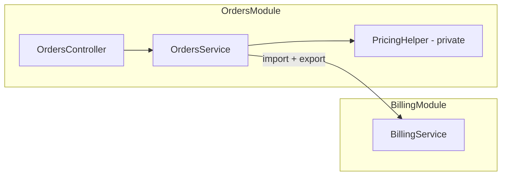
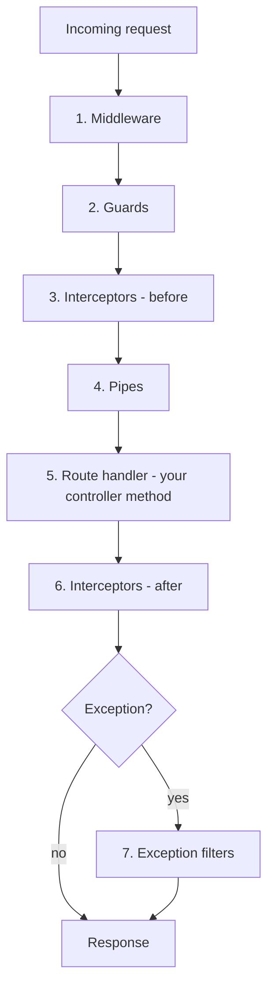
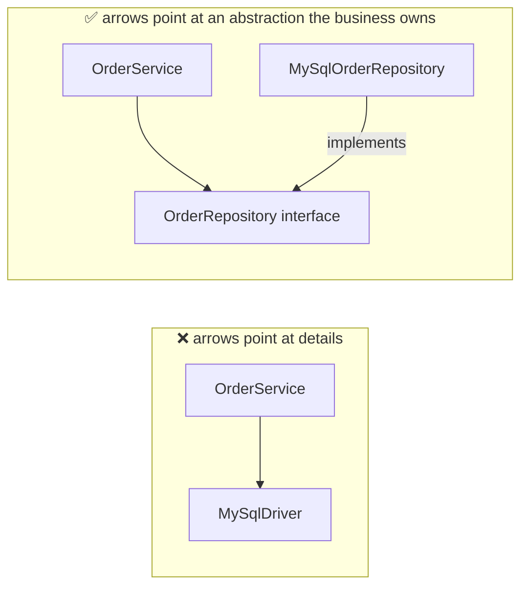
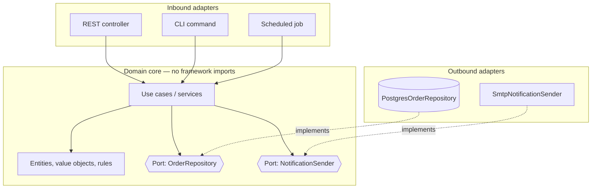
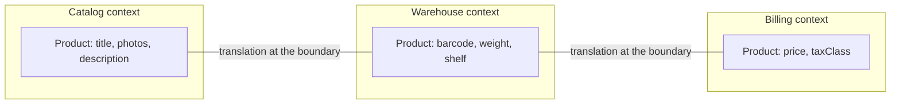

# Phase 0 — Foundations: The Complete Study Guide

> **How to read this file.** Read it top to bottom the first time — every section builds on vocabulary
> defined earlier. Words in **bold** are being *defined* at that spot; if you meet a term you don't
> recognize later, search backwards for its bold definition. Every concept has a runnable example.
> **Type the examples out yourself** — do not copy-paste. Typing is how the syntax enters your fingers.
>
> Diagrams are in [Mermaid](https://mermaid.js.org/) (rendered automatically by GitHub and VS Code
> with the "Markdown Preview Mermaid Support" extension) or plain ASCII.

---

## Table of contents

1. [Part A — TypeScript: from types to type-level programming](#part-a)
2. [Part B — NestJS: the module / provider / DI mental model](#part-b)
3. [Part C — Architecture: hexagonal, repositories, SOLID, DDD](#part-c)
4. [Part D — The tools: monorepos, Docker, Compose](#part-d)
5. [Part E — One complete NestJS example, end to end](#worked)
6. [Self-quiz with answers](#quiz)
7. [Exercises](#exercises)

---

<a name="part-a"></a>
# Part A — TypeScript: from types to type-level programming

## A.1 What a type system is, and why you want a strict one

A **value** is a piece of data your program manipulates: `42`, `"hello"`, `true`.
A **type** is a *description of the set of values something can be*: `number` is "all numbers",
`string` is "all text", `boolean` is "true or false".

JavaScript is **dynamically typed**: variables have no declared types, and mistakes are discovered
*while the program runs* — often in production, in front of a user:

```typescript
// JavaScript — this crashes only when someone actually calls it
function shout(message) {
  return message.toUpperCase();
}
shout(42); // 💥 TypeError: message.toUpperCase is not a function
```

TypeScript is **statically typed**: you (or the compiler, by inference) attach types to values, and a
program called the **compiler** (`tsc`) checks *before the code ever runs* that you never use a value
in a way its type forbids:

```ts
function shout(message: string): string {
  return message.toUpperCase();
}
shout(42); // ❌ compile error: Argument of type 'number' is not assignable to 'string'
```

The compile error is the whole point. A bug caught at compile time costs you 5 seconds.
The same bug caught in production costs a debugging session, an incident, or a user's trust.

### The strict flags — turn them ALL on, day 1

In `tsconfig.json` (the compiler's configuration file):

```jsonc
{
  "compilerOptions": {
    "strict": true,                      // umbrella: enables ~8 checks at once
    "noUncheckedIndexedAccess": true,    // see below
    "exactOptionalPropertyTypes": true   // see below
  }
}
```

**`strict: true`** enables (among others):

- **`strictNullChecks`** — the most important one. Without it, `null` and `undefined` sneak into
  every type, and "cannot read property of undefined" — the most common JS crash in history —
  is invisible to the compiler. With it, if something *can* be null, the type *says so*
  (`string | null`), and the compiler forces you to handle that case:

  ```ts
  function firstWord(s: string | null): string {
    return s.split(" ")[0]; // ❌ error: 's' is possibly 'null'
    // you are FORCED to write:
    // if (s === null) return "";
  }
  ```

- **`noImplicitAny`** — `any` is the type that means "stop checking me". An *implicit* `any` appears
  when you forget an annotation. This flag makes forgetting an error rather than a silent hole.

**`noUncheckedIndexedAccess`** — when you index into an array or a record, the element may not exist.
Without the flag, TypeScript pretends it always does:

```ts
const scores: number[] = [];
const first = scores[0];   // type says `number`… but it's actually undefined!
first.toFixed(2);          // 💥 runtime crash the compiler didn't see

// WITH the flag: scores[0] has type `number | undefined` → compiler forces a check.
```

**`exactOptionalPropertyTypes`** — distinguishes "the property is absent" from "the property is
present and set to `undefined`". Example: with `{ nickname?: string }`, writing
`user.nickname = undefined` is an error under the flag — either give a string or *delete* the key.
This matters when objects get serialized (JSON has no `undefined`) or diffed.

> Why day 1? Because every line you write under loose settings becomes a compile error you must fix
> when you finally turn strictness on. On a 10,000-line codebase that is a week of misery. On line 1
> it is free. (You already saw this in practice: Prisma's own generated config file failed the
> `exactOptionalPropertyTypes` check in this repo and had to be fixed.)

---

## A.2 Generics — functions that take *types* as parameters

### The problem generics solve

You write a function that returns the first element of an array of numbers:

```ts
function firstNumber(arr: number[]): number | undefined {
  return arr[0];
}
```

Tomorrow you need the same thing for strings. Copy-paste? `firstString`, `firstBoolean`,
`firstUser`… That's the same *logic* duplicated for every *type*. What you want to say is:

> "This function works **for any type T** — give me an array of T, I give you a T back."

That sentence *is* a generic:

```ts
function first<T>(arr: T[]): T | undefined {
  return arr[0];
}

const a = first([1, 2, 3]);        // T inferred as number  → a: number | undefined
const b = first(["x", "y"]);       // T inferred as string  → b: string | undefined
```

**`<T>` declares a type parameter** — a placeholder that gets filled in ("inferred") at each call
site. Think of a generic as *a function from types to types*, exactly like a normal function is a
function from values to values:

```
normal function:   value  in → value  out      double(4) → 8
generic:           type   in → type   out      Box<string> → { value: string }
```

### Generic types (not just functions)

```ts
interface Box<T> {
  value: T;
}

const stringBox: Box<string> = { value: "hi" };
const dateBox:   Box<Date>   = { value: new Date() };
```

`Array<T>`, `Promise<T>`, `Map<K, V>` — you have been using generics since your first line of TS.

### Constraints — "any type T, *as long as* it has …"

Sometimes "any type" is too loose. Say you want to log something's `.length`:

```ts
function logLength<T>(x: T) {
  console.log(x.length); // ❌ error: T might be a number, which has no .length
}
```

A **constraint** (`extends`) narrows which types are allowed in:

```ts
function logLength<T extends { length: number }>(x: T): T {
  console.log(x.length); // ✅ every allowed T is guaranteed to have .length
  return x;
}

logLength("hello");       // ✅ strings have length
logLength([1, 2, 3]);     // ✅ arrays have length
logLength(42);            // ❌ numbers don't
```

The classic real-world pattern — "give me an object and one of *its own* keys":

```ts
function pluck<T, K extends keyof T>(obj: T, key: K): T[K] {
  return obj[key];
}

const book = { title: "Dune", pages: 412 };
pluck(book, "title");  // type: string  ✅
pluck(book, "pages");  // type: number  ✅
pluck(book, "isbn");   // ❌ compile error — "isbn" is not a key of book
```

Read the new pieces slowly:
- **`keyof T`** — the type whose values are *the names of T's properties*. For `book` above,
  `keyof T` is `"title" | "pages"` (a union of literal string types).
- **`T[K]`** — an **indexed access type**: "the type of property K on T". `book["pages"]` the *type-level*
  way: `{title: string; pages: number}["pages"]` = `number`.

This one function demonstrates the deep idea: **the type system is a programming language that runs
at compile time.** Its values are types; its functions are generics.

---

## A.3 Conditional types and `infer`

A **conditional type** is an if/else *executed on types*:

```ts
type IsString<T> = T extends string ? "yes" : "no";

type A = IsString<"hello">; // "yes"
type B = IsString<42>;      // "no"
```

Read `T extends U ? X : Y` as: *"if T is assignable to U, the result is X, otherwise Y."*

### Why you'd ever want this

Standard-library example — `NonNullable<T>` removes `null`/`undefined` from a type:

```ts
type NonNullable<T> = T extends null | undefined ? never : T;
type Clean = NonNullable<string | null | undefined>; // string
```

(`never` is the *empty* type — "no possible value". In a union, `never` simply disappears —
that's why the nulls get filtered out. When a conditional type receives a union, it distributes:
it runs once per union member and unions the results.)

### `infer` — pattern-matching for types

`infer` lets a conditional type *extract a piece* of the type it matched. It's destructuring, but
for types:

```ts
// "If T is an array, tell me the element type."
type ElementOf<T> = T extends (infer E)[] ? E : never;

type X = ElementOf<string[]>;   // string
type Y = ElementOf<number[]>;   // number

// "If T is a Promise, what does it resolve to?"
type Awaited<T> = T extends Promise<infer V> ? V : T;

type Z = Awaited<Promise<Date>>; // Date

// "What does this function return?" (this is how the built-in ReturnType works)
type ReturnType<T> = T extends (...args: any[]) => infer R ? R : never;

type R = ReturnType<() => number>; // number
```

You will rarely *write* these daily — but you will *read* them constantly in library code
(Prisma's and NestJS's types are full of them), and error messages make no sense until you can.

---

## A.4 Mapped types — loops over properties

A **mapped type** builds a new object type by iterating over the keys of another. The syntax
`[K in keyof T]` is the type-level `for` loop:

```ts
// Make every property optional — this is EXACTLY how the built-in Partial works:
type Partial<T> = { [K in keyof T]?: T[K] };

// Make every property readonly:
type Readonly<T> = { readonly [K in keyof T]: T[K] };

// Keep only some keys — the built-in Pick:
type Pick<T, K extends keyof T> = { [P in K]: T[P] };

// The built-in Omit = "all keys except K":
type Omit<T, K> = Pick<T, Exclude<keyof T, K>>;
```

Concrete usage (an everyday scenario — form handling in any app):

```ts
interface Customer {
  id: string;
  name: string;
  email: string;
}

type CustomerDraft  = Omit<Customer, "id">;      // creating: no id yet
type CustomerPatch  = Partial<CustomerDraft>;    // editing: any subset of fields
type CustomerLabels = Record<keyof Customer, string>; // one label per field
```

### Build your own: `DeepReadonly` (the Phase-0 kata)

`Readonly<T>` only freezes the top level. Combine a mapped type with recursion and a conditional:

```ts
type DeepReadonly<T> = {
  readonly [K in keyof T]: T[K] extends object ? DeepReadonly<T[K]> : T[K];
};

interface Config {
  server: { host: string; port: number };
  flags: { beta: boolean };
}

declare const cfg: DeepReadonly<Config>;
cfg.server.port = 8080; // ❌ error — frozen at EVERY level
```

If you can write `DeepReadonly` from memory and explain each token, you are done with this section.

---

## A.5 Discriminated unions and narrowing — how you model "one of several shapes"

### The problem

Real data is often "one of N variants". A payment is *either* by card *or* by transfer *or* by
voucher — and each variant carries different fields. Beginners model this with one fat interface
full of optional fields:

```ts
// ❌ the wrong way — "optional soup"
interface Payment {
  method: string;
  cardNumber?: string;    // only for cards
  iban?: string;          // only for transfers
  voucherCode?: string;   // only for vouchers
}
```

Nothing stops `{ method: "card", iban: "DE89…" }`. Every consumer must guess which fields exist.

### The right way: a discriminated union

```ts
interface CardPayment     { kind: "card";     cardNumber: string; expiry: string }
interface TransferPayment { kind: "transfer"; iban: string }
interface VoucherPayment  { kind: "voucher";  voucherCode: string }

type Payment = CardPayment | TransferPayment | VoucherPayment;
```

- The **union** `A | B | C` means "a value of one of these shapes".
- The **discriminant** is the shared literal field `kind` — each variant pins it to a *specific
  string literal type* (`"card"`, not `string`).

**Narrowing** is the compiler shrinking a union to one variant after you test the discriminant:

```ts
function describe(p: Payment): string {
  switch (p.kind) {
    case "card":
      return `Card ending ${p.cardNumber.slice(-4)}`; // p is CardPayment here — compiler knows!
    case "transfer":
      return `Transfer from ${p.iban}`;               // p is TransferPayment here
    case "voucher":
      return `Voucher ${p.voucherCode}`;              // p is VoucherPayment here
  }
}
```

Inside each `case`, accessing the other variants' fields is a compile error. The impossible states
became *unrepresentable*.

### Exhaustiveness — the compiler as your checklist

Add a fourth variant later (`CryptoPayment`) and forget to update `describe`? Catch it at compile
time with the `never` trick:

```ts
function describe(p: Payment): string {
  switch (p.kind) {
    case "card":     return "…";
    case "transfer": return "…";
    case "voucher":  return "…";
    default: {
      const unreachable: never = p; // ❌ errors the moment a variant is unhandled
      return unreachable;
    }
  }
}
```

Other narrowing tools you should recognize: `typeof x === "string"`, `x instanceof Date`,
`"field" in x`, and **type predicates** (`function isCard(p: Payment): p is CardPayment`).

> **Why this matters beyond TS trivia:** discriminated unions are how you will model *domain
> events* ("OrderPlaced | OrderShipped | OrderCancelled"), API results
> ("Success | ValidationError | NotFound"), and state machines. It is the single most
> load-bearing TypeScript pattern in a serious backend.

---

<a name="part-b"></a>
# Part B — NestJS: the module / provider / DI mental model

## B.1 First, vocabulary: classes and decorators

A **class** is a blueprint that bundles data (properties) and behavior (methods) and can be
instantiated with `new`:

```ts
class Thermostat {
  constructor(private targetTemp: number) {}
  isTooCold(current: number): boolean {
    return current < this.targetTemp;
  }
}
const t = new Thermostat(21);
```

A **decorator** is a function that attaches *metadata* (extra information) to a class, method,
property or parameter. The `@` syntax is just "call this function on the thing below":

```ts
@Controller("books")      // ← attaches metadata: "this class handles /books routes"
class BooksController {}
```

Crucially: **a decorator usually doesn't change behavior by itself — it leaves a note.** Something
else (the framework) reads the note later and acts on it. `@Injectable()` on a NestJS class does
almost nothing at runtime except *record* "this class participates in dependency injection, and
here are its constructor parameter types". (That answer is quiz question #1.)

## B.2 Dependency Injection — the *why*, from zero

### Step 1: the problem, with no framework in sight

You are building a plain program that sends a welcome email when someone registers.

```ts
// ❌ Version 1 — the class builds its own dependencies
class SignupService {
  private mailer = new SmtpMailer("smtp.gmail.com", 587, "user", "password");

  register(email: string) {
    // ... create the account ...
    this.mailer.send(email, "Welcome!");
  }
}
```

This *works*. Now try to do three ordinary things:

1. **Test it.** Your unit test for `register()` will *actually send email over the network* —
   slow, flaky, and it spams a real inbox. You can't substitute a fake mailer because the class
   hard-wired `new SmtpMailer(...)` inside itself.
2. **Change providers.** Switching from SMTP to Mailgun means *editing this class* (and every other
   class that also did `new SmtpMailer`).
3. **Configure per environment.** Dev should log emails to console; prod should really send.
   Impossible — the construction is frozen inside.

The root disease has a name: **tight coupling** — `SignupService` doesn't just *use* a mailer,
it *knows how to build one*, including credentials it has no business knowing.

### Step 2: the fix is embarrassingly simple — pass dependencies in

```ts
// ✅ Version 2 — dependencies come in through the constructor
interface Mailer {
  send(to: string, body: string): Promise<void>;
}

class SignupService {
  constructor(private mailer: Mailer) {}   // ← "I need A mailer. Any mailer."

  register(email: string) {
    this.mailer.send(email, "Welcome!");
  }
}
```

That is **Dependency Injection (DI)**: *a class declares what it needs and receives it from
outside, instead of constructing it itself.* No framework required — DI is a design pattern,
three words long: "pass it in".

Now all three problems dissolve:

```ts
// Testing: hand it a fake
class FakeMailer implements Mailer {
  sent: string[] = [];
  async send(to: string) { this.sent.push(to); }
}
const fake = new FakeMailer();
const svc = new SignupService(fake);
svc.register("a@b.c");
expect(fake.sent).toEqual(["a@b.c"]);      // fast, no network, deterministic

// Swapping providers / environments: change ONE place, the "wiring" spot:
const mailer = process.env.NODE_ENV === "production"
  ? new MailgunMailer(apiKey)
  : new ConsoleMailer();
const svc = new SignupService(mailer);
```

> **60-second explanation for a junior dev (quiz #2):** "Instead of a class building the things it
> needs with `new`, it asks for them in its constructor. That means you can hand it real things in
> production and fake things in tests, and you can swap implementations without touching the class.
> The class says *what* it needs; someone else decides *which one* and *how it's built*."

### Step 3: the container — DI at scale

Manual injection is fine for 3 classes. A real app has 300, forming a dependency *graph*:

```
AppController → OrdersService → PricingService → TaxRates
                              → InventoryService → Database
```

Constructing that by hand means a giant `main()` full of `new`, in the right order. An
**IoC container** ("Inversion of Control" container) automates it: you *register* classes, and the
container figures out the graph and builds everything. NestJS *is*, at its core, such a container
plus an HTTP layer.

```ts
@Injectable()                 // "container, please manage me"
class PricingService {
  constructor(private taxRates: TaxRates) {}   // container sees this via metadata
}
```

When Nest needs a `PricingService`, it reads the constructor's parameter types (that's the metadata
`@Injectable()` caused to be recorded), recursively resolves each one, constructs the instance, and
**caches it as a singleton** (one shared instance per app, by default).

### Step 4: providers and tokens

A **provider** is anything the container knows how to supply. The **token** is the *lookup key*
under which it's registered. Usually the class itself is the token:

```ts
providers: [PricingService]
// shorthand for:
providers: [{ provide: PricingService, useClass: PricingService }]
//             ^^^^^^^ token            ^^^^^^^^ recipe
```

Why do explicit tokens exist? Because *interfaces vanish at runtime* (TypeScript erases them), so
you can't say "inject the `Mailer` interface" — there is no runtime object called `Mailer` to use as
a key. Instead you register under a symbolic token and inject by that token:

```ts
export const MAILER = Symbol("MAILER");

// wiring (in a module):
providers: [{ provide: MAILER, useClass: MailgunMailer }]

// consumption:
constructor(@Inject(MAILER) private mailer: Mailer) {}
```

Other recipes you'll meet: `useValue` (a ready-made object — perfect for config or test doubles)
and `useFactory` (a function that builds the value, possibly async, possibly using *other* injected
things).

## B.3 Modules — just labeled boxes of providers

A **module** is a class with an `@Module()` decorator whose only job is *metadata*: it names which
providers live in this box, which are exported for other boxes, and which other boxes it imports.

```ts
@Module({
  imports:     [BillingModule],       // boxes whose exports I want to use
  controllers: [OrdersController],    // HTTP entry points living here
  providers:   [OrdersService],       // injectables living here
  exports:     [OrdersService],       // what other modules may inject from me
})
export class OrdersModule {}
```

Mental model: modules define **visibility boundaries** for the container. A provider is injectable
only inside its own module — unless exported and imported. This is *encapsulation at the
architecture level*: `OrdersModule` can keep its internals private and expose one public service.



> **Circular dependencies (quiz #3):** if module A imports B and B imports A, something is
> misplaced. Usually a third concept is hiding inside both — extract it into its own module C that
> both import; or invert one direction with events. `forwardRef()` exists as an escape hatch, but
> treat needing it as a design smell, not a solution.

## B.4 The request lifecycle — the airport-security pipeline

Every HTTP request to a NestJS app passes through a fixed sequence of checkpoints. Learn the order
cold — half of practical NestJS debugging is knowing *where* in this pipeline something happened.



Airport analogy, checkpoint by checkpoint:

| # | Nest concept | Airport equivalent | Typical use |
|---|---|---|---|
| 1 | **Middleware** | The terminal doors — everyone walks through, no questions about *where you're flying* | logging, CORS, body parsing, request IDs |
| 2 | **Guards** | Passport control — *may this person proceed at all?* Yes/no decision | authentication, role checks |
| 3 | **Interceptors (before)** | The agent noting your entry time | timing, caching, transforming input context |
| 4 | **Pipes** | The baggage scanner — *is what you're carrying valid and in the right form?* | validation, transformation (`"42"` → `42`) |
| 5 | **Handler** | Boarding the plane — the actual business | your controller method |
| 6 | **Interceptors (after)** | Customs stamping the outcome on the way out | shaping the response, logging duration |
| 7 | **Exception filters** | The incident desk — something went wrong anywhere above | converting errors into clean HTTP responses |

**Guard vs Pipe (quiz #4)**: a **guard** answers *"is this request allowed to reach the handler?"*
(authorization — runs early, sees the request as a whole). A **pipe** answers *"are these particular
arguments valid, and in what form should the handler receive them?"* (validation/transformation —
runs last before the handler, sees individual parameters). Rejection by a guard is a 403-flavored
event; rejection by a pipe is a 400-flavored one.

## B.5 Custom decorators

Two kinds you will actually write:

**Parameter decorators** — extract something from the request and hand it to your handler as a
clean argument. Built with `createParamDecorator`:

```ts
export const UserAgent = createParamDecorator(
  (data: unknown, ctx: ExecutionContext): string => {
    const req = ctx.switchToHttp().getRequest();
    return req.headers["user-agent"] ?? "unknown";
  },
);

// usage — the handler stays oblivious to HTTP plumbing:
@Get()
list(@UserAgent() agent: string) { ... }
```

**Metadata decorators** — leave a note that a *guard or interceptor* reads later, via `Reflector`.
This is the mechanism behind role-based access:

```ts
export const MinimumAge = (age: number) => SetMetadata("minAge", age);

@MinimumAge(18)        // ← the note
@Get("casino")
enter() { ... }

// inside a guard:
const min = this.reflector.get<number>("minAge", context.getHandler());
```

Decorator writes the note → guard reads the note → decision. That two-step dance
(`SetMetadata` + `Reflector`) is one of the most reused patterns in all of NestJS.

## B.6 Dynamic modules — `forRoot` / `forRootAsync`

A regular module is static — same providers every time. A **dynamic module** is a module *returned
from a function call*, so it can be configured by the caller:

```ts
@Module({})
export class StorageModule {
  static forRoot(options: { bucket: string }): DynamicModule {
    return {
      module: StorageModule,
      providers: [
        { provide: "STORAGE_OPTIONS", useValue: options },  // options become a provider!
        StorageService,
      ],
      exports: [StorageService],
    };
  }
}

// consumer:
@Module({ imports: [StorageModule.forRoot({ bucket: "avatars" })] })
export class AppModule {}
```

The trick to internalize: **the configuration itself is registered as a provider**, so anything in
the module can inject it. `forRootAsync` is the same idea when options must be *computed* (e.g.,
read from `ConfigService`) — you pass a `useFactory` instead of a value. Every serious Nest library
(`ConfigModule.forRoot`, `BullModule.forRootAsync`, …) follows this convention; after writing one
yourself, their signatures stop looking like magic.

---

<a name="part-c"></a>
# Part C — Architecture: why the shape of code matters

## C.1 Coupling, cohesion, and the cost of change

Two words you need precisely:

- **Coupling** — how much one part *knows about* another. High coupling: changing A forces changing
  B. Low coupling: A and B interact through a small, stable surface.
- **Cohesion** — how much the things *inside* one part belong together. High cohesion: a module has
  one clear purpose. Low cohesion: a "utils" folder with 90 unrelated functions.

The entire discipline of architecture is one sentence: **maximize cohesion, minimize coupling, so
that change stays cheap.** Every pattern below is a tool for that sentence.

## C.2 SOLID — five principles, five tiny examples

*(None of these examples are web code on purpose — the principles predate the web.)*

**S — Single Responsibility.** A class should have one reason to change.

```ts
// ❌ two reasons to change: report content AND how printing works
class Report { generate() {...}  printToPdf() {...} }
// ✅ split
class Report { generate(): string {...} }
class PdfPrinter { print(text: string) {...} }
```

**O — Open/Closed.** Open to extension, closed to modification: add behavior by *adding code*, not
editing tested code.

```ts
// ❌ every new shape edits this function (and risks breaking circles when adding squares)
function area(s: any) { if (s.kind === "circle") {...} else if (s.kind === "rect") {...} }
// ✅ new shapes are new classes; area() never changes again
interface Shape { area(): number }
class Circle implements Shape { ... }
class Rect implements Shape { ... }
```

**L — Liskov Substitution.** Anywhere a base type is expected, any subtype must work *without
surprises*. The canonical violation: `Square extends Rectangle` where setting width silently changes
height — code holding a `Rectangle` breaks. If a subtype needs "don't call this method on me",
it isn't a subtype.

**I — Interface Segregation.** Many small interfaces beat one fat one. A `Printer` that must
implement `scan()` and `fax()` because the interface is `AllInOneMachine` is being punished for
methods it doesn't have.

**D — Dependency Inversion.** *The one that makes the rest possible.* Two rules:

1. High-level policy (business logic) should not depend on low-level detail (databases, SMTP, file
   systems). **Both should depend on abstractions** (interfaces).
2. The *abstraction is owned by the high level*: the business defines the `Mailer` interface it
   wishes existed; the SMTP code's job is to conform to it — not the other way around.

Notice: Part B's DI section was Dependency *Injection* — the mechanical act of passing things in.
Dependency *Inversion* is the design rule about which direction the arrows point. Injection is how
you *implement* inversion.



## C.3 Hexagonal architecture (ports & adapters)

### The core idea in one metaphor

Think of a **laptop**. The valuable thing — CPU, memory — is sealed inside. On the edge are
**ports**: USB-C, HDMI, audio jack. The laptop doesn't care *what* you plug in; anything conforming
to the port's shape works. A projector, a monitor, a capture card — all **adapters** to the HDMI
port. You swap adapters daily; you never open the laptop.

Software translation:

- **The domain core** = the laptop's insides: your business rules, pure logic, *zero* imports from
  frameworks, databases, or HTTP libraries.
- **Ports** = interfaces *defined by the core*, describing what it needs (outbound: "something that
  stores orders", "something that sends notifications") and what it offers (inbound: "you can place
  an order").
- **Adapters** = the replaceable plugs: an HTTP controller is an inbound adapter (translates HTTP
  into core calls); a Postgres repository class is an outbound adapter (implements the storage
  port using SQL).



**Why does the domain not import Prisma (quiz #5)?** Because the moment it does, your business
rules are welded to one persistence technology: you can't unit-test rules without a database, can't
swap storage, and every Prisma upgrade ripples into business code. The dependency arrows must point
*inward* — adapters know the core; the core knows only its own interfaces. The core stays a plain
TypeScript library you could test in milliseconds or reuse under a CLI.

### A complete miniature (a library lending system — nothing to do with any web framework)

```ts
// ── CORE ──────────────────────────────────────────────
// domain entity: identity + rules
class Loan {
  constructor(public readonly bookId: string, public readonly dueDate: Date) {}
  isOverdue(today: Date): boolean { return today > this.dueDate; }
}

// PORT (owned by the core — note: an interface, in the core's folder)
interface LoanRepository {
  findByMember(memberId: string): Promise<Loan[]>;
  save(memberId: string, loan: Loan): Promise<void>;
}

// use case: pure orchestration against the port
class BorrowBook {
  constructor(private loans: LoanRepository) {}
  async execute(memberId: string, bookId: string, today: Date): Promise<Loan> {
    const current = await this.loans.findByMember(memberId);
    if (current.some(l => l.isOverdue(today)))
      throw new Error("Member has overdue loans");
    if (current.length >= 5)
      throw new Error("Loan limit reached");
    const loan = new Loan(bookId, addDays(today, 21));
    await this.loans.save(memberId, loan);
    return loan;
  }
}

// ── ADAPTERS (elsewhere; they import the core, never vice-versa) ─────
class InMemoryLoanRepository implements LoanRepository { /* Map-based; used in tests */ }
class SqlLoanRepository      implements LoanRepository { /* SQL; used in prod */ }
```

The `BorrowBook` test needs no database, no HTTP, no mocking library — just the in-memory adapter.
*That test speed is not a nicety; it's what makes refactoring safe enough to do daily.*

## C.4 The repository pattern — precisely

A **repository** is *an object that gives the domain the illusion of an in-memory collection of its
entities*, while hiding every detail of storage. `findByMember`, `save`, `delete` — collection
verbs, not SQL verbs.

The two commandments that separate a real repository from an "ORM wrapper":

1. **It speaks in domain objects.** It accepts and returns `Loan`, never a Prisma/ORM row type.
   The mapping between DB shapes and domain shapes happens *inside* the repository — that is its
   *job*, not an inconvenience. ("What does the pattern buy given Prisma is already typed?" —
   this. Prisma's types describe *tables*. Your domain types describe *concepts with behavior*
   like `loan.isOverdue()`. The repository is the border checkpoint between those worlds.)
2. **Its interface lives in the domain; its implementation lives in infrastructure.** The domain
   owns the contract (Dependency Inversion, again).

Sniff test: if deleting your ORM would force edits *inside* domain/use-case files, you don't have
repositories — you have wrappers.

## C.5 DDD — Domain-Driven Design essentials

**DDD** is a school of design with one central claim: *the structure of the software should mirror
the structure of the business domain, expressed in the language domain experts actually use.*
You need four of its ideas now:

### Ubiquitous language
One shared vocabulary between code and domain experts. If the librarians say "patron", the class is
`Patron`, not `UserAccountHolder`. When the words in the code drift from the words in the meetings,
bugs are born in the gap.

### Bounded contexts
A **bounded context** is a boundary inside which a word has *exactly one meaning*. Big domains
inevitably reuse words with different meanings — the classic example is **"Product"** in an
e-commerce company:

- To **Catalog**, a Product is a title, photos, and a description to seduce buyers.
- To **Warehouse**, a Product is a barcode, a weight, and a shelf location.
- To **Billing**, a Product is a price, a tax class, and a revenue account.

Forcing one giant `Product` class to serve all three creates a monster coupled to everyone. DDD's
answer: **three contexts, three models**, each small and honest, with explicit translation where
contexts talk to each other.



**Mapping to NestJS (the Phase-0 punchline):** one bounded context ↔ one NestJS module (usually).
The module's `exports` array *is* the context's public contract; everything else stays private.
This is why the module system exists — it gives bounded contexts teeth.

### Entities vs value objects (quiz #6)
- An **entity** has an *identity that persists through change*. You at 20 and you at 40 are
  different in every attribute, yet the same person — same identity. A bank account with a changing
  balance is the same account. Entities are compared by **id**.
- A **value object** *is* its attributes — no identity. The amount "€10" is interchangeable with
  any other "€10"; the date 2024-01-01 is the date 2024-01-01. Value objects are compared by
  **value**, are immutable, and are a superb home for validation (`new Email("not-an-email")`
  throws → invalid emails become unrepresentable, everywhere, forever).

### Aggregates (light for now)
An **aggregate** is a cluster of entities/values that must stay consistent together, with one
entity as the **root** and only entry point (an `Order` with its `OrderLines`: you never edit a
line directly — you ask the order, so it can protect rules like "max 50 lines"). Save and load
aggregates whole. Deep coverage comes when you design real schemas.

## C.6 CQRS — the high-level idea (deep-dive comes in Phase 5)

**Command Query Responsibility Segregation**: reads and writes have different shapes and different
pressures, so let them use *different models*.

- A **command** changes state and returns nothing much ("transfer €50"). It wants validation,
  invariants, transactions — a *normalized* model.
- A **query** answers a question and changes nothing ("show my statement"). It wants speed and
  convenient shapes — *denormalized* projections, caches.

Everyday analogy: a restaurant kitchen keeps *tickets* (commands, ordered, validated one at a time)
while the pass display shows an *always-current summary board* (a projection built from the
tickets). Nobody cooks from the summary board; nobody reads the pile of tickets to know what's
ready. For now just internalize: **you may maintain several read-optimized copies of data derived
from one authoritative write model, updated by events, and slightly behind it (eventual
consistency)**. That "slightly behind" trade-off is a Phase-5 conversation.

---

<a name="part-d"></a>
# Part D — The tools

## D.1 Monorepo + pnpm workspaces

A **monorepo** is one git repository containing several packages (apps and libraries) that evolve
together. The alternative — one repo per package (**polyrepo**) — means every shared type change
becomes: publish package → bump version → update consumers → pray. In a monorepo, an API and its
frontend share types *in the same commit*; nothing can drift.

**pnpm workspaces** is the mechanism: `pnpm-workspace.yaml` lists package folders; pnpm links them
so `import { X } from "@myorg/shared"` resolves *locally*, installs all dependencies with one
`pnpm install` into one lockfile, and stores every package version once on disk (pnpm's
content-addressed store — this is why it's fast and small). `pnpm --filter <pkg> <cmd>` runs a
command in one package. That's 90% of what you need.

*Why not Turborepo yet?* Turborepo adds build **caching and orchestration** ("don't rebuild what
didn't change"). With 2–3 packages, plain pnpm is simpler and builds are fast anyway; adopt a build
cache when waiting starts to hurt. Defaults should earn their complexity.

## D.2 Docker in fifteen lines

- An **image** is a frozen, layered snapshot of a filesystem + a start command (a *recipe's
  result*: e.g., "Debian + PostgreSQL 16 configured").
- A **container** is a *running instance* of an image — isolated process(es) with their own
  filesystem view, network, and resource limits. Image : container :: class : instance.
- A **registry** (Docker Hub) is where images are pulled from.
- A **volume** is persistent storage attached to a container — the database *files* live there, so
  the data survives when the container is recreated.
- **Port mapping** (`-p 5433:5432`) forwards host port → container port. (You already saw a
  real-life use: this machine's native Postgres owns 5432, so the containerized one is reachable on
  5433 instead. Collisions on default ports are routine; mapping is the fix.)
- **docker compose** is a YAML file declaring several containers (services), their networks,
  volumes and health checks, started together with `docker compose up -d`. It is
  *your laptop's copy of production's shape*: Postgres + Redis defined in one reviewable file
  instead of "stuff I once installed by hand and forgot".

A **healthcheck** is a command Compose runs inside the container ("`pg_isready`") so other services
can wait for *actually ready*, not merely *started* — the difference bites the first time an app
boots faster than its database.

### D.3 The Dockerfile — and the one rule that decides your build time

Compose runs *other people's* images (Postgres, Redis). To run **your** app you write a
**Dockerfile**: an ordered recipe, where **every instruction becomes a cached layer**.

```dockerfile
FROM node:22-alpine          # the base image to start from (alpine = small)
WORKDIR /app                 # cd, and create it if needed
COPY package.json ./         # copy dependency manifests FIRST
RUN npm install --omit=dev   # install — this is the slow step
COPY . .                     # only now bring in the source
CMD ["node", "index.js"]     # the default command when the container starts
```

**The rule: order instructions from least- to most-frequently-changing.** Docker caches each layer
and reuses it *only if that instruction and everything before it are unchanged*. One layer misses →
every layer after it rebuilds.

Your source changes fifty times an hour; your dependencies change weekly. So copy the manifest,
install, *then* copy the source. Put `COPY . .` first and every one-character edit re-runs the
install. Measured, changing a single line of source and rebuilding:

```
# COPY . . before RUN npm install            # COPY package.json first
[3/4] COPY . .                               [3/5] COPY package.json ./   CACHED
[4/4] RUN npm install   ← RE-RUNS            [4/5] RUN npm install        CACHED
                                             [5/5] COPY . .   ← only this re-runs
```

That's the difference between a two-second rebuild and a ninety-second one, all day, from four lines
being in the wrong order.

### D.4 `.dockerignore` — the file people forget

`COPY . .` copies **everything**, including `node_modules` and `.git`. That bloats the image, slows
every build, and can overwrite the Linux-native `node_modules` you just installed with your host's.
Create `.dockerignore` beside the Dockerfile:

```
node_modules
.git
dist
.env
*.log
```

Excluding `.env` matters twice over: it keeps secrets out of a layer that anyone who pulls the image
can read. **Layers are not private** — a deleted file in a later layer is still recoverable from the
earlier one.

### D.5 Multi-stage builds — ship the output, not the toolchain

To *build* a TypeScript app you need `typescript`, `@types`, and every devDependency. To *run* it you
need none of them. A **multi-stage** build compiles in one image and copies only the result into a
clean second one:

```dockerfile
FROM node:22-alpine AS build           # ── stage 1: has the whole toolchain
WORKDIR /app
COPY package.json tsconfig.json ./
RUN npm install                        # ALL deps, including dev
COPY src ./src
RUN npm run build                      # → dist/

FROM node:22-alpine AS runtime         # ── stage 2: a fresh, empty image
WORKDIR /app
ENV NODE_ENV=production
COPY package.json ./
RUN npm install --omit=dev && npm cache clean --force
COPY --from=build /app/dist ./dist     # ← copy ONLY the compiled output
USER node                              # don't run as root
CMD ["node", "dist/index.js"]
```

Measured on a minimal TypeScript app: **single-stage 214 MB → multi-stage 158 MB**, a 26% cut, and
`typescript` is verifiably absent from the runtime image rather than shipped to production.

> **Be honest about when it pays.** The same test on a JavaScript app with one tiny dependency and no
> build step saved **nothing** — 158.5 MB either way, because the base image is nearly all of it and
> there was no toolchain to strip. Multi-stage buys you exactly the size of your build-only
> dependencies. For a NestJS app that's TypeScript, ts-node, eslint, jest and every `@types` package,
> so it's a real win. For a plain-JS service it's ceremony. **Measure before you claim a benefit** —
> that habit is worth more than the pattern.

`USER node` is not decoration either: containers run as **root** by default, and root inside the
container maps to a real uid on the host. That's the Phase-2 conversation, arriving early.

### D.6 Dev vs prod — the same app, two shapes

| | Development | Production |
|---|---|---|
| Source | **bind-mounted** from your machine, so edits appear instantly | **copied in** at build time; the image is immutable |
| Deps | all, including dev | `--omit=dev` |
| Process | `nest start --watch` | `node dist/main.js` |
| Rebuild | almost never — the mount handles it | on every deploy |

A **bind mount** (`volumes: ["./apps/api:/app"]`) maps a host directory into the container so a save
is visible immediately. A **named volume** (`postgres_data:/var/lib/postgresql/data`) is storage
Docker manages, for data that must outlive the container. Same YAML key, completely different jobs —
mixing them up is why someone's database "keeps resetting."

**Commands worth having in your fingers:**

```bash
docker compose up -d --build    # (re)build images and start everything detached
docker compose logs -f api      # follow one service's logs
docker compose exec api sh      # a shell INSIDE the running container
docker compose down -v          # stop and DELETE the volumes  ← the -v wipes your data
docker image inspect X --format '{{.Size}}'   # is my image getting fat?
```

---

<a name="worked"></a>
# Part E — One complete NestJS example, end to end

Fragments teach syntax; a *whole working thing* teaches how the pieces click. Here is a complete,
minimal NestJS app — a **coffee-shop ordering API** — that uses every Part B concept together:
module, controller, service, a provider, DI, a port/adapter, and the request pipeline. Type it into
a throwaway `nest new coffee` and run it. Nothing here is project code.

```ts
// ── notifications.port.ts — the PORT (an interface the business owns) ──
export interface Notifier {
  notify(message: string): Promise<void>;
}
export const NOTIFIER = Symbol("NOTIFIER");   // injection token (interfaces vanish at runtime)

// ── console.notifier.ts — an ADAPTER (dev implementation) ──
import { Injectable } from "@nestjs/common";
import { Notifier } from "./notifications.port";

@Injectable()
export class ConsoleNotifier implements Notifier {
  async notify(message: string): Promise<void> {
    console.log(`[notify] ${message}`);
  }
}

// ── menu.service.ts — a PROVIDER the OrdersService will depend on ──
import { Injectable, NotFoundException } from "@nestjs/common";

@Injectable()
export class MenuService {
  private readonly prices = new Map<string, number>([
    ["espresso", 2.5],
    ["latte", 3.5],
  ]);
  priceOf(item: string): number {
    const price = this.prices.get(item);
    if (price === undefined) throw new NotFoundException(`No such item: ${item}`);
    return price;   // NotFoundException is later turned into a 404 by the exception filter
  }
}

// ── orders.service.ts — business logic; declares what it NEEDS via the constructor ──
import { Inject, Injectable } from "@nestjs/common";
import { MenuService } from "./menu.service";
import { NOTIFIER, Notifier } from "./notifications.port";

@Injectable()
export class OrdersService {
  constructor(
    private readonly menu: MenuService,           // injected by class token
    @Inject(NOTIFIER) private readonly notifier: Notifier,  // injected by symbol token
  ) {}

  async placeOrder(item: string, qty: number): Promise<{ item: string; total: number }> {
    const total = this.menu.priceOf(item) * qty;
    await this.notifier.notify(`Order: ${qty}× ${item} = $${total}`);
    return { item, total };
  }
}

// ── create-order.dto.ts — the shape of the request body, validated by a pipe ──
import { IsInt, IsString, Min } from "class-validator";
export class CreateOrderDto {
  @IsString() item!: string;
  @IsInt() @Min(1) qty!: number;
}

// ── orders.controller.ts — the inbound HTTP ADAPTER (translates HTTP → service calls) ──
import { Body, Controller, Post } from "@nestjs/common";
import { OrdersService } from "./orders.service";
import { CreateOrderDto } from "./create-order.dto";

@Controller("orders")
export class OrdersController {
  constructor(private readonly orders: OrdersService) {}

  @Post()
  create(@Body() dto: CreateOrderDto) {        // ValidationPipe parses the body into a CreateOrderDto
    return this.orders.placeOrder(dto.item, dto.qty);
  }
}

// ── orders.module.ts — the BOX that wires it all together ──
import { Module } from "@nestjs/common";
import { OrdersController } from "./orders.controller";
import { OrdersService } from "./orders.service";
import { MenuService } from "./menu.service";
import { ConsoleNotifier } from "./console.notifier";
import { NOTIFIER } from "./notifications.port";

@Module({
  controllers: [OrdersController],
  providers: [
    OrdersService,
    MenuService,
    { provide: NOTIFIER, useClass: ConsoleNotifier },  // token → implementation recipe
  ],
})
export class OrdersModule {}

// ── main.ts — turn on the validation pipe globally ──
import { NestFactory } from "@nestjs/core";
import { ValidationPipe } from "@nestjs/common";
import { AppModule } from "./app.module";   // imports OrdersModule

async function bootstrap() {
  const app = await NestFactory.create(AppModule);
  app.useGlobalPipes(new ValidationPipe({ whitelist: true, transform: true }));
  await app.listen(3000);
}
bootstrap();
```

Now `POST http://localhost:3000/orders` with `{"item":"latte","qty":2}` → `{"item":"latte","total":7}`,
and the console logs the notification. Trace what happened against the Part B pipeline:

1. Request hits the **controller** route (`@Post()` on `/orders`).
2. The **ValidationPipe** parses the body into a `CreateOrderDto`; send `{"qty":0}` and it auto-returns
   a 400 without your handler ever running (`@Min(1)` failed).
3. The handler calls `OrdersService.placeOrder` — an object the container **injected**, never
   `new`-ed.
4. `OrdersService` uses `MenuService` (injected by class) and `Notifier` (injected by symbol token).
   To send real emails in prod you'd swap **one line** in the module (`useClass: SmtpNotifier`) —
   nothing else changes. That's Dependency Inversion paying off.
5. Ask `priceOf("tea")` → `NotFoundException` bubbles to the **exception filter**, which renders a
   clean 404. You never wrote error-to-HTTP plumbing.

**Do this:** write a unit test for `OrdersService` that passes a `FakeNotifier` (records messages)
and a real `MenuService`, and asserts the total and the notification — no HTTP, no container, in
milliseconds. If you can explain why that test is possible *because* of the constructor injection,
you own the DI concept.

## Mastery checklist — you're ready to build Phase 0 when you can…

- [ ] Turn on all strict flags and explain what each of `strictNullChecks`,
  `noUncheckedIndexedAccess`, `exactOptionalPropertyTypes` catches, with an example.
- [ ] Write `first<T>`, `pluck<T, K extends keyof T>`, and `DeepReadonly<T>` from memory.
- [ ] Model a "one of several shapes" domain as a discriminated union and write an exhaustive
  `switch` with the `never` trick.
- [ ] Explain DI to a non-programmer in 60 seconds and name the three problems it solves.
- [ ] Draw the request lifecycle (middleware → guards → interceptors → pipes → handler → filters)
  and say what belongs in each.
- [ ] Type the coffee-shop app above from scratch, add a second `Notifier` adapter, and swap it in
  the module without touching any other file.
- [ ] Draw the hexagon for any feature: core in the middle, ports on the edge, adapters outside, all
  arrows pointing inward.
- [ ] Explain why the domain must not import Prisma, and what a repository buys you.
- [ ] Explain a bounded context with the "Product means three different things" example and map one
  context to one NestJS module.
- [ ] Write a Dockerfile for a TypeScript service from memory, and say *why* `COPY package.json`
  comes before `COPY . .` — then prove it by changing one line of source and watching the install
  step report `CACHED`.
- [ ] Explain what a multi-stage build removes, and when it saves nothing.

If any box is unchecked, re-read that section and do its exercise before moving on.

<a name="quiz"></a>
# Self-quiz — with answers

Try each question out loud *before* reading the answer. Speaking is the test; reading is not.

**1. What does `@Injectable()` actually do at runtime?**
Almost nothing — and that's the insight. It marks the class and triggers TypeScript to emit its
constructor parameter types as metadata (via `emitDecoratorMetadata`). The DI container later reads
that metadata to know what to construct and inject. The decorator is a *note*, the container is the
*reader*.

**2. Explain DI to a junior dev in 60 seconds. What problem does it solve?**
See the boxed answer in B.2. Problem solved: tight coupling — classes that build their own
dependencies can't be tested in isolation, can't have implementations swapped, and can't be
configured per environment.

**3. Why is a circular dependency between modules a smell, and the usual fix?**
A cycle means neither module can be understood, tested, or loaded without the other — they are
secretly one blob wearing two names, and the dependency direction (who is allowed to know whom) has
broken down. Fix: extract the shared concept into a third module both depend on, or decouple one
direction with events. `forwardRef()` silences the symptom, not the disease.

**4. Pipe vs Guard — difference and timing?**
Guard: authorization decision ("may this request proceed?"), runs *early*, before interceptors and
pipes. Pipe: validation/transformation of individual handler arguments, runs *last* before the
handler. Order: middleware → guards → interceptors(before) → pipes → handler.

**5. In hexagonal architecture, why does the domain layer NOT import Prisma?**
Dependencies must point inward. Importing Prisma welds business rules to a persistence detail:
no unit tests without a DB, no storage swaps, framework upgrades rippling into business logic. The
domain defines repository *interfaces*; infrastructure implements them with Prisma.

**6. Value object vs entity?**
Entity: identity that survives attribute changes; compared by id (a person, an account). Value
object: is its attributes; immutable; compared by value (an amount of money, an email address, a
date range). Rule of thumb: if replacing it with an identical copy changes nothing, it's a value.

---

<a name="exercises"></a>
# Exercises — learn by doing

Do these in a scratch folder with `tsc --strict` (or the TS playground). No project code.

1. **Types.** Implement from scratch, then compare with the built-ins: `MyPartial<T>`,
   `MyPick<T, K>`, `MyOmit<T, K>`, `MyReturnType<F>`, and `DeepReadonly<T>`. Then do ~13 "easy"
   [type-challenges](https://github.com/type-challenges/type-challenges).
2. **Discriminated unions.** Model a traffic intersection: `Green { goSeconds }`,
   `Yellow { flashing: boolean }`, `Red { stopSeconds }`. Write `nextState(light)` with an
   exhaustive `switch` and the `never` trick. Add a fourth state and watch the compiler find every
   spot to update.
3. **DI with zero frameworks.** Build the `SignupService`/`Mailer` example: interface, two
   implementations (`ConsoleMailer`, `FakeMailer`), a hand-written `main()` that wires prod vs test.
   Feel how little magic DI actually is.
4. **Hexagonal kata.** Implement the library-lending core (C.3) completely, with an in-memory
   adapter and 5 unit tests (loan limit, overdue block, happy path…). Zero dependencies — pure TS.
   Time your test run; remember that number.
5. **Dynamic module.** In a throwaway Nest app (`nest new scratch`), write `GreeterModule.forRoot({
   language: "fr" })` that provides a `GreeterService` whose `hello()` obeys the option. Then add
   `forRootAsync` with a `useFactory`.
6. **Docker reps.** Without looking at this repo: write a `docker-compose.yml` with Postgres on a
   non-default host port + a named volume + a healthcheck. `docker compose up -d`, connect with
   `psql`, destroy, re-create, verify the data survived (volume) — then delete the volume and
   verify it didn't.

# Where each topic came from (the original reading list)

| Topic | Source to go deeper |
|---|---|
| TS strict flags, generics, conditional/mapped types | Total TypeScript (Matt Pocock) tutorials; *Effective TypeScript* items 1–10; type-challenges |
| DI, providers, lifecycle | NestJS docs "Overview" (all of it); Trilon blog on DI; source of `@nestjs/common` decorators (~200 lines — read it, it demystifies) |
| Clean/hexagonal architecture | "The Clean Architecture" (Robert C. Martin blog); Alistair Cockburn's original hexagonal article |
| DDD in TypeScript | Khalil Stemmler's DDD-in-TS series; *Domain-Driven Design Distilled* (Vernon) |
| DI principles beyond frameworks | Seemann, *Dependency Injection: Principles, Practices, Patterns* ch. 1–2 |
| Data systems big picture | *Designing Data-Intensive Applications* ch. 1 (read slowly; the rest comes phase by phase) |
