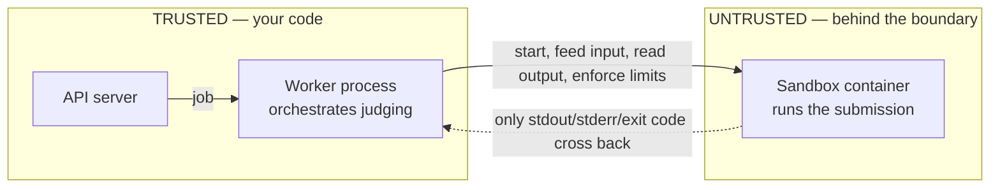
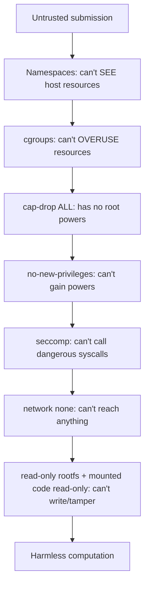
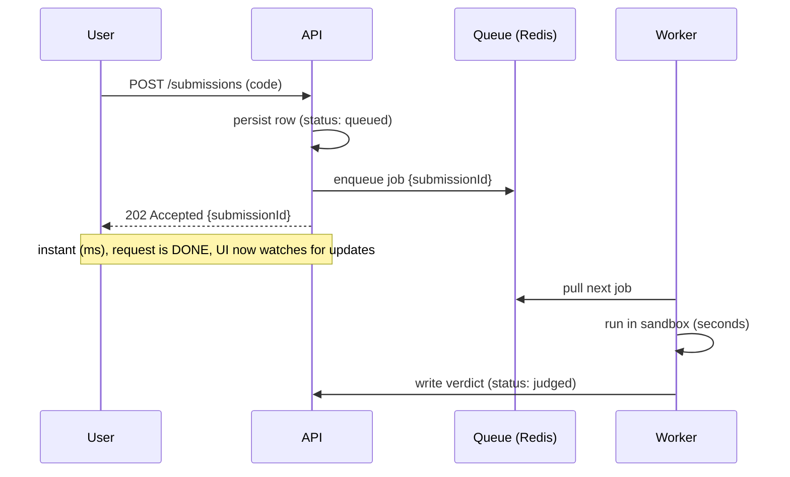
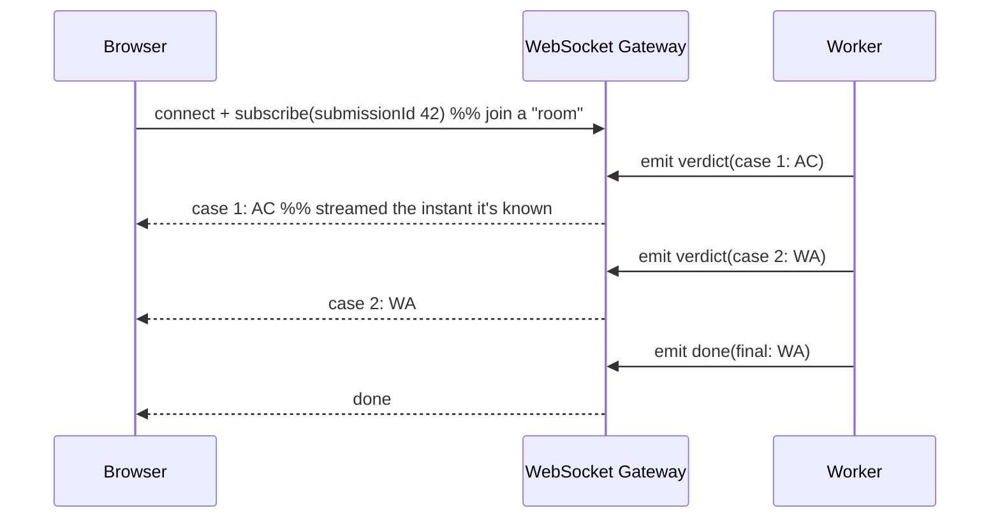

# Phase 2 — Sandboxing, Queues & Realtime: The Complete Study Guide

> **Prerequisite:** Phase 0 and Phase 1 guides. This is the most security-critical phase in the
> whole project: you are about to **run code written by strangers on your machine**. Read the
> security sections twice. Conventions unchanged: **bold = defined here**, examples standalone
> (a print shop, a mailroom, a stadium — never the project), type everything yourself.

---


---

## ⌨️ This guide is interactive

**Eight exercises are embedded below**, at the end of the section that teaches each one.

Everything in this phase is adversarial or concurrent, so the failures are the ones a passing test
will not show you: a container that looks isolated and is not, a job that runs twice, a retry that
makes an outage worse. Two of the exercises are repairs of code that works perfectly until it
doesn't.
## Table of contents

1. [Part A — The trust problem: what "run untrusted code" really means](#part-a)
2. [Part B — Linux isolation primitives: namespaces, cgroups, capabilities, seccomp](#part-b)
3. [Part C — Docker as a sandbox (and why it isn't one by default)](#part-c)
4. [Part D — Asynchronous work: queues, BullMQ, idempotency](#part-d)
5. [Part E — Realtime: WebSockets and streaming results](#part-e)
6. [Part F — Failure engineering: retries, DLQ, backpressure](#part-f)
7. [Part G — A complete (toy) untrusted-code runner](#worked)
8. [Self-quiz with answers](#quiz)
9. [Exercises](#exercises)

---

<a name="part-a"></a>
# Part A — The trust problem

## A.1 What could a hostile submission do?

Until now every line of code on your server was written by you. Now a user uploads a program and
you *execute it*. Assume the author is actively malicious and ask what they'd try. This is
**threat modeling** — enumerating what an attacker wants and can attempt, *before* building defenses.

| Attack | The hostile code does… | Without defense, result |
|---|---|---|
| **Resource exhaustion (CPU)** | `while (true) {}` | Pins a core forever; server stops serving anyone |
| **Resource exhaustion (memory)** | allocate until OOM | Kills other processes; whole box falls over |
| **Fork bomb** | spawn processes that spawn processes | Process table fills in milliseconds; machine freezes |
| **Disk fill** | write a 100 GB file | Disk full → database and logs die |
| **Network exfiltration** | open a socket to `attacker.com` | Steal secrets; **SSRF** your internal services |
| **Filesystem escape** | read `/etc/passwd`, your `.env`, other users' code | Steal credentials, other submissions |
| **Output flood** | print gigabytes to stdout | OOMs *your* worker that's buffering it |
| **Time bomb** | `sleep(3600)` then act | Ties up a worker slot; denial of service |

The mindset shift Phase 2 demands: **the submission is the enemy, and the boundary around it is the
only thing you trust.** Everything below is about building a boundary strong enough that all eight
rows fail harmlessly.


```exercise
hostile-submission
```

## A.2 The trust boundary

A **trust boundary** is the line across which you stop believing what you're told. Draw it
explicitly:



Note the worker is *trusted* but the sandbox is *not* — and even the worker treats the sandbox as
**semi-trusted**: it never assumes the sandbox behaved, it *enforces* limits from outside (a wall
clock the sandbox can't touch, memory caps the kernel imposes) and validates everything that comes
back. "Trust the boundary, not the thing inside it."

---

<a name="part-b"></a>
# Part B — Linux isolation primitives

To understand sandboxing you must know the four kernel features Docker is built from. Learn these
and containers stop being magic.

## B.1 Namespaces — "what the process can *see*"

Normally every process shares one view of the system: the same list of all processes, the same
filesystem, the same network interfaces. A **namespace** gives a process a *private, isolated view*
of one kind of resource. It's the kernel lying to the process about what exists — benevolently.

Analogy: a hotel. Every guest thinks they have "room 1" *from their own floor's perspective*; the
building has many "room 1"s, and no guest can see into another's room or even know it exists.

The namespaces that matter here:

| Namespace | Isolates | Effect on the sandbox |
|---|---|---|
| **PID** | the process tree | Submission sees itself as PID 1 and *cannot see or signal* your other processes |
| **Mount (mnt)** | the filesystem tree | Submission gets its own root `/`; your host files simply aren't in its universe |
| **Network (net)** | interfaces, ports, routes | Give it an empty network stack → *no* connectivity at all |
| **User** | user/group IDs | Root *inside* the container maps to an unprivileged nobody *outside* — a critical safety net |
| **IPC** | shared memory, semaphores | Can't touch other processes' inter-process channels |
| **UTS** | hostname | Cosmetic isolation of hostname/domain |

```
Host's real view:                 Sandbox's namespaced view:
  PID 1    systemd                  PID 1    (the submission itself)
  PID 812  your worker              (nothing else exists)
  PID 999  the submission     →     it literally cannot enumerate host PIDs
```

Because the submission is boxed in a PID namespace, it can't find, inspect, or kill your worker —
that whole class of attack is closed by isolation, not by permission checks.

## B.2 cgroups v2 — "how *much* the process can use"

Namespaces control *visibility*; **cgroups** ("control groups") control *consumption*. A cgroup is
a kernel-enforced budget on a group of processes: CPU, memory, process count, I/O. The kernel
itself enforces it — the process cannot exceed the budget no matter how hostile it is.

Map each cgroup limit to an attack from Part A:

| cgroup control | Docker flag | Defeats |
|---|---|---|
| Memory ceiling | `--memory=256m` | memory bomb — process is OOM-killed at 256 MB, nothing else affected |
| CPU quota | `--cpus=1.0` | CPU hog — gets at most one core's worth; other work keeps running |
| **PID limit** | `--pids-limit=64` | **fork bomb** — the 65th process fails to spawn; the machine never notices |
| I/O throttle | `--blkio-weight` | disk-thrash denial of service |

> **The fork-bomb answer, precisely (quiz):** a fork bomb tries to create processes exponentially.
> `--pids-limit=64` caps the sandbox's process table at 64; attempts beyond that get
> `Resource temporarily unavailable` and the bomb fizzles inside its own cage. The kernel enforces
> it; your code doesn't have to notice.

The **wall-clock timeout** — `while(true)` — is enforced *from outside*: the worker starts the
container with a deadline and kills it if it overruns. You don't trust the code to time itself; you
hold the stopwatch. (CPU-time limits also exist inside, but the outer wall-clock kill is the
backstop that always works, even against a process gaming CPU accounting.)

## B.3 Capabilities — slicing up "root"

Traditional Unix is binary: you're **root** (can do everything) or you're not. **Capabilities**
break root's power into ~40 independent switches — `CAP_NET_ADMIN` (configure networking),
`CAP_SYS_TIME` (change the clock), `CAP_CHOWN` (change file ownership), and so on. You can grant or
drop each independently.

For a code sandbox the correct posture is `--cap-drop ALL`: the submission needs *none* of these
powers — it just computes. Dropping all capabilities means even if code somehow runs "as root"
inside the container, root-without-capabilities can do almost nothing dangerous. This is the
**principle of least privilege**: grant the minimum, and here the minimum is nothing.

Pair it with `--security-opt no-new-privileges`, which forbids the process from *gaining* new
privileges later (e.g., via setuid binaries) — closing a common escalation path.

## B.4 seccomp — filtering system calls

Everything a program asks the kernel to do — open a file, send network data, spawn a process — goes
through a **system call (syscall)**: the narrow doorway between user code and the kernel. There are
~350 of them.

**seccomp** ("secure computing mode") with BPF filters lets you present the process a *smaller
list* of allowed syscalls; forbidden ones are blocked (the call fails or the process is killed).

Analogy: a building with 350 doors. Default seccomp locks the few genuinely dangerous ones
(`mount`, `reboot`, kernel-module loading, `ptrace` for inspecting other processes). A **strict
custom profile** inverts the default: deny everything, then allow only the ~50 syscalls a normal
computation needs (`read`, `write`, `brk`, `exit`…). The narrower the doorway, the less kernel
attack surface a submission can reach — most container-escape exploits work by abusing an exotic
syscall, and a submission that only does arithmetic needs none of them.

## B.5 The layers together — defense in depth

No single mechanism is trusted alone; they **stack**, so a bypass of one is caught by the next.
This is **defense in depth**:



The read-only pieces: `--read-only` makes the container's root filesystem immutable (attacker can't
plant files or modify binaries); the submission's own code is mounted **read-only** so it can't
rewrite itself mid-run; a small `tmpfs` gives it scratch space that vanishes on exit and counts
against the memory cap. **The most-forgotten flag is `--network none`** — without it the sandbox
shares Docker's default network and can reach your Postgres/Redis by container name (**SSRF**);
a compute sandbox needs zero network, so give it zero.

---

<a name="part-c"></a>
# Part C — Docker as a sandbox

## C.1 What Docker actually is

Recall from Phase 0: an **image** is a layered filesystem snapshot + start command; a **container**
is a running instance. Now the deeper truth: **a container is just a normal Linux process that the
kernel has wrapped in namespaces + cgroups.** There's no virtual machine, no separate kernel —
containers share the host kernel. That's why they start in milliseconds (versus a VM's seconds) and
why they're light enough to spin one up *per submission*. It's also the source of the caveat below.

## C.2 "Docker is not a sandbox by default"

Out of the box, Docker optimizes for developer convenience, not hostile-code containment:

- Containers run as **root inside** by default, and without user-namespace remapping that root has
  real reach toward the kernel.
- The **default network** connects the container to siblings and the outside world.
- A **generous capability set** is granted.
- The **shared kernel** is the ceiling: a kernel exploit escapes *any* container. Namespaces are
  isolation, not a separate machine.

So a plain `docker run user-code` is dangerous. The hardened invocation gathers every Part B
control into one line:

```bash
docker run \
  --rm \                              # delete container when done — no residue between submissions
  --network none \                    # B.5: no connectivity
  --memory=256m --memory-swap=256m \  # B.2: hard memory cap (swap=mem disables swap escape)
  --cpus=1.0 \                        # B.2: one core max
  --pids-limit=64 \                   # B.2: fork-bomb cap
  --cap-drop ALL \                    # B.3: no root powers
  --security-opt no-new-privileges \  # B.3: no privilege escalation
  --security-opt seccomp=strict.json \# B.4: minimal syscall allowlist
  --read-only \                       # B.5: immutable root filesystem
  --tmpfs /tmp:size=16m \             # small disposable scratch
  -v /path/to/code:/code:ro \         # B.5: submission mounted READ-ONLY
  --user 1000:1000 \                  # run as unprivileged uid, never root
  sandbox-image:latest  /code/run.sh
```

For adversarial, multi-tenant "run anyone's code" at scale, the next tier is **stronger isolation
runtimes** — gVisor (a user-space kernel that intercepts syscalls so the real kernel is never
directly exposed) or **Firecracker microVMs** (a real, tiny VM per task — genuine kernel
separation, ~125 ms boot; what AWS Lambda uses). For learning and this project, hardened Docker as
above is the right first stop; know the upgrade path exists and *why* (defensible interview
answer: "hardened containers share the host kernel; when the threat model demands kernel-level
separation, move to gVisor or Firecracker").


```exercise
docker-run-hardened
```

## C.3 Why a *separate* worker process (not an `@Injectable()` in the API)

The judging runs in a dedicated worker app, not inside your API server. Reasons, each defensible:

1. **Blast radius.** If orchestrating hostile code crashes or hangs a process, it must be the
   worker, not the API that's serving every other user.
2. **Independent scaling.** Judging is CPU-heavy and bursty; the API is I/O-light and steady. Scale
   them on different curves — run 8 workers and 2 API instances if that's the load shape.
3. **Resource contention.** A worker pinned at 100% CPU judging must not starve the event loop that
   answers health checks and login requests.
4. **Deployment isolation.** The worker needs the Docker socket and a hardened host; the API
   shouldn't. Different trust and different Dockerfile.

They communicate through a **queue** — which is Part D.

---

<a name="part-d"></a>
# Part D — Asynchronous work: queues

## D.1 Why you can't judge inside the request

A submission takes seconds (compile + run against many test cases). An HTTP request that blocks for
seconds is a disaster: the browser spins, the connection may time out, and a burst of submissions
exhausts your server's connections while each waits. The web tier must answer in milliseconds.

The fix is **asynchronous processing**: the API's job is only to *accept and acknowledge*; the
slow work happens later, elsewhere.



A **queue** is a durable list of pending work items (**jobs**) that **producers** add to and
**consumers** (workers) pull from. It decouples *accepting* work from *doing* work, absorbs bursts
(a spike becomes a longer queue, not a meltdown), and lets you scale consumers independently.


```exercise
why-a-worker
```

## D.2 BullMQ — a queue built on Redis

Recall Redis from your stack: a fast in-memory data store. **BullMQ** is a job-queue library that
uses Redis as the backing store — durable enough (Redis can persist to disk), fast, and it gives
you retries, scheduling, concurrency, and events out of the box.

```ts
// PRODUCER (in the API)
import { Queue } from "bullmq";
const judgeQueue = new Queue("judging", { connection: redis });

await judgeQueue.add(
  "judge",
  { submissionId },                 // job payload — keep it small: an id, not the whole code
  { jobId: submissionId,            // ← see idempotency below
    attempts: 3,                    // retry up to 3 times on failure
    backoff: { type: "exponential", delay: 1000 } }, // wait 1s, 2s, 4s between tries
);

// CONSUMER (in the worker)
import { Worker } from "bullmq";
new Worker("judging", async (job) => {
  const { submissionId } = job.data;
  await judge(submissionId);        // the slow, sandboxed work
}, { connection: redis, concurrency: 4 });   // 4 jobs at once per worker process
```

### Job lifecycle

```
waiting ──▶ active ──▶ completed
   ▲          │
   │          ▼ (threw)
 delayed ◀── failed ──▶ (attempts left? re-queue : dead)
```

`waiting` (queued) → `active` (a worker picked it up) → `completed` or `failed`; failures with
retries left go `delayed` (waiting out the backoff) then back to `waiting`. Knowing these states by
name is how you read a queue dashboard and diagnose a stuck system.

## D.3 Idempotency — the concept the whole phase hinges on

**Idempotent** = doing it twice has the same effect as doing it once. Pressing an elevator button
five times still calls the elevator once. A GET request is naturally idempotent; charging a credit
card is not (do it twice, charge twice).

Why it dominates queue design: **message queues deliver at-least-once, not exactly-once.** BullMQ
(like Kafka, SQS, RabbitMQ) can hand the *same job to a worker more than once* — because
"exactly-once" is, in a distributed system with crashes and network timeouts, effectively
impossible. Concrete scenario:

```
Worker pulls job → judges submission → writes verdict → CRASHES before telling the queue "done"
Queue never heard "done" → assumes the worker died mid-job → re-delivers the SAME job
Second worker judges the SAME submission again.
```

If your handler isn't idempotent, that user's rating gets updated twice, their submission counted
twice, an email sent twice. The defense is to make the handler idempotent on a **key** — here the
`submissionId`:

```ts
async function judge(submissionId: string) {
  const s = await db.submission.findUnique({ where: { id: submissionId } });
  if (s?.status === "judged") return;          // fast path — already done, no-op

  const verdicts = await runInSandbox(submissionId);

  // conditional write: claim the row ONLY if it's still queued
  const { count } = await db.submission.updateMany({
    where: { id: submissionId, status: "queued" },
    data:  { status: "judged", verdicts },
  });

  if (count === 0) return;                     // another worker won the race — stop here
  await applyRatingChange(submissionId);       // side effects go AFTER you've won the claim
}
```

Three techniques are doing the work:

1. **The early-exit check** — cheap, catches the common case, and is *not* sufficient on its own.
2. **The conditional write** — `where` includes the expected *state*, not just the id. Two workers
   that both pass the early-exit check race here, and Postgres decides: the first `UPDATE` matches
   one row, the second matches **zero**, because the status is no longer `queued`.
3. **`count === 0` as the loser's signal** — the row count *is* how you learn you lost. Everything
   with a side effect (rating updates, emails, counters) goes strictly after that check.

> **`updateMany`, not `update` — this specific choice is the bug people ship.** Prisma's `update()`
> **throws** `P2025` ("record not found") when its `where` matches nothing. On a duplicate delivery
> that's exactly what happens — so the losing worker throws, BullMQ sees a failed job, and retries
> it, which throws again. Your idempotency guard becomes a retry loop that eventually lands in the
> DLQ. `updateMany()` returns `{ count: 0 }` instead, which is a *value you can branch on* rather
> than an exception. (If you prefer `update()` for the stricter typing, you must catch `P2025`
> explicitly and treat it as "someone else won" — same logic, more code, easier to forget.)

Setting `jobId: submissionId` also lets BullMQ **deduplicate** at enqueue time — adding the same job
id twice while one is pending is ignored. That reduces duplicates; it does not eliminate them, so
the handler still has to be idempotent. "Treat BullMQ as at-least-once; make the handler idempotent
on submissionId" is both the rule and the interview answer.


```exercise
idempotent-worker
```

```exercise
at-least-once
```

## D.4 Why BullMQ over Kafka / RabbitMQ / SQS (for now)

- **Kafka** is a distributed *event log* for high-throughput streaming with replay and many
  consumer groups — enormous power, enormous operational weight. You have no event-volume problem
  yet (Phase 0's "prove Postgres + jobs are insufficient first" rule). Overkill.
- **RabbitMQ** is a capable message broker but another server to run and learn; BullMQ reuses the
  Redis you already operate.
- **SQS** is excellent but cloud-managed (AWS lock-in) and awkward to run locally for development.
- **BullMQ** rides your existing Redis, runs identically on your laptop and in prod, and gives
  retries/backoff/DLQ/concurrency with a tiny API. Right-sized. (Migrate later only when a *specific*
  requirement — massive fan-out, event replay — appears.)

---

<a name="part-e"></a>
# Part E — Realtime: WebSockets

## E.1 The problem: the server needs to talk first

Judging finishes *after* the HTTP request already returned `202`. How does the user's browser learn
the verdict? Plain HTTP can't help — the **client must initiate** every HTTP exchange; the server
can't spontaneously push. Three ways out:

| Approach | How | Cost |
|---|---|---|
| **Polling** | client asks "done yet?" every 2s | wasteful (mostly "no"); laggy (up to 2s stale); scales badly (N clients × constant requests) |
| **SSE** (Server-Sent Events) | one long-lived HTTP stream, server → client only | great for one-way; but only server→client, text-only |
| **WebSocket** | one persistent, **full-duplex** TCP connection | both directions, low overhead per message; the general answer |

**Full-duplex** = both sides can send at any time, like a phone call (versus HTTP's walkie-talkie:
one speaks, then the other). A **WebSocket** starts as a normal HTTP request that "upgrades" the
connection to a persistent socket that stays open, over which either side sends messages cheaply.



**Streaming** the verdicts — pushing each test-case result the moment it's computed, rather than
waiting for all cases then sending one blob — is what makes the UI feel alive: the user watches
"case 1 ✓, case 2 ✓, case 3 ✗" fill in live. The worker emits per case; the gateway forwards.

## E.2 Rooms — scoping who hears what

A **room** is a named group of connections; a message sent "to a room" reaches only its members.
Without rooms you'd broadcast every verdict to every connected user — a privacy leak and a
bandwidth disaster. Here each submission (or each user) gets a room; only the owner subscribes; only
they receive that submission's updates. (In Phase 5 the same mechanism scopes contest leaderboards
by contest.) When you run multiple gateway instances, rooms are fanned out across them via **Redis
pub/sub** so a verdict emitted on server A reaches a subscriber connected to server B.

## E.3 Two things beginners get wrong

- **Authentication happens on the handshake, not per message.** A WebSocket has no per-request
  headers after it opens, so you can't put a Bearer token on each message the way you do with HTTP.
  Authenticate *once*, when the socket connects (token in the connection query/auth payload,
  verified in the gateway's connection handler); reject unauthenticated sockets before they can join
  any room. Letting unauthenticated sockets subscribe to rooms is a trivial data-leak/DoS vector.
- **Backpressure.** If the server emits faster than a slow client can receive, messages pile up in
  the server's send buffer → memory grows → eventually the server suffers for one slow client. You
  must choose a policy: **drop** (skip intermediate updates — fine for a leaderboard where only the
  latest matters), **queue with a cap** (buffer a little, then drop oldest), or **disconnect** the
  laggard. The wrong choice is "unbounded buffer", which is how one bad phone on hotel wifi can
  degrade your server.

---

<a name="part-f"></a>
# Part F — Failure engineering

Distributed systems *fail partially and constantly* — the Docker daemon hiccups, a worker is
OOM-killed, the network blips. Reliability isn't "no failures"; it's "failures handled
gracefully." Three tools:


```exercise
websocket-rooms
```

## F.1 Retries with exponential backoff

Transient failures (a momentary daemon glitch) should be retried — but retrying *immediately and
forever* creates a **thundering herd** that kicks the system while it's down. **Exponential
backoff** spaces retries out — 1s, 2s, 4s, 8s — giving the dependency room to recover, ideally with
**jitter** (a small random offset) so many failed jobs don't all retry in lockstep. Cap the
attempts; not everything is transient.


```exercise
retry-backoff
```

## F.2 Dead-letter queue (DLQ)

Some jobs fail *every* time — a malformed submission, a permanent bug. Retrying them forever wastes
resources and clogs the queue. After N attempts, a job is moved to a **dead-letter queue**: a
separate holding area for "jobs that couldn't be processed", where a human (or an alert) can inspect
them without blocking live traffic. The mailroom analogy: undeliverable letters go to a dead-letter
office, not back into the delivery loop forever. Never silently drop failures — a DLQ makes failure
*visible and recoverable*.


```exercise
dlq
```

## F.3 The failure scenarios to design for (and the quiz)

- **Worker crashes mid-judge with a half-written verdict.** The user still sees `queued/running`
  (you only flip to `judged` in one final atomic write — never leave partial state visible). The
  queue never got "completed", so it re-delivers; the idempotent handler (D.3) re-judges cleanly.
  This is *why* the state machine is explicit and the final write is atomic.
- **Docker daemon unreachable.** That's a transient infra failure → retry with backoff; if it
  persists past N attempts, DLQ + alert. Don't mark the submission failed on the first blip.
- **Queue backlog explodes** (100 submissions land at once). The queue absorbs it (that's its job);
  latency rises but nothing crashes; you scale workers horizontally to drain faster. The bottleneck
  to name in an interview: sandbox startup + CPU — each judge needs a core-second, so throughput ≈
  (cores across workers) ÷ (seconds per judge); the queue just makes the overflow orderly instead
  of catastrophic.
- **Output flood / infinite loop / fork bomb / network attempt** — all handled by Part B
  (output cap, wall-clock kill, `--pids-limit`, `--network none`). If you can't name the specific
  control that stops each, re-read Part B; that recall *is* the Phase-2 security checkpoint.

---

<a name="worked"></a>
# Part G — A complete (toy) untrusted-code runner

Reading about namespaces and timeouts is one thing; wiring the orchestration is another. Here is a
standalone Node.js runner that executes a script with a **wall-clock timeout**, an **output cap**,
and **guaranteed cleanup** — the exact skeleton your worker wraps around the Docker sandbox. It's a
toy (it runs on the host, so use it only as a *shape* to learn from — the real thing runs inside the
hardened container from Part C), but every safety concern from Parts A/B/F is visible.

```ts
import { spawn } from "node:child_process";

interface RunResult {
  verdict: "OK" | "TIMEOUT" | "OUTPUT_LIMIT" | "RUNTIME_ERROR" | "SPAWN_FAILED";
  stdout: string;
  exitCode: number | null;
}

function runGuarded(
  command: string,
  args: string[],
  opts: { timeoutMs: number; maxOutputBytes: number; input: string },
): Promise<RunResult> {
  return new Promise((resolve) => {
    // In production, `command` would be `docker run <hardened flags> sandbox-image ...` (Part C).
    const child = spawn(command, args, { stdio: ["pipe", "pipe", "pipe"] });

    let stdout = "";
    let bytes = 0;
    let settled = false;                      // guard: resolve exactly once (idempotent finish)

    const finish = (r: RunResult) => {
      if (settled) return;                    // ← never resolve twice
      settled = true;
      clearTimeout(timer);
      try { child.kill("SIGKILL"); } catch {} // CLEANUP: always kill, even on success (Part F)
      resolve(r);
    };

    // 1) WALL-CLOCK TIMEOUT (Part B.2) — enforced from OUTSIDE; we don't trust the code to stop.
    const timer = setTimeout(
      () => finish({ verdict: "TIMEOUT", stdout, exitCode: null }),
      opts.timeoutMs,
    );

    // 2) OUTPUT CAP (Part A.1 "output flood") — kill if it prints too much, don't buffer forever.
    child.stdout.on("data", (chunk: Buffer) => {
      bytes += chunk.length;
      if (bytes > opts.maxOutputBytes) {
        finish({ verdict: "OUTPUT_LIMIT", stdout, exitCode: null });
      } else {
        stdout += chunk.toString();
      }
    });

    // 3) NORMAL EXIT
    child.on("close", (code) => {
      finish({
        verdict: code === 0 ? "OK" : "RUNTIME_ERROR",
        stdout,
        exitCode: code,
      });
    });

    // 3b) SPAWN FAILURE — the process never started at all (binary missing, Docker daemon down).
    //     WITHOUT this listener, Node throws the unhandled 'error' event and KILLS YOUR WORKER.
    child.on("error", () => finish({ verdict: "SPAWN_FAILED", stdout, exitCode: null }));

    // 4) FEED INPUT then close stdin so the program can read its test input
    child.stdin.write(opts.input);
    child.stdin.end();
  });
}
```

Trace it against the threat table (A.1):

- a missing binary / dead Docker daemon → `spawn` emits `'error'` → `SPAWN_FAILED` (retryable
  infrastructure failure, *not* the submission's fault — don't mark the user wrong).
- `while(true){}` → never exits → the `setTimeout` fires → `TIMEOUT`, then `SIGKILL`. (In prod the
  outer Docker `--cpus` cap also throttles it meanwhile.)
- prints 10 GB → the `bytes > maxOutputBytes` guard fires early → `OUTPUT_LIMIT`; you never hold
  10 GB in memory.
- crashes / exits non-zero → `close` with a non-zero code → `RUNTIME_ERROR`.
- the `settled` flag makes `finish` **idempotent** — timeout and close can race, but the result is
  computed once. (Same instinct as the queue handler in D.3.)

> **The `error` listener is not optional, and leaving it out is a worker-killing bug.** `spawn`
> reports "the process never started" — a missing binary, a full process table, **the Docker daemon
> being unreachable** — as an `'error'` **event**, not a rejected promise. Node's rule is that an
> unhandled `'error'` event is re-thrown, so without that one line the failure takes down the entire
> worker process, not just the one submission. And you cannot catch it with `try/catch` around the
> `await`, because it never becomes a rejection — the crash happens on a different tick.
>
> This is exactly the "Docker daemon unreachable" scenario from F.3, so map the two together: the
> listener converts a process-killing event into an ordinary `SPAWN_FAILED` verdict, which your queue
> handler then retries with backoff (F.1) and eventually dead-letters (F.2). *Every* `spawn` you ever
> write needs this listener.

What this toy is *missing* and why the real one needs Docker: it does **not** provide memory limits,
fork-bomb protection, network isolation, or filesystem isolation — those come only from the kernel
controls in Part B, which is why the real `command` is `docker run` with the hardened flag set from
C.2, not a bare interpreter. This skeleton is the *control flow*; the container is the *cage*.

**Do this:** implement `runGuarded`, then attack it. Feed it a script that loops forever (see
TIMEOUT), one that prints in an infinite loop (see OUTPUT_LIMIT), one that exits 1 (see
RUNTIME_ERROR). Then note what it *can't* stop (a fork bomb, a network call) and connect each gap to
the exact Docker flag that closes it.

## Mastery checklist — you're ready to build Phase 2 when you can…

- [ ] List five attacks an untrusted submission can attempt and the exact control that stops each.
- [ ] Explain what namespaces isolate vs. what cgroups limit, with one concrete example of each.
- [ ] Explain why "Docker is not a sandbox by default" and name three hardening flags with their
  purpose.
- [ ] Justify running judging in a separate worker process rather than inside the API.
- [ ] Explain why message queues are at-least-once and make a handler idempotent on a key.
- [ ] Draw the submit → queue → worker → verdict flow and name every storage write.
- [ ] Explain why WebSockets (not polling/SSE) and how rooms scope who receives what.
- [ ] Describe retry-with-backoff, a dead-letter queue, and a backpressure policy, and when each
  applies.
- [ ] Type the `runGuarded` skeleton from scratch and explain which threats it does and doesn't
  cover.

<a name="quiz"></a>
# Self-quiz — with answers

**1. Walk through a Submit click: every queue, process, and storage write.**
POST `/submissions` → validate → **write** submission row `status=queued` (Postgres) → **enqueue**
job `{submissionId}` with `jobId=submissionId` (BullMQ/Redis) → respond `202` with the id (request
ends). Worker **pulls** the job → marks `running` → for each test case, start a hardened sandbox
container, feed input, capture stdout/stderr/exit, enforce limits, compute a per-case verdict,
**emit** it over the WebSocket room → after all cases, **write** final verdict + `status=judged` in
one atomic update → the queue marks the job completed.

**2. Worker crashes mid-judge with a half-written verdict — what does the user see, what does the
next worker do?** The user still sees `running` (partial results were never committed as final —
you flip to `judged` only in a single atomic write). The queue didn't receive "completed", so after
the visibility/lock timeout it re-delivers the job; the idempotent handler checks status, sees it's
not `judged`, and re-judges from scratch, producing the same deterministic result.

**3. Fork bomb — what stops it?** `--pids-limit` (e.g., 64): the kernel refuses process creation
past the cap, so exponential spawning fails inside the sandbox; the host is unaffected. Backed by
the memory cgroup and the outer wall-clock kill.

**4. `while True: pass` — what stops it?** The wall-clock timeout enforced by the worker from
outside (kill the container after N seconds), backed by the `--cpus` quota so it can't starve other
work even before the kill.

**5. Code that opens a network socket — what stops it?** `--network none`: the container has no
network stack, so `connect()` has nowhere to go and fails. (Dropped `CAP_NET_*` and a seccomp
profile add depth.)

**6. Scaling to 100 simultaneous submissions — the bottleneck?** CPU and sandbox startup, not the
queue. The queue happily holds 100 jobs; throughput is bounded by total cores ÷ seconds-per-judge.
You scale horizontally (more worker processes/machines), cap per-worker `concurrency` to available
cores, and let the queue absorb the burst as depth rather than as failure.

**7. Why treat BullMQ as at-least-once?** Exactly-once delivery is unachievable across crashes and
timeouts; a worker can die after doing the work but before acknowledging, forcing re-delivery.
Therefore the handler must be idempotent on `submissionId` (early-exit if already judged +
conditional write), so a duplicate delivery is a safe no-op.

---

<a name="exercises"></a>
# Exercises — learn by doing

None of these need the project — they build the instincts the project will rely on.

1. **Feel the isolation.** `docker run --rm -it alpine sh`. Inside: `ps aux` (see how few processes
   exist — PID namespace), `ls /` (its own filesystem — mount namespace). Now
   `docker run --rm --network none alpine ping -c1 1.1.1.1` and watch it fail. Then
   `docker run --rm --pids-limit=16 alpine sh -c ':(){ :|:& };:'` — a fork bomb that *fizzles*
   (run it WITHOUT the limit only inside a disposable VM, never on your real machine).
2. **Break your own memory cap.** Run a container with `--memory=64m` and a program that keeps
   appending to an array; watch the kernel OOM-kill it at the ceiling while your host stays fine.
3. **Hand-roll the timeout.** In Node, `spawn` a child running `sleep 100`; start a `setTimeout`
   that `kill`s it after 3s. This is the wall-clock enforcer in miniature — the pattern your worker
   uses on the sandbox.
4. **At-least-once, felt.** Build a 2-file BullMQ demo (producer + worker on local Redis). In the
   worker, `console.log(job.id)` then `throw` on the first attempt; configure `attempts: 3`. Watch
   the same job id reappear. Now make the handler idempotent with an in-memory `Set` of processed
   ids and watch the duplicate become a no-op.
5. **Streaming WebSocket.** With Socket.io: a server that, on `subscribe(taskId)`, emits `progress`
   0→100 over 5 seconds; a browser page that joins the room and renders a live bar. Open two tabs
   with *different* task ids and confirm rooms keep them separate. Then open a tab with no auth and
   make the server reject it on connect.
6. **DLQ by hand.** Extend exercise 4: after 3 failed attempts, move the job's data to a `dead`
   list in Redis and log it. Confirm live jobs keep flowing while the poison job sits in `dead`.

# Where each topic came from (the original reading list)

| Topic | Source to go deeper |
|---|---|
| Namespaces, cgroups, capabilities, seccomp | *Container Security* (Liz Rice), ch. 1–4; her talk "What is a container, really?" |
| Container privileges | Docker docs, "Runtime privilege and Linux capabilities" |
| A real judge sandbox | `isolate` (the Codeforces sandbox) source — README + one syscall filter |
| Queue patterns, idempotency | BullMQ docs "Patterns" section; Brandur Leach, "Idempotency Keys" |
| At-least-once, stream processing | *DDIA* ch. 11; Pat Helland, "Data on the Outside vs Data on the Inside" |
| WebSocket scaling | Socket.io docs, Adapters & scaling section |
