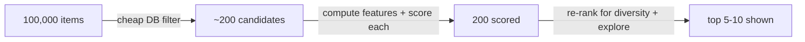

# Phase 4 — The Recommendation Engine: The Complete Study Guide

> **Prerequisite:** Phases 0–3, especially the math toolkit in Phase 3 (sigmoid, probability,
> uncertainty). This phase builds a *ranker* — a system that, given a person, picks the next thing
> to show them. It's the most "AI-flavored" phase, but it needs no neural networks: it's clever
> arithmetic plus good judgment about what to optimize. Conventions unchanged: **bold = defined
> here**, examples standalone (a bookshop, a gym app, a music service — never the project), and you
> should code every formula in a REPL.

---

## Table of contents

1. [Part A — What a recommender is, and the one idea that ruins most of them](#part-a)
2. [Part B — The pipeline: candidate generation → scoring → ranking](#part-b)
3. [Part C — The features: turning "good next problem" into numbers](#part-c)
4. [Part D — Diversity: MMR](#part-d)
5. [Part E — Collaborative filtering: "people like you"](#part-e)
6. [Part F — The explore/exploit dilemma: multi-armed bandits & UCB1](#part-f)
7. [Part G — Caching without lying: TTL, stampedes, invalidation](#part-g)
8. [Part H — Measuring a ranker: NDCG and offline evaluation](#part-h)
9. [Part I — A complete ranker, end to end](#worked)
10. [Self-quiz with answers](#quiz)
11. [Exercises](#exercises)

---

<a name="part-a"></a>
# Part A — What a recommender is, and the trap

A **recommender** (or **ranker**) answers: *of all the things I could show this person next, which
few should I show, in what order?* Netflix's rows, Spotify's Discover Weekly, a shop's "you might
like" — all rankers.

The trap that ruins most of them, stated once so you never forget it:

> **Optimize for the right outcome.** It is easy to optimize for *engagement* (did they click?) and
> catastrophic to confuse it with *value* (did it help them?). A learning platform that maximizes
> clicks will feed you easy dopamine problems you already know; a learning platform that maximizes
> *learning* will feed you the problem at the edge of your ability. These pull in different
> directions. **Engagement ≠ learning.** Every design choice below serves "did it help them learn,"
> and you must be able to say so out loud.

Concretely, our objective is: **recommend the problem that maximizes expected learning** — which,
as we'll see, means "hard enough to teach, easy enough to solve," diverse enough to build breadth,
and occasionally exploratory enough to discover what you're actually capable of.

---

<a name="part-b"></a>
# Part B — The pipeline

You never score *everything*. A catalog might have 100,000 items; scoring all of them per request,
per user, is wasteful and slow. Real recommenders run a **funnel**: cheap filters first, expensive
scoring on the survivors.



1. **Candidate generation** — a cheap, coarse filter that throws out the obviously-irrelevant using
   an indexed database query (Phase 1's `EXPLAIN`-friendly queries). For a learner: *unsolved by
   this user, active/not-retired, within a plausible difficulty band*. This turns 100,000 into ~200
   using an **index-only scan** — fast, no per-item computation.
2. **Scoring** — for each of the ~200 survivors, compute a handful of **features** (numbers
   describing fit) and combine them into one score. This is where the intelligence lives (Part C).
3. **Ranking / re-ranking** — sort by score, then adjust for diversity (Part D) and exploration
   (Part F), and take the top K.

Why the funnel matters: it's the difference between a 20 ms recommendation and a 5 s one. Cheap
first, expensive last, on a shrinking set.

---

<a name="part-c"></a>
# Part C — The features

A **feature** is a single number describing how good a candidate is along one axis. We compute
several, then combine them. Here are the ones that matter, each an application of earlier phases.

## C.1 Difficulty fit — the "flow" feature

If a problem is too easy you learn nothing; too hard and you bounce off, frustrated. Learning
happens in the **zone of proximal development** — challenging but achievable. Using Phase 3's IRT
model, you can compute `P(solve)` for this user on this problem: `sigmoid(a*(θ - b))`. The sweet
spot is **not** the hardest solvable problem — research and intuition put peak learning around
`P(solve) ≈ 0.7` (a 70% chance: mostly winnable, but you have to stretch).

So the difficulty-fit feature is highest when `P(solve)` is near 0.7 and falls off on both sides:

```
difficultyFit(pSolve) = exp( -((pSolve - 0.7)²) / (2 * width²) )   // a bump peaked at 0.7
```

```
fit
 1 |                 ______
   |               /   ▲    \
   |             /   0.7 peak  \
 0 |___________/________________\________
     0.0     0.4    0.7    1.0   → P(solve)
```

That's a **Gaussian bump** (bell curve) centered on 0.7 — max at exactly-right difficulty, low for
trivially easy (`P=0.99`) or brutally hard (`P=0.05`). This single feature encodes the whole "flow"
philosophy.

## C.2 Tag-need — where you're weakest

Phase 3 gave you a per-tag mastery θ. A learner improves fastest by shoring up weak areas. So
**tag-need** is *inverse mastery*: high for tags where θ is low, low for tags you've mastered. If a
problem is tagged `graphs` and your `graphs` mastery is poor, this feature is high — the recommender
gently steers you toward your gaps.

## C.3 Review urgency — FSRS

Phase 3's FSRS scheduler knows which solved problems are *due for review* (retrievability dropping
toward the target). A problem that's due gets a high **urgency** feature, so the recommender
interleaves fresh challenges with timely reviews — spaced repetition, built into the feed.

## C.4 Combining features: the linear weighted sum

The simplest, most defensible combiner: multiply each feature by a **weight** (its importance) and
add them up.

```ts
score =
    w_fit    * difficultyFit
  + w_need   * tagNeed
  + w_review * reviewUrgency
  + w_explore* explorationBonus   // Part F
  - w_div    * diversityPenalty;  // Part D
```

This is a **pointwise** ranker: it scores each item independently, then sorts. Contrast with:
- **pairwise** rankers (learn "A should rank above B" from pairs — e.g., RankNet),
- **listwise** rankers (optimize the whole ordering at once — e.g., LambdaMART).

Why pointwise weighted-sum first (the interview answer): it's **interpretable** (you can read off
exactly why an item ranked where — see C.5), **debuggable**, needs **no training data or labels**,
and is trivial to tune. Pairwise/listwise ML rankers (LambdaMART, XGBoost) can squeeze out more
accuracy *when you have lots of labeled interaction data* and accuracy justifies the opacity — not
where you start. Defaults earn their complexity (a recurring theme).

## C.5 "Why this?" — the debuggability payoff

Because the score is a transparent sum, you can show the user (and yourself) the **top two features
that drove a recommendation**: "Recommended because it targets your weakest tag (graphs) and is
right at your challenge level." This is both a *product* win (trust — users follow recommendations
they understand) and an *engineering* win (when a recommendation looks wrong, you can see which
feature misfired). An ML black box gives you neither for free. This is why interpretable-first is a
real engineering choice, not a beginner's crutch.

---

<a name="part-d"></a>
# Part D — Diversity: MMR

Rank purely by score and you get a **monotonous** list: if your weakest tag is `graphs`, the top 10
might *all* be graph problems. Technically optimal per-item, miserable as a set — no breadth, and if
you're stuck on graphs, ten graph problems is demoralizing.

**Maximal Marginal Relevance (MMR)** is the standard fix: build the list *greedily*, and when
picking each next item, reward it for being relevant **but penalize it for being similar to what
you've already picked**.

```
MMR score(item) = λ * relevance(item)  −  (1 − λ) * maxSimilarity(item, alreadyPicked)
```

- `λ` (lambda, 0–1) tunes the trade-off. `λ = 1` → pure relevance (no diversity). `λ = 0` → pure
  diversity (ignores quality). `λ ≈ 0.7` is a sane default: mostly relevance, enough diversity to
  avoid clones.
- `similarity` here might be "shares tags" — two graph problems are similar; a graph problem and a
  DP problem are not.

Greedy construction:

```
picked = []
while len(picked) < K:
  best = argmax over remaining of [ λ*relevance(x) − (1−λ)*maxSim(x, picked) ]
  picked.append(best); remove best from remaining
```

The first pick is the most relevant; each subsequent pick is "relevant *and* different from what's
already there." Result: a top-10 that's mostly on-target but spans a few areas. **Pitfall:** too
much diversity (`λ` too low) feels random and lost — users want a *focused* set with variety, not a
grab bag.

---

<a name="part-e"></a>
# Part E — Collaborative filtering

So far every feature is about *you* in isolation (**content-based**). **Collaborative filtering**
adds a different signal: *people similar to you*. "Users who mastered what you've mastered went on to
find problem X valuable."

The core operation is measuring **similarity between two users** from their mastery vectors. Model
each user as a **vector** — a list of numbers, here their θ per tag:

```
Alice:  graphs=1.8, dp=0.5, strings=1.2, math=0.9   → [1.8, 0.5, 1.2, 0.9]
Bob:    graphs=1.7, dp=0.6, strings=1.1, math=1.0   → [1.7, 0.6, 1.1, 1.0]
Carol:  graphs=0.2, dp=2.1, strings=0.3, math=1.9   → [0.2, 2.1, 0.3, 1.9]
```

**Cosine similarity** measures the *angle* between two vectors (not their magnitude) — are they
"pointing the same way," i.e., strong and weak in the same places?

```
cosine(A, B) = (A · B) / (|A| * |B|)
             = Σ(Aᵢ*Bᵢ) / ( sqrt(ΣAᵢ²) * sqrt(ΣBᵢ²) )
```

It ranges from −1 (opposite) through 0 (unrelated) to 1 (identical direction). Alice and Bob →
~0.99 (near-identical skill shape); Alice and Carol → much lower (opposite strengths). So a problem
Bob found valuable is a good bet for Alice. Using *direction, not magnitude* is deliberate: a
beginner and an expert with the *same relative strengths* should count as similar even though the
expert's numbers are bigger.

**Cold start** — the recommender's hardest, most-tested edge case:
- **User cold start:** a brand-new user has an empty (or default) vector — no one is meaningfully
  "similar," and difficulty fit is guesswork. Fall back to **global popularity** + a gentle
  difficulty heuristic (start slightly easy, calibrate quickly as answers arrive).
- **Item cold start:** a brand-new problem nobody has solved has no reliable difficulty estimate.
  Give it a high *exploration* bonus (Part F) or lean on the author's declared difficulty until data
  accumulates.

---

<a name="part-f"></a>
# Part F — Explore vs. exploit: multi-armed bandits

## F.1 The dilemma

**Exploit** = recommend what you're already confident is good. **Explore** = occasionally try
something uncertain, to *learn* whether it's good. Pure exploitation is a trap: the recommender only
ever suggests problems it already rates highly → those get solved → look even better → a
**self-fulfilling** loop where a few popular problems dominate and the rest are never discovered.
And a new problem with no data would *never* surface. You must spend some attention exploring.

The classic framing is the **multi-armed bandit**: a gambler faces several slot machines ("one-armed
bandits") with unknown payout rates. Each pull is a choice: play the machine that's paid best so far
(exploit), or try an under-sampled one that *might* be better (explore)? Recommending items is
exactly this — each item is an arm with an uncertain "value," and you have limited recommendation
slots.

## F.2 UCB1 — optimism in the face of uncertainty

**UCB1** (Upper Confidence Bound) is a simple, tuning-free bandit rule. For each arm it computes:

```
UCB(item) = estimatedValue(item)  +  C * sqrt( ln(totalPlays) / playsOf(item) )
             \_______exploit______/     \____________explore____________/
```

- The first term is the current best estimate (exploit).
- The second is an **uncertainty bonus** that's *large when an item has been shown rarely*
  (`playsOf(item)` small → bonus big) and *shrinks as it accumulates data*. `C` tunes how
  adventurous you are.

The slogan is **"optimism under uncertainty":** an under-sampled item gets the benefit of the doubt
— a temporary bonus — so it gets tried; if it turns out mediocre, its estimate drops and the bonus
fades and it stops being recommended. If it's great, it earns its place on merit. This automatically
gives new problems (high uncertainty) a chance without ever *forcing* junk on users.

Add UCB's bonus as the `explorationBonus` feature in C.4. Alternative: **Thompson sampling** (sample
from each arm's probability distribution and pick the max) — often slightly better empirically, but
UCB1 is deterministic, has no randomness to reason about, and needs no distributional assumptions,
so it's the right *first* choice. (Defensible: "UCB1 first for simplicity and interpretability;
consider Thompson sampling when I want to model uncertainty more richly.")

---

<a name="part-g"></a>
# Part G — Caching without lying

Computing a full ranking per request is expensive (candidate gen + features + MMR + bandit). If a
user refreshes three times in ten seconds, recomputing thrice is waste. **Cache** the result.

Recall Redis from Phase 2. Cache `userId → top-K` with a **TTL** (time-to-live), say 60 seconds:
serve the cached list for a minute, recompute after. Concepts you must know:

- **Cache invalidation strategies:**
  - **TTL** — entries expire after a fixed time. Simple; may serve slightly stale data within the
    window.
  - **Write-through** — update the cache at the same time you write the source of truth.
  - **Explicit invalidation** — when an event makes the cache wrong, delete the entry. Here: *when
    the user submits a solution*, their recommendations are stale (they just solved something, maybe
    changed a mastery θ) → invalidate `recs:{userId}` so the next request recomputes. (That's the
    quiz: TTL 60s means a user who submits and re-requests 30s later would see stale recs *unless*
    you invalidate on submission — so you invalidate on submission, don't just wait out the TTL.)

- **Cache stampede (a.k.a. thundering herd):** an entry expires and, in the same instant, 500
  requests all miss and all recompute simultaneously → a spike that can crush the service. Two
  mitigations:
  - **Jittered TTL** — add a small random offset to each entry's expiry so they don't all expire at
    the same tick (spread the recomputes out).
  - **Request coalescing** — when many requests miss the same key at once, let *one* recompute and
    have the others wait for its result rather than all recomputing.

- **Cache the right layer.** Cache the *computed candidate scores / the ranked id list*, **not** the
  rendered UI. The scores are reusable and small; the rendered HTML is bulky and view-specific.
  (Pitfall: caching too high up the stack.)

---

<a name="part-h"></a>
# Part H — Measuring a ranker

You cannot improve what you don't measure, and "it feels good" is not measurement. Two ideas.

## H.1 NDCG — the top-K ranking metric

**NDCG** (Normalized Discounted Cumulative Gain) scores *how good an ordering is*, rewarding
relevant items **and** rewarding them for being **near the top** (position matters — a great item at
rank 8 helps less than at rank 1). Built in three steps:

1. **Gain** — each item's relevance (e.g., 1 if the user actually solved/valued it, 0 if not).
2. **DCG** (Discounted Cumulative Gain) — sum the gains, each *discounted by its position* so lower
   ranks count less:

   ```
   DCG = Σ  relevanceᵢ / log₂(i + 1)          // i = 1..K (rank)
   ```

   The `log₂(i+1)` denominator grows with rank → rank 1 divides by 1, rank 2 by ~1.58, rank 3 by 2…
   so being lower down is penalized, gently.
3. **Normalize** — divide DCG by the *best possible* DCG for those items (the **IDCG**, ideal DCG),
   giving **NDCG** in [0, 1]. 1.0 = perfect ordering; 0.5 = mediocre.

Why NDCG over alternatives (interview): **precision@K** ignores order (only counts how many relevant
items are in the top K); **MAP** handles order but assumes binary relevance and is fiddlier. NDCG
handles graded relevance *and* position, which is exactly what a "best few, best order" problem
needs. `@5` (NDCG@5) means "evaluated over the top 5."

Reading it honestly (quiz): NDCG@5 = 0.60 today vs 0.65 last week is **probably noise** unless
you've checked it's statistically significant over enough users/queries — a single 0.05 move on a
small sample tells you nothing. Metrics need error bars too (Phase 3's lesson, again).

## H.2 Offline evaluation

Before shipping a ranker change, test it on **history**: take past submissions, *replay* them
through the new ranker, and ask "would it have ranked the problem the user actually solved next near
the top?" — measured by NDCG@5 against that ground truth. This lets you compare ranker variants
*without experimenting on live users*. An **A/B harness** (hash each user to variant A or B; keep
rankers pluggable) exists so you *can* run a live test later — even if you never do, building the
seam forces clean, swappable ranker code.

---

<a name="worked"></a>
# Part I — A complete ranker, end to end

All the pieces, assembled into one readable scorer for a **gym-workout app** (recommend the next
exercise) — deliberately not the project, so you port the *ideas*, not the code.

```ts
interface Exercise { id: string; muscle: string; pSolve: number; timesShown: number }

function difficultyFit(pSolve: number, width = 0.15): number {
  return Math.exp(-((pSolve - 0.7) ** 2) / (2 * width ** 2));   // C.1 bump at 0.7
}

function score(ex: Exercise, muscleNeed: Record<string, number>, totalShown: number): number {
  const fit  = difficultyFit(ex.pSolve);                        // right challenge level
  const need = muscleNeed[ex.muscle] ?? 0;                      // C.2 weakest area
  const explore = Math.sqrt(Math.log(totalShown + 1) / (ex.timesShown + 1)); // F.2 UCB bonus
  return 0.5 * fit + 0.3 * need + 0.2 * explore;                // C.4 weighted sum
}

function recommend(pool: Exercise[], muscleNeed: Record<string, number>, k = 5): Exercise[] {
  const total = pool.reduce((s, e) => s + e.timesShown, 0);
  const scored = pool
    .map((e) => ({ e, s: score(e, muscleNeed, total) }))
    .sort((a, b) => b.s - a.s);

  // MMR re-rank for diversity across muscle groups (Part D, λ = 0.7)
  const picked: Exercise[] = [];
  const remaining = [...scored];
  while (picked.length < k && remaining.length) {
    let bestIdx = 0, bestVal = -Infinity;
    for (let i = 0; i < remaining.length; i++) {
      const sim = picked.some((p) => p.muscle === remaining[i].e.muscle) ? 1 : 0;
      const mmr = 0.7 * remaining[i].s - 0.3 * sim;
      if (mmr > bestVal) { bestVal = mmr; bestIdx = i; }
    }
    picked.push(remaining.splice(bestIdx, 1)[0].e);
  }
  return picked;
}
```

Read it top to bottom and you'll see every concept: the bump (C.1), the weighted sum (C.4), the UCB
bonus (F.2), and greedy MMR (D). Add caching (G) around `recommend` and offline NDCG (H) to grade
it, and you have the whole phase in ~30 lines.

**Do this:** seed 30 fake exercises across 4 muscle groups with random `pSolve`; run `recommend`;
verify the output is (a) centered on ~0.7 difficulty, (b) skewed toward the weak muscle, and (c)
spread across groups (not five of the same). Then set `λ = 1` and watch diversity vanish; set the
explore weight to 0 and watch new exercises never surface.

## Mastery checklist — you're ready to build Phase 4 when you can…

- [ ] State why engagement ≠ learning and what your ranker actually optimizes.
- [ ] Draw the candidate → score → re-rank funnel and say why it's a funnel.
- [ ] Explain the difficulty-fit bump and why the peak is 0.7, not 1.0.
- [ ] Combine features into a weighted sum and read off a "why this?" explanation.
- [ ] Explain pointwise vs pairwise vs listwise and defend pointwise-first.
- [ ] Explain and greedily implement MMR, and describe the λ trade-off.
- [ ] Compute cosine similarity between two user vectors and explain "direction, not magnitude."
- [ ] Explain both cold-start cases and their fallbacks.
- [ ] Explain the explore/exploit dilemma and the UCB1 formula's two terms.
- [ ] Explain cache invalidation on submission, cache stampede, and jittered TTL.
- [ ] Compute NDCG@K by hand and explain why it beats precision@K here.

<a name="quiz"></a>
# Self-quiz — with answers

**1. New user, zero submissions — what does the ranker return and why?**
Fall back to global popularity plus a gentle difficulty heuristic (start slightly easy). There's no
mastery vector for collaborative filtering and no reliable `P(solve)`, so personalized features are
guesses; popularity is the safest prior while you gather the first few answers to calibrate θ
quickly.

**2. Difficulty-fit weight 0.4, tag-need 0.3; user is expert at all tags but only hard problems
remain — what happens?**
Tag-need contributes little (few weak tags), and difficulty fit favors problems near `P(solve)=0.7`
— but if only very hard problems remain, their `P(solve)` is low, so difficulty fit is also low.
The ranker returns the *least bad* option (highest fit among hard ones) and exploration may surface
under-tried items; the honest signal is "this user has outgrown the current pool" — a content
problem, not a ranker bug.

**3. NDCG@5 = 0.6 today, 0.65 last week — improvement, regression, or noise?**
Most likely noise, unless you've established significance over enough users/queries. A single 0.05
move on a small sample is within normal variance; report metrics with confidence, not point values.

**4. Cache TTL 60s; user submits, then requests recommendations 30s later — do they see the
just-solved problem? Where do you invalidate?**
With pure TTL they'd see stale recs (possibly the problem they just solved) for up to 60s. So you
**explicitly invalidate** the user's recommendation cache key on submission, forcing a recompute on
the next request. TTL is the backstop; submission-triggered invalidation is the correctness fix.

**5. Why expose "why this problem?"**
Product: users trust and follow recommendations they understand. Engineering: an interpretable
weighted sum lets you see which feature drove a bad recommendation and debug it — a black-box ranker
gives you neither.

---

<a name="exercises"></a>
# Exercises — learn by doing

All standalone, no project code.

1. **Difficulty bump.** Implement `difficultyFit`; plot it for `pSolve` 0→1; confirm the peak sits
   at 0.7 and both tails fall off. Change the center to 0.9 and reason about who that would serve.
2. **Cosine by hand, then code.** Compute cosine similarity for Alice/Bob/Carol from Part E on paper
   (yes, the arithmetic), then in code; confirm Alice≈Bob and Alice≉Carol. Add a fourth user who is
   Alice scaled ×3 and confirm cosine says ~1.0 (direction, not magnitude).
3. **MMR knob.** Take 10 scored items across 3 categories; implement greedy MMR; run it at λ = 1.0,
   0.7, 0.3 and describe how the output set changes. Find the λ where it starts feeling random.
4. **Bandit simulation.** Simulate 5 arms with hidden true payouts; run UCB1 for 1,000 pulls; plot
   how often each arm is chosen over time; confirm it converges to mostly pulling the best arm while
   still occasionally sampling others. Then add a 6th arm at pull 500 and watch UCB explore it.
5. **NDCG.** For a hand-made ranking of 5 items with known relevances, compute DCG, IDCG, and NDCG
   on paper, then verify in code. Shuffle the ranking and watch NDCG drop.
6. **Stampede.** Write a tiny cache with a 2s TTL and 50 concurrent "requests"; log every recompute;
   observe the herd on expiry; then add jitter and request-coalescing and watch recomputes collapse
   to one.

# Where each topic came from (the original reading list)

| Topic | Source to go deeper |
|---|---|
| Collaborative filtering, similarity, ranking | *Practical Recommender Systems* (Kim Falk), ch. 4–7 |
| Multi-armed bandits, UCB1 | Sutton & Barto, *Reinforcement Learning* ch. 2 (free PDF); Auer 2002 (the UCB1 paper — short) |
| MMR | Carbonell & Goldstein 1998 (the original MMR paper) |
| Real-world recommender lessons | Xavier Amatriain, "10 Lessons from Building Real Recommender Systems" (talk); Netflix & Spotify engineering blogs |
| Caching / stampede | any solid write-up on cache stampede / thundering herd; Redis docs |
