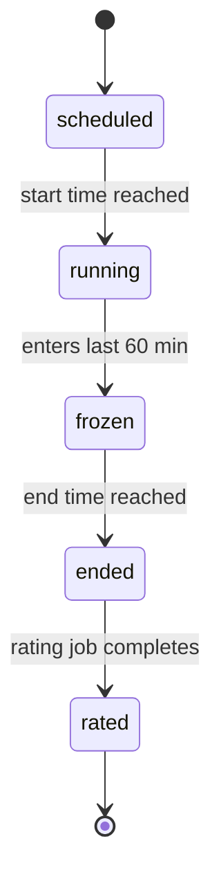
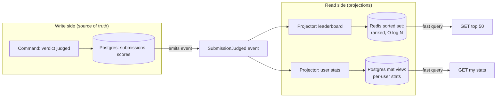
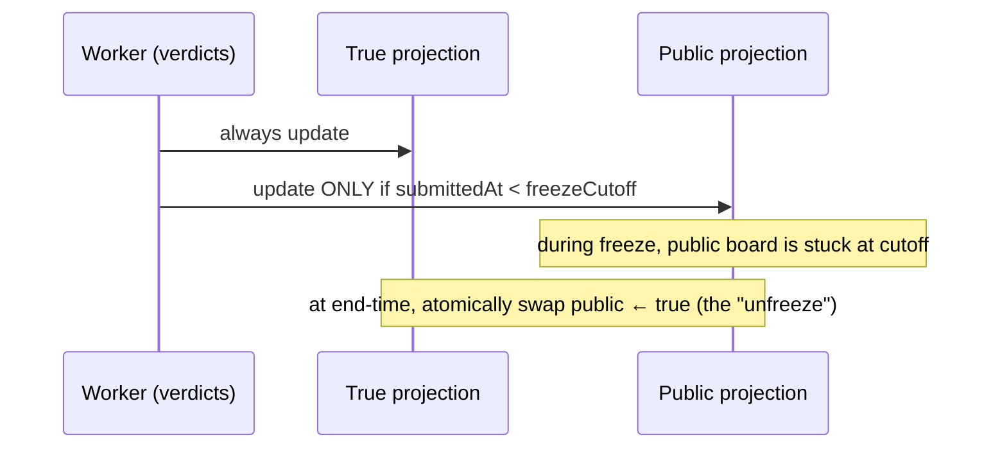

# Phase 5 — Contests, CQRS & the Real-time Leaderboard: The Complete Study Guide

> **Prerequisite:** Phases 0–4, especially Phase 2 (queues, WebSockets, idempotency) and Phase 3
> (Glicko-2 batch updates). This is where the architecture becomes *visibly* a distributed system,
> and where **CQRS** stops being a buzzword and becomes the obvious tool. The leaderboard is the
> showpiece — a thing that updates for thousands of people within a second. Conventions unchanged:
> **bold = defined here**, examples standalone (a marathon timing board, a stock ticker, an auction
> house — never the project).

---


---

## ⌨️ This guide is interactive

**Two exercises are embedded below. Both turn on the same question: do reads and writes here want the same shape? When they do, this whole phase is complexity with no payoff.**

## Table of contents

1. [Part A — State machines: modeling a contest's life](#part-a)
2. [Part B — The read/write tension, and CQRS](#part-b)
3. [Part C — Events and projections](#part-c)
4. [Part D — Eventual consistency: the honest trade-off](#part-d)
5. [Part E — Redis sorted sets: O(log N) leaderboards](#part-e)
6. [Part F — Real-time at scale: rooms, deltas, fan-out, backpressure](#part-f)
7. [Part G — The freeze, the unfreeze, and the batch rating update](#part-g)
8. [Part H — A complete leaderboard projector, end to end](#worked)
9. [Self-quiz with answers](#quiz)
10. [Exercises](#exercises)

---

<a name="part-a"></a>
# Part A — State machines

A **contest** isn't a static row; it moves through a *lifecycle*. The right way to model anything
with a lifecycle is a **state machine**: a fixed set of **states**, and explicit rules for which
**transitions** between them are legal. Everything else is forbidden.



Why a state machine instead of a pile of booleans (`isStarted`, `isFrozen`, `isRated`)? Because
booleans permit *impossible states*: `isStarted=false, isFrozen=true` is nonsense, but nothing stops
it, and someday a bug sets it. A state machine makes the state *one field* with *one legal value at a
time*, and every transition is a checked, deliberate step ("you may only go `frozen → ended`, never
`frozen → scheduled`"). This is the Phase 0 lesson "make impossible states unrepresentable," applied
to time.

```ts
type ContestState = "scheduled" | "running" | "frozen" | "ended" | "rated";  // a union (Phase 0)

const LEGAL: Record<ContestState, ContestState[]> = {
  scheduled: ["running"],
  running:   ["frozen"],
  frozen:    ["ended"],
  ended:     ["rated"],
  rated:     [],
};
function transition(from: ContestState, to: ContestState): ContestState {
  if (!LEGAL[from].includes(to)) throw new Error(`illegal transition ${from} → ${to}`);
  return to;
}
```

> **Read that `LEGAL` table adversarially — that's the skill.** It says `running` may go *only* to
> `frozen`. So a short contest with no freeze window **cannot end at all**: `running → ended` throws.
> The table is the specification, and anything you forget to list you have forbidden. Before shipping
> a state machine, walk every real-world path once and check it's representable — here you'd add
> `running: ["frozen", "ended"]`, and probably a `cancelled` state reachable from several places.
>
> This cuts both ways, and it's the whole point of the pattern: an over-tight table breaks a
> legitimate flow *loudly*, at the transition, with a clear error — which is enormously better than a
> pile of booleans that silently permits `isFrozen && !isStarted` and corrupts data three screens
> later. **Fail loudly on a path you forgot; never allow a state that makes no sense.**

Registration hangs off `scheduled`: a **ContestRegistration** records who's allowed in, and until
`running` only registered users can see the contest page.

---


```check
states
```

<a name="part-b"></a>
# Part B — The read/write tension, and CQRS

## B.1 The tension, made concrete

Picture a live contest with 10,000 participants. Two things happen constantly:

- **Writes:** a submission is judged → someone's score changes. Each write must be correct,
  validated, transactional — you cannot double-count points or corrupt a total.
- **Reads:** every one of 10,000 browsers wants the *current leaderboard*, sorted, near-instantly,
  refreshing every second.

These have *opposite* needs. Writes want a **normalized**, carefully-constrained model (one true
copy, integrity enforced). Reads want a **denormalized**, pre-sorted, instantly-servable model. Try
to serve both from one shape and you get the classic disaster: **computing rank from the database on
every read.**

```sql
-- ❌ the query that dies at scale: rank everyone, every request, per user
SELECT user_id, RANK() OVER (ORDER BY score DESC) FROM contest_scores WHERE contest_id = ?;
```

At 10 users this is fine. At 1,000 concurrent readers each triggering a full sort over the score
table, your database melts. The read pattern and the write pattern are fighting over one model.

## B.2 CQRS — separate the two

**CQRS** = **Command Query Responsibility Segregation**. One sentence: *use a different model for
changing state (commands) than for reading state (queries).*

- A **command** changes state and returns little ("record this submission's verdict"). It goes to
  the **write model** — normalized tables in Postgres, the **source of truth**.
- A **query** reads state and changes nothing ("give me the top 50"). It's served from a **read
  model** (a **projection**) — a separate, denormalized structure optimized for exactly that read.



The write side owns truth; the read side owns *speed*, in whatever shape each query wants — a Redis
sorted set for ranking (Part E), a materialized view for stats (Phase 6). One write, many tailored
reads. **Why CQRS *here* and not earlier?** Because earlier phases had no read/write pressure worth
the complexity (Phase 0's "defaults earn their complexity"). A live leaderboard for thousands is the
first place where one model genuinely can't serve both — so CQRS earns its keep exactly now.

---

<a name="part-c"></a>
# Part C — Events and projections


```exercise
cqrs-split
```

## C.1 Events

An **event** is an immutable record that *something happened*, in the past tense: `SubmissionJudged`,
`ContestStarted`, `UserRegistered`. Events are facts — they don't command anything, they *announce*.
The write side, after committing a change, **emits** an event describing it.

## C.2 Projections

A **projection** (or **read model**) is a data structure *built by consuming events*, shaped for one
read pattern. A **projector** is the code that listens for events and updates its projection:

```
SubmissionJudged{user: alice, contest: 7, points: +100}
   → LeaderboardProjector: ZADD leaderboard:7 <alice's new total>
   → UserStatsProjector:   increment alice's solved-count, update her difficulty histogram
```

Two projectors, two projections, from **one** event. The marathon analogy: runners cross timing
mats (events); one display board shows *live rankings* (one projection), another shows *pace per
kilometer* (another projection) — both fed by the same mat crossings, each optimized for its own
question. Nobody recomputes rankings from the raw mat logs on every glance.

Key property: projections are **rebuildable**. Since the events (or the source-of-truth rows) are the
truth, you can *replay* them to reconstruct any projection from scratch — which is exactly your
disaster-recovery plan when a projection's store dies (Part E, and the quiz).

---

<a name="part-d"></a>
# Part D — Eventual consistency

Splitting reads from writes buys speed but costs something you must name honestly: the projection is
updated *just after* the write, not *in the same instant*. For a brief window (milliseconds,
usually), the leaderboard can be a hair behind the true scores. This is **eventual consistency**:
the read model will *converge* to match the write model, but not *instantly*.

Contrast with **strong consistency** (every read reflects every prior write immediately), which is
what a single transactional database gives you — at the cost of the read/write contention Part B
described.

The engineering maturity here is not pretending eventual consistency away but **communicating it
honestly**:
- A user submits and, 200 ms later, the leaderboard hasn't ticked yet → that's normal convergence
  lag, not a bug. Design the UI to show "your submission: accepted, updating leaderboard…" so the
  user isn't confused by the gap.
- The **source of truth** (Postgres) is always right; the projection is a fast, slightly-delayed
  mirror. When they disagree, truth wins and the projection catches up.

"How do you communicate eventual consistency to users?" is a real interview question; the answer is
"honestly, in the UI, and by making the write side authoritative." (When a user says "I solved C but
the leaderboard didn't update," the three usual causes: (1) normal convergence lag — wait a beat;
(2) the projector is behind or crashed — check its lag/health; (3) the verdict itself isn't actually
`judged` yet — check the write side. That's the quiz.)

---


```check
cqrs
```

<a name="part-e"></a>
# Part E — Redis sorted sets

## E.1 Why a specialized structure

A leaderboard needs three operations *fast*, constantly: add/update a score, get the top N, and get
"my rank." Doing these by sorting a list is O(N log N) per call — hopeless at scale. Redis has a
purpose-built structure: the **sorted set** (ZSET).

A **sorted set** stores members each with a numeric **score**, kept *permanently sorted by score*.
It's implemented as a **skip list** (a probabilistic layered linked list) plus a hash, giving
**O(log N)** insert, update, and rank lookup — the same logarithmic magic as Phase 1's B-tree, in
memory.

```
ZADD leaderboard:7 100 alice 250 bob 175 carol
ZRANGE leaderboard:7 0 9 REV WITHSCORES
ZREVRANK leaderboard:7 carol
ZINCRBY leaderboard:7 50 alice
```

- `ZADD` adds or updates scores; the set stays sorted internally: alice(100) < carol(175) < bob(250).
- `ZRANGE … REV` returns the top 10, highest first, in O(log N + 10). (The older `ZREVRANGE` does the
  same but is [deprecated since Redis 6.2](https://redis.io/docs/latest/commands/zrevrange/).)
- `ZREVRANK` gives carol's rank from the top, in O(log N).
- `ZINCRBY` atomically adds 50 to alice's score, in O(log N).

That `ZREVRANK` — "what's my position among 100,000 people" in O(log N) — is the killer feature the
whole leaderboard is built on. No sorting per request; the set is *always* sorted.

## E.2 The score-packing trick

Contests rank by *multiple* criteria: most points first, then **earliest** solve time as a
tiebreaker. A sorted set has only one numeric score — so you **pack** both criteria into a single
number, points in the high digits and *inverted* time in the low digits.

```
packed = points × TIME_SLOTS + (TIME_SLOTS − 1 − elapsedSeconds)

TIME_SLOTS = 1_000_000      // any value greater than the longest possible contest, in seconds
```

Two things are happening. Multiplying points by `TIME_SLOTS` shifts them above every possible time
value, so **any** point difference outranks **every** time difference. Subtracting the elapsed time
from `TIME_SLOTS − 1` **inverts** it — a smaller time becomes a bigger number — because sorted sets
rank high-to-low and you want *earlier* to win.

Worked, with a 500-point tie broken on time:

```
ana     500 pts, t=3600s  →  500×1e6 + (999999−3600)  = 500,996,399
bilal   500 pts, t=7200s  →  500×1e6 + (999999−7200)  = 500,992,799
cyrine  501 pts, t=86000s →  501×1e6 + (999999−86000) = 501,913,999
dia     499 pts, t=1s     →  499×1e6 + (999999−1)     = 499,999,998
```

`ZRANGE … REV` then returns **cyrine → ana → bilal → dia**: cyrine's extra point beats ana's much
faster time, and ana beats bilal purely on the tiebreaker. That is exactly the ordering the contest
rules describe, from one `ZADD` per update.

> **The precision limit — this is the part that bites.** Redis sorted-set scores are IEEE-754
> **doubles**, so integers are exact only up to 2⁵³ ≈ 9.007 × 10¹⁵. Above that, consecutive integers
> stop being representable and *silently* collapse onto the same score. The scheme above peaks at
> `10000 × 1e6 + 999999 ≈ 1.0 × 10¹⁰` — about **900,000× of headroom**, entirely safe.
>
> Get greedy and use millisecond slots (`points × 1e12`) and the peak becomes ≈ 1.0 × 10¹⁶, past the
> limit. Measured: **1,000 consecutive millisecond values map onto only 501 distinct doubles** — half
> your tiebreakers vanish, with no error, no warning, just two players who quietly rank equal. Before
> shipping any packing scheme, compute the maximum packed value and check it against
> `Number.MAX_SAFE_INTEGER`. If it doesn't fit, drop a unit of resolution (milliseconds → seconds)
> rather than hoping.

You compute the packed score in the projector; for very tight requirements a Lua script (E.4) keeps
read-compute-write atomic.


```exercise
redis-leaderboard
```

## E.3 Persistence: RDB vs AOF

Redis is in-memory; if the process dies, is the leaderboard gone? Redis offers two persistence
modes:
- **RDB** — periodic *snapshots* of the whole dataset to disk. Fast, compact; but a crash loses
  everything since the last snapshot.
- **AOF** (Append-Only File) — logs *every write* to disk, replayed on restart. Durable to the last
  seconds; larger, slightly slower.

But the deeper answer for a *projection* (Part C): you don't have to rely on Redis persistence at
all, because the sorted set is **rebuildable from the source of truth**. If Redis dies mid-contest,
your recovery is to *replay* the judged submissions from Postgres and re-`ZADD` everyone — the
projection is derived data, not truth. (That's the "Redis dies during a contest" quiz answer:
rebuild the sorted set from the authoritative Postgres scores; you lose no real state, just a moment
of availability.)

## E.4 Lua scripts for atomicity

Sometimes you must do several Redis ops as one indivisible step (read a score, compute a packed
value, write it) without another client interleaving. Redis runs **Lua scripts** atomically —
single-threaded, no interruption — so a script is your transaction for multi-key/multi-step Redis
logic.

## E.5 Pub/sub vs streams (a Redis aside)

Two Redis messaging tools you'll weigh: **pub/sub** is fire-and-forget broadcast — subscribers
online *now* get the message, others miss it forever (great for "push this leaderboard delta to
connected servers"). **Streams** are a durable, replayable log — consumers can catch up on missed
messages (great when you can't afford to drop events). Ephemeral broadcast vs durable log; pick per
need.

---


```check
zsets
```

<a name="part-f"></a>
# Part F — Real-time at scale

Phase 2 taught WebSockets, rooms, and backpressure for one submission's verdicts. A live contest
scales that to thousands watching one board. New concerns:

## F.1 The delta protocol

Naively, on every score change you'd broadcast the *entire* leaderboard to every viewer. At 50
users that's forgivable; at 5,000 it's fatal — a 5,000-row board × thousands of updates × thousands
of viewers = bandwidth catastrophe. Instead, send a **delta**: only *what changed*.

```
❌ full:  { board: [ …5000 rows… ] }              // huge, every tick
✅ delta: { changed: [ {user: bob, newRank: 3, newScore: 250} ] }   // tiny, only movers
```

The client keeps its own copy of the board and applies deltas (move bob to rank 3, shift whoever he
passed). A **stock ticker** works exactly this way — it streams *price changes*, never re-sends the
whole market. Delta protocols are how real-time UIs stay cheap.

## F.2 Horizontal fan-out

One server can't hold 10,000 WebSocket connections comfortably, so you run several gateway
instances. Now a score change judged on **server A** must reach a viewer connected to **server B**.
Two standard solutions:
- **Sticky sessions** — a load balancer pins each client to one server for the connection's life
  (keeps a connection on one box, but doesn't by itself solve cross-server broadcast).
- **Redis pub/sub fan-out** — every gateway subscribes to a Redis channel; a delta published once is
  delivered to all gateways, each forwarding to its own room members. This is how Socket.io's Redis
  adapter scales rooms across a fleet.

## F.3 Rooms, auth, and backpressure (recap + contest specifics)

- **Rooms** scope the broadcast: one room per contest; a delta goes only to that contest's viewers.
- **Handshake auth** (Phase 2): authenticate on connect, and **only let registered users subscribe
  to a contest room** — otherwise an unauthenticated client can subscribe and either leak the board
  or flood you (a trivial DoS). This is a real security control, not a nicety.
- **Backpressure:** for a leaderboard, the right policy for a slow client is usually **drop
  intermediate deltas and periodically send a fresh snapshot** — they only care about the *latest*
  board, not every intermediate tick, so coalescing is safe and cheap.

---

<a name="part-g"></a>
# Part G — Freeze, unfreeze, and the batch rating update

Competitive contests have a dramatic convention: the **frozen scoreboard**. For the last ~60
minutes, the *public* board stops updating, so no one (competitors or audience) knows the final
standings until the reveal — it preserves suspense and stops last-minute metagaming.

The clean way to implement it (and the "why a separate frozen projection, not client-side
filtering?" answer): maintain **two projections**. The **true** projection keeps updating internally
(you still need real scores for rating). The **public** projection *ignores submissions after the
freeze cutoff*. Clients read the public one during the freeze.



Why not just hide late rows on the client? Because the client can't be trusted with data it isn't
supposed to see yet — the true scores would be sitting in the browser, one dev-tools peek away.
Server-side separation is the only honest freeze.

**Unfreeze:** at end-time, atomically swap the public projection to the true one (a Redis
transaction / rename), and the full final board appears at once.

**The batch rating update:** contests use **batch** Glicko-2 (Phase 3, B.3), not online updates.
When the contest ends, one job computes new ratings for *all* participants together, in **one
Postgres transaction**. Two reasons this must be batch and atomic:
- **Fairness:** everyone is rated against the same final field simultaneously (online updates mid-
  contest would make your rating depend on the *order* games were processed — arbitrary and unfair).
- **Correctness / no feedback loops:** updating ratings *during* the contest would feed changing
  ratings back into the same contest's expected-score math — mathematically wrong (the quiz:
  "why batch at contest end vs streaming during?" — fairness + avoiding feedback loops).

One more subtlety — **clock skew**: the API server and the worker may have slightly different clocks.
"Is this submission before the deadline?" must be decided by *one* authoritative clock — use the
database's time, not whichever machine happened to handle the request — or a submission's validity
becomes a coin flip near the boundary. (Relatedly: a submission sent 2s before the end whose verdict
arrives after the end **counts** — you judge by *submission* time against the authoritative
deadline, not verdict time; defend that rule and apply it consistently.)

---


```check
realtime
```

<a name="worked"></a>
# Part H — A complete leaderboard projector, end to end

A standalone **auction house** live-bid board (not the project): bids arrive as events; a Redis
sorted set tracks highest bid per item; clients get deltas. Every Phase-5 concept, in one place.

```ts
import Redis from "ioredis";
const redis = new Redis();

interface BidPlaced { auctionId: string; itemId: string; bidder: string; amount: number; at: number }

// PROJECTOR: consumes events, updates the read model (Part C)
async function onBidPlaced(e: BidPlaced, freezeCutoff: number) {
  const key = `board:${e.auctionId}`;

  // pack amount (high) + inverted time (low) so ties break toward the EARLIER bid (E.2)
  const packed = e.amount * 1e13 + (1e13 - e.at);

  // TRUE projection always updates; PUBLIC projection respects the freeze (Part G)
  await redis.zadd(`${key}:true`, packed, e.bidder);
  if (e.at < freezeCutoff) {
    await redis.zadd(`${key}:public`, packed, e.bidder);
  }

  // compute a DELTA and broadcast only the change (Part F)
  const rank = await redis.zrevrank(`${key}:public`, e.bidder);   // O(log N)
  publishDelta(e.auctionId, { bidder: e.bidder, amount: e.amount, rank });
}

// QUERY: top 10, served from the read model — no sorting per request (Part E)
async function topBidders(auctionId: string): Promise<Array<{ bidder: string; rank: number }>> {
  const members = await redis.zrevrange(`board:${auctionId}:public`, 0, 9);
  return members.map((bidder, i) => ({ bidder, rank: i }));
}

// UNFREEZE: swap public ← true atomically at close time (Part G)
async function unfreeze(auctionId: string) {
  await redis.rename(`board:${auctionId}:true`, `board:${auctionId}:public`);
}

// RECOVERY: rebuild the projection from the source of truth if Redis was lost (Part C / E.3)
async function rebuild(auctionId: string, allBids: BidPlaced[], freezeCutoff: number) {
  await redis.del(`board:${auctionId}:true`, `board:${auctionId}:public`);
  for (const b of allBids) await onBidPlaced(b, freezeCutoff);   // replay events
}

declare function publishDelta(id: string, delta: unknown): void;  // → Redis pub/sub → gateways → rooms
```

Trace it: bids are **events** (C); `onBidPlaced` is a **projector** writing a **sorted set** (E) with
a **packed score** (E.2); it maintains **true + public** projections for the **freeze** (G);
it broadcasts **deltas** (F); `rebuild` is the **replay-from-truth** recovery (C, E.3). Wrap the
gateway with rooms + handshake auth (F.3) and you have the phase.

**Do this:** run it against a local Redis; fire 1,000 random bids across 5 items; verify
`topBidders` is instant and correct; flush Redis mid-run and `rebuild` from your bid log; confirm the
board comes back identical. Then set a freeze cutoff and confirm the public board stops while the
true board keeps moving.

## Mastery checklist — you're ready to build Phase 5 when you can…

- [ ] Model a lifecycle as a state machine and explain why it beats boolean flags.
- [ ] Explain the read/write tension and why one model can't serve both at scale.
- [ ] Explain CQRS in one sentence and say why it's justified here but not in Phase 1.
- [ ] Explain events vs commands, and how one event feeds multiple projections.
- [ ] Explain eventual consistency and how to communicate it honestly in the UI.
- [ ] Use a Redis sorted set for ZADD/ZREVRANGE/ZREVRANK and explain the O(log N) win.
- [ ] Explain the delta protocol and why full broadcasts fail at scale.
- [ ] Explain horizontal WebSocket fan-out (sticky sessions vs Redis pub/sub).
- [ ] Explain the two-projection freeze and why client-side filtering is unsafe.
- [ ] Explain why the rating update is batch, atomic, and at contest end.
- [ ] Explain a Redis-death recovery plan via replay from the source of truth.

<a name="quiz"></a>
# Self-quiz — with answers

**1. A user submits 2s before the end; the verdict arrives after the end. Counted?**
Yes. Validity is judged by *submission* time against the authoritative deadline (the DB clock), not
by when judging finished. Judging latency must never decide fairness; otherwise a slow queue would
disqualify legitimate on-time submissions.

**2. Redis dies during a contest — recovery plan? How much state is rebuildable?**
The sorted set is a *projection*, not truth. Recovery = replay the judged submissions from Postgres
(the source of truth) and re-`ZADD` everyone, reconstructing the board. You lose no real state, only
a brief window of availability; the write side was never dependent on Redis.

**3. "I solved C but the leaderboard didn't update" — three likely causes?**
(1) Normal eventual-consistency lag — the projector hasn't caught up (wait a beat). (2) The projector
is behind or crashed — check its lag/health and restart/replay. (3) The submission isn't actually in
`judged` state yet on the write side — check the verdict pipeline. Truth lives on the write side;
diagnose from there outward.

**4. Scale to 10k concurrent leaderboard users — what changes?**
Stop computing rank from Postgres per request (use the Redis sorted set — O(log N)); switch from full
broadcasts to a delta protocol; run multiple gateway instances with Redis pub/sub fan-out (and/or
sticky sessions); coalesce/drop deltas for slow clients; authenticate room subscriptions to prevent
DoS. In short: CQRS read model + deltas + horizontal fan-out.

---

<a name="exercises"></a>
# Exercises — learn by doing

1. **State machine.** Implement the contest state machine with a `transition()` guard; write tests
   that legal transitions succeed and every illegal one throws. Add a `rated → running` attempt and
   watch it fail.
2. **Sorted-set leaderboard.** In `redis-cli`: `ZADD` ten players, `ZREVRANGE` the top 3, `ZREVRANK`
   one player, `ZINCRBY` to change a score, and watch the rank update. Then script it and time
   10,000 `ZADD`s + rank lookups — confirm it stays fast.
3. **Delta protocol.** Build a tiny server that holds a 100-row board and a client that renders it;
   on each change, send only the changed row; verify the client stays correct. Then measure bytes
   sent vs a full-board broadcast.
4. **Projection replay.** Store a log of "score events" in a file; build a projector that folds them
   into a Redis sorted set; delete the set; replay the log; confirm identical result. This is CQRS
   recovery in miniature.
5. **Freeze.** Extend exercise 4 with a freeze cutoff and two projections (true + public); confirm
   the public board freezes while the true one moves; implement the atomic unfreeze swap.
6. **Batch vs online, felt.** Simulate a 5-player contest; compute ratings two ways — online
   (update after each game, in submission order) and batch (all at once at the end). Show that the
   online result *depends on processing order* and the batch result doesn't. That difference is why
   contests batch.

# Where each topic came from (the original reading list)

| Topic | Source to go deeper |
|---|---|
| CQRS, event models | Martin Fowler, "CQRS"; Greg Young, "CQRS Documents" (free PDF) and his CQRS/Event-Sourcing talk |
| Stream processing, data systems | *DDIA* ch. 11–12; Martin Kleppmann, "Turning the Database Inside Out" (talk) |
| Domain events | Vaughn Vernon, *Implementing DDD*, the Domain Events chapter |
| Redis sorted sets & scaling | Redis docs, Sorted Sets section (all of it); Socket.io docs, Adapters & scaling |
