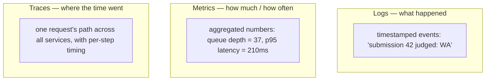

# Phase 6 — Analytics, Anti-Cheat & Observability: The Complete Study Guide

> **Prerequisite:** Phases 0–5, especially Phase 5's projections/CQRS and Phase 2's queues/tracing
> hints. This phase adds the systems that make a platform feel *grown-up*: analytics dashboards,
> plagiarism detection, and full observability — the ability to *see inside* a running distributed
> system. Conventions unchanged: **bold = defined here**, examples standalone (a coffee chain's
> sales, two students' essays, a delivery fleet — never the project).

---


---

## ⌨️ This guide is interactive

**Four exercises are embedded below — the plagiarism pipeline where each step defeats a different disguise, and the observability trio where reaching for the wrong pillar is why investigations stall.**

## Table of contents

1. [Part A — Analytics & materialized views](#part-a)
2. [Part B — Plagiarism detection: the Winnowing algorithm](#part-b)
3. [Part C — Observability: the three pillars](#part-c)
4. [Part D — Distributed tracing & OpenTelemetry](#part-d)
5. [Part E — Metrics: Prometheus, RED & USE](#part-e)
6. [Part F — A complete Winnowing fingerprinter, end to end](#worked)
7. [Self-quiz with answers](#quiz)
8. [Exercises](#exercises)

---


<a name="part-a"></a>
# Part A — Analytics & materialized views

## A.1 The problem: expensive questions asked often

Analytics questions are aggregations over lots of rows: "submissions per day for the last year,"
"verdict mix per problem," "difficulty histogram of what each user solved." Running these as live
`GROUP BY` queries over millions of rows *on every dashboard load* is slow and hammers the database
that's also serving live traffic.

## A.2 Materialized views

A regular **view** is a saved query — it runs fresh every time you read it (a stored *question*). A
**materialized view** stores the *results* of that query as a real table, computed once and read
instantly (a stored *answer*). You **refresh** it on a schedule.

```sql
-- a stored ANSWER: daily submission counts, precomputed
CREATE MATERIALIZED VIEW submission_daily_counts AS
SELECT date_trunc('day', created_at) AS day, count(*) AS n
FROM submissions
GROUP BY 1;

-- CONCURRENTLY needs a UNIQUE index on plain columns, covering every row:
CREATE UNIQUE INDEX submission_daily_counts_day ON submission_daily_counts (day);

-- refresh it (e.g., nightly via cron); CONCURRENTLY keeps it readable during refresh:
REFRESH MATERIALIZED VIEW CONCURRENTLY submission_daily_counts;
```

Without that unique index, the concurrent refresh fails with an error: it's how Postgres matches old rows
to new ones ([Postgres docs: REFRESH MATERIALIZED VIEW](https://www.postgresql.org/docs/current/sql-refreshmaterializedview.html)).

Trade-off: reads become instant, but the data is as fresh as the last refresh. That's usually fine
for analytics (a dashboard that's an hour stale is acceptable; a leaderboard that's an hour stale is
not — which is why Phase 5's leaderboard used a *continuous* projection, not a mat view).

**Refresh strategies:** *full* (recompute everything — simple, heavy), *concurrent* (recompute
without locking readers — the default you want), *incremental* (only recompute what changed — fast
but you build it yourself). **Mat views vs CQRS projections (Phase 5):** you used both, and the line
is *freshness need*. Continuous event-driven projections (Redis sorted set) for data that must be
near-real-time; periodically-refreshed materialized views for analytics that tolerate staleness.
Pick by how stale the reader can bear. (That's the quiz, and a "when did you use each?" interview
answer.)

**Dashboards** then read these cheap tables: GitHub-style activity heatmaps, per-tag mastery radars,
rating history, percentile rank vs a cohort — all instant because the heavy lifting happened at
refresh time, not read time. Pitfall to remember for the quiz: if a user says "my dashboard showed
wrong stats yesterday," the first question is *the refresh cadence* — a mat view refreshed nightly
is *supposed* to lag; investigate whether the refresh ran, not whether the query is wrong.

---


```check
analytics
```

<a name="part-b"></a>
# Part B — Plagiarism detection: Winnowing


```exercise
materialized-view
```

## B.1 Why the naive approaches fail

Goal: after a contest, flag suspiciously-similar code submissions. Naive idea: compare files
character-by-character, or check for identical substrings. It collapses immediately, because a
copier makes trivial edits:

```python
# original                          # "plagiarized" — same logic, cosmetic changes
def solve(n):                       def compute(x):
    total = 0                           result = 0
    for i in range(n):                  for idx in range(x):
        total += i                          result += idx
    return total                        return result
```

Rename variables, reformat whitespace, add comments — every character-level and substring method
sees "totally different." You need a technique that survives renaming and reformatting.

## B.2 Step 1 — tokenize at the *structure* level

The fix starts by throwing away the parts a copier can trivially change. **Tokenize** the code —
break it into meaningful units — and crucially, tokenize its **structure** (ideally via the
Abstract Syntax Tree, the parsed grammatical form), **anonymizing identifiers**: every variable name
becomes the same generic token `VAR`, every number `NUM`.

```
both snippets above tokenize to the SAME stream:
DEF VAR ( VAR ) : VAR = NUM FOR VAR IN RANGE ( VAR ) : VAR += VAR RETURN VAR
```

Now renaming buys the copier nothing — the token streams are identical. (AST-level beats plain text
tokens because it also ignores comments, whitespace, and formatting entirely — you're comparing
*program shape*, not text. That's the "AST vs text tokens" trade-off: AST is more robust but needs a
parser per language; text tokens are language-agnostic but weaker.)

## B.3 Step 2 — k-grams

Comparing whole token streams is brittle (one inserted line shifts everything). Instead, slide a
window of length **k** over the token stream to get all **k-grams** (contiguous runs of k tokens) —
this captures *local* structure, so a change in one place only affects the few k-grams overlapping
it, not the whole document.

```
tokens:  A B C D E    (k = 3)
k-grams: (A B C) (B C D) (C D E)
```

Then **hash** each k-gram to a number (a fingerprint of that local chunk). Two documents sharing
long identical logic will share many k-gram hashes.

## B.4 Step 3 — Winnowing: choosing which hashes to keep

Keeping *every* k-gram hash is too much data. Keeping every *n*-th one is fragile (an insertion
shifts which positions are "every n-th"). **Winnowing** is a clever selection rule that's both
compact *and* stable under edits: slide a **window** of `w` consecutive hashes and, in each window,
**select the minimum hash** (breaking ties by rightmost). The kept minimums are the document's
**fingerprint**.

```
index:     0    1    2    3    4    5    6
hashes:  [77,  12,  90,  34,  12,  55,  40]      window w = 4

window 1 (idx 0-3): [77, 12, 90, 34] → min 12 @ idx 1  ✔ SELECT idx 1  (new)
window 2 (idx 1-4): [12, 90, 34, 12] → min 12, tie @ idx 1 and idx 4
                                      → rightmost wins  ✔ SELECT idx 4  (new)
window 3 (idx 2-5): [90, 34, 12, 55] → min 12 @ idx 4      already selected → skip
window 4 (idx 3-6): [34, 12, 55, 40] → min 12 @ idx 4      already selected → skip

fingerprints (value @ position): { 12@1, 12@4 }
```

Three rules are doing the work, and it is worth separating them because implementations get this
wrong:

1. **Minimum in the window** — not every *n*-th hash. That's what makes the choice depend on the
   *content* rather than on the offset, so an insertion earlier in the file doesn't shift which
   hashes get picked.
2. **Ties go to the rightmost** — window 2 has two 12s, and it takes the later one. Without a fixed
   tie-break, two identical passages could fingerprint differently.
3. **Don't re-record a selection you already hold** — windows 3 and 4 both re-select `idx 4`, which
   is already in the set. You record a fingerprint only when the selected *position* changes. Skip
   this rule and a long run of one minimum floods your index with duplicates.

Why the minimum-in-window rule? Because it's **deterministic** and **local**: two documents with a
shared passage will pick the *same* minima in that passage regardless of what surrounds it — so
edits elsewhere don't disturb shared fingerprints. Window size `w` is the knob: **too large** → too
few fingerprints, you miss short matches; **too small** → too many fingerprints, more storage and
noise. (That's the "window size matters" quiz.) A guarantee Winnowing provides: any shared substring
above a certain length is *certain* to share at least one fingerprint.

## B.5 Step 4 — Jaccard similarity

Now each submission is a *set* of fingerprints. Compare two sets with **Jaccard similarity** — the
overlap ratio:

```
Jaccard(A, B) = |A ∩ B| / |A ∪ B|          (shared fingerprints) / (total distinct fingerprints)
```

0 = no overlap, 1 = identical fingerprint sets. Compute Jaccard for every pair of submissions in the
contest; **flag pairs above a threshold** for review.

## B.6 The human-in-the-loop rule

The single most important engineering *and ethical* point: **never auto-punish on a plagiarism
flag.** False positives are real — two students who took the same course may legitimately write
near-identical short solutions; boilerplate and common library idioms appear everywhere; anything
under ~50 lines is statistically noisy. So:
- **Flag, don't ban.** A high Jaccard score routes the pair to a *human review* queue, never to an
  automatic penalty.
- **Manage false positives:** ignore very short submissions, filter out common/boilerplate
  fingerprints, and present the *evidence* (the matching regions) to the reviewer, not just a
  number. (The quiz "Jaccard 0.9 between two students from the same class — false positive or
  evidence?" answer: it's *evidence to review by a human*, weighed with context like shared
  coursework — not proof, and never grounds for an automatic ban.)

---


```check
winnowing
```

<a name="part-c"></a>
# Part C — Observability: the three pillars


```exercise
plagiarism-pipeline
```

## C.1 What observability is (and isn't)

**Monitoring** answers *questions you knew to ask* ("is CPU high?"). **Observability** is the
property that lets you answer questions you *didn't* anticipate ("why is *this specific* user's
submission slow, right now?") by inspecting the system's outputs. In a distributed system —
API → queue → worker → projector → gateway — a request touches many processes, and "it's slow
somewhere" is useless without the tools to find *where*. Observability rests on three **pillars**.

## C.2 The three pillars



| Pillar | Answers | Shape | Cost at scale | Analogy |
|---|---|---|---|---|
| **Logs** | "what exactly happened here?" | discrete, timestamped, high-detail | **expensive** (volume) | a diary — rich but you can't sum diaries |
| **Metrics** | "how much / how often, over time?" | numbers aggregated over time | **cheap** (pre-aggregated) | a dashboard gauge — sums well, no detail |
| **Traces** | "where did this one request spend its time?" | a request's span-graph across services | medium | a parcel's tracking history across hubs |

The skill is knowing which pillar answers which question. "p95 latency doubled" → a **metric** told
you. "*Which step* got slow?" → a **trace**. "*Why* did that step fail for this input?" → a **log**.
You use all three, in that order, to go from symptom to cause.


```exercise
three-pillars
```

## C.3 A worked debugging story

Judge p95 latency spikes from 200 ms to 2 s. The pillars, in order:
1. **Metric** raised the alarm (the p95 gauge) — but metrics are aggregates; they can't say *why*.
2. **Trace** a slow submission end-to-end: you see the span graph and spot that the *sandbox
   startup* span ballooned (not the queue, not the DB).
3. **Logs** for that worker at that time reveal the cause: "image pull retrying — registry timeout."
Symptom → location → reason, one pillar each. This is the quiz ("p95 spikes — what do you check, in
what order?"): metric to detect, trace to localize, log to explain.

## C.4 Structured logging — the pillar you build first

That story only works if the logs are *searchable*. A human-readable line is unsearchable at scale:

```ts
console.log(`Judged submission ${id} for user ${userId}: ${verdict} in ${ms}ms`);
// → "Judged submission 42 for user 7: WA in 210ms"
```

You cannot ask that "show me every submission slower than 1 s, grouped by language" without writing a
regex. **Structured logging** emits one JSON object per event, so every field is queryable:

```ts
logger.info({
  event: "submission.judged",
  submissionId: id,
  userId,
  language,
  verdict,
  durationMs: ms,
  requestId,            // ← ties every log line of ONE request together
  traceId,              // ← ties them to the trace (Part D)
}, "submission judged");
```

Now "p95 duration by language, for failed judges only" is a query, not an archaeology project.

**The `requestId` is the load-bearing field.** Generate one at the edge (a UUID in a middleware),
attach it to the request context, and include it in *every* log line that request produces — across
services, through the queue. Without it, a busy server's log is dozens of interleaved requests and
you cannot tell which lines belong together. With it, one filter reconstructs a single user's
journey. In NestJS this is a middleware plus an interceptor; carry it in `AsyncLocalStorage` so you
don't thread it through every function signature by hand.

Three rules that separate useful logs from noise:

- **Levels mean something.** `error` = a human must look; `warn` = degraded but handled; `info` = a
  business event worth keeping (`submission.judged`); `debug` = off in production. If everything is
  `info`, nothing is.
- **Never log secrets.** No passwords, tokens, full request bodies, or the user's submitted code.
  Logs get shipped to third parties and kept for months — treat every line as public.
- **Log events, not sentences.** A stable `event` name you can group by beats prose that changes
  whenever someone edits the string.

---

<a name="part-d"></a>
# Part D — Distributed tracing & OpenTelemetry


```exercise
structured-logging
```

## D.1 Spans and traces

A **span** is a timed unit of work — "handle HTTP request," "run sandbox," "ZADD leaderboard" — with
a start, a duration, and metadata. A **trace** is a tree of spans representing *one logical request's
whole journey*, with parent/child links showing what called what.

```
Trace: submission 42            [■■■■■■■■■■■■■■■■■■■■■■■■]  1,900ms
  ├─ API: POST /submissions     [■■]                        40ms
  ├─ queue wait                    [■■■■]                   120ms
  ├─ worker: judge              [■■■■■■■■■■■■■■■■■■■]      1,700ms   ← the culprit is here
  │    ├─ sandbox startup          [■■■■■■■■■■■■■■]        1,500ms   ← specifically here
  │    └─ run test cases           [■■■]                    200ms
  └─ projector: update board       [■]                       20ms
```

One glance localizes the 1.5 s to sandbox startup. Without tracing you'd be guessing across five
processes.

## D.2 Trace context propagation — the part everyone forgets

For spans in *different processes* to join *one* trace, each service must pass along a **trace
context** (the trace id + parent span id). Over HTTP this rides in headers automatically. But your
system hops a **queue** (Phase 2): the API enqueues a job, the worker picks it up *later, in another
process*. Unless you **manually put the trace context into the job's metadata** and read it back out
in the worker, the worker starts a brand-new trace and your beautiful end-to-end picture **breaks in
two** at the queue boundary. Propagating context across the BullMQ boundary is the classic
distributed-tracing gotcha (and a pitfall/quiz point): inject on enqueue, extract on process.

Concretely — the whole fix is two calls:

```ts
import { context, propagation, trace } from "@opentelemetry/api";

// ── PRODUCER: inject the current context into the job payload ──
const carrier: Record<string, string> = {};
propagation.inject(context.active(), carrier);          // writes `traceparent` into carrier
await queue.add("judge", { submissionId, _otel: carrier });

// ── CONSUMER: extract it and make it the parent of the worker's span ──
new Worker("judge", async (job) => {
  const parent = propagation.extract(context.active(), job.data._otel ?? {});
  await context.with(parent, async () => {
    const span = trace.getTracer("judge").startSpan("worker.judge");
    try { await runJudge(job.data.submissionId); }
    finally { span.end(); }
  });
});
```

`propagation.inject` serialises the trace id + span id into a `traceparent` string (the W3C Trace
Context standard); `extract` parses it back. Skip this and every worker span becomes the root of its
own orphan trace — your traces still *look* fine individually, which is why this bug survives so
long.

## D.3 OpenTelemetry

**OpenTelemetry (OTel)** is the vendor-neutral standard + libraries for producing traces, metrics,
and logs. You instrument your code once against OTel, and export to whatever backend you like
(**Jaeger** for viewing traces, Prometheus for metrics, etc.). Why OTel over a vendor-specific
tracer (interview): **no lock-in** — swap Jaeger for another backend without re-instrumenting; one
standard across all your services and languages; a broad ecosystem of auto-instrumentation. You
depend on the standard, not a vendor (Phase 0's Dependency Inversion, at the tooling layer).

---


```check
observability
```

<a name="part-e"></a>
# Part E — Metrics: Prometheus, RED & USE

## E.1 Prometheus and cardinality

**Prometheus** is a metrics system that *scrapes* numeric time-series from your services and stores
them for querying/graphing (via **Grafana** dashboards). A metric is a named number with **labels**
(dimensions): `judge_latency_seconds{language="python", verdict="AC"}`.

The one rule that will bite you: **keep label cardinality low.** Every unique *combination* of label
values creates a separate stored time-series. Label by `language` (a handful of values) → fine.
Label by `user_id` (millions of values) → **cardinality explosion**: millions of time-series,
memory blows up, Prometheus falls over. (Pitfall/quiz: never put unbounded values like user_id as
labels.) High-cardinality detail belongs in *logs/traces*, not metrics.

## E.2 What to measure: RED and USE

Two standard recipes so you measure the *right* things instead of random numbers:

- **RED** (for request-driven services — your API, the judge): **R**ate (requests/sec), **E**rrors
  (failures/sec), **D**uration (latency distribution, p50/p95/p99). Answers "how is my service doing
  from the user's side?"
- **USE** (for resources — queues, workers, DB): **U**tilization (how busy), **S**aturation (how
  much queued/waiting), **E**rrors. Answers "is this resource healthy or overwhelmed?"

For the judge you'd track: submission rate (R), failed-judge rate (E), judge latency histogram (D),
plus queue depth (USE saturation) and worker busy-fraction (USE utilization). In code that's three
declarations:

```ts
import { Counter, Histogram, Gauge } from "prom-client";

const submissions = new Counter({                    // R and E — one counter, split by label
  name: "judge_submissions_total",
  help: "submissions judged",
  labelNames: ["language", "verdict"],               // low cardinality: ~4 × ~5 series
});

const judgeDuration = new Histogram({                // D — a histogram, never a plain average
  name: "judge_duration_seconds",
  help: "time to judge a submission",
  labelNames: ["language"],
  buckets: [0.1, 0.25, 0.5, 1, 2, 5, 10, 30],        // pick buckets around your SLO
});

const queueDepth = new Gauge({                       // USE saturation — a value that goes up and down
  name: "judge_queue_depth",
  help: "jobs waiting",
});

// at the call site
const end = judgeDuration.startTimer({ language });
const verdict = await judge(submission);
end();
submissions.inc({ language, verdict });
```

The three metric *types* map onto the three questions: a **Counter** only ever increases (totals, and
rates are derived from it); a **Gauge** goes up and down (queue depth, connections in use); a
**Histogram** buckets observations so you can compute percentiles.

> **You cannot average percentiles — the most common metrics mistake there is.** If box A reports a
> p95 of 100 ms and box B reports 300 ms, the fleet's p95 is **not** 200 ms. A percentile is a
> position in a *distribution*, and you cannot recover a combined distribution from two summary
> numbers. This is exactly why you export a **histogram** (raw bucket counts, which *do* add up
> across instances) and let Prometheus compute the percentile at query time with
> `histogram_quantile(0.95, ...)`. Ship pre-computed percentiles per instance and every dashboard
> that aggregates them is quietly lying to you.

## E.3 Alert on symptoms, not causes

The final discipline: **alert on user-visible symptoms, not internal causes.** Don't alert "CPU >
80%" — high CPU might be perfectly fine (a busy box doing useful work), and it might be *low* during
a real outage. Alert on "judge p95 latency > 5s" or "error rate > 1%" — things a *user actually
feels*. (Quiz: "don't alert on CPU, alert on user-visible latency — why?" Because CPU is a cause that
may or may not matter; latency is the symptom that always matters. Alerting on causes produces
false alarms and **alert fatigue** — the state where so many alerts fire that people ignore them,
including the real one.)

---


```check
metrics
```

<a name="worked"></a>
# Part F — A complete Winnowing fingerprinter, end to end

Standalone plagiarism detector for **short text documents** (essays, not the project). Every Part-B
step, runnable.

```ts
// 1. TOKENIZE + normalize: lowercase, strip punctuation, collapse whitespace (B.2 in spirit —
//    for real code you'd tokenize the AST and anonymize identifiers instead)
function tokenize(text: string): string[] {
  return text.toLowerCase().replace(/[^a-z0-9\s]/g, "").split(/\s+/).filter(Boolean);
}

// 2. K-GRAMS (B.3)
function kGrams(tokens: string[], k = 5): string[] {
  const grams: string[] = [];
  for (let i = 0; i + k <= tokens.length; i++) grams.push(tokens.slice(i, i + k).join(" "));
  return grams;
}

// a small deterministic hash
function hash(s: string): number {
  let h = 0; for (const c of s) h = (h * 31 + c.charCodeAt(0)) | 0; return h >>> 0;
}

// 3. WINNOW: min-hash per window of w (B.4)
function winnow(hashes: number[], w = 4): Set<number> {
  const fp = new Set<number>();
  for (let i = 0; i + w <= hashes.length; i++) {
    const window = hashes.slice(i, i + w);
    let minVal = Infinity, minIdx = 0;
    window.forEach((v, j) => { if (v <= minVal) { minVal = v; minIdx = j; } }); // ≤ = rightmost tie
    fp.add(window[minIdx]);   // a Set of VALUES, so B.4's "don't re-record" rule is free here
  }
  return fp;
}

function fingerprint(text: string): Set<number> {
  return winnow(kGrams(tokenize(text)).map(hash));
}

// 4. JACCARD similarity (B.5)
function jaccard(a: Set<number>, b: Set<number>): number {
  const inter = [...a].filter((x) => b.has(x)).length;
  const union = new Set([...a, ...b]).size;
  return union === 0 ? 0 : inter / union;
}

// 5. FLAG (B.6) — flag for REVIEW, never auto-punish; ignore tiny docs
function flagPairs(docs: Array<{ id: string; text: string }>, threshold = 0.4) {
  const fps = docs.map((d) => ({ id: d.id, fp: fingerprint(d.text), len: d.text.length }));
  const flagged: Array<{ a: string; b: string; sim: number }> = [];
  for (let i = 0; i < fps.length; i++)
    for (let j = i + 1; j < fps.length; j++) {
      if (fps[i].len < 200 || fps[j].len < 200) continue;   // skip short/noisy docs
      const sim = jaccard(fps[i].fp, fps[j].fp);
      if (sim >= threshold) flagged.push({ a: fps[i].id, b: fps[j].id, sim });
    }
  return flagged.sort((x, y) => y.sim - x.sim);   // highest similarity first, for a HUMAN to review
}
```

> **B.4 tracked positions; this tracks values — why the difference is safe here.** B.4 said to
> record a fingerprint only when the selected *position* changes. This implementation stores plain
> numbers in a `Set`, so repeats collapse automatically and the rule costs nothing. The moment you
> want to *show a reviewer the matching regions* (B.6 says you must), values alone stop being
> enough — you need `Set<{hash, position}>` keyed by position, because "where did they match" is
> the evidence a human actually judges. Start with values; upgrade to positions when you build the
> review UI.

**Do this:** feed it three essays — two that share a paragraph (should flag), one unrelated (should
not). Then *rename all the nouns* in one copy and confirm it *still* flags (structure survived —
though for prose you'd want the AST-style tokenization to fully resist synonym swaps). Tune `w` and
watch the fingerprint count and sensitivity change.

## Mastery checklist — you're ready to build Phase 6 when you can…

- [ ] Explain a materialized view vs a view, and choose mat-view vs continuous projection by
  freshness need.
- [ ] Explain why naive substring matching fails for plagiarism and what tokenization fixes.
- [ ] Explain k-grams, Winnowing's min-in-window rule, and what window size trades off.
- [ ] Compute Jaccard similarity between two fingerprint sets.
- [ ] Explain why plagiarism flags must be human-reviewed, never auto-punished.
- [ ] Name the three observability pillars and which question each answers.
- [ ] Walk a p95 latency spike from metric → trace → log to root cause.
- [ ] Explain spans/traces and why trace context must be propagated across the queue.
- [ ] Explain OpenTelemetry's value over a vendor tracer.
- [ ] Explain Prometheus cardinality and why user_id must never be a label.
- [ ] Explain RED vs USE and why you alert on symptoms, not CPU.
- [ ] Say why a structured JSON log beats a readable sentence, and what a `requestId` is for.
- [ ] Name the three Prometheus metric types and which question each answers.
- [ ] Explain why you **cannot average percentiles across instances**, and what to export instead.

<a name="quiz"></a>
# Self-quiz — with answers

**1. Why does Winnowing's window size matter — too large? too small?**
Window size sets how many fingerprints you keep. Too large → few fingerprints → you miss shorter
shared passages (under-detection). Too small → many fingerprints → more storage, more noise, and
weaker robustness to edits. You tune `w` to catch matches of the length you care about while keeping
the fingerprint set compact.

**2. Judge p95 spikes 200ms → 2s — what do you check, in what order?**
Metric first (it detected it, but only aggregates), then trace a slow request end-to-end to localize
*which span* grew (sandbox startup? queue wait? DB?), then read that component's logs at that time to
find the cause. Detect → localize → explain: metric → trace → log.

**3. "Dashboard showed wrong stats yesterday" — how to investigate?**
Check the materialized view's refresh cadence first: a mat view refreshed nightly is *designed* to
lag, so "wrong yesterday" may be expected staleness. Verify the refresh job actually ran and
succeeded before suspecting the query. Freshness is a feature of mat views, not a bug.

**4. Two submissions, Jaccard 0.9, from students in the same class — false positive or evidence?**
Evidence for a *human* to review, not proof and never grounds for an automatic ban. Weigh context
(shared coursework, common templates, submission length). Plagiarism detection is always
human-in-the-loop precisely because innocent explanations exist.

**5. Why alert on user-visible latency, not CPU?**
CPU is a cause that may or may not correlate with user pain — high CPU can be healthy, low CPU can
accompany an outage. Latency and error rate are symptoms users actually feel and are always
meaningful. Alerting on causes generates false alarms and alert fatigue, which hides the real
incident.

---

<a name="exercises"></a>
**Q. Two API instances each report a p95 latency of 100 ms and 300 ms. What's the fleet p95?**
*Answer:* **Unknown — and it is definitely not 200 ms.** A percentile is a position in a
distribution, and you can't reconstruct a combined distribution from two summary numbers. Export a
**histogram** instead: bucket counts add up across instances, so Prometheus can compute the true
percentile at query time via `histogram_quantile`. Averaging percentiles is the most common metrics
mistake in production dashboards.

**Q. Your traces look fine per-service, but you can never see a submission's full journey. Why?**
*Answer:* Trace context isn't crossing the **queue** boundary. HTTP propagates `traceparent` in
headers automatically; a BullMQ job does not. You must `propagation.inject` into the job payload when
enqueuing and `propagation.extract` in the worker — otherwise every worker span roots its own orphan
trace. The tell is exactly this: each service's traces look healthy in isolation.

**Q. A user reports "my submission was slow at about 3pm." You have a million log lines. What makes
this answerable?**
*Answer:* A **`requestId`** generated at the edge and attached to every log line that request
produces, across every service and through the queue — plus structured JSON so you can filter on it.
Without a correlation id, a busy server's log is dozens of interleaved requests with no way to tell
which lines belong together. Carry it in `AsyncLocalStorage` so it doesn't have to be threaded
through every function signature.

# Exercises — learn by doing

1. **Materialized view.** In a scratch DB with a seeded `events(created_at)` table of 1M rows: time
   a live `GROUP BY day` query, then create a materialized view of it and time reading the view.
   `REFRESH ... CONCURRENTLY` and confirm reads aren't blocked during refresh.
2. **Winnowing by hand.** Take token hashes `[8,3,9,1,3,7,2]`, window `w=3`, and compute the
   fingerprint set on paper (min of each window, rightmost tie). Then verify with the Part-F code.
3. **Plagiarism detector.** Run the Part-F code on 5 essays (two sharing a paragraph). Confirm it
   flags the right pair. Then rename nouns in a copy and confirm it still flags. Lower the threshold
   and watch false positives creep in — feel why the human review + length filter matter.
4. **Trace a request.** In a 2-service Node app (an HTTP server that enqueues to a worker), add
   OpenTelemetry; view the trace in Jaeger (local Docker). *Forget* to propagate context across the
   queue and watch the trace split in two; then propagate it and watch the trace reunite.
5. **Cardinality explosion.** Expose a Prometheus metric labeled by a bounded value (e.g.,
   `status`), then deliberately add a `request_id` label and generate 100k requests; watch the
   series count (and memory) explode; remove it and recover.
6. **RED dashboard.** Instrument a toy service with rate, error, and duration metrics; build a
   Grafana panel for each; load-test it and watch p95 climb; set an alert on p95, not CPU, and
   trigger it.

# Where each topic came from (the original reading list)

| Topic | Source to go deeper |
|---|---|
| Winnowing | Schleimer, Wilkerson, Aiken (2003), "Winnowing: Local Algorithms for Document Fingerprinting" — 11 readable pages |
| Observability, the three pillars | *Observability Engineering* (Majors et al.), first 4 chapters |
| Monitoring & SLOs | Google SRE Book (free online), monitoring chapters |
| Traces / metrics / logs signals | OpenTelemetry docs, Concepts → Signals |
| USE / RED methods | Brendan Gregg, "USE Method"; Tom Wilkie, "RED Method" |
| Materialized views | Postgres docs, Materialized Views |
