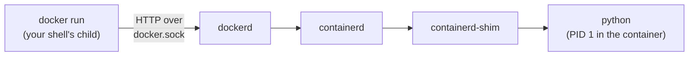

# Monday course · team setup, and the judge re-learned

**Mon 2 Nov, the ④a block, about 3 h 30.** It runs into ④b, and that's planned: today's build
stands on all of it.

> **Update, 2 Nov at 15:30: Parts 0 to D are done. Start at [Part E](#e-revise-the-worker-you-already-have-25-min).**
> The I-1 fix is merged, and the GitHub setup was done for you: the PR template, the merge
> settings, and three new CI checks (commit messages, PR titles, secrets). Each problem and its
> fix is written up in the dojo's *Team Workflow* guide, part 14. Parts A to D stay below as
> reference.

| Part | What | Time |
|---|---|---|
| [0](#0-the-start-line-15-min) | The start line: September on `main`, I-1 merged | 15 min |
| [A](#a-how-a-team-protects-main-20-min) | How a team protects `main`, and what your plan allows | 20 min |
| [B](#b-the-pr-template-20-min) | The PR template | 20 min |
| [C](#c-todays-issue-15-min-finished-in-part-g) | Today's issue | 15 min |
| [D](#d-the-docs-pr-update-it-with-main-then-merge-it-20-min) | The docs PR: update it with `main`, merge it | 20 min |
| [E](#e-revise-the-worker-you-already-have-25-min) | The worker you already have (Part 4 §1, Q1–Q4) | 25 min |
| [F](#f-the-sandbox-by-hand-35-min) | The sandbox, by hand (Part 4 §3) | 35 min |
| [G](#g-i-17-in-writing-25-min) | I-17, in writing | 25 min |
| [H](#h-i-4-if-theres-time-30-min) | I-4, if there's time | 30 min |

**How this course works**

- Every lab result below was observed on your machine on 2 Nov. **Predict before you run:** the
  prediction is where the learning happens. Answers are folded; open them after you've said yours
  out loud.
- It gives you **no file content**. You write the template, the issue, the I-17 note and any fix.
- Until Part D merges, the links to `docs/revision/` only work on the `docs/revision-week` branch
  (or on GitHub). Parts E to H come after D on purpose.

> **This file isn't committed yet.** It's untracked, so it follows you from branch to branch.
> You'll commit it in Part D, on `docs/revision-week`. Until then, stage files by name
> (`git add <path>`), never `git add .`: that's how unrelated files end up in PRs.

---

## 0. The start line (15 min)

Two things must be true before Part A. Check:

```bash
git fetch --prune origin
git branch -vv
```

| You see | It means | Do |
|---|---|---|
| `main b06c097 [origin/main]` (or later) | September is on GitHub's `main` | go to the I-1 PR, below |
| `main 8e3552d [origin/main]` | still the August history | run the four commands below |

```bash
git push --force-with-lease=main:8e3552d475bd94447e04b1ba7999292cd37042e3 origin b06c0974beb1960b1606db32932a208e02dd20c4:refs/heads/main
git push origin --delete docs/git-post-merge-guide feat/auth-register-login
git switch main
git fetch --prune origin && git reset --keep origin/main
```

1. Replaces GitHub's `main` with your September history, **only if** GitHub's `main` is still
   `8e3552d`. That condition is the "lease". Nothing is lost: on 2 Nov, every commit on the old
   `main` and on the two old branches was checked (`git cherry`), and each one already exists in
   September as an identical change.
2. Deletes the two old branches on GitHub.
3. and 4. Move **your** `main` to match. `reset --keep` moves whichever branch you're on, hence the
   `switch` first.

**Then the I-1 PR.** The branch `fix/api-e2e-module-paths` is already pushed. `gh pr create`
opens a PR **from the branch you're on**, so switch to it first: from `main`, gh refuses with
*head branch "main" is the same as base branch "main"*.

```bash
git rev-list --left-right --count origin/main...origin/fix/api-e2e-module-paths   # must print 0	1
git switch fix/api-e2e-module-paths
gh pr create --base main          # What · Why · How I tested it · Security notes
gh pr checks --watch
gh pr merge --squash --delete-branch
```

`0	1` means the PR carries exactly one commit: yours. Anything else, stop and find out why.

✅ `git log --oneline -1 origin/main` shows the I-1 fix, and CI on `main` is green.

---

## A. How a team protects `main` (20 min)

### A.1 What "protecting `main`" means

`main` is the branch everyone trusts: it's what gets deployed and what every new branch starts
from. Protecting it means setting **rules that GitHub enforces on its own server**, for everyone,
including the owner. They prevent three accidents, and you've met all three this autumn:

| Accident | Example | The rule that blocks it |
|---|---|---|
| History rewritten under everyone's feet | a force-push to `main` (you did one in Part 0, on purpose) | Block force pushes |
| Untested code lands on `main` | `git push origin main` straight from your laptop | Require a pull request |
| Broken code merged anyway | clicking Merge while CI is red | Require status checks to pass |

Why it has to be on the server: a rule on your laptop (a Git hook) only protects *your* laptop,
and `--no-verify` skips it. A rule on GitHub can't be skipped without changing the settings, and
that leaves a trace.

### A.2 The rules, and what to pick when you work alone

GitHub has two ways to write these rules: **rulesets** (Settings → Rules → Rulesets, the newer
way) and **classic branch protection** (Settings → Branches). The ideas are the same. New repos
use rulesets.

| Rule | What it does | Your setting | Why |
|---|---|---|---|
| Restrict deletions | nobody can delete `main` | on | |
| Block force pushes | nobody can rewrite `main` | on | |
| Require a pull request before merging | every change arrives through a PR | on, **0 approvals** | GitHub never lets you approve your own PR, so 1 required approval would lock you out |
| Require status checks to pass | Merge stays disabled until CI is green | on: `Lint, typecheck, build`, `API end-to-end`, `Dojo content checks` | these are the `name:` lines of the three jobs in `.github/workflows/ci.yml`. GitHub only offers checks that ran recently, so pick them after a PR has run CI |
| ↳ Require branches to be up to date | CI must have tested *your branch + the latest `main`* | on | Part D explains why |
| Require linear history | no merge commits on `main` | on | matches the merge settings in A.4 |
| Bypass list | who may ignore the rules | **empty** | otherwise you, the owner, bypass everything without noticing |

The interview version: *"`main` is protected: PRs only, CI must pass on a branch that's up to
date, no force pushes, and nobody bypasses it, including me."*

### A.3 Your repo can't have this yet

On 2 Nov, GitHub answered this repo's protection settings with:

```
Upgrade to GitHub Pro or make this repository public to enable this feature. (HTTP 403)
```

On a Free account, branch protection and rulesets only exist for **public** repos. So there's a
decision to make, and it's yours:

| Option | Cost | You get | Watch out |
|---|---|---|---|
| **1. Make the repo public** | free, 2 minutes | real protection today, and recruiters can read the code | the **whole history** becomes public, not just today's files: your Gmail address (on 81 commits), the old plan files, the BCG X mentions in `docs/revision/`, `docs/weeks/` and the dojo's playbooks. A secret scan of the history found no real secret (below) |
| **2. GitHub Pro through the [Student Developer Pack](https://education.github.com/pack)** | free once your 42 enrollment is verified | protection while staying private | verification takes anything from minutes to days |
| **3. Stay private, protect by hand** | free | the settings in A.4, your own rules, an optional seatbelt | nothing on GitHub stops a mistake |

**My recommendation:** use option 3 today, since it blocks nothing, and apply for option 2 today
too: it takes ten minutes. Decide on option 1 before week 4, when you ship. A portfolio repo has to
be public by the time you apply, so the real question is *what you want strangers to read*. That
deserves an hour then, not five minutes now.

<details><summary>The secret scan, and how to run it yourself</summary>

The tool is gitleaks, run in Docker, read-only and without network. `-u` runs it as you, so Git
doesn't refuse the repo for "dubious ownership":

```bash
docker run --rm --network none -u "$(id -u):$(id -g)" -v "$PWD:/repo:ro" \
  zricethezav/gitleaks:v8.30.1 git /repo --redact -v
```

On 2 Nov it scanned 80 commits and reported **2 findings, both false positives**:

- `WEEK-1-KNOWLEDGE.md:170`: an example JWT in a study note: an expired demo token, not a key;
- `apps/api/README.md:5`: a placeholder badge token in Nest's boilerplate README.

Triage is part of the job. For each finding, ask: *is this a real credential, and is it still
valid?* If one were real, deleting the file wouldn't help, because the history keeps it. You'd
**rotate** the secret first (create a new one, revoke the old one), then clean the history.

</details>

### A.4 What you set today, on any plan

Settings → General → **Pull Requests**:

| Setting | Set it to | Why |
|---|---|---|
| Allow merge commits | off | keeps `main` a straight line |
| Allow squash merging | on, default message *Pull request title and commit details* | for PRs whose commits are noise ("wip", "fix test") |
| Allow rebase merging | on | for PRs whose commits are each clean and meaningful (Part D) |
| Always suggest updating pull request branches | on | shows an **Update branch** button when `main` has moved |
| Automatically delete head branches | on | merged branches disappear from GitHub by themselves |

The same settings from the terminal:

```bash
gh repo edit --enable-merge-commit=false --enable-squash-merge --enable-rebase-merge \
  --squash-merge-commit-message pr-title-commits --allow-update-branch --delete-branch-on-merge
```

✅ `gh repo view --json mergeCommitAllowed,squashMergeAllowed,rebaseMergeAllowed,deleteBranchOnMerge`
shows `false`, `true`, `true`, `true`.

**The rules you keep by hand** until GitHub can enforce them. Put them in your PR template's
checklist (Part B), so every PR reminds you:

1. Nothing reaches `main` except through a PR.
2. Never merge while CI is red, or before it has finished.
3. Update the branch with `main` before merging.
4. One PR does one thing.

**Optional seatbelt (15 min): a `pre-push` hook that refuses pushes to `main`.** It's a Git hook
like your `pre-commit`, so it lives in `.husky/`, and you write it. What you need to know:

- Git runs `pre-push` before sending anything, and writes one line per branch to its **stdin**:
  `<local ref> <local sha> <remote ref> <remote sha>`.
- If the hook exits with a non-zero code, the push is cancelled.
- So: read the lines, and refuse when the remote ref is `refs/heads/main`. Print *why*, for
  future-you.
- Test it without pushing anything: pipe a fake line into it and check the exit code, e.g.
  `echo "refs/heads/x 1111 refs/heads/main 2222" | sh .husky/pre-push; echo $?`.
- It's a seatbelt, not a lock: `git push --no-verify` skips it. That's exactly why teams rely on
  the server.

---

## B. The PR template (20 min)

### B.1 What it is

A Markdown file that GitHub copies into the description box of every new PR. Its path is
`.github/pull_request_template.md`, and GitHub reads it **from the default branch**. So it does
nothing until it's merged, which sets the order: the template goes in its **own small PR** first,
and the docs PR in Part D will be the first one to use it.

### B.2 What makes a template good

A reviewer opens your PR with four questions. Each heading answers one:

| Heading | The reviewer's question | A strong answer | A weak answer |
|---|---|---|---|
| **What** | What changes? | 1–3 lines about the behaviour, not the files | "updated some files" |
| **Why** | Why now, and what breaks without it? | the problem, and the issue (`Closes #12`) | "it was needed" |
| **How I tested it** | Why should I believe it works? | the commands you ran and what they showed; the test that fails without the change | "tested locally" |
| **Security notes** | What could this expose? | "None, because …", or the risk and how it's handled | an empty heading |

Three habits from professional templates:

- **HTML comments** (`<!-- … -->`) hold the instructions: you see them while writing, and they
  disappear once the PR is posted.
- **A short checklist** for the rules from A.4: three to five boxes. A 30-box list gets ticked
  without being read.
- **`Closes #N`**: when the PR merges into `main`, GitHub closes the issue and links the two
  forever. `Fixes` and `Resolves` work too.

The I-1 PR from Part 0 is a worked example of a filled-in description. Reread it before you
write the template: every heading in it does a job.

### B.3 Do it

1. Branch from an up-to-date `main`: `git switch main && git pull && git switch -c chore/pr-template`.
2. Write `.github/pull_request_template.md` yourself: the four headings, one comment under each,
   the checklist, and a `Closes #` line.
3. Commit it as `chore(repo): add a pull request template` (checked against your commitlint
   config). If you also wrote the hook, it's a second commit: `chore(repo): …`, and you write the
   subject.
4. Push, open the PR, and wait for green.
5. Merge. One commit → **Squash and merge**. Two clean commits → **Rebase and merge**, so each one
   lands as it is. That's the A.4 rule in action.

Not every PR needs an issue: small chores like this one usually don't. Features and bugs do.

✅ Done when: on GitHub, **Compare & pull request** for any new branch opens with your template
already in the description.

---

## C. Today's issue (15 min, finished in Part G)

### C.1 Why teams use issues

The issue is the **contract**: what *done* means, written before the code. The PR is the
**delivery**. Six months from now, someone runs `git blame` on your runner and follows the chain:
the commit, then its PR, then the issue, then the reason. That chain is what "traceable" means in a
big-tech code review.

### C.2 What a good issue contains

| Section | What goes in it | The test |
|---|---|---|
| **Title** | the outcome, short | could someone tell it's done by looking? |
| **Context** | what exists today, and what's wrong or missing | a newcomer understands why it matters |
| **Scope** | what's in, and what's out | it stops the PR from growing |
| **Acceptance criteria** | checkboxes, each one observable | each box becomes one test or one command |
| **Decisions to make** | the open questions the PR must answer | |
| **Links** | ADRs, docs, related issues | |

A weak criterion versus a strong one:

- Weak: *"the runner is secure"*.
- Strong: *"a program that allocates 1 GB is stopped and reported as a memory-limit failure, and the
  worker keeps running"*.

### C.3 A worked example, from a different app (so yours stays yours)

> **Lock an account for 15 minutes after 10 failed logins**
>
> **Context.** Login is rate-limited per IP address, but an attacker with many addresses can still
> guess one user's password forever. Nothing counts failures per account today.
>
> **Scope.** In: counting failures per account, the lock, the error response. Out: emailing the
> user (its own issue), CAPTCHA.
>
> **Acceptance criteria**
> - [ ] 10 failed logins within 15 minutes lock the account: the 11th attempt gets `429`, even
>   with the right password
> - [ ] a locked account and an unknown email get the same response, so attackers can't learn
>   which emails exist
> - [ ] a successful login resets the counter
> - [ ] the lock lifts by itself after 15 minutes, tested with a fake clock, not by waiting
>
> **Decisions to make.** Where the counter lives (the database or Redis), and why.
>
> **Links.** The rate-limiting ADR.

### C.4 Yours: the Docker runner

Build it from what already exists. Don't invent anything:

- **Acceptance criteria:** the three tests under *Tests first* in Monday's section of
  [week-2-the-judge.md](week-2-the-judge.md), plus its *Done when*. Add the hardening list from
  SPRINT week 2's *Done when*: no network, a read-only filesystem, process, memory and CPU limits,
  non-root, all capabilities dropped, a wall-clock kill.
- **Decisions to make:** decisions 1–3 from the same section.
- **Context:** two lines on what exists today (`FakeCodeRunner` behind the `CODE_RUNNER` port).
  Add a line *"Root cause of I-17: see the comment below"*. You'll write that comment in Part G.
- **Out of scope:** Python and verdicts (Tuesday), the queue (Wednesday).

Create it on the website (Issues → New issue), or with
`gh issue create --title "…" --body-file <file> --label enhancement --assignee "@me"`, keeping the
body file **outside** the repo.

Then create the branch for this afternoon, linked to the issue:

```bash
gh issue develop <number> --base main --name feat/worker-docker-runner
```

The issue's sidebar now shows the branch under **Development**, and the PR you open from it links
itself.

---

## D. The docs PR: update it with `main`, then merge it (20 min)

### D.1 Why "up to date" matters

CI on your branch tested **your branch alone**. What lands on `main` is **your branch plus whatever
reached `main` in the meantime**. Two changes can each pass and still break together: one renames
a function, the other calls the old name. Updating the branch makes CI test what will actually
land. That's the *Require branches to be up to date* rule from A.2.

### D.2 Look first: yesterday's two comparisons

```bash
git fetch --prune origin
git log --oneline origin/main..docs/revision-week   # what the PR adds
git log --oneline docs/revision-week..origin/main   # what main has and the branch lacks
```

Read `A..B` as "in B, not in A". Predict both lists before you run them: how many commits each,
and which ones?

<details><summary>What you should see</summary>

The first list shows your 4 docs commits (`a7b6e53`, `13d8420`, `bd5b7f7`, `04636f0`). The second
shows what was merged today: the I-1 fix and the template (and the hook, if you wrote one). If the
second list were empty, the branch would already be up to date.

</details>

### D.3 Merge or rebase?

| | Merge `main` into the branch | Rebase the branch onto `main` |
|---|---|---|
| Command | `git merge origin/main` | `git rebase origin/main` |
| History | adds a merge commit to your branch | replays your commits on top of `main`: a straight line |
| Push | a normal `git push` | `git push --force-with-lease`, because the commits got new hashes |
| Safe when | always | **only you** have the branch (`git-workflow.md`, "The golden rule of rebase") |

Only you have `docs/revision-week`, and you want a straight line (A.4). So: **rebase**.

### D.4 Do it

```bash
git switch docs/revision-week
git add docs/weeks/week-2-monday-course.md
git commit -m "docs: add a course for monday's team setup and sandbox revision"
git fetch origin
git rebase origin/main
git push --force-with-lease
```

- The commit adds this course to the PR. The message was checked against your commitlint config.
- A conflict is unlikely: the branch and today's merges touch different files. If one happens,
  `git status` lists the files: fix them, `git add` them, then `git rebase --continue`. Lost?
  `git rebase --abort` puts everything back the way it was.
- `--force-with-lease` is needed because the rebase made new commits, and it's safe because
  nobody else pulled this branch.

✅ `git branch -vv` shows `docs/revision-week … [origin/docs/revision-week]` with no ahead or
behind, and the first command from D.2 now lists 5 commits.

### D.5 Open, check, merge

1. `gh pr create --base main`: your template fills the description, and you fill in the template.
   Two things deserve a line under **Security notes**: the files this PR deletes, and the history
   scan from A.3.
2. Wait for green. If a job fails, read its log before you change anything: what failed, and is
   it caused by this PR?
3. Merge with **Rebase and merge**. Why not squash: your commits are already clean and say
   different things (`docs:` for the guides, `chore:` for the deletions). A squash would bury the
   two chores inside one `docs:` commit.
4. Clean up: `git switch main && git pull`. If `git branch -d docs/revision-week` says *not fully
   merged*, that's expected. GitHub's rebase created new commits with new hashes, so Git can't see
   that yours were merged. Check that the PR says **Merged**, then use `-D`. (`git-workflow.md`,
   "What `git branch -d` actually checks".)

✅ On `main`, `ls docs/revision docs/weeks` shows the guides. From now on, every link in them works
on every branch.

---

## E. Revise: the worker you already have (25 min)

Open the five files in `apps/worker/src/`. For each question: answer out loud, check yourself
against [Part 4 §1](../revision/4-judge.md), then do the deeper layer below. The deeper layer is
what an interviewer's *second* question looks for.

### E.1 Q1 · `createApplicationContext` (`main.ts`, line 11)

**The idea.** `NestFactory.create()` builds two things: the dependency-injection container, *and*
an HTTP adapter (Express) that starts listening when you call `listen()`.
`createApplicationContext()` builds only the container: modules, providers, lifecycle hooks. It
has no routes and opens no socket.

**The lab.** Predict first: after the worker logs its verdict, does the process stay alive?

```bash
pnpm --filter worker build
pnpm --filter worker start; echo "exit=$?"
```

<details><summary>What happens, and why</summary>

It logs `verdict=ACCEPTED runtimeMs=1ms`, then **exits by itself** with `exit=0`, about 0.4 s after
it started (2 Nov). Node exits when there's nothing left to wait for. An HTTP server holds a
listening socket, and an open socket is something to wait for, so the API never exits on its own.
The worker has nothing to wait for.

Compare with the API: start it (`pnpm --filter api start:dev`), then run `ss -ltnp | grep node` in
another terminal. You'll see the API's `LISTEN` line on port 3001. The worker never shows up
there.

</details>

**Predict for Wednesday:** once the worker consumes jobs from BullMQ, will it stay alive? Will it
listen on a port?

<details><summary>Answer</summary>

It stays alive, because an open connection *to* Redis is something to wait for. And it still
listens on no port: it opens connections **out**, and nothing can connect **in**. "Outbound only"
is the security property behind Q1.

</details>

### E.2 Q2 · Why a separate process

Part 4 gives four reasons. Make each one concrete: finish each line with what would go wrong if
`JudgeService` were an `@Injectable()` inside the API.

| Reason | If the judge lived in the API… |
|---|---|
| Blast radius | |
| Resources | |
| Privileges | |
| Scaling | |

<details><summary>One example per line</summary>

- **Blast radius:** a bug in the judging code, say buffering a program's 2 GB of output in memory,
  crashes the process, and logins go down with it.
- **Resources:** 50 submissions in a contest's first minute keep the API busy, and `/auth/refresh`
  starts timing out.
- **Privileges:** the API would need the Docker socket, so any bug in any route would be one step
  away from root (E.3).
- **Scaling:** at contest time you want 1 API and 8 judges. In one process, you can only scale
  both together.

</details>

### E.3 Q3 · Least privilege, and why the Docker socket means root

**The idea.** Least privilege: each process gets only what its job needs, so a compromised process
can only lose what it holds. The worker spends all day next to hostile code, so assume it's the
process most likely to be compromised.

**The lab.** Predict each of the three results first:

```bash
ls -l /var/run/docker.sock
ls /root
docker run --rm -v /root:/r:ro alpine:3.20 ls -la /r
```

<details><summary>What happens</summary>

```
srw-rw---- 1 root docker 0 … /var/run/docker.sock
ls: cannot open directory '/root': Permission denied
total 20
drwx------    3 root     root          4096 … .
-rw-r--r--    1 root     root          3106 … .bashrc
```

You can't read root's home directory. But you can ask the Docker daemon, which runs as root, to
mount it into a container and read it for you. Being allowed to talk to the socket (you're in the
`docker` group) **is** being root. That's why the API never gets the socket, why the socket is
never mounted into a judged container, and why week 4 puts the system on a VM with nothing else on
it.

</details>

Then answer out loud: what does the worker need? (Submissions and tests to read, verdicts to
write, the socket.) What must it never hold? (`JWT_SECRET`, and any database role that can read
users or refresh tokens.) Postgres can enforce the second one with roles and `GRANT`.

### E.4 Q4 · A fake with no parameters and no `async` (`fake-code.runner.ts`, line 19)

Two TypeScript facts. Try them in the [TypeScript Playground](https://www.typescriptlang.org/play),
not in the repo.

**Fewer parameters is fine; more is an error.**

```ts
type Run = (code: string, language: string) => Promise<string>;

const ignoresBoth: Run = () => Promise.resolve("ok"); // compiles
const wantsThree: Run = (a, b, c) => Promise.resolve(c); // error
```

The first is safe: the caller passes two arguments, and the function is free to ignore them. You
rely on this every day: `[1, 2].forEach((x) => …)` ignores the index and the array. The second is
unsafe, because no caller will ever pass `c`.

**`async` with no `await` is a lie.** `async` tells the reader there's waiting inside. Your
worker's lint config turns on `tseslint.configs.recommendedTypeChecked`
(`apps/worker/eslint.config.mjs`, line 14), which includes `@typescript-eslint/require-await`, so
an `async` function with no `await` fails lint. `Promise.resolve(value)` returns the same type,
honestly.

**Interview follow-up: "Is your fake a mock?"** In Martin Fowler's vocabulary
([Mocks Aren't Stubs](https://martinfowler.com/articles/mocksArentStubs.html)):

- a **stub** returns canned answers;
- a **fake** is a real but simpler implementation, like an in-memory repository;
- a **mock** records the calls it receives, and the test checks them.

What `FakeCodeRunner` does is, strictly, a stub. Teams use these words loosely; knowing the
difference is what gets noticed.

---

## F. The sandbox, by hand (35 min)

### F.1 Namespaces, and what each flag means

Run the two `unshare` experiments from [Part 4 §3](../revision/4-judge.md). Then explain each flag,
because an interviewer will ask:

| Flag | Why it's there |
|---|---|
| `--pid` | a new process-id namespace: the processes inside get their own numbering, starting at 1 |
| `--fork` | `unshare` itself can't enter the new PID namespace, only the processes it creates afterwards can. `--fork` makes `bash` its child, so `bash` becomes PID 1 |
| `--mount-proc` | `ps` reads `/proc`. Without a fresh `/proc`, `ps` would still read the host's and list every process. A namespace changes what the kernel tells you, and `/proc` is how it tells you |
| `--net` | a new network namespace, with only a loopback interface, and that one is down |

### F.2 The hardened `docker run`

Write down your prediction for each of the five commands and the fork bomb in Part 4 §3: the
error message, or the exit code. Then run them, and compare with its folded table.

<details><summary>Stuck predicting? The mechanism behind each flag</summary>

| Flag | Kernel feature | What a blocked program sees |
|---|---|---|
| `--memory 128m --memory-swap 128m` | the memory cgroup | it's killed by the OOM killer |
| `--pids-limit 64` | the pids cgroup | `fork` fails: "Resource temporarily unavailable" |
| `--cpus 1` | the cpu cgroup | nothing fails; it just never gets more than one core |
| `--network none` | a network namespace | no interface except loopback, so even DNS fails |
| `--read-only`, `--tmpfs /tmp:…,noexec` | mount options | "Read-only file system"; nothing in `/tmp` can be executed |
| `--user 65534:65534` | ordinary Unix users | it's `nobody`, not root |
| `--cap-drop ALL` | capabilities | root's special powers are gone |
| `--security-opt no-new-privileges` | a flag on the process | a setuid program can't gain privileges |

An exit code above 128 means "killed by a signal": the code is 128 plus the signal's number.

</details>

### F.3 Under the hood: four new experiments

Use the same `H` variable as in Part 4 §3.

**1. A cgroup limit is just a file.** Predict the three numbers for the hardened container, then
for a default one:

```bash
docker run $H python:3.12-alpine cat /sys/fs/cgroup/memory.max /sys/fs/cgroup/pids.max /sys/fs/cgroup/cpu.max
docker run --rm python:3.12-alpine cat /sys/fs/cgroup/memory.max /sys/fs/cgroup/pids.max /sys/fs/cgroup/cpu.max
```

<details><summary>Result</summary>

Hardened: `134217728` (128 × 1024 × 1024 bytes), `64`, and `100000 100000` (100 ms of CPU per
100 ms period: one core). Default: `max`, a large number that depends on your machine, and
`max 100000`. Docker writes your flags into these files, and the kernel enforces them.

</details>

**2. Capabilities are a bitmask.**

```bash
docker run $H python:3.12-alpine grep -E 'CapEff|CapBnd|NoNewPrivs' /proc/self/status
docker run --rm python:3.12-alpine grep -E 'CapEff|CapBnd|NoNewPrivs' /proc/self/status
```

<details><summary>Result</summary>

Hardened: all zeros, and `NoNewPrivs: 1`. Default: `00000000a80425fb`, and `NoNewPrivs: 0`. Each
1 bit is one root power that Docker keeps by default: 14 of them, such as `CHOWN`, `KILL` and
`NET_RAW`. `--cap-drop ALL` clears them all. `CapBnd`, the bounding set, is the ceiling: once it's
zero, nothing in the container can get them back.

</details>

**3. Root in the container is root on the host.** Predict the `USER` column:

```bash
docker run -d --name whoprobe python:3.12-alpine sleep 60
ps -o user,pid,args -p "$(docker inspect -f '{{.State.Pid}}' whoprobe)"
docker rm -f whoprobe
```

Then do it again with `--user 65534:65534` added after `-d`.

<details><summary>Result</summary>

First `root`, then `nobody`. Docker doesn't use user namespaces by default, so user 0 inside the
container is user 0 on the host. If code ever escaped, it would escape as whichever user it was
running as. That's why `--user` matters even with every other flag on.

</details>

**4. Why did it die?** Exit code 137 can mean the OOM killer, or your own kill. Run the 1 GB
allocation **without `--rm`**, so the container stays around to be inspected (`${H#--rm }` is `$H`
without its leading `--rm`), and kill a second container yourself:

```bash
docker run --name oomprobe ${H#--rm } python:3.12-alpine python -c "b = bytearray(1024**3)"; echo "exit=$?"
docker run -d --name killprobe python:3.12-alpine sleep 100 && docker kill killprobe
docker inspect -f '{{.Name}} {{json .State}}' oomprobe killprobe
docker rm oomprobe killprobe
```

Find the field that differs. Your runner needs it this afternoon: it's the first trap in today's
guide.

<details><summary>Result</summary>

Both have `"ExitCode":137`. `"OOMKilled"` is `true` for the first and `false` for the second.

</details>

### F.4 Without notes

Close everything and answer out loud, one minute each (SPRINT week 2's *Done when*):

1. What does a namespace hide? Give two examples.
2. What does a cgroup limit? Give three, and the file where you saw each one.
3. Why does `--network none` matter, if the container holds nothing secret anyway?

<details><summary>For question 3</summary>

It does hold something secret: **the hidden test cases**, which arrive through stdin. Code with a
network could send them to its author. It could also attack the services next to it (Postgres,
Redis), mine cryptocurrency, or join a botnet with your machine.

</details>

---

## G. I-17, in writing (25 min)

On 28 Oct, `timeout -s KILL 2 docker run …` returned after 2 seconds, and the container was still
`Up`. Today you explain why: three facts, one lab, then your note.

### G.1 Who is the container's parent?

`docker` is a **client**. It sends HTTP requests through `/var/run/docker.sock` to the daemon,
and the daemon does the work:



On your machine, on 2 Nov, a running container's process tree was:

```
systemd(1)---containerd-shim(99204)---python(99230)
```

Your shell, `timeout` and `docker run` appear nowhere in it. `runc` starts the process and exits;
the shim stays as its parent. Check it yourself while a container runs:
`pstree -s -p "$(docker inspect -f '{{.State.Pid}}' <name>)"`.

### G.2 Three facts about signals

1. **SIGKILL (9) can't be caught.** The process dies instantly, with no chance to clean up or to
   tell anyone. A killed `docker run` can't ask the daemon to stop anything.
2. **SIGTERM (15) is a polite request.** A program can handle it or ignore it. It's what
   `timeout`, `kill` and Node's `child.kill()` send **by default**. When `docker run` receives one,
   it **forwards** it to the container (the "signal proxy", on by default), then keeps waiting for
   the container to exit.
3. **PID 1 is special.** The kernel doesn't apply the default action of a signal to PID 1 unless
   PID 1 has installed a handler for it: it protects each namespace's `init`. Your Python program
   *is* PID 1 in its container. Python handles SIGINT (that's `KeyboardInterrupt`), but not
   SIGTERM. The one exception: a SIGKILL sent **from outside** the namespace, by the daemon, can't
   be refused, even by PID 1.

### G.3 The lab: four ways to stop a runaway

Predict each row first: does the command return, and is the container still `Up` afterwards?

| # | Command | Your prediction |
|---|---|---|
| a | `timeout -s KILL 2 docker run --rm --name i17a python:3.12-alpine python -c "while True: pass"` | |
| b | `timeout 2 docker run --rm --name i17b python:3.12-alpine python -c "while True: pass"` | |
| c | `timeout 2 docker run --rm --init --name i17c python:3.12-alpine python -c "while True: pass"` | |
| d | `docker kill i17a` | |

After each row, check with `docker ps -a --filter name=i17 --format '{{.Names}}: {{.Status}}'`.

If a command hasn't returned after 10 seconds, leave it running. In a second terminal, read which
signals the container's PID 1 handles, then remove the container, and watch the first terminal:

```bash
docker exec i17b grep -E 'SigCgt|SigIgn' /proc/1/status
docker rm -f i17b
```

<details><summary>What happened on 2 Nov</summary>

| # | Did it return? | The container afterwards | Why |
|---|---|---|---|
| a | yes, after 2 s (`exit=124`, `timeout`'s code for "timed out") | **still `Up`** | SIGKILL killed only the client, and the container isn't its child (G.1) |
| b | **no**: it hung until the container was removed | still `Up` | the client forwarded SIGTERM to PID 1; Python has no SIGTERM handler, so as PID 1 it's ignored (fact 3). The client waits for an exit that never comes |
| c | yes, after 2.2 s | gone | `--init` makes a tiny init process (tini) PID 1. It forwards SIGTERM to Python, which isn't PID 1 any more, so the default action applies: it dies, and `--rm` removes the container |
| d | yes, at once | gone | the daemon kills the container's process with SIGKILL, from outside the namespace |

The signal mask showed `SigCgt: 0000000000000002`. Bit *n − 1* stands for signal *n*, so only bit
1 is set: Python catches signal 2 (SIGINT) and nothing else. `SigIgn: 0000000001001000` is signals
13 and 25 (SIGPIPE, SIGXFSZ), which Python ignores on purpose.

</details>

### G.4 Why this is the design of your time limit

Connect it to this afternoon. Say your worker starts `docker run` as a child process and calls
`child.kill()` at the deadline. Which row of the lab is that? What happens to the worker's
`await`, and to the CPU?

<details><summary>Answer</summary>

Row b. `kill()` sends SIGTERM by default: the client forwards it, Python ignores it, the client
never exits, the promise never settles, and the run burns a core forever. With SIGKILL you get row
a instead: the promise settles, but the container keeps burning. Either way, the client is the
wrong target.

</details>

What the design needs is in Part 4's Hint 2: stop the **container**, by name, through the daemon,
and have something that removes containers that outlive their deadline, in case the worker itself
dies. You'll design that in the build. Today, you only explain the problem.

### G.5 Write it

Post it as a comment on today's issue, titled **Root cause: I-17**: that's where a teammate would
look for it. Make it 8 to 12 lines, in plain words, with no code. It must answer:

1. What did `timeout` actually kill, and what is the container's real parent?
2. Why didn't killing the client stop the container?
3. Why doesn't a polite SIGTERM work either, for this program?
4. What does `--init` change, and why isn't it enough on its own? (Think about a submission that
   decides to ignore SIGTERM on purpose.)
5. So what must the worker stop at the deadline, and through what?
6. What happens if the worker itself crashes mid-run?

End with one sentence you could say in an interview. The test: someone who has never looked inside
Docker can follow your note.

---

## H. I-4, if there's time (30 min)

The symptom and two hints are in [Part 1, I-4](../revision/1-skeleton.md). Read them first. This
course adds three things to know and one test.

- **Next.js env files.** Each app reads its own, and `apps/web/.env.local` is for your machine,
  never committed. A `NEXT_PUBLIC_` variable is copied into the browser code **at build time**, so
  changing it means restarting `dev`, or rebuilding.
- **`.gitignore` patterns.** `git check-ignore -v <path>` tells you which line of which file
  ignores a path. A pattern can also be *negated*: in `man gitignore`, section PATTERN FORMAT, read
  the bullet that starts with "An optional prefix".
- **Fail fast.** The API refuses to start without `JWT_SECRET`, with a clear message: find where
  (Part 1, Q10). What does the web app do in the same situation today, and when
  would you find out?

**The stranger test**, the professional way to check a setup:

```bash
cd "$(mktemp -d)" && git clone git@github.com:Ayoubioussoufa/codearena.git && cd codearena
```

Then follow only what the repository tells you: no memory, no chat.

<details><summary>Hint: you'll find two gaps, not one</summary>

Before you even reach the web app: what's the first file a stranger opens in a repository? `ls`
the root of your fresh clone. A short "Run it locally" section is enough for today. The full README
(architecture, live link, demo video) is planned for Fri 20 Nov.

</details>

Ship it like a team: an issue labelled `bug`, a branch from `main`, and a PR from your template
with `Closes #…`. One PR does one thing, so if the README part grows, it gets its own PR.

---

## Done when

- [ ] September is on `main`, and I-1 is merged
- [ ] The merge settings are set, and the protection decision is made (and the Pack applied for,
  if that's your choice)
- [ ] The PR template is on `main`
- [ ] Today's issue exists, with its criteria, its decisions and a linked branch
- [ ] The docs PR is up to date, green, and merged with **Rebase and merge**
- [ ] Q1–Q4 answered out loud, each with its deeper layer
- [ ] Every result in Part 4 §3 and F.3 predicted before you saw it
- [ ] *Root cause: I-17* posted on the issue
- [ ] If there was time: I-4 fixed through its own PR, after the stranger test

## Say it out loud

Five questions an interviewer could ask about this morning. One minute each, no notes:

1. "Walk me through what happens between `git push` and a change being on `main` in your repo."
2. "Why did you rebase that branch, and when would you merge instead?"
3. "Why does your judge run in its own process?"
4. "Your time limit kills the process. Why wasn't that enough?"
5. "What would an attacker get if they took over your worker?"

> 📚 **To go further:**
> GitHub: [About rulesets](https://docs.github.com/en/repositories/configuring-branches-and-merges-in-your-repository/managing-rulesets/about-rulesets)
> · [About protected branches](https://docs.github.com/en/repositories/configuring-branches-and-merges-in-your-repository/managing-protected-branches/about-protected-branches)
> · [Creating a pull request template](https://docs.github.com/en/communities/using-templates-to-encourage-useful-issues-and-pull-requests/creating-a-pull-request-template-for-your-repository)
> · [Linking a pull request to an issue](https://docs.github.com/en/issues/tracking-your-work-with-issues/using-issues/linking-a-pull-request-to-an-issue).
> Linux: [`pid_namespaces(7)`](https://man7.org/linux/man-pages/man7/pid_namespaces.7.html), the
> section on the init process and signals · [`signal(7)`](https://man7.org/linux/man-pages/man7/signal.7.html).
> Docker: [`docker run` reference](https://docs.docker.com/reference/cli/docker/container/run/),
> the `--init` and `--sig-proxy` options.
